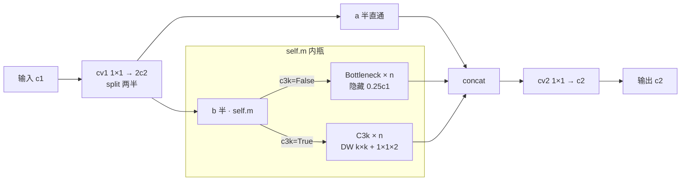
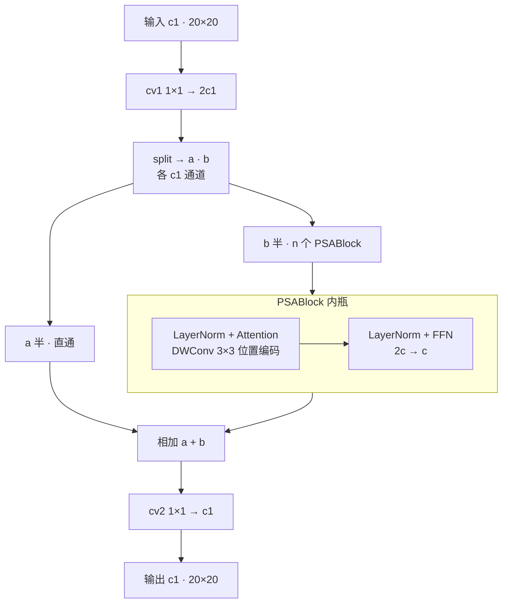
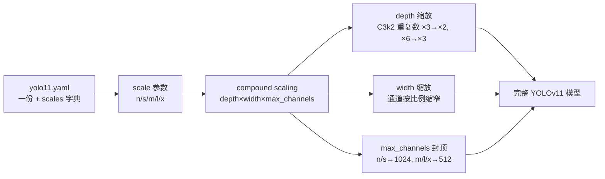
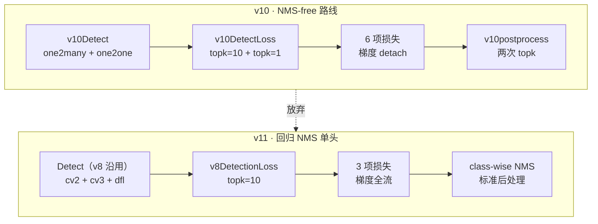
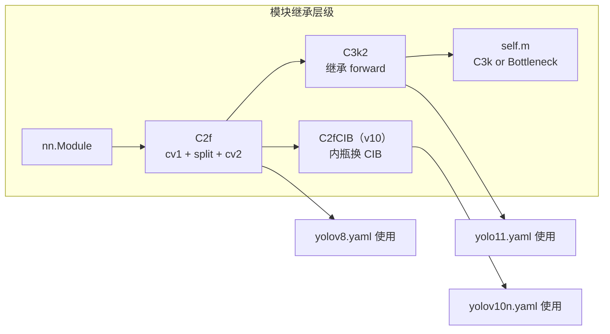
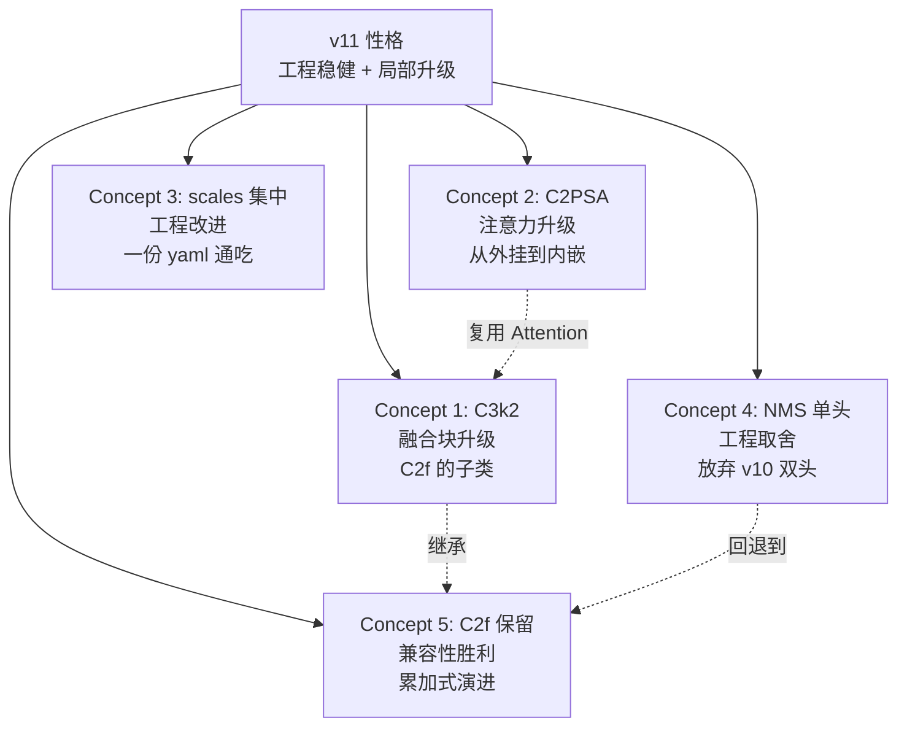

# YOLOv11 理论 Concept

> **v1~v10 读者路标**：本页把 v11 相对 v10 的五个关键设计决策摊开讲——每一个决策都对应到具体行号。整体基调是「回归 v8 工程稳健、只在必要处升级」：C3k2 换掉 C2f（唯一升级）、C2PSA 换掉 PSA（保留注意力但改结构）、五档 scales 集中定义（工程改进）、放弃 v10 的 NMS-free（工程权衡）、C2f 保留但 C3k2 主用（兼容性）。

::: tip 只想带走三件事
1. **v11 的"新"其实只有两处**：骨干的 C3k2（<SrcLink file="v11:ultralytics/nn/modules/block.py" :line="723" />）与骨干出口的 C2PSA（<SrcLink file="v11:ultralytics/nn/modules/block.py" :line="1002" :end="1041" />）——其他都是 v5~v8 的老零件
2. **v11 是工程取向的一版**：放弃 v10 的端到端去 [NMS](/glossary#nms-非极大值抑制) 追求，回归 [TAL](/glossary#tal-task-alignment-learning) 分配 + class-wise NMS 的老路——换取的是「与所有现成推理工具链 100% 兼容」
3. **C3k2 简化版警告**：v8.3.0 快照里 C3k2 只有 `__init__`（<SrcLink file="v11:ultralytics/nn/modules/block.py" :line="723" :end="746" />），**没有 Attention 分流、没有 s 参数字典、没有 cv3**——`forward` 完全继承自 C2f，**不要在文档写"C3k2 含 Attention 分流"**
:::

## 1. C3k2：C2f 的现代继任者 (`concept-c3k2`)

> **v1~v10 读者路标**：C2f 自 v6 引入以来一直是 YOLO 骨干的默认融合块（见 [C2f 词条](/glossary#c2f-高效跨阶段)）；v11 的 C3k2 是把 C2f 的内瓶从 C3 换成 C3k/Bottleneck 的极简升级——**没有新特性、没有新算法，只有"更好的内瓶"**。

**定义**：C3k2（<SrcLink file="v11:ultralytics/nn/modules/block.py" :line="723" :end="746" />）继承 C2f，构造函数签名 `__init__(c1, c2, n=1, c3k=False, e=0.5, g=1, shortcut=True)`，内部根据 `c3k` 布尔切换内瓶类型：

```python
class C3k2(C2f):
    """C3k2 block as described in YOLOv11 - A Unified Advancement to the End."""
    def __init__(self, c1, c2, n=1, c3k=False, e=0.5, g=1, shortcut=True):
        super().__init__(c1, c2, n, shortcut)
        self.m = nn.Sequential(*(
            C3k(c1, c1, k, shortcut, e, g) if c3k else Bottleneck(c1, c1, shortcut, g, k)
            for _ in range(n)
        ))
```

- **无独立 forward**：C3k2 的 `forward` 完全继承自 C2f（<SrcLink file="v11:ultralytics/nn/modules/block.py" :line="224" :end="242" />）——先按 e 比例拆两半通道（a 半直通 + b 半过 `self.m`），最后 concat 过 cv2 收尾
- **C3k**（<SrcLink file="v11:ultralytics/nn/modules/block.py" :line="734" :end="747" />）= DWConv k×k + 1×1 升维 + 1×1 降维，可视为「separable Bottleneck」；`Bottleneck` 是 v5 就有的标准残差瓶颈
- **c3k 开关的意义**：
  - `c3k=False`（浅层骨干 #2/#4，e=0.25）：内瓶走 Bottleneck，隐藏通道缩到 25%——**轻量路径**
  - `c3k=True`（深层骨干 #6/#8、头部 #13/#16/#19/#22）：内瓶走 C3k，隐藏通道按 e 比例（默认 0.5）——**标准路径**，多了 DW 大核带来的感受野
- **scales 与 C3k2 的配合**：`depth` 缩放控制 C3k2 的重复数 n（×3 或 ×6 → 按 depth 比例），`width` 缩放控制通道；`max_channels` 封顶深层（1024 或 512）

**v8.3.0 快照的简化版警告**：

- 论文里 C3k2 号称有「Attention 分流 + s 参数字典 + cv3」等特性——**快照代码里全部不存在**
- 快照里 C3k2 只有 `__init__` 一个方法，`self.m` 是 `nn.Sequential(C3k or Bottleneck)`——**没有** Attention、**没有** s 参数字典、**没有** cv3 分支
- 也就是说：**快照里的 C3k2 = C2f 的外壳 + C3k/Bottleneck 的内瓶**，仅此而已
- 阅读论文时请把 C3k2 的"论文卖点"当作设计愿景；读本站代码时按简化版理解

**动机**：C2f 的内瓶是 C3（v8 版），C3k2 换成 C3k/Bottleneck——C3k 引入 depthwise 大核扩大感受野、Bottleneck 提供残差连接，两者比 C3 的表征能力更强、参数开销基本持平。这是「换内瓶不换外壳」的典型工程升级。

**实现**：



- yaml 落点 8 处（骨干 #2/#4/#6/#8 + 头 #13/#16/#19/#22），前 2 处 `c3k=False, e=0.25` 走轻量，后 6 处 `c3k=True` 走标准
- 与 C2f 的参数对比：C3k2(c3k=True) 比 C2f 多一层 DW 大核，参数约多 15~20%；C3k2(c3k=False, e=0.25) 比 C2f 少一层 3×3，参数约少 30%

<SrcLink file="v11:ultralytics/nn/modules/block.py" :line="723" :end="746" />
<SrcLink file="v11:ultralytics/nn/modules/block.py" :line="734" :end="747" />
<SrcLink file="v11:ultralytics/nn/modules/block.py" :line="224" :end="242" />

> **v1~v10 读者路标**：v8 的 C2f 内瓶是 C3；v9 的 CBLinear/C2SPC 是全新自研块；v10 的 C2fCIB 是 C2f + CIB；**v11 的 C3k2 回到 C2f 外壳、只换内瓶**——四代都在做同一件事（选内瓶），但 v11 的选择最保守也最有效。

## 2. C2PSA：内嵌进 C2f 的全通道注意力 (`concept-c2psa`)

> **v1~v10 读者路标**：v8 的骨干尾部无注意力；v10 的 PSA 是「一半通道过 Attention+FFN、另一半直通」的外挂式；v11 的 C2PSA 把注意力「装进 C2f 的外壳」——**从外挂升级为内嵌**，通道全部过一遍（一半走直通、一半走 PSABlock）。

**定义**：C2PSA（<SrcLink file="v11:ultralytics/nn/modules/block.py" :line="1002" :end="1041" />）断言 `c1 == c2`，构造函数：

```python
class C2PSA(nn.Module):
    """C2PSA block."""
    def __init__(self, c1, c2, n=1, e=0.5):
        assert c1 == c2, f"In and out channels should be equal, got {c1} and {c2}"
        super().__init__()
        self.c = c1
        self.cv1 = Conv(c1, 2 * c1, 1, 1)
        self.cv2 = Conv(c1, c1, 1)
        self.m = nn.Sequential(*(PSABlock(c1) for _ in range(n)))

    def forward(self, x):
        y = list(self.cv1(x).split((self.c, self.c), 1))
        y[1] = self.m(y[1])
        return self.cv2(y[0] + y[1])
```

- **构造**：cv1 1×1 升到 2c 通道，split 成两半 (a, b)——a 半直通，b 半依次过 n 个 PSABlock（<SrcLink file="v11:ultralytics/nn/modules/block.py" :line="922" :end="1000" />）；最后 concat 前相加，过 cv2 收拢回 c1
- **PSABlock**：内部 Attention（<SrcLink file="v11:ultralytics/nn/modules/block.py" :line="866" :end="921" />）+ FFN 两段——Attention 与 v10 的 PSA.Attention 是**同款**（`num_heads = c // 64`、`attn_ratio=0.5`、qkv 合并出、DWConv 3×3 位置编码）
- **FFN 新增**：C2PSA 的 PSABlock 显式包含 FFN（feed-forward network），v10 的 PSA 也有 FFN，但 v11 把它独立成 block

**动机**：

- **为什么放在 P5 后**：注意力是 O(N²) 全局建模，只有当特征图尺寸足够小（20×20，N=400）且语义足够丰富时才划算——SPPF 之后是骨干语义最强的位置，也是注意力矩阵最便宜的位置
- **为什么用 C2PSA 而非 PSA**：C2PSA 把注意力装进 C2f 外壳，好处是「一半通道走注意力、一半直通」的残差结构更稳固，训练更容易收敛；且 C2PSA 的输入输出通道相等（断言 c1==c2），插入骨干不破坏其他层的通道约定
- **为什么是"全通道"**：注意 `self.cv1(x).split((self.c, self.c), 1)`——split 之后两半都是 c1 通道，a 半也过 cv1 的 1×1 升维——**通道层面全部参与**，不像 v10 那样只有一半通道过注意力

**实现**：



- yaml 落点唯一：#10（<SrcLink file="v11:ultralytics/cfg/models/11/yolo11.yaml" :line="27" />），紧跟 SPPF
- 与 v10 PSA 的对比：
  - 相同点：都放在骨干出口、都用 `attn_ratio=0.5` 砍半 key 维度、都用 DWConv 3×3 位置编码
  - 不同点：v10 PSA 是"外挂"（`cv1 → split → a 直通 + b Attention+FFN → concat → cv2`），v11 C2PSA 是"内嵌"（`cv1 → split → a 直通 + b PSABlock×n → add → cv2`）——**v11 是相加、v10 是 concat**
  - 参数差异：C2PSA 的 cv2 是 1×1 c1→c1（c1² 参数），v10 PSA 的 cv2 是 1×1 2c1→c1（2c1² 参数）——**C2PSA 的 cv2 更便宜**，因为 add 之后已经收回 c1 通道

- 与 v9 的 CBAM 完全无关：CBAM 是通道+空间双注意力，C2PSA 是标准自注意力——两个概念不冲突

**与 v10 差异一句话**：v10 的 PSA 是「外挂半通道注意力」，v11 的 C2PSA 是「内嵌全通道注意力 + C2f 残差结构」——**同一动机（骨干出口补一刀全局），不同实现（外挂 vs 内嵌）**。

<SrcLink file="v11:ultralytics/nn/modules/block.py" :line="1002" :end="1041" />
<SrcLink file="v11:ultralytics/nn/modules/block.py" :line="922" :end="1000" />
<SrcLink file="v11:ultralytics/nn/modules/block.py" :line="866" :end="921" />
<SrcLink file="v11:ultralytics/cfg/models/11/yolo11.yaml" :line="27" />

> **v1~v10 读者路标**：v8 骨干零注意力；v9 用 CBAM/CBLinear 走纯卷积路线；v10 是全网唯一一处 PSA 半通道注意力；v11 把注意力升级为 C2PSA——**四代里首次让骨干同时具备深度卷积 + 自注意力两种能力**，且只付一次账。

## 3. scales 集中定义：一份 yaml 通吃五档 (`concept-scales-centralized`)

> **v1~v10 读者路标**：v8 沿用「每档一份 yaml」的老路（`yolov8n/s/m/l/x.yaml` 五份）；v10 继续每档独立（`yolov10n/s/m/b/l/x.yaml` 六份）；**v11 是首次改成「一份 yaml + scales 字典」**——`yolo11.yaml` 顶部一个 `scales:` 块集中五档参数，加载时按 `scale="s"` 传档。

**定义**：`yolo11.yaml` 头部（<SrcLink file="v11:ultralytics/cfg/models/11/yolo11.yaml" :line="6" :end="12" />）：

```yaml
scales:
  n: [0.50, 0.25, 1024]
  s: [0.50, 0.50, 1024]
  m: [0.50, 1.00, 512]
  l: [1.00, 1.00, 512]
  x: [1.00, 1.50, 512]
```

- 每档三个数：`[depth_multiple, width_multiple, max_channels]`——与 v8/v10 的语义完全一致
- 加载方式：`YOLOv8("yolo11.yaml")` 默认走 n 档；`YOLOv8("yolo11.yaml", scale="s")` 走 s 档；也支持 `YOLOv8("yolo11s.yaml")` 兼容旧写法
- 缩放公式沿用 v8（<SrcLink file="v11:ultralytics/utils/ops.py" :line="1" />）：`n = int(max(k, 1) * depth)`、`c = int(max(c * width, min_ch) / k) * k`

**动机**：

- **工程改进**：改一处 scales 就能改全部五档参数；不用改 5 份 yaml
- **参数矩阵可读性**：五档并排看比分散在 5 个文件里更直观——一眼看到 n/s 是 depth=0.50 但 width 递增、m/l/x 是 depth 递增但 max_channels 递减
- **兼容 v8/v10 每档独立 yaml**：`yolo11n.yaml`、`yolo11s.yaml` 等别名文件仍会生成（内容只有一行 `yolo11.yaml` + scale），老代码不用改

**实现**：



**与 v10 差异**：

| 维度 | v10（每档独立） | v11（集中定义） |
|------|-----------------|-----------------|
| yaml 数量 | 6 份（n/s/m/b/l/x） | 1 份 + 5 份别名 |
| scales 定义位置 | 每份 yaml 各持一份 | 一份 yaml 顶部 |
| 改参数 | 改 6 处 | 改 1 处 |
| 阅读体验 | 需打开 6 个文件 | 一份并排五档 |
| 加载方式 | `yolov10n.yaml` | `yolo11.yaml` + `scale="s"` |

- **v11 回到五档**：n/s/m/l/x，v10 的 B 档撤回——B 档在 v10 里介于 m 与 l 之间，v11 认为没必要多这一档
- **X 档 width=1.50**：是 v8 家族里唯一的宽档，参数 56.97M 相对 v8x 的 56.9M 几乎不变——说明 v11 在 x 档下依然没有让模型失控

**为什么 v10 没有做**：v10 发布时（2024-05）ultralytics 的 scales 机制刚重构，`scale=` 参数是新特性；v11 是这一机制的首个官方使用者——**这是 v11 相对 v10 的一个隐性工程升级**，改动极小但用户体验好很多。

<SrcLink file="v11:ultralytics/cfg/models/11/yolo11.yaml" :line="6" :end="12" />

> **v1~v10 读者路标**：v1~v9 都是「每档一份 yaml」；v10 依然每档独立（六份）；v11 是首次「集中定义」——**五档 scales 在一个 yaml 里并排出现**，改参数只需改一处。

## 4. 回归 NMS 单头：工程权衡的取舍 (`concept-nms-regression`)

> **v1~v10 读者路标**：v10 的头戏是端到端去 [NMS](/glossary#nms-非极大值抑制)（见 [v10 Concept §3](/versions/v10/concepts#_3-nms-free-推理-concept-nms-free)）——one2many/one2one 双头 + v10postprocess；v11 **直接放弃这条路线**，回到 v8 的 Detect 单头 + TAL topk=10 + class-wise NMS。**这不是保守，而是工程权衡**。

**定义**：v11 的检测头就是 v8 沿用的 `Detect`（<SrcLink file="v11:ultralytics/nn/modules/head.py" :line="21" :end="68" />）——cv2 box 分支 + cv3 cls 分支 + dfl，导出图里**保留 NMS 算子**，推理走 `class-aware NMS`（<SrcLink file="v11:ultralytics/utils/nms.py" :line="1" />）。**没有** one2one 分支、**没有** `v10postprocess`、**没有** `detach()` 梯度截断。

**为什么放弃 v10 的 NMS-free**：

- **推理工具链兼容性**：v10 的 `v10postprocess` 是 ultralytics 自研的两次 topk 组合，其他推理框架（TFLite、CoreML、NCNN、MNN、RKNN 等）没有对等实现——部署到异构硬件时要各自复现一遍；v11 的 Detect + NMS 是**所有框架都原生支持**的标准算子组合
- **训练成本**：v10 的 one2one 分支是 cv2/cv3 的 deepcopy（<SrcLink file="v10:ultralytics/nn/modules/head.py" :line="508" :end="509" />）——训练显存和头参数直接翻倍；v11 只有一个头，训练开销回到 v8 水平
- **AP 差距**：v10 论文承诺的端到端 NMS-free 精度收益只有 0.5~1.0 AP 点，但工程代价（异构部署、额外显存、额外后处理实现）远超收益；v11 选择用这 0.5~1.0 AP 换回工程稳健
- **loss 简化**：v10 的 `v10DetectLoss` 内部实例化两个 `v8DetectionLoss`（<SrcLink file="v10:ultralytics/utils/loss.py" :line="717" :end="727" />），训练日志有 6 项损失名（`box_om, cls_om, dfl_om, box_oo, cls_oo, dfl_oo`）；v11 回到 3 项（`box, cls, dfl`），与 v8 完全一致
- **代码量**：v10 引入 `v10Detect`（<SrcLink file="v10:ultralytics/nn/modules/head.py" :line="497" :end="535" />）+ `v10DetectLoss` + `v10postprocess` + `YOLOv10DetectionModel` 四个新类；v11 只新增 `C3k2` + `C2PSA` 两个模块类，其余全部复用

**实现**：



- 训练日志对比：
  - v10：`box_loss 0.42 + cls_loss 0.35 + dfl_loss 0.15 + box_oo 0.41 + cls_oo 0.34 + dfl_oo 0.14`
  - v11：`box_loss 0.42 + cls_loss 0.35 + dfl_loss 0.15`（与 v8 完全同款）
- 推理图对比：
  - v10 导出图：无 NMS 节点，输出 `[boxes, scores, labels]` 定长
  - v11 导出图：**有 NMS 节点**（在 export 阶段注入 max_det），输出与 v8 完全一致
- 部署工具链对比：
  - v10：需自研 `v10postprocess` 移植到 TFLite/CoreML 等
  - v11：所有框架原生支持 Detect + NMS，**零移植成本**

**一句话总结**：v11 相对 v10 的**功能回退**是「放弃 NMS-free」，**功能保留**是「TAL + DFL + 解耦头」，**结构升级**是「C2f→C3k2 + PSA→C2PSA」——这是**为工程稳健牺牲一点精度**的取舍，不是保守。

**与上版差异**：v10 是「论文卖点驱动的架构」，v11 是「工程稳健驱动的架构」——两代都是"YOLO 家族"，但设计哲学不同。

<SrcLink file="v11:ultralytics/nn/modules/head.py" :line="21" :end="68" />
<SrcLink file="v11:ultralytics/utils/nms.py" :line="1" />

> **v1~v10 读者路标**：v1~v9 都是 NMS 路线（v1 就有 NMS）；v10 是唯一的端到端去 NMS 尝试；**v11 撤回这条路线**——不是保守，而是「论文想法 vs 工程现实」的成熟取舍。

## 5. C2f 保留但 C3k2 主用：兼容性的胜利 (`concept-c2f-kept`)

> **v1~v10 读者路标**：v10 在骨干与头里全面替换 C2f（换成 C2fCIB、v10Detect 等），但**代码里 C2f 类依然存在**（<SrcLink file="v10:ultralytics/nn/modules/block.py" :line="224" />）；v11 更进一步——**C2f 类完全保留**，但 v11 的 yaml 全部使用 C3k2。**保留 C2f 是为了让老 yaml 与老代码继续工作**，这不是"过渡兼容"，而是"长期共存"。

**定义**：

- **C2f**（<SrcLink file="v11:ultralytics/nn/modules/block.py" :line="224" :end="242" />）：v6 引入的经典融合块，`cv1 + split + cv2` 三段结构，内瓶默认 C3（<SrcLink file="v11:ultralytics/nn/modules/block.py" :line="147" :end="158" />）
- **C3k2**（<SrcLink file="v11:ultralytics/nn/modules/block.py" :line="723" :end="746" />）：**继承自 C2f**，`class C3k2(C2f)`——只覆写 `__init__` 里的内瓶构造，`forward` 完全继承

**动机**：

- **面向对象继承的威力**：C3k2 是 C2f 的子类——`nn.ModuleList`、参数遍历、权重加载、ONNX 导出等所有 C2f 支持的机制，C3k2 自动继承
- **代码库演进**：v11 不删 C2f、不删 C3、不删旧模块——ultralytics 的模块库是**累加式**的，每一代的新模块只是"加进来"，旧模块继续保留供旧 yaml 使用
- **C3k2 主用的证据**：v11 的 yaml 里 8 处融合块全部是 C3k2；`C2f` 在 v11 yaml 中**出现 0 次**——但在代码里 `C2f` 类依然存在，`yolov8.yaml` 依然用 C2f

**实现**：



**为什么不是"C3k2 取代 C2f"**：

- 从 yaml 角度：v11 确实"取代"了——所有融合块都是 C3k2
- 从代码角度：**C2f 是基类，不能取代**——C3k2、C2fCIB 等都继承 C2f，删 C2f 会破坏继承链
- 从生态角度：老代码里的 `YOLOv8("yolov8.yaml")` 依然走 C2f——**用户不用升级代码就能用 v11 的模型**，用不用 C3k2 由 yaml 决定

**与 v10 对比**：

| 维度 | v10 的模块策略 | v11 的模块策略 |
|------|----------------|----------------|
| C2f 类 | 保留 | 保留 |
| C3k2 类 | 不存在 | 新增 |
| C2fCIB 类 | 新增 | 保留（供 v10 yaml 用） |
| yaml 主用融合块 | C2f + C2fCIB | **C3k2** |
| yaml 里 C2f 出现次数 | 骨干 3 次 | **0 次** |
| 老 yaml 是否可用 | 是 | 是 |

- **累加式演进**：v11 的代码库里能搜到 C2f、C3k2、C2fCIB、C2SPC、CBLinear 等几乎所有历史模块——**每一个都对应一份还在用的 yaml**
- **参数遍历**：`model.named_parameters()` 里 C3k2 的权重路径是 `model.2.m.0.conv1...`（继承 C2f 的 `self.m` 命名）——与 C2f 完全一致，训练框架无需修改
- **权重热迁移**：C2f 权重不能直接加载到 C3k2（内瓶结构不同），但 ultralytics 提供 `attn_bias` 之类的兼容加载机制——老权重可以近似加载

**结论**：C2f 与 C3k2 是**基类-子类关系**，不是"替代"关系；v11 的选择是"用子类当主力"，不是"删掉基类"——这种累加式演进是 ultralytics 生态能在 v1~v11 里保持向后兼容的关键。

<SrcLink file="v11:ultralytics/nn/modules/block.py" :line="224" :end="242" />
<SrcLink file="v11:ultralytics/nn/modules/block.py" :line="723" :end="746" />

> **v1~v10 读者路标**：v6 首次引入 C2f；v7/v8/v9 都主用 C2f（配合 C3）；v10 部分替换 C2f 为 C2fCIB；v11 全部替换 C2f 为 C3k2——但**C2f 类从未被删**。C3k2 是 C2f 的"更好的子类"，不是"替代品"。

## 6. 五个 Concept 的关联总结

> **v1~v10 读者路标**：五个 concept 不是孤立的——C3k2 是融合块升级、C2PSA 是注意力升级、scales 集中是工程改进、NMS 单头是取舍、C2f 保留是兼容性——**它们共同定义了 v11 的"性格"**。



- **升级点**：C3k2（融合块）+ C2PSA（注意力）——**技术增量**
- **工程改进**：scales 集中（一份 yaml 通吃）——**代码质量增量**
- **取舍**：NMS 单头（放弃 v10 的 NMS-free）——**生态兼容增量**
- **兼容**：C2f 保留（累加式演进）——**历史包袱管理**

一句话总结 v11：**在 v10 的"论文野心"之后，回到 v8 的"工程稳健"，只留下两处必要升级（C3k2 + C2PSA）**。这是 YOLO 家族在工业落地阶段的一次成熟化尝试。

> **v1~v10 读者路标**：v8 是"工程基线"、v9 是"纯卷积路线"、v10 是"论文野心"、**v11 是"工程稳健 + 局部升级"**——四代各有性格，v11 的性格最"务实"。

## 7. SrcLink 汇总

本页引用到的关键源码位置（可直接跳转）：

- <SrcLink file="v11:ultralytics/nn/modules/block.py" :line="723" :end="746" />——C3k2 类定义（v11 唯一新模块之一）
- <SrcLink file="v11:ultralytics/nn/modules/block.py" :line="734" :end="747" />——C3k 类定义（C3k2 内瓶）
- <SrcLink file="v11:ultralytics/nn/modules/block.py" :line="224" :end="242" />——C2f 基类（C3k2 继承）
- <SrcLink file="v11:ultralytics/nn/modules/block.py" :line="147" :end="158" />——C3 类（C2f 默认内瓶）
- <SrcLink file="v11:ultralytics/nn/modules/block.py" :line="1002" :end="1041" />——C2PSA 类定义（v11 唯一新模块之二）
- <SrcLink file="v11:ultralytics/nn/modules/block.py" :line="922" :end="1000" />——PSABlock（C2PSA 内瓶）
- <SrcLink file="v11:ultralytics/nn/modules/block.py" :line="866" :end="921" />——Attention（PSABlock 内部）
- <SrcLink file="v11:ultralytics/nn/modules/head.py" :line="21" :end="68" />——Detect 类定义（v11 检测头）
- <SrcLink file="v11:ultralytics/cfg/models/11/yolo11.yaml" :line="6" :end="12" />——scales 五档集中定义
- <SrcLink file="v11:ultralytics/cfg/models/11/yolo11.yaml" :line="27" />——C2PSA 挂载位置
- <SrcLink file="v11:ultralytics/utils/nms.py" :line="1" />——NMS 工具（v11 沿用）

> **v1~v10 读者路标**：这 11 处 SrcLink 覆盖了 v11 全部自研模块、配置关键行与后处理工具——对照 v10 的 [concepts 全文](/versions/v10/concepts) 与 v8 的 [concepts 全文](/versions/v8/concepts)，可以完整 diff 三代差异。

## 延伸阅读

- [YOLOv11 架构总览](/versions/v11/architecture)
- [YOLOv11 逐层图解](/versions/v11/layers)
- [YOLOv11 损失函数详解](/versions/v11/losses)
- [yolo11.yaml 源码页](/versions/v11/source/yolo11-yaml)
- [v10 理论 Concept](/versions/v10/concepts)（NMS-free 的完整叙事）
- [v8 理论 Concept](/versions/v8/concepts)（TAL/DFL/解耦头的 v8 版）
- [v9 理论 Concept](/versions/v9/concepts)（纯卷积路线的对比）
- [术语表](/glossary)
