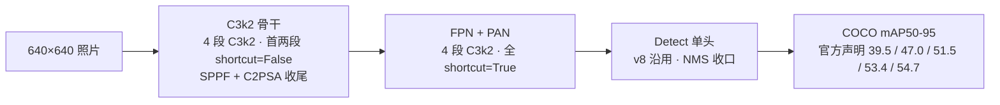
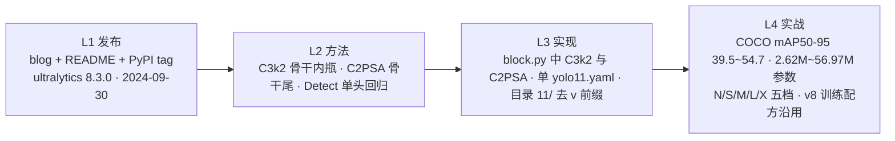

# YOLOv11 (2024-09)

**ultralytics 8.3.0 官方首发 · C3k2 + C2PSA + 回归 NMS 单头——把 v10 的双头拆掉，把 v10 的效率积木拆掉，重新回到单头 [Detect](/glossary#detect-解耦检测头) 与 NMS 收口**

- 📄 发布：**无 arXiv 论文**——ultralytics 官方博客《YOLO11: 100% Faster, 100% Smarter》+ 仓库 README + PyPI tag `v8.3.0` 三层材料构成，详见[发布精读](/versions/v11/paper)
- 🏛️ 作者：**Glenn Jocher、Jing Qiu**——[ultralytics](https://github.com/ultralytics/ultralytics) 官方 PR #16539，2024-09-30 tagger 落地
- 💻 源码：[ultralytics/ultralytics](https://github.com/ultralytics/ultralytics) tag `v8.3.0`（commit `6e43d1e1e5db72afbf686dee6745669bcb124b0a`，tag 对象 sha `a46b49a27a97d44c642882a405c8b57979e6d368`，664 文件，AGPL-3.0），消息 `ultralytics 8.3.0 YOLO11 Models Release (#16539)`；`__version__ = "8.3.0"` 写在 `__init__.py` 第 3 行 <SrcLink file="v11:ultralytics/__init__.py" :line="3" />
- 🎯 里程碑：**结构性「减法」**——用 [C3k2](/glossary#c3k2) 换掉 C2f、用 [C2PSA](/glossary#c2psa) 换掉 PSA、用 `Detect` 换掉 `v10Detect`、把 NMS 塞回后处理；同时把 v10 每档独立 yaml 折成**单文件 `yolo11.yaml` 一个 scales 定义五档**，cfg 目录**首次去掉 v 前缀**（`ultralytics/cfg/models/11/`——全站独一份）

## 3 分钟电梯演讲



1. **C3k2 换 C2f**：`class C3k2(C2f)` 直接继承 C2f、**无独立 forward**——只重写 `__init__` 把每层 Bottleneck 内瓶换成 C3k2 内的 shortcut 变体，`n / c3k / e / g / shortcut` 五参集中配置 <SrcLink file="v11:ultralytics/nn/modules/block.py" :line="723" />；yaml 里 4 段 C3k2（骨干）+ 4 段 C3k2（neck）共 8 处，替代 v10 的 C2f 群；
2. **C2PSA 收骨干尾**：`C2PSA` 把 C3k2 的残差支路与 [Attention](/glossary#attention-自注意力) + FFN 支路拼在一个 CSP 模块里 <SrcLink file="v11:ultralytics/nn/modules/block.py" :line="1002" :end="1041" />——v10 是「SPPF 之后额外挂一个 PSA」的两件套，v11 是「SPPF 之后 C2PSA 一步到位」的一件，**减少一次 concat + 一次残差相加**；
3. **参数集中**：单文件 `yolo11.yaml` 用 scales 集中定义 n/s/m/l/x 五档 <SrcLink file="v11:ultralytics/cfg/models/11/yolo11.yaml" :line="8" :end="12" />——n[0.50,0.25,1024] 319 层 / 2.62M / 6.6G，s[0.50,0.50,1024] 319 / 9.46M / 21.7G，m[0.50,1.00,512] 409 / 20.11M / 68.5G，l[1.00,1.00,512] 631 / 25.37M / 87.6G，x[1.00,1.50,512] 631 / 56.97M / 196.0G；对比 v10 每档一份 yaml（`yolov10{nsblmx}.yaml` 六份各带独立 scales），v11 的档位差异**只在参数表，不在结构**。

> **v1~v10 读者路标**：[v8 读者](/versions/v8/index)——v11 的 Detect 头是你熟悉的 <SrcLink file="v11:ultralytics/nn/modules/head.py" :line="21" :end="68" />、损失是 v8DetectionLoss <SrcLink file="v11:ultralytics/utils/loss.py" :line="157" />、TAL 分配器是你熟悉的 <SrcLink file="v11:ultralytics/utils/tal.py" :line="13" />，v11 相对 v8 的骨架改动收敛到「骨干内瓶换 C3k2 + 尾端换 C2PSA」；[v10 读者](/versions/v10/index)——v10 的双头被拆掉、SCDown/CIB/PSA 三件套被拆掉、NMS-free 部署图被放弃，v11 是一次结构性回退（详见下节对比表）。

## 四层闭环视图



## 核心贡献一览

v11 的改动方向是「**把 v10 拆掉，把 v8 用起来**」：官方把两个新积木（C3k2 / C2PSA）塞进 v8 骨架，头与损失与分配器全线回到 v8。核心贡献与代码落点：

| 贡献 | 一句话 | 代码落点 |
|------|--------|---------|
| **C3k2 骨干内瓶** | `class C3k2(C2f)` 只重写 `__init__`、`__init__(c1,c2,n=1,c3k=False,e=0.5,g=1,shortcut=True)`——每层 Bottleneck 的 shortcut 分支可选开启 | <SrcLink file="v11:ultralytics/nn/modules/block.py" :line="723" /> |
| **C2PSA 骨干尾** | C3k2 的残差支路 + Attention + FFN 拼在一个 CSP 里，替代「SPPF + 独立 PSA」两件套 | <SrcLink file="v11:ultralytics/nn/modules/block.py" :line="1002" :end="1041" /> |
| **注意力复用** | 沿用 v10 的 Attention（qkv 1×1 合并、key_dim 减半、位置编码 3×3 DWConv、num_heads = c // 64） | <SrcLink file="v11:ultralytics/nn/modules/block.py" :line="866" /> |
| **Detect 单头回归** | yaml L47 用 `Detect`（v8 版），不用 `v10Detect`；导出与 predict 全部回到 NMS 收口 | <SrcLink file="v11:ultralytics/nn/modules/head.py" :line="21" :end="68" /> |
| **v8DetectionLoss 主用** | 损失与 v10 的 `v10DetectLoss` 无交集，直接沿用 v8 的 loss 实现 | <SrcLink file="v11:ultralytics/utils/loss.py" :line="157" /> |
| **TAL 沿用** | `TaskAlignedAssigner` 默认 topk=13（v10 是 10）、α=1.0（v10 是 0.5）、β=6.0——topk 与 α 都调了 | <SrcLink file="v11:ultralytics/utils/tal.py" :line="13" /> |
| **单 yolo11.yaml** | 五档 n/s/m/l/x 用一份 scales 表集中定义，不再每档一份 yaml | <SrcLink file="v11:ultralytics/cfg/models/11/yolo11.yaml" :line="8" :end="12" /> |
| **命名去 v 前缀** | 目录 `ultralytics/cfg/models/11/`——**不加 v**，与 v8/v9/v10 的 `models/v8/`、`models/v9/`、`models/v10/` 目录规则**唯一不一致** | <SrcLink file="v11:ultralytics/cfg/models/11/yolo11.yaml" :line="1" /> |
| **版本 8.3.0** | `__version__ = "8.3.0"`，PR #16539，作者 Glenn Jocher & Jing Qiu，tag 日期 2024-09-30 | <SrcLink file="v11:ultralytics/__init__.py" :line="3" /> |

> **v1~v10 读者路标**：v11 只新增了两个模块类（`C3k2` 与 `C2PSA`）——C2f 骨干结构你从 v8 就熟 <SrcLink file="v11:ultralytics/nn/modules/block.py" :line="723" />，Detect 头也是 v8 的原版 <SrcLink file="v11:ultralytics/nn/modules/head.py" :line="21" :end="68" />，损失与分配器同 v8；[CSP](/glossary#csp-跨阶段部分连接) 与 [C3](/glossary#c3-残差瓶颈) 家族在 v11 里被 C3k2 统一；v10 那套「SCDown 下采样 + C2fCIB 大核颈 + v10Detect 双头 + v10postprocess 无 NMS」在 v11 快照里**一个都没留**。

## 关键指标

**官方 mAP50-95（COCO val，输入 640，博客与 README 声明口径；快照内不可复核）**

| 模型 | #Params | FLOPs | mAP50-95 |
|------|---------|-------|----------|
| YOLO11n | 2.62M | 6.6G | 39.5% |
| YOLO11s | 9.46M | 21.7G | 47.0% |
| YOLO11m | 20.11M | 68.5G | 51.5% |
| YOLO11l | 25.37M | 87.6G | 53.4% |
| YOLO11x | 56.97M | 196.0G | 54.7% |

- 口径提醒：**没有延迟列**——v11 README 快照里没有像 v10 那样给出 T4 TRT FP16 延迟，也没有像 v8 那样给 CPU ONNX 与 A100 TRT 双列，跨版本比延迟不可比；
- **档位数量**：v11 是 N/S/M/L/X 五档（对比 v10 六档——多了个 B）；n 与 s 的层数相同（319 层），m 到 409 层，l 与 x 到 631 层，深度跳档在 s→m 与 m→l 两处 <SrcLink file="v11:ultralytics/cfg/models/11/yolo11.yaml" :line="8" :end="12" />；
- **参数量对比 v10**：v11-n 2.62M vs v10-N 2.3M（+14%），v11-s 9.46M vs v10-S 7.2M（+31%），v11-m 20.11M vs v10-M 15.4M（+30%），v11-l 25.37M vs v10-L 24.4M（+4%），v11-x 56.97M vs v10-X 29.5M（+93%）——v11 的整体容量比 v10 大得多，尤其是 x 档接近翻倍；
- **官方声明同档 mAP 对比**：博客口径「v11-n 39.5 vs v8-n 37.3（+2.2）、v11-s 47.0 vs v8-s 44.7（+2.3）、v11-m 51.5 vs v8-m 50.2（+1.3）、v11-l 53.4 vs v8-l 52.5（+0.9）、v11-x 54.7 vs v8-x 53.9（+0.8）」——**这是博客声明，snapshot 内不可复核**。

> **v1~v10 读者路标**：跨版本比 [mAP](/glossary#map-mean-average-precision) 只比 COCO val、输入 640、同 AP 定义；v6/v7 用 A100 FPS 口径，v8 用 CPU ONNX + A100 TRT 双延迟，v9 只给 AP，v10 用 T4 TRT FP16 延迟——v11 干脆不给延迟列，跨版本比较时**延迟列一律不并列**。

## 快速上手

```python
from ultralytics import YOLO

# v11 直接接 v8 的 YOLO 入口——没有单独的 YOLOv11 类
model = YOLO("yolo11n.yaml")   # 从单 yolo11.yaml 构建随机初始化的 v11-n（scale=n 生效）
# model = YOLO("yolo11n.pt")   # 或加载官方预训练权重

results = model.train(data="coco8.yaml", epochs=10, imgsz=640)   # 训练语义与 v8 完全一致
preds = model.predict("https://ultralytics.com/images/bus.jpg")   # 后处理带 NMS（conf + iou）
model.export(format="onnx")   # 导出图里保留 NMS 节点
```

- **入口仍是 v8 的 YOLO**：v11 **没有** `YOLOv11` 顶层类，也没有 `models/yolov11/` 独立目录；`task_map` 里也不见 v11 专属的 predict/train/val——**结构差异全部由 yaml 定义，训练/预测/导出走 v8 的通用管线** <SrcLink file="v11:ultralytics/cfg/models/11/yolo11.yaml" :line="30" :end="47" />；
- **档位由 scale 决定**：`yolo11.yaml` 里的 scales 表 <SrcLink file="v11:ultralytics/cfg/models/11/yolo11.yaml" :line="8" :end="12" /> 会在 tasks.py 被读取时按后缀 n/s/m/l/x 展开深度、宽度、通道上限——一份 yaml 生成五档模型；
- **默认配置沿用 v8**：训练超参 box 7.5 / cls 0.5 / dfl 1.5、close_mosaic 10、Mosaic/MixUp 全套增强**全部与 v8 一致**；v11 的增益不来自训练 trick，来自骨干内瓶与尾端两个积木的替换；
- **导出走 NMS**：`model.export()` 走 `exporter.py` 的 v8 通用路径，ONNX / TRT 图里含 `non_max_suppression` 或等价节点——与 v10 的「导出图无 NMS」**相反**。

> **v1~v10 读者路标**：v8 读者完全不用改 `from ultralytics import YOLO`——换 `yolo11n.yaml` 即可；[v10 读者](/versions/v10/index) 请反向操作——`from ultralytics import YOLOv10` 在 v11 快照里已不存在，`v10Detect` / `v10DetectLoss` / `v10postprocess` 都不在本快照内。

## 与 v10 / v9 的关系定位

v11 不是「v10 的续作」——它是 **ultralytics 主线里在 v10 出现之后的一次官方结构性回退**：v10 是清华 THU-MIG 独立 fork 的 NMS-free 分支，v11 是 Glenn Jocher & Jing Qiu 在 ultralytics 官方仓库里发布的**回归主线**版本（快照 `__version__ = "8.3.0"` <SrcLink file="v11:ultralytics/__init__.py" :line="3" />）：

- **底子还是 v8**：CSP + C3 家族、FPN+PAN、anchor-free 网格中心回归、[DFL](/glossary#dfl-distribution-focal-loss) 分布表示、TAL 分配器、Detect 头、v8DetectionLoss、Mosaic/MixUp 全套增强——**v11 训练配方与 v8 一致**，与 v10 无继承关系；
- **delta 高度集中在 block.py**：只新增两个类（`C3k2` <SrcLink file="v11:ultralytics/nn/modules/block.py" :line="723" /> 与 `C2PSA` <SrcLink file="v11:ultralytics/nn/modules/block.py" :line="1002" :end="1041" />），yaml 里把 C2f 全换成 C3k2、把「SPPF + PSA」换成「SPPF + C2PSA」；head.py、loss.py、tal.py 的顶层类与 v8 一致；
- **命名坑只此一处**：cfg 目录首次去 v 前缀 `cfg/models/11/`（对比 v8 的 `models/v8/`、v9 的 `models/v9/`、v10 的 `models/v10/`）；且**单 yolo11.yaml** 定义五档，与 v10 每档独立 yaml 相反。

| 维度 | YOLOv8（2023-01） | YOLOv10（2024-05） | YOLOv11（2024-09） |
|------|-------------------|--------------------|--------------------|
| 代码基座 | ultralytics 单库 | ultralytics 8.1.34 fork（THU-MIG 独立仓库） | **ultralytics 8.3.0 主线 tag** |
| 作者 | Glenn Jocher & Jing Qiu | 清华 THU-MIG | **Glenn Jocher & Jing Qiu** |
| 发布形式 | 博客 + README | **arXiv:2405.14447 论文** + README | **博客 + README（无论文）** |
| 检测头 | Detect 单头 | v10Detect 双头（one2many + one2one deepcopy） | **Detect 单头（v8 沿用）** |
| 标签分配 | TAL topk=10，α=0.5 / β=6.0 | TAL topk=10 + topk=1（同分配器实例化两次） | **TAL topk=13，α=1.0 / β=6.0** |
| 推理后处理 | NMS | **v10postprocess（无 NMS）** | **NMS（回归 v8）** |
| 骨干内瓶 | C2f | C2f + C2fCIB（大核 RepVGGDW） | **C3k2**（C2f 的 shortcut 变体） |
| 下采样 | Conv 3×3 s2 | **SCDown**（空间-通道解耦） | **Conv 3×3 s2**（回归 v8） |
| 骨干尾 | SPPF | SPPF + **PSA**（独立注意力模块） | **SPPF + C2PSA**（合并成一个块） |
| 分类头 | 两个 3×3 + 1×1 | 深度可分离两段 | **DW-separable 两段**（沿用 v10 思路，无 legacy 开关） |
| 新档位 | n/s/m/l/x | n/s/m/**b**/l/x | **n/s/m/l/x**（去 B） |
| 结构文件 | v8n/s/m/l/x.yaml 五份各带 scales | yolov10n/s/m/b/l/x.yaml **六份各带 scales** | **yolo11.yaml 单份，五档 scales 集中** |
| cfg 目录 | `models/v8/` | `models/v10/` | **`models/11/`（去 v 前缀，独一份）** |
| 论文 | 无 | arXiv:2405.14447 | **无（博客 + README）** |
| 许可证 | AGPL-3.0 | AGPL-3.0 | AGPL-3.0 |

> **v1~v10 读者路标**：v11 的 [C3k2](/glossary#c3k2) 与 v8 的 [C2f](/glossary#c2f) 是「父类 + 子类的 __init__ 覆写」关系——骨干 shortcut=True 默认开启，head 内的 C3k2 不带 shortcut；[SPPF](/glossary#sppf) 保留在骨干倒数第二层；v11 的 [复合缩放](/glossary#compound-scaling-复合缩放) 从「每档一份 yaml 各带 scales」变为「一份 yaml 一个 scales 表」，档位扩展只需在 scales 表里加一行。

## 深入阅读

- [发布精读：博客 + README + PyPI tag 三层材料](/versions/v11/paper)
- [Architecture 逐层图解](/versions/v11/architecture)
- [理论 Concept](/versions/v11/concepts)
- [架构与层速查](/versions/v11/layers)
- [损失函数（v8DetectionLoss 沿用）](/versions/v11/losses)
- [反向传播推导](/versions/v11/loss-gradient)
- [训练技巧（与 v8 完全一致的配方）](/versions/v11/tricks)
- [痛点追踪](/versions/v11/painpoints)
- [源码走读](/versions/v11/code-walkthrough)
- [源码页：yolo11.yaml](/versions/v11/source/yolo11-yaml) · [head.py](/versions/v11/source/head-py) · [loss.py](/versions/v11/source/loss-py) · [tal.py](/versions/v11/source/tal-py)
- [系列家族对照](/global/family) · [术语表](/glossary)
