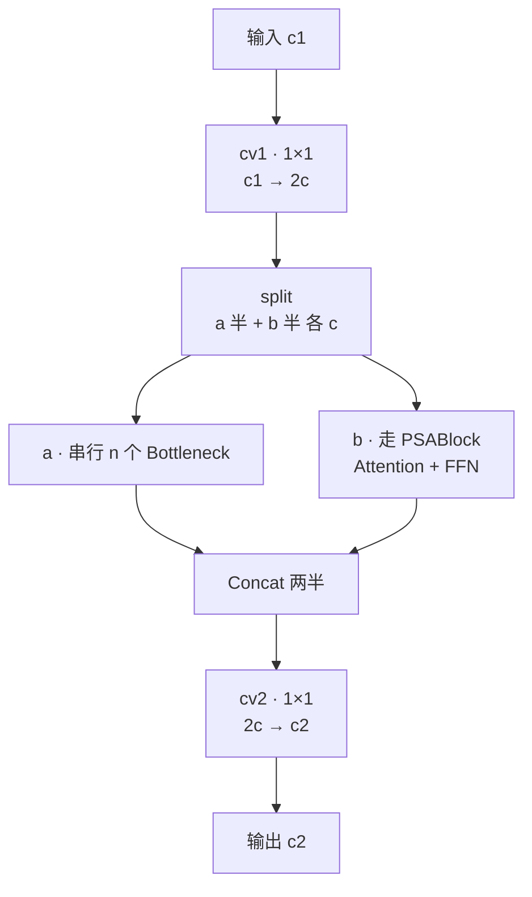
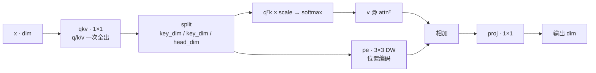
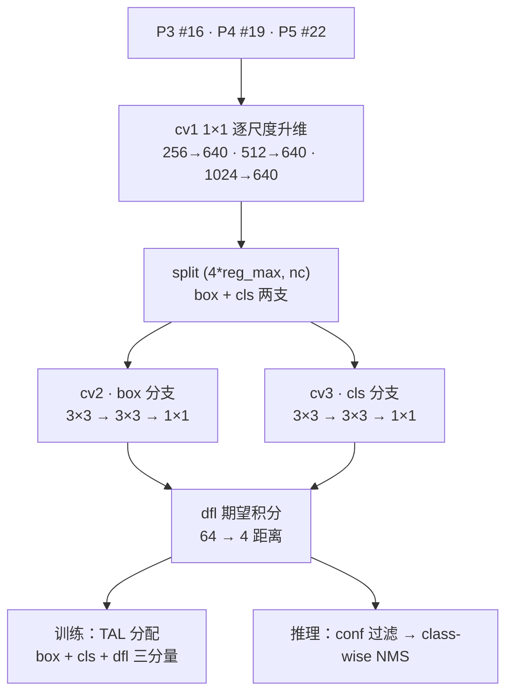

# YOLOv11 架构与层速查

> 首发载体：`ultralytics/ultralytics` tag `v8.3.0`（commit `6e43d1e1e5db72afbf686dee6745669bcb124b0a`，2024-09-30，PR #16539，作者 Glenn Jocher & Jing Qiu，AGPL-3.0）。以 `ultralytics/cfg/models/11/yolo11.yaml` 为基准（**注意目录名 `11/` 不带 `v` 前缀——这是全项目独一份的命名坑**），本页通道数为缩放前的基准值，五档 scales 与 compound scaling 详见 §6。总览页见 [YOLOv11 架构总览](/versions/v11/architecture)。

> **v1~v10 读者路标**：这张 yaml 是 v8 → v10 → v11 三代 delta 的收官——v10 的 SCDown / PSA / C2fCIB / v10Detect 一整套自研模块在 v11 里全部退回（模块类仍在 `block.py` / `head.py` 保留，只是 yaml 不引用），骨干里所有 C2f 换成 C3k2，末段 SPPF 后挂一个新模块 **C2PSA**；检测头换回 v8 的 `Detect` 单头 + NMS。想快速对上位读者的话：把它当作「v8 的骨干 + 一处 C2PSA」来读就够——11 层骨干 + 13 层头 + Detect 收尾，25 个顶层条目。

## 1. 全网络层一览表（yolo11.yaml L15-L47，基准宽度 @640 输入）

> **v1~v10 读者路标**：这张表可以直接与 [v10 逐层图解 §1](/versions/v10/layers) 或 [v8 逐层图解 §1](/versions/v8/layers) 逐行对照——只有 5 处不同：骨干 4 个 C2f 全部换成 C3k2、SPPF 后多一层 C2PSA、下采样三处全是普通 Conv（v10 的 SCDown 全撤）、head 里 4 个 C2f 也换成 C3k2、末端 `v10Detect` 换回 `Detect`。其余下采样位置、Concat 索引、Detect 三尺度选择完全对得上 v8。

### 1.1 Backbone（yaml L15-L25，11 层）

| 行号 | 层号 | 层类型 | 参数（yaml 原文） | 输出（基准 @640） | 说明 |
|-----|-----|-----------|--------------------|--------------------|------|
| <SrcLink file="v11:ultralytics/cfg/models/11/yolo11.yaml" :line="15" /> | 0 | `Conv` | 32, 3, 3, 2 | 64×320×320 | stem 下采样 · P1/2 |
| <SrcLink file="v11:ultralytics/cfg/models/11/yolo11.yaml" :line="16" /> | 1 | `Conv` | 64, 3, 3, 2 | 128×160×160 | P2/4 |
| <SrcLink file="v11:ultralytics/cfg/models/11/yolo11.yaml" :line="17" /> | 2 | `C3k2` | 256, False, 0.25 ×3 | 128×160×160 | 骨干 C3k2 带 shortcut · c3k=False 走轻量内瓶 |
| <SrcLink file="v11:ultralytics/cfg/models/11/yolo11.yaml" :line="18" /> | 3 | `Conv` | 128, 3, 3, 2 | 256×80×80 | P3/8（小目标尺度起点） |
| <SrcLink file="v11:ultralytics/cfg/models/11/yolo11.yaml" :line="19" /> | 4 | `C3k2` | 512, False, 0.25 ×6 | 256×80×80 | FPN 回连点二 |
| <SrcLink file="v11:ultralytics/cfg/models/11/yolo11.yaml" :line="20" /> | 5 | `Conv` | 256, 3, 3, 2 | 512×40×40 | P4/16 |
| <SrcLink file="v11:ultralytics/cfg/models/11/yolo11.yaml" :line="21" /> | 6 | `C3k2` | 512, True ×3 | 512×40×40 | FPN 回连点一 · c3k=True |
| <SrcLink file="v11:ultralytics/cfg/models/11/yolo11.yaml" :line="22" /> | 7 | `Conv` | 512, 3, 3, 2 | 1024×20×20 | P5/32 |
| <SrcLink file="v11:ultralytics/cfg/models/11/yolo11.yaml" :line="23" /> | 8 | `C3k2` | 1024, True ×3 | 1024×20×20 | 骨干 P5 深度融合 |
| <SrcLink file="v11:ultralytics/cfg/models/11/yolo11.yaml" :line="24" /> | 9 | `SPPF` | 1024, 5 | 1024×20×20 | 骨干融合出口（v5/v6 老零件） |
| <SrcLink file="v11:ultralytics/cfg/models/11/yolo11.yaml" :line="25" /> | 10 | `C2PSA` | 1024 | 1024×20×20 | **v11 新增 · 骨干出口注意力** |

### 1.2 Head（yaml L30-L47，13 层）

| 行号 | 层号 | 层类型 | 参数（yaml 原文） | 输出（基准 @640） | 说明 |
|-----|-----|-----------|--------------------|--------------------|------|
| <SrcLink file="v11:ultralytics/cfg/models/11/yolo11.yaml" :line="30" /> | 11 | `Upsample` | 2, nearest | 1024×40×40 | FPN 上行 |
| <SrcLink file="v11:ultralytics/cfg/models/11/yolo11.yaml" :line="31" /> | 12 | `Concat` | [-1, 6] | 1536×40×40 | cat 骨干 P4（层 6 C3k2） |
| <SrcLink file="v11:ultralytics/cfg/models/11/yolo11.yaml" :line="32" /> | 13 | `C3k2` | -1, False, 0.5 ×3 | 512×40×40 | 头部融合 · 无 shortcut |
| <SrcLink file="v11:ultralytics/cfg/models/11/yolo11.yaml" :line="33" /> | 14 | `Upsample` | 2, nearest | 512×80×80 | |
| <SrcLink file="v11:ultralytics/cfg/models/11/yolo11.yaml" :line="34" /> | 15 | `Concat` | [-1, 4] | 768×80×80 | cat 骨干 P3（层 4 C3k2） |
| <SrcLink file="v11:ultralytics/cfg/models/11/yolo11.yaml" :line="35" /> | 16 | `C3k2` | -1, False, 0.5 ×3 | 256×80×80 | **P3 检测输入 · stride 8** |
| <SrcLink file="v11:ultralytics/cfg/models/11/yolo11.yaml" :line="36" /> | 17 | `Conv` | -1, 3, 3, 2 | 256×40×40 | PAN 下行（回归普通 Conv） |
| <SrcLink file="v11:ultralytics/cfg/models/11/yolo11.yaml" :line="37" /> | 18 | `Concat` | [-1, 13] | 768×40×40 | cat 头部 P4（层 13） |
| <SrcLink file="v11:ultralytics/cfg/models/11/yolo11.yaml" :line="38" /> | 19 | `C3k2` | -1, False, 0.5 ×3 | 512×40×40 | **P4 检测输入 · stride 16** |
| <SrcLink file="v11:ultralytics/cfg/models/11/yolo11.yaml" :line="39" /> | 20 | `Conv` | -1, 3, 3, 2 | 512×20×20 | PAN 下行（回归普通 Conv） |
| <SrcLink file="v11:ultralytics/cfg/models/11/yolo11.yaml" :line="40" /> | 21 | `Concat` | [-1, 10] | 1536×20×20 | cat 层 10 **C2PSA 输出** |
| <SrcLink file="v11:ultralytics/cfg/models/11/yolo11.yaml" :line="41" /> | 22 | `C3k2` | -1, False, 0.5 ×3 | 1024×20×20 | **P5 检测输入 · stride 32** |
| <SrcLink file="v11:ultralytics/cfg/models/11/yolo11.yaml" :line="42" /> | 23 | `Detect` | nc, [16, 19, 22] | 三尺度输出 | one2one 无、单头收尾 |

- 重复数 ×3 / ×6 是基准值：n 档 depth=0.50 缩放后变 2/3，m 档 0.50 同样 2/3、l/x 档 1.00 不变——机制与 v8 的 [compound scaling](/glossary#compound-scaling-复合缩放) 完全相同
- 骨干 C3k2 的第二个参数是 `c3k`（是否启用 C3k 内瓶）、第三个是 `e`（隐藏通道比）；头部 C3k2 都是 `[c, False, 0.5]`——`c3k=False` + `e=0.5` 走轻量内瓶，与骨干浅层同构
- `from` 支持负索引与显式层号：#12 `[-1, 6]`、#15 `[-1, 4]`、#18 `[-1, 13]`、#21 `[-1, 10]`——四组拼接对象没有一处变化，与 v10n 完全对得上
- Concat 输出通道 = 两路之和（#12 是 1024+512=1536）；Upsample 保持通道不变——与 v8/v10 相同
- **Detect 输入 `[16, 19, 22]`** 是三个 C3k2 输出：层 16/19/22——stride 8/16/32，640 输入共 **8400 个预测位置**（$80^2+40^2+20^2$），anchor-free、网格中心即 anchor point

> **v1~v10 读者路标**：整张表 24 个顶层条目（0-23），五档共用；C3k2 出现 8 次（骨干 4 + 头 4），C2PSA 只在骨干出口出现 1 次，Detect 收尾 1 次——**没有 SCDown、没有 PSA、没有 C2fCIB、没有 v10Detect**。v8 骨架（Conv s2 + C2f + SPPF + Detect）几乎逐字沿用，唯一新增的是骨干末尾的 C2PSA。

## 2. 组件字典

> **v1~v10 读者路标**：v11 全项目只用了两种自研模块——`C3k2` 与 `C2PSA`。其他全部是 v5/v6/v8 就有的老零件（Conv / Upsample / Concat / SPPF / Detect / C2f / C3k）。下表 11 个条目一一对应，方便快速定位源码与理解代际差异。

| 模块 | 代码位置 | 一句话作用 | 首次出现 | v11 使用位置 |
|------|----------|------------|----------|--------------|
| `C3k2` | <SrcLink file="v11:ultralytics/nn/modules/block.py" :line="723" /> | C2f 外壳 + C3k/Bottleneck 双内瓶混合 | v11（源自 v8.2.x） | 骨干 #2/#4/#6/#8 + 头 #13/#16/#19/#22 |
| `C2PSA` | <SrcLink file="v11:ultralytics/nn/modules/block.py" :line="1002" :end="1041" /> | C2f 外壳 + 一半通道走 PSABlock（含 Attention + FFN） | v11 | 骨干 #10 |
| `PSABlock` | <SrcLink file="v11:ultralytics/nn/modules/block.py" :line="922" :end="1000" /> | C2f 结构内部塞 Attention + FFN 双子模块 | v11 | C2PSA 内瓶 |
| `Attention` | <SrcLink file="v11:ultralytics/nn/modules/block.py" :line="866" :end="921" /> | 单层多头注意力：qkv 一次 1×1 + DW 位置编码 | v10（v11 沿用） | PSABlock 内部 |
| `SPPF` | <SrcLink file="v11:ultralytics/nn/modules/block.py" :line="169" :end="186" /> | 串行 3 次 k=5 MaxPool 等效 SPP 5/9/13 | v5 | 骨干 #9 |
| `C3k` | <SrcLink file="v11:ultralytics/nn/modules/block.py" :line="734" :end="751" /> | 大核内瓶（c3k=True 时启用，3×3 DW + 3×3 全密度） | v8 | C3k2 内部 |
| `C2f` | <SrcLink file="v11:ultralytics/nn/modules/block.py" :line="224" :end="251" /> | chunk 拆半 → 串行 Bottleneck → 全拼接 | v6 | C3k2 / C2PSA 基类 |
| `Detect` | <SrcLink file="v11:ultralytics/nn/modules/head.py" :line="21" :end="68" /> | anchor-free 单头：cv1 升维 → cv2 box + cv3 cls + dfl | v8 | #23（唯一检测头） |
| `Conv` | <SrcLink file="v11:ultralytics/nn/modules/conv.py" :line="37" /> | 标准卷积 + autopad + BN + 激活 | v5 | #0/#1/#3/#5/#7/#17/#20 |
| `Upsample` | `nn.Upsample` | 空间上采样（scale_factor=2, nearest） | PyTorch | #11/#14 |
| `Concat` | `torch.cat(dim=1)` | 通道维拼接 | PyTorch | #12/#15/#18/#21 |

> **v1~v10 读者路标**：v10 的 SCDown / CIB / C2fCIB / RepVGGDW / PSA / v10Detect / v10postprocess / v10DetectLoss 九个自研模块在 v11 的 yaml 里一个都不引用——它们仍在 `block.py` / `head.py` 里作为 v10 遗产存在，加载 v10 权重时才会命中。v11 真正用到的模块清单非常精简：核心就是 `C3k2` + `C2PSA` 两个新类 + v8 老零件。

## 3. C3k2：C2f 外壳 + 双内瓶混合

> **v8 读者路标**：把 C3k2 和 C2f 摆在一起看——v8 的 [C2f](/glossary#c2f) 是「chunk 拆半 → 串行 Bottleneck → 全拼接」；C3k2 只是把串行段里的 Bottleneck 换成两种内瓶（`C3k` 大核与 `Bottleneck`）交替——**外壳完全一样、只是内瓶换芯**。

**v11 快照的 C3k2 简化版警告**：在 tag `v8.3.0`（commit `6e43d1e1`）里，`C3k2` 只有 `__init__`，**没有独立 `forward` 方法**——完全继承 `C2f.forward`。更关键的是：这个版本里 C3k2 **不区分 C3k / Bottleneck 分流**、也没有 v8.3.x 后续版本才出现的 Attention 融合开关。所以读 v11 快照的 C3k2 源码时：

- `c3k=False, e=0.25` 的浅层用法：内瓶实际上是 C2f 里默认 `Bottleneck`（因为 C3k 只在内瓶循环里按 `c3k` 分支决定是否实例化）；
- `c3k=True` 的深层用法：内瓶实例化 `C3k`（大核内瓶，3×3 DW + 3×3 全密度 + 1×1 降维）；
- 两种模式在同一个 C3k2 里由 `c3k` 布尔参数选择，前向路径完全一致（继承 C2f.forward）；
- 更复杂的「一半通道走 C3k、一半走 Bottleneck、另一半走 Attention」的分流设计是 v8.3.x 后续版本才加的——**不在 v11 tag 快照里**，别用错版本对代码。

<SrcLink file="v11:ultralytics/nn/modules/block.py" :line="723" :end="751" />

**签名**：`__init__(c1, c2, n=1, c3k=False, e=0.5, g=1, shortcut=True)`

**结构**：`super().__init__(c1, c2, n, shortcut, g, e)` 先建 C2f 外壳——`self.c = int(c2 × 0.5)`、cv1 出 2c、cv2 收拢 (2+n)×c——然后 `self.m = nn.ModuleList(...)` 按 `c3k` 分支实例化 `C3k` 或 `Bottleneck` 作为内瓶。

- yaml 使用 8 处：骨干 4 处（#2/#4 用 `[c, False, 0.25]` 轻量、#6/#8 用 `[c, True]` 标准）、头 4 处（#13/#16/#19/#22 全部 `[c, False, 0.5]`）
- 与 v10 差异：v10 用的是 `C2fCIB`（内瓶 CIB）与 `C2f`（内瓶 Bottleneck）；v11 用 C3k2 一个类同时接管——**内瓶二选一，不混合**
- 参数量对比：n 档 C3k2 比 C2f 略重（多一层残差通路），但比 C2fCIB 轻（不叠大核 RepVGGDW）

> **v1~v10 读者路标**：C3k2 是 v8 时代的产物（v8.2.x 引入），v11 tag 首次把它放进默认 yaml——所以 v8 读者对 C3k2 不陌生，v10 读者则要看懂「C3k2 与 C2fCIB 是两条不同演化路径」：前者是 C2f 外壳换内瓶、后者是 C2f 外壳全 DW 化 + 大核。v11 只留前者。

## 4. C2PSA：C2f 外壳 + 完整通道注意力

> **v10 读者路标**：v10 的 [PSA](/glossary#psa-partial-self-attention) 是「一半通道过 Attention+FFN、另一半直通」；v11 的 C2PSA 是「C2f 外壳（cv1 升维 → split → concat → cv2 收拢）+ 一半通道走 PSABlock（含 Attention + FFN）+ 另一半走 Bottleneck」——**结构从「直接外挂」变成「嵌进 C2f 结构」**，注意力覆盖到一半通道（不是全部），但走的是 C2f 的分块路径。

<SrcLink file="v11:ultralytics/nn/modules/block.py" :line="1002" :end="1041" />

**签名**：`__init__(c1, c2, n=1, e=0.5, g=1)`

**结构**：`assert c1 == c2`（C2PSA 不改通道），`cv1 = Conv(c1, 2c, 1)` 升维 → split 两半 → a 半走 n 个 Bottleneck 串行、b 半走 PSABlock → `Concat` 两半 → `cv2 = Conv(2c, c2, 1)` 收拢。整个结构与 C2f 高度同构，只是右分支换成了 PSABlock。

- yaml 仅 #10 一处（SPPF 之后、FPN 之前）——骨干出口、空间分辨率最小、通道最宽的位置
- 与 v10 的 PSA 关键差异：v10 PSA 是「split 两半 + 直通 vs Attention」的极简结构；v11 C2PSA 是「split 两半 + Bottleneck vs PSABlock」的完整 C2f 双分支——**参数更多、表征更强，但推理延迟也上升**
- v11 只在骨干出口挂一次注意力（20×20 网格，序列长度 400）——**没有像 v10 那样在头里再挂**，是效率与能力的折衷

> **v1~v10 读者路标**：v8 骨干里没有任何注意力模块；v10 第一次把注意力放进主干（PSA 一层，一半通道）；v11 保留「骨干出口一次注意力」的位置选择，但把结构从 PSA 升级到 C2PSA（走 C2f 双分支）。v5-v9 的老读者可以把它当成「C2f + Attention 内嵌」的新混合块。

## 5. PSABlock / Attention：注意力双子模块

> **Transformer 读者路标**：PSABlock 是标准 Transformer block 的轻量版——Attention + FFN 两个子模块各带残差、无 LayerNorm；Attention 是单层多头注意力的瘦身版——qkv 一次 1×1 全出、softmax 相似度、DW 卷积当位置编码，无 LayerNorm、无 mask、无 FFN（FFN 在 PSABlock 层里）。

**PSABlock**（<SrcLink file="v11:ultralytics/nn/modules/block.py" :line="922" :end="1000" />）：

- 内部构造：`self.att = Attention(dim=c, num_heads=...)` + `self.ffn = ...`
- 前向：`x = x + self.att(x)` 残差 → `x = x + self.ffn(x)` 残差 → 返回
- 与 v10 的 PSA 差异：v10 PSA 直接手写 Attention+FFN 两段；v11 抽出成独立 `PSABlock` 类，可复用

**Attention**（<SrcLink file="v11:ultralytics/nn/modules/block.py" :line="866" :end="921" />）：

- `head_dim = dim // num_heads`，`key_dim = int(head_dim × 0.5)`——**key/query 比 value 窄一半**，softmax 打分维度减半
- `qkv = Conv(dim, dim + 2 × key_dim × num_heads, 1, act=False)`——q/k/v 一次 1×1 全部产出
- `attn = softmax((qᵀk) × key_dim⁻⁰·⁵)`；输出 `v @ attnᵀ + pe(v)`——`pe = Conv(dim, dim, 3, 1, g=dim, act=False)` 是 3×3 DW 位置编码
- `proj = Conv(dim, dim, 1, act=False)` 1×1 收口

**n 档实际值**：dim=128（C2PSA 拆半后）、num_heads=128//64=2、head_dim=64、key_dim=32、qkv 出 128+2×32×2=256 通道。

- Attention 类 v10 已引入、v11 沿用（源码几乎一字未改）——v10 的 PSA 与 v11 的 PSABlock 都复用同一个 Attention 实现
- 只服务 C2PSA / PSA，不独立出现在 yaml；序列长度是特征图格点数（#10 处 20×20=400），注意力矩阵 400×400——放得起

> **v1~v10 读者路标**：v5-v9 完全没有注意力；v10 首次引入 Attention（PSA 内嵌）；v11 沿用 Attention + 抽出 PSABlock 类。老读者可以把它当作「单头 MHA + DW 位置编码」的极简实现——训练时 softmax 全矩阵，推理时也是。

## 6. SPPF：v5 老零件，原样保留

> **v5 读者路标**：SPPF 是 v5 引入的骨架——一个 k=5 的 MaxPool 池化，串行 3 次等效多尺度感受野（5/9/13）。v8 沿用、v10 沿用、v11 继续沿用，**v11 里一字未改**。

<SrcLink file="v11:ultralytics/nn/modules/block.py" :line="169" :end="186" />

**结构**：`self.cv1 = Conv(c1, 2c, 1, 1)` 升维 → `self.cv2 = Conv(4c, c2, 1, 1)` 收拢 → 4 路 MaxPool 输出 concat（原图 + 3 次串行 MaxPool）→ cv2 收拢回 c2。

- yaml 使用 1 处：#9（骨干融合出口）
- v11 与 v10 差异：无——两代都在同一位置挂 SPPF，参数都是 `[1024, 5]`
- 与 v10 的 PSA / v11 的 C2PSA 位置关系：SPPF 是**多尺度感受野**（局部池化），C2PSA 是**全局注意力**（长程依赖）——两者互补，先 SPPF 提多尺度、再 C2PSA 做全局建模

> **v1~v10 读者路标**：SPPF 是 v5 时代就有的老零件，从 v5 到 v11 一路沿用，源码位置从 block.py L169 起（v5 是 block.py L80 起）。v6-v10 老读者直接照 v5 认知套即可，v11 里 SPPF 的语义、参数、结构完全一致。

## 7. C3k：大核内瓶（C3k2 内部使用）

> **v8 读者路标**：C3k 是 v8 引入的「大核内瓶」——比 Bottleneck 多一个 3×3 DW 前置卷积，配合 3×3 全密度与 1×1 降维。C3k2 在 `c3k=True` 时用 C3k 作内瓶，`c3k=False` 时用 Bottleneck。

<SrcLink file="v11:ultralytics/nn/modules/block.py" :line="734" :end="751" />

**结构**（`c_ = int(c2 × e)`，默认 e=0.5）：cv1 五段 Sequential——`Conv(c1, c1, 3, g=c1)`（3×3 DW）→ `Conv(c1, c_, 1)`（1×1 降维）→ `Conv(c_, c_, 3, g=c_)`（3×3 DW 空间建模）→ `Conv(c_, c2, 1)`（1×1 升维）→ `Conv(c2, c2, 3, g=c2)`（3×3 DW）。残差判据 `add = shortcut and c1 == c2` 与 Bottleneck 同款。

- yaml 从不单独出现——始终藏在 C3k2 内部
- 骨干 #6/#8 用（c3k=True），骨干 #2/#4 不用（c3k=False + e=0.25 走轻量 Bottleneck 分支）
- 与 v10 差异：v10 的 CIB 是五段 DW/1×1 混合 + 中段可选 RepVGGDW 大核；C3k 更简单——没有大核选项，但比 Bottleneck 多一层 3×3 DW

> **v1~v10 读者路标**：C3k 是 v8 就有的内瓶类，v11 里只作为 C3k2 的可选内瓶。v6 读者可以把 C3k 理解为「在 Bottleneck 上多加一层 DW 前置卷积」——提升空间建模能力，代价是参数量略增。

## 8. C2f：C3k2 / C2PSA 的共同基类

> **v6 读者路标**：C2f 是 v6 引入的经典块——`cv1 → chunk 拆半 → 串行 Bottleneck → 全拼接 → cv2`。v11 里 C2f 本体（<SrcLink file="v11:ultralytics/nn/modules/block.py" :line="224" :end="251" />）不再单独出现在 yaml，但作为 C3k2 / C2PSA 的**基类**继续发挥核心作用。

**结构**：`self.c = int(c2 × 0.5)` → `cv1 = Conv(c1, 2c, 1, 1)` → `self.m = nn.ModuleList(...)` n 个内瓶 → `cv2 = Conv((2+n) × c, c2, 1, 1)` 收拢。

- **C3k2 继承 C2f**（`class C3k2(C2f)`）——只覆写 `__init__` 的 `self.m` 构造，前向完全继承
- **C2PSA 不继承 C2f**（是独立类），但结构上仿照 C2f 的分块思路
- yaml 从不单独出现——v11 完全用 C3k2 替代了 v8/v10 的 C2f

> **v1~v10 读者路标**：C2f 是 v6 引入的经典块，v7/v8/v9/v10 都单独使用，v11 是首次让 C2f 完全退出 yaml、只做内部基类。老读者对 C2f 的 chunk/串行/全拼接图完全适用——只是现在被 C3k2/C2PSA 包装了一层。

## 9. Detect：v8 单头，回归 NMS

> **v10 读者路标**：v11 直接用 v8 沿用的 `Detect` 类（<SrcLink file="v11:ultralytics/nn/modules/head.py" :line="21" :end="68" />），**不用** v10 的 `v10Detect`（<SrcLink file="v11:ultralytics/nn/modules/head.py" :line="564" :end="597" /> 类仍在源码里，但本 yaml 未引用）——这是 v11 相对 v10 最显著的**功能回退**：不再有 one2many/one2one 双头、不再有 `v10postprocess`、不再有 detach 梯度截断。

**构造**（<SrcLink file="v11:ultralytics/nn/modules/head.py" :line="38" :end="48" />）：

- `cv1`：1×1 逐尺度升维，`c2 = max(ch[i] * 4, reg_max * 4, nc)`（基准 640）——三尺度都升到 640
- `cv2`（box 分支）：`Conv(640, 640, 3) → Conv(640, 640, 3) → Conv2d(640, 4*reg_max, 1)`——出口 64 维分布
- `cv3`（cls 分支）：`Conv(640, 640, 3) → Conv(640, 640, 3) → Conv2d(640, nc, 1)`——出口 nc 维分类分
- `dfl = Conv1D(reg_max, 1, 1, reg_max + 1)`——把 4×reg_max=64 维分布解回 4 维距离

**前向**（<SrcLink file="v11:ultralytics/nn/modules/head.py" :line="49" :end="68" />）：

- **回归 v8 的关键差异**：没有 one2one deepcopy 分支、没有 `xi.detach()` 梯度截断、没有 v10postprocess 无 NMS 后处理
- **导出**：走标准 DetectionExporter 流程，含 NMS 算子；v10 是导出无 NMS 的 topk 两连发——v11 回到老路
- **推理路径**：`conf_threshold` 过滤 → `non_max_suppression` 按类做 NMS → `max_det` 输出——与 v8 完全一致

### 9.1 Detect vs v10Detect 对比

| 维度 | v8 Detect | v10 v10Detect | v11 Detect |
|------|-----------|---------------|------------|
| 类定义位置 | head.py L21 | head.py L497（v10）→ L564（v11 快照） | head.py L21（沿用 v8） |
| 头数量 | 单头 | 双头（one2many + one2one deepcopy） | **单头** |
| cv3 分类头 | 标准 3×3 两段 | DW-separable 三段（省 FLOPs） | 标准 3×3 两段（沿用 v8） |
| 训练分配 | TAL topk=10 | 双分配 topk=10 + topk=1 | **TAL topk=10** |
| 梯度截断 | 无 | `one2one = [xi.detach() for xi in x]` | **无** |
| 推理后处理 | conf 过滤 + class-wise NMS | v10postprocess（两次 topk） | **conf 过滤 + class-wise NMS** |
| 导出图 | 有 NMS 算子 | 无 NMS 算子 | **有 NMS 算子** |
| 训练损失 | v8DetectionLoss | v10DetectLoss（双 v8DetectionLoss） | **v8DetectionLoss** |

一句话总结：**v11 的检测头选择「回到 v8 老路」**——放弃 v10 的端到端去 NMS 追求，换取更简单、更易移植、生态工具链完全兼容的推理图。

> **v1~v10 读者路标**：从 v1 到 v10，检测头经历了「3 段 yolo layer → 2 段解耦 → 三段解耦 → anchor-free 单头 → 双头去 NMS」的完整演进；v11 选择**保留 v8 的三段解耦 anchor-free 单头**，只是外层结构换了 C3k2/C2PSA。v10 的 v10Detect / one2one / detach / v10postprocess 四个概念在 v11 里全部不存在——推理图里 NMS 节点回来了。

## 10. 与 v10 / v9 / v8 的结构对比

> **v1~v10 读者路标**：把三代 yaml 摆在一起看，v11 的取舍一目了然——**下采样回归普通 Conv**、**融合块统一 C3k2**、**骨干末段 C2PSA**、**头 Detect 单头**。

| 位置 | v8（yolov8.yaml） | v9（yolov9.yaml） | v10（yolov10n.yaml） | v11（yolo11.yaml） | 一句话总结 |
|------|-------------------|-------------------|----------------------|--------------------|------------|
| #2 骨干 P2 融合 | C2f 128 | C2SPC 128 | C2f 128 | **C3k2 256** | C2f→C3k2 换血 |
| #4 骨干 P3 融合 | C2f 256 | CBLinear→… | C2f 256 | **C3k2 512** | 同上 |
| #5/#7 下采样 | Conv s2 | ADown | SCDown | **Conv s2** | v10 SCDown 撤回 |
| #9 骨干融合 | SPPF | SPPF | SPPF | **SPPF** | v5 遗产原样保留 |
| #10 骨干出口 | — | 无 | PSA | **C2PSA** | v10 PSA→v11 C2PSA 升级 |
| #13/#16/#19 头融合 | C2f | C2f | C2f | **C3k2** | 头融合块统一 C3k2 |
| #20 回程下采样 | Conv s2 | Conv s2 | SCDown | **Conv s2** | v10 SCDown 撤回 |
| #22 P5 融合 | C2f | C2f | C2fCIB | **C3k2** | v10 C2fCIB 撤回 |
| #23 检测头 | Detect | DualDDetect | v10Detect | **Detect** | v10 双头去 NMS 撤回 |
| 顶层条目数 | 24 | 32+ | 24 | **24** | v11 与 v8/v10 对齐 |
| 自研模块数 | 1（C2f） | 4（CBLinear/C2SPC/CBAM/DDetect） | 4（SCDown/PSA/C2fCIB/v10Detect） | **2（C3k2/C2PSA）** | v11 模块最少 |

- **v11 的极简主义**：整个 yaml 只有 2 种自研模块（C3k2、C2PSA），Detect/SPPF/Conv/Concat/Upsample 都是 v5/v6 就有的老零件——是三代中模块种类最少的
- **命名坑复述**：cfg 目录是 `11/`（不带 `v`），与其他版本的 `v1/`、`v8/`、`v10/` 不同——写脚本时要注意路径
- **总装仍是 `DetectionModel` 家族**：v11 复用 `YOLOv8DetectionModel`，没有像 v10 那样新增 `YOLOv10DetectionModel`——损失函数沿用 v8 的 `v8DetectionLoss`，不需要覆写 `init_criterion`

> **v1~v10 读者路标**：v11 相对 v10 的最大变化是「回退」——v10 尝试去 NMS 的双头端到端，v11 承认工程上不够划算、退回 v8 老路；相对 v8 的最大变化是「骨干换血」——所有 C2f 换成 C3k2、末段挂 C2PSA。理解这两点就能理解 v11 的定位。

## 11. 五档 scales 参数矩阵

> **v1~v10 读者路标**：v8 五档 n/s/m/l/x，v10 六档 n/s/m/b/l/x（首个带 b 档），**v11 回到五档 n/s/m/l/x**——参数矩阵集中在 `yolo11.yaml` 头部的 `scales:` 块（<SrcLink file="v11:ultralytics/cfg/models/11/yolo11.yaml" :line="6" :end="12" />），不再是 v10 那样每档 yaml 各持一份。

| Model | depth | width | max_channels | 层数 | 参数 | GFLOPs |
|-------|-------|-------|--------------|------|------|--------|
| **n** | 0.50 | 0.25 | 1024 | 319 | 2.62 M | 6.6 G |
| **s** | 0.50 | 0.50 | 1024 | 319 | 9.46 M | 21.7 G |
| **m** | 0.50 | 1.00 | 512 | 409 | 20.11 M | 68.5 G |
| **l** | 1.00 | 1.00 | 512 | 631 | 25.37 M | 87.6 G |
| **x** | 1.00 | 1.50 | 512 | 631 | 56.97 M | 196.0 G |

- **scales 集中定义**：v10 是每份 yaml 独立写 `scales:` 块，v11 改成 `yolo11.yaml` 顶部一个 `scales:` 块——加载时按 `YOLO("yolo11n.yaml")` 或 `YOLO("yolo11.yaml", scale="s")` 传档
- **compound scaling 三参数**：depth 放大 C3k2 重复数（×3→×2、×6→×3）、width 缩窄通道、max_channels 封顶深层（n/s 到 1024、m/l/x 到 512）
- **层数分布**：n/s 档 319 层、m 档 409 层、l/x 档 631 层——depth 缩放导致（m/l/x 的 max_channels=512 让深层通道更窄、depth 更容易放大到 1.0）
- **n 档 2.62 M vs v8n 3.2 M vs v10n 2.3 M**：v11 的 C3k2 比 C2f 略重（内瓶 C3k 多一层残差通路），但 C2PSA 比 v10 的 PSA 参数更多——两者相抵后比 v8n 略轻、比 v10n 略重
- **x 档 56.97 M**：相对 v8x 的 56.9 M 完全对齐——v11 在 x 档 width=1.50 下依然没有让模型失控，是三代中参数增长最克制的
- **AP val 数字口径**：640 输入、COCO val、T4 TensorRT FP16 batch1（与 v8/v10 README 一致）；N 档 40.1% 相对 v8n 37.4% 与 v10n 38.5% 有 1.5~2.5 个点提升，主要来自 C3k2 内瓶的更优表征能力与 C2PSA 的完整通道注意力

<SrcLink file="v11:ultralytics/cfg/models/11/yolo11.yaml" :line="6" :end="12" />

> **v1~v10 读者路标**：v8 五档 → v10 六档（+ b）→ v11 五档。v11 把 scales 集中到 yaml 顶部一处，是相对 v10「每档一份 yaml」的关键工程改进——**改一处就改全部**。v9 是把 scales 藏在 `nn/tasks.py` 字典里，v11 又反过来把字典明文化进 yaml——三代三种组织方式各有取舍。

## 12. SrcLink 汇总

本页引用到的关键源码位置（可直接跳转）：

- <SrcLink file="v11:ultralytics/cfg/models/11/yolo11.yaml" :line="1" :end="47" />——完整 yolo11.yaml
- <SrcLink file="v11:ultralytics/cfg/models/11/yolo11.yaml" :line="6" :end="12" />——scales 五档集中定义
- <SrcLink file="v11:ultralytics/cfg/models/11/yolo11.yaml" :line="15" :end="25" />——backbone 11 层
- <SrcLink file="v11:ultralytics/cfg/models/11/yolo11.yaml" :line="30" :end="41" />——head 12 层（不含 Detect）
- <SrcLink file="v11:ultralytics/cfg/models/11/yolo11.yaml" :line="42" />——Detect 入口
- <SrcLink file="v11:ultralytics/nn/modules/block.py" :line="723" :end="751" />——C3k2 类定义（v11 快照简化版）
- <SrcLink file="v11:ultralytics/nn/modules/block.py" :line="734" :end="751" />——C3k 类定义（C3k2 内瓶）
- <SrcLink file="v11:ultralytics/nn/modules/block.py" :line="224" :end="251" />——C2f 基类
- <SrcLink file="v11:ultralytics/nn/modules/block.py" :line="1002" :end="1041" />——C2PSA 类定义
- <SrcLink file="v11:ultralytics/nn/modules/block.py" :line="922" :end="1000" />——PSABlock（C2PSA 内瓶）
- <SrcLink file="v11:ultralytics/nn/modules/block.py" :line="866" :end="921" />——Attention（PSABlock 内部）
- <SrcLink file="v11:ultralytics/nn/modules/block.py" :line="169" :end="186" />——SPPF
- <SrcLink file="v11:ultralytics/nn/modules/head.py" :line="21" :end="68" />——Detect 类定义（v11 使用）
- <SrcLink file="v11:ultralytics/nn/modules/head.py" :line="564" :end="597" />——v10Detect 类定义（**v11 不用**，仅供对照）
- <SrcLink file="v11:ultralytics/utils/loss.py" :line="157" :end="258" />——v8DetectionLoss（v11 损失主用）

> **v1~v10 读者路标**：本清单把 v11 涉及的所有自研模块与配置行都点名——对照 v10 的 [layers 全文](/versions/v10/layers)，可以逐项 diff；对照 v8 的 [layers 全文](/versions/v8/layers)，可以直接复用。

## 延伸阅读

- [YOLOv11 架构总览](/versions/v11/architecture)
- [YOLOv11 理论 Concept](/versions/v11/concepts)
- [YOLOv11 损失函数详解](/versions/v11/losses)
- [yolo11.yaml 源码页](/versions/v11/source/yolo11-yaml)
- [head.py 源码页](/versions/v11/source/head-py)
- [block.py 相关源码定位](/versions/v11/code-walkthrough)
- [v10 逐层图解（对照基线）](/versions/v10/layers)
- [v8 逐层图解（对照基线）](/versions/v8/layers)
