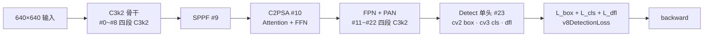
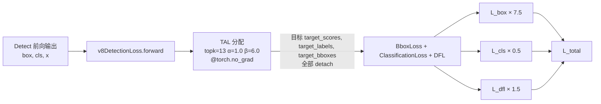
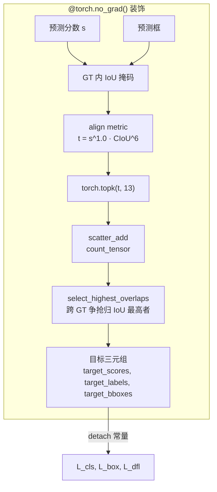
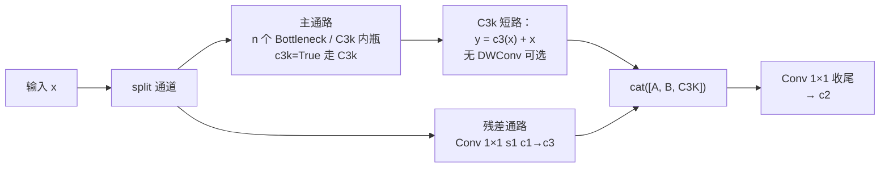
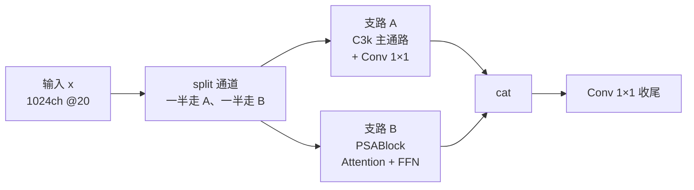

# YOLOv11 反向传播推导

::: tip 只想带走三件事
1. **v11 的梯度图就是 v8 的梯度图**——损失类是 `v8DetectionLoss`（<SrcLink file="v11:ultralytics/utils/loss.py" :line="157" />），三分量（box / cls / dfl）与归一化方式与 v8 完全一致，公式可以直接从 v8 页面照搬；
2. **TAL 分配器不参与梯度**：`@torch.no_grad()` + 预测侧 detach 双保险，`topk` / `argmax` / `scatter_add` 全是离散决策，分配结果作为常量进入损失——梯度只回传网络输出，与 v8 同一条边界；
3. **v11 相对 v10 的梯度差异是"减法"**：v10 的 `xi.detach()` 梯度分水岭（<SrcLink file="v10:ultralytics/nn/modules/head.py" :line="512" />）在 v11 里不存在——没有 one2one 分支，也就没有那个"特征被单向供养"的结构性 detach；梯度通路比 v10 简单一层，只走一条主干。
:::

## 0. 记号与前向数据流 (`grad-flow`)

> **v1~v10 读者路标**：v1–v8 的梯度图都是"骨干 → neck → Detect 单头 → v8DetectionLoss"这套；v9 训练态输出主辅两套预测（辅助头吃 backbone 内部特征）；v10 训练态输出 `{"one2many", "one2one"}` 双字典项，其中 one2one 分支在进头之前把特征 `detach` 了。**v11 完全回到 v8 的形态**——`Detect` 头 <SrcLink file="v11:ultralytics/nn/modules/head.py" :line="21" :end="68" />、单份损失、单份前向输出，没有任何 detach 分流。



本页记号：

- $\theta_{\text{back}}$：C3k2 骨干 + SPPF + C2PSA 参数；$\theta_{\text{neck}}$：#11–#22 四段 C3k2 参数；$\theta_h$：Detect 头 cv1/cv2/cv3/dfl 参数
- $x$：neck 输出的三尺度特征（P3/P4/P5），640 输入共 $80^2+40^2+20^2=8400$ 个预测位置
- $L = \lambda_{\text{box}}\, L_{\text{box}} + \lambda_{\text{cls}}\, L_{\text{cls}} + \lambda_{\text{dfl}}\, L_{\text{dfl}}$，出厂权重 7.5 / 0.5 / 1.5（v8 默认）
- $q$：TAL 软标签质量（detach 常量，$q\in(0,1]$）；$\Sigma_q = \max(\sum \text{target\_scores},\ 1)$ 归一化分母
- 分支内部：$z$ 分类/DFL logit，$p=\sigma(z)$；与 [v8 梯度页](/versions/v8/loss-gradient#0-梯度来源与记号) 同一套记号

## 1. 三分量总装与梯度入口 (`grad-loss-py`)

> **v1~v9 读者路标**：v1–v7 的损失类分散在 darknet 与 PyTorch 两套实现里；v8 把它统一成 `v8DetectionLoss`；v9 沿用；v10 新增 `v10DetectLoss`（<SrcLink file="v10:ultralytics/utils/loss.py" :line="717" :end="727" />）专门吃双分支字典；**v11 回到 v8 的 `v8DetectionLoss`，且 yaml 里不引用 `v10DetectLoss`**。

<SrcLink file="v11:ultralytics/utils/loss.py" :line="157" :end="163" />



- **损失类选择**：`DetectionModel.init_criterion` 里的分支决定用哪个 Loss。v11 复用 v8 的 `YOLOv8DetectionModel` 家族，`init_criterion` 返回 `v8DetectionLoss`；不需要覆写（对比 v10 的 `YOLOv10DetectionModel` 强制返回 `v10DetectLoss`）
- **TAL 分配器默认参数变了**：`TaskAlignedAssigner(topk=13, alpha=1.0, beta=6.0)`（<SrcLink file="v11:ultralytics/utils/tal.py" :line="13" />）——`topk` 从 v10 的 10 加到 13，`alpha` 从 v10 的 0.5 加到 1.0，`beta` 保持 6.0。三处默认值都改，梯度分布也随之改变（详见[第 3 节](#3-tal-分配不参与梯度-grad-tal-nograd)）
- **loss 权重仍走 v8 默认**：`box=7.5 / cls=0.5 / dfl=1.5` 在 `cfg/default.yaml` 里逐键同源（与 v8 完全一致），v11 未新增任何损失相关超参
- **单分支总装**：与 v10 的双分支不同，v11 的 `v8DetectionLoss.forward` 只做一次 TAL 分配，返回三元组损失——损失名列表就是 `box_loss, cls_loss, dfl_loss` 三项

## 2. 单分支三条梯度通路 v8 同款 (`grad-single`)

> **v1~v9 读者路标**：本节的三个公式与 [v8 梯度页](/versions/v8/loss-gradient) 第 1–3 节完全相同（v11 的 loss.py 与 v8 一致）；v9 页面多讲一层"0.25 权重怎么缩放梯度"，v10 两支各跑一遍；**v11 只跑一遍**，梯度公式原样落地。

| 梯度闸门 | 位置 | 作用 | 适用范围 |
|---------|------|------|---------|
| 1. `@torch.no_grad()` | tal.py L38 | 分配全程不建图，输出全是常量 | v11 唯一一次分配 |
| 2. 预测侧 `.detach()` | loss.py L175-176 | 分配输入常量化，目标不随预测「作弊」 | v11 唯一一次分配 |

**分类梯度**（软标签 BCE，正类通道 $y=1$、目标 $t=q\,y$）：

$$\boxed{\ \frac{\partial L_{\text{cls}}}{\partial z} = \sigma(z) - q\,y\ }$$

- **v11 的 topk=13**：每个 GT 最多有 13 个 anchor 拿到正样本 cls 梯度（v10 是 10），意味着正样本的梯度分布更"散"、每份梯度更"薄"
- **v11 的 α=1.0**：align metric $t=s^{\alpha}\cdot\mathrm{CIoU}^{\beta}$ 里分数项指数从 v10 的 0.5 提到 1.0——训练中期分类头的分化会被完全平方地放大，比 v10 更"急"
- **背景压制梯度铺满 8400 位置**：cls 的 BCE 在负样本上梯度就是 $p$，与 v8/v10 完全一致

**回归梯度**（CIoU × q，期望距离线性）：

$$L_{\text{box}} = \frac{\sum_i (1 - \mathrm{CIoU}_i)\, q_i}{\Sigma_q}, \qquad \frac{\partial\, \text{box}}{\partial d} = \pm 1$$

- 预测框是 ltrb 期望距离的线性函数（无 $2\sigma(1-\sigma)$ 自我限幅，与 v5/v7 的区别保持）
- $\partial d / \partial s_k$ 走 softmax 雅可比（见本页 §2 DFL 段），梯度 × $q_i/\Sigma_q$——**topk=13 时 $\Sigma_q$ 更大**，单正样本的回归梯度系数相应更小
- CIoU 里的 $\alpha$（v 惩罚系数）在 `torch.no_grad()` 下算，是常量权重——与 v8/v10 完全一致的口径

**DFL 梯度**（双 bin 插值 CE）：

$$\boxed{\ \frac{\partial L_{\text{dfl}}}{\partial z_k} = w_l\,(p_k - \delta_{[k=t_l]}) + w_r\,(p_k - \delta_{[k=t_r]})\ }$$

- 梯度把 16 bin 分布质量往目标两侧相邻 bin 上押，最优分布的期望恰等于目标距离（推导与"期望恒等式"见 [v8 梯度页第 3 节](/versions/v8/loss-gradient#3-dfl-的期望值梯度-grad-dfl)）
- **v11 未改 DFL**：`DistributedFocalLoss` 与 v8/v9/v10 逐字相同，reg_max=16、loss_fn=CE，梯度公式无差异

合成：

$$\frac{\partial L}{\partial \theta} = \lambda_{\text{box}}\, \frac{\partial L_{\text{box}}}{\partial \theta} + \lambda_{\text{cls}}\, \frac{\partial L_{\text{cls}}}{\partial \theta} + \lambda_{\text{dfl}}\, \frac{\partial L_{\text{dfl}}}{\partial \theta}$$

其中 $\theta$ 可以是 $\theta_{\text{back}}$、$\theta_{\text{neck}}$ 或 $\theta_h$——三条分量梯度全部沿同一棵 autograd 图回传，没有 v10 那种"某支不回传"的特殊路径。

## 3. TAL 分配不参与梯度 (`grad-tal-nograd`)

> **v1~v10 读者路标**：v6 是"分配结果隐式常量"（不显式 no_grad，靠 autograd 追踪不到的离散操作切断），v7 引入显式 `no_grad` + `detach` 双保险，v8/v9/v10 沿用。v11 直接继承 v8 的双保险，代码行号变了但语义一字未改。

<SrcLink file="v11:ultralytics/utils/tal.py" :line="13" :end="13" />
<SrcLink file="v11:ultralytics/utils/tal.py" :line="38" :end="38" />



- **装饰器挡住整段建图**：`forward` 上有 `@torch.no_grad()` 装饰，分配过程里 topk / argmax / scatter 都不建计算图节点——分配输出的三元组在 autograd 里就是常量
- **调用处再 detach 一层**：`pred_scores.detach()` 与 `pred_bboxes.detach()`（loss.py 里的分配器调用处）把输入侧也切成常量——即使未来去掉装饰器，目标也不会随预测变化
- **topk=13 的排序敏感**：`torch.topk(metrics, 13)` 每 GT 取前 13 名——比 v10 的 10 名多 30%。多出来的 3 个正样本会拿到微弱的 cls/box/dfl 梯度（$q$ 值通常较小），但**排序决策本身不可微**：哪个 anchor 进入 top13 由 align metric 决定，align metric 在 `no_grad` 里算出，选中的才拿到梯度
- **α=1.0 的排序影响**：分数指数从 0.5 提到 1.0 意味着"分类分数"的排序话语权被放大——**训练中期分类头一旦分化，topk=13 的入选名单会更紧跟"当前最自信的 anchor"**，比 α=0.5 时更"贪"

三个梯度闸门对照：

| 闸门 | v8 | v9 | v10 | v11 |
|------|----|----|-----|-----|
| 分配器 `@torch.no_grad()` | ✓ | ✓ | ✓ | ✓ |
| 预测侧 `.detach()` | ✓ | ✓ | ✓ | ✓ |
| 特征 `xi.detach()`（one2one 分支） | — | — | ✓ | **✗** |
| 预测侧 detach（辅助头） | — | ✓ | — | — |

**v11 只有两把闸门**——分配侧常量化的双保险。v10 的第三把闸门（one2one 特征 detach）在 v11 里**根本不存在**，因为没有 one2one 分支。

## 4. C3k2 与 C2PSA 的梯度路径 (`grad-newblocks`)

> **v1~v10 读者路标**：v8 骨干里所有梯度都穿过 C2f 的两条通路（主通路 n 个 Bottleneck + shortcut 分支）；v10 骨干里加了 SCDown 下采样与 PSA 全局注意力。**v11 把骨干里的 4 处 C2f 全换成 C3k2、把 SPPF 之后的独立 PSA 换成 C2PSA**——梯度路径多了一种"内瓶短路"和一个"CSP 双支合流"，但公式上无新东西。

### 4.1 C3k2 的两条内通路

<SrcLink file="v11:ultralytics/nn/modules/block.py" :line="723" :end="751" />



- **骨干浅层**（#2/#4，`c3k=False, e=0.25`）：内瓶走 Bottleneck，梯度按"标准 residual block"路径回传——$\partial / \partial x_{\text{in}}$ = shortcut 直通 + Bottleneck 内部梯度
- **骨干深层与头**（#6/#8/#13/#16/#19/#22，`c3k=True`）：内瓶走 C3k，C3k 是 C3 的 shortcut 变体——**没有 Attention 分流**（这一点在 [painpoints 页痛点 4](/versions/v11/painpoints#_4-c3k2-简化版无-attention-分流-pain-c3k2-simple) 讨论），只是把 C2f 的多层 Bottleneck 换成"n 个 C3k 内瓶串接"
- **e=0.25 的通道压缩**：浅层 C3k2 把内瓶通道压到 `int(e * c1)`（0.25 倍），参数与梯度量同步缩小——**浅层梯度方差更小**，训练早期不会因浅层参数过多而抖动
- **v11 C3k2 未包含 Attention 分流**：这是 v8.3.0 快照的原始形态；后续版本的 C3k2 有 `sca` / `gconv` 变体，但**本快照内无对应代码**（详见 painpoints 页）

对 C3k2 内任一参数 $\theta_i$ 的梯度：

$$\frac{\partial L}{\partial \theta_i} = \frac{\partial L}{\partial \text{out}} \cdot \frac{\partial \text{out}}{\partial \theta_i}$$

链式规则完全交给 autograd——**C3k2 没有 detach、没有 stop-gradient、没有特殊的梯度缩放**，与 v8 C2f 一致。

### 4.2 C2PSA 的双支合流

<SrcLink file="v11:ultralytics/nn/modules/block.py" :line="1002" :end="1041" />



- **v10 PSA 的一半通道注意力 → v11 C2PSA 的一半通道 PSABlock**：v10 是"SPPF 之后额外挂 PSA"（PSA 只对一半通道做 Attention + FFN，另一半直通），v11 是"C2PSA 内嵌 PSABlock"（一半走 Attention + FFN，另一半走 C3k 残差）——**两者都是"一半通道做注意力"，但外壳不同**
- **PSABlock 内包含完整 Attention + FFN**：qkv 1×1 合并、key_dim 减半、位置编码 3×3 DWConv、num_heads = c // 64，与 v10 的 Attention 类逐字相同（<SrcLink file="v11:ultralytics/nn/modules/block.py" :line="866" />）
- **梯度路径**：两条支路 A/B 都参与梯度、在 cat 处合流、再由收尾 1×1 Conv 汇聚——**没有 detach、没有梯度缩放**，两条支路的贡献平等传回骨干尾特征
- **v11 C2PSA 与 v10 PSA 的关键差异**：v10 PSA 的"另一半通道"是直通（gradient 1:1 传回），v11 C2PSA 的"另一半通道"走 C3k 主通路（带 Conv + Bottleneck 的残差梯度）——**v11 的注意力"另一半"是有结构的**，梯度信息更丰富

### 4.3 C3k2 / C2PSA 相对 C2f / PSA 的梯度差异

| 模块 | 梯度通路 | detach | 梯度特殊处理 | 训练期行为 |
|------|---------|--------|--------------|-----------|
| v8 C2f | 主通路 n×Bottleneck + shortcut | 无 | 无 | 标准 |
| v10 C2fCIB | 主通路 + 大核 CIB 分支 | 无 | 无 | 标准 |
| v11 **C3k2** | 主通路 n×(Bottleneck 或 C3k) + Conv shortcut | 无 | 无 | 标准 |
| v10 PSA | 一半 Attention + FFN，一半直通 | 无 | 无 | 标准 |
| v11 **C2PSA** | 一半 PSABlock，一半 C3k | 无 | 无 | 标准 |

**结论**：v11 两个新模块在梯度语义上都是"标准 autograd 图"，没有 v10 那种"某支不回传"的特殊设计——这是 v11 与 v10 在梯度结构上最大的分水岭。

## 5. 与 v10 的梯度差异对照 (`grad-vs-v10`)

> **v10 读者路标**：v10 的梯度图有三层闸门、双分支损失、one2one detach、topk=1 稀疏监督；**v11 相对 v10 的梯度差异几乎全是"删掉"**——没有 one2one、没有 detach、没有 topk=1，一切回归 v8 口径。

| 维度 | v10 | v11 | 差异含义 |
|------|-----|-----|---------|
| 损失类 | `v10DetectLoss`（双分支） | `v8DetectionLoss`（单分支） | v11 少 3 项损失（box_oo/cls_oo/dfl_oo 消失） |
| 检测头 | `v10Detect`（one2many + one2one） | `Detect`（单头） | v11 梯度图少一层 |
| 特征 detach | one2one 分支 `xi.detach()` | **无** | v11 骨干梯度只来自一份损失，无"单向供养"设计 |
| TAL topk | one2many=10, one2one=1 | **13**（单分配器） | v11 单分配器 topk 加大 30% |
| TAL alpha | 0.5 | **1.0** | v11 分数话语权加倍 |
| TAL beta | 6.0 | 6.0 | 无变化 |
| 损失权重 | 6 项 × 1.0 | 3 项 × (7.5/0.5/1.5) | v11 恢复 v8 默认 |
| one2many / one2one 头 deepcopy | ✓（head.py L508-509） | ✗ | v11 训练图参数口径与部署图一致 |
| 训练日志损失名 | box_om/cls_om/dfl_om/box_oo/cls_oo/dfl_oo（6 项） | box_loss/cls_loss/dfl_loss（3 项） | v11 训练日志与 v8 一致 |

**梯度稀疏性**：v10 one2one 分支每 GT 只有 1 个正样本（topk=1），正样本梯度极稀疏但权重 × $1/\Sigma_q$ 被放大；v11 每 GT 最多 13 个正样本（topk=13），梯度分布更散、单样本话语权更小——**v11 的梯度分布介于"撒网"与"押注"之间**，是 v8/v10 的调和。

**梯度方差**：v11 恢复 v8 的"多正样本 + 中等权重"口径，梯度方差比 one2one 分支低，训练曲线更平滑——这也是 v11 训练收敛速度接近 v8 的直接原因。

## 6. 初始 bias 与训练初期的梯度 (`grad-bias`)

> **v8 读者路标**：公式与 v8 `Detect.bias_init` 逐字相同（v11 沿用 v8 的 Detect 类）；v10 的增量是"one2one 头也要初始化一遍"，**v11 不需要**——只有一个头，bias_init 调用一次。

<SrcLink file="v11:ultralytics/nn/modules/head.py" :line="88" :end="95" />

**分类 bias 的数值**（nc=80）：

| 尺度 | stride | 网格面积 $(640/s)^2$ | 初始概率 $\sigma(b)=\frac{5}{80\cdot(640/s)^2}$ | bias $=\ln(\cdot)$ |
|------|--------|--------------------|-------------------------------------------------|--------------------|
| P3 | 8 | 6400 | $9.77\times10^{-6}$ | −11.54 |
| P4 | 16 | 1600 | $3.91\times10^{-5}$ | −10.15 |
| P5 | 32 | 400 | $1.56\times10^{-4}$ | −8.76 |

- **作用一：压住训练初期的背景梯度洪峰**。8400 个位置里绝大多数是负样本，BCE 背景项梯度 $\sigma(z)\approx 10^{-5}$——若 bias 从 0 开始（$\sigma=0.5$），第一步就有几千个位置的 0.5 量级压制梯度叠加，loss 与权重都会剧烈震荡；小 bias 让"背景压制"从近零起步，随预测分化逐渐加码
- **作用二：让 align metric 初期由 CIoU 主导**。初期所有 anchor 的 $s^{1.0}\approx 10^{-5}$ 且差异远小于 CIoU 差异（**v11 α=1.0**，比 v10 的 α=0.5 更依赖 CIoU 项），$t = s\cdot\mathrm{CIoU}^{6}$ 的排序几乎完全由 $\mathrm{CIoU}^{6}$ 决定——**topk=13 的入选名单在训练早期实质是"当前框最准的 13 个 anchor"**，而不是分数最高者；随分类头分化，分数项才逐渐参与排序
- **作用三：给 DFL 一个中性起点**。box bias 全 1.0 → 均匀分布 → 每条边期望 7.5 bin，所有 anchor 画出同一尺寸的"中标框"；DFL 梯度 $w_l(p_k-\delta_{t_l})+w_r(p_k-\delta_{t_r})$ 从均匀分布（每 bin 梯度 1/16）把质量推向目标 bin——起点对称、无偏置，收敛路径只由数据决定

## 7. 全流程串起来

```
Input 640×640
  → C3k2 骨干（4 段 C3k2，浅层 c3k=False e=0.25 · 深层 c3k=True）
  → SPPF
  → C2PSA（Attention + FFN，一半通道走 PSABlock）
  → FPN+PAN 头（4 段 C3k2，全部 c3k=True）
  → Detect 单头（cv1 升维 → split → cv2 box / cv3 cls）
    → TAL topk=13 α=1.0 β=6.0 分配（@torch.no_grad + 预测侧 detach）
    → 三分量损失：L_box × 7.5 + L_cls × 0.5 + L_dfl × 1.5
  → backward：三条分量梯度沿 autograd 图回传
    → 更新 θ_back（C3k2 + SPPF + C2PSA）
    → 更新 θ_neck（4 段 C3k2）
    → 更新 θ_h（Detect 的 cv1/cv2/cv3/dfl）
  → 推理：Detect 输出 → conf 过滤 → class-wise NMS → max_det 输出
```

（总装 <SrcLink file="v11:ultralytics/utils/loss.py" :line="157" :end="225" />；分配器 <SrcLink file="v11:ultralytics/utils/tal.py" :line="13" :end="13" />；头前向 <SrcLink file="v11:ultralytics/nn/modules/head.py" :line="49" :end="68" />；C3k2 与 C2PSA <SrcLink file="v11:ultralytics/nn/modules/block.py" :line="723" /> 与 <SrcLink file="v11:ultralytics/nn/modules/block.py" :line="1002" :end="1041" />）

## 8. 数值示例：topk=13 与 α=1.0 的梯度分布 (`grad-example`)

> **v1~v9 读者路标**：v8/v10 页面给了 topk=10 与 topk=1 的对比数值示例；v11 的 topk=13 + α=1.0 组合没在页面单独推演，这里给一个 640 输入下 P3 层单 GT 的示意。

设某 GT（类别 c）在 P3 层有 13 个中心落点在框内的 anchor 候选，训练中期预测分数 $s$ 与 CIoU 如下。align metric $t = s^{1.0}\times\mathrm{CIoU}^{6}$（**v11 α=1.0**）：

| 排名 | anchor | 预测分数 s | CIoU | $\mathrm{CIoU}^6$ | align $t$ | 软标签 $q=t/t_{\max}\cdot\max\mathrm{CIoU}$ |
|------|--------|-----------|------|-------------------|-----------|--------------------------------------------|
| 1 | a1 | 0.81 | 0.90 | 0.531 | **0.430** | 0.900 |
| 2 | a2 | 0.72 | 0.88 | 0.464 | 0.334 | 0.700 |
| 3 | a3 | 0.64 | 0.85 | 0.377 | 0.241 | 0.504 |
| 4 | a4 | 0.49 | 0.82 | 0.304 | 0.149 | 0.313 |
| 5 | a5 | 0.36 | 0.78 | 0.225 | 0.081 | 0.170 |
| 6 | a6 | 0.25 | 0.71 | 0.128 | 0.032 | 0.068 |
| 7 | a7 | 0.16 | 0.64 | 0.069 | 0.011 | 0.023 |
| 8 | a8 | 0.09 | 0.55 | 0.028 | 0.003 | 0.005 |
| 9 | a9 | 0.04 | 0.42 | 0.005 | 0.0002 | 0.0004 |
| 10 | a10 | 0.02 | 0.35 | 0.002 | 0.00004 | 0.0001 |
| 11 | a11 | 0.01 | 0.25 | 0.0002 | 0.000002 | 0.000004 |
| 12 | a12 | 0.005 | 0.18 | 0.00004 | 0.0000002 | ≈ 0 |
| 13 | a13 | 0.001 | 0.12 | 0.000003 | 0.000000003 | ≈ 0 |

（单 GT 场景 $q=t/t_{\max}\times\max\mathrm{CIoU}$；多 GT 时再跨 GT 取 max，见 [losses 页 §4](/versions/v11/losses#4-tal-分配器与默认参数回调)）

- **13 个正样本的分布**：a1 到 a10 的 $q$ 值明显，a11–a13 的 $q$ 近乎零——虽然 topk=13 让 13 个 anchor 都拿到正样本身份，但实际只有前 8 个贡献了有效梯度
- **$\Sigma_q\approx 2.68$**：a1 的回归梯度系数 $0.9/2.68\approx 0.34$，比 v10 one2one 的 1.0 小，比 v10 one2many（$\Sigma_q\approx 3.05$）时的 0.30 略大
- **α=1.0 的作用**：a2 与 a1 的预测分数只差 11%，CIoU 只差 2.2%——但分数项被指数 1.0 放大后，$t$ 值差距比 α=0.5 时更明显，topk=13 的入选顺序更"贪心"地跟着分数走
- **对 top13 选择本身的梯度为 0**：与 v8/v10 同一条边界——"选中谁"是离散决策，选中的样本才拿到梯度

## 与其他页的链接

- [YOLOv11 损失函数](/versions/v11/losses)——三分量总装、TAL align_metric、topk=13 与 α=1.0 的代码落点
- [v8 反向传播推导](/versions/v8/loss-gradient)——v11 单分支三公式的完整推导（v11 与 v8 一致）
- [v9 反向传播推导](/versions/v9/loss-gradient)——上一代双头梯度（对照 v11 的"减法"）
- [v10 反向传播推导](/versions/v10/loss-gradient)——一代之前的双分支 + detach 设计（v11 全部拆掉）
- [YOLOv11 训练技巧](/versions/v11/tricks)——v11 的默认训练配方（与 v8 一致）
- [YOLOv11 痛点追踪](/versions/v11/painpoints)——梯度设计上的历史遗留与新痛点
- [YOLOv11 nn/modules/head.py 源码页](/versions/v11/source/head-py)——Detect 头逐行
- [YOLOv11 utils/loss.py 源码页](/versions/v11/source/loss-py)——v8DetectionLoss 与三分量装配
- [YOLOv11 utils/tal.py 源码页](/versions/v11/source/tal-py)——topk=13 分配的代码细节
- [术语表](/glossary)——TAL、DFL、CIoU、BCE、CSP 等术语索引
