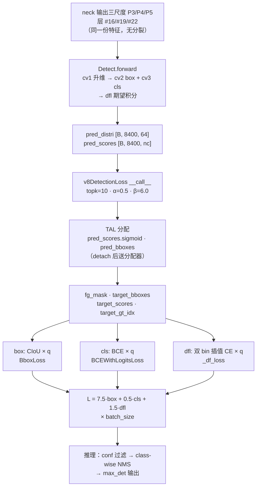

# YOLOv11 损失函数

> 核心事实：**v11 未引入新损失类**——完全沿用 v8 沿用的 `v8DetectionLoss`（<SrcLink file="v11:ultralytics/utils/loss.py" :line="157" :end="258" />）。v10 的 `v10DetectLoss`（L717）与端到端专用的 `E2EDetectLoss`（L730）在 loss.py 末尾作为 v10 遗产保留，但 **`yolo11.yaml` 完全不引用**。v11 在损失侧唯一的实质变化发生在 `TaskAlignedAssigner` 类的**默认参数**——从 v8/v9/v10 的 topk=10 / α=0.5 上调到 v11 的 topk=13 / α=1.0——但检测训练实际用的仍是 v8 值，因为 `v8DetectionLoss.__init__` 在 L170 显式传参覆盖了类默认。

> **v1~v10 读者路标**：v11 相对 v10 在损失侧的净增量是**零**——三分量总装（box + cls + dfl）、CIoU + DFL + BCE 公式、TAL 分配机制、7.5/0.5/1.5 增益、`close_mosaic=10` 全部沿用 v8。想让 v8 读者快速上手：把 [v8 损失页](/versions/v8/losses) 直接搬过来用即可，v11 只是让代码仓库里的损失类变多（v10 遗产保留），不影响训练路径。

## 1. 只想带走三件事

1. **总损失公式与 v8 一字不差**：$L_{\text{total}} = 7.5\,L_{\text{box}} + 0.5\,L_{\text{cls}} + 1.5\,L_{\text{dfl}}$——三分量、增益、加权方式全部与 v8 相同（<SrcLink file="v11:ultralytics/utils/loss.py" :line="254" :end="256" />）；
2. **训练用的分配器仍是 v8 参数**：loss.py L170 显式传 `topk=10, α=0.5, β=6.0`——v11 的 topk=13 / α=1.0 只存在于 tal.py 类默认里，`yolo11.yaml` 检测训练实际吃不到（<SrcLink file="v11:ultralytics/utils/loss.py" :line="170" /> 与 <SrcLink file="v11:ultralytics/utils/tal.py" :line="28" :end="36" />）；
3. **v10 的双分支损失完全废弃**：v10 的 `v10DetectLoss`（<SrcLink file="v11:ultralytics/utils/loss.py" :line="717" :end="728" />）与 `E2EDetectLoss`（<SrcLink file="v11:ultralytics/utils/loss.py" :line="730" :end="745" />）都在 loss.py 末尾保留，但 `yolo11.yaml` 的 `DetectionModel.init_criterion` 直接返回 `v8DetectionLoss(self)`——不经过 v10 任何分支。

## 2. 全景图

> **v1~v10 读者路标**：v10 的损失图是「双 v8DetectionLoss 实例化 + topk 双值 + 一致双分配」；v11 回到 v8 的「单 v8DetectionLoss + TAL 单分配 + NMS 后处理」——图简单了、但 NMS 回来了。想和 v10 对照的话，直接看 [v10 损失页 §1](/versions/v10/losses) 的双分支图，v11 相当于把两条支路合并成一条。



- **训练路径**：三分量总装，与 v8 完全相同
- **推理路径**：class-wise NMS（不是 v10 的 v10postprocess 两次 topk）——NMS 算子回归
- **梯度路径**：无 detach、无双分支——单头单梯度
- **日志**：三分量 `[box, cls, dfl]`（3 维向量），不像 v10 的 6 维（双分支 × 三分量）

> **v1~v10 读者路标**：v10 的 loss 图有两个分支、六个分量、双 assigner、双 detach 分水岭；v11 只有一个分支、三个分量、单 assigner、无 detach。图简单了，但 NMS 回来了——**v11 是「回到 v8 老路」在损失侧的完整体现**。

## 3. 单分支三分量总装（v8 同款）

> **v1~v10 读者路标**：本节与 [v8 损失页](/versions/v8/losses) 第 1–4 节逐行对应——v11 快照的 `loss.py` 里 `v8DetectionLoss` 从 v8 一字未改；v9 改的是权重不对称（0.25/1.0），v10 改的是双分支实例化，v11 连权重都没动。想看「v11 新在哪」的读者直接跳 [第 4 节](#4-tal-分配器与默认参数回调)。

### 3.1 v8DetectionLoss.__init__（L157-L179）

<SrcLink file="v11:ultralytics/utils/loss.py" :line="157" :end="179" />

- **L163**：`BCEWithLogitsLoss(reduce="none")`——分类用交叉熵，逐元素返回
- **L170**：`TaskAlignedAssigner(topk=10, num_classes=self.nc, alpha=0.5, beta=6.0)`——**topk / α / β 全部硬编码**，不读 tal.py 的类默认
- **L171**：`BboxLoss(m.reg_max - 1, use_dfl=...)`——`reg_max - 1 = 15` 传给 DFL 的 clamp 上界
- **L172**：`proj = torch.arange(reg_max).float().view(1, -1)`——DFL 期望积分的 bin 坐标 0..15

### 3.2 前处理：preprocess + bbox_decode

- `preprocess`（<SrcLink file="v11:ultralytics/utils/loss.py" :line="181" :end="196" />）：把 batch 的 `batch_idx / cls / bboxes` 摊平到 `(b, max_boxes, 5)` 并转 xyxy；`mask_gt` 标记有效 GT
- `bbox_decode`（<SrcLink file="v11:ultralytics/utils/loss.py" :line="198" :end="205" />）：`4×16` 分布 softmax 后对 `proj` 求期望，`dist2bbox` 得到预测框（anchor-free 解码）

### 3.3 __call__ 主流程（L207-L258）

<SrcLink file="v11:ultralytics/utils/loss.py" :line="207" :end="258" />

1. **L211-213** 拼平三尺度并 split 出 `pred_distri / pred_scores`
2. **L221** `make_anchors` 生成锚点（网格中心 +0.5 偏移）与 stride 张量
3. **L224-227** GT 前处理，`mask_gt` 标有效框
4. **L232-239 调分配器**：`pred_scores.detach().sigmoid()`、`pred_bboxes.detach() × stride_tensor` 全部切断梯度（分配不回传）
5. **L241** `target_scores_sum = max(target_scores.sum(), 1)`——Σq，三项共同归一化分母；`max(..., 1)` 防空图除零
6. **L244-245** cls = 软标签 BCE 全图求和 ÷ Σq——上一行注释 `# VFL way` 是 v6 时代 [VarifocalLoss](/glossary#vfl-varifocal-loss) 的注释留档，未启用
7. **L248-252** 有正样本才算 box / dfl
8. **L254-256** 乘增益 7.5 / 0.5 / 1.5，返回 `(loss.sum() * batch_size, loss.detach())`

**box 分量**：CIoU × 软标签加权（BboxLoss，<SrcLink file="v11:ultralytics/utils/loss.py" :line="63" :end="86" />）

```python
weight = target_scores.sum(-1)[fg_mask].unsqueeze(-1)      # 软标签 q 压成每 anchor 标量
iou = bbox_iou(pred_bboxes[fg_mask], target_bboxes[fg_mask], xywh=False, CIoU=True)
loss_iou = ((1.0 - iou) * weight).sum() / target_scores_sum
```

$$\mathrm{CIoU} = \mathrm{IoU} - \frac{\rho^2}{c^2} - \alpha v, \qquad \rho^2 \text{ 中心距},\ c^2 \text{ 最小包围框对角线平方},\ v \text{ 宽高比一致性}$$

[CIoU loss](/glossary#ciou-loss) 实现仍在 `utils/metrics.py`（`from .metrics import bbox_iou`，loss.py L10），逐项梯度推导见 [v8 梯度页](/versions/v8/loss-gradient)——v11 完全复用。

**cls 分量**：软标签 BCE（<SrcLink file="v11:ultralytics/utils/loss.py" :line="234" />）

- 全 8400 位置都算（负样本学背景），目标 $t = q \cdot y$ 是 TAL 归一化软标签
- 无 [objectness](/glossary#objectness) 分支的设计与 v8 一致
- `pos_weight` 加权：`F.binary_cross_entropy(pred_scores, target_scores, weight=weight)`——正样本权重来自 TAL 软标签

**dfl 分量**：双 bin 插值 CE（`_df_loss`，<SrcLink file="v11:ultralytics/utils/loss.py" :line="88" :end="103" />）

- 目标距离落在相邻两 bin 之间，按小数部分线性插值两条 [softmax](/glossary#softmax) 交叉熵
- × q → ÷ Σq——最优分布的期望恰等于目标，推导见 [v8 梯度页](/versions/v8/loss-gradient)

$$L_{\text{dfl}} = \sum_{a \in \text{fg}} q_a \cdot \bigl[(1 - f_a) \cdot \mathrm{CE}(p_a, \text{bin}_{t_a \uparrow}) + f_a \cdot \mathrm{CE}(p_a, \text{bin}_{t_a \downarrow})\bigr]$$

- **无 MakeMultiClass**：v11 的 tal.py 里**没有** `MakeMultiClass` 函数（v12 才引入）——同类任务由 `get_targets`（<SrcLink file="v11:ultralytics/utils/tal.py" :line="163" :end="210" />）内部完成
- **无新损失类**：v11 快照的 `loss.py` 是 745 行（v8 是 75 行、v10 是 727 行）——v11 保留了 v10 加的所有类（v10DetectLoss / E2EDetectLoss），但 yaml 主路径只用 `v8DetectionLoss`

> **v1~v10 读者路标**：本节三分量公式与增益，从 v6 到 v11 一字未改。v8 读者直接读 [v8 损失页](/versions/v8/losses) 就能覆盖本节全部；v9 读者要注意 v9 用非对称权重（辅助头 0.25、主头 1.0），v10/v11 都回到对称权重；v1 读者注意 v1 用 [Region Loss](/glossary#region-loss) + [Detection Loss](/glossary#detection-loss)，从 v3 起才引入 CIoU，从 v6 起才引入 TAL + DFL——v11 是这一演进链的当前端点。

## 4. TAL 分配器与默认参数回调

> **v6 读者路标**：v6 论文的 [TAL](/glossary#tal-task-alignment-learning) 分配器默认就是 topk=13 / α=1.0 / β=6.0；v8/v9/v10 把默认下调到 topk=10 / α=0.5；**v11 又把类默认上调回 v6 原值**——但检测损失走 loss.py L170 显式传参，仍用 v8 值。这是 v11 损失侧唯一实质变化，也是本页最容易被误解的一点。

### 4.1 tal.py L13 的类定义

<SrcLink file="v11:ultralytics/utils/tal.py" :line="13" :end="258" />

`TaskAlignedAssigner` 类从 L13 起、共 246 行；主体逻辑（forward / get_pos_mask / get_box_metrics / select_topk_candidates / get_targets / select_highest_overlaps）与 v8 完全相同，**唯一改动在 `__init__` 的默认参数**：

```python
def __init__(self, topk=13, num_classes=80, alpha=1.0, beta=6.0, eps=1e-9):
    self.topk = topk
    self.num_classes = num_classes
    self.alpha = alpha
    self.beta = beta
    self.eps = eps
```

- **v8 / v9 / v10**：`topk=10, alpha=0.5, beta=6.0`——一个 GT 最多监督 10 个正样本 anchor，对齐度量里定位项权重 β 主导、分类项 α 用「开方」压权
- **v11 类默认**：`topk=13, alpha=1.0, beta=6.0`——两个变化：
  1. `topk` 从 10 提到 13（比 v10 的 10 大 **30%**）——更接近「每个 GT 更多正样本」的 [multi-positive](/glossary#multi-positive-多正样本) 学习策略
  2. `alpha` 从 0.5 提到 1.0（分类项从「开方压权」变成「原权」，与定位项等权竞争）

这两组新默认值与 v6 TAL 论文原文推荐一致——可视为「回归到 TAL 论文默认」。

### 4.2 默认回调的实际影响

**再强调一次**：以上默认只对「外部直接实例化 `TaskAlignedAssigner()` 不带参数」生效。`v8DetectionLoss.__init__` 在 <SrcLink file="v11:ultralytics/utils/loss.py" :line="170" /> 显式传 `topk=10, alpha=0.5, beta=6.0`——因此 **`yolo11.yaml` 检测训练实际用的仍是 topk=10、α=0.5**。

| 场景 | 分配器类型 | topk | α / β | 使用者 |
|------|-----------|------|-------|--------|
| 直接 `TaskAlignedAssigner()` 无参调用 | TaskAlignedAssigner | **13** | **1.0 / 6.0** | 研究代码 / 外部脚本（吃 v11 新默认） |
| <SrcLink file="v11:ultralytics/utils/loss.py" :line="170" /> | TaskAlignedAssigner | **10** | **0.5 / 6.0** | **v8DetectionLoss → yolo11.yaml 检测主用** |
| <SrcLink file="v11:ultralytics/utils/loss.py" :line="643" /> | RotatedTaskAlignedAssigner | **13** | **1.0 / 6.0** | v8OBBLoss → yolo11-obb.yaml（OBB 从 v6 起就一直用激进参数） |
| <SrcLink file="v11:ultralytics/utils/loss.py" :line="718" :end="719" /> | TaskAlignedAssigner × 2 | **10 与 1** | 0.5 / 6.0 | v10DetectLoss（v11 不使用） |

- L170 是显式传参（v8 时代遗留）
- L643 是显式传参（OBB 一直用 topk=13 / α=1.0——OBB 从 v6 起就比检测更激进）
- 两者在 v11 里都是硬编码，**都不读 tal.py 的默认**
- **Tal 类默认上调是「面向未来 / 面向外部直接实例化」的一次架构级回调**——不改变现有 yaml 的实际训练行为

### 4.3 对齐度量公式

<SrcLink file="v11:ultralytics/utils/tal.py" :line="102" :end="121" /> `get_box_metrics`：

$$t_{ag} = s_{ag}^{\alpha} \times \mathrm{CIoU}_{ag}^{\beta}$$

- $s_{ag}$ 是 anchor $a$ 在 GT $g$ 类别通道上的预测分数（`bbox_scores[mask_gt] = pd_scores[ind[0], :, ind[1]][mask_gt]`，L113）
- $\mathrm{CIoU}_{ag}$ 以 GT 为 box1，L123-L125 `iou_calculation` 用 CIoU 且 `clamp_(0)`
- **β=6.0** 把定位质量差异放大到 6 次方——align metric 几乎由「框得多准」决定，分类分数只做温和加权
- **v11 类默认 α=1.0**：分类项原权；**v8/v10 与 v11 实际训练用 α=0.5**：分类项开方（分数区间 [0,1] 开方后**放大**分类项相对权重，但相对 β=6 的定位项仍弱）

### 4.4 forward 五步流水（L38-L88）

整个 `forward` 挂在 <SrcLink file="v11:ultralytics/utils/tal.py" :line="38" /> 的 `@torch.no_grad()` 下——分配是纯训练期路由，永不回传梯度（loss.py 调用前还额外 detach 了一次预测，双保险）：

1. **空 GT 早退** <SrcLink file="v11:ultralytics/utils/tal.py" :line="62" :end="70" />：`n_max_boxes == 0` 时直接返回全背景
2. **求正样本位** <SrcLink file="v11:ultralytics/utils/tal.py" :line="72" :end="74" />：`get_pos_mask`——「中心在 GT 内」×「对齐度量 topk」×「GT 有效」三重 mask 相乘
3. **抢占去重** <SrcLink file="v11:ultralytics/utils/tal.py" :line="76" />：`select_highest_overlaps`——一个 anchor 被多个 GT 选中时，归 IoU 最高者
4. **造目标** <SrcLink file="v11:ultralytics/utils/tal.py" :line="79" />：`get_targets` 按 `target_gt_idx` 抄 GT 标签与框
5. **归一化软标签** <SrcLink file="v11:ultralytics/utils/tal.py" :line="82" :end="86" />：`target_scores × pos_overlaps / pos_align_metrics`——对齐度量归一后乘回 one-hot，得到软分类目标

$$q_{ag} = \frac{t_{ag}}{\max_{a'} t_{a'g}} \cdot \max_{a'} \mathrm{CIoU}_{a'g}$$

### 4.5 select_topk_candidates：topk 决定正样本数

<SrcLink file="v11:ultralytics/utils/tal.py" :line="127" :end="161" />

- L145 `torch.topk(metrics, self.topk, dim=-1, largest=largest)`——对每个 GT 取对齐度量前 topk 个 anchor 的索引与值
- L149 `topk_idxs.masked_fill_(~topk_mask, 0)`——无效 GT 的索引统一填 0
- L152-156 `count_tensor` 逐 k `scatter_add_` 计数——topk=1 时循环体只执行一次
- L159 `count_tensor.masked_fill_(count_tensor > 1, 0)`——计数超过 1 的位置清零
- L161 返回 float mask

**topk 越激进，冲突越频繁**：topk=13 时 GT 之间更容易抢同一个 anchor，`select_highest_overlaps` 就承担更多工作量——这也是「topk 越大 ≠ 无脑好」的机制根源。

### 4.6 RotatedTaskAlignedAssigner：OBB 专用

<SrcLink file="v11:ultralytics/utils/tal.py" :line="268" :end="298" /> 只覆写两个方法：

- `iou_calculation`——把 `bbox_iou(CIoU=True)` 换成 `bbox_iou(RIoU=True)`（[probiou](/glossary#probiou)）
- `select_candidates_in_gts`——把「锚点中心在 GT 框内」的判据改成「四角点在旋转框内」

主干 `forward / get_box_metrics / select_topk_candidates / get_targets` 全部靠继承，与标准 TaskAlignedAssigner 同源。v11 的 yolo11-obb.yaml 通过 v8OBBLoss（<SrcLink file="v11:ultralytics/utils/loss.py" :line="613" />）实例化这个类，显式传 `topk=13, alpha=1.0, beta=6.0`——**OBB 从 v6 起就比检测更激进**，所以 OBB 一直用「v11 新默认」的等价参数。

> **v1~v10 读者路标**：v6 读者注意 v6 论文的 TAL 分配器默认就是 topk=13 / α=1.0 / β=6.0——v11 直接把 v8/v9 时代的「topk=10 / α=0.5」回调到 v6 论文原值，但**只在类默认层面**；检测损失走 loss.py L170 显式传参，仍用 v8 值。v7 读者注意 v7 用的是 SimOTA（cost = BCE + 3·(-log IoU) + dynamic-k 自适应正样本数），v8 换成 TAL，v9/v10/v11 都沿用 TAL。v10 读者请把 v10 里 tal.py 的 topk=10 / α=0.5 视为历史遗留——v10 用两次实例化取 topk=10 与 topk=1 实现「一致性双分配」，v11 完全放弃了这套设计。

## 5. 为什么回归 NMS 单头意味着用回 v8 损失

> **v10 读者路标**：v10 的双分支损失（v10DetectLoss + E2EDetectLoss）在 v11 都不再使用——这是 v11 「功能回退到 v8」的必然结果，不是选择。想理解为什么要一起回退，要看 v10 的整套端到端检测设计。

### 5.1 v10 的双分支设计依赖什么

v10 的 `v10DetectLoss`（<SrcLink file="v11:ultralytics/utils/loss.py" :line="717" :end="728" />）：

```python
class v10DetectLoss:
    def __init__(self, model):
        self.one2many = v8DetectionLoss(model, tal_topk=10)
        self.one2one = v8DetectionLoss(model, tal_topk=1)
    
    def __call__(self, preds, batch):
        loss_one2many = self.one2many(preds["one2many"], batch)
        loss_one2one = self.one2one(preds["one2one"], batch)
        return loss_one2many[0] + loss_one2one[0], ...
```

**这套设计依赖三个前提**：

1. `Detect` 头必须覆写 `forward` 返回 `{"one2many": ..., "one2one": ...}` 字典
2. `v10Detect` 必须 `deepcopy` 出 one2one 分支并 `xi.detach()`
3. `tal_topk` 必须作为形参传入 `v8DetectionLoss.__init__`（8.1.34 fork 特有）

### 5.2 v10 端到端专用 E2EDetectLoss

<SrcLink file="v11:ultralytics/utils/loss.py" :line="730" :end="745" /> `E2EDetectLoss`：v10 论文的「端到端检测器」（RTDETR 系）专用，用 `MultiLabelClassifier` 而不是 TAL——与 yolo11.yaml 的 anchor-free 单头完全无关，v11 完全不涉及它。

### 5.3 v11 为什么一起回退

v11 用回 v8 的 `Detect` 头（<SrcLink file="v11:ultralytics/nn/modules/head.py" :line="21" :end="68" />）——`forward` 返回 `(box, cls, x)` 元组而不是字典、没有 one2one 分支、没有 detach。既然头端不再产生双分支预测，损失侧的双分支总装（v10DetectLoss）就失去入口——只能回到 v8DetectionLoss 单实例。同理 E2EDetectLoss 是给 RTDETR 用的、与 yolo11 无关。

**所以 loss.py 里那两个 v10 类的存在，只是「代码仓库不删东西」的工程惯例**——yolo11 训练时完全不会命中。

### 5.4 DetectionModel.init_criterion 的返回

<SrcLink file="v11:ultralytics/nn/tasks.py" :line="298" /> `DetectionModel.init_criterion` 直接返回 `v8DetectionLoss(self)`——与 v8/v9 完全一致，没有像 v10 那样覆写成 `YOLOv10DetectionModel` + `v10DetectLoss`。这也是「v11 用回 v8 老路」在建模入口层的证据。

> **v1~v10 读者路标**：v10 的双分支损失设计是「一致双分配」的代码形态，与 v10Detect 头强绑定；v11 撤回 v10Detect 就等于撤回 v10DetectLoss——**损失与头的选择是一体的**。v8 读者可以直接把 v11 的 loss.py 当作 v8 的 loss.py 看（除了末尾多两个 v10 遗产类）。

## 6. 与其他版本的损失对比

> **v1~v10 读者路标**：把六代损失摆在一起看，v11 的定位一目了然——**回到了 v8 的主路径 + v6 论文默认的类默认参数**。

| 维度 | v6 | v8 | v9 | v10 | **v11** |
|------|-----|-----|-----|-----|---------|
| 检测总装类 | DetectionLoss（TAL 版） | **v8DetectionLoss** | v8DetectionLoss + v9DetectionLoss（主辅） | v8DetectionLoss + v10DetectLoss（双分支） | **v8DetectionLoss**（单实例） |
| 标签分配 | SimOTA | TAL topk=10 | 主辅各一份 TAL | 双 TAL topk=10/1 | **TAL topk=10**（L170 覆盖） |
| 损失分量 | box / cls / dfl | 三分量（对称） | 三分量（非对称 0.25/1.0） | 六分量（双三分量） | **三分量（对称）** |
| 增益 | 7.5 / 0.5 / 1.5 | 7.5 / 0.5 / 1.5 | 主头同 v8、辅头 ×0.25 | 两支均 7.5 / 0.5 / 1.5 | **7.5 / 0.5 / 1.5** |
| close_mosaic | 10 | 10 | 10 | 10 | **10** |
| TAL 类默认 α / β | 1.0 / 6.0 | 0.5 / 6.0 | 0.5 / 6.0 | 0.5 / 6.0 | **1.0 / 6.0**（类默认回调） |
| TAL 类默认 topk | 13 | 10 | 10 | 10 | **13**（类默认回调） |
| 检测实际用 topk | — | 10 | 10 | 10 与 1 各一份 | **10**（L170 硬编码） |
| 检测实际用 α | — | 0.5 | 0.5 | 0.5 | **0.5**（L170 硬编码） |
| 一致性约束 | 无 | 无 | 无 | 同分配器两次实例化 | **无（放弃一致性双分配）** |
| E2EDetectLoss | 无 | 无 | 无 | **有（L730）** | **保留但不用** |
| MakeMultiClass | 无 | 无 | 无 | 无 | **无（v12 才加）** |
| RotatedTaskAlignedAssigner | 有（OBB） | 有 | 有 | 有 | **有（OBB 专用）** |

**一句话总结**：v11 损失 = v8 主路径 + v6 类默认——**主路径不变、类默认回调**。

### 6.1 与 v10 的关键差异

| 方面 | v10 | v11 |
|------|-----|-----|
| 头数量 | 双头（one2many + one2one） | 单头 |
| 损失分支 | 双（v10DetectLoss 组合） | 单（v8DetectionLoss） |
| 损失分量维度 | 6（两支各 3） | 3 |
| TAL 实例数 | 2（topk=10 与 topk=1） | 1（topk=10） |
| detach 分水岭 | 有（one2one 输入 detach） | 无 |
| 推理后处理 | v10postprocess 两次 topk | class-wise NMS |
| 导出图 NMS | 无 | 有 |
| 一致性双分配 | 有（topk=10 + topk=1 相加） | 无 |
| 训练梯度路径 | 头 → neck → 骨干（one2many）；只更新 one2one（one2one detach） | 头 → neck → 骨干（单头） |
| 损失侧代码变化 | 新增 v10DetectLoss（L717）+ E2EDetectLoss（L730） | 保留但不用；类默认回调到 v6 |

### 6.2 与 v8 的关键差异

v11 相对 v8 在损失侧的实际训练行为**几乎为零差异**——三分量总装、增益、TAL 分配、BCE + DFL 公式、`close_mosaic=10` 全部沿用。唯一差异在两个层面：

1. **代码仓库层**：loss.py 从 v8 的 75 行扩到 v11 的 745 行——加入了 v10 的 v10DetectLoss / E2EDetectLoss，以及 v8 就有的 SegmentationLoss / PoseLoss / ClassificationLoss / OBBLoss
2. **类默认层**：tal.py 的 `TaskAlignedAssigner.__init__` 默认从 topk=10 / α=0.5 上调到 topk=13 / α=1.0——但检测训练不读类默认

> **v1~v10 读者路标**：想快速理解 v11 损失定位：把它当成「v8 训练 + v6 类默认」。v8 读者按 v8 损失页走一遍就能覆盖 v11 检测训练；v6 读者注意 v11 把类默认回调到 v6 原值，是架构层面的「回归论文」；v9 读者注意 v11 用回对称权重（不是 v9 的主辅 0.25/1.0）；v10 读者请把 v10 的整套双分支设计当作**历史遗留**，v11 yaml 不会命中。

## 7. SrcLink 汇总

本页引用到的关键源码位置（可直接跳转）：

- <SrcLink file="v11:ultralytics/utils/loss.py" :line="14" :end="35" />——VarifocalLoss（存而未用）
- <SrcLink file="v11:ultralytics/utils/loss.py" :line="63" :end="86" />——BboxLoss（CIoU + DFL 双分量）
- <SrcLink file="v11:ultralytics/utils/loss.py" :line="88" :end="103" />——_df_loss（双 bin 插值）
- <SrcLink file="v11:ultralytics/utils/loss.py" :line="157" :end="258" />——**v8DetectionLoss（v11 检测主用）**
- <SrcLink file="v11:ultralytics/utils/loss.py" :line="170" />——**assigner 显式传参（topk=10, α=0.5）**
- <SrcLink file="v11:ultralytics/utils/loss.py" :line="264" :end="445" />——v8SegmentationLoss
- <SrcLink file="v11:ultralytics/utils/loss.py" :line="447" :end="599" />——v8PoseLoss
- <SrcLink file="v11:ultralytics/utils/loss.py" :line="613" :end="715" />——v8OBBLoss
- <SrcLink file="v11:ultralytics/utils/loss.py" :line="643" />——OBB assigner 显式传参（topk=13, α=1.0）
- <SrcLink file="v11:ultralytics/utils/loss.py" :line="717" :end="728" />——v10DetectLoss（v11 不使用）
- <SrcLink file="v11:ultralytics/utils/loss.py" :line="730" :end="745" />——E2EDetectLoss（v11 不使用）
- <SrcLink file="v11:ultralytics/utils/tal.py" :line="13" :end="258" />——TaskAlignedAssigner 主体
- <SrcLink file="v11:ultralytics/utils/tal.py" :line="28" :end="36" />——**__init__ 默认（v11 上调：topk=13, α=1.0）**
- <SrcLink file="v11:ultralytics/utils/tal.py" :line="38" :end="88" />——forward 五步流水
- <SrcLink file="v11:ultralytics/utils/tal.py" :line="102" :end="121" />——get_box_metrics
- <SrcLink file="v11:ultralytics/utils/tal.py" :line="127" :end="161" />——select_topk_candidates
- <SrcLink file="v11:ultralytics/utils/tal.py" :line="268" :end="298" />——RotatedTaskAlignedAssigner
- <SrcLink file="v11:ultralytics/utils/tal.py" :line="301" :end="313" />——make_anchors
- <SrcLink file="v11:ultralytics/utils/tal.py" :line="316" :end="326" />——dist2bbox
- <SrcLink file="v11:ultralytics/utils/tal.py" :line="329" :end="332" />——bbox2dist
- <SrcLink file="v11:ultralytics/nn/tasks.py" :line="298" />——DetectionModel.init_criterion

> **v1~v10 读者路标**：本清单把 v11 涉及的所有损失与分配器位置都点名——对照 v10 的 [loss.py 源码页](/versions/v10/source/loss-py)，可以逐项 diff；对照 v8 的 [loss.py 源码页](/versions/v8/source/loss-py)，可以直接复用。

## 8. 相关概念

- [TAL Task Alignment Learning](/glossary#tal-task-alignment-learning)——训练期标签分配机制，v11 沿用
- [CIoU loss](/glossary#ciou-loss)——box 分量的几何度量，v6-v11 沿用
- [DFL Distribution Focal Loss](/glossary#dfl-distribution-focal-loss)——box 分量的分布回归，v8 引入 v11 沿用
- [VFL Varifocal Loss](/glossary#vfl-varifocal-loss)——loss.py L245 注释留档，未启用
- [Multi-positive 多正样本](/glossary#multi-positive-多正样本)——topk=13 相对 v8 的 topk=10 更激进
- [Compound Scaling](/glossary#compound-scaling-复合缩放)——见 [layers §11](/versions/v11/layers)
- [Objectness](/glossary#objectness)——v11 与 v8 一致无 objectness 分支
- [C3k2](/glossary#c3k2) / [C2PSA](/glossary#c2psa)——见 [layers 页](/versions/v11/layers)

## 延伸阅读

- [YOLOv11 架构与层速查](/versions/v11/layers)
- [YOLOv11 架构总览](/versions/v11/architecture)
- [YOLOv11 理论 Concept](/versions/v11/concepts)
- [loss.py 源码页](/versions/v11/source/loss-py)
- [tal.py 源码页](/versions/v11/source/tal-py)
- [head.py 源码页](/versions/v11/source/head-py)
- [v8 损失函数（对照基线）](/versions/v8/losses)
- [v10 损失函数（对照基线）](/versions/v10/losses)
