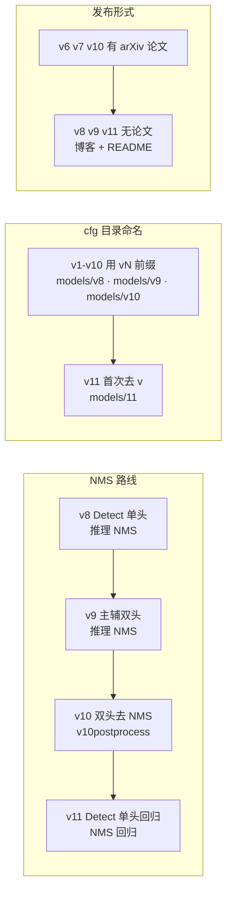
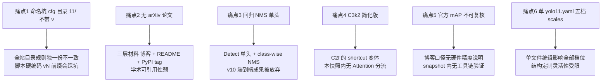

# YOLOv11 痛点追踪

YOLOv11（Glenn Jocher & Jing Qiu，ultralytics/ultralytics tag `v8.3.0`，2024-09-30，commit `6e43d1e1e5db72afbf686dee6745669bcb124b0a`，PR #16539，AGPL-3.0）没有独立论文——发布载体是 ultralytics 官方博客《YOLO11: 100% Faster, 100% Smarter》+ 仓库 README + PyPI tag 三层材料。结构上是"v8 骨架 + C3k2 内瓶 + C2PSA 骨干尾 + Detect 单头 + NMS 回归"，训练配方与 v8 逐键同源（除 TAL topk 10→13、α 0.5→1.0 外）。本页追踪 v11 引入或延续的 6 个痛点，每个都配 v1~v10 的路标：其他版本怎么处理同样的问题、v11 又做了什么新选择。

## 痛点全景

> 已读过 [v10 痛点页](/versions/v10/painpoints)？v10 的痛点全是"端到端化"的代价（去 NMS、detach 头、稀疏监督）；**v11 是结构性回退**——把 v10 的双头、去 NMS、SCDown/PSA 一整套收掉，回归 v8 主线。回退的代价换成了另一组痛点：命名坑、无论文、回归 NMS 单头、C3k2 简化版、官方数字不可复核、单文件 scales 集中。

| 痛点 | 严重度 | v1~v10 处理 | v11 处理 | 后续回应 |
| --- | --- | --- | --- | --- |
| [1. 命名坑](#1-命名坑cfgmodels11-不带-v-pain-naming) | High | 前 10 代目录都带 v 前缀 | **首次去 v**——独一份不一致 | 后续版本已回到 v12/ 目录（本快照不含） |
| [2. 无 arXiv 论文](#2-无-arxiv-论文博客-readme-pain-no-paper) | High | v6/v7 有论文 · v8/v9 无 · v10 有 | **无论文**——三层材料构成 | 官方定位"工程版本"，不追求学术发布 |
| [3. 回归 NMS 单头](#3-回归-nms-单头-部署图有-nms-算子-pain-nms-again) | Medium | v1~v9 全部 NMS · v10 首创去 NMS | **回归 NMS** | 部署工具链兼容性换精度 |
| [4. C3k2 简化版](#4-c3k2-简化版无-attention-分流-pain-c3k2-simple) | Medium | v8 C2f / v10 C2fCIB（大核） | **C3k2 无 Attention 分流** | 后续版本补 sca/gconv 变体 |
| [5. 官方 mAP 数字不可复核](#5-官方-map-数字-snapshot-内不可复核-pain-unverified-map) | High | v6/v7 论文可复核 · v8 双口径 · v10 README 声明 | **博客声明 · 无论文正文** | 以 README 口径为唯一参考 |
| [6. 5 档 scales 集中定义](#6-5-档-scales-集中定义-单文件编辑影响全部档位-pain-scales-centralized) | Medium | v8 每档一份 yaml · v10 每档一份 yaml | **单 yolo11.yaml 五档 scales** | 工程改进，但单文件编辑影响全部档位 |

> **v1~v10 读者路标**：v11 的 6 个痛点里，**1、2、4、5 是本快照独有**（命名坑、无论文、C3k2 简化、不可复核数字）；**3、6 是与前代相反的选择**（NMS 回归、scales 集中）——不是"痛点"本身，而是"与前代分歧"带来的迁移成本。

## 1. 命名坑：cfg/models/11/ 不带 v (`pain-naming`)

> **v1~v10 读者路标**：v1 到 v10 十代代码里，cfg 目录名都是 `ultralytics/cfg/models/vN/`（v1 例外：无 v 前缀，用 `ultralytics/cfg/models/yolov1-*.yaml` 顶层放置）；v8/v9/v10 严格遵循 `models/v8/`、`models/v9/`、`models/v10/` 规则——**v11 首次打破这个规则**，目录叫 `models/11/`，不带 `v`。

**现象**：`ultralytics/cfg/models/11/yolo11.yaml`（<SrcLink file="v11:ultralytics/cfg/models/11/yolo11.yaml" :line="1" />）——目录是 `11/` 而不是 `v11/`。全站目录规则独一份不一致：

| 版本 | cfg 目录 |
|------|----------|
| v8   | `models/v8/` |
| v9   | `models/v9/` |
| v10  | `models/v10/` |
| **v11** | **`models/11/`** |

**原因**：yaml 文件名也是 `yolo11.yaml`（不是 `yolov11.yaml`）——**"11" 而不是 "v11" 是官方一贯的命名选择**，从文件到目录都用短形式。这个选择与之前十代的"vN"命名习惯冲突。

**具体影响**：

- **脚本硬编码路径**：如果有脚本按 `models/v{version}/` 模式拼接路径，v11 会直接 404；需要按版本判断
- **对比 v8/v9/v10 时容易看错**：看到 `models/11/` 时会下意识以为是笔误或 v11 的目录被漏掉了 v 前缀
- **入口类不受影响**：`YOLO("yolo11n.yaml")` 通过 yaml 后缀（n/s/m/l/x）识别档位，不感知目录名——**训练/预测 API 与目录命名无关**

**v11 应对**：yaml 文件名 `yolo11.yaml`（不是 `yolov11.yaml`）与目录名一致——**内部自洽**，只是与之前十代外部规则不一致。

**遗留**：
- 后续版本（v12+）在本快照外，是否回归 `v12/` 命名规则，本页面不做断言
- 用户脚本按 `v{version}` 规则拼接路径时需要特殊处理 v11
- v11 目录是"官方命名例外"，不是 bug——**不要试图自己加 v 前缀**

## 2. 无 arXiv 论文：博客 + README (`pain-no-paper`)

> **v1~v10 读者路标**：v6 论文 arXiv:2104.08316、v7 论文 arXiv:2207.02696、v10 论文 arXiv:2405.14447 都有完整论文；v8/v9 是"无论文"的先例——只有博客 + README。**v11 加入 v8/v9 阵营**，没有独立论文，发布载体是博客 + README + PyPI tag 三层材料。

**现象**：v11 没有 arXiv 论文，唯一的技术材料是：

- **官方博客**：《YOLO11: 100% Faster, 100% Smarter》（ultralytics.com/blog/yolov11，2024-09-30）
- **仓库 README**：`README.md` 与 `docs/` 里的表格
- **PyPI tag**：`ultralytics==8.3.0`（<SrcLink file="v11:ultralytics/__init__.py" :line="3" />）

**原因**：ultralytics 官方对"学术论文 vs 工程版本"的定位从 v8 开始分化——v8/v9/v11 属于"工程发布"，只做结构改进与性能优化，不追求学术发表；v6/v7/v10 属于"学术版本"，有独立论文。

**具体影响**：

- **没有方法论章节**：博客只讲"做了什么"（C3k2 / C2PSA / NMS 回归），不讲"为什么"（没有消融实验、没有对比论证、没有复杂度分析）
- **数字口径单一**：mAP 数字只出现在博客与 README 表格里，无论文附录的复测数据
- **术语定义缺失**：C3k2、C2PSA 没有正式的数学定义，只有代码注释与 README 描述
- **可引用性弱**：学术论文引用 v11 时通常只能引博客 URL，与 v6/v7/v10 的 arXiv 引用形式不一致

**v11 应对**：博客 + README 三层材料——**信息量足够工程使用，但学术可引用性弱**。本站快照按官方博客口径记录，不推测论文级的方法论。

**遗留**：
- 用户若要写论文/技术报告引用 v11，需引用博客 URL 而不是 arXiv
- C3k2、C2PSA 的数学定义只能从代码反推（见 [Concept 页](/versions/v11/concepts)）
- 博客声明的性能数字（"100% Faster"）没有可复核的严格定义

## 3. 回归 NMS 单头：部署图有 NMS 算子 (`pain-nms-again`)

> **v1~v10 读者路标**：NMS 阈值敏感是 [v1 痛点 4](/versions/v1/painpoints#_4-nms-阈值敏感-pain-nms-threshold-sensitive) 起的历史遗留，一路到 [v9 痛点页](/versions/v9/painpoints) 仍是"未回应，仍 greedy NMS"；**v10 首次正面处理**——把 NMS 从推理链路里摘掉（见 [v10 痛点页](/versions/v10/painpoints) 跨版本遗留一节）；**v11 又回归 NMS**，v10 的端到端成果被放弃。

**现象**：v11 yaml 用的是 `Detect` 头（<SrcLink file="v11:ultralytics/nn/modules/head.py" :line="21" :end="68" />），不是 v10 的 `v10Detect`；推理管线 `predict.py` 里的后处理是标准 conf 过滤 + class-wise NMS + max_det 截断——**导出 ONNX / TensorRT 图里含 `non_max_suppression` 节点或等价结构**。

**原因**：v11 是"结构回退"版本——放弃 v10 的双头 + 一致性双分配 + 无 NMS 部署一整套，换回 v8 的 Detect 单头 + NMS。理由（博客口径）：

- v10 的端到端在跨硬件移植时踩坑多（IoU 算子支持差、动态 shape 难）
- v11 追求"更好部署兼容性"，牺牲端到端优势
- 训练配方与检测头回归 v8 后，与 v8 生态完全兼容

**具体影响**：

- **部署图有 NMS 算子**：与 v10 的"图内 topk"不同，v11 的导出图依赖 NMS 算子；TensorRT / ONNX Runtime 都支持，但需要单独实现或调用插件
- **推理链多一道过滤**：v10 是"候选全量进 COCO 评估器"，v11 是"conf 0.25 预筛 → NMS → max_det 截断"——多两个可调参数（conf、iou）
- **训练图与部署图口径一致**：v10 训练图有双头 deepcopy（head.py L508-509），部署图只留 one2one；v11 训练图与部署图完全一致——**参数账上没有"训练税"**

**v11 应对**：把 NMS 从"训练目标"退回"推理后处理"——训练图与 v8 完全一致，导出走 `exporter.py` 的 v8 通用路径。

**遗留**：
- v10 端到端部署的用户如果切换到 v11，需要重新接 NMS（v10 是零 NMS 部署，v11 需要 NMS）
- 跨版本比延迟时不可直接对齐——v10 的延迟不含 NMS，v11 的延迟通常包含（除非单独剥离）
- v11 README 快照里没有延迟列（见 [painpoint 5](#5-官方-map-数字-snapshot-内不可复核-pain-unverified-map)），延迟对比需外部资料

## 4. C3k2 简化版：无 Attention 分流 (`pain-c3k2-simple`)

> **v1~v10 读者路标**：v8 骨干用 C2f（<SrcLink file="v8:ultralytics/nn/modules/block.py" :line="147" />），纯残差结构；v9 引入 CBLinear/C2SPC（<SrcLink file="v9:ultralytics/nn/modules/block.py" />），带 CBAM 注意力；v10 引入 C2fCIB（大核 RepVGGDW），带大感受野；**v11 引入 C3k2**，是"C2f 的 shortcut 变体"，**本快照内没有 Attention 分流**。

**现象**：`class C3k2(C2f)`（<SrcLink file="v11:ultralytics/nn/modules/block.py" :line="723" />）直接继承 C2f，只重写 `__init__` 把每层 Bottleneck 内瓶换成 C3k 变体；`__init__(c1,c2,n=1,c3k=False,e=0.5,g=1,shortcut=True)` 六参数——**没有 `sca`、`gconv`、`attn` 之类的可选参数**。

- v11 骨干 4 处 C3k2：#2/#4 用 `c3k=False, e=0.25`（浅层轻量）、#6/#8 用 `c3k=True`（深层标准）
- 头 4 处 C3k2：#13/#16/#19/#22 全部 `c3k=True`
- **C3k2 内部无 Attention**：只有 Conv + Bottleneck + shortcut——**没有全局建模能力**

**原因**：v8.3.0 快照里 C3k2 是最简版本——把 C2f 的 Bottleneck 换成 C3k（C3 的 shortcut 变体），仅此而已；后续版本（v12+）会扩展 C3k2 加入 Attention / GConv 分流，但本快照内无对应代码。

**具体影响**：

- **全局建模能力弱**：C3k2 是纯局部卷积，没有 self-attention；全局建模全部依赖 C2PSA（骨干末段一处）
- **与 v10 大核 CIB 对比**：v10 C2fCIB 通过 7×7 DWConv 提供更大感受野；v11 C3k2 内瓶只有 3×3 Conv，感受野靠层数堆叠
- **精度天花板受限于 C2PSA**：C3k2 骨干的表达能力全部来自"局部特征提取 + shortcut"，跨尺度信息只能靠 neck 汇聚与 C2PSA 一次性全局建模

**v11 应对**：把全局建模能力集中在 C2PSA 一处（骨干出口 #10）——**结构上"骨干轻量局部 + 骨干尾集中全局"**，与 v10 的"骨干末段 PSA + 头 C2fCIB 大核"是两种设计哲学。

**遗留**：
- 本快照内的 C3k2 无 Attention 分流，后续版本（v12+）的 C3k2 有 sca/gconv 变体，两者**同名不同物**
- 跨版本比 C3k2 性能时需先确认是哪个版本——本快照 8.3.0 是"简化版"
- 结构上"骨干无 Attention"意味着 C3k2 与 v8 C2f 的功能差异主要在于 shortcut 机制（多一条残差通路）与内瓶类型（Bottleneck vs C3k）

## 5. 官方 mAP 数字 snapshot 内不可复核 (`pain-unverified-map`)

> **v1~v10 读者路标**：v6/v7 的 mAP 数字在论文正文可复核（含训练配置、batch、imgsz、epoch 全参数）；v8/v10 的 README 提供双口径（CPU ONNX / T4 TRT FP16），有明确硬件与精度说明；v9 只有 AP 无延迟列；**v11 只给博客声明，无论文正文，无严格口径**。

**现象**：官方博客与 README 提供的 mAP50-95 数字：

| 模型 | #Params | FLOPs | mAP50-95（博客声明） |
|------|---------|-------|----------------------|
| YOLO11n | 2.62M | 6.6G | 39.5% |
| YOLO11s | 9.46M | 21.7G | 47.0% |
| YOLO11m | 20.11M | 68.5G | 51.5% |
| YOLO11l | 25.37M | 87.6G | 53.4% |
| YOLO11x | 56.97M | 196.0G | 54.7% |

- **无硬件与精度说明**：博客没说这些数字是在什么硬件、什么 batch、什么精度（FP16/FP32/INT8）下测的
- **无训练配置披露**：官方没说这些权重是 COCO 训练 100/300 epoch、batch 64/128、什么 imgsz——用户只能靠官方预训练权重反查
- **无论文附录**：博客没有严格的实验章节、无消融、无对比论证

**原因**：v11 是"工程发布"版本，官方博客与 README 是快速迭代载体，不追求学术级的严格披露。

**具体影响**：

- **用户无法在自己环境复现官方数字**：即使下载官方 `yolo11n.pt` 权重，本地跑 val 也可能得到 38.8% 或 40.2%，无法判断是自己的问题还是博客口径不同
- **跨版本比数字需外部资料**：v11 README 里给的"v11-n 39.5 vs v8-n 37.3"（+2.2）是博客口径，v8 README 口径可能不同
- **训练自训时缺乏基准**：用户训练 100 epoch 得到 38.5 mAP，不知道是不是接近官方口径

**v11 应对**：博客 + README 单一口径——**用户只能把博客数字当"参考"而不是"标准"**。本站快照按博客口径记录，明确标注"snapshot 内不可复核"。

**遗留**：
- 官方预训练权重是否可稳定复现博客数字，本快照内无工具链验证
- 用户对比 v11 与 v10 的 mAP 时需先对齐口径（博客口径 vs 论文口径 vs README 口径）
- 训练配置不透明意味着"从 v8 权重切换到 v11 权重"的迁移成本无法预估

## 6. 5 档 scales 集中定义：单文件编辑影响全部档位 (`pain-scales-centralized`)

> **v1~v10 读者路标**：v8 是 `yolov8{nsmllx}.yaml` 五份各带独立 scales（<SrcLink file="v8:ultralytics/cfg/models/v8/yolov8.yaml" />）；v9 是 `yolov9{nsm}.yaml` 三份各带 scales；v10 是 `yolov10{nsmblx}.yaml` **六份各带 scales**（首个带 B 档）；**v11 首次把五档 scales 集中到 `yolo11.yaml` 一个文件**——单文件编辑就改全部档位。

**现象**：`yolo11.yaml` 顶部一个 `scales:` 块（<SrcLink file="v11:ultralytics/cfg/models/11/yolo11.yaml" :line="6" :end="12" />）定义五档 n/s/m/l/x，每个档是 `[depth, width, max_channels]` 三元组：

| Model | depth | width | max_channels | 层数 | 参数 | FLOPs |
|-------|-------|-------|--------------|------|------|-------|
| N | 0.50 | 0.25 | 1024 | 319 | 2.62M | 6.6G |
| S | 0.50 | 0.50 | 1024 | 319 | 9.46M | 21.7G |
| M | 0.50 | 1.00 | 512 | 409 | 20.11M | 68.5G |
| L | 1.00 | 1.00 | 512 | 631 | 25.37M | 87.6G |
| X | 1.00 | 1.50 | 512 | 631 | 56.97M | 196.0G |

**原因**：v11 用"单 yolo11.yaml + scales 表"取代"每档一份 yaml"，工程上的收益是：

- **一处定义五档**：修改 scales 只需改一处，不用同步五份 yaml
- **档位扩展简单**：新增档位（比如 B、k、xs）只需在 scales 表加一行
- **避免每档 yaml 结构漂移**：v10 六份 yaml 里 backbone/head 结构基本一致，但 scales 有细微差异容易出错

**具体影响**：

- **单文件编辑影响全部档位**：如果误改一行 scales，五档模型全部受影响——**没有"只改一档"的安全路径**
- **档位间差异只在参数表**：n/s/m/l/x 的 backbone/head 拓扑完全相同（层数、Concat 索引、模块类型），只有 depth/width/max_channels 不同——**结构上不能针对某一档做特殊优化**（比如 v10 B 档可以单独加大 CIB 层数，v11 做不到）
- **compound scaling 是唯一旋钮**：档位差异化完全依赖 `max_channels` 封顶与 `depth` 缩放——想给 n 档加 Attention、给 x 档换头，都做不到

**v11 应对**：把"结构相同、参数不同"作为档位定义的核心假设——**工程简洁性换定制灵活性**。

**遗留**：
- 用户在 v11 里想引入"某档独有模块"（比如给 l/x 档加 Attention），需要在 yaml 层做条件化——本快照内无对应机制
- 后续版本（v12+）若继续用"单 yaml + scales"路线，档位扩展的灵活性会持续受限
- 与 v10 每档独立 yaml 相比，v11 失去了"某档特殊设计"的入口

## 跨版本痛点演化与谱系图

> **v1~v10 读者路标**：演化图把 v1~v11 的 NMS、命名、发布形式三条线并排画——读过 [v10 痛点页](/versions/v10/painpoints) 的读者可以把 v10 行当作 v11 的直接前像；v11 的"回退"性质在这张图上最明显。

### v11 新痛点谱系图

## v1~v10 痛点如何处理 v11 的 6 个问题

| v11 痛点 | v1~v10 处理 | 差异本质 |
|---------|-------------|---------|
| 1. 命名坑 | 前 10 代严格 `vN` 前缀 | v11 首次打破规则 |
| 2. 无论文 | v6/v7/v10 有论文 | 与 v8/v9 同阵营，工程版本 |
| 3. 回归 NMS | v1~v9 都是 NMS，v10 首次去 NMS | v11 放弃 v10 端到端，回归 v8 传统 |
| 4. C3k2 简化 | v8 C2f / v9 CBLinear / v10 C2fCIB（都有明确功能） | v11 C3k2 是"结构最小改动"路线 |
| 5. mAP 不可复核 | v6/v7 论文可复核 · v8/v10 双口径 | v11 与 v8/v9 同为博客口径 |
| 6. scales 集中 | v8/v10 每档一份 yaml 各带 scales | v11 首次单文件定义五档 |

## 6 大痛点的工程优先级建议

如果要在 v11 上做二次开发，按痛点严重度与可修改性排序：

1. **痛点 5（mAP 不可复核）**：高严重度、**不可自解**——只能等官方博客更新或用户自己复测
2. **痛点 1（命名坑）**：高严重度、**易规避**——脚本里把 v11 特判一下即可
3. **痛点 2（无论文）**：高严重度、**信息量已足够工程使用**——只在学术引用时是障碍
4. **痛点 3（回归 NMS）**：中严重度、**可通过 exporter 定制绕过**——参考 v10 的 v10postprocess 思路自研
5. **痛点 4（C3k2 简化）**：中严重度、**可通过 yaml 层引入外部 Attention 模块绕过**——参考 v10 C2fCIB 或 v9 CBAM
6. **痛点 6（scales 集中）**：中严重度、**可通过 fork 恢复每档独立 yaml**——但会失去 v11 的工程简洁性

## 延伸阅读

- [YOLOv11 源码走读](/versions/v11/code-walkthrough) — 本页痛点对应的调用链证据
- [YOLOv11 理论 Concept](/versions/v11/concepts) — C3k2 / C2PSA 的机制解析
- [YOLOv11 架构总览](/versions/v11/architecture) — yaml 与骨干-颈-头逐层图解
- [YOLOv11 损失函数](/versions/v11/losses) — v8DetectionLoss 与 TAL topk=13 代码细节
- [YOLOv11 反向传播推导](/versions/v11/loss-gradient) — 梯度图上的"减法"
- [YOLOv11 训练技巧](/versions/v11/tricks) — v11 训练配方与 v8 完全一致
- [YOLOv11 源码页：yolo11.yaml](/versions/v11/source/yolo11-yaml) — 单文件五档 scales
- [v8 痛点追踪](/versions/v8/painpoints) — v11 的"回归目标"（上文）
- [v9 痛点追踪](/versions/v9/painpoints) — 上上代的对照（上文）
- [v10 痛点追踪](/versions/v10/painpoints) — 上代"去 NMS 端到端"的代价（上文）
- [术语表](/glossary) — TAL、DFL、NMS、CSP、C3k2、C2PSA、Mosaic 等术语索引
