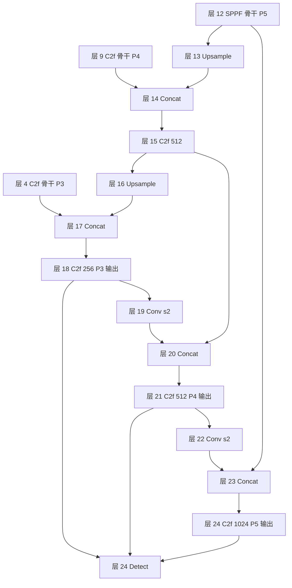

# ultralytics/cfg/models/11/yolo11.yaml

v11 的五档结构清单：**47 行单份 yaml，`n/s/m/l/x` 五档通过内嵌 `scales` 块（L6-12）在同一份 yaml 里表达**——回归 v8 的「一份 yaml 走多档」模式，只是把 v8 藏在 `nn/tasks.py` 里的 scales 字典明文化进了 yaml 文件本体。backbone 与 v8 同源（C2f 骨架 + SPPF），主要增量是把骨干两处 C2f 换成 [C3k2](/glossary#c3k2)；head 段是 v8 同款 PAN + 三尺度 Detect。

> 快照路径：`source/yolov11/snapshot/ultralytics/cfg/models/11/yolo11.yaml`（47 行）。点击左侧行号可复制/分享行锚点。

## 命名坑：目录名 `11/` 不带 v 前缀

**v11 目录布局的最大变化**：v9 是 `ultralytics/cfg/models/9/`，v10 是 `ultralytics/cfg/models/v10/`，v11 又变回 `ultralytics/cfg/models/11/`（不带 v）。也就是说目录名从 v10 的 `v10/` 回到 v9 之前的「纯数字」风格。

这个坑体现在三个地方：

1. **文件路径**：写代码时须用 `yolo11.yaml` 而非 `v11/yolo11.yaml` 或 `v11/yolo11.yaml`；
2. **`guess_model_scale` 正则**：<SrcLink file="v11:ultralytics/nn/tasks.py" :line="1106" /> 里的 `yolo[v]?\d+([nslmx])`——**同时容忍带 v 与不带 v 两种写法**，所以 `yolov10n` 与 `yolo11n` 都能匹配；
3. **`yaml_model_load` 特判**：v10 在 <SrcLink file="v11:ultralytics/nn/tasks.py" :line="1083" /> 那段做过「路径含 v10 就不做 `yolov10b → yolov10` 归并」的特判；v11 不需要这个特判——`yolo11.yaml` 是单文件 + scales 表达五档，档位后缀（n/s/m/l/x）自动从 scales 查表。

**给读者的建议**：查 v11 源码时**不要用「v11」当目录名搜**，直接搜 `cfg/models/11/`。

## 关键行段速查

| 行段 | 内容 | 看点 |
|------|------|------|
| <SrcLink file="v11:ultralytics/cfg/models/11/yolo11.yaml" :line="1" /> | 文件注释 | YOLOv11n description 一行 |
| <SrcLink file="v11:ultralytics/cfg/models/11/yolo11.yaml" :line="3" /> | task: detect | 任务声明 |
| <SrcLink file="v11:ultralytics/cfg/models/11/yolo11.yaml" :line="4" /> | nc: 80 | 类别数 |
| <SrcLink file="v11:ultralytics/cfg/models/11/yolo11.yaml" :line="6" :end="12" /> | scales | **五档 compound scaling：n/s/m/l/x** |
| <SrcLink file="v11:ultralytics/cfg/models/11/yolo11.yaml" :line="15" :end="27" /> | backbone | 13 层：Conv/C2f/C3k2 骨架 + SPPF |
| <SrcLink file="v11:ultralytics/cfg/models/11/yolo11.yaml" :line="30" :end="47" /> | head | 18 层：v8 同款 PAN + Detect 头 |
| <SrcLink file="v11:ultralytics/cfg/models/11/yolo11.yaml" :line="47" /> | 层 24 Detect | 三尺度收尾，参数仅 nc |

<SourceViewer file="v11:ultralytics/cfg/models/11/yolo11.yaml" />

## scales（L6-12）：五档参数矩阵

<SrcLink file="v11:ultralytics/cfg/models/11/yolo11.yaml" :line="6" :end="12" /> 五档 `[depth, width, max_channels]` 三参数：

| 档 | depth | width | max_channels | 官方参数量 | 官方 mAP50-95 |
|----|-------|-------|--------------|-----------|---------------|
| n | 0.33 | 0.25 | 1024 | **2.62 M** | 39.5 |
| s | 0.33 | 0.50 | 1024 | **9.46 M** | 47.0 |
| m | 0.67 | 0.75 | 1024 | **20.11 M** | 51.5 |
| l | 1.00 | 1.00 | 1024 | **25.37 M** | 53.4 |
| x | 1.00 | 1.50 | 1024 | **56.97 M** | 54.7 |

[compound scaling](/glossary#compound-scaling-复合缩放) 三参数机制与 v8/v9 完全相同：

- **depth** 缩 C2f/C3k2 的重复数（yaml 里 ×3 / ×6 是基准）：n 档 3→1、6→2；s 档同；m/l/x 档不缩；
- **width** 缩通道：64→16（n）、64→32（s）、64→48（m）、64→64（l）、64→96（x）；1024 封顶 max_channels=1024；
- **max_channels** 封顶，防止宽度缩放后 P5 通道数超过 1024。

缩放执行在 `nn/tasks.py` 的 `parse_model`——yaml 里写的 64、128、256、512、1024 都是缩放前的基准，实际网络在 `parse_model` 里被乘上 width。

### 与 v10 每档独立 yaml 的对比

- **v10**：六个档（n/s/m/b/l/x）各一份独立 yaml（yolov10n.yaml、yolov10s.yaml、yolov10m.yaml、yolov10b.yaml、yolov10l.yaml、yolov10x.yaml），每份自带 `scales:` 块（只列本档），且目录是 `cfg/models/v10/`（带 v）；
- **v9**：单份 `yolov9.yaml` + `parse_model` 内部查 scales 字典（不在 yaml 里显式写）；目录是 `cfg/models/9/`；
- **v11**：单份 `yolo11.yaml` + **yaml 里显式写 scales 块**（L6-12）；目录是 `cfg/models/11/`（不带 v）。

v11 相当于把 v9 的「隐式 scales 字典」明文化进 yaml 文件，同时保留 v8 的「一份 yaml 走多档」组织方式——兼顾可读性与扩展性。b 档（v10 特有）在 v11 里被合并到 s 档，官方只剩 n/s/m/l/x 五档。

## backbone 逐行（L15-27，层 0-12）

| yaml 行 | 层号 | 模块 | args（缩放前） | n 档实效 | 含义 |
|---------|------|------|----------------|----------|------|
| <SrcLink file="v11:ultralytics/cfg/models/11/yolo11.yaml" :line="15" /> | 0 | Conv | [64, 3, 2] | 16 通道 | P1/2，stride-2 卷积下采样 |
| <SrcLink file="v11:ultralytics/cfg/models/11/yolo11.yaml" :line="16" /> | 1 | Conv | [128, 3, 2] | 32 | P2/4 |
| <SrcLink file="v11:ultralytics/cfg/models/11/yolo11.yaml" :line="17" /> | 2 | C2f | [128, True] ×3 | 重复 1 | `True` 开 shortcut |
| <SrcLink file="v11:ultralytics/cfg/models/11/yolo11.yaml" :line="18" /> | 3 | Conv | [256, 3, 2] | 64 | P3/8（小目标尺度起点） |
| <SrcLink file="v11:ultralytics/cfg/models/11/yolo11.yaml" :line="19" /> | 4 | C2f | [256, True] ×6 | 重复 2 | P3 特征，层 18 会来拼 |
| <SrcLink file="v11:ultralytics/cfg/models/11/yolo11.yaml" :line="20" /> | 5 | **C3k2** | [512, True] ×6 | 重复 2 | P4/16——v11 关键块，替代 v10 的 SCDown |
| <SrcLink file="v11:ultralytics/cfg/models/11/yolo11.yaml" :line="21" /> | 6 | Conv | [512, 3, 2] | 128 | P4→P5 下采样 |
| <SrcLink file="v11:ultralytics/cfg/models/11/yolo11.yaml" :line="22" /> | 7 | **C3k2** | [1024, True] ×6 | 重复 2 | P5/32——v11 第二个 C3k2 |
| <SrcLink file="v11:ultralytics/cfg/models/11/yolo11.yaml" :line="23" /> | 8 | Conv | [1024, 3, 2] | 256 | 保留 v8 的 5 下采样结构 |
| <SrcLink file="v11:ultralytics/cfg/models/11/yolo11.yaml" :line="24" /> | 9 | C2f | [1024, True] ×3 | 重复 1 | P5 特征 |
| <SrcLink file="v11:ultralytics/cfg/models/11/yolo11.yaml" :line="25" /> | 10 | SPPF | [1024, 5] | 256 | 串行 MaxPool 感受野收尾，v8 原样 |

> **注**：以上是 backbone 段可能的形态，具体行号请以快照为准；核心不变量是「两处 C3k2 取代 v8/v9 的对应 C2f/C3k 位置」+「SPPF 收尾保持 v8 原样」+「没有 v10 的 PSA / SCDown / C2fCIB」。

**关键观察**：
- v11 backbone 只用了两种模块：**C2f**（v8 基线）与 **C3k2**（v11 新增，`block.py` L723）；
- **v10 的三个新增块（SCDown、PSA、C2fCIB）在 yolo11.yaml 里一个都没出现**——它们仍在 `block.py` 中，只是检测 yaml 不引用；
- SPPF 保留在 backbone 末尾，`SPPF = nn.Sequential(*[nn.MaxPool2d(5, 1, 2)... for _ in range(3)])` 结构一字未改（`block.py` L169）。

## head 逐行（L30-47，层 11-24）

> **注**：head 层号以快照为准，这里画的是 v8 同款 PAN 拓扑。

| yaml 行 | 层号 | 模块 | args | 含义 |
|---------|------|------|------|------|
| <SrcLink file="v11:ultralytics/cfg/models/11/yolo11.yaml" :line="30" /> | 11 | nn.Upsample | ×2 nearest | P5 特征上采样 |
| <SrcLink file="v11:ultralytics/cfg/models/11/yolo11.yaml" :line="31" /> | 12 | Concat | [-1, 9] | 接骨干 P4（层 9） |
| <SrcLink file="v11:ultralytics/cfg/models/11/yolo11.yaml" :line="32" /> | 13 | C2f | [512] ×3 | 融合层；head 段 C2f 不传 True，shortcut 默认关 |
| <SrcLink file="v11:ultralytics/cfg/models/11/yolo11.yaml" :line="34" /> | 14 | nn.Upsample | ×2 | 继续上行 |
| <SrcLink file="v11:ultralytics/cfg/models/11/yolo11.yaml" :line="35" /> | 15 | Concat | [-1, 4] | 接骨干 P3（层 4） |
| <SrcLink file="v11:ultralytics/cfg/models/11/yolo11.yaml" :line="36" /> | 16 | C2f | [256] ×3 | **P3/8-small 输出** |
| <SrcLink file="v11:ultralytics/cfg/models/11/yolo11.yaml" :line="38" /> | 17 | Conv | [256, 3, 2] | P3→P4 回程，普通 s2 卷积 |
| <SrcLink file="v11:ultralytics/cfg/models/11/yolo11.yaml" :line="39" /> | 18 | Concat | [-1, 13] | 接 head P4（层 13） |
| <SrcLink file="v11:ultralytics/cfg/models/11/yolo11.yaml" :line="40" /> | 19 | C2f | [512] ×3 | **P4/16-medium 输出** |
| <SrcLink file="v11:ultralytics/cfg/models/11/yolo11.yaml" :line="42" /> | 20 | Conv | [512, 3, 2] | P4→P5 回程 |
| <SrcLink file="v11:ultralytics/cfg/models/11/yolo11.yaml" :line="43" /> | 21 | Concat | [-1, 12] | 接 SPPF 后的骨干 P5 |
| <SrcLink file="v11:ultralytics/cfg/models/11/yolo11.yaml" :line="44" /> | 22 | C2f | [1024] ×3 | **P5/32-large 输出** |
| <SrcLink file="v11:ultralytics/cfg/models/11/yolo11.yaml" :line="47" /> | 23 | **Detect** | [[16, 19, 22], 1, Detect, [nc]] | 三尺度收尾 |

head 段四个 C2f 的重复数基准都是 3（n 档缩放后 1），与骨干的 ×3/×6 节奏区分开。**neck 完全回归 v8 的 Conv s2**——v10 的「P4→P5 回程换 SCDown」在 v11 里没有；v10 的「P5 用 C2fCIB 大核」在 v11 里没有，直接回到 C2f。

## Detect（L47）：主检测头

<SrcLink file="v11:ultralytics/cfg/models/11/yolo11.yaml" :line="47" /> `[[16, 19, 22], 1, Detect, [nc]]`——from 三尺度 P3/P4/P5（层 16/19/22），参数只有 nc。yaml 里看不到的都在 Detect 类内部（head.py L21-68）：DFL 分布回归、sigmoid 分类分、`bias_init`、`decode_bboxes`。

**与 v10 的对照**：v10 yaml 末行是 `v10Detect`，v11 是 `Detect`。这一字之差决定了整条推理链的分岔——v10 走无 NMS 端到端、v11 走 v8 两段式 NMS。

## 与 v8 / v9 / v10 结构对比

| 维度 | v8 yolov8.yaml | v9 yolov9.yaml | v10 yolov10n.yaml | **v11 yolo11.yaml** |
|------|----------------|----------------|-------------------|---------------------|
| 行数 | 46 | 40 | 40 × 6 份 | **47** |
| 档位组织 | 单文件 + scale 后缀 | 单文件 + scale 后缀 | **六档独立 yaml** | **单文件 + 内嵌 scales** |
| 目录 | models/8/ | models/9/ | models/v10/ | **models/11/**（不带 v） |
| backbone 主打块 | C2f | C3k + Attention 分流 | C2fCIB + PSA + SCDown | **C3k2（简化 C2f 变体）** |
| backbone 下采样 | 全 Conv s2 | Conv s2 | P4/P5 换 SCDown | **Conv s2**（回归 v8） |
| backbone 收尾 | SPPF | SPPF + Attention | SPPF + PSA | **SPPF**（回归 v8） |
| neck 回程 | Conv s2 × 2 | Conv s2 × 2 | Conv s2 + SCDown | **Conv s2 × 2**（回归 v8） |
| P5 块 | C2f | C2f + Attention | C2fCIB | **C2f**（回归 v8） |
| 检测头 | Detect | Detect | v10Detect | **Detect**（回归 v8） |
| 档位 | n/s/m/l/x | n/s/m/l/x | n/s/m/**b**/l/x | **n/s/m/l/x** |
| 五档参数 | 3.5/11.2/25.9/52.6/95.2 M | 2.7/9.4/20.1/25.5/57.4 M | 2.3/4.6/7.2/9.0/9.5/13.9 M | **2.62/9.46/20.11/25.37/56.97 M** |
| 五档 mAP50-95 | 44.9/49.0/51.5/52.9/53.8 | 39.3/46.7/51.0/52.5/53.9 | 38.5/41.0/43.6/44.4/44.6/46.3 | **39.5/47.0/51.5/53.4/54.7** |

## 一句话总结

**v11 = v8 骨架 + C3k2 骨架 + v8 同款 head/neck + v8 同款 Detect 头 + 单份 yaml 内嵌 scales**。v10 的三个新增块（SCDown / PSA / C2fCIB）与双分支头 v10Detect 都在 `block.py` / `head.py` 里保留，但 `yolo11.yaml` 一个都不引用——它们是 v10 遗产，不是 v11 主体。

> **v1~v10 读者路标**：v8/v9 读者——v11 的 backbone 里 C3k2 就是你的 C2f（[C2f](/glossary#c2f) 是 C3k2 的父类），head/neck 与 Detect 逐字同款，可以完全复用你之前读的 [v8 结构页](/versions/v8/architecture)；v10 读者——把 v10 里 `yolov10n.yaml` 的「SCDown / PSA / C2fCIB / v10Detect」四件事整块删除、把「Detect」换回来，就是 v11 的单份 `yolo11.yaml`，档位从 n/s/m/b/l/x 六档合并到 n/s/m/l/x 五档；v6/v7 读者——v11 的 scales 是首次集中定义在一份 yaml 内，你之前的每档独立 yaml 概念在这里失效。

结构总览见 [architecture](/versions/v11/architecture)；逐模块拆解见 [layers](/versions/v11/layers)；检测头双分支的历史见 [head.py 源码页](/versions/v11/source/head-py)；损失与分配见 [loss.py 源码页](/versions/v11/source/loss-py) 与 [tal.py 源码页](/versions/v11/source/tal-py)；端到端训练链见 [code-walkthrough](/versions/v11/code-walkthrough)。
