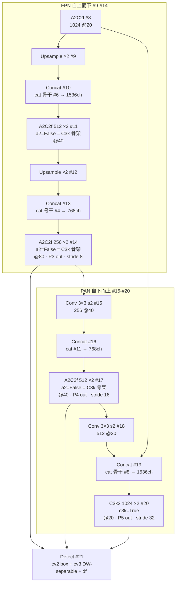
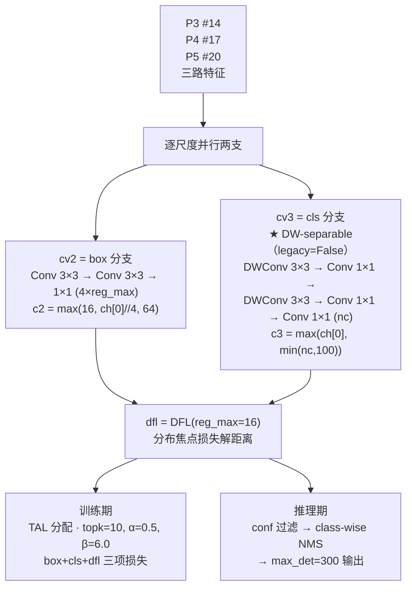
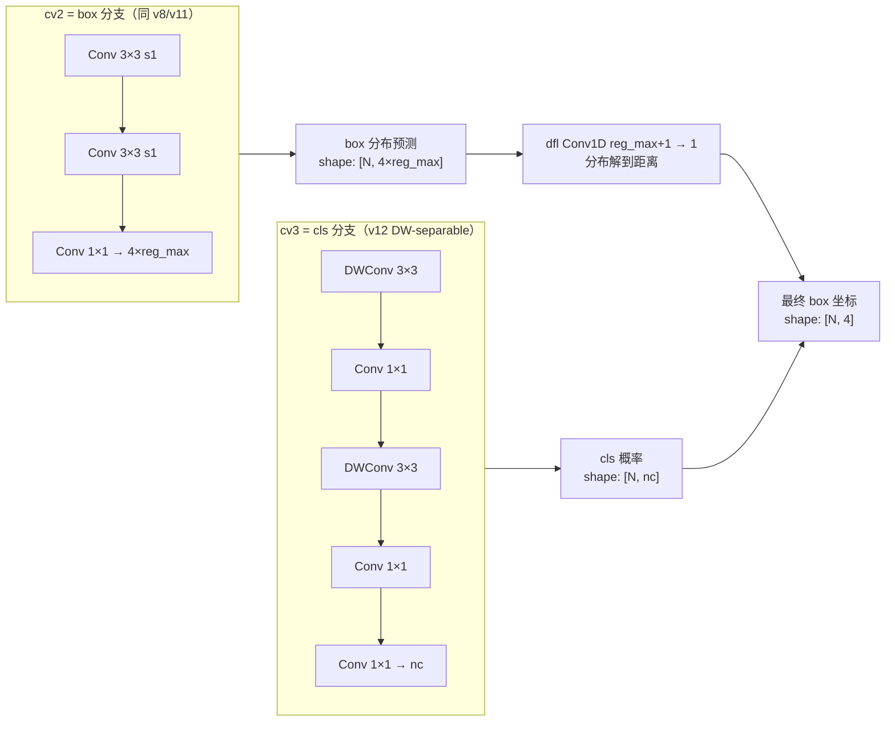

# YOLOv12 Architecture 逐层图解

> 首发载体：`sunsmatterjie/yolov12` tag `v1.0`，commit `b1035f8f97cd1a7440454a54f8bc19f989448159`，2025-02-19，作者 Yunjie Tian / Qixiang Ye / David Doermann（UB SUNY + UCAS），AGPL-3.0。以 `ultralytics/cfg/models/v12/yolov12.yaml` 为基准（**注意 cfg 目录名 `v12/` 带 v 前缀，回归 v8/v10 规则，与 v11 的 `11/` 不带 v 相反**），本页通道数为缩放前的基准值。配置原文见 <SrcLink file="v12:ultralytics/cfg/models/v12/yolov12.yaml" :line="1" :end="45" />，逐层源码见 [YOLOv12 逐层图解](/versions/v12/layers)。

> **v1~v11 读者路标**：这张 yaml 是 [yolo11.yaml](/versions/v11/source/yolo11-yaml) 的下一代——v11 骨干层 5/7 的 C3k2 换成 A2C2f（a2=True）、SPPF 直接去掉、末端注意力从 C2PSA 变成 A2C2f 收敛、head 里的四个 C3k2 换成 A2C2f(a2=False)=C3k 骨架 + 一个 C3k2 收尾、Detect 头 yaml 层面无变化但 `parse_model` 给它写 `legacy=False`（v11 的 cv3 本来就是 DW-separable）。整张图仍是 22 层（v11 是 24 层，去 SPPF 与末尾 C2PSA 各少一层，头部四个融合块改成 3 个 + 1 个 C3k2）。

::: tip 只想带走三件事
1. **P4/P5 两处真正用 Attention**：yaml 里 A2C2f 出现 5 次（骨干 2 + head 3），**只有 backbone 层 6 与层 8 是 a2=True**（真正跑 ABlock 与 AAttn），head 里三处 A2C2f 都是 a2=False（等价于 C3k 骨架）；
2. **AAttn 硬依赖 FlashAttention**：`from flash_attn.flash_attn_interface import flash_attn_func`（block.py L1160-1163）+ `assert False` 兜底——**没有 CUDA + flash-attn 就根本跑不起来**；`num_heads = c_ // 32` 硬编码 + `assert c_ % 32 == 0` 通道断言；
3. **Detect 补 `legacy` 开关**：yaml 里没有反映，`parse_model` 因模型含 C3k2/A2C2f 把 `m.legacy = False` 写给 Detect——**v11 的 cv3 本来就无条件走 DW-separable，v12 只是把「不可切」变成了「可切但默认不变」**。
:::

## 1. 一眼看清：yolov12.yaml 全图

> **v1~v11 读者路标**：整张图与 [yolo11.yaml](/versions/v11/source/yolo11-yaml) 的形状相似但少一层——v11 是 24 层（含 SPPF + C2PSA），v12 是 22 层（去 SPPF、去 C2PSA、去 P5 处的第二个 C3k2，改成 3 个 A2C2f + 1 个 C3k2）。盯住图中 2 个 A2C2f a2=True（骨干 P4/P5）与 3 个 A2C2f a2=False（head 尺度融合）与 1 个 C3k2（P5-large 收尾）。

```mermaid
flowchart TB
    %% Backbone #0-#8
    IMG["640×640×3"] --> L0["Conv 3×3 s2 #0<br/>64ch @320 · P1/2"]
    L0 --> L1["Conv 3×3 s2 #1<br/>128ch @160 · P2/4"]
    L1 --> L2["C3k2 256 ×2 #2<br/>c3k=False, e=0.25"]
    L2 --> L3["Conv 3×3 s2 #3<br/>256ch @80 · P3/8"]
    L3 --> L4["C3k2 512 ×4 #4<br/>c3k=False, e=0.25"]
    L4 --> L5["Conv 3×3 s2 #5<br/>512ch @40 · P4/16"]
    L5 --> L6["A2C2f 512 ×4 #6<br/>a2=True, area=4<br/>★ 骨干注意力块 1"]
    L6 --> L7["Conv 3×3 s2 #7<br/>1024ch @20 · P5/32"]
    L7 --> L8["A2C2f 1024 ×4 #8<br/>a2=True, area=1<br/>★ 骨干注意力块 2"]

    %% Head #9-#21
    L8 --> L9["Upsample ×2 #9<br/>1024ch @40"]
    L9 --> L10["Concat #10<br/>cat 骨干 #6 → 1536ch"]
    L10 --> L11["A2C2f 512 ×2 #11<br/>a2=False = C3k 骨架"]
    L11 --> L12["Upsample ×2 #12<br/>512ch @80"]
    L12 --> L13["Concat #13<br/>cat 骨干 #4 → 768ch"]
    L13 --> L14["A2C2f 256 ×2 #14<br/>a2=False = C3k 骨架<br/>P3 out · stride 8"]

    L14 --> L15["Conv 3×3 s2 #15<br/>256ch @40"]
    L15 --> L16["Concat #16<br/>cat #11 → 768ch"]
    L16 --> L17["A2C2f 512 ×2 #17<br/>a2=False = C3k 骨架<br/>P4 out · stride 16"]

    L17 --> L18["Conv 3×3 s2 #18<br/>512ch @20"]
    L18 --> L19["Concat #19<br/>cat 骨干 #8 → 1536ch"]
    L19 --> L20["C3k2 1024 ×2 #20<br/>c3k=True<br/>P5 out · stride 32"]

    L14 --> DET["Detect #21<br/>P3/P4/P5 单头 · stride 8/16/32<br/>cv2 box · cv3 DW-separable cls · dfl"]
    L17 --> DET
    L20 --> DET
```

- 图中通道数为 yaml 声明的**基准宽度**；n 档 depth=0.50 / width=0.25 把 A2C2f 与 C3k2 重复数 ×4→2、×2→1、通道 ÷4（末级 1024→256），五档 scales 见 §6
- backbone 占 yaml L15~L25（#0~#8，共 9 层）、head 占 L28~L45（#9~#21，共 13 层）；Detect 落在 #21（<SrcLink file="v12:ultralytics/cfg/models/v12/yolov12.yaml" :line="45" />）
- **A2C2f 一共出现 5 次**：骨干 2 次（#6/#8，a2=True）、head 3 次（#11/#14/#17，a2=False）——头里还有一个 C3k2 收尾（#20）；只有骨干 2 处真正跑 Attention，head 三处走 C3k 骨架
- **A2C2f a2=True 的 area 参数**：#6 是 area=4（2×2 分组，对应 P4/16 分辨率）、#8 是 area=1（无分组）——两者对应不同分辨率的网格，area 决定 area-attention 的分组粒度
- **去 SPPF**：v11 是骨干 #9 SPPF + #10 C2PSA 双收敛；v12 直接用 A2C2f（#8）作为骨干出口，SPPF 完全去掉
- Concat 输出通道 = 两路之和（#10 是 1024+512=1536）；#19 回连的是骨干 #8 A2C2f 输出（与 v11 回连 #10 C2PSA 的位置对应，语义一致）
- 骨干 C3k2 #2/#4 显式传 `c3k=False, e=0.25`（浅层轻量），head 的 #20 C3k2 传 `c3k=True`（P5-large 收尾走标准 C3k 内瓶）

<SrcLink file="v12:ultralytics/cfg/models/v12/yolov12.yaml" :line="1" :end="45" />

> **v1~v11 读者路标**：整图 22 个顶层条目，n/s/m/l/x 五档共用；A2C2f 出现 5 次（骨干 2 + 头 3），C3k2 出现 3 次（骨干 2 + 头 1），Detect 收尾 1 次——**没有 SPPF、没有 C2PSA、没有 C2f、没有 C2fCIB、没有 SCDown**。想和 v11 对上的话，可以理解为「v11 骨干的 P4/P5 两个 C3k2 换成 A2C2f(a2=True)、去掉 SPPF 与末端 C2PSA、head 里的四个 C2f 换成三个 A2C2f(a2=False)+一个 C3k2」。

## 2. Backbone #0~#8：Conv 下采样 + C3k2 融合 + A2C2f 内嵌注意力

> **v1~v11 读者路标**：#0~#4 与 v11 前 5 层几乎一致（Conv s2 × 2 + C3k2 × 2），差异从 #5 开始——v11 的 #6/#8 是 C3k2、v12 的 #6/#8 是 A2C2f；v11 的 #9 SPPF 与 #10 C2PSA 在 v12 完全消失，直接以 #8 A2C2f 作为骨干出口。

```mermaid
flowchart LR
    IMG["640×640×3"] --> L0["Conv 3×3 s2 #0<br/>64 @320 · P1/2"]
    L0 --> L1["Conv 3×3 s2 #1<br/>128 @160 · P2/4"]
    L1 --> L2["C3k2 256 ×2 #2<br/>c3k=False, e=0.25"]
    L2 --> L3["Conv 3×3 s2 #3<br/>256 @80 · P3/8"]
    L3 --> L4["C3k2 512 ×4 #4<br/>c3k=False, e=0.25"]
    L4 --> L5["Conv 3×3 s2 #5<br/>512 @40 · P4/16"]
    L5 --> L6["A2C2f 512 ×4 #6<br/>a2=True, area=4<br/>★ 内嵌 Attention"]
    L6 --> L7["Conv 3×3 s2 #7<br/>1024 @20 · P5/32"]
    L7 --> L8["A2C2f 1024 ×4 #8<br/>a2=True, area=1<br/>★ 内嵌 Attention"]
```

- **前 5 层**（#0-#4）与 v11 完全同款节奏：Conv s2 → Conv s2 → C3k2 融合 → Conv s2 → C3k2 融合。C3k2 显式声明 `c3k=False, e=0.25`——浅层轻量，与 v11 相同
- **#5/#7 下采样**（<SrcLink file="v12:ultralytics/cfg/models/v12/yolov12.yaml" :line="22" />、<SrcLink file="v12:ultralytics/cfg/models/v12/yolov12.yaml" :line="24" />）：回归 v8/v11 的普通 `Conv [c, 3, 2]`——v10 的 SCDown 依然不用
- **#6 A2C2f area=4**（<SrcLink file="v12:ultralytics/cfg/models/v12/yolov12.yaml" :line="23" />）：这是 v12 的第一个 Attention 块——`a2=True, area=4, n=4`；基准（m/l 档）下 `c1=512, c2=512, c_ = int(512*0.5) = 256`、`num_heads = 256//32 = 8`；n 档则是 `c1=c2=128, c_=64, heads=2`，s 档 `c_=128, heads=4`；内部 **4 段 × 2 个 ABlock = 8 个 ABlock**
- **#8 A2C2f area=1**（<SrcLink file="v12:ultralytics/cfg/models/v12/yolov12.yaml" :line="25" />）：这是 v12 的第二个 Attention 块——`a2=True, area=1, n=4`；基准（m/l/x 档）下 `c2` 被 `max_channels=512` 封顶，`c_ = 256`、`num_heads = 8`；n 档 `c2=256 → c_=128 → heads=4`，s 档 `c2=512 → c_=256 → heads=8`；内部同样 8 个 ABlock
- **骨干 9 层的通道-位置对应**：64@P1 → 128@P2 → 256@P3 → 512@P4 → 512@P4(继续提特征) → 1024@P5 → 1024@P5(继续)——从 P4 开始通道停在 512、到 P5 提到 1024，与 v8/v10/v11 相同；**但 v12 没有 #9 SPPF 与 #10 C2PSA 两处骨干收敛层**，直接以 #8 A2C2f 输出作为骨干出口
- **area 参数的物理意义**：AAttn 的 area 是「分组感受野」——area=4 表示 2×2 分组，每个 token 与同分组内的其他 token 做 Attention（局部 Attention）；area=1 表示无分组（全局 Attention）。#6 用 area=4 是因为 P4/16 分辨率较高（40×40 网格 = 1600 token），全 Attention 代价过大；#8 用 area=1 是因为 P5/32 分辨率低（20×20 网格 = 400 token），全 Attention 可行

<SrcLink file="v12:ultralytics/cfg/models/v12/yolov12.yaml" :line="15" :end="25" />
<SrcLink file="v12:ultralytics/nn/modules/block.py" :line="1160" :end="1354" />

> **v1~v11 读者路标**：v8 骨干用 4 个 C2f + SPPF 收尾；v10 骨干多了 SCDown 下采样与 PSA 全局注意力；v11 把 SCDown 撤掉、把 PSA 换成 C2PSA、把所有 C2f 换成 C3k2；**v12 把骨干 P4/P5 的 C3k2 换成 A2C2f（内嵌 Attention）、去掉 SPPF、去掉末端 C2PSA**——v12 的骨干里第一次真正有「骨干内嵌 Attention」，而不是 v10/v11 的「骨干尾外挂 Attention」。

## 3. Head #9~#21：PAN 双向聚合，两个下采样均走 Conv s2

> **v1~v11 读者路标**：v12 的 head 拓扑与 v11 完全一致（Upsample×2 + Concat×3 + 融合块×4 + Conv s2×2 + Detect），只是融合块从 v11 的 4 个 C3k2 换成 3 个 A2C2f(a2=False) + 1 个 C3k2。#19 回连的是 #8 A2C2f 而不是 #10 C2PSA（v11 位置）。

- **FPN 上行 #9-#14**：Upsample×2 + Concat（骨干 #6、#4）+ A2C2f 融合，与 v11 结构完全同款；出口 #14（基准 256 通道 @80×80）是 P3 检测输入，stride 8
- **A2C2f a2=False 的实际含义**：`class A2C2f(nn.Module)` 的构造里，当 `a2=False` 时 `self.m` 的每段是 `C3k(c_, c_, 2, shortcut, g)` 而不是 `ABlock(...)`——**head 里的三个 A2C2f 实际就是 C3k 骨架**，跟 v11 的 C3k2 c3k=True 语义等价（都是 CSP 外壳 + C3k 内瓶）
- **`gamma` 按档位生效**：A2C2f 的 `gamma` 只在 `a2 and residual` 时启用（block.py L1342）；`parse_model` 只给 **L/X 档**追加 `residual=True`（tasks.py L1034-1038），所以 **L/X 档骨干 #6/#8 有 layer-scale，n/s/m 档没有；head 三处因 a2=False 永远没有**
- **Concat 索引与 v11 完全一致**：#10 → `[-1, 6]`、#13 → `[-1, 4]`、#16 → `[-1, 11]`、#19 → `[-1, 8]`——四组拼接对象没有一处变化
- **PAN 下行 #15-#20**：两段下采样都是 `Conv [c, 3, 2]`（#15、#18），与 v8/v11 相同
- #19 `Concat` 回连 **#8 A2C2f**（<SrcLink file="v12:ultralytics/cfg/models/v12/yolov12.yaml" :line="42" />）——v8 在同一位置回连的是 #9 SPPF；v10 回连的是 #10 PSA；v11 回连的是 #10 C2PSA；v12 回连的是 #8 A2C2f。四代版本都在同一个位置做「让骨干出口参与 PAN 顶点」的相同选择，只是模块代际不同
- **P5-large 收尾用 C3k2 而非 A2C2f**：#20 是 `C3k2 1024 ×2 c3k=True`——这是 v12 里 C3k2 唯一出现在 head 的位置，其他三个头融合块都是 A2C2f(a2=False)=C3k 骨架；论文未解释为什么 P5-large 保留 C3k2，可能因为 P5 分辨率最低、参数预算宽裕、C3k 已经足够
- 三个出口 #14/#17/#20 喂给 #21 Detect，stride 8/16/32、640 输入共 **8400 个预测位置**（$80^2+40^2+20^2$）——anchor-free、网格中心即 anchor point，与 v8/v11 完全一致

<SrcLink file="v12:ultralytics/cfg/models/v12/yolov12.yaml" :line="28" :end="42" />

> **v1~v11 读者路标**：v8 的头走 [C2f + RepConv 收口（v7 有，v8 撤）](/versions/v8/architecture) 的极简形态；v9 头换了 [DualDDetect 双头 + C2SPC](/versions/v9/architecture)；v10 头新增 C2fCIB 大核 + v10Detect 双头去 NMS；v11 退回 v8 的形态（4 个 C3k2 + Detect）；**v12 与 v11 结构完全一致**，只是把 C3k2 换成 A2C2f(a2=False)——**结构上的 A2C2f 与 C3k2 是「同名不同物」**，yaml 层看不出差异。

## 4. Head #21 Detect 详解：默认 DW-separable 分类头

> **v1~v11 读者路标**：v12 沿用 v11 的 `Detect` 类，只多了一个 `legacy` 类属性（L32，默认 `False`）——**v11 的 cv3 本来就无条件走 DW-separable**，v12 把它变成「可用 legacy 切回 v8 全卷积」；`parse_model` 在模型含 C3k2/A2C2f 时给 Detect 写 `legacy=False`，因此行为与 v11 相同。**yaml 层面无任何反映**。

- **构造**（<SrcLink file="v12:ultralytics/nn/modules/head.py" :line="32" />）：`self.legacy = legacy`（默认 False，仅类属性，不接收参数）；**没有 v8.0 时代的 `cv1` 升维层**——`cv2`/`cv3` 直接从各尺度特征出发，`c2 = max((16, ch[0] // 4, reg_max * 4))`、`c3 = max(ch[0], min(nc, 100))`；`cv2`（box）与 v8/v11 完全同款（两段 3×3 + 1×1 出 `4*reg_max`）
- **cv3 DW-separable 分支**（<SrcLink file="v12:ultralytics/nn/modules/head.py" :line="46" :end="57" />）：`legacy=False` 时走这段（与 v11 head.py 完全相同）：`DWConv(x, x, 3) + Conv(x, c3, 1) → DWConv(c3, c3, 3) + Conv(c3, c3, 1) → Conv2d(c3, nc, 1)`——**5 段卷积，v8 是 3 段全卷积，v11 已经是这 5 段**
- **cv3 legacy 分支**（<SrcLink file="v12:ultralytics/nn/modules/head.py" :line="46" :end="48" />）：v8 与 v12 的 `legacy=True` 分支是全 3×3 两段 `Conv(x, c3, 3) → Conv(c3, c3, 3) → Conv2d(c3, nc, 1)`——v12 保留在代码里，yaml 不会触发；**v11 没有这个分支（无 legacy 开关，永久 DW）**
- **DFL**（<SrcLink file="v12:ultralytics/nn/modules/head.py" :line="58" />）：`self.dfl = DFL(self.reg_max) if self.reg_max > 1 else nn.Identity()`——与 v8/v11 完全一致
- **推理**（<SrcLink file="v12:ultralytics/nn/modules/head.py" :line="64" :end="74" />）：训练态直接返回三尺度特征；推理态走 `_inference`，`end2end=False` 时不进 `forward_end2end`——与 v11 完全相同；`end2end`（L27）、`max_det=300`（L28）、`_inference`（L100）、`postprocess`（L151）**在 v11 的 head.py 里也都存在**
- **`_inference` / `postprocess` / `max_det=300` / `end2end` 属性**：**v11 的 head.py 已经有全部这四项**（v11 L94 / L140 / L27 / L26），v12 不是新增

### 4.1 Detect v12 vs v11 vs v10 对比

| 维度 | v8 Detect | v10 v10Detect | v11 Detect | **v12 Detect** |
|------|-----------|---------------|------------|----------------|
| 类定义位置 | `head.py` L21 | `head.py` L497 | `head.py` L21（沿用 v8） | `head.py` L21（沿用 v11） |
| 头数量 | 单头 | 双头（one2many + one2one deepcopy） | 单头 | **单头** |
| cv3 分类头 | 全 3×3 两段 | DW-separable 三段 | DW-separable 三段（无开关） | **DW-separable 三段（`legacy` 可切回全卷积）** |
| `legacy` 默认 | 无此参数 | 无此参数 | **无此参数（永久 DW）** | **False** |
| 训练分配 | TAL topk=10 α=0.5 β=6.0 | 双分配 topk=10 + topk=1 | TAL topk=10 α=0.5 β=6.0（类默认 13/1.0 不生效） | **TAL topk=10 α=0.5 β=6.0（与 v11 完全相同）** |
| 梯度截断 | 无 | `one2one = [xi.detach() for xi in x]` | 无 | **无** |
| 推理后处理 | conf 过滤 + class-wise NMS | v10postprocess（两次 topk） | conf 过滤 + class-wise NMS | **conf 过滤 + class-wise NMS** |
| 导出图 | 有 NMS 算子 | 无 NMS 算子 | 有 NMS 算子 | **有 NMS 算子** |
| `max_det` 默认 | 无（predict 端常量） | exporter 注入 | **300** | **300** |
| `end2end` 属性 | 无 | 无 | **有** | **有** |
| `_inference` | 内联 | 内联 | **独立方法** | **独立方法** |
| `postprocess` | 内联 | 内联 | **静态方法** | **静态方法** |

一句话总结：**v12 的检测头与 v11 几乎完全一致**——`Detect` 类、`_inference`、`postprocess`、`max_det=300`、`end2end=False` 全部沿袭；唯一代码差异是 v12 多了一个 `legacy` 类属性，让 cv3 可切回 v8 全卷积，而默认值 `False` 复现 v11 的 DW-separable 行为。**TAL 参数（topk=10 / α=0.5 / β=6.0）也与 v11 逐字节相同**，不是 v12 的回归。

### 4.2 Detect 内部分支（v12 DW-separable 默认）

- cv2 与 cv3 的通道公式相同（`max(ch[0], min(self.nc, 100))`），差异只在最终输出维度与卷积结构
- cv3 DW-separable 比 v8 的全 3×3 少约 4× FLOPs（DWConv 只算通道独立卷积）；**v11 已经是这个结构，v12 没有进一步变化**
- `reg_max` 默认 16，`4*reg_max=64`——每个预测位置对每个方向（left/right/top/bottom）都输出 16 个距离桶的概率

<SrcLink file="v12:ultralytics/nn/modules/head.py" :line="21" :end="74" />

> **v1~v11 读者路标**：从 v1 到 v11，检测头经历了「3 段 yolo layer → 2 段解耦 → 三段解耦 → anchor-free 单头 → 双头去 NMS」的完整演进；v11 已经用了 DW-separable 的 cv3，**v12 只把「不可切换」变成「有 legacy 开关、默认仍是 DW」**——对导出结构与 FLOPs **没有实质影响**。

## 5. 与 v11/v10/v9/v8 的结构对比

> **v1~v11 读者路标**：把四代 yaml 摆在一起看，v12 的取舍一目了然——**下采样回归普通 Conv**、**融合块 C3k2 + A2C2f 混用**、**骨干 P4/P5 内嵌 A2C2f 注意力**、**去 SPPF**、**头 Detect 沿用 v11（仅补 legacy 开关）**。

| 位置 | v8（yolov8.yaml） | v10（yolov10n.yaml） | v11（yolo11.yaml） | **v12（yolov12.yaml）** | 一句话总结 |
|------|-------------------|----------------------|--------------------|-------------------------|------------|
| #2 骨干 P2 融合 | C2f 128 | C2f 128 | C3k2 256 | **C3k2 256** | v11→v12 保持 |
| #4 骨干 P3 融合 | C2f 256 | C2f 256 | C3k2 512 | **C3k2 512** | 同上 |
| #5/#7 下采样 | Conv s2 | SCDown | Conv s2 | **Conv s2** | v10 SCDown 撤回后保持 |
| #6 骨干 P4 融合 | C2f 512 | C2f 512 | C3k2 512 | **A2C2f 512 a2=True area=4** | **v12 关键块 1** |
| #8 骨干 P5 融合 | C2f 1024 | C2f 1024 | C3k2 1024 | **A2C2f 1024 a2=True area=1** | **v12 关键块 2** |
| #9/#10 骨干出口 | SPPF / — | SPPF + PSA | SPPF + C2PSA | **无（去 SPPF 去注意力尾）** | **v12 关键改动** |
| #13/#16/#19 头融合 | C2f | C2f | C3k2 | **A2C2f a2=False (=C3k)** | 头融合块换 A2C2f 骨架 |
| #20 回程下采样 | Conv s2 | SCDown | Conv s2 | **Conv s2** | 保持 |
| #22 P5 融合 | C2f | C2fCIB | C3k2 | **C3k2** | 保持 |
| #23 检测头 | Detect | v10Detect | Detect（无 legacy，永久 DW） | **Detect（legacy=False，可切回全卷积）** | 仅补开关，默认行为不变 |
| 顶层条目数 | 24 | 24 | 24 | **22** | v12 少 2 层（去 SPPF + 去 C2PSA） |
| 自研模块数 | 1（C2f） | 3（SCDown/PSA/C2fCIB/v10Detect） | 2（C3k2/C2PSA） | **4（C3k2/A2C2f/AAttn/ABlock）** | v12 自研模块最多 |
| 骨干注意力位置 | 无 | 骨干尾 PSA | 骨干尾 C2PSA | **骨干 P4/P5 内嵌 A2C2f** | **v12 关键定位** |

- **v12 的模块数最多**：整个 yaml 有 4 种自研模块（C3k2、A2C2f、AAttn、ABlock），Detect/Conv/Concat/Upsample 都是老零件；**但真正跑 Attention 的只有骨干 P4/P5 两处**，其他 A2C2f 走 C3k 骨架
- **命名坑修正**：cfg 目录是 `v12/`（带 `v`），与其他版本（v8/v10）一致；v11 的 `11/`（不带 v）是四代里唯一的例外，v12 修正了这一命名不一致
- **总装仍是 `DetectionModel` 家族**：v12 复用 `DetectionModel`，损失函数沿用 v8 的 `v8DetectionLoss`——**`tal_topk=10` 默认与显式 α=0.5/β=6.0 的写法与 v11 逐字节相同**（v11 的 loss.py L160/L176 也是这两行），所以损失侧**没有 v12 专属改动**

## 6. 五档 scales 与参数量

> **v1~v11 读者路标**：v12 五档 n/s/m/l/x 的 `[depth, width, max_channels]` 与 v11 **逐项完全相同**（<SrcLink file="v12:ultralytics/cfg/models/v12/yolov12.yaml" :line="6" :end="12" />）；**层数与参数量的变化全部来自结构变化**（A2C2f 内嵌 2×ABlock、去 SPPF、head 换 A2C2f/C3k2），不是 compound scaling 系数变化。

| Model | depth | width | max_channels | 层数 | 参数 | GFLOPs | mAP50-95 |
|-------|-------|-------|--------------|------|------|--------|----------|
| N | 0.50 | 0.25 | 1024 | 465 | 2.60M | 6.7G | 40.6% |
| S | 0.50 | 0.50 | 1024 | 465 | 9.29M | 21.7G | 48.0% |
| M | 0.50 | 1.00 | **512** | 501 | 20.20M | 68.1G | 52.5% |
| L | 1.00 | 1.00 | **512** | 831 | 26.45M | 89.7G | 53.7% |
| X | 1.00 | 1.50 | **512** | 831 | 59.22M | 200.3G | 55.2% |

- **scales 集中定义**：沿用 v11 组织方式——`yolov12.yaml` 顶部一个 `scales:` 块（<SrcLink file="v12:ultralytics/cfg/models/v12/yolov12.yaml" :line="6" :end="12" />）
- **compound scaling**：与 v8/v9/v11 完全一致——depth 放大 A2C2f/C3k2 重复数、width 缩窄通道、max_channels 封顶
- **max_channels 分层级封顶**：n/s 是 1024，m/l/x 是 512——**与 v11 完全相同**，不是 v12 的改动；它决定 P5 的 1024 通道在 m/l/x 档被压到 512，因此 A2C2f 的 `c_` 最多 256（`e=0.5`）→ `num_heads` 最多 8
- **depth 与 v11 相同**：n/s/m 是 0.50，l/x 是 1.00——**没有「0.33 提到 0.50」这回事**（v11 的 n/s 也是 0.50）
- **层数差异来自结构**：n/s 465 层（v11 是 409）、m 501、l/x 831——yaml 里 A2C2f 的 repeats 是 4（骨干）与 2（head），每段 ABlock 内部还要展开 attn+mlp，加上去 SPPF，最终层数比 v11 多
- **AP val 数字口径**：640 输入、COCO val（README 声明口径；无硬件与精度说明，跨版本比延迟不可比）；N 档 40.6% 相对 v8n 37.3% 与 v11n 39.5% 有 1~3 个点提升，主要来自 A2C2f 骨干内嵌 Attention 与训练配方差异化
- **X 档 59.22M**：相对 v8x 56.9M 与 v11x 56.97M 略多（+4%），主要来自 A2C2f 内嵌 ABlock 的 Attention 参数

<SrcLink file="v12:ultralytics/cfg/models/v12/yolov12.yaml" :line="6" :end="12" />

> **v1~v11 读者路标**：v8 五档 → v10 六档（+ B）→ v11 五档 → v12 五档。v12 沿用 v11 的"单 yaml + scales 集中"路线，档位扩展只需在 scales 表加一行；但 A2C2f 的 `assert c_ % 32 == 0` 与 `num_heads = c_ // 32` 硬编码限制了通道数定制的自由度——通道数必须是 32 的倍数。

## 7. SrcLink 汇总

本页引用到的关键源码位置（可直接跳转）：

- <SrcLink file="v12:ultralytics/cfg/models/v12/yolov12.yaml" :line="1" :end="45" />——完整 yolov12.yaml
- <SrcLink file="v12:ultralytics/cfg/models/v12/yolov12.yaml" :line="6" :end="12" />——scales 五档集中定义
- <SrcLink file="v12:ultralytics/cfg/models/v12/yolov12.yaml" :line="15" :end="25" />——backbone 9 层
- <SrcLink file="v12:ultralytics/cfg/models/v12/yolov12.yaml" :line="23" />——A2C2f #6 a2=True area=4（骨干 P4 注意力块）
- <SrcLink file="v12:ultralytics/cfg/models/v12/yolov12.yaml" :line="25" />——A2C2f #8 a2=True area=1（骨干 P5 注意力块）
- <SrcLink file="v12:ultralytics/cfg/models/v12/yolov12.yaml" :line="29" :end="45" />——head 13 层（含 Detect）
- <SrcLink file="v12:ultralytics/cfg/models/v12/yolov12.yaml" :line="45" />——Detect 入口
- <SrcLink file="v12:ultralytics/nn/modules/block.py" :line="1160" :end="1163" />——FlashAttention 硬依赖 import + assert
- <SrcLink file="v12:ultralytics/nn/modules/block.py" :line="1166" :end="1246" />——AAttn 类定义
- <SrcLink file="v12:ultralytics/nn/modules/block.py" :line="1249" :end="1297" />——ABlock 类定义
- <SrcLink file="v12:ultralytics/nn/modules/block.py" :line="1300" :end="1354" />——A2C2f 类定义
- <SrcLink file="v12:ultralytics/nn/modules/head.py" :line="21" :end="74" />——Detect 类定义（v12 使用，legacy=False 默认）
- <SrcLink file="v12:ultralytics/nn/modules/head.py" :line="46" :end="57" />——Detect cv3 DW-separable 分支
- <SrcLink file="v12:ultralytics/utils/loss.py" :line="160" :end="178" />——v8DetectionLoss（`tal_topk=10` 与显式 α/β，与 v11 行为等价）
- <SrcLink file="v12:ultralytics/utils/tal.py" :line="13" />——TaskAlignedAssigner 类默认 topk=13 α=1.0（**v11 与 v12 的 loss.py 都显式覆盖为 topk=10 α=0.5，两版一致**）

> **v1~v11 读者路标**：本清单把 v12 涉及的所有自研模块与配置行都点名——对照 v11 的 [architecture §1-§6](/versions/v11/architecture)，可以逐项 diff；对照 v10 的 [architecture 全文](/versions/v10/architecture)，可以看到 v10 的 SCDown/PSA/C2fCIB/v10Detect 在 v12 里全部消失。

## 延伸阅读

- [YOLOv12 逐层图解](/versions/v12/layers)
- [YOLOv12 理论 Concept](/versions/v12/concepts)
- [YOLOv12 损失函数详解](/versions/v12/losses)
- [yolov12.yaml 源码页](/versions/v12/source/yolov12-yaml)
- [block.py 源码页（A2C2f / ABlock / AAttn）](/versions/v12/source/block-py)
- [head.py 源码页（Detect DW-separable）](/versions/v12/source/head-py)
- [loss.py 源码页（与 v11 逐字节等价）](/versions/v12/source/loss-py)
- [tal.py 源码页](/versions/v12/source/tal-py)
- [v11 架构总览（对照基线）](/versions/v11/architecture)
- [v10 架构总览（对照基线）](/versions/v10/architecture)
- [v8 架构总览（对照基线）](/versions/v8/architecture)
