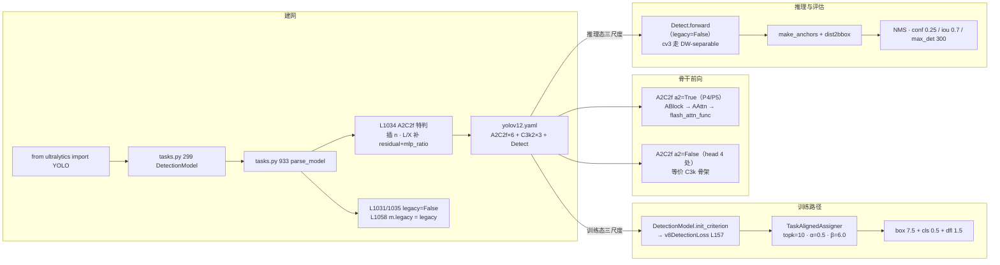

# YOLOv12 源码走读

本页沿 YOLOv12（`sunsmarterjie/yolov12` tag `v1.0`，commit `b1035f8f97cd1a7440454a54f8bc19f989448159`，2025-02-19，AGPL-3.0，arXiv:2502.12524）的一条端到端链路走读源码：**入口 `from ultralytics import YOLO` → `parse_model` 建 A2C2f 骨干 → AAttn 前向（FlashAttention）→ v8DetectionLoss（tal_topk=10）→ 反向 → Detect（legacy=False）解码 → NMS**。所有行号均以站内快照 `source/yolov12/snapshot/` 为准，可点击 SrcLink 跳转核对。

> **这个项目的身份必须先说清**：v12 **不是 ultralytics 官方发布**，而是第三方研究者（Yunjie Tian / Qixiang Ye / David Doermann）**fork ultralytics `8.3.63` 后改造**的仓库。因此 `ultralytics/__init__.py` L3 的 `__version__ = "8.3.63"` 是 **fork 基线版本**，不是 v12 自己的版本号；v12 的增量集中在四处：`cfg/models/v12/yolov12.yaml`（**目录带 v 前缀，v11 的 `11/` 是例外**）、`nn/modules/block.py` 的三个新类、`nn/tasks.py` 的 A2C2f 档位特判与 Detect `legacy` 赋值。损失侧**没有 v12 增量**：`loss.py` 与 v11 行为一致，`tal_topk` 参数位在 v11 就已存在。**没有 `YOLOv12` 独立类，也没有专属 trainer。**

> **这条链路与 v11 推理链的差异**：v11 是「C3k2 骨干 + C2PSA 尾端注意力 + Detect 单头 + v8DetectionLoss」；v12 把注意力**从尾端搬到骨干 P4/P5**（A2C2f 的 `a2=True` 两处），去掉 SPPF；Detect 头的 cv3 **在 v11 就已是 DW-separable**，v12 只是补了 `legacy` 类属性（默认 False，行为不变），其余（FPN/PAN、v8DetectionLoss、TAL 分配、NMS 后处理）**与 v8/v11 完全一致**。所以本页的重点不在「检测管线变了」，而在**建网期 A2C2f 如何被 `parse_model` 特判**、**AAttn 前向如何依赖 FlashAttention**、**Detect 的 `legacy` 如何被隐式赋值**。

## 文件清单

| 文件 | 行数 | 功能 |
| --- | --- | --- |
| `ultralytics/cfg/models/v12/yolov12.yaml` | 45 | 单文件五档 scales（L6-12）+ backbone 9 层（L15-25）+ head 13 层（L28-45，含 Detect） |
| `ultralytics/nn/modules/block.py` | 1354 | **v12 三个新类**：AAttn（L1166）、ABlock（L1249）、A2C2f（L1300）；FlashAttention 导入在 L1160-1163 |
| `ultralytics/nn/modules/head.py` | 625 | Detect（L21，`legacy` 类属性 L32、cv3 双分支 L46-57）；v10Detect 遗留（L592，`end2end` 分支 L76） |
| `ultralytics/utils/loss.py` | 743 | v8DetectionLoss（L157，`tal_topk` 参数在 L160、assigner 在 L176）；E2EDetectLoss 遗留（L728） |
| `ultralytics/utils/tal.py` | 385 | TaskAlignedAssigner（L14；类默认 `topk=13, alpha=1.0, beta=6.0` 在 L29）；OOM 回退 L73-80 |
| `ultralytics/nn/tasks.py` | 1189 | DetectionModel（L299）、**parse_model（L933，A2C2f 档位特判 L1034-1038、`m.legacy` 赋值 L1058）**、yaml_model_load（L1084）、guess_model_scale（L1100） |
| `ultralytics/engine/trainer.py` | 820 | build_optimizer（L759）；`optimizer=auto` 内部覆盖 `warmup_bias_lr=0.0`（L788） |
| `ultralytics/__init__.py` | — | `__version__ = "8.3.63"`（L3）——**fork 基线，不是 v12 版本号** |
| `ultralytics/cfg/models/v12/` | — | **目录带 `v` 前缀**——v11 的 `models/11/` 是四代里唯一的例外，v12 回归 v8/v10 规则 |

## 调用链总览



## 1. 入口：`YOLO` 通用类，无 YOLOv12 类

v12 与 v11 一样**没有专属入口类**——`from ultralytics import YOLO` 就是全部：

```python
from ultralytics import YOLO
model = YOLO("yolov12n.pt")   # 官方权重（GitHub Release，非 ultralytics 资产）
model = YOLO("yolov12.yaml")  # 或从 yaml 建网
```

任务分派仍走 `tasks.py` 的三个探测函数：

- <SrcLink file="v12:ultralytics/nn/tasks.py" :line="1100" :end="1114" /> `guess_model_scale`：正则 `yolo[v]?\d+([nslmx])`——`yolov12n` 与 `yolov8n` 都能匹配，因为 `[v]?` 可选；
- <SrcLink file="v12:ultralytics/nn/tasks.py" :line="1084" :end="1097" /> `yaml_model_load`：把 `yolov12n.yaml` 归并成 `yolov12.yaml`，写入 `d["scale"] = "n"`；
- `guess_model_task`：从文件名关键词判任务（detect 默认）。

**与 v11 的差别**：v11 的 `yaml_model_load` 里有一段「路径含 `v10` 就不归并」的历史特判，v12 **没有**——`yolov12n.yaml` 会正常归并到 `yolov12.yaml`。但 v12 **多了一条新特判**，在 `parse_model` 里（见 §2）。

## 2. 建网：`parse_model` 的 A2C2f 档位特判

`tasks.py` L299 的 `DetectionModel` 结构与 v11 一致（仅内部 `init_criterion` 多了 `end2end` 条件判断）：

```python
class DetectionModel(BaseModel):
    def __init__(self, cfg="yolov12.yaml", ch=3, nc=None, verbose=False):
        super().__init__(cfg=cfg, ch=ch, nc=nc, verbose=verbose)
    def init_criterion(self):
        return E2EDetectLoss(self) if getattr(self, "end2end", False) else v8DetectionLoss(self)
                                        # ↑ Detect.end2end 默认 False → 实际走 v8DetectionLoss(tal_topk=10)
```

真正的 v12 专属逻辑在 <SrcLink file="v12:ultralytics/nn/tasks.py" :line="933" /> 的 `parse_model` 里，共三处：

### 2.1 A2C2f 的 repeats 处理（L1026-1029）

```python
if m in {..., C2PSA, A2C2f}:
    args.insert(2, n)  # number of repeats
    n = 1
```

yaml 写 `[-1, 4, A2C2f, [512, True, 4]]`，`parse_model` 把它变成 `A2C2f(c1=512, c2=<缩放后>, n=4, a2=True, area=4)`——**第四个字段是 repeats，不是 `residual`**。

### 2.2 L/X 档追加 `residual=True, mlp_ratio=1.2`（L1034-1038）

```python
if m is A2C2f:
    legacy = False
    if scale in "lx":  # for L/X sizes
        args.append(True)    # residual=True
        args.append(1.2)     # mlp_ratio=1.2
```

**这是全站最容易漏读的一处**：五档 yaml 写法完全相同，但

| 档位 | 实际 args | `residual` | `gamma` | `mlp_ratio` |
|------|-----------|-----------|---------|-------------|
| n / s / m | `[c1, c2, 4, a2, area]` | 默认 `False` | **None** | 默认 **2.0** |
| l / x | `[c1, c2, 4, a2, area, True, 1.2]` | **True** | **0.01 初始化的 `c2` 维向量** | **1.2** |

也就是说：**L/X 档的 A2C2f 有 layer-scale 残差，n/s/m 档没有**；L/X 档的 FFN 展开比是 1.2，n/s/m 是 2.0。

### 2.3 隐式 `legacy=False`（L1030-1035 · L1053-1058）

```python
if m is C3k2:  # for M/L/X sizes
    legacy = False
    ...
if m is A2C2f:
    legacy = False
...
elif m in {Detect, WorldDetect, Segment, Pose, OBB, ImagePoolingAttn, v10Detect}:
    ...
    if m in {Detect, Segment, Pose, OBB}:
        m.legacy = legacy
```

`legacy` 初值 `True`（L938），v12 的 yaml 含 C3k2（L19/L21/L43）与 A2C2f（5 处），所以最终 `Detect.legacy = False` → **DW-separable 分类头**。yaml 里看不到任何 `legacy` 字样。

### 2.4 通道断言在模块内部

`parse_model` 只负责把 `c2` 缩放成 `make_divisible(min(c2, max_channels) × width, 8)`；**A2C2f 自己的 `assert c_ % 32 == 0`（block.py L1333）才是最终守门人**——见 [tricks §4](/versions/v12/tricks#4-a2c2f-的通道约束c_-32--0-trick-channel-constraint)。

## 3. 前向：A2C2f 的双内通路

`A2C2f`（<SrcLink file="v12:ultralytics/nn/modules/block.py" :line="1300" :end="1354" />）**不继承 C2f**，是独立 `nn.Module`：

```python
def __init__(self, c1, c2, n=1, a2=True, area=1, residual=False, mlp_ratio=2.0, e=0.5, g=1, shortcut=True):
    c_ = int(c2 * e)
    assert c_ % 32 == 0, "Dimension of ABlock be a multiple of 32."
    num_heads = c_ // 32
    self.cv1 = Conv(c1, c_, 1, 1)
    self.cv2 = Conv((1 + n) * c_, c2, 1)
    self.gamma = nn.Parameter(0.01 * torch.ones((c2)), requires_grad=True) if a2 and residual else None
    self.m = nn.ModuleList(
        nn.Sequential(*(ABlock(c_, num_heads, mlp_ratio, area) for _ in range(2))) if a2 else C3k(c_, c_, 2, shortcut, g)
        for _ in range(n)
    )

def forward(self, x):
    y = [self.cv1(x)]
    y.extend(m(y[-1]) for m in self.m)
    if self.gamma is not None:
        return x + (self.gamma * self.cv2(torch.cat(y, 1)).permute(0, 2, 3, 1)).permute(0, 3, 1, 2)
    return self.cv2(torch.cat(y, 1))
```

- **`a2=True`（骨干 P4/P5 两处）**：`self.m` 每段是 **2 个 ABlock**，ABlock 内是 AAttn + Conv-FFN；
- **`a2=False`（head 四处）**：`self.m` 每段是 **C3k**，等价于 v11 的 C3k 骨架——**名字叫 A2C2f，实际不含注意力**；
- **`gamma` 决定最外层残差**：`None` 时是纯前馈块（n/s/m），非 `None` 时是带 layer-scale 的残差块（L/X）。

### 3.1 AAttn（L1165-1245）

```python
def forward(self, x):
    B, C, H, W = x.shape
    N = H * W
    qkv = self.qkv(x).flatten(2).transpose(1, 2)
    if self.area > 1:
        qkv = qkv.reshape(B * self.area, N // self.area, C * 3)
        B, N, _ = qkv.shape
    q, k, v = qkv.view(B, N, self.num_heads, self.head_dim * 3).split([...], dim=3)

    if x.is_cuda:
        x = flash_attn_func(q.contiguous().half(), k.contiguous().half(), v.contiguous().half()).to(q.dtype)
    else:
        # 手写 softmax 分支（L1223-1233）
    if self.area > 1:
        x = x.reshape(B // self.area, N * self.area, C)
        v = v.reshape(B // self.area, N * self.area, C)
    x = x + self.pe(v)          # ← 7×7 DWConv 位置编码，注入在输出侧
    x = self.proj(x)
    return x
```

四个要点：

1. **`area` 是「区域切分」**：`area=4` 把特征图切成 4 组独立做 attention——这是「Area Attention」的字面含义，把全局注意力的 $O(N^2)$ 降到 $O(N^2/\text{area})$；
2. **FlashAttention 是唯一 CUDA 路径**：q/k/v 全部 `.half()`，**即便外层是 fp32**；非 CUDA 有手写 softmax 回退，但**导入期 `assert False` 已经堵死了「没装 flash-attn」的场景**（见 §1 的说明与 [painpoints §1](/versions/v12/painpoints#1-flashattention-硬依赖导入即崩-pain-flash-attn)）；
3. **`pe` 只作用在 `v` 上**：`x = x + self.pe(v)`——位置编码不是加在 q/k/v 之前，而是**在 attention 输出之后注入**，这是 v12 与标准 ViT 的一个结构差异；
4. **`proj` 是 1×1 Conv**：整个注意力块**没有 LayerNorm**，归一化靠 `Conv` 内置的 BN。

### 3.2 ABlock（L1248-1297）

```python
def __init__(self, dim, num_heads, mlp_ratio=1.2, area=1):
    self.attn = AAttn(dim, num_heads=num_heads, area=area)
    self.mlp = nn.Sequential(Conv(dim, int(dim * mlp_ratio), 1), Conv(int(dim * mlp_ratio), dim, 1, act=False))
    self.apply(self._init_weights)

def forward(self, x):
    x = x + self.attn(x)
    x = x + self.mlp(x)
    return x
```

- **两级 post-residual**：`x + attn(x)` 与 `x + mlp(x)`，**没有 pre-norm**；
- **`mlp_ratio` 由 A2C2f 传入**：n/s/m 档 2.0、L/X 档 1.2——ABlock 自己的默认 1.2 只在被单独实例化时生效；
- **初始化是 ViT 风格**：`trunc_normal_(std=.02)` + bias 置 0（L1286-1292）。

## 4. 训练：v8DetectionLoss + TAL（topk=10 / α=0.5 / β=6.0）

`DetectionModel.init_criterion` 返回 `v8DetectionLoss(self)`——**没有专属损失类**。

`v8DetectionLoss`（<SrcLink file="v12:ultralytics/utils/loss.py" :line="157" :end="178" />）的构造：

```python
def __init__(self, model, tal_topk=10):  # model must be de-paralleled
    ...
    self.assigner = TaskAlignedAssigner(topk=tal_topk, num_classes=self.nc, alpha=0.5, beta=6.0)
    self.bbox_loss = BboxLoss(m.reg_max).to(device)
```

**要读懂 v12 的分配行为，必须两处对照**：

| 位置 | topk | alpha | beta | 说明 |
|------|------|-------|------|------|
| loss.py L176（**实际执行**） | `tal_topk=10` | **0.5** | 6.0 | 训练真正用的参数 |
| tal.py L29（类默认） | 13 | **1.0** | 6.0 | 被显式覆盖，**不生效** |

- **`tal_topk` 参数位是 v11 引入的**：从硬编码 `topk=10` 改成参数默认值 `10`——**v12 逐行沿用**，行为与 v8/v11 相同，只是留了个口子；
- **`alpha` / `beta` 是写死的字面量**：不走 `tal_topk` 的参数化，所以永远 0.5 / 6.0；
- **分配器本身不参与梯度**：`forward` 上有 `@torch.no_grad()`（tal.py L39），它是「选正样本」的离散操作；
- **三分量总装**：`box 7.5 / cls 0.5 / dfl 1.5`（default.yaml L99-101），与 v8 一致。

细节见 [losses](/versions/v12/losses) 与 [loss-gradient](/versions/v12/loss-gradient)。

## 5. 前向：Detect（legacy=False）与推理

`Detect`（<SrcLink file="v12:ultralytics/nn/modules/head.py" :line="21" :end="74" />）与 v8 同构，但两处不同：

1. **`legacy` 由建网器赋值**（§2.3）→ `cv3` 走 5 段 DW-separable 分支；
2. **`end2end` 分支仍在**（L60-62 与 L76 起）——那是 v10 遗留的双头逻辑，v12 的 `Detect.end2end = False`（L27），**不启用**。

训练态 `forward`（L64-74）：

```python
for i in range(self.nl):
    x[i] = torch.cat((self.cv2[i](x[i]), self.cv3[i](x[i])), 1)
if self.training:
    return x                    # ← 训练态直接返回三尺度特征
y = self._inference(x)
return y if self.export else (y, x)
```

推理态 `_inference`：`make_anchors` → split box/cls → `dist2bbox` 解码 → sigmoid 分类拼接 → 返回 `(b, 8400, 4+nc)`。

后处理回到 v8/v11 的两段式：

1. `conf=0.25` 预筛（val 用 0.001，见 default.yaml L51 注释）；
2. class-wise NMS，`iou=0.7`、`max_det=300`（L52-53）；
3. 结果转 `Results`。

**与 v10 的差别**：v10 的 `v10postprocess`（`utils/ops.py`）用 `amax + topk` 直接选 `max_det` 个框、**无 NMS**；v12 完全回到 NMS，**导出图里会有 NMS 算子**。

## 6. 五个关键源码文件走读顺序

1. **`ultralytics/cfg/models/v12/yolov12.yaml`**（45 行）——五档 scales + 9 层 backbone（A2C2f 在 L23/L25）+ 13 层 head（A2C2f 在 L31/L35/L39，C3k2 收尾 L43，Detect L45）；
2. **`ultralytics/nn/tasks.py`**（1189 行，只看 L933 起的 `parse_model`，重点 L1026-1038 与 L1053-1058）——**A2C2f 的 repeats/档位特判与 `legacy` 赋值都在这里**；
3. **`ultralytics/nn/modules/block.py`**（1354 行，只看 L1160-1354）——AAttn / ABlock / A2C2f 三个类 + FlashAttention 导入；
4. **`ultralytics/nn/modules/head.py`**（625 行，只看 L21-74 的 Detect）——`legacy` 双分支；
5. **`ultralytics/utils/loss.py`**（743 行，只看 L157-259 的 v8DetectionLoss）——`tal_topk` 参数与显式 α/β。

## 与 v11 / v10 / v8 走读对比

| 维度 | v8 | v10 | v11 | **v12** |
|------|----|-----|-----|---------|
| 顶层类 | `YOLO` | `YOLOv10`（独立类） | `YOLO` | **`YOLO`**（同 v11） |
| 版本号 | 8.0.0 | 8.1.34 fork | 8.3.0 | **8.3.63（fork 基线）** |
| 项目归属 | ultralytics | THU-MIG 独立仓库 | ultralytics | **sunsmarterjie fork** |
| 目录布局 | `models/v8/` | `models/v10/` | `models/11/`（不带 v） | **`models/v12/`（带 v）** |
| 骨干主打块 | C2f | C2fCIB + PSA + SCDown | C3k2 + C2PSA | **A2C2f（P4/P5 `a2=True`）+ C3k2（浅层/P5-large）** |
| 骨干尾 | SPPF | SPPF + PSA | SPPF + C2PSA | **无 SPPF** |
| 注意力实现 | — | PSA（纯 torch） | C2PSA（纯 torch） | **AAttn（FlashAttention 硬依赖）** |
| 检测头 | Detect（全卷积） | v10Detect（双分支） | Detect（DW-separable cv3，无开关） | **Detect `legacy=False`（DW-separable cv3，可切回全 3×3）** |
| 损失 | v8DetectionLoss | v10DetectLoss | v8DetectionLoss | **v8DetectionLoss（与 v11 相同）** |
| TAL topk | 10 | 10 与 1 | 10（loss.py 显式；类默认 13） | **10（loss.py 显式；类默认 13）** |
| TAL α / β | 0.5 / 6.0 | 0.5 / 6.0 | 0.5 / 6.0（显式；类默认 1.0） | **0.5 / 6.0（显式；类默认 1.0）** |
| 推理后处理 | NMS | `v10postprocess` topk | NMS | **NMS** |
| 五档参数 | 3.5/11.2/25.9/52.6/95.2M | 2.3~13.9M（六档） | 2.62/9.46/20.11/25.37/56.97M | **2.60/9.29/20.20/26.45/59.22M** |
| 官方 mAP50-95 | 44.9~53.8 | 38.5~46.3 | 39.5~54.7 | **40.6/48.0/52.5/53.7/55.2（README 声明）** |

## 阅读路线建议

1. **先读 `yolov12.yaml` 45 行**——确认 A2C2f 出现 5 次（骨干 2 次 `a2=True`、head 3 次 `a2=False`）、无 SPPF；
2. **读 `tasks.py` L1026-1058**——搞清楚 A2C2f 的 `n` 插在哪、L/X 档为什么多两个参数、`legacy` 被谁写成 `False`；
3. **读 `block.py` L1300-1354 的 A2C2f**——`a2` 双分支 + `gamma` 条件；
4. **读 `block.py` L1166-1246 的 AAttn**——`area` 切分 + FlashAttention + `pe(v)`；
5. **读 `loss.py` L157-178**——`tal_topk=10` 与显式 α=0.5 / β=6.0；
6. **最后读 `head.py` L21-74**——`legacy=False` 的 cv3 双分支。

## 延伸阅读

- [YOLOv12 cfg/models/v12/yolov12.yaml 源码页](/versions/v12/source/yolov12-yaml) — 45 行结构清单 + 命名回归说明
- [YOLOv12 nn/modules/block.py 源码页](/versions/v12/source/block-py) — AAttn / ABlock / A2C2f 逐行
- [YOLOv12 nn/modules/head.py 源码页](/versions/v12/source/head-py) — Detect 双分支
- [YOLOv12 utils/loss.py 源码页](/versions/v12/source/loss-py) — `tal_topk` 参数位（与 v11 相同）
- [YOLOv12 utils/tal.py 源码页](/versions/v12/source/tal-py) — 类默认 topk=13 α=1.0 与实际调用的差异
- [YOLOv12 训练技巧](/versions/v12/tricks) — FlashAttention 环境、通道约束、分档配方
- [YOLOv12 痛点追踪](/versions/v12/painpoints) — 本页发现的隐性行为对应的风险
- [YOLOv11 源码走读](/versions/v11/code-walkthrough) — 上一代的对照（C3k2 + C2PSA）
- [YOLOv10 源码走读](/versions/v10/code-walkthrough) — 双分支、无 NMS 的对照
- [术语表](/glossary) — A2C2f、AAttn、ABlock、FlashAttention、TAL、DWConv 等术语索引
