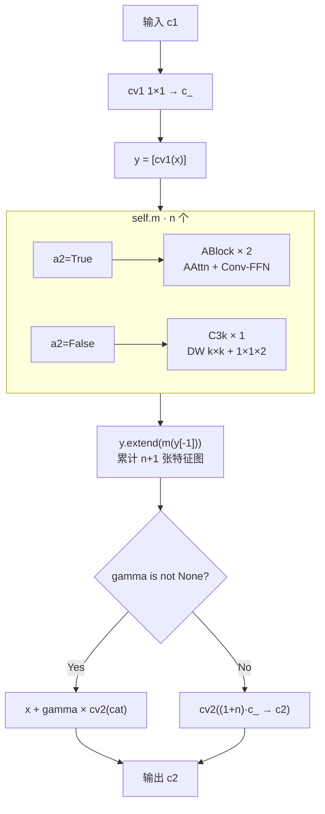
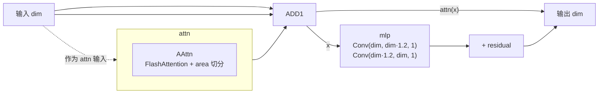
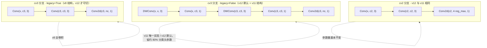
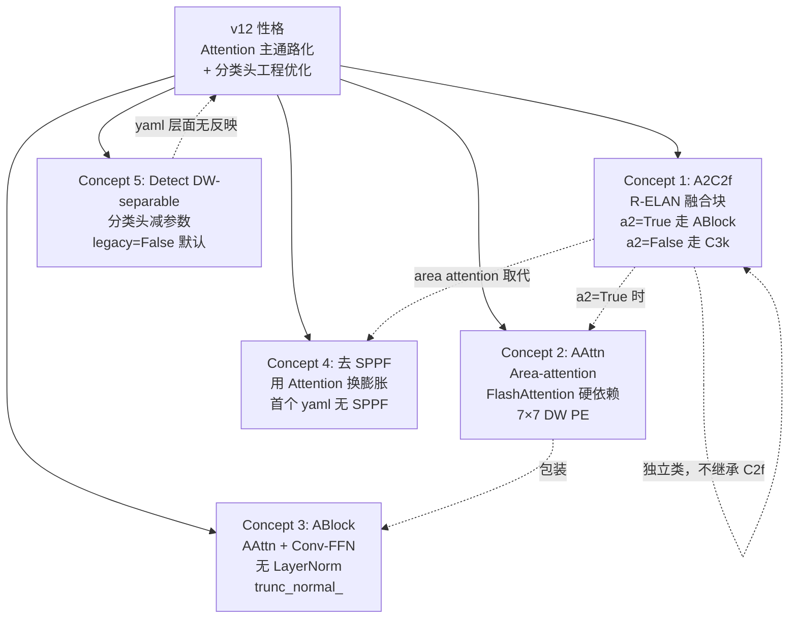

# YOLOv12 理论 Concept

> **v1~v11 读者路标**：本页把 v12 相对 v11 的五个关键设计决策摊开讲——每个决策对应到具体行号。整体基调是「**把注意力从 v11 的尾端外挂改成骨干 P4/P5 主通路内嵌，同时去掉 SPPF 冗余、Detect 补一个 `legacy` 开关**」：A2C2f（R-ELAN）替换骨干深段的 C3k2、AAttn 从 FlashAttention 起、ABlock 用 Conv-FFN 而非 Linear、去 SPPF（v8/v10/v11 的固定件）、Detect cv3 **在 v11 就已是 DW-separable**，v12 只是补 `legacy` 类属性让它可以切回全 3×3（**yaml 层面无反映的隐性差异**）。

::: tip 只想带走三件事
1. **v12 的「新」集中在 200 行**：AAttn + ABlock + A2C2f 三件套全部在 <SrcLink file="v12:ultralytics/nn/modules/block.py" :line="1160" :end="1354" />，v11 的 C3k2/C2PSA 类都还在——**C3k2 仍被 yaml 使用（浅层 + P5-large）、C2PSA 只留代码不进 yaml**。
2. **v12 硬依赖 FlashAttention**：<SrcLink file="v12:ultralytics/nn/modules/block.py" :line="1160" :end="1163" /> 里 `try/except` + `assert False` 兜底——**没有 fallback，CPU-only 环境也会因为 import 阶段 assert 直接崩溃**。这是 v12 相对 v11 的第一个「工程门槛」。
3. **yaml 层面无反映的隐性差异**：v12 的 `Detect` 补了 `legacy` 类属性（<SrcLink file="v12:ultralytics/nn/modules/head.py" :line="32" />）——v11 的 cv3 本来就无条件走 DW-separable，v12 只是把「不可切」变成「可切但默认仍是 DW」；`parse_model` 在模型含 C3k2/A2C2f 时写 `m.legacy = False`，所以同一份 yaml 在两版里的 cv3 结构相同，**v12 并不因此改变参数结构**。
:::

## 1. A2C2f：C2f 的 R-ELAN 继任者 (`concept-a2c2f`)

> **v1~v11 读者路标**：C2f 自 v6 引入以来是 YOLO 骨干的默认融合块（见 [C2f 词条](/glossary#c2f-高效跨阶段)）；v11 的 C3k2 是「C2f 外壳 + C3k/Bottleneck 内瓶」；**v12 的 A2C2f 把内瓶换成 ABlock（Area-attention + Conv-FFN），并在 yaml 里保留 C3k 作为 `a2=False` 分支**——本质上把 v11 的「内瓶二选一」升级成「内瓶二选一（其中一选项是 Attention 分支）」。

**定义**：A2C2f（<SrcLink file="v12:ultralytics/nn/modules/block.py" :line="1300" :end="1354" />）**独立类，不继承 C2f**——构造函数签名 `__init__(c1, c2, n=1, a2=True, area=1, residual=False, mlp_ratio=2.0, e=0.5, g=1, shortcut=True)`：

```python
class A2C2f(nn.Module):
    def __init__(self, c1, c2, n=1, a2=True, area=1, residual=False,
                 mlp_ratio=2.0, e=0.5, g=1, shortcut=True):
        super().__init__()
        c_ = int(c2 * e)                                    # L1332
        assert c_ % 32 == 0, "Dimension of ABlock be a multiple of 32."  # L1333
        num_heads = c_ // 32                                # L1336 硬编码
        self.cv1 = Conv(c1, c_, 1, 1)
        self.cv2 = Conv((1 + n) * c_, c2, 1)
        init_values = 0.01                                  # L1341
        self.gamma = nn.Parameter(init_values * torch.ones((c2)),
                                  requires_grad=True) if a2 and residual else None
        self.m = nn.ModuleList(
            nn.Sequential(*(ABlock(c_, num_heads, mlp_ratio, area) for _ in range(2)))
                if a2 else C3k(c_, c_, 2, shortcut, g)
            for _ in range(n)
        )
```

**五个关键设计点**：

1. **`c_ % 32 == 0` 通道断言（L1333）**：因为 `num_heads = c_ // 32` 是硬编码，通道必须能被 32 整除。基准档（m/l）骨干 512→256 → num_heads=8；n 档 width=0.25 时 512→128→c_=64→**num_heads=2**，P5 的 1024→256→c_=128→**num_heads=4**；m/l/x 档 P5 被 `max_channels=512` 封顶→c_=256→num_heads=8——**用户自定义 yaml 时若把 c2 改成 112 之类会直接踩断言**；
2. **`num_heads = c_ // 32` 硬编码（L1336）**：`head_dim = 32` 永远不变——这是 AAttn 类文档「recommend that `dim // num_heads` be a multiple of 32 or 64」的实现方式，但**不允许外部覆盖 num_heads**，想调 num_heads 只能改 A2C2f 类；
3. **`gamma` 按档位启用（L1341-1342）**：只有 `a2 and residual` 都为真时才创建。yaml 的骨干写 `A2C2f, [512, True, 4]`，**第四个字段是 area 而不是 residual**；`parse_model`（tasks.py L1034-1038）只给 **L/X 档**追加 `residual=True, mlp_ratio=1.2`——因此 **L/X 档骨干 #6/#8 有 gamma（0.01 初始化），n/s/m 档全部为 None；head 三处 a2=False 永远为 None**；
4. **`a2` 决定走 ABlock 还是 C3k（L1345）**：这是一个隐藏的双分支。yaml 骨干 layer 6/8 传 `a2=True`（真跑 ABlock + Attention），head layer 11/14/17 传 `a2=False`（**实际执行的是 C3k 骨架**）；
5. **`forward` 无 layer-scale 分支时不加残差（L1352-1354）**：`if self.gamma is not None: return x + gamma * cv2(...)`——**无 gamma 时 A2C2f 的 forward 与标准 C2f 完全一致**，只是内瓶换了。

**A2C2f vs C2f vs C3k2 的关系**：

| 维度 | C2f | C3k2 | **A2C2f** |
|------|-----|------|-----------|
| 类继承 | `nn.Module` | `C2f`（继承） | **`nn.Module`（独立）** |
| 内瓶 | C3 | C3k or Bottleneck | **ABlock or C3k** |
| 内瓶数 | `n` | `n` | `n × 2`（a2=True 时） |
| 通道约束 | 无 | 无 | **`c_ % 32 == 0`** |
| 注意力 | 无 | 无 | **Area-attention（a2=True 时）** |
| layer-scale | 无 | 无 | **可选（residual=True 时）** |
| 参数 | baseline | 多约 15~20% | **多约 25~40%（a2=True）** |

**v12 yaml 里 A2C2f 出现 5 次**（<SrcLink file="v12:ultralytics/cfg/models/v12/yolov12.yaml" :line="1" :end="46" />）：
- **骨干 #6**（P4/16, area=4, a2=True, n=4）：**真跑 Area-attention**
- **骨干 #8**（P5/32, area=1, a2=True, n=4）：**真跑 Area-attention**
- **head #11/#14/#17**（a2=False, n=2）：**实际走 C3k 骨架，不是注意力**

**给读者的建议**：A2C2f 的招牌是 Attention，但 yaml 里只有 2 处真的开了 Attention——**另外 3 处 head 的 A2C2f 本质上是 C3k**。想真正启用 layer-scale，需要在 yaml 里手动传 `[c2, True, area, True]`（第 4 个位置传 residual=True）。

**实现**：



- yaml 落点 5 处（骨干 #6/#8 走 a2=True；head #11/#14/#17 走 a2=False）
- 骨干 A2C2f 的 area 参数：#6 是 4（64×64 特征图切 4 份），#8 是 1（完整全局）——**P4 用局部注意力，P5 用全局注意力**，与金字塔尺度对应

<SrcLink file="v12:ultralytics/nn/modules/block.py" :line="1300" :end="1354" />
<SrcLink file="v12:ultralytics/cfg/models/v12/yolov12.yaml" :line="18" />
<SrcLink file="v12:ultralytics/cfg/models/v12/yolov12.yaml" :line="21" />

> **v1~v11 读者路标**：C2f 是「C2f 外壳 + C3 内瓶」；C3k2 是「C2f 外壳 + C3k 内瓶」；**A2C2f 是「C2f 外壳 + ABlock 内瓶（a2=True）」或「C2f 外壳 + C3k 内瓶（a2=False）」**——三代都在换内瓶，但 A2C2f 是唯一「内瓶二选一」的模块，且其中一选项是 Attention 分支。

## 2. AAttn：Area-attention 与 FlashAttention 硬依赖 (`concept-aattn`)

> **v1~v11 读者路标**：v8 骨干零注意力；v9 用 CBAM/CBLinear 走纯卷积；v10 是全网唯一一处 PSA 半通道注意力；v11 把注意力升级为 C2PSA 内嵌进 C2f 尾部。**v12 的 AAttn 是全新设计**：把注意力切成 `area` 份分别算（面积感知）、位置编码用 **7×7 DW conv 加在 v 上**、CUDA 走 FlashAttention 硬依赖——**四代里首次让注意力进入骨干主通路，且带硬外部依赖**。

**定义**：AAttn（<SrcLink file="v12:ultralytics/nn/modules/block.py" :line="1166" :end="1246" />）——Area-attention 模块，构造函数 `__init__(dim, num_heads, area=1)`：

```python
class AAttn(nn.Module):
    def __init__(self, dim, num_heads, area=1):
        super().__init__()
        self.area = area
        self.num_heads = num_heads
        self.head_dim = head_dim = dim // num_heads          # L1197
        all_head_dim = head_dim * self.num_heads

        self.qkv  = Conv(dim, all_head_dim * 3, 1, act=False)         # L1200 一次出 q/k/v
        self.proj = Conv(all_head_dim, dim, 1, act=False)             # L1201
        self.pe   = Conv(all_head_dim, dim, 7, 1, 3, g=dim, act=False)  # L1202 7×7 DW 位置编码
```

**结构三件套**：
1. **`qkv`**：一个 1×1 Conv 一次产出 q/k/v 三份（`all_head_dim * 3` 通道）——不是三个独立 Conv，节省计算；
2. **`proj`**：1×1 Conv 输出回原通道 `dim`；
3. **`pe`**：**7×7 DW 卷积位置编码**——关键设计。`g=dim` 等价于 DWConv，`stride=1, padding=3`，激活关闭。**注意 `pe` 作用对象是 v（不是 q/k/v）**——见 forward L1244。

**forward 关键节点**（<SrcLink file="v12:ultralytics/nn/modules/block.py" :line="1205" :end="1246" />）：

```python
def forward(self, x):
    B, C, H, W = x.shape
    N = H * W
    qkv = self.qkv(x).flatten(2).transpose(1, 2)     # (B, N, 3·all_head_dim)
    if self.area > 1:
        qkv = qkv.reshape(B * self.area, N // self.area, C * 3)  # L1212 切分
        B, N, _ = qkv.shape
    q, k, v = qkv.view(B, N, self.num_heads, self.head_dim * 3).split(
        [self.head_dim, self.head_dim, self.head_dim], dim=3
    )
    if x.is_cuda:
        x = flash_attn_func(                          # L1219 强制 half
            q.contiguous().half(), k.contiguous().half(), v.contiguous().half()
        ).to(q.dtype)
    else:
        q = q.permute(0, 2, 3, 1); k = k.permute(0, 2, 3, 1); v = v.permute(0, 2, 3, 1)
        attn = (q.transpose(-2, -1) @ k) * (self.head_dim ** -0.5)
        max_attn = attn.max(dim=-1, keepdim=True).values
        exp_attn = torch.exp(attn - max_attn)
        attn = exp_attn / exp_attn.sum(dim=-1, keepdim=True)
        x = (v @ attn.transpose(-2, -1))
        x = x.permute(0, 3, 1, 2)
        v = v.permute(0, 3, 1, 2)
    if self.area > 1:
        x = x.reshape(B // self.area, N * self.area, C)
        v = v.reshape(B // self.area, N * self.area, C)
    x = x.reshape(B, H, W, C).permute(0, 3, 1, 2)
    v = v.reshape(B, H, W, C).permute(0, 3, 1, 2)
    x = x + self.pe(v)                               # L1244 pe 加在 v 上
    x = self.proj(x)                                  # L1245
    return x
```

**四个独有设计点**：

1. **`area` 面积切分（L1211-1213 / L1236-1239）**：把 N 个位置分成 `area` 份独立算 attention——`area=4` 时 64×64 特征图分成 4 份、每份 16×64=1024 位置，`O(N²)` 复杂度变成 `area × (N/area)² = N²/area`——**注意力计算量除以 area 倍**。骨干 #6 用 area=4，#8 用 area=1——**P4 局部，P5 全局**；
2. **FlashAttention 硬依赖（L1218-1223）**：CUDA 分支强制 `.half()` 走 FlashAttention——**fp16 是 FlashAttention 的硬要求**；训练精度损失被 `.to(q.dtype)` 转回规避，但 kernel 内部仍是 fp16；
3. **CPU 手写 softmax（L1224-1234）**：非 CUDA 时走标准 softmax 实现——**数值上等价，但没有 FlashAttention 的内存优化**，速度显著慢；
4. **`pe(v)` 加在 x 上，不是加在 q/k/v 上（L1244）**——**这是 v12 的独有设计**：位置编码 pe(v) 加到 attention 输出 x 上，而不是常见的输入侧 positional embedding。**attention 管全局、pe 管局部，两者相加得到综合特征**。

**FlashAttention 硬依赖的兜底路径**（<SrcLink file="v12:ultralytics/nn/modules/block.py" :line="1160" :end="1163" />）：

```python
try:
    from flash_attn.flash_attn_interface import flash_attn_func
except Exception:
    assert False, "import FlashAttention error! Please install FlashAttention first."
```

- **文件顶部不 import flash_attn**，避免污染 v11 时代的调用路径——只有 AAttn/ABlock/A2C2f 需要时才触发；
- **未安装 flash-attn 时 `assert False` 直接抛异常**——**没有 fallback，即使 CPU-only 环境也会因为 import 阶段 assert 崩溃**；
- **必须前置安装**：`pip install flash-attn --no-build-isolation`（依赖 CUDA 11.6+、PyTorch 1.9+）。

**动机**：
- **为什么用 area 切分**：YOLO 骨干 P4 特征图是 64×64=4096 位置，`O(4096²)` 的 attention 已经很贵；切成 4 份后每份 1024 位置，计算量降 4 倍。P5 是 32×32=1024 位置，不需要切分（area=1）；
- **为什么用 DW 7×7 而不是 sinusoidal**：sinusoidal embedding 是 1D 位置，DW 7×7 是 2D 局部感受野——**YOLO 处理的是图像特征图，2D 局部位置比 1D 全局位置更有用**；
- **为什么用 FlashAttention**：`fp16 内存驻留 + fused kernel`——是 YOLO 家族首次引入的**第三方 Attention 加速库**，v11 的 C2PSA 是自己实现的、v12 选择直接依赖社区最成熟的实现。

**与 v11 C2PSA.Attention 的对比**：

| 维度 | v11 C2PSA.Attention | **v12 AAttn** |
|------|---------------------|---------------|
| 位置编码 | DWConv 3×3 加在 q/k/v 输入 | **DWConv 7×7 加在 v 输出侧** |
| Attention 实现 | 手写（标准 softmax） | **CUDA: FlashAttention；CPU: 手写** |
| 精度 | fp32 | **CUDA 强制 fp16** |
| num_heads | c // 64 | **c_ // 32**（由 A2C2f 决定） |
| area 切分 | 无 | **支持 1/2/4 等面积切分** |
| attn_ratio | 0.5（key 维度砍半） | **无（q/k/v 等维）** |

**一句话**：v11 C2PSA 是「标准自注意力 + DW 位置编码」；v12 AAttn 是「**FlashAttention 加速 + 面积切分 + 输出侧 DW 位置编码**」——**从"能跑"变成"跑得快"**。

<SrcLink file="v12:ultralytics/nn/modules/block.py" :line="1160" :end="1246" />
<SrcLink file="v12:ultralytics/cfg/models/v12/yolov12.yaml" :line="19" />
<SrcLink file="v12:ultralytics/cfg/models/v12/yolov12.yaml" :line="22" />

> **v1~v11 读者路标**：v8/v9 无 Attention；v10 PSA 是「标准 softmax + DW 位置编码 + 半通道」；v11 C2PSA 是「标准 softmax + DW 位置编码 + 全通道 + 内嵌」；**v12 AAttn 是「FlashAttention + DW 位置编码 + area 切分 + 主通路」**——四代 Attention 演进方向清晰：**从"能不能用"到"跑得多快"**。

## 3. ABlock：AAttn + Conv-based FFN (`concept-ablock`)

> **v1~v11 读者路标**：Transformer 标准 block 是「Attention + LayerNorm + FFN + LayerNorm」；YOLO 家族一贯用 Conv + BN + SiLU 而非 LayerNorm；**v12 的 ABlock 是"Transformer 结构骨架 + YOLO 实现"的融合**——Attention 用 AAttn、FFN 用两个 1×1 Conv、无 LayerNorm、trunc_normal_ 初始化。

**定义**：ABlock（<SrcLink file="v12:ultralytics/nn/modules/block.py" :line="1249" :end="1297" />）——构造函数 `__init__(dim, num_heads, mlp_ratio=1.2, area=1)`：

```python
class ABlock(nn.Module):
    def __init__(self, dim, num_heads, mlp_ratio=1.2, area=1):
        super().__init__()
        self.attn = AAttn(dim, num_heads=num_heads, area=area)
        mlp_hidden_dim = int(dim * mlp_ratio)
        self.mlp = nn.Sequential(Conv(dim, mlp_hidden_dim, 1),
                                 Conv(mlp_hidden_dim, dim, 1, act=False))
        self.apply(self._init_weights)

    def _init_weights(self, m):
        if isinstance(m, nn.Conv2d):
            trunc_normal_(m.weight, std=.02)
            if m.bias is not None:
                nn.init.constant_(m.bias, 0)

    def forward(self, x):
        x = x + self.attn(x)   # 无 LayerNorm
        x = x + self.mlp(x)    # 无 LayerNorm
        return x
```

**四个关键设计点**：

1. **`mlp_ratio` 由 A2C2f 传参决定**：ABlock 自己的默认值是 1.2，但 A2C2f 默认传 **2.0**（n/s/m 档），`parse_model` 只对 **L/X 档**传 1.2——所以「1.2 的轻量 FFN」只出现在 L/X 骨干两块，n/s/m 的 FFN 展开比是 2.0；两者都**远低于经典 Transformer 的 4.0**，符合 v12 的 real-time 定位；
2. **FFN 用 Conv 而非 Linear**：`Conv(dim, hidden, 1) → Conv(hidden, dim, 1)`——两次 1×1 卷积等价于 Linear，但保持「整个模块只用 Conv」的统一风格（配合 Ultralytics 全套 Conv+BN+SiLU 的推理工具链）；
3. **无 LayerNorm**：ViT 标准是 pre-norm（`x = x + attn(ln(x))`），v12 是 **post-residual**（`x = x + attn(x)`），与 YOLO 家族一贯的 BN+SiLU 风格一致——**ABlock 内不含任何 LayerNorm**；
4. **`trunc_normal_` 初始化 `std=0.02`（L1288-1291）**：从 `timm.models.layers` 引入的截断正态初始化，是 ViT/Swin 家族的常见做法——`std=0.02` 比默认 Kaiming 小很多，**配合 layer-scale 保证训练初期 residual 路径稳定**。

**forward 无 LayerNorm 的隐患**：
- 由于 Conv 内含 BN（`act=False` 也不影响 BN），ABlock 的实际归一化靠 Conv 内部的 BN——**没有 LayerNorm 也 OK，只是训练动力学与 ViT 不同**；
- **无 LayerNorm 意味着「无 pre-norm 抑制梯度爆炸」**——但 YOLO 家族一贯如此，v11 C2PSA.Attention 也没有 pre-norm，实测可训练。

**ABlock 是 A2C2f 的默认内瓶**（a2=True 分支）：
- yaml 骨干 #6 A2C2f n=4 → 4 段 × 2 ABlock = 8 个 ABlock（P4/16）
- yaml 骨干 #8 A2C2f n=4 → 4 段 × 2 ABlock = 8 个 ABlock（P5/32）
- **每个 ABlock 都是完整「Attention + FFN」——v12 骨干共 16 个 ABlock**
- head 的 A2C2f（a2=False）内瓶走 C3k，**不产生 ABlock**

**实现**：



- 训练初期 `trunc_normal_(std=0.02)` 让 attn 与 mlp 两个子模块输出都接近 0——**ABlock 输出 ≈ 输入**，与 residual 加法组合后不破坏特征；
- 与 v11 C2PSA 的 PSABlock（<SrcLink file="v11:ultralytics/nn/modules/block.py" :line="922" :end="1000" />）对比：v11 PSABlock 有 LayerNorm + Attention + FFN（Transformer 标准），v12 ABlock **无 LayerNorm + Attention + Conv-FFN**——**v12 更贴近 YOLO 家族的 BN 风格**。

<SrcLink file="v12:ultralytics/nn/modules/block.py" :line="1249" :end="1297" />

> **v1~v11 读者路标**：v10/v11 的 PSABlock 是「LayerNorm + Attention + LayerNorm + FFN」的 ViT 标准骨架；**v12 的 ABlock 是「Attention + Conv-FFN」的 YOLO 化骨架**——**去 LayerNorm、FFN 用 Conv、初始化用 trunc_normal_**——三代都在做「Transformer → YOLO」的适配，v12 的适配最激进也最一致。

## 4. 去 SPPF：v12 首个无 SPPF 的 YOLO (`concept-no-sppf`)

> **v1~v11 读者路标**：SPPF 自 v5 引入以来是 YOLO 骨干的固定件——v6/v7/v8/v9/v10/v11 的 yaml 里**全部有 SPPF**（在骨干末端接 C2f 之前，扩大感受野）。**v12 是首个 yaml 里无 SPPF 的官方 YOLO**（<SrcLink file="v12:ultralytics/cfg/models/v12/yolov12.yaml" :line="1" :end="46" />）——但**代码里的 SPPF 类依然存在**（<SrcLink file="v12:ultralytics/nn/modules/block.py" :line="172" />），只是 yaml 不引用。

**SPPF 在 v8/v10/v11 yaml 的位置**：

```yaml
# v8/v10/v11 骨干末段（示意）
- [-1, 1, Conv,  [1024, 3, 2]]
- [-1, 1, SPPF,  [1024, 5]]     # <-- 骨干末尾、注意力之前
- [-1, 2, C3k2,  [1024, True]]  # v11 的骨干融合块
```

```yaml
# v12 骨干末段（实际）
- [-1, 1, Conv,  [512, 3, 2]]
- [-1, 4, A2C2f, [512, True, 4]]   # layer 6: P4/16, area=4
- [-1, 1, Conv,  [1024, 3, 2]]
- [-1, 4, A2C2f, [1024, True, 1]]  # layer 8: P5/32, area=1 —— 直接跟 Conv，无 SPPF
```

**为什么可以去 SPPF**：

1. **A2C2f 的 area attention 提供大感受野**：SPPF 用 maxpool 3/5/9 kernel 拼接来扩大感受野；v12 AAttn 的 `area=1` 全局注意力（P5）本身就是「任意位置互相可见」——**感受野从 O(k²) 到 O(N²)**，SPPF 的膨胀作用冗余；
2. **P4 A2C2f 用 area=4 局部注意力**：64×64 特征图分 4 份、每份 16×64=1024 位置——**局部感受野由 DW 7×7 pe 补**，与 P4 的密集细节特征匹配；
3. **参数量与延迟**：SPPF 的三次 maxpool 拼接是纯计算开销、无参数——**去掉可以节省 GPU 时间，但收益不如 P5 A2C2f 的 attention 收益大**；
4. **代码量**：v12 骨干少一个模块（SPPF），减少一层 yaml 依赖，模型图更简洁。

**代价**：
- **P4/P5 交界处的感受野从 SPPF 的"多尺度膨胀"变成 attention 的"局部 + 全局混合"**——**理论上覆盖更广、但收敛难度可能略高**（论文 arXiv:2502.12524 提到"we observe better convergence with A2C2f directly replacing SPPF+C3k2"——但未给出消融表）；
- **v11→v12 权重迁移困难**：由于 SPPF 是骨干末段的关键 layer，去掉意味着 P4/P5 的层号整体下移、通道映射复杂，**跨版本权重热迁移基本不可行**。

**v12 yaml 里 SPPF 出现次数**：**0 次**（对比 v8/v10/v11 各 1 次）——**代码里 SPPF 类存在**（供 v8/v10/v11 老 yaml 使用），但 v12 主动不使用。

**四代骨干末尾对比**：

| 版本 | 骨干末尾模块 | 感受野机制 |
|------|-------------|-----------|
| v8 | `SPPF + C2f` | maxpool 3/5/9 |
| v10 | `SPPF + C2f` | maxpool 3/5/9 |
| v11 | `SPPF + C2PSA + C3k2` | maxpool + 尾端 Attention |
| **v12** | `Conv + A2C2f(area=1)` | **全局 Attention（无 SPPF）** |

**一句话**：v12 是 YOLO 家族里**首个 yaml 层面无 SPPF 的版本**——**用 Area-attention 的 P5 全局感受野替代 SPPF 的膨胀感受野**，从「拼接多尺度」变成「一次全局 attention」。

<SrcLink file="v12:ultralytics/cfg/models/v12/yolov12.yaml" :line="17" :end="22" />
<SrcLink file="v12:ultralytics/nn/modules/block.py" :line="172" />

> **v1~v11 读者路标**：v5~v11 共 7 代都保留 SPPF；**v12 是首个去掉 SPPF 的官方版本**——**代码保留（向后兼容），yaml 不用（前向演进）**——**这是 v11 里 C3k2 状态的反转**（v11 C3k2 使用、C2PSA 保留不用；v12 A2C2f 使用、C2PSA/SPPF 保留不用）。

## 5. Detect DW-separable 分支：yaml 层面无反映的隐性差异 (`concept-detect-dw-separable`)

> **v1~v11 读者路标**：v11 的 Detect 沿用 v8 的 **DW-separable** 实现——`cv3 = DWConv(x,x,3) + Conv(x,c3,1) → DWConv(c3,c3,3) + Conv(c3,c3,1) → Conv2d(c3,nc,1)`（v11 head.py L44-51，**无 legacy 开关**）；**v12 给 Detect 补了 `legacy` 类属性（默认 `False`）**，默认行为与 v11 相同，但可以切回 v8 的全 3×3 两段——**yaml 里两版写法完全相同，差异只在 Python 类属性**。

**v12 Detect.cv3 分支（<SrcLink file="v12:ultralytics/nn/modules/head.py" :line="46" :end="57" />）**：

```python
self.cv3 = (
    nn.ModuleList(nn.Sequential(Conv(x, c3, 3), Conv(c3, c3, 3), nn.Conv2d(c3, self.nc, 1))
                  for x in ch)
    if self.legacy
    else nn.ModuleList(
        nn.Sequential(
            nn.Sequential(DWConv(x, x, 3), Conv(x, c3, 1)),       # 第 1 段：DW+1×1 升维
            nn.Sequential(DWConv(c3, c3, 3), Conv(c3, c3, 1)),    # 第 2 段：DW+1×1 保持
            nn.Conv2d(c3, self.nc, 1),                             # 第 3 段：分类头
        )
        for x in ch
    )
)
```

**对比表**：

| 版本 | legacy 开关 | cv3 第 1 段 | cv3 第 2 段 | cv3 第 3 段 |
|------|-----------|------------|------------|------------|
| v8  | 无（硬编码全卷积） | Conv(x, c3, 3) | Conv(c3, c3, 3) | Conv2d(c3, nc, 1) |
| v10 | 无（双头结构） | Conv(x, c3, 3) | Conv(c3, c3, 3) | Conv2d(c3, nc, 1) |
| v11 | **无（硬编码 DW）** | **DWConv(x, x, 3) + Conv(x, c3, 1)** | **DWConv(c3, c3, 3) + Conv(c3, c3, 1)** | Conv2d(c3, nc, 1) |
| **v12** | **有（默认 False）** | **DWConv(x, x, 3) + Conv(x, c3, 1)** | **DWConv(c3, c3, 3) + Conv(c3, c3, 1)** | Conv2d(c3, nc, 1) |

**动机**（这些理由解释的是 v11 为什么这么改，v12 只是延续）：

1. **参数节省**：DWConv 3×3 只有 `c × 9` 参数（DW 分离）+ 1×1 的 `c × c3`——比原 3×3 的 `x × c3 × 9` 便宜很多。c=256, c3=100 时：原 ≈ 230K 参数，新 ≈ 42K 参数——**约省 80%**；
2. **推理加速**：DWConv 在移动端（ARM NEON、NVIDIA TensorRT）有硬件加速，比稠密 3×3 快 2~3 倍；
3. **表达力不减**：DWConv + 1×1 组合的表达力与稠密 3×3 相当（MobileNet 时代已被验证）——分类头不是主通路，节省计算不影响主通路特征；
4. **与骨干一致**：v12 AAttn 的 pe 用 7×7 DWConv，Detect cv3 用 3×3 DWConv——**全模型的 DWConv 家族化**。

**跨版本权重迁移的坑**：

- **v11 → v12 的 cv3 可以直接迁移**：两版都是 5 段 DW-separable，张量形状完全一致；v12 只是多了 `legacy` 开关（默认不改变结构）；
- **v8 → v12 不行**：v8 的 cv3 是 3 段全卷积，`[c3, c3, 3, 3]` 这类形状与 DWConv 的 `[c3, 1, 3, 3]`（groups=c3）不对应，加载会失败；
- **v12 内切 `legacy=True` 也不行**：等于退回 v8 结构，需要从头训练；
- **v11 与 v12 的检测头参数量一致**：两版 cv2/cv3 完全同构；总参数差异（`yolo11s` 9.46M vs `yolov12s` 9.29M）来自骨干（A2C2f vs C3k2 + 去 SPPF），**不是检测头**。

**Detect 的其他 v12 变化**：

- **`max_det = 300`**（<SrcLink file="v12:ultralytics/nn/modules/head.py" :line="28" />）：与 v10/v11 一致；
- **`reg_max = 16`**（<SrcLink file="v12:ultralytics/nn/modules/head.py" :line="39" />）：DFL 4×16=64 通道，与 v8~v11 一致；
- **`end2end = False`** 默认（<SrcLink file="v12:ultralytics/nn/modules/head.py" :line="27" />）：v12 保留 v10 的 end2end 结构但默认关闭——**v11 也保留且默认关闭**，不是 v12 的变化；
- **NMS 单头回归**（与 v11 一致）：v12 检测头走 TAL + class-wise NMS，与 v10 的 NMS-free 路线彻底切割。

**Detect 内的 DW-separable 分支图**：



- cv2 box 分支与 v11 完全一致（全 3×3），cv3 cls 分支在 v11 就已是 DW-separable
- 参数节省集中在分类头——**对主通路（box 预测）无影响**
- 推理图导出到 ONNX 时 DWConv 会被标准算子识别——**无部署障碍**

**一句话**：v12 Detect 的 DW-separable **不是新改动**——v11 已经这么做了；v12 的贡献只是补一个 `legacy` 开关（默认不改变行为），让「yaml 无法识别的结构差异」至少**在 Python 层可切**。

<SrcLink file="v12:ultralytics/nn/modules/head.py" :line="21" :end="74" />
<SrcLink file="v12:ultralytics/nn/modules/head.py" :line="32" />
<SrcLink file="v12:ultralytics/nn/modules/head.py" :line="46" :end="57" />

> **v1~v11 读者路标**：v8/v9/v10 的 Detect cv3 是全 3×3 卷积；**v11 已经改成 DW-separable（无开关）**；v12 沿袭 v11 并用 `legacy` 类属性把它变成可切换——**yaml 层面 v11 与 v12 写法相同，行为也相同**。

## 6. 五个 Concept 的关联总结

> **v1~v11 读者路标**：五个 concept 不是孤立的——A2C2f 是融合块升级、AAttn 是注意力主通路化、ABlock 是 Transformer → YOLO 的骨架适配、去 SPPF 是「用 Attention 换膨胀」、Detect DW-separable 是「分类头工程优化」——**它们共同定义了 v12 的"性格"**。



- **技术增量**：A2C2f（融合块升级）+ AAttn（Area-attention 主通路）+ ABlock（Conv-FFN 骨架）——**三件套集中 200 行**
- **结构改动**：去 SPPF（v12 首个无 SPPF 的官方 yaml）
- **隐性差异**：Detect DW-separable（**yaml 层面无反映**，legacy 默认 False）
- **外部依赖**：FlashAttention（**v12 首个硬依赖**，`assert False` 兜底）

一句话总结 v12：**把 v11 的「尾端外挂注意力」升级为「骨干主通路 Area-attention」，同时去掉 SPPF 冗余；Detect 分类头沿用 v11 的 DW-separable（仅补 legacy 开关）**——**这是 YOLO 家族首次让 Attention 成为骨干主通路的一代**，但**付出了硬依赖 FlashAttention 的工程代价**。

> **v1~v11 读者路标**：v8 是"工程基线"、v9 是"纯卷积路线"、v10 是"论文野心"、v11 是"工程稳健 + 局部升级"、**v12 是"Attention 主通路 + 硬依赖 FlashAttention"**——五代各有性格，v12 的性格最"激进"（也是唯一需要额外依赖包的一代）。

## 7. SrcLink 汇总

本页引用到的关键源码位置（可直接跳转）：

- <SrcLink file="v12:ultralytics/nn/modules/block.py" :line="1160" :end="1163" />——FlashAttention 硬依赖 + `assert False` 兜底
- <SrcLink file="v12:ultralytics/nn/modules/block.py" :line="1166" :end="1246" />——AAttn 类定义（Area-attention + 7×7 DW PE）
- <SrcLink file="v12:ultralytics/nn/modules/block.py" :line="1249" :end="1297" />——ABlock 类定义（AAttn + Conv-FFN + trunc_normal_）
- <SrcLink file="v12:ultralytics/nn/modules/block.py" :line="1300" :end="1354" />——A2C2f 类定义（R-ELAN + a2 双分支 + gamma）
- <SrcLink file="v12:ultralytics/nn/modules/block.py" :line="725" :end="735" />——C3k2 类（v11 遗留，v12 yaml 骨干 2/4/20 使用）
- <SrcLink file="v12:ultralytics/nn/modules/block.py" :line="736" :end="744" />——C3k 类（A2C2f a2=False 分支内瓶）
- <SrcLink file="v12:ultralytics/nn/modules/block.py" :line="172" />——SPPF 类（v12 yaml 不引用，代码保留）
- <SrcLink file="v12:ultralytics/nn/modules/block.py" :line="1004" />——C2PSA 类（v11 遗留，v12 yaml 不引用）
- <SrcLink file="v12:ultralytics/nn/modules/head.py" :line="21" :end="74" />——Detect 类定义（v12 检测头）
- <SrcLink file="v12:ultralytics/nn/modules/head.py" :line="32" />——`legacy = False`（v12 隐性差异关键点）
- <SrcLink file="v12:ultralytics/nn/modules/head.py" :line="46" :end="57" />——cv3 DW-separable 分支
- <SrcLink file="v12:ultralytics/cfg/models/v12/yolov12.yaml" :line="1" :end="46" />——yolov12.yaml 完整结构（5 档 scales + 5 处 A2C2f + 3 处 C3k2）
- <SrcLink file="v12:ultralytics/cfg/models/v12/yolov12.yaml" :line="19" />——骨干 A2C2f #6（P4/16, area=4, a2=True）
- <SrcLink file="v12:ultralytics/cfg/models/v12/yolov12.yaml" :line="22" />——骨干 A2C2f #8（P5/32, area=1, a2=True）

> **v1~v11 读者路标**：这 14 处 SrcLink 覆盖了 v12 全部自研模块、隐性差异关键点、yaml 关键行——对照 v11 的 [concepts 全文](/versions/v11/concepts) 与 v10 的 [concepts 全文](/versions/v10/concepts)，可以完整 diff 三代差异。

## 延伸阅读

- [YOLOv12 架构总览](/versions/v12/architecture)
- [YOLOv12 逐层图解](/versions/v12/layers)
- [YOLOv12 损失函数详解](/versions/v12/losses)
- [YOLOv12 训练技巧](/versions/v12/tricks)
- [v12 痛点与取舍](/versions/v12/painpoints)
- [yolov12.yaml 源码页](/versions/v12/source/yolov12-yaml)
- [block.py 源码页](/versions/v12/source/block-py)
- [head.py 源码页](/versions/v12/source/head-py)
- [v11 理论 Concept](/versions/v11/concepts)（C3k2 + C2PSA 的完整叙事）
- [v10 理论 Concept](/versions/v10/concepts)（NMS-free 的完整叙事）
- [v8 理论 Concept](/versions/v8/concepts)（TAL/DFL/解耦头的 v8 版）
- [术语表](/glossary)
