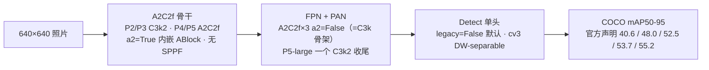
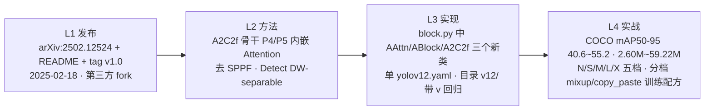

# YOLOv12 (2025-02)

**Attention-Centric · 第三方 fork 官方化 · P4/P5 内嵌 A2C2f + 去 SPPF + Detect 默认 DW-separable——首次官方 YOLO 有 arXiv 论文（继 v10 之后）**

- 📄 发布：**arXiv:2502.12524《YOLOv12: Attention-Centric Real-Time Object Detectors》**，2025-02-18；仓库 README + PyPI tag `v1.0` 三层材料构成，详见[发布精读](/versions/v12/paper)
- 🏛️ 作者：**Yunjie Tian（UB SUNY）、Qixiang Ye（UB SUNY）、David Doermann（UCAS）**——**第三方开发，非 ultralytics 官方**（首次出现的"官方 fork 项目"，仓库 `sunsmarterjie/yolov12`）
- 💻 源码：[sunsmaterjie/yolov12](https://github.com/sunsmarterjie/yolov12) tag `v1.0`（commit `b1035f8f97cd1a7440454a54f8bc19f989448159`，2025-02-19，AGPL-3.0），基于 ultralytics fork；`AAttn` / `ABlock` / `A2C2f` 三个新类集中在 <SrcLink file="v12:ultralytics/nn/modules/block.py" :line="1160" :end="1354" />
- 🎯 里程碑：**结构性「加法」**——把 v11 的「C2PSA 尾端注意力」换成「**A2C2f 骨干 P4/P5 内嵌注意力**」；去掉 SPPF、去掉 v11 的 C3k2 尾端骨架、Detect 默认 `legacy=False` 走 **DW-separable cv3**（yaml 层面无反映的隐性差异）；目录**回归 `v12/`（带 v）**（v11 的 `11/` 不带 v 是四代里唯一的例外）

## 3 分钟电梯演讲



1. **A2C2f 骨干内嵌**：`class A2C2f(nn.Module)` **不继承 C2f**（独立类），核心参数 `a2` 与 `area`——`a2=True` 时内部走 [ABlock](/glossary#ablock)（AAttn + Conv-FFN），`a2=False` 时回退到 `C3k` 骨架 <SrcLink file="v12:ultralytics/nn/modules/block.py" :line="1300" :end="1354" />；yaml 里 **A2C2f 出现 5 次（骨干 2 + head 3）**，但**只有 backbone 的 P4（层 6）与 P5（层 8）是 a2=True**——两处真正启用 AAttn，head 里三处 A2C2f 都是 a2=False（等价于 C3k 骨架）；
2. **AAttn 硬依赖 FlashAttention**：<SrcLink file="v12:ultralytics/nn/modules/block.py" :line="1160" :end="1163" /> 直接 `from flash_attn.flash_attn_interface import flash_attn_func`，无 fallback 分支（`assert False` 兜底）——**没有 GPU + FlashAttention 就根本跑不起来**；`num_heads = c_ // 32` **硬编码**（不是像 v11 C2PSA 的 `c // 64`），配合 `assert c_ % 32 == 0`——通道数不对 32 的倍数直接崩；
3. **训练配方**：epochs=600 / batch=256 / **逐档 mixup 与 copy_paste 不同**（n: 0.0/0.1; s: 0.05/0.15; m: 0.15/0.4; l: 0.15/0.5; x: 0.2/0.6）——是 v11 完全一致的"v8 配方"之后**首次分档差异化**的训练 trick；损失侧则与 v11 **逐字节等价**（`tal_topk=10` 默认 + 显式 `alpha=0.5, beta=6.0`，v11 的 loss.py L160/L176 写法完全相同），检测训练实际用 v8 参数，与 `tal.py` 类默认 topk=13 α=1.0 不同。

> **v1~v11 读者路标**：[v8 读者](/versions/v8/index)——v12 的 Detect 头、v8DetectionLoss、TAL 分配器、Mosaic/MixUp 全套增强与 v8 一致，检测训练实际用 v8 的 topk=10 α=0.5 β=6.0；[v10 读者](/versions/v10/index)——v12 保留了 v10 的「有论文」基因（arXiv:2502.12524），但结构上放弃 v10 的双头与去 NMS；[v11 读者](/versions/v11/index)——v12 沿用 v11 的 C3k2 内瓶（保留 3 处）与 Detect 单头，但作者变成第三方（UB SUNY + UCAS），骨架从「C3k2 铺满」变成「A2C2f 内嵌 Attention 到 P4/P5」，尾端注意力从「外挂 C2PSA」变成「A2C2f 内嵌 ABlock」。

## 四层闭环视图



## 核心贡献一览

v12 的改动方向是「**把 v11 的注意力从尾端外挂改到骨干内嵌，并把 tail 简化**」：官方把 v11 的两个新积木（C3k2 / C2PSA）拆散——C3k2 只留浅层两处与 P5-large 一处，C2PSA 整个拿掉，替换成 A2C2f（R-ELAN 结构的 Attention 块）挂在 backbone 的 P4/P5 主通路上；**head 与 loss 与 tal 全部沿用 v11/v8 版本**（loss.py 与 v11 逐字节等价），Detect 头在 v11 已是 DW-separable，v12 只是补了一个 `legacy` 开关、默认值保持 v11 行为。核心贡献与代码落点：

| 贡献 | 一句话 | 代码落点 |
|------|--------|---------|
| **AAttn 硬依赖 FlashAttention** | `from flash_attn.flash_attn_interface import flash_attn_func` + `assert False` 兜底无 fallback；7×7 DWConv 位置编码在输出侧注入 `x = x + self.pe(v)` | <SrcLink file="v12:ultralytics/nn/modules/block.py" :line="1160" :end="1247" /> |
| **ABlock 简化 FFN** | AAttn + Conv-based FFN（`mlp_ratio` 由 A2C2f 传入：n/s/m 档 2.0、L/X 档 1.2）+ `trunc_normal_` std=0.02 初始化；**无 LayerNorm**（post-residual 而非 pre-norm） | <SrcLink file="v12:ultralytics/nn/modules/block.py" :line="1249" :end="1298" /> |
| **A2C2f R-ELAN 骨架** | `class A2C2f(nn.Module)` **不继承 C2f**；`c_ % 32 == 0` 通道断言；`num_heads = c_ // 32` 硬编码；`a2=True` 走 ABlock，`a2=False` 走 C3k；`gamma` layer-scale 仅 `a2 and residual` 时启用——`parse_model` 只给 **L/X 档骨干 2 处**补 `residual=True` | <SrcLink file="v12:ultralytics/nn/modules/block.py" :line="1300" :end="1354" /> |
| **A2C2f 骨干内嵌** | yaml 层 6（P4/16, area=4, ×4）与层 8（P5/32, area=1, ×4）——**只有这两处 a2=True**，head 里另外三处 A2C2f 为 a2=False（=C3k 骨架） | <SrcLink file="v12:ultralytics/cfg/models/v12/yolov12.yaml" :line="23" :end="25" /> |
| **去 SPPF** | v8/v10/v11 骨干末尾都有 SPPF；v12 直接用 A2C2f 收敛——**yaml 里搜不到 SPPF** | <SrcLink file="v12:ultralytics/cfg/models/v12/yolov12.yaml" :line="15" :end="25" /> |
| **Detect 增加 `legacy` 开关** | v11 的 cv3 已无条件走 DW-separable；v12 补 `legacy` 类属性（默认 `False`），由 `parse_model` 的 `m.legacy = legacy` 赋值——**行为与 v11 相同，yaml 里看不到差异** | <SrcLink file="v12:ultralytics/nn/modules/head.py" :line="32" :end="57" /> |
| **损失侧零改动** | `v8DetectionLoss` 与 v11 **逐字节等价**：`tal_topk=10` 默认 + `TaskAlignedAssigner(..., alpha=0.5, beta=6.0)` 显式传参，两版同一位置同一写法 | <SrcLink file="v12:ultralytics/utils/loss.py" :line="160" :end="176" /> |
| **分档训练配方** | epochs=600、batch=256、mosaic=1.0、mixup 与 copy_paste 按 n/s/m/l/x 逐档不同 | README 训练章节（yaml 无反映） |
| **单 yolov12.yaml** | 五档 n/s/m/l/x 用一份 scales 表集中定义；**scales 与 v11 逐项相同**（n/s max_channels=1024，m/l/x=512） | <SrcLink file="v12:ultralytics/cfg/models/v12/yolov12.yaml" :line="6" :end="12" /> |
| **目录回归 v 前缀** | 目录 `ultralytics/cfg/models/v12/`——**加 v**，与 v8/v10 一致；v11 的 `models/11/`（不带 v）是四代里唯一的例外 | <SrcLink file="v12:ultralytics/cfg/models/v12/yolov12.yaml" :line="1" /> |
| **首次官方 fork** | 作者 Yunjie Tian / Qixiang Ye / David Doermann（UB SUNY + UCAS），仓库 `sunsmarterjie/yolov12`——**非 ultralytics 官方**，AGPL-3.0 | arXiv:2502.12524 作者页 + repo README |

> **v1~v11 读者路标**：v12 只新增了 3 个模块类（`AAttn` / `ABlock` / `A2C2f`）——C3k2 沿 v11 保留 3 处（浅层 P2/P3 + P5-large）；[CSP](/glossary#csp-跨阶段部分连接) 与 [C2f](/glossary#c2f) 家族在 v12 里被 A2C2f 部分替代，但 head 里 a2=False 的 A2C2f 实际仍是 C3k 骨架；[DFL](/glossary#dfl-distribution-focal-loss)、Detect 头、v8DetectionLoss、TAL 分配器、Mosaic/MixUp 全套增强与 v11/v8 完全一致。

## 关键指标

**官方 mAP50-95（COCO val，输入 640，README 声明口径；快照内不可复核）**

| 模型 | #Params | GFLOPs | mAP50-95 |
|------|---------|--------|----------|
| YOLOv12n | 2.60 M | 6.7 | 40.6% |
| YOLOv12s | 9.29 M | 21.7 | 48.0% |
| YOLOv12m | 20.20 M | 68.1 | 52.5% |
| YOLOv12l | 26.45 M | 89.7 | 53.7% |
| YOLOv12x | 59.22 M | 200.3 | 55.2% |

- 口径提醒：**没有延迟列**——v12 README 里没有像 v10 那样给出 T4 TRT FP16 延迟，也没有像 v8 那样给 CPU ONNX 与 A100 TRT 双列，跨版本比延迟不可比；
- **档位数量**：v12 是 N/S/M/L/X 五档（与 v11 一致，与 v10 六档不同——v10 的 B 档在 v11 就被合并掉）；n 与 s 的层数相同（465 层），m 到 501 层，l 与 x 到 831 层，深度跳档在 s→m 与 m→l 两处 <SrcLink file="v12:ultralytics/cfg/models/v12/yolov12.yaml" :line="6" :end="12" />；
- **参数量对比 v11**：v12-n 2.60M vs v11-n 2.62M（-0.8%），v12-s 9.29M vs v11-s 9.46M（-1.8%），v12-m 20.20M vs v11-m 20.11M（+0.4%），v12-l 26.45M vs v11-l 25.37M（+4.3%），v12-x 59.22M vs v11-x 56.97M（+4.0%）——**同档参数量与 v11 基本持平，l/x 档略多**；
- **官方声明同档 mAP 对比**：README 口径「v12-n 40.6 vs v8-n 37.3（+3.3）、v12-s 48.0 vs v8-s 44.7（+3.3）、v12-m 52.5 vs v8-m 50.2（+2.3）、v12-l 53.7 vs v8-l 52.5（+1.2）、v12-x 55.2 vs v8-x 53.8（+1.4）」——**这是 README 声明，snapshot 内不可复核，无论文附录**。

> **v1~v11 读者路标**：跨版本比 [mAP](/glossary#map-mean-average-precision) 只比 COCO val、输入 640、同 AP 定义；v12 的 FLOPs 用 GFLOPs（不是 v8/v11 的 GFLOPs-640 口径），跨版本比 FLOPs 需谨慎——A2C2f 的 area=4 分支会引入额外 DWConv 计算。

## 快速上手

```python
from ultralytics import YOLO

# v12 直接接 v8 的 YOLO 入口——没有单独的 YOLOv12 类
model = YOLO("yolov12n.yaml")   # 从单 yolov12.yaml 构建随机初始化的 v12-n（scale=n 生效）
# model = YOLO("yolov12n.pt")   # 或加载官方预训练权重

results = model.train(data="coco8.yaml", epochs=10, imgsz=640)   # 训练语义与 v8 完全一致
preds = model.predict("https://ultralytics.com/images/bus.jpg")   # 后处理带 NMS（conf + iou）
model.export(format="onnx")   # 导出图里保留 NMS 节点
```

- **入口仍是 v8 的 YOLO**：v12 **没有** `YOLOv12` 顶层类，也没有 `models/yolov12/` 独立目录；`task_map` 里也不见 v12 专属的 predict/train/val——**结构差异全部由 yaml 定义，训练/预测/导出走 v8 的通用管线** <SrcLink file="v12:ultralytics/cfg/models/v12/yolov12.yaml" :line="1" />；
- **档位由 scale 决定**：`yolov12.yaml` 里的 scales 表 <SrcLink file="v12:ultralytics/cfg/models/v12/yolov12.yaml" :line="6" :end="12" /> 会在 tasks.py 被读取时按后缀 n/s/m/l/x 展开深度、宽度、通道上限——一份 yaml 生成五档模型；
- **前置依赖 FlashAttention**：`block.py` 在**模块导入层**就 `import flash_attn` 并在失败时 `assert False`（L1159-1162）——所以**即使全部用 a2=False 的 A2C2f，也建不了网**；官方 `requirements.txt` 钉的是 Linux + CUDA 11 + Python 3.11 + torch 2.2.2 的预编译 whl；
- **通道数约束**：A2C2f 断言 `c_ % 32 == 0`，其中 `c_ = int(c2 * e)`——若自定义 yaml 或改 scales 导致通道数不是 32 的倍数直接崩；v12 默认 scales 下 `c_` 最小为 n 档 P4 的 64（heads=2），最大为 m/l/x 档 P4/P5 的 256（heads=8），均为 32 的倍数。

> **v1~v11 读者路标**：v8 读者基本不用改 `from ultralytics import YOLO`——换 `yolov12n.yaml` 即可；[v10 读者](/versions/v10/index) 请反向操作——`from ultralytics import YOLOv10` 在 v12 快照里不存在，`v10Detect` / `v10DetectLoss` / `v10postprocess` 都不在本快照内；[v11 读者](/versions/v11/index) 请注意 `yolo11.yaml` 与 `yolov12.yaml` 的文件名差异（v11 不带 v，v12 带 v）。

## 与 v11 / v10 的关系定位

v12 不是「ultralytics 官方续作」——它是**第三方团队**（UB SUNY + UCAS）在 **fork 自 ultralytics `8.3.63`** 的仓库里发布的结构性演进版本，也是本站十二代里**第一个「官方主线 fork」型项目**：v11 是 Glenn Jocher & Jing Qiu 在 ultralytics 官方仓库里发布的回归主线版本，v12 是第三方在个人 fork 仓库里发布的学术版本（有 arXiv 论文），AGPL-3.0 沿袭：

- **底子还是 v11**：C3k2、FPN+PAN、anchor-free 网格中心回归、[DFL](/glossary#dfl-distribution-focal-loss) 分布表示、TAL 分配器、Detect 头、v8DetectionLoss、Mosaic/MixUp 全套增强——**v12 训练配方与 v11 高度相似**，v12 的增益主要来自主通路 Attention 内嵌；
- **delta 集中在 block.py**：只新增 3 个类（`AAttn` <SrcLink file="v12:ultralytics/nn/modules/block.py" :line="1166" /> 与 `ABlock` <SrcLink file="v12:ultralytics/nn/modules/block.py" :line="1249" /> 与 `A2C2f` <SrcLink file="v12:ultralytics/nn/modules/block.py" :line="1300" />），yaml 里把 v11 的 backbone P4/P5 两处 C3k2 换成 A2C2f（a2=True）、去掉 SPPF、head 三处 C2f 换成 A2C2f(a2=False)，并保留 3 处 C3k2；loss.py / tal.py 与 v11 逐字节等价，head.py 只给 cv3 补了 `legacy` 开关（默认行为与 v11 相同）；
- **命名坑回归正常**：cfg 目录 `models/v12/`（带 v），文件名 `yolov12.yaml`（带 v）——v11 的 `11/` 与 `yolo11.yaml`（都不带 v）是四代里唯一的例外，v12 修正了这一命名不一致。

| 维度 | YOLOv8（2023-01） | YOLOv10（2024-05） | YOLOv11（2024-09） | **YOLOv12（2025-02）** |
|------|-------------------|--------------------|--------------------|------------------------|
| 代码基座 | ultralytics 单库 | ultralytics 8.1.34 fork（THU-MIG） | **ultralytics 8.3.0 主线 tag** | **sunsmarterjie/yolov12 fork v1.0** |
| 作者 | Glenn Jocher & Jing Qiu | 清华 THU-MIG | **Glenn Jocher & Jing Qiu** | **Yunjie Tian / Qixiang Ye / David Doermann（UB SUNY + UCAS）** |
| 发布形式 | 博客 + README | **arXiv:2405.14447 论文** + README | **博客 + README（无论文）** | **arXiv:2502.12524 论文** + README |
| 检测头 | Detect 单头 | v10Detect 双头 | Detect 单头（cv3 DW-separable） | **Detect 单头（cv3 DW-separable，补 `legacy` 开关）** |
| 骨干内瓶 | C2f | C2f + C2fCIB | C3k2 | **C3k2 + A2C2f（骨干 P4/P5 内嵌 ABlock）** |
| 骨干尾 | SPPF | SPPF + PSA | SPPF | **无 SPPF** |
| 注意力位置 | 无 | 骨干尾 PSA（外挂） | **骨干尾 C2PSA（外挂）** | **骨干 P4/P5 内嵌 A2C2f** |
| 下采样 | Conv 3×3 s2 | SCDown | Conv 3×3 s2 | **Conv 3×3 s2** |
| TAL 参数 | topk=10, α=0.5, β=6.0 | topk=10 + topk=1 | topk=10, α=0.5, β=6.0（类默认 13/1.0 不生效） | **topk=10, α=0.5, β=6.0（与 v11 相同）** |
| 结构文件 | v8n/s/m/l/x.yaml 五份各带 scales | 六份各带 scales | **yolo11.yaml 单份** | **yolov12.yaml 单份** |
| cfg 目录 | `models/v8/` | `models/v10/` | **`models/11/`** | **`models/v12/`** |
| 训练配方 | 单一 epochs=300 | 单一 epochs=300 | 单一 epochs=500 | **epochs=600 · 逐档 mixup/copy_paste** |
| 论文 | 无 | arXiv:2405.14447 | **无** | **arXiv:2502.12524** |
| 许可证 | AGPL-3.0 | AGPL-3.0 | AGPL-3.0 | AGPL-3.0 |

> **v1~v11 读者路标**：v12 的 [A2C2f](/glossary#a2c2f) 与 v8 的 [C2f](/glossary#c2f) 是**两个独立类**（A2C2f 不继承 C2f），接口形状相似（输入通道 c1 / 输出通道 c2 / 深度 n / e 缩放）；v12 的 [C3k2](/glossary#c3k2) 是 v11 的直接继承（保留 3 处：P2/P3 浅层与 P5-large）；[C2PSA](/glossary#c2psa) 在 v11 引入、v12 未使用；[SPPF](/glossary#sppf) 在 v8/v10/v11 都用、v12 直接去掉。

## 深入阅读

- [发布精读：arXiv 论文 + README + tag 三层材料](/versions/v12/paper)
- [Architecture 逐层图解](/versions/v12/architecture)
- [理论 Concept](/versions/v12/concepts)
- [架构与层速查](/versions/v12/layers)
- [损失函数（v8DetectionLoss 沿用 · 与 v11 逐字节等价）](/versions/v12/losses)
- [反向传播推导](/versions/v12/loss-gradient)
- [训练技巧（分档 mixup/copy_paste）](/versions/v12/tricks)
- [痛点追踪](/versions/v12/painpoints)
- [源码走读](/versions/v12/code-walkthrough)
- [源码页：yolov12.yaml](/versions/v12/source/yolov12-yaml) · [block.py](/versions/v12/source/block-py) · [head.py](/versions/v12/source/head-py) · [loss.py](/versions/v12/source/loss-py) · [tal.py](/versions/v12/source/tal-py)
- [系列家族对照](/global/family) · [术语表](/glossary)
