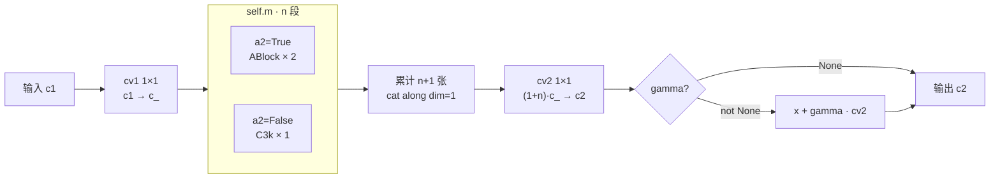
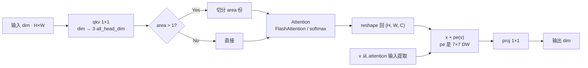
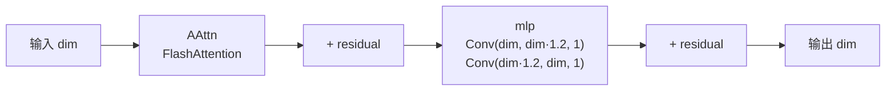
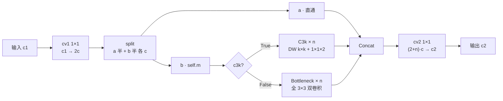
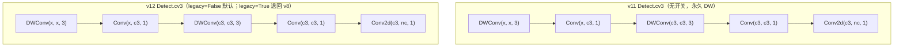

# YOLOv12 架构与层速查

> 首发载体：`sunsmatterjie/yolov12` tag `v1.0`（commit `b1035f8f97cd1a7440454a54f8bc19f989448159`，2025-02-19，作者 Yunjie Tian / Qixiang Ye / David Doermann，AGPL-3.0）。**这是 YOLO 家族首个非 Ultralytics 官方 fork 项目**（fork 自 ultralytics）。以 `ultralytics/cfg/models/v12/yolov12.yaml` 为基准（**目录名 `v12/` 带 `v` 前缀**，回归 v8/v10 规则；与 v11 的 `11/` 命名相反），本页通道数为缩放前的基准值，五档 scales 与 compound scaling 详见 §9。总览页见 [YOLOv12 架构总览](/versions/v12/architecture)。

> **v1~v11 读者路标**：这张 yaml 是 v8 → v11 → v12 三代 delta 的收官——v11 的 SPPF 与 C2PSA 在 v12 里全部撤出 yaml（模块类仍在 `block.py` 保留），骨干 P4/P5 段换成新的 **A2C2f**（Area-attention R-ELAN），P5-large 保留一处 C3k2 收尾；检测头 **`Detect.legacy = False` 默认**（<SrcLink file="v12:ultralytics/nn/modules/head.py" :line="32" />），cv3 分类分支**与 v11 相同，仍走 DW-separable**——v12 只是补了 `legacy` 开关，可切回全 3×3；yaml 层面无反映的隐性差异。想快速对上位读者的话：把它当作「v11 骨干去掉 SPPF 与 C2PSA，P4/P5 换成 A2C2f 内嵌 Attention，其余照旧」来读——**9 层骨干 + 13 层头（含 Detect 收尾），22 个顶层条目**。

## 1. 全网络层一览表（yolov12.yaml L15-L45，基准宽度 @640 输入）

> **v1~v11 读者路标**：这张表可以直接与 [v11 逐层图解 §1](/versions/v11/layers) 或 [v8 逐层图解 §1](/versions/v8/layers) 逐行对照——与 v11 相比只有 5 处结构不同：**骨干 9 层**（v11 是 11 层，去 SPPF 与 C2PSA）、骨干 P4/P5 段 `C3k2 → A2C2f`、P5 大核改回 `C3k2 c3k=True`（不再走 A2C2f）、head 三段融合块从 `C3k2` 换成 `A2C2f(a2=False)` 走 C3k 骨架、目录名 `11/ → v12/` 加回 v 前缀（Detect cv3 两代同为 DW-separable，v12 仅补 `legacy` 开关，不算结构差异）。其余下采样位置、Concat 索引、Detect 三尺度选择完全对得上 v8。

### 1.1 Backbone（yaml L15-L25，9 层）

| 行号 | 层号 | 层类型 | 参数（yaml 原文） | 输出（基准 @640） | 说明 |
|-----|-----|-----------|--------------------|--------------------|------|
| <SrcLink file="v12:ultralytics/cfg/models/v12/yolov12.yaml" :line="17" /> | 0 | `Conv` | 64, 3, 2 | 64×320×320 | stem 下采样 · P1/2 |
| <SrcLink file="v12:ultralytics/cfg/models/v12/yolov12.yaml" :line="18" /> | 1 | `Conv` | 128, 3, 2 | 128×160×160 | P2/4 |
| <SrcLink file="v12:ultralytics/cfg/models/v12/yolov12.yaml" :line="19" /> | 2 | `C3k2` | 256, False, 0.25 ×2 | 128×160×160 | 骨干浅层 · c3k=False · e=0.25 走 Bottleneck |
| <SrcLink file="v12:ultralytics/cfg/models/v12/yolov12.yaml" :line="20" /> | 3 | `Conv` | 256, 3, 2 | 256×80×80 | P3/8（小目标尺度起点） |
| <SrcLink file="v12:ultralytics/cfg/models/v12/yolov12.yaml" :line="21" /> | 4 | `C3k2` | 512, False, 0.25 ×2 | 256×80×80 | 骨干 P3 · c3k=False · e=0.25 |
| <SrcLink file="v12:ultralytics/cfg/models/v12/yolov12.yaml" :line="22" /> | 5 | `Conv` | 512, 3, 2 | 512×40×40 | P4/16 |
| <SrcLink file="v12:ultralytics/cfg/models/v12/yolov12.yaml" :line="23" /> | 6 | `A2C2f` | 512, **True, 4** ×4 | 512×40×40 | **v12 新增 · P4/16 · a2=True · area=4 局部 Attention** |
| <SrcLink file="v12:ultralytics/cfg/models/v12/yolov12.yaml" :line="24" /> | 7 | `Conv` | 1024, 3, 2 | 1024×20×20 | P5/32 |
| <SrcLink file="v12:ultralytics/cfg/models/v12/yolov12.yaml" :line="25" /> | 8 | `A2C2f` | 1024, **True, 1** ×4 | 1024×20×20 | **v12 新增 · P5/32 · a2=True · area=1 全局 Attention** |

- 与 v11 骨干的关键差异：**去掉 SPPF 与 C2PSA**（v11 骨干层 9/10），P4/P5 段直接用 A2C2f 主通路化 Area-attention；
- **A2C2f 的 area 参数**：#6 用 area=4（P4/16, 64×64 特征图切 4 份局部注意力），#8 用 area=1（P5/32, 32×32 特征图全局注意力）——**局部 + 全局**混合；
- **C3k2 浅层保留**：骨干 #2/#4 用 `c3k=False, e=0.25` 走轻量 Bottleneck，与 v11 完全相同——**v12 只升级骨干深段，浅段沿用 v11**。

### 1.2 Head（yaml L29-L45，13 层）

| 行号 | 层号 | 层类型 | 参数（yaml 原文） | 输出（基准 @640） | 说明 |
|-----|-----|-----------|--------------------|--------------------|------|
| <SrcLink file="v12:ultralytics/cfg/models/v12/yolov12.yaml" :line="29" /> | 9 | `Upsample` | 2, nearest | 1024×40×40 | FPN 上行 |
| <SrcLink file="v12:ultralytics/cfg/models/v12/yolov12.yaml" :line="30" /> | 10 | `Concat` | [-1, 6] | 1536×40×40 | cat 骨干 P4（层 6 A2C2f） |
| <SrcLink file="v12:ultralytics/cfg/models/v12/yolov12.yaml" :line="31" /> | 11 | `A2C2f` | 512, **False**, -1 ×2 | 512×40×40 | **a2=False 走 C3k 骨架（不是 Attention）** |
| <SrcLink file="v12:ultralytics/cfg/models/v12/yolov12.yaml" :line="33" /> | 12 | `Upsample` | 2, nearest | 512×80×80 | |
| <SrcLink file="v12:ultralytics/cfg/models/v12/yolov12.yaml" :line="34" /> | 13 | `Concat` | [-1, 4] | 768×80×80 | cat 骨干 P3（层 4 C3k2） |
| <SrcLink file="v12:ultralytics/cfg/models/v12/yolov12.yaml" :line="35" /> | 14 | `A2C2f` | 256, **False**, -1 ×2 | 256×80×80 | **P3 检测输入 · stride 8 · a2=False 走 C3k** |
| <SrcLink file="v12:ultralytics/cfg/models/v12/yolov12.yaml" :line="37" /> | 15 | `Conv` | 256, 3, 2 | 256×40×40 | PAN 下行 |
| <SrcLink file="v12:ultralytics/cfg/models/v12/yolov12.yaml" :line="38" /> | 16 | `Concat` | [-1, 11] | 768×40×40 | cat 头部 P4（层 11 A2C2f） |
| <SrcLink file="v12:ultralytics/cfg/models/v12/yolov12.yaml" :line="39" /> | 17 | `A2C2f` | 512, **False**, -1 ×2 | 512×40×40 | **P4 检测输入 · stride 16 · a2=False 走 C3k** |
| <SrcLink file="v12:ultralytics/cfg/models/v12/yolov12.yaml" :line="41" /> | 18 | `Conv` | 512, 3, 2 | 512×20×20 | PAN 下行 |
| <SrcLink file="v12:ultralytics/cfg/models/v12/yolov12.yaml" :line="42" /> | 19 | `Concat` | [-1, 8] | 1536×20×20 | cat 骨干 P5（层 8 A2C2f） |
| <SrcLink file="v12:ultralytics/cfg/models/v12/yolov12.yaml" :line="43" /> | 20 | `C3k2` | 1024, True ×2 | 1024×20×20 | **P5 检测输入 · stride 32 · 唯一保留的 C3k2 c3k=True** |
| <SrcLink file="v12:ultralytics/cfg/models/v12/yolov12.yaml" :line="45" /> | 21 | `Detect` | nc, [14, 17, 20] | 三尺度输出 | **legacy=False 默认 · cv3 DW-separable 三段式** |

- **A2C2f 出现 5 次**：骨干 2 次（#6/#8, a2=True 真跑 Attention）+ head 3 次（#11/#14/#17, a2=False 走 C3k 骨架）——**只有 2 处真的启用 Attention**；
- **C3k2 出现 3 次**：骨干 #2/#4（c3k=False 轻量）+ head #20（c3k=True 大核 P5-large）——**C3k2 在 v12 yaml 里被保留**，与 v11 相反的是它不再是"骨干主力"；
- **A2C2f 的第 3 参数 area=-1**：head 段传 -1 走默认 area=1，但 a2=False 时该参数被忽略；
- **Detect 输入 `[14, 17, 20]`** 是三个特征图：层 14/17/20——stride 8/16/32，640 输入共 **8400 个预测位置**（$80^2+40^2+20^2$），anchor-free、网格中心即 anchor point。

> **v1~v11 读者路标**：整张表 22 个顶层条目（0-21），五档共用；A2C2f 出现 5 次（骨干 2 + 头 3，只有骨干 2 处 a2=True 真跑 Attention），C3k2 出现 3 次（骨干 2 + 头 1），Detect 收尾 1 次——**没有 SPPF、没有 C2PSA、没有 v10Detect、没有 SCDown、没有 C2fCIB**。v8 骨架（Conv s2 + C2f + Detect）几乎逐字沿用，唯一新增的是骨干 P4/P5 段的 A2C2f。

## 2. 组件字典

> **v1~v11 读者路标**：v12 全项目只用两种自研模块——**`A2C2f` 与 `AAttn`**（外加 ABlock 内嵌）。C3k2 作为 v11 遗留保留（骨干浅层与 P5-large），C2PSA 与 SPPF 在 yaml 里被撤出但代码保留。其余全部是 v5/v6/v8 老零件（Conv / DWConv / Upsample / Concat / Detect / C2f / C3k）。

| 模块 | 代码位置 | 一句话作用 | 首次出现 | v12 使用位置 |
|------|----------|------------|----------|--------------|
| `A2C2f` | <SrcLink file="v12:ultralytics/nn/modules/block.py" :line="1300" :end="1354" /> | R-ELAN 融合块：a2=True 走 ABlock，a2=False 走 C3k | v12 | 骨干 #6/#8 + 头 #11/#14/#17 |
| `ABlock` | <SrcLink file="v12:ultralytics/nn/modules/block.py" :line="1249" :end="1297" /> | AAttn + Conv-based FFN，trunc_normal_ 初始化 | v12 | A2C2f 内部（a2=True 时） |
| `AAttn` | <SrcLink file="v12:ultralytics/nn/modules/block.py" :line="1166" :end="1246" /> | Area-attention：FlashAttention 硬依赖 + 7×7 DW PE | v12 | ABlock 内部 |
| `C3k2` | <SrcLink file="v12:ultralytics/nn/modules/block.py" :line="725" :end="735" /> | v11 引入，v12 沿用（骨干浅层 + P5-large） | v11 | 骨干 #2/#4 + 头 #20 |
| `C3k` | <SrcLink file="v12:ultralytics/nn/modules/block.py" :line="736" :end="744" /> | C3 的 k 参数化变体，A2C2f a2=False 分支内瓶 | v8 | A2C2f 内部（a2=False 时） |
| `C2f` | <SrcLink file="v12:ultralytics/nn/modules/block.py" :line="224" /> | C3k2 的父类，A2C2f **不继承**（是独立类） | v6 | 仅作为 C3k2 基类 |
| `C2PSA` | <SrcLink file="v12:ultralytics/nn/modules/block.py" :line="1004" /> | v11 引入，v12 代码保留但 yaml 不引用 | v11 | 无（v11 遗留） |
| `SPPF` | <SrcLink file="v12:ultralytics/nn/modules/block.py" :line="172" /> | v5 引入，v12 代码保留但 yaml 不引用 | v5 | 无（v12 去 SPPF） |
| `Detect` | <SrcLink file="v12:ultralytics/nn/modules/head.py" :line="21" :end="74" /> | anchor-free 单头；**v12 legacy=False 默认 cv3 DW-separable** | v8 | #21（唯一检测头） |
| `Conv` | <SrcLink file="v12:ultralytics/nn/modules/conv.py" :line="37" /> | 标准卷积 + autopad + BN + 激活 | v5 | #0/#1/#3/#5/#7/#15/#18 |
| `DWConv` | <SrcLink file="v12:ultralytics/nn/modules/conv.py" :line="52" /> | Depthwise 卷积（v12 Detect cv3 隐式使用） | v7 | Detect.cv3 分支（v12 默认） |
| `Upsample` | `nn.Upsample` | 空间上采样（scale_factor=2, nearest） | PyTorch | #9/#12 |
| `Concat` | `torch.cat(dim=1)` | 通道维拼接 | PyTorch | #10/#13/#16/#19 |

> **v1~v11 读者路标**：v11 的 C3k2 + C2PSA 两件套在 v12 全部被替换为 A2C2f + ABlock + AAttn 三件套——但 C3k2 在 v12 yaml 里**依然被使用**（骨干浅层与 P5-large）。v12 的模块策略是**「累加 + 部分替换」**：新增 A2C2f/ABlock/AAttn，C3k2 保留使用，C2PSA/SPPF 代码保留但 yaml 不引用。

## 3. A2C2f：R-ELAN 融合块（v12 招牌模块）

> **v1~v11 读者路标**：C2f 是「C2f 外壳 + C3 内瓶」；C3k2 是「C2f 外壳 + C3k/Bottleneck 内瓶」；**A2C2f 是「C2f 外壳 + ABlock 内瓶（a2=True）」或「C2f 外壳 + C3k 内瓶（a2=False）」**——**独立类，不继承 C2f**（与 C3k2 相反）。

<SrcLink file="v12:ultralytics/nn/modules/block.py" :line="1300" :end="1354" />

**签名**：`__init__(c1, c2, n=1, a2=True, area=1, residual=False, mlp_ratio=2.0, e=0.5, g=1, shortcut=True)`

**结构**：
- `c_ = int(c2 * e)`，`assert c_ % 32 == 0`（L1333，硬编码 num_heads 前必须满足）
- `num_heads = c_ // 32`（L1336，**硬编码，不可外部覆盖**）
- `cv1 = Conv(c1, c_, 1)`，`cv2 = Conv((1+n) * c_, c2, 1)`
- `gamma = 0.01` layer-scale 参数（L1341-1342），**只在 `a2 and residual` 都为真时启用**——yaml 骨干 args 第三位是 area，`residual` 由 `parse_model` 只对 **L/X 档**补 `True`（tasks.py L1034-1038）
- `self.m = nn.ModuleList(n 个)`：`a2=True` 时每个含 `ABlock × 2`；`a2=False` 时每个含 `C3k`（大核内瓶）

**forward**（<SrcLink file="v12:ultralytics/nn/modules/block.py" :line="1348" :end="1354" />）：
- `y = [cv1(x)]` → `y.extend(m(y[-1]) for m in self.m)` 累计 n+1 张特征图
- 有 gamma 时：`x + gamma * cv2(cat(y)).permute(...)` 走 layer-scale 残差
- 无 gamma 时：`cv2(cat(y))` 走纯 C2f 骨架（与标准 C2f 完全一致的 forward）

**v12 yaml 里 5 处 A2C2f**：

| 层号 | c2 | a2 | area | n | 实际行为 |
|------|----|----|------|---|---------|
| #6（骨干 P4/16） | 512 | **True** | 4 | 4 | **真跑 Area-attention · 64×64 特征图切 4 份局部** |
| #8（骨干 P5/32） | 1024 | **True** | 1 | 4 | **真跑 Area-attention · 32×32 特征图全局** |
| #11（head P4） | 512 | False | -1 | 2 | **走 C3k 骨架**（不是 Attention） |
| #14（head P3） | 256 | False | -1 | 2 | **走 C3k 骨架** |
| #17（head P4） | 512 | False | -1 | 2 | **走 C3k 骨架** |

**参数变化关键点**：
- 骨干 A2C2f 参数 c_ = int(512 * 0.5) = 256（#6，m/l 档）、int(min(1024, 512) * 0.5) = 256（#8，m/l/x 档因 max_channels=512 封顶）；n 档分别是 64 与 128
- #6 num_heads = 256 // 32 = 8（n 档 c_=64 → 2；s 档 c_=128 → 4）；#8 num_heads = 256 // 32 = 8（n 档 c_=128 → 4；s 档 c_=256 → 8）
- head A2C2f 参数 c_ = int(512 * 0.5) = 256、int(256 * 0.5) = 128、int(512 * 0.5) = 256——**因 a2=False 内瓶走 C3k，num_heads 计算不参与实际计算**



> **v1~v11 读者路标**：A2C2f 是 v12 的首个「注意力 + 融合块」组合——v11 C3k2 是纯卷积、v10 C2fCIB 是纯卷积、v8 C2f 是纯卷积；**A2C2f 通过 a2 参数把纯卷积和 Attention 融合在一个类里**——用同一个模块骨架承载两种模式。

## 4. AAttn：Area-attention 主通路（v12 新设计）

> **v1~v11 读者路标**：v10 PSA 是「半通道外挂 Attention」，v11 C2PSA 是「全通道内嵌 Attention」；**v12 AAttn 是「骨干主通路 Attention + FlashAttention 硬依赖 + area 面积切分 + 7×7 DW 输出侧位置编码」**——四代 Attention 演进方向清晰：从"能不能用"到"跑得多快"。

<SrcLink file="v12:ultralytics/nn/modules/block.py" :line="1166" :end="1246" />

**签名**：`__init__(dim, num_heads, area=1)`

**结构三件套**：
- `qkv = Conv(dim, all_head_dim * 3, 1, act=False)`——一次 1×1 出 q/k/v 三份
- `proj = Conv(all_head_dim, dim, 1, act=False)`——1×1 输出投影
- `pe = Conv(all_head_dim, dim, 7, 1, 3, g=dim, act=False)`——**7×7 DW 位置编码**

**forward 关键点**：
- L1211-1213 area > 1 时把 qkv 切分成 area 份（`qkv.reshape(B * area, N // area, C * 3)`）——**局部 attention**
- L1218-1223 CUDA 分支走 `flash_attn_func` 强制 fp16
- L1224-1234 CPU 分支走手写 softmax
- **L1244 `x = x + self.pe(v)`**——位置编码 pe 作用在 v 上、加到 attention 输出 x 上——**输出侧位置注入**



**与其他 Attention 对比**：

| 维度 | v11 C2PSA.Attention | **v12 AAttn** |
|------|---------------------|---------------|
| 位置编码 | DWConv 3×3 加在 q/k/v 输入 | **DWConv 7×7 加在 v 输出侧** |
| Attention 实现 | 手写（标准 softmax） | **CUDA: FlashAttention；CPU: 手写** |
| 精度 | fp32 | **CUDA 强制 fp16** |
| num_heads | c // 64 | **c_ // 32**（由 A2C2f 决定） |
| area 切分 | 无 | **支持 1/2/4 等面积切分** |
| attn_ratio | 0.5（key 维度砍半） | **无（q/k/v 等维）** |
| 使用位置 | 骨干出口（C2PSA 内部） | **骨干主通路 P4/P5（A2C2f 内部）** |

**FlashAttention 硬依赖**（<SrcLink file="v12:ultralytics/nn/modules/block.py" :line="1160" :end="1163" />）：
- `try/except` + `assert False` 兜底——**未安装 flash-attn 时直接抛异常，无 fallback**
- 即使 CPU-only 环境也会因为 import 阶段 assert 崩溃
- 前置安装：`pip install flash-attn --no-build-isolation`

> **v1~v11 读者路标**：v5-v9 完全没有 Attention；v10 首次引入（PSA 半通道外挂）；v11 升级为 C2PSA（全通道内嵌）；**v12 AAttn 是骨干主通路 + 硬依赖 FlashAttention**——**四代里唯一带外部硬依赖的 Attention 设计**。

## 5. ABlock：Conv-FFN + 无 LayerNorm

> **Transformer 读者路标**：标准 Transformer block 是「Attention + LayerNorm + FFN + LayerNorm」；YOLO 家族一贯用 Conv + BN + SiLU 而非 LayerNorm；**v12 ABlock 是「Transformer 骨架 + YOLO 实现」的融合**——Attention 用 AAttn、FFN 用两个 1×1 Conv、无 LayerNorm、trunc_normal_ 初始化 std=0.02。

<SrcLink file="v12:ultralytics/nn/modules/block.py" :line="1249" :end="1297" />

**签名**：`__init__(dim, num_heads, mlp_ratio=1.2, area=1)`

**结构**：
- `self.attn = AAttn(dim, num_heads, area)`
- `self.mlp = nn.Sequential(Conv(dim, dim * 1.2, 1), Conv(dim * 1.2, dim, 1, act=False))`——**Conv-based FFN，展开比只有 1.2**（非经典 Transformer 的 4.0）
- `_init_weights`：所有 Conv 用 `trunc_normal_(std=0.02)`，bias 置 0——**ViT/Swin 家族的初始化风格**

**forward**（<SrcLink file="v12:ultralytics/nn/modules/block.py" :line="1293" :end="1297" />）：
```python
x = x + self.attn(x)   # 无 LayerNorm
x = x + self.mlp(x)    # 无 LayerNorm
```

**关键设计点**：
1. `mlp_ratio = 1.2` 是 ABlock 自己的默认值——但 A2C2f 默认传 **2.0**（n/s/m 档），`parse_model` 只对 **L/X 档**传 1.2；两者都属轻量 FFN，符合 v12 "real-time" 定位
2. FFN 用 Conv 而非 Linear——保持 Conv+BN+SiLU 统一风格
3. 无 LayerNorm——依赖 Conv 内的 BN 归一化，与 YOLO 家族一致
4. `trunc_normal_ std=0.02`——训练初期 ABlock 输出接近 0，配合 residual 稳定



> **v1~v11 读者路标**：v10/v11 PSABlock 是「LayerNorm + Attention + LayerNorm + FFN」的 ViT 标准骨架；**v12 ABlock 是「Attention + Conv-FFN」的 YOLO 化骨架**——三代都在做「Transformer → YOLO」的适配，v12 的适配最激进也最一致。

## 6. C3k2：v11 遗留，v12 骨干浅层 + P5-large 沿用

> **v11 读者路标**：C3k2 在 v11 是骨干主力（yaml 8 处）；v12 yaml 只用 3 处——骨干浅层 2 处（c3k=False, e=0.25）+ P5-large 1 处（c3k=True）。**C3k2 在 v12 里的角色是「兼容 v11 骨架 + 承担 P5 大核」而非「主通路」**。

<SrcLink file="v12:ultralytics/nn/modules/block.py" :line="725" :end="735" />

**签名**：`__init__(c1, c2, n=1, c3k=False, e=0.5, g=1, shortcut=True)`

**结构**：继承 C2f，只覆写 `self.m`——`c3k=True` 时内瓶 C3k（大核），`c3k=False` 时内瓶 Bottleneck。

**v12 yaml 使用点**：

| 层号 | c2 | c3k | e | n | 内瓶 | 位置 |
|------|----|-----|---|---|------|------|
| #2（骨干 P2） | 256 | False | 0.25 | 2 | Bottleneck | 浅层轻量 |
| #4（骨干 P3） | 512 | False | 0.25 | 2 | Bottleneck | 浅层轻量 |
| #20（head P5-large） | 1024 | **True** | 0.5 | 2 | **C3k** | P5 大核 |

**为什么 P5-large 用 C3k2 而非 A2C2f**：
- P5-large 是 P5/32 检测输入的最终融合块，特征是 20×20 网格 1536 通道——**空间分辨率极小、通道极宽**，attention 的 O(N²) 复杂度已经很低（N=400）；
- 但作者选择 C3k2 c3k=True（DW 大核 + 1×1×2）而不是 ABlock——可能是**避免 P5-large 段与骨干 P5 A2C2f 的 Attention 冗余**（骨干 P5 已经做过全局 attention，head 段再用 A2C2f 走 C3k 骨架就够了）；
- **这是 v12 yaml 设计的一个隐蔽选择**：整个模型只有骨干 P4/P5 两段真正的 Attention，head 全部走纯卷积。



> **v1~v11 读者路标**：C3k2 在 v11 是骨干主力（8 处），v12 是骨干浅层 + P5-large 保留（3 处）——**v12 让 C3k2 从主力退到配角**，主通路让给 A2C2f。但 C3k2 的类定义 v11/v12 完全一致（`class C3k2(C2f)`），只是使用位置变了。

## 7. C3k：A2C2f a2=False 分支内瓶

> **v8 读者路标**：C3k 是 v8 引入的「大核内瓶」——比 Bottleneck 多一个 3×3 DW 前置卷积。v12 里 C3k 出现在两个位置：C3k2 内部（c3k=True 时）和 A2C2f 内部（a2=False 时）——**是两个模块共享的内瓶类**。

<SrcLink file="v12:ultralytics/nn/modules/block.py" :line="736" :end="744" />

**结构**：继承 C3，`self.m = nn.Sequential(Bottleneck(c_, c_, shortcut, g, k=(k, k), e=1.0) × n)`——用 k=3 的 Bottleneck 替代默认 Bottleneck。

**v12 使用位置**：
- C3k2 内部（骨干 #20, c3k=True）——P5-large 融合
- A2C2f 内部（head #11/#14/#17, a2=False）——**head 三段融合的实际实现**

**head A2C2f(a2=False) 的实质结构**：
- `c_ = int(c2 * e)` = int(512 * 0.5) = 256（#11/#17）或 int(256 * 0.5) = 128（#14）
- 每个 self.m 段含 1 个 C3k：`C3k(c_, c_, n=2, shortcut=True, g=1)`
- 与标准 C3k 完全一致——**只是被 A2C2f 外壳包装了一层**
- 换句话说：**v12 head 段的 A2C2f(a2=False) 等价于「C2f 外壳 + C3k 内瓶」的 C3k2**（结构近似但不完全等价——A2C2f 的 cv2 输入通道是 `(1+n)*c_` 而非 `(2+n)*c_`）

> **v1~v11 读者路标**：C3k 是 v8 就有、v11 沿用、v12 继续沿用的老内瓶——**它是 A2C2f 和 C3k2 的共享内瓶**，三代共用的最底层积木。

## 8. SPPF：v5 老零件，v12 yaml 不引用

> **v5 读者路标**：SPPF 是 v5 引入的骨架——一个 k=5 的 MaxPool 池化，串行 3 次等效多尺度感受野（5/9/13）。v8/v10/v11 全沿用；**v12 是首个 yaml 里无 SPPF 的官方 YOLO**——代码保留、yaml 不用。

<SrcLink file="v12:ultralytics/nn/modules/block.py" :line="172" />

**v12 去 SPPF 的原因**：
1. **A2C2f 的 area attention 提供大感受野**：P5 A2C2f 用 area=1 全局 attention（32×32 特征图完整全局），P4 用 area=4 局部（64×64 特征图 4 份局部）——**感受野从 O(k²) 到 O(N²)**，SPPF 膨胀作用冗余；
2. **参数量与延迟**：SPPF 的三次 maxpool 拼接是纯计算开销、无参数；
3. **代码量**：v12 骨干少一个模块，模型图更简洁。

**代价**：
- **P4/P5 交界处的感受野从 SPPF 的"多尺度膨胀"变成 attention 的"局部 + 全局混合"**；
- **v11→v12 权重迁移困难**：SPPF 是骨干末段的关键 layer，去掉意味着 P4/P5 层号整体下移、通道映射复杂。

**v12 骨架末尾对比**：

| 版本 | 骨干末尾模块 | 感受野机制 |
|------|-------------|-----------|
| v8 | `SPPF + C2f` | maxpool 3/5/9 |
| v10 | `SPPF + C2f` | maxpool 3/5/9 |
| v11 | `SPPF + C2PSA + C3k2` | maxpool + 尾端 Attention |
| **v12** | `Conv + A2C2f(area=1)` | **全局 Attention（无 SPPF）** |

> **v1~v11 读者路标**：v5-v11 共 7 代都保留 SPPF；**v12 是首个去掉 SPPF 的官方版本**——**代码保留（向后兼容），yaml 不用（前向演进）**。

## 9. C2PSA：v11 遗留，v12 yaml 不引用

> **v11 读者路标**：C2PSA 在 v11 是骨干出口的注意力模块（唯一一处）；v12 yaml 完全不引用——**代码保留、yaml 不用**，与 v11 的 C3k2 状态恰好相反（v11 骨干主力的 C3k2 在 v12 变配角，v11 骨干出口的 C2PSA 在 v12 变遗留）。

<SrcLink file="v12:ultralytics/nn/modules/block.py" :line="1004" />

**为什么 v12 撤掉 C2PSA**：
- v12 把注意力从「骨干出口一次」升级为「骨干 P4/P5 主通路」——P4 A2C2f 与 P5 A2C2f 覆盖了 C2PSA 的语义范围；
- 骨干出口再挂 C2PSA 会**重复注意力**（P5 A2C2f 已经是全局 attention，C2PSA 再来一次冗余）；
- **代码保留是为了 v11 权重的加载兼容性**——用户加载 v11 训练好的权重时仍能命中 C2PSA 类。

**v11/v12 yaml 骨干末段对比**：

```yaml
# v11 骨干末段
- [-1, 1, Conv,  [1024, 3, 2]]
- [-1, 1, SPPF,  [1024, 5]]
- [-1, 1, C2PSA, [1024]]        # 骨干出口注意力

# v12 骨干末段
- [-1, 1, Conv,  [1024, 3, 2]]
- [-1, 4, A2C2f, [1024, True, 1]]  # 骨干 P5 全局 Attention
```

> **v1~v11 读者路标**：v11 的 C2PSA 是骨干出口的注意力（外挂一次）；v12 的 A2C2f 是骨干 P4/P5 的注意力（主通路两次）——**从"尾端补一刀"变成"主通路内嵌"**。

## 10. Detect：legacy 开关，cv3 DW-separable（与 v11 同构）

> **v11 读者路标**：v11 的 Detect 没有 `legacy` 参数，cv3 **无条件**走 DW-separable（head.py L44-51）；**v12 补了类属性 `legacy = False`**（<SrcLink file="v12:ultralytics/nn/modules/head.py" :line="32" />）并把 v8 的全 3×3 分支放进 `if self.legacy`——**默认行为与 v11 相同**，yaml 层面也相同。

<SrcLink file="v12:ultralytics/nn/modules/head.py" :line="21" :end="74" />

**关键行**：
- L32 `legacy = False  # backward compatibility for v3/v5/v8/v9 models`
- L39 `self.reg_max = 16  # DFL channels`
- L42 `c2, c3 = max((16, ch[0] // 4, self.reg_max * 4)), max(ch[0], min(self.nc, 100))`
- L46-57 cv3 分支：legacy=True 走全 3×3；legacy=False 走 DW-separable 三段

**cv3 DW-separable 三段式**（<SrcLink file="v12:ultralytics/nn/modules/head.py" :line="49" :end="57" />）：
```python
nn.Sequential(
    nn.Sequential(DWConv(x, x, 3), Conv(x, c3, 1)),        # 第 1 段
    nn.Sequential(DWConv(c3, c3, 3), Conv(c3, c3, 1)),     # 第 2 段
    nn.Conv2d(c3, self.nc, 1),                             # 第 3 段
)
```

**cv2 box 分支**（<SrcLink file="v12:ultralytics/nn/modules/head.py" :line="43" :end="45" />）：与 v11 完全一致，全 3×3 两段 + 1×1 收尾。

**v12 Detect vs v11 Detect 对比**：

| 维度 | v11 Detect | **v12 Detect** |
|------|-----------|---------------|
| legacy 参数 | **无（永久 DW）** | **有（类属性，默认 False）** |
| cv2 box | Conv(x, c2, 3) → Conv(c2, c2, 3) → Conv2d(c2, 64, 1) | **相同** |
| cv3 cls | DWConv(x, x, 3) + Conv(x, c3, 1) + DWConv(c3, c3, 3) + Conv(c3, c3, 1) + Conv2d(c3, nc, 1) | **完全相同** |
| cv3 分类头参数 | ~42K (c=256, c3=100) | **~42K（相同）** |
| 训练分配 | TAL topk=10, α=0.5, β=6.0 | **相同** |
| 推理后处理 | class-wise NMS | **相同** |
| 导出图 | 有 NMS 算子 | **有 NMS 算子** |

**为什么 cv3 是 DW-separable**（v11 的设计理由，v12 只是延续）：
1. **参数节省**：DWConv 3×3 只有 `c × 9` 参数 + 1×1 的 `c × c3`——比 v8 全 3×3 便宜约 80%；
2. **推理加速**：DWConv 在移动端有硬件加速；
3. **表达力不减**：DWConv + 1×1 组合与稠密 3×3 表达力相当（MobileNet 时代验证）；
4. **与骨干一致**：v12 AAttn 的 pe 用 7×7 DWConv，Detect cv3 用 3×3 DWConv——**全模型 DWConv 家族化**。

**跨版本权重迁移的坑**：
- **v11 `best.pt` → v12 可以直接加载**：cv2/cv3 结构完全一致，v12 只是多了 `legacy` 开关且默认不改变结构；
- **v8 → v12 不行**：v8 的 cv3 是全 3×3，与 DWConv 的 groups 结构不匹配。



> **v1~v11 读者路标**：v8/v9/v10 的 Detect.cv3 是全 3×3；**v11 已改成 DW-separable 且没有开关**；v12 只是补了 `legacy` 让它可以退回 v8 结构——**默认行为与 v11 完全相同**。

## 11. 与 v11 / v10 / v8 的结构对比

> **v1~v11 读者路标**：把四代 yaml 摆在一起看，v12 的取舍一目了然——**骨干去 SPPF 与 C2PSA**、**骨干 P4/P5 段 A2C2f 主通路 Attention**、**head 三段融合走 A2C2f(a2=False) 骨架**、**P5-large 保留 C3k2**、**Detect 沿用 v11 的 DW cv3（仅补 legacy）**。

| 位置 | v8（yolov8.yaml） | v10（yolov10n.yaml） | v11（yolo11.yaml） | **v12（yolov12.yaml）** | 一句话总结 |
|------|-------------------|----------------------|--------------------|-------------------------|------------|
| #2 骨干 P2 融合 | C2f 128 | C2f 128 | C3k2 256 | **C3k2 256** | v12 沿用 v11 |
| #4 骨干 P3 融合 | C2f 256 | C2f 256 | C3k2 512 | **C3k2 512** | v12 沿用 v11 |
| #6 骨干 P4 融合 | C2f 512 | C2f 512 | C3k2 512 | **A2C2f 512 a2=True area=4** | **v12 首次骨干 Attention** |
| #7/#8/#9 骨干深段 | SPPF + C2f | SPPF + C2f | SPPF + C2PSA + C3k2 | **Conv + A2C2f(area=1)** | **v12 去 SPPF + C2PSA** |
| #10 骨干出口 | — | — | C2PSA | **无** | **v12 撤掉骨干出口注意力** |
| head 融合块 | C2f × 4 | C2f × 4 | C3k2 × 4 | **A2C2f(a2=False) × 3 + C3k2 × 1** | **v12 head 主要走 C3k 骨架** |
| #20 P5-large | C2f | C2fCIB | C3k2 c3k=True | **C3k2 c3k=True** | v12 沿用 v11 |
| 检测头 | Detect | v10Detect | Detect | **Detect（补 legacy 开关）** | **与 v11 同构** |
| cv3 分类头 | 全 3×3 | DW-separable | **DW-separable（无开关）** | **DW-separable（legacy 可切）** | v11 已 DW，v12 仅加开关 |
| 顶层条目数 | 24 | 24 | 24 | **22** | v12 少 2 层（去 SPPF + C2PSA） |
| 自研模块数 | 1（C2f） | 4（SCDown/PSA/C2fCIB/v10Detect） | 2（C3k2/C2PSA） | **3（A2C2f/ABlock/AAttn）** | v12 模块数量回到中等 |
| 目录命名 | `v8/` | `v10/` | `11/` | **`v12/`** | v12 回归 v 前缀规则 |
| 外部依赖 | 无 | 无 | 无 | **FlashAttention（硬依赖）** | **v12 首个硬依赖外部包** |

- **v12 的关键回退**：yaml 结构比 v11 简单 2 层（去 SPPF 与 C2PSA）——**结构更简洁**
- **v12 的关键升级**：A2C2f 主通路 Attention——**骨干注意力化**；Detect 的 DW 分类头是 v11 的继承（v12 仅补 `legacy` 开关）
- **命名坑回归**：目录 `v12/` 带 v 前缀（回归 v8/v10 规则，与 v11 的 `11/` 相反）
- **总装仍是 `DetectionModel` 家族**：v12 复用 `DetectionModel`，损失函数沿用 `v8DetectionLoss`——**与 v11 行为等价**（`tal_topk=10` 默认 + 显式 α=0.5/β=6.0 两版相同，仅代码风格差异）

> **v1~v11 读者路标**：v12 相对 v11 的最大变化是「骨干 Attention 主通路化 + 去 SPPF」；相对 v10 的最大变化是「回归 NMS 单头 + 保留 v11 的检测头基础」；相对 v8 的最大变化是「骨干 P4/P5 段彻底换成 A2C2f」——**v12 是四代里的 Attention 主通路化代表**。

## 12. 五档 scales 参数矩阵

> **v1~v11 读者路标**：v8 五档 n/s/m/l/x，v10 六档 n/s/m/b/l/x，v11 五档，**v12 五档**——参数矩阵集中在 `yolov12.yaml` 头部的 `scales:` 块（<SrcLink file="v12:ultralytics/cfg/models/v12/yolov12.yaml" :line="6" :end="12" />），与 v11 同款组织方式（一份 yaml + scales 字典）。

| Model | depth | width | max_channels | 层数 | 参数 | GFLOPs | mAP50-95 |
|-------|-------|-------|--------------|------|------|--------|----------|
| **n** | 0.50 | 0.25 | 1024 | 465 | 2.60 M | 6.7 | 40.6 |
| **s** | 0.50 | 0.50 | 1024 | 465 | 9.29 M | 21.7 | 48.0 |
| **m** | 0.50 | 1.00 | 512 | 501 | 20.20 M | 68.1 | 52.5 |
| **l** | 1.00 | 1.00 | 512 | 831 | 26.45 M | 89.7 | 53.7 |
| **x** | 1.00 | 1.50 | 512 | 831 | 59.22 M | 200.3 | 55.2 |

- **scales 集中定义**：与 v11 完全同款——`yolov12.yaml` 顶部一个 `scales:` 块，加载时按 `YOLO("yolov12.yaml", scale="s")` 或 `YOLO("yolov12n.yaml")` 传档
- **depth 缩放分布**：n/s 档 465 层、m 档 501 层、l/x 档 831 层——**scales 系数与 v11 逐项相同**，层数差异全部来自结构：A2C2f 每段含 2 个 ABlock、骨干 repeats=4，且去掉了 SPPF/C2PSA
- **n 档 2.60 M vs v11n 2.62 M vs v10n 2.3 M vs v8n 3.2 M**：**v12n 与 v11n 参数几乎一致**，但 v12 有 Attention，v11 是纯卷积——**v12 在相同参数量下加入了 Attention**
- **x 档 59.22 M vs v11x 56.97 M vs v8x 56.9 M**：v12x 参数略高，主要因 A2C2f 的 Attention 分支
- **mAP 数字口径**：640 输入、COCO val（README 声明，未注明硬件与精度）——**n 档 40.6% 相对 v11n 39.5%、v8n 37.3% 有提升**，作者归因于 A2C2f 的 Area-attention 与分档训练配方

**训练配方**（README 权威数据）：
- epochs=600, batch=256, mosaic=1.0
- mixup：n=0.0, s=0.05, m=0.15, l=0.15, x=0.2
- copy_paste：n=0.1, s=0.15, m=0.4, l=0.5, x=0.6

**注意**：v12 的 mAP 数字**没有随论文提供消融表**；官方权重托管在 `sunsmarterjie/yolov12` 的 GitHub Release（v1.0），**不是 ultralytics 资产仓库**，复现与数字核对依赖该仓库的可用性。

<SrcLink file="v12:ultralytics/cfg/models/v12/yolov12.yaml" :line="6" :end="12" />

> **v1~v11 读者路标**：v8 → v10 → v11 → v12 的 scales 组织方式：v8 每档一份 yaml；v10 每档一份 yaml；v11 一份 yaml + scales 字典；**v12 沿用 v11 的组织方式**——**参数矩阵在 yaml 顶部一处**，改一处就改全部。

## 13. SrcLink 汇总

本页引用到的关键源码位置（可直接跳转）：

- <SrcLink file="v12:ultralytics/cfg/models/v12/yolov12.yaml" :line="1" :end="45" />——完整 yolov12.yaml
- <SrcLink file="v12:ultralytics/cfg/models/v12/yolov12.yaml" :line="6" :end="12" />——scales 五档集中定义
- <SrcLink file="v12:ultralytics/cfg/models/v12/yolov12.yaml" :line="17" :end="25" />——backbone 9 层
- <SrcLink file="v12:ultralytics/cfg/models/v12/yolov12.yaml" :line="29" :end="43" />——head 12 条（不含 Detect）
- <SrcLink file="v12:ultralytics/cfg/models/v12/yolov12.yaml" :line="45" />——Detect 入口
- <SrcLink file="v12:ultralytics/nn/modules/block.py" :line="1160" :end="1163" />——FlashAttention 硬依赖兜底
- <SrcLink file="v12:ultralytics/nn/modules/block.py" :line="1166" :end="1246" />——AAttn 类定义
- <SrcLink file="v12:ultralytics/nn/modules/block.py" :line="1249" :end="1297" />——ABlock 类定义
- <SrcLink file="v12:ultralytics/nn/modules/block.py" :line="1300" :end="1354" />——A2C2f 类定义
- <SrcLink file="v12:ultralytics/nn/modules/block.py" :line="725" :end="735" />——C3k2 类定义（v11 遗留，v12 使用）
- <SrcLink file="v12:ultralytics/nn/modules/block.py" :line="736" :end="744" />——C3k 类定义（A2C2f a2=False 内瓶）
- <SrcLink file="v12:ultralytics/nn/modules/block.py" :line="224" />——C2f 基类（v12 yaml 不直接使用）
- <SrcLink file="v12:ultralytics/nn/modules/block.py" :line="1004" />——C2PSA 类（v12 yaml 不引用）
- <SrcLink file="v12:ultralytics/nn/modules/block.py" :line="172" />——SPPF 类（v12 yaml 不引用）
- <SrcLink file="v12:ultralytics/nn/modules/head.py" :line="21" :end="74" />——Detect 类定义
- <SrcLink file="v12:ultralytics/nn/modules/head.py" :line="32" />——`legacy = False`（v12 隐性差异关键点）
- <SrcLink file="v12:ultralytics/nn/modules/head.py" :line="46" :end="57" />——cv3 DW-separable 分支

> **v1~v11 读者路标**：本清单把 v12 涉及的所有自研模块与配置行都点名——对照 v11 的 [layers 全文](/versions/v11/layers)，可以逐项 diff；对照 v8 的 [layers 全文](/versions/v8/layers)，可以直接复用下采样位置、Concat 索引与 Detect 三尺度选择。

## 延伸阅读

- [YOLOv12 架构总览](/versions/v12/architecture)
- [YOLOv12 理论 Concept](/versions/v12/concepts)
- [YOLOv12 损失函数详解](/versions/v12/losses)
- [YOLOv12 训练技巧](/versions/v12/tricks)
- [v12 痛点与取舍](/versions/v12/painpoints)
- [yolov12.yaml 源码页](/versions/v12/source/yolov12-yaml)
- [block.py 源码页](/versions/v12/source/block-py)
- [head.py 源码页](/versions/v12/source/head-py)
- [v11 逐层图解（对照基线）](/versions/v11/layers)
- [v10 逐层图解（对照基线）](/versions/v10/layers)
- [v8 逐层图解（对照基线）](/versions/v8/layers)
