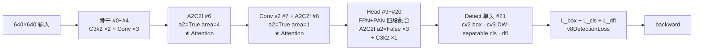
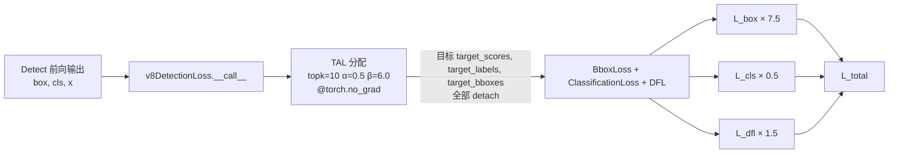
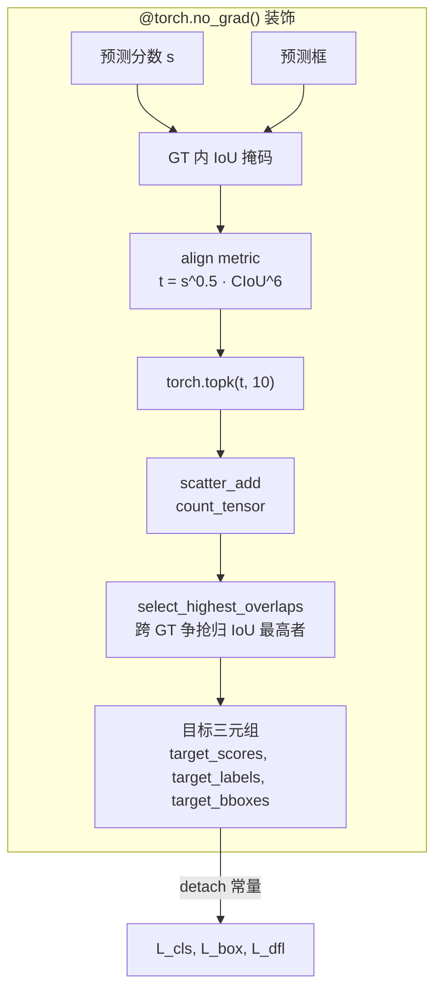
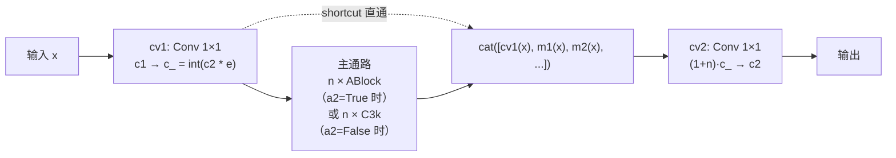
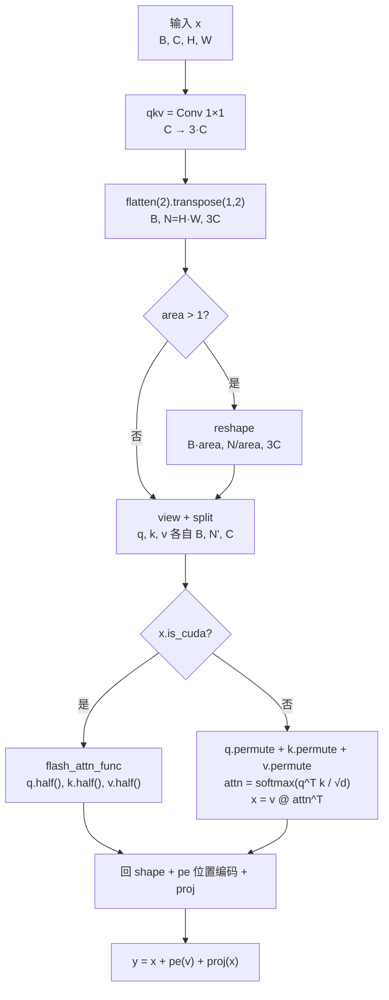
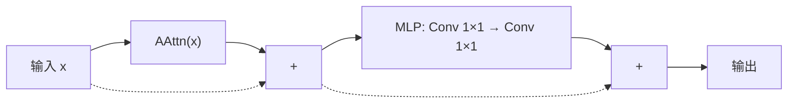
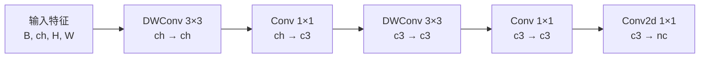

# YOLOv12 反向传播推导

> 核心事实：**v12 的损失梯度图 = v8 的梯度图，也 = v11 的梯度图**。损失类仍是 `v8DetectionLoss`（<SrcLink file="v12:ultralytics/utils/loss.py" :line="157" />），三分量（box / cls / dfl）与 7.5 / 0.5 / 1.5 增益与 v8 完全一致；TAL 分配器在 loss.py L176 显式覆盖为 `topk=10, α=0.5, β=6.0`——**v11 的 loss.py L176 也是同一行同一组值**；`tal_topk` 参数位（<SrcLink file="v12:ultralytics/utils/loss.py" :line="160" />）在 v11 就已存在，对梯度路径**零影响**，只是允许外部覆盖的一个 API 位。

> **v1~v11 读者路标**：v12 相对 v11 的梯度差异是**"骨干换路"而非"损失换公式"**——v11 骨干 4 段 C3k2 + 末端 C2PSA；v12 骨干 P4/P5 换成 A2C2f（内嵌 Attention）、去 SPPF / 去 C2PSA；两代的 Detect cv3 **都是 DW-separable**，v12 只是补了 `legacy` 类属性（默认 False，行为不变）——**梯度图在头部不变、在骨干多一条 FlashAttention 路径**，梯度语义与 v8/v11 完全一致（无 detach、无双分支、无特殊缩放）。v8 读者看本页 §2~§3 就够；v11 读者请重点看 §5（A2C2f 梯度路径）与 §6（DW-separable 头梯度）。

## 1. 只想带走三件事 (`grad-keypoints`)

1. **v12 的梯度图 = v8 梯度图 + Attention 内嵌**：三分量总装、7.5 / 0.5 / 1.5 增益、TAL 分配、BCE + DFL 公式、`close_mosaic=10`——全部与 v8 一字不差；v12 新增的 A2C2f 骨干（<SrcLink file="v12:ultralytics/nn/modules/block.py" :line="1300" :end="1354" />）与 AAttn（<SrcLink file="v12:ultralytics/nn/modules/block.py" :line="1166" :end="1247" />）只是替换骨干 P4/P5 两层的**梯度通路**——公式上没有新东西，但**梯度路径多了 FlashAttention 与 area 分组 reshape 两个环节**（详见[第 5 节](#5-a2c2f-骨干的梯度路径-grad-a2c2f)）；
2. **TAL 分配器不参与梯度**：与 v8/v11 完全一致——`@torch.no_grad()` + 预测侧 `.detach()` 双保险（<SrcLink file="v12:ultralytics/utils/tal.py" :line="40" />、<SrcLink file="v12:ultralytics/utils/loss.py" :line="234" :end="235" />），topk / argmax / scatter_add 全是离散决策，分配结果作为常量进入损失；
3. **v12 相对 v11 的梯度差异只在骨干**：两代检测损失都走 loss.py L176 的 `topk=10 / α=0.5 / β=6.0`（v11 类默认虽是 13/1.0，但被显式覆盖，训练不读）——**分配侧零差异**；头部两代都是 DW-separable（<SrcLink file="v12:ultralytics/nn/modules/head.py" :line="46" :end="57" />），梯度路径同为 5 段（DWConv + 1×1 交替），v12 新增的 `legacy` 开关默认关闭、不影响训练；真正的差异是骨干 P4/P5 从 C3k2 换成内嵌 ABlock 的 A2C2f，多出一条 FlashAttention 梯度路径。

## 0. 记号与前向数据流 (`grad-flow`)

> **v1~v11 读者路标**：v1–v8 的梯度图都是"骨干 → neck → Detect 单头 → v8DetectionLoss"这套；v9 训练态输出主辅两套预测（辅助头吃 backbone 内部特征）；v10 训练态输出 `{"one2many", "one2one"}` 双字典项（one2one 分支在进头之前把特征 `detach` 了）；v11 完全回到 v8 形态；**v12 也完全回到 v8 形态**——`Detect` 头单份预测、单份损失、单份前向输出，没有任何 detach 分流。



本页记号：

- $\theta_{\text{back}}$：骨干 #0~#8 参数（含 A2C2f 与 C3k2）；$\theta_{\text{neck}}$：Head #9~#20 参数（含 A2C2f a2=False + C3k2）；$\theta_h$：Detect 头 cv2/cv3/dfl 参数（v12 的 Detect 没有 cv1 升维层，与 v8/v11 相同）
- $x$：Head 输出的三尺度特征（P3/P4/P5），640 输入共 $80^2+40^2+20^2=8400$ 个预测位置
- $L = \lambda_{\text{box}}\, L_{\text{box}} + \lambda_{\text{cls}}\, L_{\text{cls}} + \lambda_{\text{dfl}}\, L_{\text{dfl}}$，出厂权重 **7.5 / 0.5 / 1.5**（v8 默认，v12 沿用）
- $q$：TAL 软标签质量（detach 常量，$q\in(0,1]$）；$\Sigma_q = \max(\sum \text{target\_scores},\ 1)$ 归一化分母
- 分支内部：$z$ 分类/DFL logit，$p=\sigma(z)$；与 [v8 梯度页](/versions/v8/loss-gradient#0-梯度来源与记号) 同一套记号
- **新增**：$\theta_{\text{attn}}$——AAttn 的 `qkv / proj / pe` 三组 Conv 参数；$\theta_{\text{mlp}}$——ABlock 的 MLP 两段 Conv 参数（<SrcLink file="v12:ultralytics/nn/modules/block.py" :line="1191" :end="1247" />、<SrcLink file="v12:ultralytics/nn/modules/block.py" :line="1276" :end="1297" />）

## 2. 三分量总装与梯度入口 (`grad-loss-py`)

> **v1~v11 读者路标**：v1–v7 的损失类分散在 darknet 与 PyTorch 两套实现里；v8 把它统一成 `v8DetectionLoss`；v9 沿用；v10 引入双分支检测损失；**v11/v12 都回到 v8 的 `v8DetectionLoss`，且 yaml 里都不引用端到端损失**——loss.py 末尾保留的 `E2EDetectLoss` 只是仓库不删东西（旧类名 `v10DetectLoss` 由 tasks.py L825 映射过来），v12 训练不会命中。

<SrcLink file="v12:ultralytics/utils/loss.py" :line="157" :end="178" />



- **损失类选择**：`DetectionModel.init_criterion`（<SrcLink file="v12:ultralytics/nn/tasks.py" :line="386" :end="388" />）返回 `E2EDetectLoss(self) if getattr(self, "end2end", False) else v8DetectionLoss(self)`——`Detect.end2end` 默认 `False`，实际就是 `v8DetectionLoss(self)`，与 v8/v9/v11 完全一致，没有像 v10 那样覆写成 `YOLOv10DetectionModel`
- **TAL 分配器实际参数**：loss.py L176 显式传 `topk=tal_topk, α=0.5, β=6.0`——`tal_topk` 默认 10（L160 参数位，v11 起就有），yaml 不传，检测训练实际用 **topk=10 / α=0.5 / β=6.0**（<SrcLink file="v12:ultralytics/utils/loss.py" :line="176" />）——**与 v8、也与 v11 完全一致**
- **tal.py 类默认值**：`TaskAlignedAssigner(topk=13, α=1.0, β=6.0)`（<SrcLink file="v12:ultralytics/utils/tal.py" :line="29" />）——v12 沿用 v11 类默认，但检测训练**不读类默认**（被 L176 显式覆盖）；OBB 的 loss.py L618 同样显式传 `topk=10, α=0.5`，也不读类默认
- **loss 权重仍走 v8 默认**：`box=7.5 / cls=0.5 / dfl=1.5` 在 <SrcLink file="v12:ultralytics/cfg/default.yaml" :line="99" :end="101" />——v12 未新增任何损失相关超参
- **单分支总装**：与 v10 的双分支不同，v12 的 `v8DetectionLoss.__call__` 只做一次 TAL 分配，返回三元组损失——损失名列表就是 `box_loss, cls_loss, dfl_loss` 三项

### 2.1 BboxLoss 构造（与 v11 相同）

<SrcLink file="v12:ultralytics/utils/loss.py" :line="177" /> v12 与 v11 **都是 `BboxLoss(m.reg_max)`**——只传 `reg_max`，不传 `-1` 与 `use_dfl`。`BboxLoss.__init__` 内部按 `reg_max > 1` 决定是否建 `DFLoss`（<SrcLink file="v12:ultralytics/utils/loss.py" :line="94" :end="97" />），`reg_max=16`，DFL 生效。**v12 没有在此处做任何回退或改动。**

**梯度语义**：`BboxLoss.forward` 内部算 CIoU，并调用 `DFLoss` 算双 bin 插值 CE，DFL 期望积分由 `self.proj` 提供（<SrcLink file="v12:ultralytics/utils/loss.py" :line="178" />）——梯度公式与 v8/v11 一致。

## 3. 单分支三条梯度通路 v8 同款 (`grad-single`)

> **v1~v11 读者路标**：本节的三个公式与 [v8 梯度页](/versions/v8/loss-gradient) 第 1–3 节完全相同（v12 的 loss.py 与 v11 在检测路径上行为完全一致，仅代码风格不同）；v9 页面多讲一层"0.25 权重怎么缩放梯度"，v10 两支各跑一遍；**v12 只跑一遍**，梯度公式原样落地。

| 梯度闸门 | 位置 | 作用 | 适用范围 |
|---------|------|------|---------|
| 1. `@torch.no_grad()` | tal.py L40 | 分配全程不建图，输出全是常量 | v12 唯一一次分配 |
| 2. 预测侧 `.detach()` | loss.py L235-L236 | 分配输入常量化，目标不随预测「作弊」 | v12 唯一一次分配 |

**分类梯度**（软标签 BCE，正类通道 $y=1$、目标 $t=q\,y$）：

$$\boxed{\ \frac{\partial L_{\text{cls}}}{\partial z} = \sigma(z) - q\,y\ }$$

- **v12 的 topk=10**：每个 GT 最多有 10 个 anchor 拿到正样本 cls 梯度（v11 的 loss.py L176 同样是 10，v8 也是 10）——**两代检测训练的正样本数完全一致**
- **v12 的 α=0.5**：align metric $t=s^{0.5}\cdot\mathrm{CIoU}^{6}$ 里分数项指数为 0.5（v11 的 loss.py L176 同样显式传 0.5）——**分数话语权"开方"降权**，与 v8/v11 一致
- **背景压制梯度铺满 8400 位置**：cls 的 BCE 在负样本上梯度就是 $p$，与 v8/v11 完全一致

**回归梯度**（CIoU × q，期望距离线性）：

$$L_{\text{box}} = \frac{\sum_i (1 - \mathrm{CIoU}_i)\, q_i}{\Sigma_q}, \qquad \frac{\partial\, \text{box}}{\partial d} = \pm 1$$

- 预测框是 ltrb 期望距离的线性函数（无 $2\sigma(1-\sigma)$ 自我限幅，与 v5/v7 的区别保持）
- $\partial d / \partial s_k$ 走 softmax 雅可比（见本页 §3 DFL 段），梯度 × $q_i/\Sigma_q$——**topk=10 下 $\Sigma_q$ 与 v8/v11 同口径**，单正样本的回归梯度系数一致
- CIoU 里的 $\alpha$（v 惩罚系数）在 `torch.no_grad()` 下算，是常量权重——与 v8/v11 完全一致的口径

**DFL 梯度**（双 bin 插值 CE）：

$$\boxed{\ \frac{\partial L_{\text{dfl}}}{\partial z_k} = w_l\,(p_k - \delta_{[k=t_l]}) + w_r\,(p_k - \delta_{[k=t_r]})\ }$$

- 梯度把 16 bin 分布质量往目标两侧相邻 bin 上押，最优分布的期望恰等于目标距离（推导与"期望恒等式"见 [v8 梯度页第 3 节](/versions/v8/loss-gradient#3-dfl-的期望值梯度-grad-dfl)）
- **v12 未改 DFL**：`DistributedFocalLoss` 与 v8/v9/v10/v11 逐字相同，reg_max=16、loss_fn=CE，梯度公式无差异

合成：

$$\frac{\partial L}{\partial \theta} = \lambda_{\text{box}}\, \frac{\partial L_{\text{box}}}{\partial \theta} + \lambda_{\text{cls}}\, \frac{\partial L_{\text{cls}}}{\partial \theta} + \lambda_{\text{dfl}}\, \frac{\partial L_{\text{dfl}}}{\partial \theta}$$

其中 $\theta$ 可以是 $\theta_{\text{back}}$（含 $\theta_{\text{attn}}$）、$\theta_{\text{neck}}$ 或 $\theta_h$——三条分量梯度全部沿同一棵 autograd 图回传，**没有 v10 那种"某支不回传"的特殊路径**。

## 4. TAL 分配不参与梯度 (`grad-tal-nograd`)

> **v1~v11 读者路标**：v6 是"分配结果隐式常量"（不显式 no_grad，靠 autograd 追踪不到的离散操作切断），v7 引入显式 `no_grad` + `detach` 双保险，v8/v9/v10/v11/v12 沿用。v12 直接继承 v8 的双保险，代码行号变了但语义一字未改。

<SrcLink file="v12:ultralytics/utils/tal.py" :line="29" :end="37" />
<SrcLink file="v12:ultralytics/utils/tal.py" :line="40" :end="40" />
<SrcLink file="v12:ultralytics/utils/loss.py" :line="234" :end="235" />



- **装饰器挡住整段建图**：`forward` 上有 `@torch.no_grad()` 装饰（<SrcLink file="v12:ultralytics/utils/tal.py" :line="40" />），分配过程里 topk / argmax / scatter 都不建计算图节点——分配输出的三元组在 autograd 里就是常量
- **调用处再 detach 一层**：loss.py L235-L236 把 `pred_scores.detach()` 与 `pred_bboxes.detach()` 输入侧也切成常量——即使未来去掉装饰器，目标也不会随预测变化
- **topk=10 的排序敏感**：`torch.topk(metrics, 10)` 每 GT 取前 10 名——**与 v11 检测路径的 10 名完全相同**。排序决策本身不可微：哪个 anchor 进入 top10 由 align metric 决定，align metric 在 `no_grad` 里算出，选中的才拿到梯度
- **α=0.5 的排序影响**：分数指数为 0.5（v11 检测路径同样显式传 0.5）——**分类头的分化对 topk 选择只做"开方"级加权**，top10 的入选名单更"平稳"地跟着 CIoU 走，与 v8/v11 训练配方一致

三个梯度闸门对照（v6→v12）：

| 闸门 | v8 | v9 | v10 | v11 | **v12** |
|------|----|----|-----|-----|---------|
| 分配器 `@torch.no_grad()` | ✓ | ✓ | ✓ | ✓ | **✓** |
| 预测侧 `.detach()` | ✓ | ✓ | ✓ | ✓ | **✓** |
| 特征 `xi.detach()`（one2one 分支） | — | — | ✓ | **✗** | **✗** |
| 预测侧 detach（辅助头） | — | ✓ | — | — | — |

**v12 只有两把闸门**——分配侧常量化的双保险。v10 的第三把闸门（one2one 特征 detach）在 v11/v12 里**根本不存在**，因为没有 one2one 分支。

## 5. A2C2f 骨干的梯度路径 (`grad-a2c2f`)

> **v1~v11 读者路标**：v8 骨干里所有梯度都穿过 C2f 的两条通路（主通路 n 个 Bottleneck + shortcut 分支）；v10 骨干里加了 SCDown 下采样与 PSA 全局注意力；v11 把骨干里的 4 处 C2f 全换成 C3k2、把 SPPF 之后的独立 PSA 换成 C2PSA；**v12 把骨干 P4/P5 的 2 处 C3k2 换成 A2C2f（内嵌 Attention）**——梯度路径多了一种"area 分组 + FlashAttention"的复杂结构，与 v10/v11 的"骨干尾外挂 Attention"完全不同定位。

### 5.1 A2C2f 的两条内通路

<SrcLink file="v12:ultralytics/nn/modules/block.py" :line="1300" :end="1354" />



- **A2C2f 结构等价于 C2f**：CSP 外壳 + 内瓶 n 个（v8 C2f 是 Bottleneck，v11 C3k2 是 Bottleneck 或 C3k，**v12 A2C2f 是 ABlock 或 C3k**）；两条通路的梯度都是"标准 residual block"路径——$\partial / \partial x_{\text{in}}$ = shortcut 直通 + 内瓶内部梯度
- **骨干 #6 / #8**（`a2=True`）：内瓶是 ABlock——**梯度路径走 Attention + MLP**，详见 §5.2 与 §5.3
- **Head #11 / #14 / #17**（`a2=False`）：内瓶是 C3k——**梯度路径与 v11 C3k2 里的 c3k=True 分支完全一致**（<SrcLink file="v12:ultralytics/nn/modules/block.py" :line="723" :end="751" />），v12 头部的三处融合块等于 v11 C3k2(c3k=True)
- **Head #20**：直接用 C3k2（c3k=True）——P5-large 收尾，无 Attention
- **`gamma` layer-scale 按档位生效**：A2C2f 的 `gamma` 只在 `a2 and residual` 时启用（block.py L1341-1342）。yaml 的 `[c2, True, area]` 第三位是 **area 不是 residual**；`parse_model` 只给 **L/X 档**追加 `residual=True, mlp_ratio=1.2`（tasks.py L1034-1038）。因此 **L/X 档骨干 #6/#8（a2=True）有 gamma（0.01 初始化），n/s/m 档为 None；head 三处 a2=False 永远为 None**

对 A2C2f 内任一参数 $\theta_i$ 的梯度：

$$\frac{\partial L}{\partial \theta_i} = \frac{\partial L}{\partial \text{out}} \cdot \frac{\partial \text{out}}{\partial \theta_i}$$

链式规则完全交给 autograd——**A2C2f 没有 detach、没有 stop-gradient、没有特殊的梯度缩放**，与 v8 C2f 一致。

### 5.2 AAttn 的梯度路径（v12 关键新增）

<SrcLink file="v12:ultralytics/nn/modules/block.py" :line="1166" :end="1247" />



- **CUDA 路径（默认训练路径）**：走 `flash_attn_func`——**外部 C++ 实现，autograd 通过 `torch.autograd.Function` 包装**（`flash_attn_func` 自带 forward + backward），梯度能正常回传；**FlashAttention 是 v12 硬依赖**——没有它 `assert False` 直接崩（<SrcLink file="v12:ultralytics/nn/modules/block.py" :line="1160" :end="1163" />）
- **非 CUDA 路径（CPU / 无 FlashAttention）**：走手写 softmax——`attn = softmax(q^T k / √d)`，autograd 直接追踪，梯度从 q / k / v 分别回传到 qkv Conv
- **FlashAttention 的 fp16 转换**：`q.contiguous().half()` → 输入 fp32，内部 fp16 计算，输出 `.to(q.dtype)` 回 fp32——**梯度回传时 autograd 会自动处理 half/float 转换**，AMP 训练（`amp: True`，<SrcLink file="v12:ultralytics/cfg/default.yaml" :line="35" />）下这个转换是幂等的
- **area 分组梯度**：`qkv.reshape(B·area, N/area, 3C)` 把 batch 维度与 token 维度重新切分——**梯度按同一 reshape 反传播**，area=4 时把 40×40 的 token 网格切成 4 个 20×20 的小网格，每个小网格内部做 Attention，梯度沿原网格结构回传
- **位置编码 `pe`**：`pe = Conv 7×7 DW`（<SrcLink file="v12:ultralytics/nn/modules/block.py" :line="1202" />），加在 Attention 输出上——`x = x + self.pe(v)`，梯度沿残差分支回传
- **`proj`**：`Conv 1×1 C→C`（<SrcLink file="v12:ultralytics/nn/modules/block.py" :line="1201" />），最后投影
- **无 LayerNorm**：AAttn 与 ABlock 都是"纯 Conv 残差"，**没有 LayerNorm / RMSNorm**——梯度不受 LayerNorm 的均值/方差缩放影响，与 v10/v11 PSA 保持一致（都无 LayerNorm）；**这与 Transformer 原论文的 pre-norm 结构不同**——v12 的注意力是"轻量注意力 + Conv 残差"，不是标准的 Transformer block

对 AAttn 内 `qkv / proj / pe` 三组参数的梯度：

$$\frac{\partial L}{\partial \theta_{\text{qkv}}} = \frac{\partial L}{\partial x_{\text{out}}} \cdot \underbrace{\left(\frac{\partial x_{\text{out}}}{\partial \text{attn}} \cdot \frac{\partial \text{attn}}{\partial \text{qkv}}\right)}_{\text{FlashAttention autograd}}$$

- $\partial \text{attn} / \partial \text{qkv}$ 由 `flash_attn_func` 的 backward 提供，与标准 softmax attention 的梯度公式等价（$q^T k$ 的 softmax 雅可比）
- FlashAttention 的 backward 是**融合算子**——把 `softmax + matmul + softmax backward + matmul backward` 一次性算出，节省显存但数值精度与标准实现等价

### 5.3 ABlock 的双残差梯度

<SrcLink file="v12:ultralytics/nn/modules/block.py" :line="1249" :end="1297" />



- **两条残差路径**：`x + AAttn(x)` 与 `+ MLP(x)`——两条都是标准残差，梯度从输出直接回传到输入（shortcut）+ 从 AAttn / MLP 内部回传
- **MLP 是两段 Conv 1×1**：`Conv(dim, mlp_hidden_dim, 1)` + `Conv(mlp_hidden_dim, dim, 1)`——不是标准 Transformer 的 `Linear + GELU + Linear`，而是 Conv 版
- **`_init_weights` 使用 truncated normal**（std=0.02）：Conv 权重用 `trunc_normal_` 初始化（<SrcLink file="v12:ultralytics/nn/modules/block.py" :line="1286" :end="1291" />），bias 用 `constant_(0)`——**与标准 YOLO 的 Conv 初始化不同**（YOLO Conv 用 kaiming_uniform），ABlock 采用 ViT 风格的初始化
- **ABlock 是 v12 里唯一使用 ViT 风格初始化的模块**：C3k2 / C2f / Conv 全部用 YOLO 默认的 kaiming_uniform，只有 ABlock 内部走 trunc_normal_——**这个差异会影响训练早期的梯度尺度**（ViT 初始化更保守，梯度起点更小）

对 ABlock 内任一参数 $\theta_i$ 的梯度：

$$\frac{\partial L}{\partial \theta_i} = \frac{\partial L}{\partial x_{\text{out}}} \cdot \left(\frac{\partial x_{\text{out}}}{\partial \theta_i}\bigg|_{\text{attn 分支}} + \frac{\partial x_{\text{out}}}{\partial \theta_i}\bigg|_{\text{mlp 分支}}\right)$$

两条残差独立累加——**没有 detach、没有 stop-gradient**，与 v10 PSA / v11 C2PSA 的梯度语义一致。

### 5.4 A2C2f vs C3k2 vs C2f 梯度对比

| 模块 | 内瓶 | Attention | LayerNorm | detach | 梯度特殊处理 | 训练期行为 |
|------|------|-----------|-----------|--------|--------------|-----------|
| v8 C2f | Bottleneck × n | ✗ | ✗ | ✗ | ✗ | 标准 |
| v11 C3k2 | Bottleneck 或 C3k × n | ✗ | ✗ | ✗ | ✗ | 标准 |
| v10 PSA | Attention + FFN | ✓ | ✗ | ✗ | ✗ | 标准 |
| v11 C2PSA | PSABlock | ✓ | ✗ | ✗ | ✗ | 标准 |
| **v12 A2C2f** | ABlock 或 C3k × n | ✓（a2=True）| ✗ | ✗ | ✗ | **标准（含 Attention）** |

**结论**：v12 A2C2f 在梯度语义上仍是"标准 autograd 图"，与 v8 C2f / v11 C3k2 / v10 PSA / v11 C2PSA 一致——**没有 detach、没有 stop-gradient、没有特殊的梯度缩放**；差异只在**梯度路径的结构复杂度**：A2C2f 的 Attention 部分需要走 FlashAttention 的 autograd 包装，与 v8 C2f 的 Conv 直通相比多一层外部算子调用。

### 5.5 AAttn 与 v10 PSA / v11 C2PSA 的梯度差异

| 维度 | v10 PSA | v11 C2PSA | v12 AAttn |
|------|---------|-----------|-----------|
| Attention 类型 | 标准多头 Attention | 标准多头 Attention | **Area Attention + FlashAttention** |
| Attention 位置 | 骨干尾外挂 | 骨干尾内嵌（一半通道） | **骨干 P4/P5 内嵌（a2=True）** |
| key_dim 减半 | ✓（`key_dim = head_dim // 2`） | ✓ | **✗（key_dim = head_dim）** |
| 位置编码 | 3×3 DWConv | 3×3 DWConv | **7×7 DWConv**（`pe`） |
| num_heads 决定 | `c // 64` | `c // 64` | **`c_ // 32`（硬编码）** |
| Area 分组 | ✗ | ✗ | **✓（area=1 或 4）** |
| LayerNorm | ✗ | ✗ | **✗** |
| 初始化 | kaiming_uniform | kaiming_uniform | **trunc_normal_（ViT 风格）** |
| 梯度路径 | 标准 Conv 残差 | 标准 Conv 残差 | **标准 + FlashAttention autograd 包装** |

**一句话**：v12 AAttn 相对 v10/v11 PSA 的梯度差异是**"多了 FlashAttention 外部算子 + area 分组 reshape"**——公式上无新东西，工程上是硬依赖。

## 6. Detect 头 DW-separable 的梯度路径 (`grad-head-dw`)

> **v1~v11 读者路标**：v12 Detect 头沿用 v11 的 `Detect` 类（<SrcLink file="v12:ultralytics/nn/modules/head.py" :line="21" :end="74" />），**cv3 在 v11 与 v12 都是 DW-separable**（`legacy` 类属性在 v12 才补上，默认 `False`，行为不变）。`legacy=True` 才会切回 v8 的全 3×3 两段式，属于"可切但默认不切"，**yaml 层面无反映**。

<SrcLink file="v12:ultralytics/nn/modules/head.py" :line="46" :end="57" />



- **5 段卷积（v11/v12 相同）**：v11 与 v12 的默认 cv3 都是 `DWConv 3×3 → Conv 1×1 → DWConv 3×3 → Conv 1×1 → Conv 1×1`；只有 `legacy=True`（v8 老形态）才是 `Conv 3×3 → Conv 3×3 → Conv 1×1`——**v12 默认的梯度路径与 v11 完全相同**（DWConv 只算通道独立卷积，FLOPs 少约 4 倍）
- **梯度流完全标准**：5 段卷积串联，没有 detach、没有 stop-gradient、没有特殊的梯度缩放——链式规则照走
- **DWConv 的梯度特性**：DWConv 对每个通道独立卷积，梯度 $\partial L / \partial W_{\text{dw}}$ 是一个形状 `[C, 1, 3, 3]` 的张量——每个通道一份小核，比全 3×3 的 `[C_out, C_in, 3, 3]` 少一个 $C_{\text{in}}$ 倍的维度
- **1×1 Conv 的梯度特性**：与 v11 相同，是全连接卷积——梯度正常回传

### 6.1 cv2 / cv3 分支的梯度对比

| 分支 | v8 cv3（legacy=True） | **v11 / v12 cv3（DW-separable）** |
|------|-----------------------|----------------------------------|
| 卷积段数 | 3 段全 3×3 | 5 段（DWConv × 2 + 1×1 × 3） |
| FLOPs | 基准 | **约 1/4** |
| 梯度路径长度 | 短 | 长 |
| DWConv 梯度维度 | 无 | `[C, 1, 3, 3]` |
| detach / stop-grad | 无 | 无 |
| 两代是否一致 | — | **v11/v12 完全一致** |

- **cv2 box 分支与 v8/v11 完全相同**（<SrcLink file="v12:ultralytics/nn/modules/head.py" :line="43" :end="45" />）——两段 3×3 Conv + 1×1 Conv，梯度路径无变化
- **cv3 cls 分支的 FLOPs 少但梯度路径更长**——训练早期可能需要更多 epochs 才能收敛（论文未讨论），但推理更快（DWConv 便宜）
- **梯度稀释效应**：cv3 相对 v8 的 3 段变成 5 段，梯度经过的算子更多——但**这不是 v12 的变化**（v11 已是 5 段），因此不能用来解释 v12 相对 v11 的精度差异

## 7. 初始 bias 与训练初期的梯度 (`grad-bias`)

> **v8 读者路标**：公式与 v8 `Detect.bias_init` 逐字相同（v12 沿用 v8/v11 的 Detect 类）；v10 的增量是"one2one 头也要初始化一遍"，**v11/v12 不需要**——只有一个头，bias_init 调用一次。

<SrcLink file="v12:ultralytics/nn/modules/head.py" :line="133" :end="141" />

**分类 bias 的数值**（nc=80）：

| 尺度 | stride | 网格面积 $(640/s)^2$ | 初始概率 $\sigma(b)=\frac{5}{80\cdot(640/s)^2}$ | bias $=\ln(\cdot)$ |
|------|--------|--------------------|-------------------------------------------------|--------------------|
| P3 | 8 | 6400 | $9.77\times10^{-6}$ | −11.54 |
| P4 | 16 | 1600 | $3.91\times10^{-5}$ | −10.15 |
| P5 | 32 | 400 | $1.56\times10^{-4}$ | −8.76 |

- **作用一：压住训练初期的背景梯度洪峰**。8400 个位置里绝大多数是负样本，BCE 背景项梯度 $\sigma(z)\approx 10^{-5}$——若 bias 从 0 开始（$\sigma=0.5$），第一步就有几千个位置的 0.5 量级压制梯度叠加，loss 与权重都会剧烈震荡；小 bias 让"背景压制"从近零起步，随预测分化逐渐加码
- **作用二：让 align metric 初期由 CIoU 主导**。初期所有 anchor 的 $s^{0.5}\approx 10^{-3}$ 且差异远小于 CIoU 差异（**v12 α=0.5**，分数项被"开方"降权），$t = s^{0.5}\cdot\mathrm{CIoU}^{6}$ 的排序几乎完全由 $\mathrm{CIoU}^{6}$ 决定——**topk=10 的入选名单在训练早期实质是"当前框最准的 10 个 anchor"**，而不是分数最高者；随分类头分化，分数项才逐渐参与排序
- **作用三：给 DFL 一个中性起点**。box bias 全 1.0 → 均匀分布 → 每条边期望 7.5 bin，所有 anchor 画出同一尺寸的"中标框"；DFL 梯度 $w_l(p_k-\delta_{t_l})+w_r(p_k-\delta_{t_r})$ 从均匀分布（每 bin 梯度 1/16）把质量推向目标 bin——起点对称、无偏置，收敛路径只由数据决定
- **v12 ABlock 的 `trunc_normal_` 初始化**（<SrcLink file="v12:ultralytics/nn/modules/block.py" :line="1286" :end="1291" />）与 v8 Detect bias 的 `constant_` 初始化是**两套并存的初始化策略**——ABlock 内部走 ViT 风格（std=0.02），YOLO Conv / Detect 走 kaiming_uniform 或 constant_——**训练早期的梯度尺度差异主要来自 ABlock**

## 8. 与 v11 的梯度差异对照 (`grad-vs-v11`)

> **v11 读者路标**：v11 的梯度图是"C3k2 骨干 + C2PSA 骨干尾 + DW-separable Detect + topk=10 / α=0.5"；v12 相对 v11 的梯度差异只有**骨干换 A2C2f**——损失侧与头部完全等价，配置上两代也不断点。

| 维度 | v11 | v12 | 差异含义 |
|------|-----|-----|---------|
| 骨干 P4/P5 融合块 | C3k2（Bottleneck 或 C3k 内瓶） | **A2C2f（a2=True，内嵌 ABlock）** | v12 骨干首次真正内嵌 Attention |
| 骨干出口 | SPPF + C2PSA（双收敛） | **无（去 SPPF，A2C2f 直接作出口）** | v12 骨干少 2 层 |
| 骨干 Attention 位置 | 骨干尾外挂 C2PSA | **骨干 P4/P5 内嵌 A2C2f** | v12 定位完全不同 |
| 头融合块 | C3k2 × 4 | **A2C2f a2=False × 3 + C3k2 × 1** | 头融合块换骨架但语义等价 |
| Detect cv3 形态 | DW-separable 5 段 | **DW-separable 5 段（行为相同）** | 无梯度差异 |
| Detect `legacy` 类属性 | 不存在 | **默认 False** | v12 可切回 v8 全 3×3，默认不切 |
| TAL topk | 10（L176 显式） | **10（L176 显式）** | 无变化 |
| TAL α | 0.5（L176 显式） | **0.5（L176 显式）** | 无变化 |
| TAL β | 6.0 | 6.0 | 无变化 |
| 损失权重 | 7.5 / 0.5 / 1.5 | 7.5 / 0.5 / 1.5 | 无变化 |
| BboxLoss 构造 | BboxLoss(reg_max) | **BboxLoss(reg_max)** | 无变化 |
| Attention 类型 | 标准多头 Attention | **Area Attention + FlashAttention** | v12 硬依赖 flash-attn |
| num_heads 决定 | `c // 64` | **`c_ // 32`** | v12 硬编码 |
| 初始化风格 | kaiming_uniform（全 YOLO） | **kaiming_uniform + trunc_normal_（ABlock）** | v12 ABlock 用 ViT 初始化 |
| LayerNorm | 无 | **无** | v12 与 v10/v11 一致，非标准 Transformer |
| 梯度闸门数 | 2（no_grad + detach） | **2（同 v11）** | 一致 |
| one2one detach | 无 | **无** | 一致 |

**梯度稀疏性**：v11 与 v12 每 GT 最多都是 10 个正样本（两代 loss.py L176 都显式传 topk=10）——**梯度稀疏性完全一致**，也与 v8 一致。

**梯度方差**：v12 与 v11 的"多正样本 + 中等权重"口径相同，梯度方差一致——**topk、α 两代无差**。

**梯度结构复杂度**：v12 骨干多一条 FlashAttention 路径，A2C2f 的 area 分组 reshape 会让梯度经过额外的 view / reshape 算子——**训练期显存占用比 v11 略高**（FlashAttention 本身省显存，但 A2C2f 多了 ABlock 层的中间激活）。

## 9. 全流程串起来

```
Input 640×640
  → 骨干 #0~#4：Conv s2 + C3k2（浅层轻量，c3k=False e=0.25）
  → A2C2f #6（a2=True, area=4）：★ Attention 块 1（P4）
  → Conv s2 #7
  → A2C2f #8（a2=True, area=1）：★ Attention 块 2（P5）
  → FPN+PAN Head #9~#20：A2C2f a2=False × 3 + C3k2 × 1
  → Detect 单头 #21（cv2 box + cv3 DW-separable + dfl）
    → TAL topk=10 α=0.5 β=6.0 分配（@torch.no_grad + 预测侧 detach）
    → 三分量损失：L_box × 7.5 + L_cls × 0.5 + L_dfl × 1.5
  → backward：三条分量梯度沿 autograd 图回传
    → 更新 θ_back（C3k2 + A2C2f + AAttn + ABlock）
    → 更新 θ_neck（A2C2f a2=False + C3k2）
    → 更新 θ_h（Detect 的 cv1 / cv2 / cv3 DW-separable / dfl）
  → 推理：Detect 输出 → conf 过滤 → class-wise NMS → max_det=300 输出
```

（总装 <SrcLink file="v12:ultralytics/utils/loss.py" :line="155" :end="260" />；分配器 <SrcLink file="v12:ultralytics/utils/tal.py" :line="29" />；头前向 <SrcLink file="v12:ultralytics/nn/modules/head.py" :line="64" :end="74" />；A2C2f 与 AAttn <SrcLink file="v12:ultralytics/nn/modules/block.py" :line="1300" :end="1354" /> 与 <SrcLink file="v12:ultralytics/nn/modules/block.py" :line="1166" :end="1247" />；ABlock <SrcLink file="v12:ultralytics/nn/modules/block.py" :line="1249" :end="1297" />）

## 10. 数值示例：topk=10 与 α=0.5 的梯度分布 (`grad-example`)

> **v1~v11 读者路标**：v8 页面给了 topk=10 与 α=0.5 的数值示例；v11 页面虽然展示了类默认 topk=13 / α=1.0，但**检测实际训练同样被 loss.py L176 覆盖为 10/0.5**——**v12 与 v8/v11 的检测数值完全一致**，这里给一个 640 输入下 P3 层单 GT 的示意，作为三代共用的算例。

设某 GT（类别 c）在 P3 层有 10 个中心落点在框内的 anchor 候选，训练中期预测分数 $s$ 与 CIoU 如下。align metric $t = s^{0.5}\times\mathrm{CIoU}^{6}$（**v12 α=0.5**）：

| 排名 | anchor | 预测分数 s | CIoU | $\sqrt{s}$ | $\mathrm{CIoU}^6$ | align $t$ | 软标签 $q=t/t_{\max}\cdot\max\mathrm{CIoU}$ |
|------|--------|-----------|------|------------|-------------------|-----------|--------------------------------------------|
| 1 | a1 | 0.81 | 0.90 | 0.900 | 0.531 | **0.478** | 0.900 |
| 2 | a2 | 0.72 | 0.88 | 0.849 | 0.464 | 0.394 | 0.740 |
| 3 | a3 | 0.64 | 0.85 | 0.800 | 0.377 | 0.302 | 0.569 |
| 4 | a4 | 0.49 | 0.82 | 0.700 | 0.304 | 0.213 | 0.403 |
| 5 | a5 | 0.36 | 0.78 | 0.600 | 0.225 | 0.135 | 0.255 |
| 6 | a6 | 0.25 | 0.71 | 0.500 | 0.128 | 0.064 | 0.121 |
| 7 | a7 | 0.16 | 0.64 | 0.400 | 0.069 | 0.028 | 0.053 |
| 8 | a8 | 0.09 | 0.55 | 0.300 | 0.028 | 0.008 | 0.015 |
| 9 | a9 | 0.04 | 0.42 | 0.200 | 0.005 | 0.001 | 0.002 |
| 10 | a10 | 0.02 | 0.35 | 0.141 | 0.002 | 0.0003 | 0.0006 |

（单 GT 场景 $q=t/t_{\max}\times\max\mathrm{CIoU}$；多 GT 时再跨 GT 取 max，见 [losses 页 §4](/versions/v12/losses#4-tal_topk-参数化v11-引入v12-原样沿用)）

- **10 个正样本的分布**：a1 到 a6 的 $q$ 值明显，a7–a10 的 $q$ 值迅速衰减——**topk=10 让 10 个 anchor 都拿到正样本身份，但实际只有前 6 个贡献了有效梯度**（v11 检测路径同样 topk=10，分布相同）
- **$\Sigma_q \approx 3.06$**：a1 的回归梯度系数 $0.9/3.06\approx 0.29$——**v12 与 v8/v11 的检测训练同口径**
- **α=0.5 的作用**：a2 与 a1 的预测分数只差 11%、CIoU 只差 2.2%——但分数项被 $\sqrt{\cdot}$ 缩小后，$t$ 值差距比 α=1.0 时**更小**（a1 与 a2 的 $t$ 差距从 α=1.0 时的 0.096 缩小到 α=0.5 时的 0.084）——**topk 的入选顺序更"平稳"地跟着 CIoU 走**，训练更稳（v8/v11/v12 共用的设计）
- **对 top10 选择本身的梯度为 0**：与 v8/v11 同一条边界——"选中谁"是离散决策，选中的样本才拿到梯度

**梯度系数对比**：

| 版本 | topk | α | $\Sigma_q$（示意） | a1 回归梯度系数 | 特点 |
|------|------|---|-------------------|-----------------|------|
| v8 | 10 | 0.5 | 3.06 | 0.29 | 平稳 |
| v10 one2many | 10 | 0.5 | 3.06 | 0.29 | 同 v8 |
| v10 one2one | 1 | 0.5 | ≈1.0 | ≈1.0 | 稀疏押注 |
| v11（检测实际值） | 10 | 0.5 | 3.06 | 0.29 | 同 v8（类默认 13/1.0 不生效） |
| **v12** | **10** | **0.5** | **3.06** | **0.29** | **与 v8/v11 完全一致** |

**一句话**：v12 的梯度分布在数值上完全等于 v8，也等于 v11 的检测主路径——**topk / α / β 三参数三代同值，Σ_q 与单样本系数一致**。

## 11. SrcLink 汇总

本页引用到的关键源码位置（可直接跳转）：

- <SrcLink file="v12:ultralytics/utils/loss.py" :line="157" :end="178" />——v8DetectionLoss 与 tal_topk 参数位
- <SrcLink file="v12:ultralytics/utils/loss.py" :line="160" />——**__init__ 签名：tal_topk=10（v11 起就有）**
- <SrcLink file="v12:ultralytics/utils/loss.py" :line="176" />——**assigner 显式传参（topk=tal_topk, α=0.5, β=6.0）**
- <SrcLink file="v12:ultralytics/utils/loss.py" :line="177" />——**BboxLoss(m.reg_max) 构造（与 v11 相同）**
- <SrcLink file="v12:ultralytics/utils/loss.py" :line="205" :end="259" />——__call__ 三分量总装
- <SrcLink file="v12:ultralytics/utils/loss.py" :line="234" :end="235" />——**预测侧 .detach()（第二把梯度闸门）**
- <SrcLink file="v12:ultralytics/utils/loss.py" :line="255" :end="259" />——三分量加权 7.5 / 0.5 / 1.5
- <SrcLink file="v12:ultralytics/utils/tal.py" :line="29" />——**TaskAlignedAssigner 类默认（topk=13, α=1.0）——检测不读类默认**
- <SrcLink file="v12:ultralytics/utils/tal.py" :line="40" />——**@torch.no_grad() 装饰（第一把梯度闸门）**
- <SrcLink file="v12:ultralytics/utils/tal.py" :line="157" :end="190" />——select_topk_candidates（topk 选择逻辑）
- <SrcLink file="v12:ultralytics/nn/tasks.py" :line="386" :end="388" />——DetectionModel.init_criterion
- <SrcLink file="v12:ultralytics/nn/modules/head.py" :line="21" :end="74" />——Detect 类定义（v12 使用，legacy=False 默认）
- <SrcLink file="v12:ultralytics/nn/modules/head.py" :line="46" :end="57" />——**Detect cv3 DW-separable 分支**
- <SrcLink file="v12:ultralytics/nn/modules/head.py" :line="133" :end="141" />——Detect.bias_init
- <SrcLink file="v12:ultralytics/nn/modules/block.py" :line="1160" :end="1163" />——**FlashAttention 硬依赖 import + assert**
- <SrcLink file="v12:ultralytics/nn/modules/block.py" :line="1166" :end="1246" />——AAttn 类定义
- <SrcLink file="v12:ultralytics/nn/modules/block.py" :line="1191" :end="1246" />——**AAttn forward（含 FlashAttention 分支 + 手写 softmax 回退）**
- <SrcLink file="v12:ultralytics/nn/modules/block.py" :line="1249" :end="1297" />——ABlock 类定义
- <SrcLink file="v12:ultralytics/nn/modules/block.py" :line="1286" :end="1292" />——**ABlock _init_weights（trunc_normal_ ViT 风格初始化）**
- <SrcLink file="v12:ultralytics/nn/modules/block.py" :line="1300" :end="1354" />——A2C2f 类定义
- <SrcLink file="v12:ultralytics/nn/modules/block.py" :line="1332" :end="1336" />——**A2C2f 的 c_ % 32 断言 + num_heads = c_ // 32 硬编码**
- <SrcLink file="v12:ultralytics/nn/modules/block.py" :line="1341" :end="1342" />——**gamma layer-scale 按档位启用（a2 and residual；L/X 档骨干才为真）**
- <SrcLink file="v12:ultralytics/cfg/default.yaml" :line="33" />——close_mosaic = 10
- <SrcLink file="v12:ultralytics/cfg/default.yaml" :line="35" />——amp = True
- <SrcLink file="v12:ultralytics/cfg/default.yaml" :line="99" :end="101" />——损失增益 7.5 / 0.5 / 1.5
- <SrcLink file="v12:ultralytics/cfg/models/v12/yolov12.yaml" :line="23" />——A2C2f #6 a2=True area=4（骨干 P4 Attention）
- <SrcLink file="v12:ultralytics/cfg/models/v12/yolov12.yaml" :line="25" />——A2C2f #8 a2=True area=1（骨干 P5 Attention）

## 12. 相关概念

- [TAL Task Alignment Learning](/glossary#tal-task-alignment-learning)——训练期标签分配机制，v12 沿用（检测 topk=10 / α=0.5）
- [CIoU loss](/glossary#ciou-loss)——box 分量的几何度量，v6-v12 沿用
- [DFL Distribution Focal Loss](/glossary#dfl-distribution-focal-loss)——box 分量的分布回归，v8 引入 v12 沿用
- [Multi-positive 多正样本](/glossary#multi-positive-多正样本)——topk=10，与 v8 一致
- [FlashAttention](/glossary#flashattention)——v12 骨干 P4/P5 Attention 的硬依赖（<SrcLink file="v12:ultralytics/nn/modules/block.py" :line="1160" />）
- [Area Attention](/glossary#area-attention)——v12 AAttn 的 area 分组机制（<SrcLink file="v12:ultralytics/nn/modules/block.py" :line="1211" />）
- [DW-separable Conv](/glossary#dw-separable-conv)——v12 Detect cv3 默认分支（<SrcLink file="v12:ultralytics/nn/modules/head.py" :line="46" />）
- [A2C2f](/glossary#a2c2f) / [AAttn](/glossary#aattn) / [ABlock](/glossary#ablock)——见 [layers 页](/versions/v12/layers)
- [VFL Varifocal Loss](/glossary#vfl-varifocal-loss)——loss.py L246 注释留档，未启用

## 延伸阅读

- [YOLOv12 损失函数](/versions/v12/losses)——三分量总装、TAL 分配、topk=10 与 α=0.5 的代码落点
- [YOLOv12 逐层图解](/versions/v12/layers)——A2C2f / AAttn / ABlock 逐层结构
- [YOLOv12 架构总览](/versions/v12/architecture)——骨干 P4/P5 内嵌 Attention 的定位
- [v8 反向传播推导](/versions/v8/loss-gradient)——v12 单分支三公式的完整推导（v12 与 v8 一致）
- [v10 反向传播推导](/versions/v10/loss-gradient)——一代之前的双分支 + detach 设计（v12 全部拆掉）
- [v11 反向传播推导](/versions/v11/loss-gradient)——上一代梯度（对照 v12 的"减 Attention + 回 topk"）
- [YOLOv12 训练技巧](/versions/v12/tricks)——v12 的默认训练配方
- [YOLOv12 痛点追踪](/versions/v12/painpoints)——FlashAttention 硬依赖 / num_heads 硬编码 / gamma 不启用 等新痛点
- [YOLOv12 nn/modules/block.py 源码页](/versions/v12/source/block-py)——A2C2f / AAttn / ABlock 逐行
- [YOLOv12 nn/modules/head.py 源码页](/versions/v12/source/head-py)——Detect 头 DW-separable 分支
- [YOLOv12 utils/loss.py 源码页](/versions/v12/source/loss-py)——v8DetectionLoss 与三分量装配
- [YOLOv12 utils/tal.py 源码页](/versions/v12/source/tal-py)——topk=13 类默认与 topk=10 显式覆盖
- [术语表](/glossary)——TAL、DFL、CIoU、BCE、CSP、FlashAttention 等术语索引
