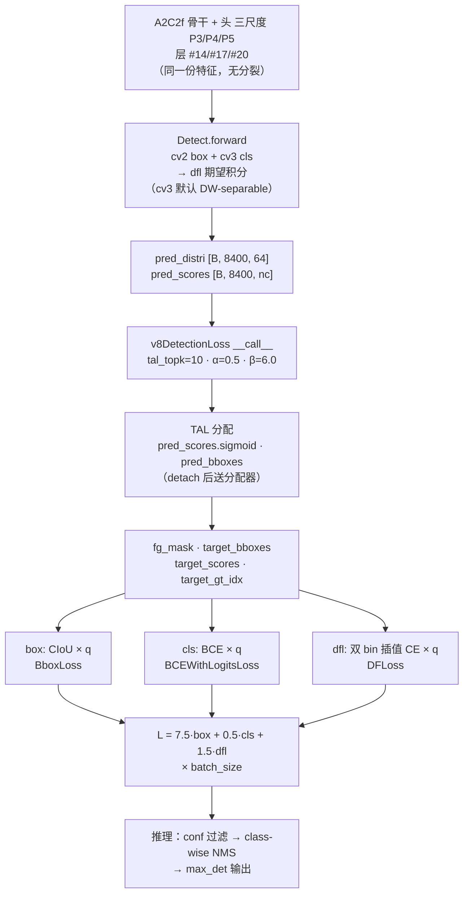

# YOLOv12 损失函数

> 核心事实：**v12 未引入新损失类**——完全沿用 v8 沿用的 `v8DetectionLoss`（<SrcLink file="v12:ultralytics/utils/loss.py" :line="157" :end="259" />）。v12 的 `loss.py` 与 v11 快照**行为完全一致**（743 行 vs 745 行，差异仅为代码风格：license 头、`if n := ...` 写法、docstring 列表格式）；`v10DetectLoss` 这个类名在 v11/v12 里**都不存在**，只剩 `E2EDetectLoss`（L728）继承其一多对一/一对一的双分支职责，`tasks.py` L825 做了旧模块路径映射。损失侧真正可观察的 delta 只有一处：**v12 的 `tal.py` 新增了 OOM 时回落 CPU 的 `try/except` 与 `_forward` 拆分**（355 行 → 385 行），与公式、超参、分配结果均无关。

> **v1~v11 读者路标**：v12 相对 v11 在损失侧的净增量是**零训练行为差异**——三分量总装（box + cls + dfl）、CIoU + DFL + BCE 公式、TAL 分配机制、7.5/0.5/1.5 增益、`close_mosaic=10` 全部沿用 v8。v12 论文的「Attention 骨干内嵌」是纯结构改动，损失侧一行公式未改；想让 v8 读者快速上手：把 [v8 损失页](/versions/v8/losses) 直接搬过来用即可。

## 1. 只想带走三件事

1. **总损失公式与 v8 一字不差**：$L_{\text{total}} = 7.5\,L_{\text{box}} + 0.5\,L_{\text{cls}} + 1.5\,L_{\text{dfl}}$——三分量、增益、加权方式全部与 v8 相同（<SrcLink file="v12:ultralytics/utils/loss.py" :line="255" :end="259" />）；
2. **训练用的分配器仍是 v8 参数**：loss.py L176 显式传 `topk=tal_topk, α=0.5, β=6.0`——tal.py L29 的类默认 topk=13 / α=1.0 在这里被显式覆盖；`tal_topk=10` 是 `__init__` 的默认参数值（<SrcLink file="v12:ultralytics/utils/loss.py" :line="160" />），yaml 不覆盖，检测训练实际吃的仍是 v8 老值；
3. **端到端双分支损失只剩 `E2EDetectLoss`**：v12 的 loss.py 末尾是 `E2EDetectLoss`（<SrcLink file="v12:ultralytics/utils/loss.py" :line="728" :end="743" />），内部持有 one2many（tal_topk=10）与 one2one（tal_topk=1）两个 `v8DetectionLoss` 实例；`yolov12.yaml` 不引用它，`DetectionModel.init_criterion` 在 `end2end=False` 时直接返回 `v8DetectionLoss(self)`。

## 2. 全景图

> **v1~v11 读者路标**：v11 的损失图是「单 v8DetectionLoss + TAL 单分配 + NMS 后处理」；v12 沿用这一形态，只是把 yaml 里的骨干从 C3k2/C2PSA 换成 A2C2f/去 SPPF，Detect 头的 `legacy` 类属性补成可切换（默认仍是 DW-separable）。损失侧图完全不变——**v12 的注意力内嵌是骨干层的事，与损失侧无关**。



- **训练路径**：三分量总装，与 v8/v11 完全相同
- **推理路径**：class-wise NMS（不是 v10 的 v10postprocess 两次 topk）——NMS 算子保留
- **梯度路径**：无 detach、无双分支——单头单梯度
- **日志**：三分量 `[box, cls, dfl]`（3 维向量）

## 3. 单分支三分量总装（v8 同款）

> **v1~v11 读者路标**：本节与 [v8 损失页](/versions/v8/losses) 第 1–4 节逐行对应——v12 快照的 `loss.py` 里 `v8DetectionLoss` **与 v11 行为等价**（`tal_topk=10` 参数位、显式 α=0.5/β=6.0 的写法完全相同，连行号 L160/L176/L177 都一致）；v9 改的是权重不对称（0.25/1.0），v10 改的是双分支实例化，v11/v12 连权重和 topk 都没动。想看「v12 损失侧到底有没有变化」的读者直接跳 [第 4 节](#4-tal_topk-参数化v11-引入v12-原样沿用)。

### 3.1 v8DetectionLoss.__init__（L157-L178）

<SrcLink file="v12:ultralytics/utils/loss.py" :line="157" :end="178" />

- **L160**：`def __init__(self, model, tal_topk=10)`——**与 v11 完全相同**：topk 早就是参数位（v11 loss.py 也是这一行），v12 没有新增；
- **L166**：`self.bce = nn.BCEWithLogitsLoss(reduction="none")`——分类用交叉熵，逐元素返回
- **L174**：`self.use_dfl = m.reg_max > 1`——reg_max=16，DFL 生效
- **L176**：`self.assigner = TaskAlignedAssigner(topk=tal_topk, num_classes=self.nc, alpha=0.5, beta=6.0)`——**topk 来自参数，α/β 显式硬编码**
- **L177**：`self.bbox_loss = BboxLoss(m.reg_max).to(device)`——**v11 与 v12 都是这一行**（`BboxLoss(reg_max)`，只传 reg_max）
- **L178**：`self.proj = torch.arange(m.reg_max, dtype=torch.float, device=device)`——DFL 期望积分的 bin 坐标 0..15

### 3.2 前处理：preprocess + bbox_decode

- `preprocess`（<SrcLink file="v12:ultralytics/utils/loss.py" :line="180" :end="195" />）：把 batch 的 `batch_idx / cls / bboxes` 摊平到 `(b, max_boxes, 5)` 并转 xyxy；`mask_gt` 标记有效 GT
- `bbox_decode`（<SrcLink file="v12:ultralytics/utils/loss.py" :line="197" :end="204" />）：`4×16` 分布 softmax 后对 `proj` 求期望，`dist2bbox` 得到预测框（anchor-free 解码）

### 3.3 __call__ 主流程（L206-L260）

<SrcLink file="v12:ultralytics/utils/loss.py" :line="206" :end="260" />

1. **L208-209** 初始化 `loss = torch.zeros(3)`，并 `feats = preds[1] if isinstance(preds, tuple) else preds`——兼容 [Detect.forward](/versions/v12/source/head-py) 的 `(y, x)` 返回值
2. **L210-212** 拼平三尺度并 split 出 `pred_distri / pred_scores`
3. **L220** `make_anchors` 生成锚点（网格中心 +0.5 偏移）与 stride 张量
4. **L223-226** GT 前处理，`mask_gt` 标有效框
5. **L229** `pred_bboxes = self.bbox_decode(anchor_points, pred_distri)`——先解码出预测框
6. **L233-241 调分配器**：L235 `pred_scores.detach().sigmoid()`、L236 `pred_bboxes.detach() * stride_tensor` 全部切断梯度（分配不回传）
7. **L243** `target_scores_sum = max(target_scores.sum(), 1)`——Σq，三项共同归一化分母；`max(..., 1)` 防空图除零
8. **L246-247** cls = 软标签 BCE 全图求和 ÷ Σq——L246 注释 `# VFL way` 是 v6 时代 [VarifocalLoss](/glossary#vfl-varifocal-loss) 的注释留档，未启用
9. **L250-254** 有正样本才算 box / dfl
10. **L256-258** 乘增益 7.5 / 0.5 / 1.5，L260 返回 `(loss.sum() * batch_size, loss.detach())`

**box 分量**：CIoU × 软标签加权（BboxLoss，<SrcLink file="v12:ultralytics/utils/loss.py" :line="91" :end="113" />）

```python
weight = target_scores.sum(-1)[fg_mask].unsqueeze(-1)      # 软标签 q 压成每 anchor 标量
iou = bbox_iou(pred_bboxes[fg_mask], target_bboxes[fg_mask], xywh=False, CIoU=True)
loss_iou = ((1.0 - iou) * weight).sum() / target_scores_sum
```

$$\mathrm{CIoU} = \mathrm{IoU} - \frac{\rho^2}{c^2} - \alpha v, \qquad \rho^2 \text{ 中心距},\ c^2 \text{ 最小包围框对角线平方},\ v \text{ 宽高比一致性}$$

[CIoU loss](/glossary#ciou-loss) 实现仍在 `utils/metrics.py`（`from .metrics import bbox_iou`，loss.py L12），逐项梯度推导见 [v8 梯度页](/versions/v8/loss-gradient)——v12 完全复用。

**cls 分量**：软标签 BCE

- 全 8400 位置都算（负样本学背景），目标 $t = q \cdot y$ 是 TAL 归一化软标签
- 无 [objectness](/glossary#objectness) 分支的设计与 v8 一致
- `pos_weight` 加权：`self.bce(pred_scores, target_scores.to(dtype)).sum() / target_scores_sum`（L247）

**dfl 分量**：双 bin 插值 CE（`DFLoss`，<SrcLink file="v12:ultralytics/utils/loss.py" :line="65" :end="88" />）

- 目标距离落在相邻两 bin 之间，按小数部分线性插值两条 [softmax](/glossary#softmax) 交叉熵
- × q → ÷ Σq——最优分布的期望恰等于目标，推导见 [v8 梯度页](/versions/v8/loss-gradient)

$$L_{\text{dfl}} = \sum_{a \in \text{fg}} q_a \cdot \bigl[(1 - f_a) \cdot \mathrm{CE}(p_a, \text{bin}_{t_a \uparrow}) + f_a \cdot \mathrm{CE}(p_a, \text{bin}_{t_a \downarrow})\bigr]$$

- **无 MakeMultiClass**：v12 的 tal.py 里**没有** `MakeMultiClass` 函数——同类任务由 `get_targets`（<SrcLink file="v12:ultralytics/utils/tal.py" :line="192" :end="238" />）内部完成
- **无新损失类**：v12 快照的 `loss.py` 是 743 行（v11 是 745 行，差异仅代码风格）——v12 保留了 `E2EDetectLoss`，但 yaml 主路径只用 `v8DetectionLoss`

> **v1~v11 读者路标**：本节三分量公式与增益，从 v6 到 v12 一字未改。v8 读者直接读 [v8 损失页](/versions/v8/losses) 就能覆盖本节全部；v9 读者要注意 v9 用非对称权重（辅助头 0.25、主头 1.0），v10/v11/v12 都回到对称权重；v1 读者注意 v1 用 [Region Loss](/glossary#region-loss) + [Detection Loss](/glossary#detection-loss)，从 v3 起才引入 CIoU，从 v6 起才引入 TAL + DFL——v12 是这一演进链的当前端点。

## 4. tal_topk 参数化：v11 引入、v12 原样沿用

> **v6/v11 读者路标**：v6 论文的 [TAL](/glossary#tal-task-alignment-learning) 分配器默认就是 topk=13 / α=1.0 / β=6.0；**v11 的 loss.py 已经把 topk 提到参数位 `tal_topk=10` 并显式传 α=0.5/β=6.0**；v12 的 loss.py 与 v11 在此处完全相同——**默认值仍是 10，α/β 仍硬编码 0.5/6.0**。这是 v12 损失侧**没有变化**的地方，也是最容易被误读成「v12 新特性」的一点。

### 4.1 loss.py L160 的签名（v11 已就位）

<SrcLink file="v12:ultralytics/utils/loss.py" :line="157" :end="178" />

```python
class v8DetectionLoss:
    def __init__(self, model, tal_topk=10):  # model must be de-paralleled
        ...
        self.assigner = TaskAlignedAssigner(topk=tal_topk, num_classes=self.nc, alpha=0.5, beta=6.0)
```

- **v8 / v9 / v10**：`TaskAlignedAssigner(topk=10, num_classes=self.nc, alpha=0.5, beta=6.0)`——**topk 硬编码在 loss.py 内部**
- **v11 / v12**：`TaskAlignedAssigner(topk=tal_topk, num_classes=self.nc, alpha=0.5, beta=6.0)`——**topk 已在 `__init__` 参数位**，α/β 仍硬编码

**这个改动的语义**：允许外部通过 `v8DetectionLoss(model, tal_topk=13)` 拿到「v8 主路径 + v6 论文 topk」的组合——为研究代码提供了参数化入口。

**对 yaml 的实际影响**：`yolov12.yaml` 不传 tal_topk 参数，`DetectionModel.init_criterion` 也不传——**默认走 10**，与 v11 完全一致。

### 4.2 tal.py L29 的类默认（v12 沿用 v11）

<SrcLink file="v12:ultralytics/utils/tal.py" :line="29" :end="37" />

```python
def __init__(self, topk=13, num_classes=80, alpha=1.0, beta=6.0, eps=1e-9):
    ...
```

- **v12 类默认**：`topk=13, alpha=1.0, beta=6.0`——**与 v11 完全一致**（v11 首次从 v8/v9/v10 的 10/0.5 上调到 13/1.0，v12 沿用）
- **实际训练用值**：loss.py L176 显式传 `topk=10, alpha=0.5, beta=6.0`——**覆盖类默认**

### 4.3 默认回调的实际影响

| 场景 | 分配器类型 | topk | α / β | 使用者 |
|------|-----------|------|-------|--------|
| 直接 `TaskAlignedAssigner()` 无参调用 | TaskAlignedAssigner | **13** | **1.0 / 6.0** | 研究代码 / 外部脚本（吃类默认） |
| <SrcLink file="v12:ultralytics/utils/loss.py" :line="176" /> | TaskAlignedAssigner | **10**（tal_topk 默认） | **0.5 / 6.0** | **v8DetectionLoss → yolov12.yaml 检测主用** |
| `v8DetectionLoss(model, tal_topk=13)` | TaskAlignedAssigner | **13** | **0.5 / 6.0** | 外部通过参数化入口覆盖（v11 起可用） |
| <SrcLink file="v12:ultralytics/utils/loss.py" :line="618" /> | RotatedTaskAlignedAssigner | **10** | **0.5 / 6.0** | v8OBBLoss → yolov12-obb.yaml |
| <SrcLink file="v12:ultralytics/utils/loss.py" :line="732" :end="733" /> | TaskAlignedAssigner × 2 | **10 与 1** | 0.5 / 6.0 | E2EDetectLoss（v12 不使用） |

- **L176 是显式传参**（topk 来自 tal_topk 参数，α/β 硬编码）
- **L618 也是显式传参**（OBB 与检测同值：topk=10 / α=0.5）
- **两者在 v12 里都不读 tal.py 的默认**
- **tal.py 类默认上调是 v11 引入的架构级回调，v12 沿用**——不改变现有 yaml 的实际训练行为

### 4.4 对齐度量公式

<SrcLink file="v12:ultralytics/utils/tal.py" :line="132" :end="151" /> `get_box_metrics`：

$$t_{ag} = s_{ag}^{\alpha} \times \mathrm{CIoU}_{ag}^{\beta}$$

- $s_{ag}$ 是 anchor $a$ 在 GT $g$ 类别通道上的预测分数（`bbox_scores[mask_gt] = pd_scores[ind[0], :, ind[1]][mask_gt]`，L143）
- $\mathrm{CIoU}_{ag}$ 以 GT 为 box1，L153-L155 `iou_calculation` 用 CIoU 且 `clamp_(0)`
- **β=6.0** 把定位质量差异放大到 6 次方——align metric 几乎由「框得多准」决定，分类分数只做温和加权
- **v12 与 v11 实际训练用 α=0.5**：分类项开方（分数区间 [0,1] 开方后**放大**分类项相对权重，但相对 β=6 的定位项仍弱）

### 4.5 forward 五步流水（L39-L118）

`forward` 挂在 <SrcLink file="v12:ultralytics/utils/tal.py" :line="39" :end="40" /> 的 `@torch.no_grad()` 下——分配是纯训练期路由，永不回传梯度（loss.py 调用前还额外 detach 了一次预测，双保险）：

1. **空 GT 早退** <SrcLink file="v12:ultralytics/utils/tal.py" :line="64" :end="71" />：`n_max_boxes == 0` 时直接返回全背景
2. **OOM 回退** <SrcLink file="v12:ultralytics/utils/tal.py" :line="73" :end="80" />：`_forward` 抛 `torch.OutOfMemoryError` 时把全部张量搬到 CPU 重算再搬回——**这是 v12 相对 v11 唯一的真实代码增量**
3. **求正样本位** <SrcLink file="v12:ultralytics/utils/tal.py" :line="102" :end="104" />：`get_pos_mask`——「中心在 GT 内」×「对齐度量 topk」×「GT 有效」三重 mask 相乘
4. **抢占去重** <SrcLink file="v12:ultralytics/utils/tal.py" :line="106" />：`select_highest_overlaps`——一个 anchor 被多个 GT 选中时，归 IoU 最高者
5. **造目标** <SrcLink file="v12:ultralytics/utils/tal.py" :line="109" />：`get_targets` 按 `target_gt_idx` 抄 GT 标签与框
6. **归一化软标签** <SrcLink file="v12:ultralytics/utils/tal.py" :line="111" :end="116" />：`target_scores × pos_overlaps / pos_align_metrics`——对齐度量归一后乘回 one-hot，得到软分类目标

$$q_{ag} = \frac{t_{ag}}{\max_{a'} t_{a'g}} \cdot \max_{a'} \mathrm{CIoU}_{a'g}$$

### 4.6 select_topk_candidates：topk 决定正样本数

<SrcLink file="v12:ultralytics/utils/tal.py" :line="157" :end="190" />

- L174 `torch.topk(metrics, self.topk, dim=-1, largest=largest)`——对每个 GT 取对齐度量前 topk 个 anchor 的索引与值
- L178 `topk_idxs.masked_fill_(~topk_mask, 0)`——无效 GT 的索引统一填 0
- L181-185 `count_tensor` 逐 k `scatter_add_` 计数——topk=1 时循环体只执行一次
- L188 `count_tensor.masked_fill_(count_tensor > 1, 0)`——计数超过 1 的位置清零
- L190 返回 float mask

**topk 越激进，冲突越频繁**：topk=13 时 GT 之间更容易抢同一个 anchor，`select_highest_overlaps` 就承担更多工作量——这也是「topk 越大 ≠ 无脑好」的机制根源。

### 4.7 RotatedTaskAlignedAssigner：OBB 专用

<SrcLink file="v12:ultralytics/utils/tal.py" :line="298" :end="340" /> 只覆写两个方法：

- `iou_calculation`——把 `bbox_iou(CIoU=True)` 换成 `probiou`（[probiou](/glossary#probiou)）
- `select_candidates_in_gts`——把「锚点中心在 GT 框内」的判据改成「四角点在旋转框内」

主干 `forward / get_box_metrics / select_topk_candidates / get_targets` 全部靠继承，与标准 TaskAlignedAssigner 同源。v12 的 yolov12-obb.yaml 通过 v8OBBLoss（<SrcLink file="v12:ultralytics/utils/loss.py" :line="612" />）实例化这个类，显式传 `topk=10, alpha=0.5, beta=6.0`——**OBB 的分配参数与检测主路径相同**，与 tal.py 类默认（13/1.0）无关。

> **v1~v11 读者路标**：v6 读者注意 v6 论文的 TAL 分配器默认就是 topk=13 / α=1.0 / β=6.0——v11 直接把 v8/v9/v10 时代的「topk=10 / α=0.5」回调到 v6 论文原值（仅在 tal.py 类默认），**v12 沿用这个类默认**；检测损失走 loss.py L176 显式传参，仍用 v8 值（topk=10、α=0.5），且 v11 已把 topk 提到参数位。v7 读者注意 v7 用的是 SimOTA（cost = BCE + 3·(-log IoU) + dynamic-k 自适应正样本数），v8 换成 TAL，v9/v10/v11/v12 都沿用 TAL。v10 读者请把 v10 里 tal.py 的 topk=10 / α=0.5 视为历史遗留——v10 用两次实例化取 topk=10 与 topk=1 实现「一致性双分配」，v11/v12 完全放弃了这套设计。

## 5. 为什么 v12 保留 v8 主路径

> **v10 读者路标**：v10 的双分支损失在 v11/v12 都不再使用——这是「回归 v8 NMS 单头」的必然结果，不是选择。v12 快照里对应的类叫 `E2EDetectLoss`，`v10DetectLoss` 这个旧类名已被 `tasks.py` L825 映射过去。

### 5.1 双分支设计依赖什么

v12 的 `E2EDetectLoss`（<SrcLink file="v12:ultralytics/utils/loss.py" :line="728" :end="743" />）：

```python
class E2EDetectLoss:
    def __init__(self, model):
        self.one2many = v8DetectionLoss(model, tal_topk=10)
        self.one2one = v8DetectionLoss(model, tal_topk=1)

    def __call__(self, preds, batch):
        preds = preds[1] if isinstance(preds, tuple) else preds
        one2many = preds["one2many"]
        loss_one2many = self.one2many(one2many, batch)
        one2one = preds["one2one"]
        loss_one2one = self.one2one(one2one, batch)
        return loss_one2many[0] + loss_one2one[0], loss_one2many[1] + loss_one2one[1]
```

**这套设计依赖三个前提**：

1. `Detect` 头必须覆写 `forward` 返回 `{"one2many": ..., "one2one": ...}` 字典（`forward_end2end`，head.py L76）
2. `Detect.end2end=True` 时必须 `deepcopy` 出 one2one 分支并 `xi.detach()`（head.py L60-62 / L87-90）
3. `tal_topk` 必须作为形参传入 `v8DetectionLoss.__init__`

**前提 3 在 v11 就已满足**（v11 loss.py L160 同样是 `tal_topk=10`），所以这不是 v12 的改动。v12 yaml 没有引用 `v10Detect` 或 `E2EDetectLoss`，前提 1 与 2 不成立——双分支在 v12 依然不可用。

**旧类名去哪了**：<SrcLink file="v12:ultralytics/nn/tasks.py" :line="825" /> 的权重兼容映射把 `ultralytics.utils.loss.v10DetectLoss` 指向 `ultralytics.utils.loss.E2EDetectLoss`——加载 v10 旧权重时靠它兜底，v12 自身训练不经过。

### 5.2 端到端 E2EDetectLoss

`E2EDetectLoss` 就是 v10 论文「端到端检测器」在 ultralytics 主线里的形态：one2many + one2one 双分配、one2one 分支来自 `xi.detach()`——与 yolov12.yaml 的 anchor-free 单头完全无关，v12 完全不涉及它（`Detect.end2end = False`，head.py L27）。

### 5.3 v12 为什么一起回退

v12 用回 v8 的 `Detect` 头（<SrcLink file="v12:ultralytics/nn/modules/head.py" :line="21" :end="74" />），`forward` 返回 `(box, cls, x)` 元组而不是字典、没有 one2one 分支、没有 detach。cv3 的 DW-separable 在 v11 就已如此，v12 只是补了 `legacy` 类属性让它可以切回全 3×3。既然头端不再产生双分支预测，损失侧的双分支总装（`E2EDetectLoss`）就失去入口——只能回到 v8DetectionLoss 单实例。

**所以 loss.py 里那个端到端类的存在，只是「代码仓库不删东西」的工程惯例**——yolov12 训练时完全不会命中。

### 5.4 DetectionModel.init_criterion 的返回

<SrcLink file="v12:ultralytics/nn/tasks.py" :line="386" :end="388" /> `DetectionModel.init_criterion`：

```python
return E2EDetectLoss(self) if getattr(self, "end2end", False) else v8DetectionLoss(self)
```

`Detect.end2end` 默认 `False`，所以实际返回 `v8DetectionLoss(self)`——与 v8/v9/v11 一致，没有像 v10 那样覆写成 `YOLOv10DetectionModel` + 专属损失类。这也是「v12 用回 v8 老路」在建模入口层的证据。

> **v1~v11 读者路标**：v10 的双分支损失设计是「一致双分配」的代码形态，与 v10Detect 头强绑定；v11/v12 撤回 v10Detect 就等于撤回双分支损失——**损失与头的选择是一体的**。v8 读者可以直接把 v12 的 loss.py 当作 v8 的 loss.py 看（除了末尾多一个 `E2EDetectLoss`，且 v11 起就有 `tal_topk` 参数位）。

## 6. 与其他版本的损失对比

> **v1~v11 读者路标**：把七代损失摆在一起看，v12 的定位一目了然——**完全等于 v11**（同样的 v8 主路径、同样的类默认、同样的 `tal_topk` 参数位），额外只多一个 OOM 回退。

| 维度 | v6 | v8 | v9 | v10 | v11 | **v12** |
|------|-----|-----|-----|-----|-----|---------|
| 检测总装类 | DetectionLoss（TAL 版） | **v8DetectionLoss** | v8DetectionLoss + v9DetectionLoss（主辅） | v8DetectionLoss + 双分支类 | v8DetectionLoss | **v8DetectionLoss** |
| 标签分配 | SimOTA | TAL topk=10 | 主辅各一份 TAL | 双 TAL topk=10/1 | TAL topk=10（L176 覆盖） | **TAL topk=10**（L176 覆盖） |
| 损失分量 | box / cls / dfl | 三分量（对称） | 三分量（非对称 0.25/1.0） | 六分量（双三分量） | 三分量（对称） | **三分量（对称）** |
| 增益 | 7.5 / 0.5 / 1.5 | 7.5 / 0.5 / 1.5 | 主头同 v8、辅头 ×0.25 | 两支均 7.5 / 0.5 / 1.5 | 7.5 / 0.5 / 1.5 | **7.5 / 0.5 / 1.5** |
| close_mosaic | 10 | 10 | 10 | 10 | 10 | **10** |
| TAL 类默认 α / β | 1.0 / 6.0 | 0.5 / 6.0 | 0.5 / 6.0 | 0.5 / 6.0 | 1.0 / 6.0 | **1.0 / 6.0**（沿用 v11） |
| TAL 类默认 topk | 13 | 10 | 10 | 10 | 13 | **13**（沿用 v11） |
| 检测实际用 topk | — | 10 | 10 | 10 与 1 各一份 | 10 | **10** |
| 检测实际用 α | — | 0.5 | 0.5 | 0.5 | 0.5 | **0.5** |
| loss.py topk 参数化 | — | — | — | — | **✅ tal_topk 参数位** | **✅（同 v11）** |
| BboxLoss 构造 | — | BboxLoss(reg_max) | 同 v8 | 同 v8 | BboxLoss(reg_max) | **BboxLoss(reg_max)**（同 v11） |
| 一致性约束 | 无 | 无 | 无 | 同分配器两次实例化 | 无（放弃一致性双分配） | **无** |
| 端到端损失类 | 无 | 无 | 无 | **有（v10DetectLoss）** | E2EDetectLoss（L730） | **E2EDetectLoss（L728）** |
| MakeMultiClass | 无 | 无 | 无 | 无 | 无 | **无** |
| RotatedTaskAlignedAssigner | 有（OBB） | 有 | 有 | 有 | 有（OBB 专用） | **有（OBB 专用）** |

**一句话总结**：v12 损失 = v11 损失（`v8DetectionLoss` + TAL topk=10 + 7.5/0.5/1.5）——**主路径、类默认、参数位全部相同，训练行为零差异**。

### 6.1 与 v11 的关键差异

| 方面 | v11 | v12 |
|------|-----|-----|
| loss.py 行数 | 745 | 743（仅代码风格） |
| tal.py 行数 | 355 | 385 |
| v8DetectionLoss 存在 | ✓ | ✓ |
| tal_topk 参数化 | ✓（默认 10） | **✓（默认 10，同 v11）** |
| L176 assigner topk | 10 | **10**（tal_topk 默认） |
| L176 assigner α / β | 0.5 / 6.0 | **0.5 / 6.0** |
| BboxLoss 构造 | BboxLoss(reg_max) | **BboxLoss(reg_max)**（同 v11） |
| tal.py L29 类默认 topk | 13 | **13** |
| tal.py L29 类默认 α | 1.0 | **1.0** |
| tal.py OOM 回退 | ✗ | **✓（try/except + `_forward`）** |
| Detect cv3 形态 | DW-separable（无开关） | **DW-separable + `legacy` 类属性**（yaml 层面无反映） |
| 训练实际用 topk / α / β | 10 / 0.5 / 6.0 | **10 / 0.5 / 6.0** |

**唯一可观察差异**：`tal.py` 在显存不足时会把分配计算搬回 CPU（v12 新增）；损失侧没有任何可观察的训练行为差异。

### 6.2 与 v8 的关键差异

v12 相对 v8 在损失侧的实际训练行为**几乎为零差异**——三分量总装、增益、TAL 分配、BCE + DFL 公式、`close_mosaic=10` 全部沿用。差异在两个层面：

1. **代码仓库层**：loss.py 从 v8 的 75 行扩到 v12 的 743 行——加入了 `E2EDetectLoss` 以及 SegmentationLoss / PoseLoss / ClassificationLoss / OBBLoss
2. **类默认层**：tal.py 的 `TaskAlignedAssigner.__init__` 默认从 topk=10 / α=0.5 上调到 topk=13 / α=1.0（v11 引入、v12 沿用）——但检测训练不读类默认

> **v1~v11 读者路标**：想快速理解 v12 损失定位：把它当成「v11 损失页照抄」。v8 读者按 v8 损失页走一遍就能覆盖 v12 检测训练；v6 读者注意 v11/v12 把类默认回调到 v6 原值，是架构层面的「回归论文」；v9 读者注意 v12 用回对称权重（不是 v9 的主辅 0.25/1.0）；v10 读者请把 v10 的整套双分支设计当作**历史遗留**，yolov12 训练不会命中。

## 7. SrcLink 汇总

本页引用到的关键源码位置（可直接跳转）：

- <SrcLink file="v12:ultralytics/utils/loss.py" :line="16" :end="37" />——VarifocalLoss（存而未用）
- <SrcLink file="v12:ultralytics/utils/loss.py" :line="40" :end="62" />——FocalLoss（存而未用）
- <SrcLink file="v12:ultralytics/utils/loss.py" :line="65" :end="88" />——DFLoss（双 bin 插值）
- <SrcLink file="v12:ultralytics/utils/loss.py" :line="91" :end="113" />——BboxLoss（CIoU + DFL 双分量）
- <SrcLink file="v12:ultralytics/utils/loss.py" :line="116" :end="137" />——RotatedBboxLoss（OBB 专用）
- <SrcLink file="v12:ultralytics/utils/loss.py" :line="140" :end="154" />——KeypointLoss（pose 专用）
- <SrcLink file="v12:ultralytics/utils/loss.py" :line="157" :end="259" />——**v8DetectionLoss（v12 检测主用）**
- <SrcLink file="v12:ultralytics/utils/loss.py" :line="160" />——**__init__ 签名：tal_topk=10（v11 起就有）**
- <SrcLink file="v12:ultralytics/utils/loss.py" :line="176" />——**assigner 显式传参（topk=tal_topk, α=0.5, β=6.0）**
- <SrcLink file="v12:ultralytics/utils/loss.py" :line="205" :end="259" />——__call__ 三分量总装
- <SrcLink file="v12:ultralytics/utils/loss.py" :line="263" :end="444" />——v8SegmentationLoss
- <SrcLink file="v12:ultralytics/utils/loss.py" :line="446" :end="599" />——v8PoseLoss
- <SrcLink file="v12:ultralytics/utils/loss.py" :line="601" :end="610" />——v8ClassificationLoss
- <SrcLink file="v12:ultralytics/utils/loss.py" :line="612" :end="725" />——v8OBBLoss
- <SrcLink file="v12:ultralytics/utils/loss.py" :line="618" />——OBB assigner 显式传参（topk=10, α=0.5）
- <SrcLink file="v12:ultralytics/utils/loss.py" :line="728" :end="743" />——E2EDetectLoss（v12 不使用）
- <SrcLink file="v12:ultralytics/utils/tal.py" :line="14" :end="295" />——TaskAlignedAssigner 主体
- <SrcLink file="v12:ultralytics/utils/tal.py" :line="29" :end="37" />——**__init__ 默认（topk=13, α=1.0）——v12 沿用 v11**
- <SrcLink file="v12:ultralytics/utils/tal.py" :line="40" :end="118" />——forward / _forward 流水
- <SrcLink file="v12:ultralytics/utils/tal.py" :line="132" :end="151" />——get_box_metrics
- <SrcLink file="v12:ultralytics/utils/tal.py" :line="157" :end="190" />——select_topk_candidates
- <SrcLink file="v12:ultralytics/utils/tal.py" :line="192" :end="238" />——get_targets
- <SrcLink file="v12:ultralytics/utils/tal.py" :line="298" :end="340" />——RotatedTaskAlignedAssigner
- <SrcLink file="v12:ultralytics/nn/tasks.py" :line="386" :end="388" />——DetectionModel.init_criterion
- <SrcLink file="v12:ultralytics/nn/tasks.py" :line="825" />——v10DetectLoss → E2EDetectLoss 权重映射

## 8. 相关概念

- [TAL Task Alignment Learning](/glossary#tal-task-alignment-learning)——训练期标签分配机制，v12 沿用
- [CIoU loss](/glossary#ciou-loss)——box 分量的几何度量，v6-v12 沿用
- [DFL Distribution Focal Loss](/glossary#dfl-distribution-focal-loss)——box 分量的分布回归，v8 引入 v12 沿用
- [VFL Varifocal Loss](/glossary#vfl-varifocal-loss)——loss.py L246 注释留档，未启用
- [Multi-positive 多正样本](/glossary#multi-positive-多正样本)——topk=10 与 v11 一致
- [Objectness](/glossary#objectness)——v12 与 v8 一致无 objectness 分支
- [A2C2f](/glossary#a2c2f) / [AAttn](/glossary#aattn) / [ABlock](/glossary#ablock)——见 [layers 页](/versions/v12/layers)

## 延伸阅读

- [YOLOv12 架构与层速查](/versions/v12/layers)
- [YOLOv12 架构总览](/versions/v12/architecture)
- [YOLOv12 理论 Concept](/versions/v12/concepts)
- [loss.py 源码页](/versions/v12/source/loss-py)
- [tal.py 源码页](/versions/v12/source/tal-py)
- [head.py 源码页](/versions/v12/source/head-py)
- [v8 损失函数（对照基线）](/versions/v8/losses)
- [v10 损失函数（对照基线）](/versions/v10/losses)
- [v11 损失函数（上一代）](/versions/v11/losses)
