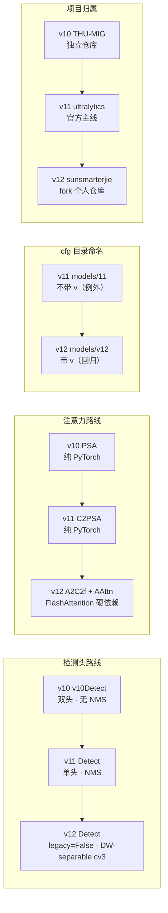
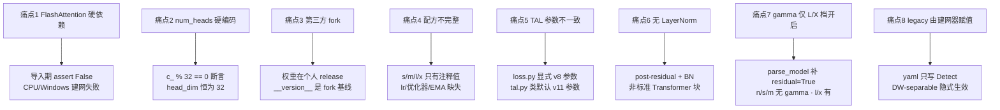

# YOLOv12 痛点追踪

YOLOv12（Yunjie Tian / Qixiang Ye / David Doermann，UB SUNY + UCAS，仓库 `sunsmarterjie/yolov12` tag `v1.0`，commit `b1035f8f97cd1a7440454a54f8bc19f989448159`，2025-02-19，AGPL-3.0，arXiv:2502.12524）是**站内第一个「第三方 fork」版本**——它不是 ultralytics 官方发布，而是社区研究者基于 ultralytics `8.3.63` fork 后改出来的注意力版 YOLO。这个身份决定了 v12 的痛点结构和前十一代都不一样：**前代的痛点多在「结构取舍」，v12 的痛点多在「工程可用性与归属」**。本页追踪 8 个痛点，每个都配 v1~v11 路标。

## 痛点全景

> 已读过 [v11 痛点页](/versions/v11/painpoints)？v11 的痛点集中在「结构回退的代价」（命名坑、无论文、回归 NMS、C3k2 简化、数字不可复核、scales 集中）；**v12 的痛点换了一批**：FlashAttention 硬依赖、`num_heads` 硬编码、第三方 fork 的归属问题、训练配方不完整、TAL 参数与类默认不一致、无 LayerNorm、gamma 默认关闭、Detect 隐性差异。**v11 的「命名坑」在 v12 反而被修好了**（目录回归 `v12/` 带 v 前缀）。

| 痛点 | 严重度 | v1~v11 处理 | v12 处理 | 后续影响 |
| --- | --- | --- | --- | --- |
| [1. FlashAttention 硬依赖](#1-flashattention-硬依赖导入即崩-pain-flash-attn) | **High** | 前十代纯 torch，CPU 可跑 | **导入即 `assert False`**，CPU/Windows 建网失败 | 部署与训练环境被锁死 |
| [2. `num_heads` 硬编码 + 通道断言](#2-num_heads--c_-32-硬编码通道断言-pain-heads-hardcoded) | High | C2f/C3k2/C2fCIB 无整除约束 | **`assert c_ % 32 == 0`**，head 数不可配 | 自定义宽度/`e` 易崩 |
| [3. 第三方 fork：归属与权重托管](#3-第三方-fork归属与权重托管都脱离-ultralytics-pain-third-party) | **High** | v9/v10 也是第三方，但独立仓库 | **fork 自 ultralytics 8.3.63**，权重在个人仓库 release | 长期维护与合规存疑 |
| [4. 训练配方只给了 n 档完整命令](#4-训练配方只给了-n-档完整命令-pain-recipe-incomplete) | Medium | v6/v7 论文给完整配方 | **s/m/l/x 只给注释值** | 官方数字难复现 |
| [5. `tal_topk` 参数化但 α/β 显式覆盖](#5-tal_topk-参数化却显式写死-v8-参数-pain-tal-mismatch) | Medium | v11 改的是类默认值 | **loss.py 显式 α=0.5 β=6.0**，与 tal.py 默认相反 | 读代码极易误判 |
| [6. 无 LayerNorm：非标准 Transformer](#6-无-layernormpost-residual-的注意力块-pain-no-layernorm) | Medium | v10 PSA/v11 C2PSA 也无 LN | **依旧无 LN、post-residual** | 与「Attention-Centric」论文定位有落差 |
| [7. gamma 只在 L/X 档静默开启](#7-gamma-只在-lx-档静默开启-pain-gamma-hidden) | Medium | 前代无 layer-scale | **`parse_model` 只给 L/X 补 `residual=True, mlp_ratio=1.2`** | 五档结构隐性分裂 |
| [8. Detect `legacy` 由建网器赋值](#8-detect-legacy-由建网器隐式赋值yaml-无开关-pain-head-hidden) | Low | v10 有 `v10Detect` 独立类 | **`m.legacy = legacy`（因含 C3k2/A2C2f → False）** | 想回 v8 头必须改源码 |

## 1. FlashAttention 硬依赖：导入即崩 (`pain-flash-attn`)

> **v1~v11 读者路标**：前十一代的注意力模块（v10 的 PSA、v11 的 C2PSA）都是**纯 PyTorch 实现**——`nn.MultiheadAttention` 或手写 `softmax(QKᵀ/√d)V`，CPU 也能建网推理；**v12 第一次把第三方 CUDA 算子做成导入期硬依赖**。

**现象**（<SrcLink file="v12:ultralytics/nn/modules/block.py" :line="1159" :end="1163" />）：

```python
try:
    from flash_attn.flash_attn_interface import flash_attn_func
except Exception:
    assert False, "import FlashAttention error! Please install FlashAttention first."
from timm.models.layers import trunc_normal_
```

- **`except` 分支是 `assert False`**，不是降级——只要 `flash_attn` 导入失败，**整个 `ultralytics.nn.modules.block` 模块都加载不了**；
- 后果是**任何入口都崩**：`YOLO("yolov12n.yaml")`、`from ultralytics import YOLO`（会导入 modules）、甚至 `yolo val` 都用不了；
- 同一段还硬依赖 `timm.models.layers.trunc_normal_`——**timm 也是必装项**，缺了同样抛 `ModuleNotFoundError`；
- `requirements.txt` 的 whl 名把平台写死（`requirements.txt` L3）：

```
flash_attn-2.7.3+cu11torch2.2cxx11abiFALSE-cp311-cp311-linux_x86_64.whl
```

**为何是痛点**：

1. **Windows / macOS 无法直接 `pip install`**——whl 只覆盖 Linux x86_64，其它平台需源码编译（要求 CUDA toolkit 与 torch 版本严格匹配，编译常需 30 分钟以上且失败率高）；
2. **Python 版本锁死 3.11**——`cp311` tag，3.10/3.12 需自行编译；
3. **CUDA 版本锁死 11.x + torch 2.2.2**——`cu11torch2.2` 与 `cxx11abiFALSE` 三者必须同时匹配，国内镜像源通常没有这个 whl；
4. **推理也要**——`AAttn.forward`（<SrcLink file="v12:ultralytics/nn/modules/block.py" :line="1217" :end="1222" />）在 `x.is_cuda` 时直接调 `flash_attn_func`，**部署侧（TensorRT/ONNX）必须能处理该算子或改写为普通 attention**。

**v12 的「兜底」其实兜不住**：

```python
if x.is_cuda:
    x = flash_attn_func(...)
else:
    # 手写 softmax 回退（L1223-1233）
```

`forward` 里确实有非 CUDA 的手写 softmax 分支——**但导入期的 `assert False` 已经让 CPU 场景在模块加载阶段就死了**，这段回退代码在「没装 flash-attn」时永远执行不到。它只在「装了 flash-attn 但张量在 CPU 上」时可用（例如 CPU offload 的特殊场景）。

**遗留**：

- 想在不支持的平台上跑 v12，需**自行打补丁**：把 L1161-1162 改成 `flash_attn_func = None`，并在 `forward` 里判断 `flash_attn_func is not None`；
- 本站快照按源码原样记录，**不提供修改后的可用版本**；
- 这是 v12 相对 v11 最大的实际使用门槛——**「能不能跑」先于「跑得好不好」**。

## 2. `num_heads = c_ // 32` 硬编码 + 通道断言 (`pain-heads-hardcoded`)

> **v1~v11 读者路标**：v8 的 C2f、v11 的 C3k2、v10 的 C2fCIB 都**没有通道整除断言**——`c_ = int(c2 * e)` 向下取整后直接用，任意 `e` 都能建网；v11 的 C2PSA 用 `c // 64` 算 head，但同样没有断言；**v12 的 A2C2f 把「32 的倍数」写成硬断言，head 数也不再可配**。

**现象**（<SrcLink file="v12:ultralytics/nn/modules/block.py" :line="1330" :end="1336" />）：

```python
c_ = int(c2 * e)  # hidden channels
assert c_ % 32 == 0, "Dimension of ABlock be a multiple of 32."
# num_heads = c_ // 64 if c_ // 64 >= 2 else c_ // 32
num_heads = c_ // 32
```

**三重限制**：

1. **隐藏通道必须 32 的倍数**——`c_` 由 `c2 × e` 得到，`c2` 又经过 `make_divisible(width × c2, 8)` 与 `max_channels` 封顶，**任一步都可能让断言失败**；
2. **head 数不可配**——`num_heads` 完全由 `c_ // 32` 决定，yaml 没有 `num_heads` 参数；
3. **`head_dim` 恒为 32**——因为 `head_dim = dim // num_heads = c_ / (c_ / 32) = 32`，**任何档位都只有 32 维/头**；这远低于标准 Transformer 的 64/128 维 head。

**注释里暴露的设计摇摆**（L1335）：

```python
# num_heads = c_ // 64 if c_ // 64 >= 2 else c_ // 32
num_heads = c_ // 32
```

被注释掉的那行说明作者试过「head 数减半（`c_//64`），但不少于 2」的规则，**最终选了固定 `c_//32`**——这意味着 v12 的 head 数随通道线性增长：n=2、s=4、m=8、l=8、x=12（详见 [tricks §4](/versions/v12/tricks#4-a2c2f-的通道约束c_-32--0-trick-channel-constraint)）。

**具体影响**：

- **自定义 `e` 容易崩**：想仿照 v11 的 C3k2 用 `e=0.25`（浅层轻量），`c2=512`、`width=0.25` 时 `c_ = 128 × 0.25 = 32` ✓，但 `c2=256` 时会得到 `c_=16` → 断言失败；
- **宽高缩放不连续**：`width` 取 0.25/0.5/1.0/1.5 是官方调好的，**用户随便填一个 0.75 就可能踩断言**；
- **与 v11 的可移植性断裂**：把 v11 yaml 里的 C3k2 换名成 A2C2f 并保留 `e=0.25`，很可能直接崩——**同名参数不同约束**。

**遗留**：没有「自动 head 数推导」的兜底；不能像标准 Transformer 那样配置 `num_heads`。想改只能 fork 源码。

## 3. 第三方 fork：归属与权重托管都脱离 ultralytics (`pain-third-party`)

> **v1~v11 读者路标**：v9（WongKinYiu/yolov9）、v10（THU-MIG/yolov10）也是第三方独立仓库，但**它们是「另起炉灶」的重实现**；v12 不一样——它是**直接 fork ultralytics 主线（`8.3.63`）再改**，所以代码结构与 ultralytics 高度同构，但**归属、权重、维护责任全部落在个人仓库**。

**三层证据**：

| 层 | 事实 | 出处 |
|----|------|------|
| 作者 | Yunjie Tian（UB SUNY）、Qixiang Ye（UB SUNY）、David Doermann（UCAS） | arXiv:2502.12524 |
| 仓库 | `sunsmarterjie/yolov12`（个人账号），fork 自 ultralytics | README + `__version__ = "8.3.63"` |
| 权重 | `releases/download/v1.0/yolov12{n/s/m/l/x}.pt`——**个人仓库的 GitHub Release** | README L56-60 |

**为何是痛点**：

1. **权重可用性依赖个人仓库**：`YOLO("yolov12n.pt")` 的下载地址解析到 `sunsmarterjie/yolov12` 的 release；仓库若删除/改名，**所有依赖官方权重的脚本立即失效**；
2. **不是 ultralytics 官方资产**：`ultralytics` PyPI 包里**没有** `yolov12.yaml`，`YOLO("ultralytics yolov12n")` 之类写法不存在——用户必须从 fork 仓库安装；
3. **版本号是 fork 基线，不是产品版本**：`__version__ = "8.3.63"`（<SrcLink file="v12:ultralytics/__init__.py" :line="3" />）——这是它 fork 时的 ultralytics 版本，**不是 v12 自己的版本号**；产品版本只能看 git tag `v1.0`；
4. **AGPL-3.0 继承**：fork 自 AGPL 的 ultralytics，整仓仍是 AGPL-3.0——**商业闭源部署需要法务评估**（与 ultralytics 官方一致，但多了「fork 是否合规」的一层疑问）；
5. **维护不确定**：个人仓库在 v1.0 之后是否持续跟进 ultralytics 主线，本站快照内无法判断。

**与 v9/v10 的区别**：

- v9/v10 是**独立代码库**，用户预期就是「另一套实现」；
- v12 是**fork**，用户会预期「和 ultralytics 一样能用」——**但依赖与资产都不在原厂渠道**，这是期望落差。

**遗留**：企业落地时建议**内部 fork + 镜像权重**，不要直接依赖个人仓库的 release；许可证按 AGPL-3.0 处理。

## 4. 训练配方只给了 n 档完整命令 (`pain-recipe-incomplete`)

> **v1~v11 读者路标**：v6/v7 的论文附录给出完整训练配置（epochs/batch/lr/增强全参数）；v8/v10/v11 的 README 至少给一条完整命令；**v12 的 README 只给 n 档的完整命令，s/m/l/x 四档只有行内注释值**。

**现象**（仓库 [README.md 训练章节](https://github.com/sunsmarterjie/yolov12/blob/v1.0/README.md) L70-L86）：

```python
model = YOLO('yolov12n.yaml')
results = model.train(
  data='coco.yaml',
  epochs=600,
  batch=256,
  imgsz=640,
  scale=0.5,          # S:0.9; M:0.9; L:0.9; X:0.9
  mosaic=1.0,
  mixup=0.0,          # S:0.05; M:0.15; L:0.15; X:0.2
  copy_paste=0.1,     # S:0.15; M:0.4; L:0.5; X:0.6
  device="0,1,2,3",
)
```

**缺失的信息**：

- **s/m/l/x 的 batch 与设备**：注释只说 n 档示例，四档大概率要改 batch（显存不够），但 README 没说；
- **学习率**：没有给 lr0 / lrf / warmup——只能假定走 `default.yaml` 出厂值；
- **优化器**：没说是 SGD 还是 AdamW——`optimizer: auto` 会按迭代数自动选，600 epoch 下大概率是 SGD；
- **权重衰减 / EMA**：完全未提；
- **数据规模**：只说 `coco.yaml`，没说是否用 COCO train2017 全量、是否合并 val。

**具体影响**：

- **官方 mAP 无法严格复现**：即使按 README 跑，也因缺失超参而得到不同数字；
- **跨档对比不公平**：n 档的参数明确、s~x 靠猜——用户自训的 s 档数字与官方表格不可直接比；
- **论文也没补**：arXiv 主文没有训练细节附录（见 [paper §论文中未充分披露的地方](/versions/v12/paper#论文中未充分披露的地方本站提醒)）。

**遗留**：本站快照按 README 原样记录，并把「注释值」整理成矩阵（见 [tricks §2](/versions/v12/tricks#2-分档-mixup--copy_paste-矩阵v12-的核心配方创新-trick-per-scale-aug)），**明确标注这是注释而非完整命令**。

## 5. `tal_topk` 参数化却显式写死 v8 参数 (`pain-tal-mismatch`)

> **v1~v11 读者路标**：[v11 痛点页](/versions/v11/painpoints) 记录过「TAL 默认 topk 提到 13、α 提到 1.0」；v12 表面上看是「把 topk 参数化」——**但实际训练行为退回 v8**：`loss.py` 显式传 `alpha=0.5, beta=6.0`，且默认 `tal_topk=10`。

**现象**（<SrcLink file="v12:ultralytics/utils/loss.py" :line="160" /> · <SrcLink file="v12:ultralytics/utils/loss.py" :line="176" />）：

```python
def __init__(self, model, tal_topk=10):  # model must be de-parallel
    ...
    self.assigner = TaskAlignedAssigner(topk=tal_topk, num_classes=self.nc, alpha=0.5, beta=6.0)
```

而 `TaskAlignedAssigner` 的类默认值是（<SrcLink file="v12:ultralytics/utils/tal.py" :line="28" />）：

```python
def __init__(self, topk=13, num_classes=80, alpha=1.0, beta=6.0, eps=1e-9):
```

**两组参数的差异**：

| 参数 | tal.py 类默认（v11 口径） | loss.py 实际传入（v12 训练） |
|------|--------------------------|------------------------------|
| topk | 13 | **10**（`tal_topk` 默认值） |
| alpha | 1.0 | **0.5** |
| beta | 6.0 | 6.0 |

**为何是痛点**：

1. **误读风险极高**：只看 `tal.py` 会以为 v12 训练用 topk=13 α=1.0（v11 口径）；只看 `loss.py` 才知道实际是 v8 口径——**两处都要读才能判断真实行为**；
2. **「参数化」的唯一收益是给调用方留口子**：`tal_topk` 是 v12 对 loss.py 的唯一改动，但**官方训练脚本没有传非默认值**——所以对训练结果的贡献是 0；
3. **类默认值与调用点不一致是长期维护隐患**：某天有人把 `loss.py` 改成 `TaskAlignedAssigner(topk=tal_topk, num_classes=self.nc)`（漏掉 α/β），行为会**静默切换到 v11 口径**；
4. **文档与论文未提及**：README 与 arXiv 都没说 TAL 用什么参数，用户只能从代码反推。

**遗留**：本站以「实际执行路径」为准记录（topk=10 / α=0.5 / β=6.0，见 [losses §4](/versions/v12/losses#4-tal_topk-参数化v12-唯一改动)），并在 [loss-gradient §10](/versions/v12/loss-gradient#10-数值示例topk10-与-α05-的梯度分布-grad-example) 给了数值分布示例。**不要只看 tal.py 的类默认值。**

## 6. 无 LayerNorm、post-residual 的注意力块 (`pain-no-layernorm`)

> **v1~v11 读者路标**：v10 的 PSA、v11 的 C2PSA 都用 `nn.MultiheadAttention` + 卷积 FFN，**同样没有 LayerNorm**；v12 延续这个传统——**AAttn/ABlock 里既没有 LayerNorm 也没有 BatchNorm 之外的归一化**。

**现象**（<SrcLink file="v12:ultralytics/nn/modules/block.py" :line="1293" :end="1297" />）：

```python
def forward(self, x):
    x = x + self.attn(x)
    x = x + self.mlp(x)
    return x
```

- **post-residual 顺序**：先算子层、再加回输入——不是标准 Transformer 的 **pre-norm**（`x = x + attn(LN(x))`）；
- **完全没有 LN**：`attn` 内部只有 `qkv` / `proj` / `pe` 三个 `Conv`（带 BN），`mlp` 是两个 `Conv`（带 BN）——**归一化全靠 BatchNorm**；
- **没有 dropout、没有 `norm1/norm2`**：ABlock 的 `__init__` 只创建 `attn` 与 `mlp` 两个子模块（<SrcLink file="v12:ultralytics/nn/modules/block.py" :line="1276" :end="1282" />）。

**为何是痛点**：

1. **与论文标题的落差**：论文叫「Attention-Centric Real-Time Object Detectors」，但实现**不是标准 Transformer 块**——想复用 MAE/ViT 预训练权重或做跨架构迁移都做不到；
2. **BN 在小 batch 下不稳**：`Conv` 默认带 BatchNorm2d，而 Transformer 系通常用 LN 以摆脱 batch 依赖；v12 的注意力块**依然吃 batch size**（batch=256 的官方配方正说明这点）；
3. **训练稳定性靠初始化兜**：ABlock 用 `trunc_normal_(std=.02)`（见 [tricks §5](/versions/v12/tricks#5-gamma-layer-scale-与-vit-初始化默认全关-trick-gamma-off)）+ `gamma` 机制（默认关闭）来补偿没有 LN 的深层堆叠——**这两条都是「事后补丁」，不是架构级方案**；
4. **`area` 切分会放大分布差异**：`area=4` 时特征图被切成 4 块独立做 attention，**块间尺度差异没有 LN 归一**，只能靠 `pe`（7×7 DWConv 位置编码）缓解。

**遗留**：想给 v12 加 LN 需要改 `AAttn`/`ABlock` 源码，**且会与官方权重不兼容**；本站建议只在自研场景考虑。

## 7. gamma 只在 L/X 档静默开启 (`pain-gamma-hidden`)

> **v1~v11 读者路标**：v8~v11 的结构块里**没有 layer-scale 概念**；v12 首次在 A2C2f 引入 `gamma`（LayerScale 风格的小初值缩放）——**但 yaml 层完全看不出来**：`parse_model` 只给 L/X 档补 `residual=True`，n/s/m 档不补。

**现象**（<SrcLink file="v12:ultralytics/nn/modules/block.py" :line="1341" :end="1346" /> · <SrcLink file="v12:ultralytics/nn/tasks.py" :line="1034" :end="1038" />）：

```python
init_values = 0.01  # or smaller
self.gamma = nn.Parameter(init_values * torch.ones((c2)), requires_grad=True) if a2 and residual else None
```

```python
if m is A2C2f:
    legacy = False
    if scale in "lx":  # for L/X sizes
        args.append(True)   # residual=True
        args.append(1.2)    # mlp_ratio=1.2
```

- `yolov12.yaml` 五处 A2C2f 的参数都只有 `[c2, a2, area]`（例如 `[-1, 4, A2C2f, [512, True, 4]]`）——**yaml 里没有 `residual`**；
- 但 `parse_model` 在 **L/X 档**会给 args 追加 `True` 与 `1.2` → `residual=True, mlp_ratio=1.2`；
- 结果：**n/s/m 档 5 处 A2C2f 的 `gamma` 全是 `None`；l/x 档 5 处全部有 gamma**（0.01 初始化的 `c2` 维向量）。

**为何是痛点**：

1. **同名字段、两种结构**：五档 yaml 写法一字不差，但 n/s/m 是「纯前馈 A2C2f」，l/x 是「带 layer-scale 残差的 A2C2f」——**不读 `parse_model` 的 L1034-L1038 根本发现不了**；
2. **mlp_ratio 也被档位改**：n/s/m 用 A2C2f 默认的 2.0，l/x 被传 1.2——**同一个模块在五档里有两种 FFN 宽度**（站内早期页面按 ABlock 默认值 1.2 描述，实际只有 l/x 是 1.2）；
3. **权重结构不可跨档迁移**：`gamma` 的 `c2` 维参数只存在于 l/x 权重里，n/s/m 权重没有这些键——**n/s/m 与 l/x 的 state_dict 不兼容**；
4. **作者注释 `# or smaller`** 暗示 0.01 可能偏大——但没有给出任何调参依据，也没有消融。

**遗留**：本站以「`parse_model` 的实际行为」为准记录；想统一五档行为（全开或全关），只能 fork 改 `tasks.py`，**改了就与官方权重失配**。

## 8. Detect `legacy` 由建网器隐式赋值，yaml 无开关 (`pain-head-hidden`)

> **v1~v11 读者路标**：v10 用**独立类** `v10Detect`（v12 快照 `head.py` L592）表达「不同的头」，yaml 里写 `v10Detect` 就切换；v8/v11 写 `Detect`；**v12 只写 `Detect`，但 `parse_model` 会因模型含 C3k2/A2C2f 而把 `legacy=False` 写到 Detect 实例上，同一个类就走 DW-separable 分支**。

**现象**（<SrcLink file="v12:ultralytics/nn/modules/head.py" :line="32" /> · <SrcLink file="v12:ultralytics/nn/tasks.py" :line="1053" :end="1058" />）：

```python
legacy = False  # backward compatibility for v3/v5/v8/v9 models
```

```python
elif m in {Detect, WorldDetect, Segment, Pose, OBB, ImagePoolingAttn, v10Detect}:
    args.append([ch[x] for x in f])
    ...
    if m in {Detect, Segment, Pose, OBB}:
        m.legacy = legacy   # ← 建网时覆盖实例属性
```

- `legacy` 是**类属性**，`Detect.__init__` 不接收它；
- `parse_model` 的 `legacy` 初值是 `True`（tasks.py L938），**遇到 C3k2 或 A2C2f 就置 `False`**（L1031 / L1035）——v12 的 yaml 两者都有，于是 Detect 拿到 `legacy=False`；
- v12 的 `yolov12.yaml` 末行是 `- [[14, 17, 20], 1, Detect, [nc]]`——**和 v8/v11 的写法一字不差**；
- 但 `cv3` 的结构因 `legacy=False` 变成 **5 段 DW-separable**（`DWConv + Conv` 交替，见 [tricks §6](/versions/v12/tricks#6-detect-legacyfalsewd-separable-分类头的训练含义-trick-dw-head)）。

**为何是痛点**：

1. **yaml 层面完全无差异**：把 v8 的 `yolov8.yaml` 与 v12 的 `yolov12.yaml` 并排看，末行都是 `Detect`——**看不到「分类头换了」**；
2. **想切回 v8 头只能改源码**：`legacy=True` 没有 yaml 入口，需要子类化或改类属性（如 `Detect.legacy = True` 全局 hack，会影响同进程内所有模型）；
3. **权重形状不兼容**：`legacy=True` 与 `False` 的 `cv3` 参数键数与形状都不同，**切分支就从零训练**；
4. **导出图也变**：DWConv 在 ONNX 里是 `Conv(groups=C)`，与全卷积的图节点数不同——**推理引擎的算子融合策略要重新验证**。

**遗留**：本站把「v12 默认 DW-separable」作为**结构性事实**记录，并在 [concepts §5](/versions/v12/concepts#5-detect-dw-separable-分支yaml-层面无反映的隐性差异-concept-detect-dw-separable) 与 [layers §10](/versions/v12/layers#10-detectlegacyfalse-默认cv3-dw-separable) 都做了标注。

## 跨版本痛点演化与谱系图

> **v1~v11 读者路标**：把 v10→v12 三代的关键变化并排画出来——v11 的「命名坑」被 v12 修好，但 v12 自己引入了 FlashAttention 硬依赖与第三方归属问题。



### v12 新痛点谱系图



## v1~v11 如何处理 v12 的 8 个问题

| v12 痛点 | v1~v11 处理 | 差异本质 |
|---------|-------------|---------|
| 1. FlashAttention 硬依赖 | 前十一代纯 torch，psa/c2psa 手写 attention | v12 用第三方 CUDA kernel 换速度 |
| 2. num_heads 硬编码 | C2f/C3k2 无整除断言；C2PSA 用 `c//64` | v12 断言更严、head 更碎（32 维） |
| 3. 第三方 fork | v9/v10 独立仓库；v11 官方主线 | v12 是「fork 官方再改」，期望落差更大 |
| 4. 配方不完整 | v6/v7 论文给全；v8/v10/v11 README 给一条完整命令 | v12 只给 n 档完整命令 |
| 5. TAL 参数不一致 | v8~v11 只在一处定义 | v12 类默认与调用点分裂 |
| 6. 无 LayerNorm | v10 PSA / v11 C2PSA 同样无 LN | 三代一致的传统，v12 未改 |
| 7. gamma 仅 L/X 档 | v8~v11 无 layer-scale | v12 有机制且**按档位分裂** |
| 8. legacy 建网器赋值 | v10 用独立类 `v10Detect` | v12 用同一类的实例属性表达差异 |

## 8 大痛点的工程优先级建议

如果要在 v12 上做二次开发，按「阻塞程度 + 可绕过性」排序：

1. **痛点 1（FlashAttention 硬依赖）**：**最高优先**——决定「能不能跑」，Linux/CUDA11/py311 之外全部要打补丁；
2. **痛点 3（第三方 fork）**：**高优先**——企业落地必须内部镜像权重 + AGPL 合规评估；
3. **痛点 2（num_heads/通道断言）**：高——自定义 yaml 时高频踩坑，**易规避**（保证 `c_` 是 32 倍数）；
4. **痛点 4（配方不完整）**：中——影响复现而非运行，**可通过固定 default.yaml 缓解**；
5. **痛点 5（TAL 参数不一致）**：中——影响理解而非运行，**读代码时两处对照即可**；
6. **痛点 6（无 LayerNorm）**：中——影响跨架构迁移，**自研时可改**（但失配官方权重）；
7. **痛点 7（gamma 仅 L/X 档）**：中——影响「五档结构一致性」的认知，**默认行为不影响使用**；
8. **痛点 8（legacy 建网器赋值）**：低——官方权重就是 DW-separable，**按默认用即可**。

## 延伸阅读

- [YOLOv12 源码走读](/versions/v12/code-walkthrough) — 本页痛点对应的调用链证据
- [YOLOv12 训练技巧](/versions/v12/tricks) — FlashAttention 环境、通道约束、分档配方
- [YOLOv12 理论 Concept](/versions/v12/concepts) — A2C2f / AAttn / ABlock 的机制解析
- [YOLOv12 架构总览](/versions/v12/architecture) — yaml 与骨干-颈-头逐层图解
- [YOLOv12 损失函数](/versions/v12/losses) — `tal_topk` 参数化的真实行为
- [YOLOv12 发布精读](/versions/v12/paper) — 论文的三层材料与未披露项
- [v11 痛点追踪](/versions/v11/painpoints) — 上代「结构回退」的代价（命名坑在 v12 已修复）
- [v10 痛点追踪](/versions/v10/painpoints) — 双头去 NMS 的代价
- [v8 痛点追踪](/versions/v8/painpoints) — v12 检测头与损失的共同前像
- [术语表](/glossary) — FlashAttention、LayerNorm、layer-scale、TAL、DWConv、NMS 等术语索引
