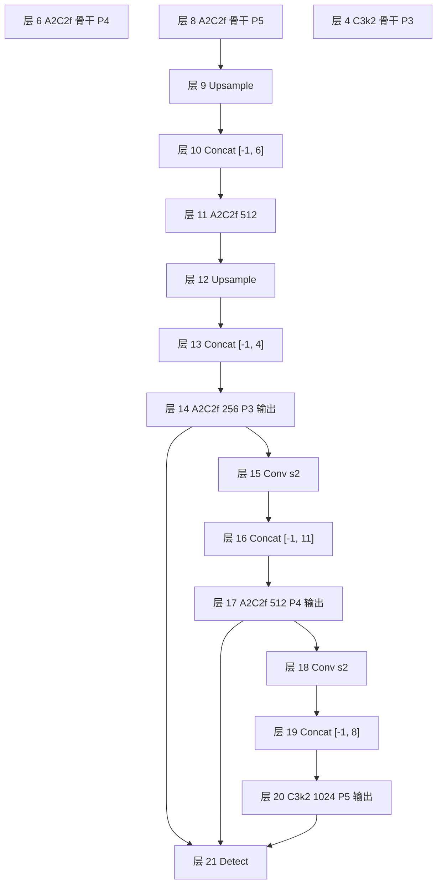

# ultralytics/cfg/models/v12/yolov12.yaml

v12 的五档结构清单：**45 行单份 yaml，`n/s/m/l/x` 五档通过内嵌 `scales` 块（L6-12）在同一份 yaml 里表达**——沿用 v11 的「一份 yaml 走多档」组织方式；目录名从 v11 的 `11/`（不带 v）回归到 `v12/`（带 v），跟 v8/v10 的命名规则一致。结构上的核心变化是：**backbone 两处引入 A2C2f 承接 P4/P5，head 三个尺度各挂一个 A2C2f，P5-large 保留一个 C3k2 兜底，去掉 SPPF**。

> 快照路径：`source/yolov12/snapshot/ultralytics/cfg/models/v12/yolov12.yaml`（45 行）。点击左侧行号可复制/分享行锚点。

## 命名坑：目录名 `v12/` 带 v 前缀

v9 是 `ultralytics/cfg/models/9/`，v10 是 `ultralytics/cfg/models/v10/`，v11 又变回 `ultralytics/cfg/models/11/`（不带 v），v12 回归到 `ultralytics/cfg/models/v12/`（带 v）。**四代 yaml 目录命名风格并不统一**——查代码时最好直接读 yaml 目录列表，不要靠「数字前/无 v」的直觉判断。

这个坑体现在三个地方：

1. **文件路径**：写代码时用 `yolov12.yaml`（`v12/` 目录下的完整文件名），别写成 `12/yolov12.yaml` 或 `v12/yolov12.yaml`；
2. **`guess_model_scale` 正则**：<SrcLink file="v12:ultralytics/nn/tasks.py" :line="1106" /> 里的 `yolo[v]?\d+([nslmx])`——**同时容忍带 v 与不带 v 两种写法**，所以 `yolov12n` 与 `yolo12n` 都能匹配；
3. **档位解析**：档位后缀（n/s/m/l/x）从 yaml 内嵌 `scales:` 查表，与 v11 完全同款机制，见 [nn/tasks.py parse_model](/versions/v11/source/yolo11-yaml)。

**给读者的建议**：查 v12 源码时目录名用 `v12/`；文件名是 `yolov12.yaml`。

## 关键行段速查

| 行段 | 内容 | 看点 |
|------|------|------|
| <SrcLink file="v12:ultralytics/cfg/models/v12/yolov12.yaml" :line="1" /> | 文件注释 | YOLOv12 🚀 AGPL-3.0 |
| <SrcLink file="v12:ultralytics/cfg/models/v12/yolov12.yaml" :line="5" /> | nc: 80 | 类别数 |
| <SrcLink file="v12:ultralytics/cfg/models/v12/yolov12.yaml" :line="6" :end="12" /> | scales | **五档 compound scaling：n/s/m/l/x** |
| <SrcLink file="v12:ultralytics/cfg/models/v12/yolov12.yaml" :line="15" :end="25" /> | backbone | 9 层：Conv / C3k2 / **A2C2f** 骨架（**无 SPPF**） |
| <SrcLink file="v12:ultralytics/cfg/models/v12/yolov12.yaml" :line="28" :end="45" /> | head | 17 层：PAN + A2C2f×3 + C3k2×1 + Detect |
| <SrcLink file="v12:ultralytics/cfg/models/v12/yolov12.yaml" :line="45" /> | 层 21 Detect | 三尺度收尾，参数仅 nc |

<SourceViewer file="v12:ultralytics/cfg/models/v12/yolov12.yaml" />

## scales（L6-12）：五档参数矩阵

<SrcLink file="v12:ultralytics/cfg/models/v12/yolov12.yaml" :line="6" :end="12" /> 五档 `[depth, width, max_channels]` 三参数：

| 档 | depth | width | max_channels | 层数 | 官方参数量 | 官方 GFLOPs | 官方 mAP50-95 |
|----|-------|-------|--------------|------|-----------|-------------|---------------|
| n | 0.50 | 0.25 | 1024 | 465 | **2.60 M** | 6.7 | 40.6 |
| s | 0.50 | 0.50 | 1024 | 465 | **9.29 M** | 21.7 | 48.0 |
| m | 0.50 | 1.00 | **512** | 501 | **20.20 M** | 68.1 | 52.5 |
| l | 1.00 | 1.00 | **512** | 831 | **26.45 M** | 89.7 | 53.7 |
| x | 1.00 | 1.50 | **512** | 831 | **59.22 M** | 200.3 | 55.2 |

**v12 scales 与 v11 逐项完全相同**（没有变化点）：

- n/s 档 `[0.50, 0.25/0.50, 1024]`、m 档 `[0.50, 1.00, 512]`、l/x 档 `[1.00, 1.00/1.50, 512]`——**depth / width / max_channels 三参数与 v11 一字不差**；
- 因此「n 与 s 层数一致（都是 465 层）」「m 档 4 倍重复缩到 2 倍」这些现象在 v11 就已存在，不是 v12 的改动；
- v12 与 v11 的层数/参数量差异，全部来自**模块替换**（C3k2/C2PSA → A2C2f）而非 scales 缩放。

compound scaling 三参数机制与 v8/v9/v11 完全相同——**depth** 缩 A2C2f/C3k2 的重复数；**width** 缩通道；**max_channels** 封顶。

### 与 v10 每档独立 yaml 的对比

- **v10**：六个档（n/s/m/b/l/x）各一份独立 yaml，每份自带 `scales:` 块（只列本档），且目录是 `cfg/models/v10/`（带 v）；
- **v9**：单份 `yolov9.yaml` + `parse_model` 内部查 scales 字典（不在 yaml 里显式写）；目录是 `cfg/models/9/`；
- **v11**：单份 `yolo11.yaml` + **yaml 里显式写 scales 块**；目录是 `cfg/models/11/`（不带 v）；
- **v12**：单份 `yolov12.yaml` + **yaml 里显式写 scales 块**；目录是 **`cfg/models/v12/`（带 v）**。

v12 相当于 v11 的组织方式 + v10 的目录命名。b 档（v10 特有）在 v11/v12 里被合并到 s 档。

## backbone 逐行（L15-25，层 0-8）

| yaml 行 | 层号 | 模块 | args（缩放前） | 含义 |
|---------|------|------|----------------|------|
| <SrcLink file="v12:ultralytics/cfg/models/v12/yolov12.yaml" :line="17" /> | 0 | Conv | [64, 3, 2] | P1/2，stride-2 卷积下采样 |
| <SrcLink file="v12:ultralytics/cfg/models/v12/yolov12.yaml" :line="18" /> | 1 | Conv | [128, 3, 2] | P2/4 |
| <SrcLink file="v12:ultralytics/cfg/models/v12/yolov12.yaml" :line="19" /> | 2 | **C3k2** | [256, False, 0.25] | P2 特征；c3k=False 走 Bottleneck，e=0.25 |
| <SrcLink file="v12:ultralytics/cfg/models/v12/yolov12.yaml" :line="20" /> | 3 | Conv | [256, 3, 2] | P3/8（小目标尺度起点） |
| <SrcLink file="v12:ultralytics/cfg/models/v12/yolov12.yaml" :line="21" /> | 4 | **C3k2** | [512, False, 0.25] | P3 特征；同层 19 配置 |
| <SrcLink file="v12:ultralytics/cfg/models/v12/yolov12.yaml" :line="22" /> | 5 | Conv | [512, 3, 2] | P4/16 |
| <SrcLink file="v12:ultralytics/cfg/models/v12/yolov12.yaml" :line="23" /> | 6 | **A2C2f** | [512, **True, 4**] | **P4 特征，a2=True + area=4**——v12 关键块 1 |
| <SrcLink file="v12:ultralytics/cfg/models/v12/yolov12.yaml" :line="24" /> | 7 | Conv | [1024, 3, 2] | P4→P5 下采样 |
| <SrcLink file="v12:ultralytics/cfg/models/v12/yolov12.yaml" :line="25" /> | 8 | **A2C2f** | [1024, **True, 1**] | **P5 特征，a2=True + area=1**——v12 关键块 2 |

**关键观察**：

- v12 backbone **无 SPPF**（v8/v10/v11 都有；v12 直接以 A2C2f 收敛）；
- v12 backbone **只用三种模块**：`Conv` / `C3k2` / `A2C2f`；
- P2/P3 用 **C3k2 c3k=False**（内嵌 `Bottleneck`，等价于经典 C2f 但保留 C3k2 名号），P4/P5 换成 **A2C2f a2=True**——注意 a2=True 时才真正启用 ABlock 内的 AAttn；`a2=False` 时 A2C2f 内部会回退到 `C3k(c_, c_, 2, shortcut, g)`（`block.py` L1345）；
- 骨干 A2C2f 的 `e=0.5`（yaml 未显式传，取默认）。基准 @640 下 #6 的 `c_=256`、#8 因 `max_channels=512` 封顶也是 `c_=256`；五档实际 `num_heads`：n 档 2/4、s 档 4/8、m/l/x 档 8/8——`assert c_ % 32 == 0` 全部通过，**不会出现 heads=16**。

## head 逐行（L28-45，层 9-21）

| yaml 行 | 层号 | 模块 | args | 含义 |
|---------|------|------|------|------|
| <SrcLink file="v12:ultralytics/cfg/models/v12/yolov12.yaml" :line="29" /> | 9 | nn.Upsample | ×2 nearest | P5 特征上采样 |
| <SrcLink file="v12:ultralytics/cfg/models/v12/yolov12.yaml" :line="30" /> | 10 | Concat | [-1, 6] | 接骨干 P4（层 6） |
| <SrcLink file="v12:ultralytics/cfg/models/v12/yolov12.yaml" :line="31" /> | 11 | **A2C2f** | [512, **False, -1**] | 融合层；**a2=False** 走 C3k 分支 |
| <SrcLink file="v12:ultralytics/cfg/models/v12/yolov12.yaml" :line="33" /> | 12 | nn.Upsample | ×2 | 继续上行 |
| <SrcLink file="v12:ultralytics/cfg/models/v12/yolov12.yaml" :line="34" /> | 13 | Concat | [-1, 4] | 接骨干 P3（层 4） |
| <SrcLink file="v12:ultralytics/cfg/models/v12/yolov12.yaml" :line="35" /> | 14 | **A2C2f** | [256, **False, -1**] | **P3/8-small 输出；a2=False** |
| <SrcLink file="v12:ultralytics/cfg/models/v12/yolov12.yaml" :line="37" /> | 15 | Conv | [256, 3, 2] | P3→P4 回程 |
| <SrcLink file="v12:ultralytics/cfg/models/v12/yolov12.yaml" :line="38" /> | 16 | Concat | [-1, 11] | 接 head P4（层 11） |
| <SrcLink file="v12:ultralytics/cfg/models/v12/yolov12.yaml" :line="39" /> | 17 | **A2C2f** | [512, **False, -1**] | **P4/16-medium 输出；a2=False** |
| <SrcLink file="v12:ultralytics/cfg/models/v12/yolov12.yaml" :line="41" /> | 18 | Conv | [512, 3, 2] | P4→P5 回程 |
| <SrcLink file="v12:ultralytics/cfg/models/v12/yolov12.yaml" :line="42" /> | 19 | Concat | [-1, 8] | 接骨干 P5（层 8） |
| <SrcLink file="v12:ultralytics/cfg/models/v12/yolov12.yaml" :line="43" /> | 20 | **C3k2** | [1024, True] | **P5/32-large 输出；c3k=True** |
| <SrcLink file="v12:ultralytics/cfg/models/v12/yolov12.yaml" :line="45" /> | 21 | **Detect** | [[14, 17, 20], 1, Detect, [nc]] | 三尺度收尾 |

**head 段的 a2 全部为 False**——这是个非常关键的结构性事实：

- **A2C2f 的 a2 参数在 head 段一律为 False**（yaml L31/L35/L39），A2C2f 类内部会 `return C3k(c_, c_, 2, shortcut, g)` 而不是 `ABlock(...)`（`block.py` L1345）；
- 也就是说，**head 段的三个 A2C2f 实际执行的是「C3k 骨架 + C2f 拼接 + 可选 gamma」**——注意因为 a2=False 时 `gamma=None`（`block.py` L1342 的条件是 `a2 and residual`），所以最终 head 的三个 A2C2f 是**没有 layer-scale** 的纯 C3k 骨架；
- 只有 backbone 的 layer 6 / layer 8 是 a2=True，走完整的 ABlock 路径。

**这就是 v12 的实际语义**：Attention 只在骨干 P4/P5 两个位置出现（A2C2f a2=True 各 4 次重复），head 是普通 C3k 拼接。所谓「Attention 骨干内嵌」的准确描述是「**P4 与 P5 各挂一块 R-ELAN 结构的注意力块**」，不是「所有 A2C2f 都是 Attention」。

## Detect（L45）：主检测头

<SrcLink file="v12:ultralytics/cfg/models/v12/yolov12.yaml" :line="45" /> `[[14, 17, 20], 1, Detect, [nc]]`——from 三尺度 P3/P4/P5（层 14/17/20），参数只有 nc。yaml 里看不到的都在 Detect 类内部（[head.py L21](/versions/v12/source/head-py)）：DFL 分布回归、sigmoid 分类分、`bias_init`、`decode_bboxes`。

**与 v11 的对照**：v11 与 v12 的 yaml 末行都是 `Detect`，且两代的 cv3 **都走 DW-separable**（v11 无开关、无条件 DW）；v12 的 Detect 类补了 `legacy=False` 默认属性（`head.py` L32），可切回 v8 的全 3×3，但**默认行为与 v11 相同**——这是类属性层面的差异，yaml 层面无任何反映。

## 与 v8 / v10 / v11 结构对比

| 维度 | v8 yolov8.yaml | v10 yolov10n.yaml | **v11 yolo11.yaml** | **v12 yolov12.yaml** |
|------|----------------|-------------------|---------------------|---------------------|
| 行数 | 46 | 40 × 6 份 | **47** | **45** |
| 档位组织 | 单文件 + scale 后缀 | **六档独立 yaml** | 单文件 + 内嵌 scales | **单文件 + 内嵌 scales** |
| 目录 | models/8/ | models/v10/ | **models/11/**（不带 v） | **models/v12/**（带 v） |
| backbone 主打块 | C2f | C2fCIB + PSA + SCDown | C3k2（简化 C2f 变体） | **A2C2f（R-ELAN）+ C3k2** |
| backbone 收尾 | SPPF | SPPF + PSA | **SPPF** | **无 SPPF（直接 A2C2f）** |
| neck 回程 | Conv s2 × 2 | Conv s2 + SCDown | Conv s2 × 2 | **Conv s2 × 2** |
| head 尺度块 | C2f × 3 | C2fCIB × 3 | C2f × 3 | **A2C2f × 3 + C3k2 × 1** |
| head 尺度块实质 | C2f | C2fCIB | C2f | **A2C2f a2=False（=C3k 骨架）** |
| P5-large 收尾 | C2f | C2fCIB | C2f | **C3k2 c3k=True** |
| 检测头 | Detect（全 3×3 cv3） | v10Detect | Detect（DW-separable，无开关） | **Detect（legacy=False → DW-separable，行为同 v11）** |
| 档位 | n/s/m/l/x | n/s/m/**b**/l/x | n/s/m/l/x | n/s/m/l/x |
| 五档参数 | 3.5/11.2/25.9/52.6/95.2 M | 2.3/4.6/7.2/9.0/9.5/13.9 M | 2.62/9.46/20.11/25.37/56.97 M | **2.60/9.29/20.20/26.45/59.22 M** |
| 五档 mAP50-95 | 44.9/49.0/51.5/52.9/53.8 | 38.5/41.0/43.6/44.4/44.6/46.3 | 39.5/47.0/51.5/53.4/54.7 | **40.6/48.0/52.5/53.7/55.2** |

## 一句话总结

**v12 = v11 骨架 + A2C2f 引入 P4/P5 主通路 + 去 SPPF + head 用 A2C2f(a2=False)=C3k 骨架 + C3k2 保留在 P5-large + Detect cv3 与 v11 同为 DW-separable（v12 补 `legacy` 开关）+ 目录回归 `v12/`**。v11 的 C3k2 骨架、C2PSA 尾端注意力、SPPF 收尾三件套里，v12 只保留了 C3k2（且只出现在 P5-large 一处），把注意力从「尾端外挂」改成「骨干 P4/P5 内嵌」，把「SPPF 感受野收尾」改成「直接 A2C2f 收敛」。

> **v1~v11 读者路标**：v8/v9 读者——v12 的 head 与 v8 同款 PAN 拓扑，Detect 头沿用（cv3 与 v11 一样走 DW-separable），骨架是 C2f 骨架里嵌 ABlock 的 R-ELAN，[C2f](/glossary#c2f) 与 A2C2f 的接口形状一致；v10 读者——把 v10 里 `yolov10n.yaml` 的「SCDown / PSA / C2fCIB / v10Detect」四件事整块删除、换成「A2C2f + C3k2 + Detect」，档位从 n/s/m/b/l/x 六档合并到 n/s/m/l/x 五档；v11 读者——v12 就是把 v11 骨干 layer 5/7 的 C3k2 换成 A2C2f（a2=True + area=4/1），把 SPPF 拿掉，把 head 的四个 C2f 换成三个 A2C2f(a2=False) + 一个 C3k2；detect 头结构不变（两代 cv3 都是 DW-separable），v12 只是补了 `legacy` 类属性，默认值 False 让行为与 v11 一致。

结构总览见 [architecture](/versions/v12/architecture)；逐模块拆解见 [layers](/versions/v12/layers)；A2C2f / ABlock / AAttn 三件套见 [block.py 源码页](/versions/v12/source/block-py)；检测头 DW-separable 分支见 [head.py 源码页](/versions/v12/source/head-py)；损失与分配见 [loss.py 源码页](/versions/v12/source/loss-py) 与 [tal.py 源码页](/versions/v12/source/tal-py)；端到端训练链见 [code-walkthrough](/versions/v12/code-walkthrough)。
