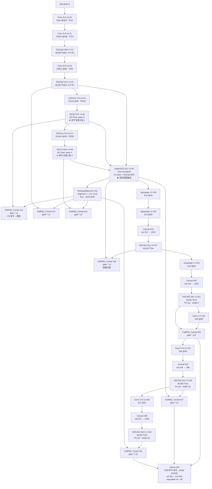
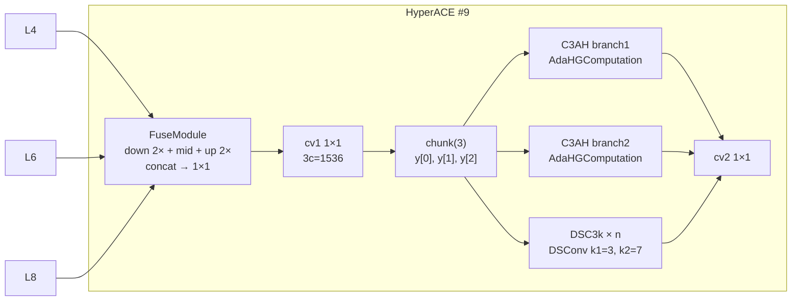
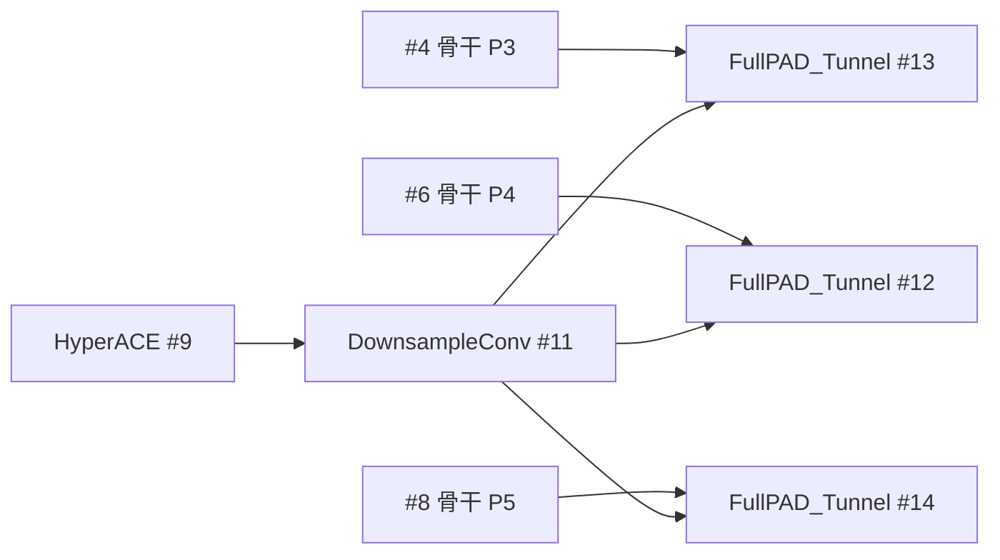
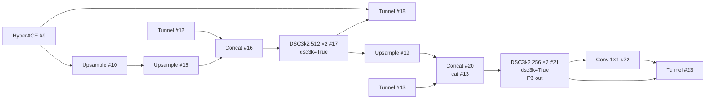
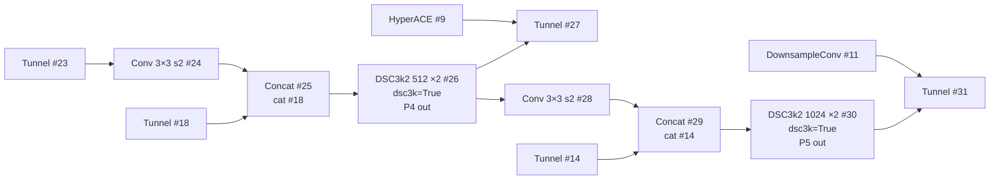
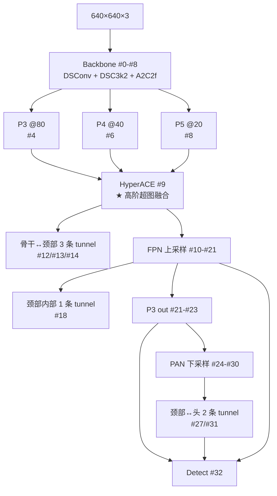

# YOLOv13 Architecture 逐层图解

> 首发载体：`iMoonLab/yolov13` commit `73289949533efac82bb5f72ec19b746618656bd2`（2025-11-18），对应 [arXiv:2506.17733v2](https://arxiv.org/abs/2506.17733)。以 `ultralytics/cfg/models/v13/yolov13.yaml` 为基准（**cfg 目录名 `v13/` 带 `v` 前缀，与 v12 一致、与 v11 的 `11/` 相反**），本页通道数为缩放前的基准值。配置原文见 <SrcLink file="v13:ultralytics/cfg/models/v13/yolov13.yaml" :line="1" :end="50" />，逐层源码见 [YOLOv13 逐层图解](/versions/v13/layers)。

> **v1~v12 读者路标**：这张 yaml 是 [yolov12.yaml](/versions/v12/architecture) 的下一代——**骨干 9 层保持 A2C2f 内嵌 Attention 的思路，但下采样改用 DSConv（深度可分离 stride-2）、C3k2 中段换成 DSC3k2**；**Head 首个 block 变成 HyperACE**（把骨干 P3/P4/P5 三路 concat 后一次超图融合），随后是 FPN+PAN + **7 条 FullPAD_Tunnel 门控连接**（骨干↔颈部 3 条 / 颈部内部 1 条 / 颈部↔头 3 条），最后 Detect 输出。整张图 32 层（v12 是 22 层，v13 增加 10 层主要在 FullPAD tunnel 与额外 downsample/conv 路径）。

::: tip 只想带走三件事
1. **Backbone 9 层**：Conv→Conv→DSC3k2→Conv→DSC3k2→DSConv→A2C2f×4→DSConv→A2C2f×4——**下采样从 v12 的 Conv 3×3 s2 换成 DSConv 3×3 s2**（#5/#7），A2C2f 沿用（#6/#8），C3k2 只留浅层（#2/#4），中段 C3k2 换成 DSC3k2（#3/#5）；
2. **Head 里 HyperACE 只出现 1 次（#9）**：把 `[[4, 6, 8]]` 三路 concat 成 3×640=1920 通道输入，内部做 fuse + chunk(3) + 两条 C3AH + 一个 DSC3k 并行 + concat，输出 512 通道到 head 首个融合；
3. **7 条 FullPAD_Tunnel 是"学习门控"而不是"固定 concat"**：yaml 里 7 次 `FullPAD_Tunnel`（#12/#13/#14/#18/#23/#28/#32），每个都对应一对跨尺度/跨骨干/跨头连接。`out = x[0] + gate * x[1]`，gate 初始化为 0.0——**训练前等价于直通 x[0]**，训练中学到软门控。
:::

## 1. 一眼看清：yolov13.yaml 全图

> **v1~v12 读者路标**：整张图 32 层，骨干 9 层（#0-#8）与 head 23 层（#9-#31）。**骨干节奏与 v12 相似但下采样用 DSConv**，head 与 v12 结构完全不同——v13 head 首个 block 就是 HyperACE 融合 P3/P4/P5，之后是 FPN+PAN 与 7 条 FullPAD_Tunnel 的门控连接网。

- 图中通道数为 yaml 声明的**基准宽度**；n 档 depth=0.50 / width=0.25 把 DSC3k2 与 A2C2f 重复数 ×4→2、×2→1，通道 ÷4（末级 1024→256），四档 scales 见 §6
- backbone 占 yaml L11~L19（#0~#8，共 9 层）、head 占 L22~L50（#9~#32，共 24 个顶层条目）
- **骨干下采样：Conv 3×3 s2（#0/#1/#3）+ DSConv 3×3 s2（#5/#7）交替**——v13 的下采样路径比 v12 更"轻量"
- **骨干 C3k2 变成 DSC3k2**（#2/#4）；#2/#4 显式传 `dsc3k=False, e=0.25`——**n=2 时默认走 DSC3k 内瓶**，但传入 dsc3k=False 时改成 DSBottleneck 单块内瓶（轻量）
- **A2C2f 出现 2 次**（#6/#8，a2=True）——v13 沿用 v12 的骨干注意力思路
- **FullPAD_Tunnel 出现 7 次**：#12/#13/#14（骨干 P4/P3/P5 → head）、#18（head 内部）、#23（head 内部）、#27（颈部↔头）、#31（颈部↔头）——**骨干↔颈部 3 条 + 颈部内部 1 条 + 颈部↔头 3 条 = 7 条**

<SrcLink file="v13:ultralytics/cfg/models/v13/yolov13.yaml" :line="1" :end="50" />

## 2. Backbone #0-#8：Conv/DSConv 下采样 + DSC3k2 融合 + A2C2f 内嵌注意力

> **v1~v12 读者路标**：与 v12 骨干对比，v13 的关键改动在**下采样用 DSConv（#5/#7）**与**C3k2 中段换成 DSC3k2（#2/#4 沿用 C3k2 骨架但换成 DSBottleneck 内瓶；#3/#5 是 DSC3k2 但传 dsc3k=False 实际走 DSBottleneck）**。注意：**v13 的 yaml 里骨干中段没有 DSC3k2 使用 `dsc3k=True` 的路径**——所有 `dsc3k=True` 都出现在 head 的 #17/#21/#26/#30。

```mermaid
flowchart LR
    IMG["640×640×3"] --> L0["Conv 3×3 s2 #0<br/>64 @320 · P1/2"]
    L0 --> L1["Conv 3×3 s2 #1<br/>128 @160 · P2/4"]
    L1 --> L2["DSC3k2 256 ×2 #2<br/>dsc3k=False, e=0.25"]
    L2 --> L3["Conv 3×3 s2 #3<br/>256 @80 · P3/8"]
    L3 --> L4["DSC3k2 512 ×2 #4<br/>dsc3k=False, e=0.25"]
    L4 --> L5["DSConv 3×3 s2 #5<br/>512 @40 · P4/16"]
    L5 --> L6["A2C2f 512 ×4 #6<br/>a2=True, area=4<br/>★ Attention"]
    L6 --> L7["DSConv 3×3 s2 #7<br/>1024 @20 · P5/32"]
    L7 --> L8["A2C2f 1024 ×4 #8<br/>a2=True, area=1<br/>★ Attention"]
```

- **前 5 层**（#0-#4）与 v12 前 5 层的差异：v12 的 #2/#4 是 C3k2，v13 换成 DSC3k2（`dsc3k=False, e=0.25`）——**内瓶用 DSBottleneck 而非 C3k 或 Bottleneck**
- **下采样**：#0/#1/#3 是 Conv 3×3 s2；#5/#7 是 DSConv 3×3 s2（**v13 新增，深度可分离**）——**P4/P5 段的下采样计算量减少约 5×**
- **A2C2f 沿用 v12**：#6/#8 完全同款（`a2=True, area=4/1`）——**FlashAttention 硬依赖仍在**
- **骨干出口无 SPPF / C2PSA**：与 v11/v12 一致，直接以 A2C2f 作为骨干出口

## 3. Head #9-#32：HyperACE + 7 条 FullPAD_Tunnel + FPN+PAN

### 3.1 HyperACE #9（骨干 P3/P4/P5 一次性融合）

> **v1~v12 读者路标**：v13 head 的入口 block 直接接 `[[4, 6, 8]]`——**骨干 P3（层 #4）、P4（层 #6）、P5（层 #8）三路 concat 后一次性送进 HyperACE**。这是 v12 没有的做法（v12 head 首个 block 是 Upsample）。

- **yaml 参数**：`[512, 8, True, True, 0.5, 1, "both"]`——c2=512, num_hyperedges=8, dsc3k=True, shortcut=True, e1=0.5, e2=1, context="both"
- **n（重复数）**：yaml 里写 `2`，但 <SrcLink file="v13:ultralytics/nn/tasks.py" :line="1086" /> 强制 `n = 1`——**实际只有一个 DSC3k 低阶分支**
- **hyperedge 缩放**：<SrcLink file="v13:ultralytics/nn/tasks.py" :line="1081" :end="1084" /> n 档 hyperedge × 0.5 = 4，x 档 × 1.5 = 12，s/l 档保持 8
- **L/X 档 channel_adjust 关闭**：<SrcLink file="v13:ultralytics/nn/tasks.py" :line="1087" :end="1088" /> 追加 `False`——FuseModule 不再压缩通道
- **两条 C3AH 分支 + L 个 DSC3k** 并行：C3AH 走高阶超图消息传递，DSC3k 走低阶深度可分离——**"高阶 + 低阶"混合**

### 3.2 骨干↔颈部三条 tunnel（#12/#13/#14）

> **v1~v12 读者路标**：这是 v13 相对 v12 最独特的设计——**head 的 DownsampleConv #11 输出同时和骨干的 #4/#6/#8 三路 tunnel 连接**。

每条 tunnel 语义：`out = x[0] + gate * x[1]`，其中 `x[0]` 是 DownsampleConv 的头部输出、`x[1]` 是骨干某层的直连输出。**gate 初始化为 0.0**——训练前等价于直通，训练中 gate 逐渐学出权重，**这是"骨干-颈部全管线连接"（FullPAD）的实现**。

### 3.3 上采样路径 + 颈部内部（#15-#23）

- #15-#17：标准 FPN 上采样 + concat + DSC3k2
- #18：**颈部内部 tunnel**——#17 与 #9 的融合
- #19-#21：继续上采样到 P3 尺度
- #22-#23：**#21 的 P3 输出后再过 Conv 1×1 + Tunnel**——这是 v13 的 P3 输出前的最后融合

### 3.4 下采样路径 + 颈部↔头（#24-#31）

- #24-#26：PAN 下采样 + concat + DSC3k2 到 P4 尺度
- #27：**颈部↔头 tunnel**——#26 与 #9 融合
- #28-#30：继续下采样到 P5 尺度
- #31：**颈部↔头 tunnel**——#30 与 #11 融合

### 3.5 Detect #32

- **输入**：#23（P3）、#27（P4）、#31（P5）三路 tunnel 输出
- **v13 的 Detect 头未改动**（`head.py` 没有 v13 专属头，仍是 v8 的 Detect + DW-separable cv3）
- 三分量输出：`cv2` box 分布、`cv3` cls 分类、`dfl` 距离回归

## 4. 完整数据流

## 5. 与 v12 的结构对比

| 层 | v12 | v13 |
|----|-----|-----|
| #0-#4 | Conv → Conv → C3k2 → Conv → C3k2 | Conv → Conv → **DSC3k2** → Conv → **DSC3k2** |
| #5-#6 | Conv 3×3 s2 → A2C2f | **DSConv 3×3 s2** → A2C2f |
| #7-#8 | Conv 3×3 s2 → A2C2f | **DSConv 3×3 s2** → A2C2f |
| #9 | Upsample | **HyperACE**（骨干 P3/P4/P5 融合） |
| #10 | Concat | Upsample |
| #11-#17 | A2C2f a2=False + 上采样 + Concat | DownsampleConv + **3 条骨干↔颈部 tunnel** + Upsample + Concat + DSC3k2 |
| #18 | Upsample | **Tunnel #18**（颈部内部） |
| #19-#21 | A2C2f a2=False (P3 out) | **Upsample + Concat + DSC3k2** |
| #22-#23 | Conv 3×3 s2 (PAN) | **Conv 1×1 + Tunnel #23** |
| #24-#27 | Concat + A2C2f + Conv s2 | Conv 3×3 s2 + Concat + DSC3k2 (P4) + **Tunnel #27** |
| #28-#31 | Concat + C3k2 | Conv 3×3 s2 + Concat + DSC3k2 (P5) + **Tunnel #31** |
| #32 | Detect | Detect（未动） |

**要点**：
- **骨干 9 层不变，节奏相似**（Conv/DSConv 交替下采样 + DSC3k2/C3k2 融合 + A2C2f 深段注意力）
- **Head 从 13 层扩到 24 层**——多出的 11 层全部是 FullPAD_Tunnel 与配套的 Conv 1×1 / DownsampleConv
- **骨干 ↔ 颈部 + 颈部 ↔ 头 + 颈部内部** = 7 条 FullPAD_Tunnel
- **Detect 未动**——v8 的三分量头沿用至今

## 6. 五档 scales 与 channel 缩放

`yolov13.yaml` <SrcLink file="v13:ultralytics/cfg/models/v13/yolov13.yaml" :line="4" :end="7" /> 定义 4 档 scales（n/s/l/x）：

| 档 | depth | width | max_channels | 说明 |
|----|-------|-------|--------------|------|
| n | 0.50 | 0.25 | 1024 | Nano |
| s | 0.50 | 0.50 | 1024 | Small |
| l | 1.00 | 1.00 | 512 | Large |
| x | 1.00 | 1.50 | 512 | Extra Large |

**注意 v13 只有 4 档**（v12 是 5 档含 m），**s 档 depth=0.5 与 n 档相同、只调 width**——这是 v13 相对 v12 的一处配方简化。

### v13 特有的缩放特例（tasks.py L1075-L1095）

<SrcLink file="v13:ultralytics/nn/tasks.py" :line="1075" :end="1095" /> 里对 HyperACE 与 DownsampleConv 有专门的档位缩放逻辑：

| 模块 | 档位 | 缩放动作 |
|------|------|---------|
| HyperACE | n | hyperedge × 0.5（M=4） |
| HyperACE | x | hyperedge × 1.5（M=12） |
| HyperACE | s/l | hyperedge 保持（M=8） |
| HyperACE | l/x | 追加 `channel_adjust=False` |
| DownsampleConv | l/x | 追加 `False` 且 c2=c1（不升通道） |

**L/X 档的关键差异**：DownsampleConv 在 L/X 档 `channel_adjust=False`——**L/X 档不做通道翻倍**，这与 n/s 档的行为不同。想复现 L/X 档的官方 COCO 数字必须踩到这些特例。

## 7. 与 v12 参数量的对比

从 arXiv TABLE I：

| 型号 | v12 Params (M) | v13 Params (M) | Δ |
|------|----------------|----------------|---|
| S | 9.3 | 9.0 | **-0.3** |
| L | 26.4 | 27.6 | +1.2 |
| X | 59.1 | 64.0 | +4.9 |

**v13-S 比 v12-S 少参数、v13-L/X 比 v12-L/X 多参数**——高阶超图的额外参数在 L/X 档被放大。

## 8. 参考

- 论文 §III-A Overall Architecture：<SrcLink file="v13:ultralytics/cfg/models/v13/yolov13.yaml" :line="1" :end="50" />
- HyperACE 实现：<SrcLink file="v13:ultralytics/nn/modules/block.py" :line="1804" :end="1856" />
- FullPAD_Tunnel 实现：<SrcLink file="v13:ultralytics/nn/modules/block.py" :line="1891" :end="1916" />
- DownsampleConv 实现：<SrcLink file="v13:ultralytics/nn/modules/block.py" :line="1858" :end="1889" />
- v13 缩放特例：<SrcLink file="v13:ultralytics/nn/tasks.py" :line="1075" :end="1095" />
