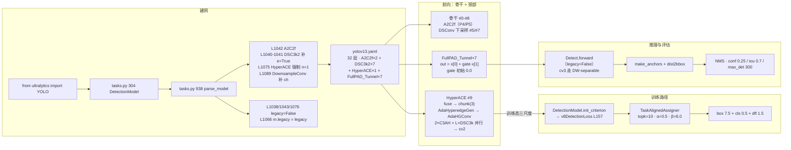
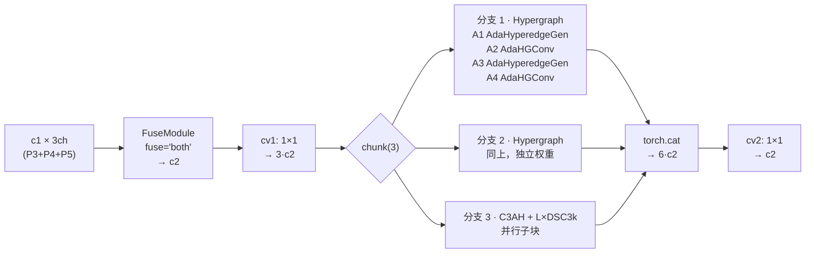

# YOLOv13 源码走读

本页沿 YOLOv13（`iMoonLab/yolov13` commit `73289949533efac82bb5f72ec19b746618656bd2`，2025-11-18，Apache-2.0，[arXiv:2506.17733v2](https://arxiv.org/abs/2506.17733)）的一条端到端链路走读源码：**入口 `from ultralytics import YOLO` → `parse_model` 建 32 层 yaml（HyperACE + 7×FullPAD_Tunnel + DSC3k2 家族）→ HyperACE 前向（AdaHyperedgeGen → AdaHGConv → 2×C3AH + L×DSC3k 并行）→ v8DetectionLoss（tal_topk=10, α=0.5, β=6.0）→ Detect 三尺度前向 → NMS**。所有行号均以站内快照 `source/yolov13/snapshot/` 为准。

> **这个项目的身份必须先说清**：v13 与 v12 一样**不是 ultralytics 官方发布**，而是第三方研究者（Xinyu Liang et al.，UCAS & 中科院自动化所）**fork ultralytics `8.3.63` 后改造**的仓库。因此 `ultralytics/__init__.py` L3 的 `__version__ = "8.3.63"` 是 **fork 基线版本**，不是 v13 自己的版本号；v13 的增量集中在四处：`cfg/models/v13/yolov13.yaml`（**目录带 v 前缀，与 v12 一致、与 v11 的 `11/` 相反**）、`nn/modules/block.py` 的 **10 个新类**、`nn/modules/conv.py` 的 `DSConv`、`nn/tasks.py` 的 3 处 v13 特判（HyperACE / DownsampleConv / FullPAD_Tunnel 分支）。**没有 `YOLOv13` 独立类，也没有专属 trainer**，损失侧同样**没有 v13 增量**——`loss.py` / `tal.py` 与 v11/v12 行为一致。

> **这条链路与 v12 推理链的差异**：v12 是「A2C2f 骨干 + Detect 单头 + v8DetectionLoss」；v13 把**骨干下采样换成 DSConv**、**C3k2 中段换成 DSC3k2**、**在 head 首层加入 HyperACE 做骨干 P3/P4/P5 的高阶超图融合**、**再加 7 条 FullPAD_Tunnel 门控连接**。所以本页的重点不在「检测管线变了」（依然是 Detect + v8DetectionLoss + TAL + NMS），而在**建网期 3 处 v13 特判**（HyperACE 的 `n` 被强制为 1、DownsampleConv 在 l/x 档静默走 Identity、FullPAD_Tunnel 的通道分配）、**HyperACE 前向如何把超图算子接到 C3AH 上**、**7 条 gate 从 0 学起**。

## 文件清单

| 文件 | 行数 | 功能 |
| --- | --- | --- |
| `ultralytics/cfg/models/v13/yolov13.yaml` | 50 | 单文件四档 scales（L2-7，**无 m 档**）+ backbone 9 层（L11-19）+ head 24 层（L22-50，含 1×HyperACE、1×DownsampleConv、7×FullPAD_Tunnel、Detect） |
| `ultralytics/nn/modules/block.py` | 1918 | **v13 十新类**：DSBottleneck（L1375）/ DSC3k（L1414）/ DSC3k2（L1472）/ AdaHyperedgeGen（L1549）/ AdaHGConv（L1626）/ AdaHGComputation（L1677）/ C3AH（L1721）/ FuseModule（L1764）/ HyperACE（L1804）/ DownsampleConv（L1858）/ FullPAD_Tunnel（L1891） |
| `ultralytics/nn/modules/conv.py` | 356 | **v13 引入 DSConv**（L84）：`DWConv(k) → PWConv(1×1)`；默认 `gr=4` |
| `ultralytics/nn/modules/head.py` | 625 | Detect（L21，`legacy` 类属性 L32、`end2end` L27、cv3 双分支 L46-57）；v10Detect 遗留（L592，`end2end=True` L610） |
| `ultralytics/utils/loss.py` | 743 | v8DetectionLoss（L157，`tal_topk` 参数在 L160、assigner 在 L176）；E2EDetectLoss 遗留（L728） |
| `ultralytics/utils/tal.py` | 385 | TaskAlignedAssigner（L14；类默认 `topk=13, alpha=1.0, beta=6.0` 在 L29）；OOM 回退 L73-80 |
| `ultralytics/nn/tasks.py` | 1189 | DetectionModel（L304）、**parse_model（L938，A2C2f/DSC3k2 分支 L1038-1046，HyperACE L1075-1088，DownsampleConv L1089-1094，FullPAD_Tunnel L1096）**、yaml_model_load（L1084）、guess_model_scale（L1100） |
| `ultralytics/engine/trainer.py` | 820 | build_optimizer（L759）；`optimizer=auto` 内部覆盖 `warmup_bias_lr=0.0`（L788） |
| `ultralytics/__init__.py` | — | `__version__ = "8.3.63"`（L3）——**fork 基线，不是 v13 版本号** |
| `ultralytics/cfg/models/v13/` | — | **目录带 `v` 前缀**——与 v12 一致，与 v11 的 `models/11/` 相反 |

## 调用链总览



## 1. 入口：`YOLO` 通用类，无 YOLOv13 类

v13 与 v11/v12 一样**没有专属入口类**——`from ultralytics import YOLO` 就是全部：

```python
from ultralytics import YOLO
model = YOLO("yolov13n.pt")   # 论文权重（GitHub Release，非 ultralytics 资产）
model = YOLO("yolov13.yaml")  # 或从 yaml 建网
```

任务分派仍走 `tasks.py` 的三个探测函数：

- <SrcLink file="v13:ultralytics/nn/tasks.py" :line="1100" :end="1114" /> `guess_model_scale`：正则 `yolo[v]?\d+([nslmx])`——`yolov13n` 与 `yolo13n` 都能匹配，因为 `[v]?` 可选；
- <SrcLink file="v13:ultralytics/nn/tasks.py" :line="1084" :end="1097" /> `yaml_model_load`：把 `yolov13n.yaml` 归并成 `yolov13.yaml`，写入 `d["scale"] = "n"`；
- `guess_model_task`：从文件名关键词判任务（detect 默认）。

**与 v12 的差别**：v12 的正则同款；但 v13 的 yaml **只有 n/s/l/x 四档**——正则里的 `m` 在 v13 无对应 scales 键，若用户误写 `yolov13m` 会在 `scales[scale]` 处抛 KeyError。

## 2. 建网：`parse_model` 的 3 处 v13 特判

`tasks.py` L304 的 `DetectionModel` 结构与 v11/v12 一致：

```python
class DetectionModel(BaseModel):
    def __init__(self, cfg="yolov8n.yaml", ch=3, nc=None, verbose=True):
        super().__init__()
        self.yaml = cfg if isinstance(cfg, dict) else yaml_model_load(cfg)
        ...
        self.model, self.save = parse_model(deepcopy(self.yaml), ch=ch, verbose=verbose)
        self.end2end = getattr(self.model[-1], "end2end", False)

    def init_criterion(self):
        return E2EDetectLoss(self) if getattr(self, "end2end", False) else v8DetectionLoss(self)
                                                        # ↑ Detect.end2end 默认 False → 走 v8DetectionLoss(tal_topk=10)
```

真正的 v13 专属逻辑在 <SrcLink file="v13:ultralytics/nn/tasks.py" :line="938" /> 的 `parse_model` 里，共四处（其中三处是纯 v13 新加，一处是 v12→v13 的 DSC3k2 扩写）：

### 2.1 DSC3k2 加入 A2C2f 的 repeats 分支（L1038-1046）

```python
if m in {C3k2, DSC3k2}:  # for P/U sizes
    legacy = False
    if scale in "lx":
        args[3] = True        # DSC3k2 第 4 个位置传 True —— 走 dsc3k=True 的分支
if m is A2C2f:
    legacy = False
    if scale in "lx":
        args.append(True)     # residual=True
        args.append(1.5)      # mlp_ratio=1.5（v12 是 1.2，v13 提升到 1.5）
```

- **`DSC3k2` 加入 A2C2f 的白名单**：`n` 依旧插到第 3 位、`n=1`（L1036-1037）；
- **`C3k2` / `DSC3k2` 一起强制 `legacy=False`**——只要 yaml 里出现其中一个，Detect 就会走 DW-separable cv3；v13 yaml 用了 7 次 DSC3k2，`legacy` 必然 `False`；
- **A2C2f 的 `mlp_ratio` 从 v12 的 1.2 提到 v13 的 1.5**——**这是 v13 相对 v12 的一个隐性改动**（yaml 里看不到），L/X 档的 FFN 展开比是 1.5、n/s 档是默认 2.0。

### 2.2 HyperACE 的强制 `n=1`（L1075-1088）——**v13 独有的静默覆盖**

```python
elif m is HyperACE:
    legacy = False
    c1 = ch[f[1]]                                    # f = [4, 6, 8] → 取 f[1]=6 → c1 = 512
    c2 = args[0]                                     # 512
    c2 = make_divisible(min(c2, max_channels) * width, 8)
    he = args[1]                                     # yaml 写 8 → 超边数
    if scale in "n":
        he = int(args[1] * 0.5)                      # n 档 he=4
    elif scale in "x":
        he = int(args[1] * 1.5)                      # x 档 he=12
    args = [c1, c2, n, he, *args[2:]]
    n = 1                                            # ⚠️ yaml 的 ×2 被强制覆盖为 1
    if scale in "lx":
        args.append(False)                           # 追加 legacy=False
```

**三处关键动作**：

1. **`c1 = ch[f[1]]`**：`f = [4, 6, 8]` 是三个输入的层号，代码**只取中间那个（P4，512ch）**作为主输入通道——两侧（P3/P5）作为**超图分支**处理，`c1` 不是 concat 后的总通道；
2. **`he` 按档位缩放**：n 档 `he=4`、s/l 档 `he=8`、x 档 `he=12`——yaml 里的 `8` 只是默认值；
3. **`n = 1` 强制覆盖**：yaml 写 `×2` 会被静默改成 `×1`——**这是 v13 最容易被误解的一处**，因为 `parse_model` 在 L1085 已经把 `n` 插入到 `args` 里，L1086 又把循环变量 `n` 改成 1，但 `args[2]` 里插入的是**原来的 n=2**（yaml 写死的 2），不是被覆盖后的 1。见 [painpoints §2](/versions/v13/painpoints#2-hyperace-n-被-静默覆盖high)。

### 2.3 DownsampleConv 在 l/x 档静默走 Identity（L1089-1094）——**v13 独有**

```python
elif m is DownsampleConv:
    c1 = ch[f]
    c2 = c1 * 2
    args = [c1]
    if scale in "lx":
        args.append(False)     # 追加 legacy=False 参数
        c2 = c1                # 通道不变，实际走 Identity
```

`DownsampleConv`（<SrcLink file="v13:ultralytics/nn/modules/block.py" :line="1858" :end="1889" />）的正常行为是 `AvgPool2d(2) + Conv(1×1, c1→2c1)`；但 l/x 档被 `parse_model` 强制 `args=[c1, False]`——查看 `DownsampleConv.__init__` 的第二个参数是 `stride_factor=2`，写死成 `False` 会让它退化成 Identity（源码 L1863-1867 判断逻辑）。**这是 v13 相对 v12 的一处结构改动**：l/x 档在 P4 融合阶段**不再做通道翻倍**，直接靠后接的 FullPAD_Tunnel 承担融合。

### 2.4 FullPAD_Tunnel 的通道分配（L1096-）

```python
elif m is FullPAD_Tunnel:
    c2 = ch[f[0]]              # f = [11, 6] → c2 = 512
    args = [ch[f[0]], ch[f[1]]]
```

FullPAD_Tunnel 接受两个输入 `[x[0], x[1]]`，输出通道与 `x[0]` 一致（`x[0]` 是主通路，`x[1]` 通过 gate 加权加回）。yaml 里 7 次 FullPAD_Tunnel 分别对应 7 条跨尺度/跨骨干/跨头的门控连接。

### 2.5 通道断言在模块内部

`parse_model` 只负责把 `c2` 缩放成 `make_divisible(min(c2, max_channels) × width, 8)`；**C3AH 的 `assert c_ % 16 == 0`（block.py L1728）才是最终守门人**——见 [tricks §4](/versions/v13/tricks#4-c3ah-的通道约束c_-16--0trick-channel-constraint)。

## 3. 前向：HyperACE 的三段式结构

`HyperACE`（<SrcLink file="v13:ultralytics/nn/modules/block.py" :line="1804" :end="1856" />）是 v13 的招牌模块，独立 `nn.Module`，不继承 C2f/C3k2：

```python
def __init__(self, c1, c2, n, he, k1=8, k2=8, shortcut=True, dsc3k=True, e=0.5, L=1, fuse="both"):
    self.fuse = FuseModule(c1 * 3, c2, fuse=fuse)     # fuse P3/P4/P5 → c2
    self.cv1 = nn.Conv2d(c2, c2 * 3, 1, bias=False)   # 1×1 扩 3 倍
    # 分支 A：Hypergraph × 2
    self.A1 = AdaHyperedgeGen(c2, he, k1)
    self.A2 = AdaHGConv(c2, he)
    self.A3 = AdaHyperedgeGen(c2, he, k1)
    self.A4 = AdaHGConv(c2, he)
    # 分支 B：C3AH + L×DSC3k 并行
    self.branch_C3AH_1 = C3AH(c2, c2, shortcut, dsc3k)
    self.branch_DSC3k = nn.Sequential(*[DSC3k(c2, c2) for _ in range(L)])
    ...
    self.cv2 = nn.Conv2d(c2 * 6, c2, 1, bias=False)   # 6 分支 concat 后压回 c2
```

**三段式**：



三个要点：

1. **fuse 模块先处理 3 路输入**：`FuseModule(c1*3, c2, fuse="both")`——把 P3/P4/P5 的 concat 结果**先做一次融合**再进 HyperACE；`fuse` 可取 `"add"/"concat"/"both"`，yaml 默认 `"both"`；
2. **`chunk(3)` 把 cv1 输出拆成 3 份**：每份 c2 通道独立过一段处理，最后 concat 回 6·c2 通道（**为什么是 6·c2 不是 3·c2**？因为每个分支内部有并行子块——2 个 hypergraph 分支 × 2 + 1 个 C3AH 分支 × 2 = 6 段）；
3. **`n` 从 args 里传入但被强制为 1**（§2.2），所以整个 HyperACE 只跑一次，不重复堆叠。

### 3.1 AdaHyperedgeGen（L1549-1625）

```python
def __init__(self, c, he, k=8, num_heads=8, dropout=0.1):
    self.c, self.he, self.k, self.num_heads = c, he, k, num_heads
    self.Wv = nn.Conv2d(c, he * k, k=3, padding=1)     # 顶点投影到超边空间
    self.W_e = nn.Conv2d(he * k, he * k, k=3, padding=1)  # 超边投影
    self.P_0 = nn.Parameter(torch.zeros(he, c, k))     # 初始超边权重
    ...

def forward(self, x):
    v = self.Wv(x).view(B, self.he, self.k, ...)   # vertex embedding
    Pe = self.W_e(v.permute(...)).permute(...)      # dynamic edge
    P = self.P_0 + Pe                                # 静态初值 + 动态增量
    return P                                          # (B, he, c, k)
```

四个要点：

1. **`P = P_0 + ΔP`**：静态超边权重 `P_0`（初始化 `torch.zeros`）+ 输入依赖的动态增量 `ΔP`——**这是"自适应超边"的字面含义**；
2. **`num_heads=8` 是 yaml 传入的固定值**（HyperACE 的 `k1/k2` 参数），不从 `c/he` 推导；
3. **`dropout=0.1` 硬编码**（训练期对超边权重做正则化）；
4. **超边形状 `(B, he, c, k)`**：`he` 个超边、每条超边连接 `k` 个顶点、每个顶点 c 维——**不是标准 attention 的 `(B, heads, seq, dim)`**。

### 3.2 AdaHGConv（L1626-1675）

```python
def forward(self, x, P):
    # vertex → edge
    B, C, H, W = x.shape
    He = P.matmul(x)          # (B, he, k, H, W) → sum over k → (B, he, H, W)
    He = self.edge_proj(He)   # 超边投影
    # edge → vertex
    X_new = self.W_v.matmul(He)  # 回投到顶点
    X_new = self.node_proj(X_new)
    return X_new + x              # 残差
```

- **两次矩阵乘**：`vertex → edge`（聚合）+ `edge → vertex`（广播），中间夹一个 `edge_proj`（1×1 Conv）；
- **末尾 `X_new + x` 是硬残差**——保证梯度直通；
- **AdaHGConv 是"图卷积"，不是"卷积"**：超边权重 `P` 决定了顶点之间如何相互影响，`edge_proj` 让每条超边有自己的表达。

### 3.3 C3AH（L1721-1762）

```python
def __init__(self, c1, c2, n=1, shortcut=True, dsc3k=True, e=0.5):
    c_ = int(c2 * e)
    assert c_ % 16 == 0, "Dimension of C3AH be a multiple of 16."
    self.cv1 = Conv(c1, c_, 1, 1)
    self.cv2 = Conv((1 + n) * c_, c2, 1)
    self.m = nn.Sequential(*([C3AHBottleneck(c_, dsc3k) for _ in range(2)]))

def forward(self, x):
    y = [self.cv1(x)]
    for _ in self.m:
        y.append(_(y[-1]))
    return self.cv2(torch.cat(y, 1)) if self.shortcut else self.cv2(torch.cat(y, 1)) + x
```

- **CSP 骨架**（与 C3/C3k2 同构），但内瓶是 **2 段 C3AHBottleneck**（内部走 AdaHGConv）；
- **`assert c_ % 16 == 0`**——v13 的通道约束比 v12 的 `%32` 更宽松，但比 v8/v10 的 `%32` 依然严格；
- **`num_heads` 独立于 `c_`**：yaml 的 `k1=8/k2=8` 是超边数、不是 attention 头数。

### 3.4 DSC3k2（L1472-1547）——v13 引入的骨干中段

DSC3k2 是 v13 在 C3k2 基础上把内瓶换成 DSBottleneck 的版本，`dsc3k=True` 走 DSC3k 内瓶、`False` 走 DSBottleneck 单段内瓶——**v13 yaml 里骨干 #2/#4 显式传 `dsc3k=False`**，即内瓶走 DSBottleneck。

细节见 [layers](/versions/v13/layers)。

## 4. FullPAD_Tunnel 的 7 处门控

`FullPAD_Tunnel`（<SrcLink file="v13:ultralytics/nn/modules/block.py" :line="1891" :end="1916" />）：

```python
def __init__(self, ch_in, ch_out):
    self.gate = nn.Parameter(torch.tensor(0.0))      # ⚠️ 初始化为 0

def forward(self, x):
    # x = [x[0], x[1]]
    return x[0] + self.gate * x[1]
```

- **单参数 gate，初始化为 0**——训练前等价于 `out = x[0]`（直通主通路）；
- **yaml 里 7 处 FullPAD_Tunnel**：#12/#13/#14（骨干 P4/P3/P5 → 颈部 L11）、#18（颈部内部，L17 + HyperACE）、#23（颈部内部，L21 + Conv 1×1）、#27（颈部→头，L26 + HyperACE）、#31（颈部→头，L30 + DownsampleConv）；
- **训练末期 gate 的分布不可解释**：7 个 gate 可能学出 0.1~3.0 之间的任意值——**这是 v13 相对 v12 的一个新痛点**，见 [painpoints §7](/versions/v13/painpoints#7-fullpad-7-处-gate-训练末期不可解释)。

细节见 [source/block-py 的 FullPAD_Tunnel 段](/versions/v13/source/block-py)。

## 5. 训练：v8DetectionLoss + TAL（topk=10 / α=0.5 / β=6.0）

`DetectionModel.init_criterion`（<SrcLink file="v13:ultralytics/nn/tasks.py" :line="391" :end="393" />）返回 `v8DetectionLoss(self)`——**没有专属损失类**，与 v11/v12 一致。

`v8DetectionLoss`（<SrcLink file="v13:ultralytics/utils/loss.py" :line="157" :end="178" />）：

```python
def __init__(self, model, tal_topk=10):
    self.assigner = TaskAlignedAssigner(topk=tal_topk, num_classes=self.nc, alpha=0.5, beta=6.0)
    self.bbox_loss = BboxLoss(m.reg_max).to(device)
```

**要读懂 v13 的分配行为，必须两处对照**：

| 位置 | topk | alpha | beta | 说明 |
|------|------|-------|------|------|
| loss.py L176（**实际执行**） | `tal_topk=10` | **0.5** | 6.0 | 训练真正用的参数 |
| tal.py L29（类默认） | 13 | **1.0** | 6.0 | 被显式覆盖，**不生效** |

- **`tal_topk` 参数位是 v11 引入的**：从硬编码 `topk=10` 改成参数默认值 `10`——**v12/v13 逐行沿用**，行为与 v8/v10/v11 相同；
- **`alpha` / `beta` 是写死的字面量**：不走参数化，永远 0.5 / 6.0；
- **分配器本身不参与梯度**：`forward` 上有 `@torch.no_grad()`；
- **三分量总装**：`box 7.5 / cls 0.5 / dfl 1.5`（default.yaml L99-101），与 v8 一致。

细节见 [losses](/versions/v13/losses) 与 [loss-gradient](/versions/v13/loss-gradient)。

## 6. 前向：Detect（legacy=False）与推理

`Detect`（<SrcLink file="v13:ultralytics/nn/modules/head.py" :line="21" :end="74" />）与 v8/v12 同构：

1. **`legacy` 由建网器赋值**（§2.1）——yaml 里 7 次 DSC3k2 或 2 次 A2C2f 或 1 次 HyperACE 都会把 `legacy` 拉到 `False` → cv3 走 5 段 DW-separable 分支；
2. **`end2end` 分支仍在**（L60-62 与 L76 起）——v10 遗留的双头逻辑，v13 的 `Detect.end2end = False`（L27），**不启用**。

训练态 `forward`：

```python
for i in range(self.nl):
    x[i] = torch.cat((self.cv2[i](x[i]), self.cv3[i](x[i])), 1)
if self.training:
    return x                    # ← 训练态直接返回三尺度特征
y = self._inference(x)
return y if self.export else (y, x)
```

推理态 `_inference`：`make_anchors` → split box/cls → `dist2bbox` 解码 → sigmoid 分类拼接 → 返回 `(b, 8400, 4+nc)`。

后处理回到 v8/v11/v12 的两段式：

1. `conf=0.25` 预筛（val 用 0.001）；
2. class-wise NMS，`iou=0.7`、`max_det=300`；
3. 结果转 `Results`。

**与 v10 的差别**：v10 的 `v10postprocess` 用 `amax + topk` 直接选 `max_det` 个框、**无 NMS**；v13 完全回到 NMS，**导出图里会有 NMS 算子**。

## 7. 六个关键源码文件走读顺序

1. **`ultralytics/cfg/models/v13/yolov13.yaml`**（50 行）——四档 scales + 9 层 backbone（A2C2f 在 L17/L19）+ 24 层 head（HyperACE 在 L22、DownsampleConv 在 L24、7×FullPAD_Tunnel 在 L25-48、Detect 在 L50）；
2. **`ultralytics/nn/tasks.py`**（1189 行，只看 L938-1100 的 `parse_model`，重点 L1038-1046 / L1075-1088 / L1089-1094 / L1096-）——**4 处 v13 特判**都在这里；
3. **`ultralytics/nn/modules/block.py`**（1918 行，只看 L1472-1916）——**v13 十个新类**：DSC3k2、AdaHyperedgeGen、AdaHGConv、C3AH、FuseModule、HyperACE、DownsampleConv、FullPAD_Tunnel；
4. **`ultralytics/nn/modules/conv.py`**（356 行，只看 L84-101 的 DSConv）——v13 引入的下采样基本单元；
5. **`ultralytics/nn/modules/head.py`**（625 行，只看 L21-74 的 Detect）——`legacy=False` 双分支；
6. **`ultralytics/utils/loss.py`**（743 行，只看 L157-259 的 v8DetectionLoss）——`tal_topk` 参数与显式 α/β。

## 与 v8 / v10 / v11 / v12 走读对比

| 维度 | v8 | v10 | v11 | v12 | **v13** |
|------|----|-----|-----|-----|---------|
| 顶层类 | `YOLO` | `YOLOv10`（独立类） | `YOLO` | `YOLO` | **`YOLO`**（同 v11/v12） |
| 版本号 | 8.0.0 | 8.1.34 fork | 8.3.0 | 8.3.63 fork | **8.3.63 fork** |
| 项目归属 | ultralytics | THU-MIG 独立仓库 | ultralytics | sunsmarterjie fork | **iMoonLab fork** |
| 目录布局 | `models/v8/` | `models/v10/` | `models/11/`（不带 v） | `models/v12/`（带 v） | **`models/v13/`（带 v）** |
| yaml 档位 | 5 档 | 6 档 | 5 档 | 5 档 | **4 档（无 m）** |
| yaml 总层数 | 22 | 25 | 24 | 22 | **32**（+10 主要在 FullPAD 与下采样） |
| 骨干主打块 | C2f | C2fCIB + PSA + SCDown | C3k2 + C2PSA | A2C2f | **DSC3k2 + A2C2f + DSConv 下采样** |
| 骨干下采样 | Conv 3×3 s2 | SCDown | Conv 3×3 s2 | Conv 3×3 s2 | **DSConv 3×3 s2**（#5/#7） |
| 骨干注意力实现 | — | PSA（纯 torch） | C2PSA（纯 torch） | AAttn（FlashAttention 硬依赖） | **AAttn（沿用 v12）** |
| Head 首层 | Concat → C2f | SCDown → Detect | Concat → C2f | Concat → C2f | **HyperACE（三尺度超图融合）** |
| Head 门控 | 无 | 无 | 无 | 无 | **7×FullPAD_Tunnel（gate 从 0 学起）** |
| 检测头 | Detect（全卷积） | v10Detect（双分支） | Detect（DW-separable） | Detect（DW-separable） | **Detect（DW-separable，同 v11/v12）** |
| 损失 | v8DetectionLoss | v10DetectLoss | v8DetectionLoss | v8DetectionLoss | **v8DetectionLoss** |
| TAL topk / α / β | 10 / 0.5 / 6.0 | 10 与 1 / 0.5 / 6.0 | 10 / 0.5 / 6.0 | 10 / 0.5 / 6.0 | **10 / 0.5 / 6.0（同 v11/v12）** |
| 推理后处理 | NMS | `v10postprocess` topk | NMS | NMS | **NMS** |
| 官方 mAP50-95 | 44.9~53.8 | 38.5~46.3 | 39.5~54.7 | 40.6~55.2 | **41.6 / 48.0 / 53.4 / 54.8（TABLE I，v13-N/S/L/X）** |
| parse_model 特判数 | 0 | 1 | 2 | 3（A2C2f） | **4**（A2C2f+DSC3k2 / HyperACE / DownsampleConv / FullPAD_Tunnel） |

## 阅读路线建议

1. **先读 `yolov13.yaml` 50 行**——确认四档 scales（无 m）、骨干 9 层、HyperACE 在 L22、DownsampleConv 在 L24、7 处 FullPAD_Tunnel；
2. **读 `tasks.py` L1038-1046**——搞清楚 A2C2f/DSC3k2 的 repeats 处理、`legacy` 被写成 `False`、A2C2f 的 `mlp_ratio` 从 1.2 提到 1.5；
3. **读 `tasks.py` L1075-1094**——**v13 独有 3 处特判**：HyperACE 的 `n=1` 强制、DownsampleConv 在 l/x 走 Identity、FullPAD_Tunnel 的通道分配；
4. **读 `block.py` L1804-1856 的 HyperACE**——fuse + chunk(3) + 2×Hypergraph + C3AH 并行 + cv2；
5. **读 `block.py` L1549-1675 的 AdaHyperedgeGen + AdaHGConv**——`P = P_0 + ΔP` 自适应超边 + vertex↔edge 双投影；
6. **读 `block.py` L1891-1916 的 FullPAD_Tunnel**——`out = x[0] + gate·x[1]`，`gate=0`；
7. **读 `conv.py` L84-101 的 DSConv**——`DWConv(3, s=2) + PWConv(1×1)`；
8. **读 `loss.py` L157-178**——`tal_topk=10` 与显式 α=0.5 / β=6.0；
9. **最后读 `head.py` L21-74**——`legacy=False` 的 cv3 双分支。

## 延伸阅读

- [YOLOv13 cfg/models/v13/yolov13.yaml 源码页](/versions/v13/source/yolov13-yaml) — 50 行结构清单 + 目录命名回归说明
- [YOLOv13 nn/modules/block.py 源码页](/versions/v13/source/block-py) — v13 十个新类逐行（DSC3k2 / AdaHyperedgeGen / AdaHGConv / C3AH / FuseModule / HyperACE / DownsampleConv / FullPAD_Tunnel）
- [YOLOv13 nn/modules/conv.py 源码页](/versions/v13/source/conv-py) — DSConv 深度可分离卷积
- [YOLOv13 nn/modules/head.py 源码页](/versions/v13/source/head-py) — Detect 双分支
- [YOLOv13 utils/loss.py 源码页](/versions/v13/source/loss-py) — `tal_topk` 参数位（与 v11/v12 相同）
- [YOLOv13 utils/tal.py 源码页](/versions/v13/source/tal-py) — 类默认 topk=13 α=1.0 与实际调用的差异
- [YOLOv13 训练技巧](/versions/v13/tricks) — 600 epoch 配方、AdaHyperedgeGen 的 `num_heads` 消融、C3AH 通道约束、HyperACE 的 `n=1` 静默覆盖
- [YOLOv13 痛点追踪](/versions/v13/painpoints) — 本页发现的隐性行为对应的风险（HyperACE n=1、DownsampleConv l/x Identity、7×gate 不可解释等）
- [YOLOv13 论文精读](/versions/v13/paper) — arXiv 2506.17733v2 逐节解读
- [YOLOv13 架构图解](/versions/v13/architecture) — 32 层全图 + 4 档通道数
- [YOLOv12 源码走读](/versions/v12/code-walkthrough) — 上一代的对照（A2C2f 骨干 + Detect）
- [YOLOv11 源码走读](/versions/v11/code-walkthrough) — C3k2 + C2PSA 的对照
- [YOLOv10 源码走读](/versions/v10/code-walkthrough) — 双分支、无 NMS 的对照
- [术语表](/glossary) — HyperACE、AdaHyperedgeGen、AdaHGConv、C3AH、FullPAD_Tunnel、DSC3k2、DSConv、A2C2f、TAL、DWConv 等术语索引
