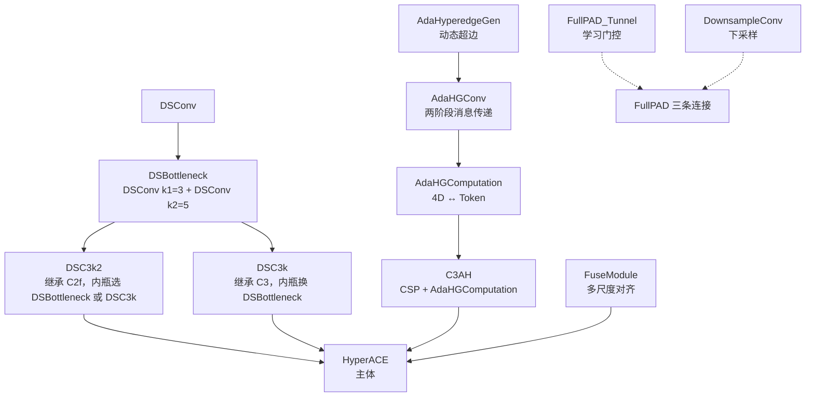

# YOLOv13 理论 Concept

> **v1~v12 读者路标**：本页把 v13 相对 v12 的三个关键设计决策摊开讲——**HyperACE（自适应超图消息传递）/ FullPAD（全管线门控连接）/ DS 深度可分离卷积体系**。每个决策对应到具体行号。整体基调是「**保留 v12 的 A2C2f 骨干注意力 + 引入超图消息传递做骨干/颈部主通路的高阶融合 + 用学习门控替代固定 concat + 用深度可分离替换中段下采样**」。

::: tip 只想带走三件事
1. **v13 的新代码集中在 block.py 的 540 行**：<SrcLink file="v13:ultralytics/nn/modules/block.py" :line="1375" :end="1916" /> 里 11 个新类（DSBottleneck / DSC3k / DSC3k2 / AdaHyperedgeGen / AdaHGConv / AdaHGComputation / C3AH / FuseModule / HyperACE / DownsampleConv / FullPAD_Tunnel）+ conv.py L84 的 DSConv。**loss.py、tal.py、head.py 零改动**。
2. **AdaHyperedgeGen 是"动态超边"**：`P = P_0 + ΔP`，其中 `P_0` 是可学习的基础原型（`nn.Parameter` + `xavier_uniform_` 初始化），`ΔP = context_net([mean(X), max(X)])` 是**依赖输入的动态偏移**——**每 batch 都会生成新的超边集合**，与 Gumbel-Softmax Hyperedge 的静态超边不同。
3. **FullPAD_Tunnel 是"学习门控"而不是"固定 concat"**：`gate = nn.Parameter(torch.tensor(0.0))`，`out = x[0] + gate * x[1]`——**gate 初始化为 0**，训练前等价于直通 x[0]，训练中 gate 从 0 学出值。这是让 7 条 FullPAD tunnel"能收敛"的关键工程细节。
:::

## 1. AdaHyperedgeGen：动态超边生成器 (`concept-adahyperedgegen`)

> **v1~v12 读者路标**：传统超图神经网络（HyperGCN、HGCN）用**静态超边**（预设的连接关系）；v13 的 AdaHyperedgeGen **每 batch 根据输入生成动态超边**，用多头相似度决定每个顶点参与哪些超边。这与 v12 的 AAttn 相似（也是"每 batch 生成 attention 矩阵"），但**输出对象不同**：AAttn 是 pairwise attention，AdaHyperedgeGen 是 vertex-hyperedge 参与矩阵。

**定义**（<SrcLink file="v13:ultralytics/nn/modules/block.py" :line="1549" :end="1625" />）：

```python
class AdaHyperedgeGen(nn.Module):
    def __init__(self, node_dim, num_hyperedges, num_heads=4, dropout=0.1, context="both"):
        super().__init__()
        self.num_heads = num_heads
        self.num_hyperedges = num_hyperedges
        self.head_dim = node_dim // num_heads
        self.context = context

        # 基础原型（可学习参数，xavier 初始化）
        self.prototype_base = nn.Parameter(torch.Tensor(num_hyperedges, node_dim))
        nn.init.xavier_uniform_(self.prototype_base)

        # 动态偏移：根据 context 生成 ΔP
        if context in ("mean", "max"):
            self.context_net = nn.Linear(node_dim, num_hyperedges * node_dim)
        elif context == "both":
            self.context_net = nn.Linear(2*node_dim, num_hyperedges * node_dim)

        self.pre_head_proj = nn.Linear(node_dim, node_dim)
        self.dropout = nn.Dropout(dropout)
        self.scaling = math.sqrt(self.head_dim)

    def forward(self, X):
        B, N, D = X.shape
        # 1. 生成动态 context
        if self.context == "mean":
            context_cat = X.mean(dim=1)
        elif self.context == "max":
            context_cat, _ = X.max(dim=1)
        else:  # "both"
            avg_context = X.mean(dim=1)
            max_context, _ = X.max(dim=1)
            context_cat = torch.cat([avg_context, max_context], dim=-1)

        # 2. 生成动态原型 P = P_0 + ΔP
        prototype_offsets = self.context_net(context_cat).view(B, self.num_hyperedges, D)
        prototypes = self.prototype_base.unsqueeze(0) + prototype_offsets

        # 3. 多头相似度
        X_proj = self.pre_head_proj(X)
        X_heads = X_proj.view(B, N, self.num_heads, self.head_dim).transpose(1, 2)
        proto_heads = prototypes.view(B, self.num_hyperedges, self.num_heads, self.head_dim).permute(0, 2, 1, 3)
        X_heads_flat = X_heads.reshape(B * self.num_heads, N, self.head_dim)
        proto_heads_flat = proto_heads.reshape(B * self.num_heads, self.num_hyperedges, self.head_dim).transpose(1, 2)
        logits = torch.bmm(X_heads_flat, proto_heads_flat) / self.scaling
        logits = logits.view(B, self.num_heads, N, self.num_hyperedges).mean(dim=1)
        logits = self.dropout(logits)

        # 4. softmax 得参与矩阵
        return F.softmax(logits, dim=1)
```

**六个关键设计点**：

1. **`P_0` 是 learnable parameter + xavier 初始化**（L1582-L1583）：基础原型是**跨 batch 共享的可学习量**——训练后代表"通用的高阶关联模式"，`ΔP` 是"每 batch 的动态偏移"，两者相加得到最终原型；
2. **`context="both"` 是默认**（yaml HyperACE 传 `"both"`）：意味着 context_net 输入维度是 `2*node_dim`——**mean 和 max 上下文拼接**，参数比 "mean-only" 或 "max-only" 翻倍。论文未量化三者的差异；
3. **`num_heads` 决定相似度计算的多头数**：yaml 里 HyperACE 的默认 num_heads=8（在 C3AH L1751 `num_heads = c_ // 16`），**不是 AdaHyperedgeGen 构造时的 num_heads=4**——两者数值不一致，因为 C3AH 把 `c_ // 16` 的值传给 AdaHGComputation → AdaHGConv → AdaHyperedgeGen 的 num_heads 参数；
4. **softmax 沿 `dim=1`**（L1624）：N 维（顶点维）softmax——**每个超边内部的所有顶点概率加起来为 1**，与 attention 的 softmax 语义相反（attention 是每顶点归一，这里每超边归一）；
5. **`dropout=0.1`**（L1596）：对 logits 做 dropout——**训练时随机丢弃部分相似度信号**，让网络不过度依赖特定顶点-超边配对；
6. **`scaling = √head_dim`**（L1597）：标准 attention 缩放，防止 softmax 饱和。

**AdaHyperedgeGen vs AAttn（v12）vs Self-Attention**：

| 维度 | Self-Attention | AAttn (v12) | **AdaHyperedgeGen (v13)** |
|------|---------------|-------------|---------------------------|
| 输出对象 | QK^T softmax 得 N×N attention | 同左，加 area 分组 | **N×M 参与矩阵 A** |
| 边类型 | 一对一（pairwise） | 一对一 + 局部窗口 | **一对多（vertex→hyperedge）** |
| 超边数量 | 隐式（等于 token 数） | 隐式 | **显式 M 个（yaml 传 num_hyperedges=8）** |
| 归一化方向 | 每 query 归一 | 同左 | **每超边归一（softmax dim=1）** |
| 依赖 | 无 | FlashAttention 硬依赖 | **无外部依赖**（纯 PyTorch） |
| 计算量 | O(N²D) | O(N²D/area) | **O(N·M·D)** |

**关键点**：v13 去掉了 FlashAttention 硬依赖（AdaHyperedgeGen 用纯 `bmm` + `softmax`），但代价是**每超边只有 8 个原型**，比 Self-Attention 的 N 个"query"表达力弱——**这是"高阶关联"与"两两关联"的表达力取舍**。

## 2. AdaHGConv：两阶段超图消息传递 (`concept-adahgconv`)

> **v1~v12 读者路标**：AdaHGConv 是 AdaHyperedgeGen 的"消费方"——它消费 A，做**两阶段消息传递**：vertex→edge（聚合顶点到超边）与 edge→vertex（把超边信息分发给顶点）。这与 Gumbel-Softmax Hyperedge 的两阶段消息传递一致，但**参与矩阵 A 是动态生成的**（不是 Gumbel-Softmax 抽样的稀疏矩阵）。

**定义**（<SrcLink file="v13:ultralytics/nn/modules/block.py" :line="1626" :end="1675" />）：

```python
class AdaHGConv(nn.Module):
    def __init__(self, embed_dim, num_hyperedges=16, num_heads=4, dropout=0.1, context="both"):
        super().__init__()
        self.edge_generator = AdaHyperedgeGen(embed_dim, num_hyperedges, num_heads, dropout, context)
        self.edge_proj = nn.Sequential(
            nn.Linear(embed_dim, embed_dim),
            nn.GELU()
        )
        self.node_proj = nn.Sequential(
            nn.Linear(embed_dim, embed_dim),
            nn.GELU()
        )

    def forward(self, X):
        # 1. 生成参与矩阵
        A = self.edge_generator(X)

        # 2. vertex → edge 聚合
        He = torch.bmm(A.transpose(1, 2), X)   # (B, M, D)
        He = self.edge_proj(He)

        # 3. edge → vertex 分发
        X_new = torch.bmm(A, He)              # (B, N, D)
        X_new = self.node_proj(X_new)

        # 4. 残差
        return X_new + X
```

**要点**：
- **两次 bmm**（L1669/L1672）：都是标准矩阵乘法，GPU 加速良好，**不需要 FlashAttention**；
- **两次 projection**（`edge_proj` + `node_proj`）：都是 `Linear + GELU` 两层 MLP——**每阶段有一个非线性变换**，避免退化；
- **残差返回**（L1675）：`X_new + X`——**恒等映射保底**，与 AdaHGConv 的原始输入 X 相加；
- **没有激活函数直接接 residual**：`X_new` 已经过 `node_proj` 的 GELU，残差相加时不再有额外激活——**保证梯度流**。

## 3. AdaHGComputation：4D → Token → AdaHGConv (`concept-adahgcomputation`)

> **v1~v12 读者路标**：AdaHGComputation 是把 AdaHGConv 接入 CNN 的"胶水层"——把 4D 特征图 (B, C, H, W) flatten 成 (B, H·W, C) 的 token 序列，送入 AdaHGConv 做超图消息传递，再 reshape 回 4D。**这是 v13 唯一把 4D CNN 特征当作 token 处理的模块**，与 v11 的 C2PSA / v12 的 A2C2f 里的 reshape 语义不同。

**定义**（<SrcLink file="v13:ultralytics/nn/modules/block.py" :line="1677" :end="1719" />）：

```python
class AdaHGComputation(nn.Module):
    def __init__(self, embed_dim, num_hyperedges=16, num_heads=8, dropout=0.1, context="both"):
        super().__init__()
        self.embed_dim = embed_dim
        self.hgnn = AdaHGConv(
            embed_dim=embed_dim,
            num_hyperedges=num_hyperedges,
            num_heads=num_heads,
            dropout=dropout,
            context=context
        )

    def forward(self, x):
        B, C, H, W = x.shape
        tokens = x.flatten(2).transpose(1, 2)     # (B, C, H, W) → (B, H·W, C)
        tokens = self.hgnn(tokens)
        x_out = tokens.transpose(1, 2).view(B, C, H, W)
        return x_out
```

**要点**：
- **flatten 与 transpose**：`x.flatten(2)` 把 (B, C, H, W) 变成 (B, C, H·W)，再 `transpose(1, 2)` 变成 (B, H·W, C)——**token 数是 H·W，每 token 维度是 C**；
- **AdaHGConv 的输入维度是 `embed_dim=C`**：C3AH 传入 `c_ = int(c2 * e)` 作为 embed_dim——**C3AH 的隐藏通道就是 AdaHGConv 的 embed_dim**；
- **无 padding / stride / dilation**：4D→Token 是无损的 flatten，AdaHGConv 输出的 H·W 位置一一对应输入位置，**空间拓扑通过 flatten 保留但不再被显式利用**（AdaHGConv 里的超边消息传递不感知 H/W 结构）；
- **num_heads=8 默认**：AdaHGComputation 构造时默认 8 头，C3AH L1751 会传 `c_ // 16` 覆盖这个默认——**yaml 里 c_=256 时 num_heads=16，c_=512 时 num_heads=32**（数值较大）。

## 4. C3AH：CSP + AdaHGComputation (`concept-c3ah`)

> **v1~v12 读者路标**：C3AH 是 C3 家族的"超图版本"——把 C3 内的 Bottleneck 换成 AdaHGComputation。**C3 与 C2f 都是 CSP 风格的"分-合"块，C3AH 沿用了 C3 的骨架但换了内瓶**。

**定义**（<SrcLink file="v13:ultralytics/nn/modules/block.py" :line="1721" :end="1762" />）：

```python
class C3AH(nn.Module):
    def __init__(self, c1, c2, e=1.0, num_hyperedges=8, context="both"):
        super().__init__()
        c_ = int(c2 * e)
        assert c_ % 16 == 0, "Dimension of AdaHGComputation should be a multiple of 16."
        num_heads = c_ // 16
        self.cv1 = Conv(c1, c_, 1, 1)   # 升维到 c_
        self.cv2 = Conv(c1, c_, 1, 1)   # shortcut 分支升维
        self.m = AdaHGComputation(embed_dim=c_,
                                  num_hyperedges=num_hyperedges,
                                  num_heads=num_heads,
                                  dropout=0.1,
                                  context=context)
        self.cv3 = Conv(2 * c_, c2, 1)  # 合流降维到 c2

    def forward(self, x):
        return self.cv3(torch.cat((self.m(self.cv1(x)), self.cv2(x)), 1))
```

**要点**：
- **`c_ % 16 == 0` 硬断言**（L1750）：因为 `num_heads = c_ // 16` 是硬编码，通道必须能被 16 整除——**与 v12 A2C2f 的 `c_ % 32 == 0` 不同，这里更宽松**；
- **CSP 骨架**：`x → cv1(1×1) → AdaHGComputation` 与 `cv2(1×1)` shortcut concat 后过 `cv3(1×1)`——**两条分支都是 1×1 卷积**，无 3×3 空间混合；
- **num_heads 由通道推导**（L1751）：`num_heads = c_ // 16`——**c_ = 256 时 16 头、c_ = 512 时 32 头**（比 Self-Attention 常规 8-16 头更多，因为 AdaHGConv 的 head_dim = c_ // num_heads = 16，比较小）；
- **dropout 硬编码 0.1**：yaml 里没有暴露 dropout 参数，用户不可调；
- **context="both" 硬编码传递**（L1757）：AdaHGComputation 的默认 context="both"，C3AH 直接透传——**除非外部构造 C3AH 时改 context**，否则永远走 "both" 分支。

## 5. FuseModule：多尺度 concat (`concept-fusemodule`)

> **v1~v12 读者路标**：FuseModule 是 HyperACE 的第一步——把三个尺度的特征（P3/P4/P5）对齐到中间尺度后 concat 融合。这与 v10 的 CIB 系列、v11 的 C3k2 融合语义不同——**FuseModule 是"跨尺度对齐融合"，不做深度可分离，也不做注意力**。

**定义**（<SrcLink file="v13:ultralytics/nn/modules/block.py" :line="1764" :end="1802" />）：

```python
class FuseModule(nn.Module):
    def __init__(self, c_in, channel_adjust):
        super().__init__()
        self.downsample = nn.AvgPool2d(kernel_size=2)
        self.upsample = nn.Upsample(scale_factor=2, mode='nearest')
        if channel_adjust:
            self.conv_out = Conv(4 * c_in, c_in, 1)
        else:
            self.conv_out = Conv(3 * c_in, c_in, 1)

    def forward(self, x):
        x1_ds = self.downsample(x[0])     # P3 下采样 2×
        x3_up = self.upsample(x[2])       # P5 上采样 2×
        x_cat = torch.cat([x1_ds, x[1], x3_up], dim=1)
        out = self.conv_out(x_cat)
        return out
```

**要点**：
- **输入是列表**：`x = [x_P3, x_P4, x_P5]`——**x[0] 是 P3（高分辨率），x[2] 是 P5（低分辨率）**；
- **对齐到中间尺度**：x[0] 下采样 2× 到 P4 尺度，x[2] 上采样 2× 到 P4 尺度——**三路都在 P4 尺度融合**；
- **`channel_adjust` 参数**：True 时输入 4×c_in、输出 c_in（**压缩 4 倍**）；False 时输入 3×c_in、输出 c_in（**压缩 3 倍**）。L/X 档 channel_adjust=False（tasks.py L1088）——**L/X 档 FuseModule 不压缩通道**；
- **c_in 是"骨干浅层通道"**：yaml 里 HyperACE c1 从 backbone 层 #4（P3）的通道推导——**L/X 档 max_channels=512 时 c_in=512**，n/s 档 c_in 会更小（v13 缩放后）。

## 6. HyperACE：多尺度超图融合主通路 (`concept-hyperace`)

> **v1~v12 读者路标**：HyperACE 是 v13 的"招牌"——**在骨干 P3/P4/P5 三路 concat 后一次性做超图消息传递**。整个 yaml 里 HyperACE 只出现 1 次（head #9），但它是**唯一真正跑超图消息传递的模块**。

**定义**（<SrcLink file="v13:ultralytics/nn/modules/block.py" :line="1804" :end="1856" />）：

```python
class HyperACE(nn.Module):
    def __init__(self, c1, c2, n=1, num_hyperedges=8, dsc3k=True, shortcut=False,
                 e1=0.5, e2=1, context="both", channel_adjust=True):
        super().__init__()
        self.c = int(c2 * e1)
        self.cv1 = Conv(c1, 3 * self.c, 1, 1)
        self.cv2 = Conv((4 + n) * self.c, c2, 1)
        self.m = nn.ModuleList(
            DSC3k(self.c, self.c, 2, shortcut, k1=3, k2=7) if dsc3k
            else DSBottleneck(self.c, self.c, shortcut=shortcut)
            for _ in range(n)
        )
        self.fuse = FuseModule(c1, channel_adjust)
        self.branch1 = C3AH(self.c, self.c, e2, num_hyperedges, context)
        self.branch2 = C3AH(self.c, self.c, e2, num_hyperedges, context)

    def forward(self, X):
        x = self.fuse(X)                    # 多尺度融合到 P4 尺度
        y = list(self.cv1(x).chunk(3, 1))   # 拆成 3 份：y[0], y[1], y[2]
        out1 = self.branch1(y[1])           # 分支 1: 高阶超图
        out2 = self.branch2(y[1])           # 分支 2: 高阶超图
        y.extend(m(y[-1]) for m in self.m)  # 分支 3: L 个 DSC3k 串联（低阶）
        y[1] = out1                         # 用 out1 替换 y[1]
        y.append(out2)                      # 追加 out2
        return self.cv2(torch.cat(y, 1))     # concat 后过 cv2
```

**要点**：
- **三路并行**：`branch1` + `branch2` 是两条 C3AH 高阶分支（都作用于 `y[1]`，共享同一输入），`self.m` 是 L 个 DSC3k 低阶串联（作用于 `y[-1]`）——**"高阶 × 2 + 低阶 × L"并行**；
- **cv2 的输入通道是 (4+n) × c**（L1840）：n 个 DSC3k + 3 个初始 chunk + 1 个 out2 = 4 + n 条分支；
- **`n` 被 tasks.py 强制为 1**（<SrcLink file="v13:ultralytics/nn/tasks.py" :line="1086" />）：yaml 里写 2，但实际 n=1——**L 个 DSC3k 只串联 1 次**；
- **e1=0.5 是默认**（yaml 传 0.5）：`c = c2 * e1`——yaml 里 c2=512 时 c=256；
- **e2=1 是默认**（yaml 传 1）：C3AH 的 e=1.0——**C3AH 的隐藏通道等于 c**，不再缩放；
- **dsc3k=True 是默认**（yaml 传 True）：走 DSC3k 而非 DSBottleneck；
- **shortcut=False 是默认**：DSC3k 的 shortcut=False——**低阶分支不加残差**（DSC3k 内层 DSBottleneck 里 shortcut=False）；
- **`channel_adjust` 决定 FuseModule 行为**：n/s 档 True（4×c→c），l/x 档 False（3×c→c）——**L/X 档不压缩 FuseModule 输出通道**。

**HyperACE vs v12 A2C2f 骨干注意力**：

| 维度 | v12 A2C2f | v13 HyperACE |
|------|-----------|-------------|
| 位置 | 骨干 P4/P5 | Head #9（骨干 P3/P4/P5 融合后） |
| 输入尺度 | 单尺度（P4 或 P5） | **三尺度（P3/P4/P5）** |
| 消息传递 | 两两 Attention（area 分组） | **超图消息传递（8 超边）** |
| 参数 | 4 个 ABlock | 2 个 C3AH + 1 个 DSC3k + FuseModule |
| FlashAttention 依赖 | 是（硬依赖） | **否**（纯 bmm） |
| 出现次数 | 2 次（骨干 #6/#8） | **1 次**（head #9） |

## 7. FullPAD_Tunnel：学习门控跨尺度融合 (`concept-fullpad`)

> **v1~v12 读者路标**：FullPAD_Tunnel 是 v13 的"另一招牌"——**7 条"学习门控"的跨尺度/跨头/跨骨干连接**。与 SE / GCNet 的通道门控不同，FullPAD_Tunnel 是**标量门控**（单一 gate 参数），语义简单但表达力足够。

**定义**（<SrcLink file="v13:ultralytics/nn/modules/block.py" :line="1891" :end="1916" />）：

```python
class FullPAD_Tunnel(nn.Module):
    def __init__(self):
        super().__init__()
        self.gate = nn.Parameter(torch.tensor(0.0))

    def forward(self, x):
        out = x[0] + self.gate * x[1]
        return out
```

**要点**：
- **gate 初始化为 0.0**（L1913）：`torch.tensor(0.0)` 而不是 `torch.ones(...)`——**训练前等价于 `out = x[0] + 0 = x[0]`，直通 x[0]**；
- **gate 是标量参数**（`nn.Parameter` 单值）：不是通道门控（SE 是每通道一个 sigmoid 值），不是空间门控——**单一标量控制 x[1] 的贡献**；
- **可学习**（`nn.Parameter` 默认 `requires_grad=True`）：训练中通过梯度下降学习 gate 值——**每个 tunnel 独立学一个 gate**；
- **输入是列表**：`x = [x_main, x_aux]`——**x[0] 是主通路，x[1] 是辅助通路**；
- **加法而非 concat**：`x[0] + gate * x[1]`——**通道数必须相同**（yaml 里所有 tunnel 输入都保证同通道数，靠 DownsampleConv / Conv 1×1 对齐）；
- **梯度可逆**：`d_out/d_gate = x[1]`、`d_out/d_x1 = gate`——**gate=0 时梯度为 0，但 gate 本身仍有梯度 ∂L/∂gate = x[1]·∂L/∂out，能学出非零值**。

**FullPAD_Tunnel vs SE / GCNet 门控**：

| 维度 | SE | GCNet | **FullPAD_Tunnel** |
|------|-----|-------|-------------------|
| 门控粒度 | 通道 | 全局上下文 | **标量** |
| 初始化 | 全零 → 学出小值 | 全零 → 学出小值 | **0.0 → 学出小值** |
| 应用位置 | 块内部 | 块内部 | **跨块（跨尺度/跨头/跨骨干）** |
| 计算量 | 小 | 大 | **极小（单标量乘法）** |
| 参数量 | 2 × c | c² | **1** |

**关键点**：FullPAD_Tunnel 用**极简的标量门控**实现了 v12 完全没有的"跨尺度/跨头/跨骨干"信息流动——**这是"高阶关联"的一种退化形式**，代价小、效果显著（消融 +0.5~0.9 AP）。

## 8. DownsampleConv：v13 新增的下采样块 (`concept-downsampleconv`)

> **v1~v12 读者路标**：DownsampleConv 是 v13 新增的下采样模块，用在 head #11。它的语义是"下采样 + 可选通道调整"，**与 v12 的 A2C2f 下采样路径不同**——v13 head 首个融合块 HyperACE 之后直接接 DownsampleConv 做下采样（不走 Conv 3×3 s2）。

**定义**（<SrcLink file="v13:ultralytics/nn/modules/block.py" :line="1858" :end="1889" />）：

```python
class DownsampleConv(nn.Module):
    def __init__(self, in_channels, channel_adjust=True):
        super().__init__()
        self.downsample = nn.AvgPool2d(kernel_size=2)
        if channel_adjust:
            self.channel_adjust = Conv(in_channels, in_channels * 2, 1)
        else:
            self.channel_adjust = nn.Identity()

    def forward(self, x):
        return self.channel_adjust(self.downsample(x))
```

**要点**：
- **`AvgPool2d(2) + Conv(1×1, 2×ch)`**：下采样用平均池化（不是 Conv s2），通道调整用 1×1 卷积——**计算量比 Conv 3×3 s2 小得多**；
- **`channel_adjust=False` 时用 Identity**（L1886）：L/X 档 channel_adjust=False（tasks.py L1093-1094）——**L/X 档 DownsampleConv 只下采样、不升通道**；
- **`c2 = c1 * 2` 是默认**：n/s 档默认升通道到 2×，L/X 档保持 c1 不变。

## 9. DS 深度可分离卷积体系 (`concept-ds`)

> **v1~v12 读者路标**：DSConv / DSBottleneck / DSC3k / DSC3k2 四个模块组成 v13 的"深度可分离体系"——**取代 v12 骨干中段的 C3k2**。DS 系列是 MobileNet 家族在 YOLO 里的移植，v13 是第一次系统性引入。

### 9.1 DSConv（conv.py L84）

```python
class DSConv(nn.Module):
    def __init__(self, c1, c2, k, s, g, d=1, add=True, gr=4):
        super().__init__()
        c_ = int(c1 * gr)
        self.conv = nn.Conv2d(c1, c_, k, s, autopad(k, d), groups=c1, bias=False)
        self.conv1 = Conv(c_, c2, 1, 1)
        self.add = add and c1 == c2

    def forward(self, x):
        y = self.conv1(self.conv(x))
        return x + y if self.add else y
```

**要点**：
- **DWConv + PWConv**：先做深度卷积（`groups=c1`），再做逐点卷积——**MobileNetV2 的标准件**；
- **默认 `gr=4`**：group 数放大 4 倍——**比标准 MobileNetV2 的 gr=1 更"分组"**；
- **`add=True` 默认**：如果 c1==c2 则加残差。yaml 里 DSConv 都用默认 add=True。

### 9.2 DSBottleneck（L1375）

```python
class DSBottleneck(nn.Module):
    def __init__(self, c1, c2, shortcut=True, e=0.5, k1=3, k2=5, d2=1):
        super().__init__()
        c_ = int(c2 * e)
        self.cv1 = DSConv(c1, c_, k1, s=1, p=None, d=1)
        self.cv2 = DSConv(c_, c2, k2, s=1, p=None, d=d2)
        self.add = shortcut and c1 == c2

    def forward(self, x):
        y = self.cv2(self.cv1(x))
        return x + y if self.add else y
```

**要点**：
- **两个 DSConv 串联**：k1=3, k2=5（yaml 里 DSC3k 传 k1=3, k2=7）——**核大小交替，扩大感受野**；
- **d2=1 默认**：膨胀系数 1，不膨胀——**d2 参数是给想加膨胀留的 API**；
- **shortcut and c1==c2**：只有在 c1==c2 时才加残差——**DSC3k 里 c_=c，所以 shortcut 总生效**；
- **`e=0.5` 是构造默认，但被 DSC3k/DSC3k2 覆写为 1.0**（L1462/L1529）——**实际部署时 e=1.0**。

### 9.3 DSC3k（L1414）

```python
class DSC3k(C3):
    def __init__(self, c1, c2, n=1, shortcut=True, g=1, e=0.5, k1=3, k2=5, d2=1):
        super().__init__(c1, c2, n, shortcut, g, e)
        c_ = int(c2 * e)
        self.m = nn.Sequential(
            *(DSBottleneck(c_, c_, shortcut=shortcut, e=1.0, k1=k1, k2=k2, d2=d2)
              for _ in range(n))
        )
```

**要点**：
- **继承 C3**：沿用 C3 的"分-合"骨架（cv1 / cv2 / cv3）；
- **替换 C3 内的 Bottleneck 为 DSBottleneck**：`e=1.0` 是 DSBottleneck 内部参数（隐藏通道 = c_ = c），**不再缩小**；
- **默认 `k1=3, k2=5, d2=1`**：HyperACE 里传 `k1=3, k2=7`——**HyperACE 的 DSC3k 用 7×7 而不是 5×5**。

### 9.4 DSC3k2（L1472）

```python
class DSC3k2(C2f):
    def __init__(self, c1, c2, n=1, dsc3k=False, e=0.5, g=1, shortcut=True,
                 k1=3, k2=7, d2=1):
        super().__init__(c1, c2, n, shortcut, g, e)
        if dsc3k:
            self.m = nn.ModuleList(
                DSC3k(self.c, self.c, n=2, shortcut=shortcut, g=g,
                      e=1.0, k1=k1, k2=k2, d2=d2) for _ in range(n)
            )
        else:
            self.m = nn.ModuleList(
                DSBottleneck(self.c, self.c, shortcut=shortcut,
                             e=1.0, k1=k1, k2=k2, d2=d2) for _ in range(n)
            )
```

**要点**：
- **继承 C2f**：沿用 C2f 的"分-合-多 shortcut"骨架；
- **`dsc3k` 参数决定内瓶**：False 时用 DSBottleneck 单块，True 时用 DSC3k（内含 2 个 DSBottleneck）——**n=2 时是 4 个 DSBottleneck 串联**；
- **yaml 里骨干 #2/#4 传 `dsc3k=False`**：走 DSBottleneck 轻量分支——**骨干浅层走轻量**；
- **yaml 里 head #17/#21/#26/#30 传 `dsc3k=True`**：走 DSC3k 增强分支——**head 走增强**；
- **`n=2` 时的实际行为**：n=2 时用 DSC3k，且 DSC3k 内部 n=2——**总共 2×2=4 个 DSBottleneck**。

## 10. 各模块间的组合关系



**核心组合**：
- **HyperACE** = FuseModule + 2×C3AH + L×DSC3k（"高阶 + 低阶"混合）
- **FullPAD 三条连接** = 7×FullPAD_Tunnel + DownsampleConv 通道对齐
- **DS 体系** = DSConv + DSBottleneck + DSC3k + DSC3k2（低阶体系）

## 11. 与 v12 概念对照速查

| v12 概念 | v13 对应 | 差异 |
|---------|---------|------|
| A2C2f (a2=True) | A2C2f（沿用） | **完全相同** |
| A2C2f (a2=False) | 不再使用 | v12 head 三处 a2=False，v13 全部换成 DSC3k2 |
| C3k2 | DSC3k2（浅层 #2/#4 dsc3k=False；head #17/#21/#26/#30 dsc3k=True） | 内瓶从 C3k/Bottleneck 换成 DSBottleneck/DSC3k |
| C2PSA | 不再使用 | v12 head 尾端 C2PSA，v13 无 |
| SPPF | 不再使用 | 与 v12 一致 |
| 骨干下采样 Conv 3×3 s2 | **DSConv 3×3 s2**（#5/#7） | 从全卷积换成深度可分离 |
| Detect cv3 DW-separable | Detect cv3 DW-separable（未动） | **完全相同** |
| — | **AdaHyperedgeGen** | **v13 新增** |
| — | **AdaHGConv** | **v13 新增** |
| — | **AdaHGComputation** | **v13 新增** |
| — | **C3AH** | **v13 新增** |
| — | **FuseModule** | **v13 新增** |
| — | **HyperACE** | **v13 新增** |
| — | **DownsampleConv** | **v13 新增** |
| — | **FullPAD_Tunnel** | **v13 新增** |
| — | **DSConv** | **v13 新增**（conv.py L84） |
