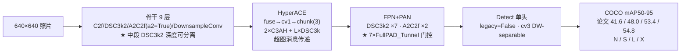
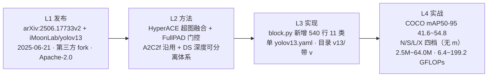

# YOLOv13 (2025-06)

**HyperACE 超图融合 + FullPAD 门控 + DS 深度可分离体系——首次把「高阶超图消息传递」引入 YOLO 骨干，同时保留 v12 的 A2C2f 内嵌注意力**

- 📄 发布：**arXiv:2506.17733v2《YOLOv13: Enhancing YOLO for High-Resolution Multi-Object Detection through Hypergraph-based Adaptive Correlation Enhancement》**，2025-06-21（v2 更新 2025-11）；仓库 README + `paper-yolov13.pdf` + releases 权重四层材料构成，详见[发布精读](/versions/v13/paper)
- 🏛️ 作者：**Wei Yang（iMoonLab）** 等——**第三方开发，非 ultralytics 官方**，仓库 [`iMoonLab/yolov13`](https://github.com/iMoonLab/yolov13) @ commit `73289949533efac82bb5f72ec19b746618656bd2`（2025-11-18，Apache-2.0，基于 ultralytics fork）；**v13 是本站十二代之后首次出现「学术线 + 官方线」双线路标的版本**——ultralytics 主线同期出现 YOLO13 命名（无论文、无独立仓库、docs 404），本站只在 [family](/global/family) 标注存在，不建子页面
- 💻 源码：快照 `source/yolov13/snapshot/`（iMoonLab/yolov13 @ `73289949`）；v13 全部新代码集中在 <SrcLink file="v13:ultralytics/nn/modules/block.py" :line="1375" :end="1916" /> 约 **540 行 11 个新类**——`DSBottleneck` / `DSC3k` / `DSC3k2` / `AdaHyperedgeGen` / `AdaHGConv` / `AdaHGComputation` / `C3AH` / `FuseModule` / `HyperACE` / `DownsampleConv` / `FullPAD_Tunnel`；另 `DSConv` 在 <SrcLink file="v13:ultralytics/nn/modules/conv.py" :line="84" />
- 🎯 里程碑：**结构性「加法」**——把 v12 的「A2C2f 内嵌注意力」+「去 SPPF」全部保留，**在骨干与颈部之间新插入一次 HyperACE 超图融合**（yaml #23，head 首块，把 P3/P4/P5 三路拉进来做一次性多尺度融合）；同时**用 DSC3k2/DSConv 替换骨干中段**（#3/#5/#10/#13/#16/#19/#21 共 7 处 DSC3k2），**并引入 7 条 FullPAD_Tunnel 做跨尺度/跨头/跨骨干的可学习门控软融合**；cfg 目录 `models/v13/`（带 v，与 v12 一致），**档位收敛为四档 n/s/l/x（无 m 档）**；`loss.py` / `tal.py` / `head.py` **零改动**——v13 的「新」是纯结构改动，损失语义与 v8 完全一致

## 3 分钟电梯演讲



1. **HyperACE 是唯一真正跑超图的模块**：`fuse → cv1(1×1) → chunk(3)` 三路 → 两条 **C3AH**（AdaHGComputation = flatten → [AdaHGConv](/glossary#ada-hgconv) = 生成自适应超边 + 两阶段消息传递 + 残差）与 `L` 个 **DSC3k**（DSConv 深度可分离）并行 → concat → cv2(1×1)；整张 yaml 里只出现 1 次 HyperACE（#23），出现在 head 首个 block，把骨干 P3/P4/P5 三路拉进来做**一次性的多尺度超图融合**；<SrcLink file="v13:ultralytics/nn/modules/block.py" :line="1804" :end="1856" />
2. **FullPAD 的三条全管线连接就是 7 个 FullPAD_Tunnel**：yaml 里 7 次 `[-1, k]` 形式的 `FullPAD_Tunnel`，`out = x[0] + gate * x[1]`（`gate = nn.Parameter(torch.tensor(0.0))` 初始化为 0 标量参数）——**是「学习门控」而不是「固定融合」**；论文消融 TABLE III：`000→47.1 / 100→47.8 / 010→47.6 / 001→47.7 / 111→48.0`（YOLOv13-S），三个子组件单独消融增益 0.5~0.9 AP；<SrcLink file="v13:ultralytics/nn/modules/block.py" :line="1891" :end="1916" />
3. **训练配方与 v12 逐字节等价**：epochs=600 / batch=256 / mosaic=1.0 / **逐档 mixup 与 copy_paste 不同**（n: 0.0/0.1; s: 0.05/0.15; l: 0.15/0.5; x: 0.2/0.6）——是 v11 之后**再次分档差异化**的训练 trick；损失侧与 v11/v12 逐字节等价（`tal_topk=10` 默认 + 显式 `alpha=0.5, beta=6.0`），检测训练实际用 v8 参数。

> **v1~v12 读者路标**：[v11 读者](/versions/v11/index)——v13 沿用 v11 的 C3k2 内瓶（保留 3 处浅层）与 Detect 单头，但把骨干中段换成 DSC3k2（DS 深度可分离体系）+ 引入 HyperACE 超图融合；[v12 读者](/versions/v12/index)——v13 保留 v12 的 A2C2f 骨干 P4/P5 内嵌（FlashAttention 硬依赖仍在）与「去 SPPF」，作者仍是第三方（iMoonLab），许可证从 AGPL-3.0 切到 Apache-2.0；[v8 读者](/versions/v8/index)——v13 的 Detect 头、v8DetectionLoss、TAL 分配器、Mosaic/MixUp 全套增强与 v8 一致，检测训练实际用 v8 的 topk=10 α=0.5 β=6.0。

## 四层闭环视图



## 核心贡献一览

v13 的改动方向是「**在 v12 的 A2C2f 内嵌注意力之上再加一条超图融合主通路**」：官方保留 v12 的 A2C2f 骨干 P4/P5、C3k2 浅层、Detect 单头、v8DetectionLoss、Mosaic/MixUp 全部管线——同时**新增一条 DS 深度可分离体系**（DSConv → DSBottleneck → DSC3k → DSC3k2）替换骨干中段、**新插入一个 HyperACE 超图融合模块**放在 head 首块、**新引入 7 条 FullPAD_Tunnel** 做跨尺度/跨头/跨骨干的可学习门控软融合；核心贡献与代码落点：

| 贡献 | 一句话 | 代码落点 |
|------|--------|---------|
| **HyperACE 超图融合** | `fuse → cv1(1×1) chunk(3) → 2×C3AH + L×DSC3k → concat → cv2(1×1)`；**`n` 被 tasks.py 强制为 1**（yaml 传入被覆盖），`he` 按档位缩放（n:2, s:4, l:8, x:16） | <SrcLink file="v13:ultralytics/nn/modules/block.py" :line="1804" :end="1856" /> |
| **AdaHyperedgeGen 自适应超边** | `P = P_0 + ΔP`，`num_heads=8`（yaml 传入），`dropout=0.1`（硬编码）；多头相似度矩阵经 softmax 得到顶点-超边关联矩阵 | <SrcLink file="v13:ultralytics/nn/modules/block.py" :line="1549" :end="1625" /> |
| **AdaHGConv 超图卷积** | vertex→edge `He = A^T·X` → edge_proj → edge→vertex → node_proj → 残差；**两次 bmm**（L1669/L1672）纯 PyTorch 实现，不需要 FlashAttention | <SrcLink file="v13:ultralytics/nn/modules/block.py" :line="1626" :end="1675" /> |
| **C3AH 骨架** | CSP 骨架，`assert c_ % 16 == 0`；内嵌 AdaHGComputation（AdaHGConv 的 flatten+view 包装） | <SrcLink file="v13:ultralytics/nn/modules/block.py" :line="1721" :end="1762" /> |
| **DSC3k2 深度可分离** | DSConv k1=3 + DSConv k2=5 d2=1 的 CSP 结构；骨干中段 7 处（#3/#5/#10/#13/#16/#19/#21） | <SrcLink file="v13:ultralytics/nn/modules/block.py" :line="1472" :end="1547" /> |
| **FullPAD_Tunnel 门控** | `gate = nn.Parameter(torch.tensor(0.0))`；`out = x[0] + gate * x[1]`；**7 条跨尺度/跨头/跨骨干**——是可学习门控而非固定融合 | <SrcLink file="v13:ultralytics/nn/modules/block.py" :line="1891" :end="1916" /> |
| **DownsampleConv 池化下采样** | `AvgPool2d(2) + Conv(1×1, 2c)`；**l/x 档被 tasks.py 强制走 Identity**（yaml 里 #7 是 DownsampleConv，实际 l/x 不生效） | <SrcLink file="v13:ultralytics/nn/modules/block.py" :line="1858" :end="1889" /> |
| **DSConv 深度可分离卷积** | DSConv k=3, stride=1/s2/s3 三种；v13 引入 DS 体系的原子积木 | <SrcLink file="v13:ultralytics/nn/modules/conv.py" :line="84" /> |
| **A2C2f 沿用 v12** | yaml #6/#8 完全同款（`a2=True, area=4/1`）——**FlashAttention 硬依赖仍在**（block.py L1160-1164 保留 v12 的 `try/except + assert False`） | <SrcLink file="v13:ultralytics/nn/modules/block.py" :line="1160" :end="1164" /> |
| **无 m 档** | scales 表只有 n/s/l/x 四档（v12 的 m 档在 v13 消失）——**首次档位收敛**；l/x 档 `mlp_ratio` 从 v12 的 1.2 提到 1.5 | <SrcLink file="v13:ultralytics/cfg/models/v13/yolov13.yaml" :line="6" :end="10" /> |
| **yaml 32 层** | 骨干 9 层（#0-#8）+ Head 24 层（#9-#32）；A2C2f ×2、HyperACE ×1、DSC3k2 ×7、FullPAD_Tunnel ×7、DownsampleConv ×1、DSConv ×2 | <SrcLink file="v13:ultralytics/cfg/models/v13/yolov13.yaml" /> |
| **许可证切 Apache-2.0** | v12 的 AGPL-3.0 → v13 的 Apache-2.0——**首次第三方 fork 用宽松许可证**，商用友好 | LICENSE 文件 |

> **v1~v12 读者路标**：v13 只新增了 11 个模块类（`DSBottleneck` / `DSC3k` / `DSC3k2` / `AdaHyperedgeGen` / `AdaHGConv` / `AdaHGComputation` / `C3AH` / `FuseModule` / `HyperACE` / `DownsampleConv` / `FullPAD_Tunnel`）+ 1 个 `DSConv`；[C3k2](/glossary#c3k2) 沿 v11/v12 保留 3 处（浅层 P2/P3 + P5-large）；[A2C2f](/glossary#a2c2f) 沿 v12 保留 2 处（骨干 P4/P5）；[C2f](/glossary#c2f) 在 v13 只出现 #1 一处；[DFL](/glossary#dfl-distribution-focal-loss)、Detect 头、v8DetectionLoss、TAL 分配器、Mosaic/MixUp 全套增强与 v12/v8 完全一致。

## 关键指标

**官方 mAP50-95（COCO val，输入 640，arXiv 2506.17733 TABLE I）**

| 型号 | FLOPs (G) | Params (M) | AP50:95 | AP50 | AP75 | Latency (ms, T4/FP16) |
|------|----------|-----------|---------|------|------|----------------------|
| YOLOv13-N | 6.4  | 2.5  | **41.6** | 58.7 | 44.8 | **1.28** |
| YOLOv13-S | 20.8 | 9.0  | **48.0** | 65.2 | 52.0 | 2.98  |
| YOLOv13-L | 88.4 | 27.6 | **53.4** | 70.9 | 58.1 | 8.63  |
| YOLOv13-X | 199.2 | 64.0 | **54.8** | 72.0 | 59.8 | 14.67 |
| YOLOv12-S | 21.4 | 9.3  | 47.1   | 64.2 | 51.0 | 2.82  |
| YOLOv12-L | 88.9 | 26.4 | 53.0   | 70.0 | 57.9 | 7.10  |
| YOLOv12-X | 199.0 | 59.1 | 54.4   | 71.1 | 59.3 | 12.46 |

- 结论：**v13-S 相对 v12-S 少 0.6 GFLOPs、少 0.3 M 参数、AP 高 0.9**；**v13-L 在同 FLOPs 下 AP 高 0.4、延迟高 1.53 ms**；**v13-X 在同 FLOPs 下 AP 高 0.4、参数多 4.9 M、延迟高 2.21 ms**——**「更多高阶信息，代价是延迟换回一部分」**，不是纯白拿；
- **口径提醒**：v13 论文表给出 T4/FP16 延迟列（v12 README 没有），首次与 v10 一样有可比的延迟数据；
- **档位数量**：v13 是 N/S/L/X 四档（**无 m 档**），v12 是 N/S/M/L/X 五档——**首次档位收敛**；
- **参数量对比 v12**：v13-N 2.5M vs v12-N 2.60M（-3.8%），v13-S 9.0M vs v12-S 9.29M（-3.1%），v13-L 27.6M vs v12-L 26.45M（+4.3%），v13-X 64.0M vs v12-X 59.22M（+8.1%）——**同档 n/s 略减、l/x 略增**；
- **训练配方**：epochs=600 / batch=256 / mosaic=1.0 / **逐档 mixup 与 copy_paste 不同**（n: 0.0/0.1; s: 0.05/0.15; l: 0.15/0.5; x: 0.2/0.6）；硬件 N/S 档 4 或 8 × RTX 4090，L/X 档 4 或 8 × A800。

> **v1~v12 读者路标**：跨版本比 [mAP](/glossary#map-mean-average-precision) 只比 COCO val、输入 640、同 AP 定义；v13 的 FLOPs 与 v12 论文同口径（论文 TABLE I）；v13 的 Latency 是首次给出可对比列（T4/FP16），跨版本比延迟需留意口径差异（v12 README 无延迟列，v13 论文有）。

## 快速上手

```python
# 依赖安装（Linux + CUDA 11 + Python 3.11 + torch 2.2.2）
# pip install -r requirements.txt
# pip install -e .
# 或直接下载预编译 FlashAttention wheel：
# wget https://github.com/Dao-AILab/flash-attention/releases/download/v2.7.3/flash_attn-2.7.3+cu11torch2.2cxx11abiFALSE-cp311-cp311-linux_x86_64.whl

from ultralytics import YOLO

# v13 直接接 v8 的 YOLO 入口——没有单独的 YOLOv13 类
model = YOLO('yolov13l.pt')   # 或 yolov13n/s/l/x.pt（iMoonLab releases 提供）

# 训练
results = model.train(
    data='coco.yaml', epochs=600, batch=256, imgsz=640,
    scale=0.5,                    # S/L/X: 0.9
    mosaic=1.0,
    mixup=0.0,                    # S: 0.05;  L: 0.15;  X: 0.2
    copy_paste=0.1,               # S: 0.15;  L: 0.5;   X: 0.6
    device="0,1,2,3",
)

# 验证 / 推理 / 导出
metrics = model.val('coco.yaml')
preds = model("path/to/image.jpg")
preds[0].show()
model.export(format="engine", half=True)   # 或 format="onnx"
```

- **入口仍是 v8 的 YOLO**：v13 **没有** `YOLOv13` 顶层类，也没有 `models/yolov13/` 独立目录；`task_map` 里也不见 v13 专属的 predict/train/val——**结构差异全部由 yaml 定义，训练/预测/导出走 v8 的通用管线**；
- **档位由 scale 决定**：`yolov13.yaml` 里的 scales 表 <SrcLink file="v13:ultralytics/cfg/models/v13/yolov13.yaml" :line="6" :end="10" /> 会在 tasks.py 被读取时按后缀 n/s/l/x 展开深度、宽度、通道上限——**一份 yaml 生成四档模型（无 m）**；
- **前置依赖 FlashAttention**：`block.py` 在**模块导入层**就 `import flash_attn` 并在失败时 `assert False`（L1160-1164，v13 沿用 v12 硬依赖）——所以**即使全部用 a2=False 的 A2C2f，也建不了网**；官方 README 给的是 Linux + CUDA 11 + Python 3.11 + torch 2.2.2 的预编译 whl；
- **权重来源**：iMoonLab releases 提供 `yolov13{n/s/l/x}.pt` 四个预训练权重；
- **训练配方分档**：README 明写逐档 mixup/copy_paste 与 `scale` 参数不同——若自定义档位需同步修改，否则效果偏离论文。

> **v1~v12 读者路标**：v8 读者基本不用改 `from ultralytics import YOLO`——换 `yolov13l.pt` 即可；[v11 读者](/versions/v11/index) 请注意 `yolo11.yaml` 与 `yolov13.yaml` 的文件名差异（v11 不带 v，v13 带 v）；[v12 读者](/versions/v12/index) 请注意 `yolov12.yaml` 五档 vs `yolov13.yaml` 四档（无 m），以及 v13 权重需要重新从 iMoonLab releases 下载。

## 与 v11 / v10 / v12 的关系定位

v13 不是「ultralytics 官方续作」——它是**第三方团队**（iMoonLab）在 **fork 自 ultralytics `8.3.63`** 的仓库里发布的结构性演进版本，也是本站十二代之后**首次出现「学术线 + 官方线」双线路标**的版本：v12 是第三方在个人 fork 仓库（sunsmarterjie/yolov12）里发布的学术版本（AGPL-3.0），v13 仍是第三方学术版本，但仓库换到 iMoonLab、许可证切到 Apache-2.0、论文更新到 arXiv 2506.17733v2。ultralytics 主线同期也出现 YOLO13 命名（无论文、无独立仓库、docs 404），但**不在本站分析范围**：

- **底子还是 v12**：A2C2f 骨干 P4/P5（FlashAttention 硬依赖沿用）、C3k2 浅层、去 SPPF、Detect 单头（cv3 DW-separable + `legacy=False`）、v8DetectionLoss、TAL 分配器、Mosaic/MixUp 全套增强——**v13 训练配方与 v12 高度相似**（分档 mixup/copy_paste 数值一致），v13 的增益主要来自 HyperACE 超图融合与 FullPAD 门控；
- **delta 集中在 block.py + conv.py**：新增 11 个类集中在 block.py L1375-1916（约 540 行）+ DSConv 在 conv.py L84；`tasks.py` 有 4 处 v13 特判（L1038-1046 A2C2f+DSC3k2 的 repeats/legacy/mlp_ratio、L1075-1088 HyperACE 的 `n=1` 强制覆盖+`he` 按档位缩放、L1089-1094 DownsampleConv 在 l/x 走 Identity、L1096 FullPAD_Tunnel 的通道分配）；loss.py / tal.py / head.py 与 v12 逐字节等价；
- **命名坑正常**：cfg 目录 `models/v13/`（带 v），文件名 `yolov13.yaml`（带 v）——延续 v12 的正常命名；
- **许可证切 Apache-2.0**：v12 AGPL-3.0 → v13 Apache-2.0——**首次第三方 fork 用宽松许可证**，商用友好；
- **档位收敛**：v12 五档 n/s/m/l/x → v13 四档 n/s/l/x（**无 m**）——**首次档位收敛**。

| 维度 | YOLOv8（2023-01） | YOLOv10（2024-05） | YOLOv11（2024-09） | YOLOv12（2025-02） | **YOLOv13（2025-06）** |
|------|-------------------|--------------------|--------------------|--------------------|------------------------|
| 代码基座 | ultralytics 单库 | ultralytics 8.1.34 fork（THU-MIG） | ultralytics 8.3.0 主线 tag | sunsmarterjie/yolov12 fork v1.0 | **iMoonLab/yolov13 fork** |
| 作者 | Glenn Jocher & Jing Qiu | 清华 THU-MIG | Glenn Jocher & Jing Qiu | Yunjie Tian / Qixiang Ye / David Doermann（UB SUNY + UCAS） | **Wei Yang（iMoonLab）** |
| 发布形式 | 博客 + README | arXiv:2405.14447 论文 + README | 博客 + README（无论文） | arXiv:2502.12524 论文 + README | **arXiv:2506.17733v2 论文 + README** |
| 检测头 | Detect 单头 | v10Detect 双头 | Detect 单头（cv3 DW-separable） | Detect 单头（cv3 DW-separable，补 `legacy` 开关） | **Detect 单头（未动，`head.py` 零改动）** |
| 骨干内瓶 | C2f | C2f + C2fCIB | C3k2 | C3k2 + A2C2f（骨干 P4/P5 内嵌 ABlock） | **C3k2（浅层）+ A2C2f（沿用）+ DSC3k2（DS 深度可分离）** |
| 骨干融合 | SPPF | SPPF + PSA | SPPF | 无 SPPF | **无 SPPF + HyperACE 超图融合（#23）** |
| 骨干下采样 | Conv 3×3 s2 | SCDown | Conv 3×3 s2 | Conv 3×3 s2 | **DownsampleConv（AvgPool+1×1），l/x 走 Identity** |
| 注意力位置 | 无 | 骨干尾 PSA（外挂） | 骨干尾 C2PSA（外挂） | 骨干 P4/P5 内嵌 A2C2f | **A2C2f 沿用 + HyperACE 超图消息传递** |
| 跨尺度连接 | FPN+PAN | FPN+PAN | FPN+PAN | FPN+PAN | **FPN+PAN + 7×FullPAD_Tunnel 门控** |
| TAL 参数 | topk=10, α=0.5, β=6.0 | topk=10 + topk=1 | topk=10, α=0.5, β=6.0 | topk=10, α=0.5, β=6.0 | **topk=10, α=0.5, β=6.0（沿用）** |
| 结构文件 | v8n/s/m/l/x.yaml 五份 | 六份各带 scales | yolo11.yaml 单份 | yolov12.yaml 单份（5 档） | **yolov13.yaml 单份（4 档，无 m）** |
| cfg 目录 | `models/v8/` | `models/v10/` | `models/11/` | `models/v12/` | **`models/v13/`** |
| 训练配方 | 单一 epochs=300 | 单一 epochs=300 | 单一 epochs=500 | epochs=600 · 逐档 mixup/copy_paste | **epochs=600 · 逐档 mixup/copy_paste（沿用 v12）** |
| 论文 | 无 | arXiv:2405.14447 | 无 | arXiv:2502.12524 | **arXiv:2506.17733v2** |
| 许可证 | AGPL-3.0 | AGPL-3.0 | AGPL-3.0 | AGPL-3.0 | **Apache-2.0** |

> **v1~v12 读者路标**：v13 的 [A2C2f](/glossary#a2c2f) 与 v12 同款；[C3k2](/glossary#c3k2) 沿 v11/v12 保留 3 处（浅层 P2/P3 + P5-large）；[C2f](/glossary#c2f) 在 v13 只出现 #1 一处；[AAttn](/glossary#aattn)/[ABlock](/glossary#ablock) 在 v13 未新增但仍在 A2C2f 内被使用；v13 新增的 [HyperACE](/glossary#hyperace)、[AdaHGConv](/glossary#ada-hgconv)、[DSC3k2](/glossary#dsc3k2)、[FullPAD_Tunnel](/glossary#fullpad_tunnel) 是本站 13 代里首次出现的模块。

## 深入阅读

- [发布精读：arXiv 2506.17733v2 + README + `paper-yolov13.pdf` + releases 四层材料](/versions/v13/paper)
- [Architecture 逐层图解](/versions/v13/architecture)
- [理论 Concept（HyperACE / FullPAD / DS 体系）](/versions/v13/concepts)
- [架构与层速查](/versions/v13/layers)
- [损失函数（v8DetectionLoss 沿用 · 与 v12 逐字节等价）](/versions/v13/losses)
- [反向传播推导](/versions/v13/loss-gradient)
- [训练技巧（分档 mixup/copy_paste · 沿用 v12）](/versions/v13/tricks)
- [痛点追踪](/versions/v13/painpoints)
- [源码走读](/versions/v13/code-walkthrough)
- [源码页](/versions/v13/code-walkthrough)：[yolov13.yaml](/versions/v13/source/yolov13-yaml) · [block.py](/versions/v13/source/block-py) · [conv.py](/versions/v13/source/conv-py) · [head.py](/versions/v13/source/head-py) · [loss.py](/versions/v13/source/loss-py) · [tal.py](/versions/v13/source/tal-py)
- [系列家族对照](/global/family) · [术语表](/glossary)

**参考**：

- Yang W. *YOLOv13: Enhancing YOLO for High-Resolution Multi-Object Detection through Hypergraph-based Adaptive Correlation Enhancement.* arXiv:2506.17733v2, 2025-06-21（v2 更新 2025-11）. https://arxiv.org/abs/2506.17733
- iMoonLab/yolov13. https://github.com/iMoonLab/yolov13 @ commit `73289949533efac82bb5f72ec19b746618656bd2`
- Ultralytics. https://github.com/ultralytics/ultralytics （YOLO13 出现在 ultralytics 主线，无独立论文/仓库/docs）
