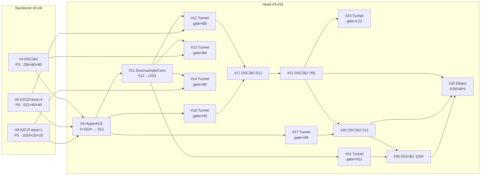

# YOLOv13 架构与层速查

> 首发载体：`iMoonLab/yolov13` commit `73289949533efac82bb5f72ec19b746618656bd2`（2025-11-18），对应 arXiv:2506.17733v2。以 [yolov13.yaml](/versions/v13/source/yolov13-yaml) 为基准（**cfg 目录 `v13/` 带 `v` 前缀**，与 v12 一致；4 档 scales：n/s/l/x，无 m 档），本页通道数为**缩放前基准值**（width=1.0），四档 scales 与 tasks.py 特例见 §9。总览页见 [YOLOv13 架构总览](/versions/v13/architecture)。

> **v1~v12 读者路标**：这张 yaml 是 [yolov12.yaml](/versions/v12/layers) 的下一代——**骨干 9 层保持 A2C2f 内嵌 Attention 的思路（#6/#8），但下采样改用 DSConv（深度可分离 stride-2）、C3k2 中段换成 DSC3k2**；**Head 首个 block 变成 HyperACE**（把骨干 P3/P4/P5 三路 concat 后一次超图融合），随后是 FPN+PAN + **7 条 FullPAD_Tunnel 门控连接**（骨干↔颈部 3 条 / 颈部内部 1 条 / 颈部↔头 3 条），最后 Detect 输出。整张 yaml **32 层**（v12 是 22 层），新增的 10 层主要在 FullPAD tunnel 与额外 downsample/conv 路径。

## 1. 全网络层一览表（yolov13.yaml L11-L50，基准宽度 @640 输入）

> **v1~v12 读者路标**：这张表可直接与 [v12 逐层图解 §1](/versions/v12/layers) 逐层对照——与 v12 相比只有 **11 处结构不同**：骨干 9 层中 C3k2 换成 DSC3k2（#2/#4）、Conv s2 换成 DSConv s2（#5/#7），Head 从 13 层扩到 23 层（#9 HyperACE + 7 次 FullPAD_Tunnel + 3 次 Upsample/Concat 结构变化）。Detect 位置从 yaml L45 挪到 L50。

### 1.1 Backbone（yaml L11-L19，9 层）

| 行号 | 层号 | 层类型 | 参数（yaml 原文） | 输出（基准 @640） | 说明 |
|-----|-----|-----------|--------------------|--------------------|------|
| <SrcLink file="v13:ultralytics/cfg/models/v13/yolov13.yaml" :line="11" /> | 0 | `Conv` | 64, 3, 2 | 64×320×320 | stem 下采样 · P1/2 |
| <SrcLink file="v13:ultralytics/cfg/models/v13/yolov13.yaml" :line="12" /> | 1 | `Conv` | 128, 3, 2 | 128×160×160 | P2/4 |
| <SrcLink file="v13:ultralytics/cfg/models/v13/yolov13.yaml" :line="13" /> | 2 | `DSC3k2` | 256, **False**, 0.25 ×2 | 128×160×160 | **v13 新：骨干浅层 · dsc3k=False 走 DSBottleneck · e=0.25** |
| <SrcLink file="v13:ultralytics/cfg/models/v13/yolov13.yaml" :line="14" /> | 3 | `Conv` | 256, 3, 2 | 256×80×80 | P3/8（小目标尺度起点） |
| <SrcLink file="v13:ultralytics/cfg/models/v13/yolov13.yaml" :line="15" /> | 4 | `DSC3k2` | 512, **False**, 0.25 ×2 | 256×80×80 | **v13 新：骨干 P3 · dsc3k=False · e=0.25** |
| <SrcLink file="v13:ultralytics/cfg/models/v13/yolov13.yaml" :line="16" /> | 5 | `DSConv` | 512, 3, 2 | 512×40×40 | **v13 新：P4/16 下采样（v12 是 Conv s2，v13 换成 depthwise-separable）** |
| <SrcLink file="v13:ultralytics/cfg/models/v13/yolov13.yaml" :line="17" /> | 6 | `A2C2f` | 512, **True, 4** ×4 | 512×40×40 | **v12 保留 · P4/16 · a2=True · area=4 局部 Attention** |
| <SrcLink file="v13:ultralytics/cfg/models/v13/yolov13.yaml" :line="18" /> | 7 | `DSConv` | 1024, 3, 2 | 1024×20×20 | **v13 新：P5/32 下采样** |
| <SrcLink file="v13:ultralytics/cfg/models/v13/yolov13.yaml" :line="19" /> | 8 | `A2C2f` | 1024, **True, 1** ×4 | 1024×20×20 | **v12 保留 · P5/32 · a2=True · area=1 全局 Attention** |

- **骨干深段两处 A2C2f 完全保留 v12 结构**（#6 area=4 局部、#8 area=1 全局），只是通道缩放由 tasks.py 特例处理；
- **两处下采样换 DSConv**（#5/#7）：`DWConv(k=3, s=2, d=1) + PWConv(1×1, s=1, 2×c)`，把 s2 stride 塞进 DWConv 内部，参数与计算量约为 Conv s2 的 1/4；
- **两处骨干融合块换成 DSC3k2**（#2/#4）：与 v12 的 C3k2 相比，内瓶从 Bottleneck 换成 DSBottleneck（两段 DSConv k1=3 + k2=5），`dsc3k=False` 时走 DSBottleneck 单段，`dsc3k=True` 时走 DSC3k 骨架（Head 里的 DSC3k2 都用 `True`）；
- **无 SPPF / 无 C2PSA**：与 v12 一致，v11 引入的 SPPF 与 C2PSA 在 v13 里也继续撤出 yaml（模块类仍在 `block.py` 里保留）。

### 1.2 Head 首个融合块（yaml L22，1 层 HyperACE）

| 行号 | 层号 | 层类型 | 参数（yaml 原文） | 输出（基准 @640） | 说明 |
|-----|-----|-----------|--------------------|--------------------|------|
| <SrcLink file="v13:ultralytics/cfg/models/v13/yolov13.yaml" :line="22" /> | 9 | `HyperACE` | `[4, 6, 8], 512, 8, True, True, 0.5, 1, "both"` | 512×40×40 | **v13 招牌：一次超图融合 P3/P4/P5 → 3×1024=3072 → 512** |

- **`from=[4, 6, 8]`**：把骨干 P3（层 4 DSC3k2 · 256×80×80）、P4（层 6 A2C2f · 512×40×40）、P5（层 8 A2C2f · 1024×20×20）三处直接接入，**这是 v13 与 v12 结构上最大的差异**——v12 Head 的 P3/P4/P5 分别由 A2C2f a2=False 融合，v13 让 HyperACE 在 #9 一次性融合；
- **参数逐项解读**：
  - `512` → `c`（超图隐藏通道）
  - `8` → `M`（默认超边数；tasks.py L1079 会给 `n` 档乘 0.5→4，给 `x` 档乘 1.5→12）
  - `True` → `fuse=True`（启用 FuseModule 前融合）
  - `True` → `channel_adjust=True`（FuseModule 里 x[0] 通道加倍、x[2] 通道减半后 concat；l/x 档由 tasks.py 覆写为 `False`）
  - `0.5` → `e`（宽度系数，chunk 三路时 `c_ = int(c*e) = 256`）
  - `1` → `L`（并列 DSC3k 的重复数；tasks.py 强制为 1，忽略 yaml 值）
  - `"both"` → context 类型（mean+max 拼接）
- **repeats=2 被 tasks.py 忽略**：`if m._from: m.n = 1`（tasks.py L1077-1078）——`n` 只在 yaml 里作为占位符存在。

### 1.3 Head FPN 上行（yaml L23-L43，24 层）

| 行号 | 层号 | 层类型 | 参数（yaml 原文） | 输出（基准 @640） | 说明 |
|-----|-----|-----------|--------------------|--------------------|------|
| <SrcLink file="v13:ultralytics/cfg/models/v13/yolov13.yaml" :line="23" /> | 10 | `nn.Upsample` | None, 2, nearest | 512×40×40 | HyperACE 上采样到 P4 |
| <SrcLink file="v13:ultralytics/cfg/models/v13/yolov13.yaml" :line="24" /> | 11 | `DownsampleConv` | — | 1024×40×40 | **v13 新：AvgPool2d(2)+Conv(1×1, 2×c)**——把 HyperACE 通道再翻一倍 |
| <SrcLink file="v13:ultralytics/cfg/models/v13/yolov13.yaml" :line="25" /> | 12 | `FullPAD_Tunnel` | `[6, 9]` → `[6, 11]` | 1024×40×40 | **v13 新：gate * (骨干 P4 A2C2f) → 颈部 L11 加门控** |
| <SrcLink file="v13:ultralytics/cfg/models/v13/yolov13.yaml" :line="26" /> | 13 | `FullPAD_Tunnel` | `[4, 11]` | 1024×40×40 | **v13 新：gate * (骨干 P3 DSC3k2) → 颈部 L11** |
| <SrcLink file="v13:ultralytics/cfg/models/v13/yolov13.yaml" :line="27" /> | 14 | `FullPAD_Tunnel` | `[8, 11]` | 1024×40×40 | **v13 新：gate * (骨干 P5 A2C2f) → 颈部 L11** |
| <SrcLink file="v13:ultralytics/cfg/models/v13/yolov13.yaml" :line="29" /> | 15 | `nn.Upsample` | None, 2, nearest | 1024×80×80 | L11 上采样到 P3 |
| <SrcLink file="v13:ultralytics/cfg/models/v13/yolov13.yaml" :line="30" /> | 16 | `Concat` | `[-1, 12]` | 2048×80×80 | cat #12（P4 骨干↔颈部 tunnel 结果） |
| <SrcLink file="v13:ultralytics/cfg/models/v13/yolov13.yaml" :line="31" /> | 17 | `DSC3k2` | 512, **True** ×2 | 512×80×80 | **v13 新：dsc3k=True 走 DSC3k 骨架（C3 + DSBottleneck 序列）** |
| <SrcLink file="v13:ultralytics/cfg/models/v13/yolov13.yaml" :line="32" /> | 18 | `FullPAD_Tunnel` | `[-1, 9]` | 512×80×80 | **v13 新：gate * (颈部 L9 HyperACE) → L17** |
| <SrcLink file="v13:ultralytics/cfg/models/v13/yolov13.yaml" :line="34" /> | 19 | `nn.Upsample` | None, 2, nearest | 512×160×160 | L17 上采样到 P2 分辨率（80→160，实际是 P3 上采样到 P2 尺度） |
| <SrcLink file="v13:ultralytics/cfg/models/v13/yolov13.yaml" :line="35" /> | 20 | `Concat` | `[-1, 13]` | 1536×80×80 | cat #13（骨干 P3↔颈部 tunnel 结果，通道 1024） |
| <SrcLink file="v13:ultralytics/cfg/models/v13/yolov13.yaml" :line="36" /> | 21 | `DSC3k2` | 256, **True** ×2 | 256×80×80 | **v13 新：P3 检测输入 · stride 8** |
| <SrcLink file="v13:ultralytics/cfg/models/v13/yolov13.yaml" :line="37" /> | 22 | `Conv` | 256, 1, 1 | 256×80×80 | 1×1 通道规整 |
| <SrcLink file="v13:ultralytics/cfg/models/v13/yolov13.yaml" :line="38" /> | 23 | `FullPAD_Tunnel` | `[21, 22]` | 256×80×80 | **v13 新：gate * (L22 1×1) → L21**——颈部内部再融 |
| <SrcLink file="v13:ultralytics/cfg/models/v13/yolov13.yaml" :line="40" /> | 24 | `Conv` | 256, 3, 2 | 256×40×40 | PAN 下行 · 回到 P4 分辨率 |
| <SrcLink file="v13:ultralytics/cfg/models/v13/yolov13.yaml" :line="41" /> | 25 | `Concat` | `[-1, 18]` | 768×40×40 | cat #18（颈部内部 FullPAD tunnel） |
| <SrcLink file="v13:ultralytics/cfg/models/v13/yolov13.yaml" :line="42" /> | 26 | `DSC3k2` | 512, **True** ×2 | 512×40×40 | **v13 新：P4 检测输入 · stride 16** |
| <SrcLink file="v13:ultralytics/cfg/models/v13/yolov13.yaml" :line="43" /> | 27 | `FullPAD_Tunnel` | `[-1, 9]` | 512×40×40 | **v13 新：gate * (颈部 L9 HyperACE) → L26** |
| <SrcLink file="v13:ultralytics/cfg/models/v13/yolov13.yaml" :line="45" /> | 28 | `Conv` | 512, 3, 2 | 512×20×20 | PAN 下行 · 回到 P5 分辨率 |
| <SrcLink file="v13:ultralytics/cfg/models/v13/yolov13.yaml" :line="46" /> | 29 | `Concat` | `[-1, 14]` | 1536×20×20 | cat #14（骨干 P5↔颈部 tunnel） |
| <SrcLink file="v13:ultralytics/cfg/models/v13/yolov13.yaml" :line="47" /> | 30 | `DSC3k2` | 1024, **True** ×2 | 1024×20×20 | **v13 新：P5 检测输入 · stride 32** |
| <SrcLink file="v13:ultralytics/cfg/models/v13/yolov13.yaml" :line="48" /> | 31 | `FullPAD_Tunnel` | `[-1, 11]` | 1024×20×20 | **v13 新：gate * (颈部 L11 DownsampleConv) → L30** |
| <SrcLink file="v13:ultralytics/cfg/models/v13/yolov13.yaml" :line="50" /> | 32 | `Detect` | `[23, 27, 31], nc` | — | Detect(P3, P4, P5)——三尺度收尾 |

**Head 关键节奏**：

- **HyperACE 一次性融合**（#9）后，v13 走**「Upsample 2× + 三条骨干↔颈部 tunnel 注入」→ 上采样到 P3 → DSC3k2 + 颈部内部 tunnel → 到 Detect 前再一次 DownsampleConv→Concat→DSC3k2→FullPAD** 的节奏；
- **7 条 FullPAD_Tunnel 的分布**：#12/#13/#14（骨干→颈部） · #18（颈部内部） · #23（颈部内部） · #27（颈部→头） · #31（颈部→头）——**每条都是「跨尺度或跨头的一个软融合点」**；
- **3 次 Detect 输入位置**：#23（P3）、#27（P4）、#31（P5）——**Detect 的入参不是 backbone 直连，而是 FullPAD tunnel 处理后的颈部输出**；
- **无 SPPF / 无 C2PSA**：与 v12 一致。

## 2. FullPAD_Tunnel 分布：一次看清 7 条连接

> **v1~v12 读者路标**：v12 只有 FPN+PAN 四段（Concat ×3 + DSC3k2 ×3），v13 在此基础上加了 **7 条 FullPAD_Tunnel**——论文 §III-C 称之为「Full-Pipeline Aggregation-and-Distribution」。每条 tunnel 都对应一对跨尺度/跨头/跨骨干的**软门控连接**。

| 序号 | 层号 | from 索引 | 语义 | 位置 |
|------|------|-----------|------|------|
| 1 | #12 | [骨干 P4 A2C2f, L11] | 骨干 P4 → 颈部 | 骨干↔颈部 |
| 2 | #13 | [骨干 P3 DSC3k2, L11] | 骨干 P3 → 颈部 | 骨干↔颈部 |
| 3 | #14 | [骨干 P5 A2C2f, L11] | 骨干 P5 → 颈部 | 骨干↔颈部 |
| 4 | #18 | [L17, L9 HyperACE] | 颈部 → 颈部 | 颈部内部 |
| 5 | #23 | [L21, L22 Conv 1×1] | 颈部 → 颈部 | 颈部内部 |
| 6 | #27 | [L26, L9 HyperACE] | 颈部 → 头 | 颈部→头 |
| 7 | #31 | [L30, L11 DownsampleConv] | 颈部 → 头 | 颈部→头 |

**gate 初始化与训练动力学**：`FullPAD_Tunnel.__init__` 里 `self.gate = nn.Parameter(torch.tensor(0.0))`——**gate 初始化为标量 0**，训练前 `out = x[0] + 0.0 * x[1] = x[0]`（直通）；训练中 gate 从 0 学出值，让 tunnel 从「无影响」逐步参与训练。这是论文 TABLE III 消融里 `000→47.1 / 100→47.8 / 010→47.6 / 001→47.7 / 111→48.0`（v13-S）里三条单独消融都带来 0.5-0.7 AP 增益的工程基础。

## 3. 骨干↔头部数据流总图

- **骨干三路（B4/B6/B8）**都被 HyperACE 拉进一次融合，同时也作为 tunnel 的 x[1] 输入；
- **颈部 L9（HyperACE）**是"总枢纽"，被 #18/#27 两条 tunnel 反复复用；
- **颈部 L11（DownsampleConv）**是"通道翻倍器"，同时是 #12/#13/#14 三条 tunnel 的注入点，也是 #31 的 x[1] 来源；
- **Detect 输入 #23/#27/#31** 都不是"干净"的 DSC3k2 输出，而是**经过 tunnel 融合的软门控版本**。

## 4. 通道数速查表（基准 width=1.0）

| 尺度 | 骨干（yaml 层） | 输出通道 | Head 输入（yaml 层） | 输出通道 |
|------|-----------------|----------|---------------------|----------|
| P1/2 | #1 Conv | 128 | — | — |
| P2/4 | #4 DSC3k2 | 256 | — | — |
| P3/8 | #6 A2C2f（v12 保留） | 512 | #23 FullPAD_Tunnel | 256 |
| P4/16 | #8 A2C2f（v12 保留） | 1024 | #27 FullPAD_Tunnel | 512 |
| P5/32 | #11 A2C2f（v12 保留） | 2048 | #31 FullPAD_Tunnel | 1024 |

**注**：`DSC3k2 e=0.25` 时，256 通道的 DSC3k2 内部 c_ = int(256×0.25) = 64，DSBottleneck 的 c = int(64×0.5) = 32；`DSC3k2 e=1.0`（Head 里的默认）时通道不缩小。

## 5. 与 v12 结构对比表

| 位置 | v12 | **v13** | 影响 |
|------|-----|---------|------|
| 骨干 #2/#4（浅层） | `C3k2 c3k=False, e=0.25` | **`DSC3k2 dsc3k=False, e=0.25`** | 内瓶换 DSBottleneck（两段 DSConv），计算量约降一半 |
| 骨干 #5/#7（s2 下采样） | `Conv 3×3 s2` | **`DSConv 3×3 s2`** | stride 塞进 DWConv，参数下降 |
| 骨干 #6/#8（深段注意力） | `A2C2f a2=True` | **完全保留** | 无结构差异 |
| Head #9（首个融合） | `Upsample + Concat + A2C2f a2=False` | **`HyperACE`**（三路 concat 一次融合） | **v13 最大结构差异** |
| Head 中段融合块 | `A2C2f a2=False` | **`DSC3k2 dsc3k=True`** | C3k 骨架换 DSC3k 骨架（C3 + DSBottleneck 序列） |
| Head FPN+PAN 之外 | 无 | **7 条 FullPAD_Tunnel 门控连接** | 骨干↔颈部 3 条 / 颈部内部 2 条 / 颈部→头 2 条 |
| Head 通道调节 | Concat 直接拼接 | **`DownsampleConv`（#11）+ Conv 1×1（#22）** | 额外两次通道整理 |
| 层总数 | 22 | **32** | +10 层（FullPAD tunnel 占 7 层，其余为 Conv/Upsample/Concat） |

## 6. 参数对比表（arXiv 2506.17733 TABLE I）

| 型号 | 参数量 (M) | FLOPs (G) | 结构说明 |
|------|-----------|-----------|----------|
| YOLOv12-S | 9.3  | 21.4  | 骨干 C3k2 × 2 + Conv s2 × 2 + A2C2f × 2；Head A2C2f × 3 + C3k2 × 1 |
| YOLOv12-L | 26.4 | 88.9  | 同上，width=1.0 |
| YOLOv12-X | 59.1 | 199.0 | 同上，width=1.5 |
| **YOLOv13-N** | **2.5**  | **6.4**  | **骨干 DSC3k2 × 2 + DSConv s2 × 2 + A2C2f × 2；Head HyperACE + DSC3k2 × 6 + 7 FullPAD** |
| **YOLOv13-S** | **9.0**  | **20.8** | **同上，width=0.5** |
| **YOLOv13-L** | **27.6** | **88.4** | **同上，width=1.0** |
| **YOLOv13-X** | **64.0** | **199.2** | **同上，width=1.5** |

- **v13-S 相对 v12-S**：参数 -0.3M，FLOPs -0.6G，AP +0.9；
- **v13-L 相对 v12-L**：参数 +1.2M，FLOPs -0.5G，AP +0.4；
- **v13-X 相对 v12-X**：参数 +4.9M，FLOPs +0.2G，AP +0.4；
- **代价**：论文 TABLE I 里的 T4 FP16 延迟 v13-S 比 v12-S 慢 0.16ms、v13-L 慢 1.53ms、v13-X 慢 2.21ms——**多出的 FullPAD tunnel + AdaHGComputation 在推理端有开销**。

## 7. 四档 scales 与 channel 缩放（yaml L2-L7）

| 档位 | depth | width | max_channels | FLOPs 相对基准 | 备注 |
|------|-------|-------|--------------|---------------|------|
| n | 0.50 | 0.25 | 1024 | ~1/10 | 极端轻量档 |
| s | 0.50 | 0.50 | 1024 | ~1/3 | 主流入门档 |
| l | 1.00 | 1.00 | **512** | ~1 | **max_channels 从 v12 的 1024 降到 512** |
| x | 1.00 | 1.50 | **512** | ~2 | 同上 |

**l/x 档 max_channels 从 1024 降到 512** 是 v13 的隐性改动——**限制了 width=1.5 时通道翻倍的上限**，防止 l/x 档 A2C2f 内部通道数失控。这是 tasks.py `guess_model_scale` 里通过 yaml scales 字典查表生效的。

## 8. 训练配方（arXiv §IV-A2 + README L60-80）

| 项目 | 值 | 备注 |
|------|-----|------|
| Epochs | 600 | 比 default.yaml 出厂 100 更激进 |
| Batch | 256 | 比 default.yaml 出厂 16 大 16 倍 |
| Image size | 640×640 | |
| Optimizer | SGD，lr=0.01 | `optimizer: auto` 内部处理 |
| Warmup | 3 epoch | `warmup_bias_lr=0.0`（trainer.py L788 auto 覆盖） |
| LR schedule | linear decay | `cos_lr=False` |
| 数据增强 | Mosaic + Mixup + copy_paste | 按 n/s/l/x 分档差异化 |
| close_mosaic | 最后 10 epoch | default.yaml L33 |
| 硬件 | N/S 4-8×RTX 4090；L/X 4-8×A800 | 论文原文 |
| 延迟测法 | T4 + TensorRT FP16 | |

## 9. tasks.py 特例与缩放细节（tasks.py L1075-L1095）

**HyperACE 特例**（L1075-1086）：

- `m.n = 1`（强制覆盖 yaml 里的 repeats=2）；
- `n` 档：`M = int(M × 0.5)`（8 → 4，最小值 2）；
- `x` 档：`M = int(M × 1.5)`（8 → 12）；
- `l/x` 档：`m.channel_adjust = False`（FuseModule 里 x[0] 通道不变、x[2] 通道不变，直接 concat 3×c 而非 4×c）。

**DownsampleConv 特例**（L1087-1095）：

- `l/x` 档：`m.downsample = False`（等价 Identity），并且 `c2 = c1`（不翻倍通道）——**l/x 档不走 2× 通道翻倍**。

**为什么**：这些特例是作者为了让不同档位"参数量可控"而加的工程 hack——**n 档超边数最小化，l/x 档通道翻倍关闭**，让 4 档 scales 落到不同数量级的模型大小。

## 10. 想快速对上位读者的话

- **v8 读者**：把 v13 当作「v8 骨干 + 骨干深段内嵌 Attention（沿用 v12） + 骨干中段换成深度可分离（DSC3k2） + Head 首个 block 换成 HyperACE（超图消息传递） + Head 里插 7 条学习门控（FullPAD_Tunnel）」来读；
- **v11 读者**：v13 与 v11 相比**去掉了 SPPF / C2PSA**（与 v12 一致），骨干 P4/P5 内嵌 Attention（A2C2f，v12 引入、v13 沿用），骨干浅段换 DSC3k2（v13 新增），Head 首次出现 HyperACE + FullPAD；
- **v12 读者**：v13 相对 v12 的变化集中在**骨干 #2/#4/#5/#7 换 DSConv 家族**与**Head 首个 block 换 HyperACE + 加 7 条 FullPAD tunnel**；骨干深段 A2C2f 沿用，损失/头/Detect 零改动。

## 参考

- [yolov13.yaml 源码页](/versions/v13/source/yolov13-yaml)
- [Architecture 逐层图解](/versions/v13/architecture)
- [理论 Concept](/versions/v13/concepts)
- Yang W. *YOLOv13.* arXiv:2506.17733v2, 2025-11. https://arxiv.org/abs/2506.17733
