# YOLOv13 反向传播推导

> 核心事实：**v13 的损失梯度图 = v8 的梯度图 + Attention 内嵌 + 超图消息传递**。损失类仍是 `v8DetectionLoss`（<SrcLink file="v13:ultralytics/utils/loss.py" :line="157" />），三分量（box / cls / dfl）与 7.5 / 0.5 / 1.5 增益与 v8 完全一致；TAL 分配器在 loss.py L176 显式覆盖为 `topk=10, α=0.5, β=6.0`。**v13 相对 v12 的梯度差异不在损失侧、也不在头部**，而在**骨干 P4/P5 与 Head 首个融合块**——**A2C2f 保留 v12 的 FlashAttention 路径 + HyperACE 引入 AdaHGConv 的 softmax 与两阶段消息传递梯度 + 7 条 FullPAD_Tunnel 引入门控参数 gate 的梯度**。

> **v1~v12 读者路标**：v12 相对 v11 的梯度差异是「骨干换路」——v11 骨干 C3k2 + 末端 C2PSA；v12 骨干 P4/P5 换成 A2C2f（内嵌 Attention）、去 SPPF / 去 C2PSA；Detect cv3 两代都是 DW-separable。**v13 相对 v12 的梯度差异**是「骨干浅段 + Head 主通路同时换路」：骨干 C3k2 换成 DSC3k2、下采样 Conv 换成 DSConv、Head 首个 block 从「Upsample + Concat + A2C2f a2=False」换成 HyperACE（内含 AdaHGComputation + 2×C3AH + DSC3k），外加 7 条 FullPAD_Tunnel 门控连接。**梯度语义完全不变**（无 detach、无双分支、无特殊缩放），v8 读者看本页 §2~§3 就够；v12 读者请重点看 §5（HyperACE 梯度路径）与 §6（FullPAD_Tunnel 门控梯度）。

## 1. 只想带走三件事 (`grad-keypoints`)

1. **v13 的梯度图 = v8 梯度图 + Attention 内嵌 + 超图消息传递 + 门控**：三分量总装、7.5 / 0.5 / 1.5 增益、TAL 分配、BCE + DFL 公式、`close_mosaic=10`——全部与 v8 一字不差；v13 新增的骨干模块（DSBottleneck / DSC3k / DSC3k2）与 Head 模块（HyperACE / FullPAD_Tunnel / DownsampleConv）只是替换骨干与 Head 首段的**梯度通路**——公式上没有新东西，但**梯度路径多了 AdaHGComputation 的 softmax 与两阶段消息传递、FullPAD_Tunnel 的 gate 参数两个环节**（详见[第 5 节](#5-hyperace-骨干的梯度路径-grad-hyperace) 与 [第 6 节](#6-fullpad_tunnel-门控梯度-grad-fullpad)）；
2. **TAL 分配器不参与梯度**：与 v8/v11/v12 完全一致——`@torch.no_grad()` + 预测侧 `.detach()` 双保险（<SrcLink file="v13:ultralytics/utils/tal.py" :line="40" />、<SrcLink file="v13:ultralytics/utils/loss.py" :line="234" :end="235" />），topk / argmax / scatter_add 全是离散决策，分配结果作为常量进入损失；
3. **v13 相对 v12 的梯度差异在骨干与 Head 首段**：两代检测损失都走 loss.py L176 的 `topk=10 / α=0.5 / β=6.0`——**分配侧零差异**；头部两代都是 DW-separable，梯度路径同为 5 段（DWConv + 1×1 交替），**头部零差异**；真正的差异是骨干浅段从 C3k2 换成 DSC3k2（DSBottleneck 内瓶），下采样从 Conv s2 换成 DSConv s2，**Head 首个 block 从「Upsample + Concat + A2C2f a2=False」换成 HyperACE（含 AdaHyperedgeGen + AdaHGConv + FuseModule）**，加上 **7 条 FullPAD_Tunnel 门控梯度路径**。

## 0. 记号与前向数据流 (`grad-flow`)

> **v1~v12 读者路标**：v1–v8 的梯度图都是"骨干 → neck → Detect 单头 → v8DetectionLoss"这套；v9 训练态输出主辅两套预测；v10 训练态输出 `{"one2many", "one2one"}` 双字典项；v11/v12 完全回到 v8 形态；**v13 也完全回到 v8 形态**——`Detect` 头单份预测、单份损失、单份前向输出，没有任何 detach 分流。

```mermaid
flowchart LR
    IMG["640×640 输入"] --> BB["骨干 #0~#4<br/>DSC3k2 ×2 + Conv ×3"]
    BB --> DSC["DSConv s2 #5<br/>★ 深度可分离下采样"]
    DSC --> A1["A2C2f #6<br/>a2=True area=4<br/>★ FlashAttention"]
    A1 --> DSC2["DSConv s2 #7<br/>★ 深度可分离下采样"]
    DSC2 --> A2["A2C2f #8<br/>a2=True area=1<br/>★ FlashAttention"]
    A2 --> HYPER["HyperACE #9<br/>fuse+chunk(3)<br/>2×C3AH + DSC3k<br/>★ AdaHGComputation"]
    HYPER --> TUN["FullPAD_Tunnel ×7<br/>gate 参数 ×7<br/>★ 门控梯度"]
    TUN --> H["Detect 单头 #32<br/>cv2 box · cv3 DW-separable cls · dfl"]
    H --> LM["L_box + L_cls + L_dfl<br/>v8DetectionLoss"]
    LM --> BD["backward"]
```



本页记号：

- $\theta_{\text{back}}$：骨干 #0~#8 参数（含 DSC3k2 + DSConv + A2C2f）；$\theta_{\text{neck}}$：Head #9~#31 参数（含 HyperACE + FullPAD_Tunnel ×7 + DSC3k2）；$\theta_h$：Detect 头 cv2/cv3/dfl 参数
- $x$：Head 输出的三尺度特征（P3/P4/P5），640 输入共 $80^2+40^2+20^2=8400$ 个预测位置
- $L = \lambda_{\text{box}}\, L_{\text{box}} + \lambda_{\text{cls}}\, L_{\text{cls}} + \lambda_{\text{dfl}}\, L_{\text{dfl}}$，出厂权重 **7.5 / 0.5 / 1.5**（v8 默认，v13 沿用）
- $q$：TAL 软标签质量（detach 常量，$q\in(0,1]$）；$\Sigma_q = \max(\sum \text{target\_scores},\ 1)$ 归一化分母
- 分支内部：$z$ 分类/DFL logit，$p=\sigma(z)$；与 [v8 梯度页](/versions/v8/loss-gradient#0-梯度来源与记号) 同一套记号
- **v13 新增**：
  - $\theta_{\text{attn}}$：AAttn 的 `qkv / proj / pe` 三组 Conv 参数（沿用 v12）
  - $\theta_{\text{hg}}$：AdaHyperedgeGen 的 `prototype_base + context_net + pre_head_proj` 参数（<SrcLink file="v13:ultralytics/nn/modules/block.py" :line="1549" :end="1625" />）；AdaHGConv 的 `edge_proj / node_proj` 参数（<SrcLink file="v13:ultralytics/nn/modules/block.py" :line="1626" :end="1675" />）
  - $\theta_{\text{fuse}}$：FuseModule 的三组卷积参数（<SrcLink file="v13:ultralytics/nn/modules/block.py" :line="1764" :end="1802" />）
  - $\theta_{\text{gate}}$：7 条 FullPAD_Tunnel 的 `nn.Parameter(torch.tensor(0.0))`（<SrcLink file="v13:ultralytics/nn/modules/block.py" :line="1891" :end="1916" />）

## 2. 三分量总装与梯度入口 (`grad-loss-py`)

> **v1~v12 读者路标**：v1–v7 的损失类分散在 darknet 与 PyTorch 两套实现里；v8 把它统一成 `v8DetectionLoss`；v9 沿用；v10 引入双分支检测损失；**v11/v12/v13 都回到 v8 的 `v8DetectionLoss`，且 yaml 里都不引用端到端损失**——loss.py 末尾保留的 `E2EDetectLoss` 只是仓库不删东西，v13 训练不会命中。

**v13 的 `v8DetectionLoss.__call__` 与 v11/v12 逐行相同**（<SrcLink file="v13:ultralytics/utils/loss.py" :line="205" :end="259" />）：

```python
# 1. TAL 分配（detach 预测）
targets = self.assigner(batch["bboxes_aux"], batch["cls_aux"], batch_idx,
                       batch["batch_idx_raw"].view(-1), pred_distri, pred_scores)
fg_mask, best_gt_idx, target_bboxes, target_scores, target_gt_scores = ...

# 2. box loss
loss[0] = self.bbox_loss(pred_distri, target_bboxes, target_scores, fg_mask.sum())

# 3. cls loss
loss[1] = self.bce_loss(pred_scores, target_scores)

# 4. dfl loss
loss[2] = self.dfl_loss(pred_distri, target_bboxes, fg_mask) if self.reg_max > 1 else ...
```

**梯度入口**：`L.backward()` → `BboxLoss.backward` / `BCEWithLogitsLoss.backward` / `DFLoss.backward` → Detect 的 cv2/cv3 → Head 三尺度特征。

## 3. Detect 头梯度（沿用 v11/v12）

> **v1~v12 读者路标**：v11/v12/v13 的 Detect 头 cv3 **都是 DW-separable**（<SrcLink file="v13:ultralytics/nn/modules/head.py" :line="46" :end="57" />），梯度路径同为 5 段（DWConv + 1×1 交替）——**三代零差异**。

**Detect 前向**：

```python
def forward(self, x):
    for i in range(self.nl):
        x[i] = self.cv2[i](x[i])   # cv2 box 分支（1×1 Conv，直接送 dfl）
    if self.training:
        return torch.cat([cv2[i](x[i]).view(bs, self.na, -1) for i in range(self.nl)], 1).permute(0, 2, 1)
    ...
```

**梯度路径**：`L_box → cv2[i] → x[i]`（三尺度直接回传）；`L_cls + L_dfl → cv3[i] → x[i]`（分类与回归分支共享底层 x[i]）。

**cv3 DW-separable 梯度**：

```
x[i] → Conv2d(c, c, 1) → Conv2d(c, c, 3, groups=c) → Conv2d(c, c, 1) → Conv2d(c, nc, 1)
```

梯度路径 4 段，与 v11/v12 一致。

## 4. 骨干 DSC3k2 与 DSConv 的梯度 (`grad-ds`)

> **v1~v12 读者路标**：v13 相对 v12 的骨干浅段从 C3k2 换成 DSC3k2、下采样从 Conv s2 换成 DSConv s2——**内瓶从 Bottleneck 换成 DSBottleneck（两段 DSConv k1=3 + k2=5）**。梯度路径**多了 depthwise 与 pointwise 两次交替**。

**DSBottleneck 前向**（<SrcLink file="v13:ultralytics/nn/modules/block.py" :line="1375" :end="1411" />）：

```python
class DSBottleneck(nn.Module):
    def __init__(self, c1, c2, shortcut=True, g=1, e=0.5, k1=3, k2=5, d1=1, d2=1):
        ...
        c_ = int(c2 * e)
        self.cv1 = DSConv(c1, c_, k1, stride=1, d=d1)
        self.cv2 = DSConv(c_, c2, k2, stride=1, d=d2)
        self.add = shortcut and c1 == c2

    def forward(self, x):
        y = self.cv2(self.cv1(x))
        return y + x if self.add else y
```

**DSConv 内部**（<SrcLink file="v13:ultralytics/nn/modules/conv.py" :line="84" :end="101" />）：

```python
def forward(self, x):
    return self.cv2(self.cv1(x))   # DWConv(k) → PWConv(1×1)
```

**梯度路径**（DSBottleneck 内）：

```
x → [cv1: DWConv k1 → BN → SiLU → PWConv 1×1 → BN → SiLU]
  → [cv2: DWConv k2 → BN → SiLU → PWConv 1×1 → BN → SiLU]
  → y
y + x → output（shortcut 时）
```

**关键点**：

- **DSConv 的 DWConv 用 `groups=c_in`**——梯度是逐通道独立反传，参数量与梯度数量都约是普通卷积的 1/c_out；
- **PWConv 用 1×1**——梯度是全通道交叉反传，参数量与梯度数量约是 DWConv 的 c_out 倍；
- **总参数量**：`k²·c_in + c_in·c_out`（对比普通卷积 `k²·c_in·c_out`），在 k=3、c_in=c_out=c 时约降 1/(2c)；
- **残差 add**：`y + x`——**主通路 y 的梯度**与**shortcut x 的梯度**分别独立回传。

## 5. HyperACE 骨干的梯度路径 (`grad-hyperace`)

> **v1~v12 读者路标**：v13 相对 v12 的 Head 首个 block 从「Upsample + Concat + A2C2f a2=False」换成 **HyperACE**（含 FuseModule + 2×C3AH + L 个 DSC3k）——**新增 AdaHyperedgeGen 的动态超边梯度与 AdaHGConv 的两阶段消息传递梯度**。

**HyperACE 前向**（<SrcLink file="v13:ultralytics/nn/modules/block.py" :line="1804" :end="1856" />）：

```python
class HyperACE(nn.Module):
    def __init__(self, c1, c, M=8, fuse=True, channel_adjust=True, e=0.5, L=1, context="both"):
        ...
        self.fuse = FuseModule(c1, channel_adjust) if fuse else nn.Identity()
        self.cv1 = Conv(int(sum(c1)) if fuse else c1, c*3, 1)
        self.ace1 = C3AH(c, c, e=e, L=L, context=context)
        self.ace2 = C3AH(c, c, e=e, L=L, context=context)
        self.dsc3k = nn.Sequential(*(DSC3k(c, c, e=e) for _ in range(L)))
        self.cv2 = Conv(c*2 + c*L, c, 1)

    def forward(self, x):
        x = self.fuse(x)                # FuseModule: 三尺度融合
        y = self.cv1(x)                 # 1×1 conv → c*3 通道
        y1, y2, y3 = y.chunk(3, dim=1) # chunk 三路
        return self.cv2(torch.cat([
            self.ace1(y1),              # C3AH 分支 1
            self.ace2(y2),              # C3AH 分支 2
            self.dsc3k(y3)              # DSC3k 分支（L 个串联）
        ], dim=1))
```

**梯度路径**：

```
L → cv2 → [ace1, ace2, dsc3k] → cv1 → FuseModule → x[0..2]
```

**核心：AdaHGComputation 的梯度**（<SrcLink file="v13:ultralytics/nn/modules/block.py" :line="1677" :end="1719" />）：

```python
class AdaHGComputation(nn.Module):
    def forward(self, x):
        B, C, H, W = x.shape
        X = x.flatten(2).transpose(1, 2)   # [B, HW, C]
        X_new = self.ada_hg_conv(X)        # AdaHGConv
        return X_new.transpose(1, 2).reshape(B, C, H, W)
```

**AdaHGConv 前向**（<SrcLink file="v13:ultralytics/nn/modules/block.py" :line="1626" :end="1675" />）：

```python
class AdaHGConv(nn.Module):
    def forward(self, X):
        A = self.hyperedge_gen(X)          # AdaHyperedgeGen: [B, N, M]
        He = torch.einsum('bnc,bck->bnk', A.transpose(1, 2), X)  # vertex→edge
        He = self.edge_proj(He)
        X_new = torch.einsum('bnk,bck->bcn', A, He)                # edge→vertex
        X_new = self.node_proj(X_new)
        return X_new + X                                     # 残差
```

**AdaHyperedgeGen 前向**（<SrcLink file="v13:ultralytics/nn/modules/block.py" :line="1549" :end="1625" />）：

```python
class AdaHyperedgeGen(nn.Module):
    def forward(self, X):
        B, N, D = X.shape
        # 1. 动态 context
        avg_context = X.mean(dim=1)
        max_context, _ = X.max(dim=1)
        context_cat = torch.cat([avg_context, max_context], dim=-1)
        # 2. 生成动态偏移
        delta_P = self.context_net(context_cat).view(B, M, D)
        P = self.prototype_base.unsqueeze(0) + delta_P   # [B, M, D]
        # 3. 顶点-超边相似度（多头）
        X_proj = self.pre_head_proj(X).view(B, N, num_heads, head_dim)
        P_proj = P.view(B, M, num_heads, head_dim)
        sim = torch.einsum('bnhd,bmhd->bhnm', X_proj, P_proj) / scaling
        # 4. 多头 softmax 归一（每超边归一，dim=1）
        A = sim.softmax(dim=1).mean(dim=1)  # [B, N, M]
        return self.dropout(A)
```

**HyperACE 梯度关键点**：

1. **`prototype_base` 参与梯度**：`nn.Parameter(torch.Tensor(num_hyperedges, node_dim))`——xavier 初始化，每 batch 都会被累加动态偏移 `ΔP`；
2. **`context_net` 参与梯度**：从 `[mean(X), max(X)]` 生成 `ΔP`——`mean` 与 `max` 都是可微的聚合算子；
3. **`A = sim.softmax(dim=1).mean(dim=1)` 是核心**：
   - **`softmax(dim=1)` 是每超边归一**——每超边内 N 个顶点的 A 和为 1（不是每顶点归一）；
   - **`mean(dim=1)` 是多头平均**——4 个头的 softmax 结果平均后作为最终 A；
   - **dropout(0.1)**——训练时随机丢弃 10% 的 A；
4. **两阶段消息传递 `He = A^T · X` → `X_new = A · He`**——`einsum` 是全可微的，梯度按链式法则回传；
5. **残差 `X_new + X`**——主通路与 shortcut 各自独立回传；
6. **C3AH 是 CSP 骨架**——`x → cv1 → AdaHGComputation` 与 `x → cv2`（shortcut）在 `cat` 处合并后再过 `cv3`；
7. **`channel_adjust` 特例**：l/x 档 `channel_adjust=False` 时 FuseModule 里 x[0] 通道不变（v13-S/n 走 `True`）；
8. **`n` 被 tasks.py 强制为 1**——HyperACE 的 repeats 参数被忽略。

## 6. FullPAD_Tunnel 门控梯度 (`grad-fullpad`)

> **v1~v12 读者路标**：v13 在 Head 里插了 **7 条 FullPAD_Tunnel**——每条都是**「学习门控」而不是「固定 concat」**。gate 是标量 `nn.Parameter(torch.tensor(0.0))`——**训练前 gate=0（等价直通 x[0]）**，训练中 gate 从 0 学出值。

**FullPAD_Tunnel 前向**（<SrcLink file="v13:ultralytics/nn/modules/block.py" :line="1891" :end="1916" />）：

```python
class FullPAD_Tunnel(nn.Module):
    def __init__(self):
        super().__init__()
        self.gate = nn.Parameter(torch.tensor(0.0))

    def forward(self, x):
        return x[0] + self.gate * x[1]
```

**梯度路径**：

```
∂L/∂gate = Σ_t (∂L/∂x_out)[t] · x[1][t]
∂L/∂x[0] = ∂L/∂x_out
∂L/∂x[1] = ∂L/∂x_out · gate
```

**关键点**：

1. **`gate` 初始化为 0**：训练前 `∂L/∂x[1] = 0`，x[1] 通路**完全断开**——FullPAD tunnel 训练前不影响梯度；
2. **训练中 gate 学出值**：SGD 更新 `gate ← gate - lr · ∂L/∂gate`——`∂L/∂gate = Σ(∂L/∂x_out) · x[1]`，只要 x[1] 有非零信号，gate 就会被推动离开 0；
3. **门控梯度与残差类似**：与 `y = x + gate · z` 的门控残差等价——**gate 学出来后可视为"软门控"**；
4. **7 条 tunnel 独立**：每条 tunnel 有自己的 `gate` 参数（7 个标量参数），互不影响；
5. **论文消融 TABLE III**：`000→47.1 / 100→47.8 / 010→47.6 / 001→47.7 / 111→48.0`——**三条子组件单独消融增益都在 0.5-0.7 AP**，说明 gate 学到非平凡值。

## 7. DownsampleConv 梯度

**DownsampleConv 前向**（<SrcLink file="v13:ultralytics/nn/modules/block.py" :line="1858" :end="1889" />）：

```python
class DownsampleConv(nn.Module):
    def __init__(self, c1, c2, downsample=True):
        ...
        self.down = nn.Identity() if not downsample else nn.Sequential(
            nn.AvgPool2d(2, stride=2),
            Conv(c1, c2, 1)
        )

    def forward(self, x):
        return self.down(x)
```

**梯度路径**：`L → Conv 1×1 → AvgPool2d(2)`——AvgPool 的梯度是反传时把每个 2×2 窗口内的梯度**平均**（不是求和）；Conv 1×1 走标准卷积反传。

**l/x 档特例**：tasks.py L1087-1095 强制 `downsample=False` 且 `c2 = c1`——**l/x 档 DownsampleConv 是 Identity**（不参与梯度）。

## 8. 与 v12/v11/v8 的对应关系速查

| 维度 | v8 | v11 | v12 | **v13** |
|------|-----|-----|-----|---------|
| 损失类 | `v8DetectionLoss` | 沿用 | 沿用 | **沿用** |
| 三分量增益 | 7.5/0.5/1.5 | 相同 | 相同 | **相同** |
| TAL 分配 | topk=10 α=0.5 β=6.0 | 相同（类默认 topk=13 被覆盖） | 相同 | **相同** |
| 骨干浅段 | Bottleneck/C3k | C3k2 | C3k2 | **DSC3k2（DSBottleneck 内瓶）** |
| 骨干下采样 | Conv 3×3 s2 | Conv 3×3 s2 | Conv 3×3 s2 | **DSConv 3×3 s2** |
| 骨干深段注意力 | 无 | C2PSA（末端） | A2C2f 内嵌（#6/#8） | **A2C2f 保留（#6/#8）** |
| Head 首个 block | FPN Upsample + Concat | FPN + C3k2 | FPN + A2C2f a2=False | **HyperACE** |
| Head 融合块 | C2f/C3k2 | C3k2 | A2C2f a2=False + C3k2 | **DSC3k2 dsc3k=True** |
| Head 额外连接 | 无 | 无 | 无 | **7 条 FullPAD_Tunnel** |
| 头 Detect | v8 Detect（DW-separable cv3） | 相同 | 相同 | **相同** |
| **总损失公式** | 7.5/0.5/1.5 | 相同 | 相同 | **相同** |
| **梯度通路新增** | — | Attention | Attention（FlashAttention） | **Attention + 超图消息传递 + 门控** |

## 9. 想快速对上位读者的话

- **v8 读者**：v13 的损失与头梯度与 v8 完全相同，只是骨干多了一条 Attention 路径（v12 引入，v13 沿用）；
- **v11/v12 读者**：v13 的梯度差异集中在**骨干浅段（DSC3k2 内瓶换 DSBottleneck）、下采样（DSConv s2）与 Head 首个 block（HyperACE）**，外加 **7 条 FullPAD_Tunnel 门控梯度**；
- **v13 独有的梯度挑战**：**AdaHGComputation 的 `A` 矩阵是每 batch 动态生成的**，`softmax(dim=1)` 的每超边归一与 `mean(dim=1)` 的多头平均都要小心梯度；**FullPAD_Tunnel 的 gate 从 0 学起**，训练初期梯度会集中在 `∂L/∂gate` 而不在 x[1] 通路上。

## 参考

- [YOLOv13 损失函数](/versions/v13/losses)
- [理论 Concept](/versions/v13/concepts)
- [v12 反向传播](/versions/v12/loss-gradient)
- [v8 反向传播](/versions/v8/loss-gradient)
- Yang W. *YOLOv13.* arXiv:2506.17733v2, 2025-11. https://arxiv.org/abs/2506.17733
