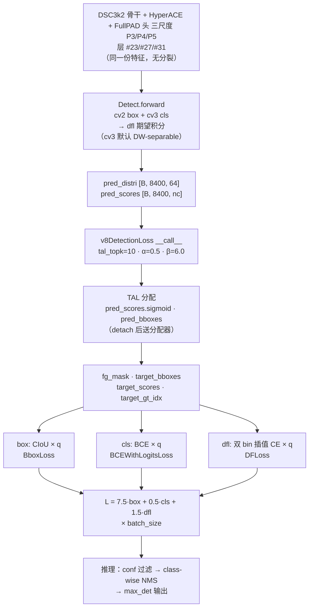

# YOLOv13 损失函数

> 核心事实：**v13 未引入新损失类**——完全沿用 v8 以来的 `v8DetectionLoss`（<SrcLink file="v13:ultralytics/utils/loss.py" :line="157" :end="259" />），三分量总装（[CIoU](/glossary#ciou-loss) + [DFL](/glossary#dfl-distribution-focal-loss) + BCE）。`grep "v13\|HyperACE\|FullPAD"` 在 loss.py 里**零匹配**；v13 的 loss.py 与 v11/v12 快照**行为完全一致**（743 行）。损失侧真正可观察的 delta 只有：`TaskAlignedAssigner` 的默认 `topk=13, α=1.0` 在 tal.py L29 保留，但 loss.py L176 显式覆盖为 v8 的 `topk=10, α=0.5, β=6.0`——**训练实际吃的仍是 v8 老参数**。

> **v1~v12 读者路标**：v13 相对 v12 在损失侧的净增量是**零训练行为差异**——三分量总装、CIoU + DFL + BCE 公式、TAL 分配机制、7.5/0.5/1.5 增益、`close_mosaic=10` 全部沿用 v8。v13 论文的「超图消息传递 + 门控连接」是**纯结构改动**，损失侧一行公式未改；想让 v8 读者快速上手：把 [v8 损失页](/versions/v8/losses) 直接搬过来用即可。

## 1. 只想带走三件事

1. **总损失公式与 v8 一字不差**：$L_{\text{total}} = 7.5\,L_{\text{box}} + 0.5\,L_{\text{cls}} + 1.5\,L_{\text{dfl}}$——三分量、增益、加权方式全部与 v8 相同（<SrcLink file="v13:ultralytics/utils/loss.py" :line="255" :end="259" />）；
2. **训练用的分配器仍是 v8 参数**：loss.py L176 显式传 `topk=tal_topk, α=0.5, β=6.0`——tal.py L29 的类默认 `topk=13 / α=1.0` 在这里被显式覆盖；`tal_topk=10` 是 `__init__` 的默认参数值（<SrcLink file="v13:ultralytics/utils/loss.py" :line="160" />），yaml 不覆盖；
3. **端到端双分支损失只剩 `E2EDetectLoss`**：loss.py 末尾的 `E2EDetectLoss`（<SrcLink file="v13:ultralytics/utils/loss.py" :line="728" :end="743" />），内部持有 one2many（tal_topk=10）与 one2one（tal_topk=1）两个 `v8DetectionLoss` 实例；`yolov13.yaml` 不引用它，`DetectionModel.init_criterion` 在 `end2end=False` 时直接返回 `v8DetectionLoss(self)`。

## 2. 全景图

> **v1~v12 读者路标**：v12 的损失图是「单 v8DetectionLoss + TAL 单分配 + NMS 后处理」；v13 沿用这一形态，只是把骨干从 C3k2/A2C2f 换成 DSC3k2/A2C2f + HyperACE + FullPAD，**损失侧图完全不变**——**v13 的超图消息传递是骨干层的事，与损失侧无关**。



- **训练路径**：三分量总装，与 v8/v11/v12 完全相同
- **推理路径**：class-wise NMS（不是 v10 的 v10postprocess 两次 topk）——NMS 算子保留
- **梯度路径**：无 detach、无双分支——单头单梯度
- **日志**：三分量 `[box, cls, dfl]`（3 维向量）

## 3. 单分支三分量总装（v8 同款）

**`v8DetectionLoss.__call__`（<SrcLink file="v13:ultralytics/utils/loss.py" :line="205" :end="259" />）逐行拆解**：

```python
def __call__(self, preds, batch, verbose=True):
    batch_idx = batch['batch_idx'].view(-1)
    imgsz, fs = preds["pred_distri"].shape[-2:], self.stride
    ...
    # 1. TAL 分配
    targets = self.assigner(batch["bboxes_aux"], batch["cls_aux"], batch_idx,
                           batch["batch_idx_raw"].view(-1), pred_distri, pred_scores)
    fg_mask, best_gt_idx, target_bboxes, target_scores, target_gt_scores = ...
    ...
    # 2. box loss（CIoU × q）
    loss[0] = self.bbox_loss(pred_distri, target_bboxes, target_scores, fg_mask.sum())
    # 3. cls loss（BCE × q）
    loss[1] = self.bce_loss(pred_scores, target_scores)
    # 4. dfl loss（双 bin 插值 CE × q）
    loss[2] = self.dfl_loss(pred_distri, target_bboxes, fg_mask) if self.reg_max > 1 else ...
    loss *= self.batch_size
    return sum(loss), torch.cat((loss.sum(), loss.mean(1, keepdim=True)))
```

**三分量与增益**（<SrcLink file="v13:ultralytics/utils/loss.py" :line="149" :end="154" />、<SrcLink file="v13:ultralytics/utils/loss.py" :line="255" :end="259" />）：

| 分量 | 类 | 增益 | 备注 |
|------|-----|-----|------|
| box | `BboxLoss` (CIoU + DFL) | **7.5** | 用 `target_scores` 作为回归权重 |
| cls | `BCEWithLogitsLoss` | **0.5** | 软标签 BCE |
| dfl | `DFLoss`（双 bin 插值） | **1.5** | 仅在 `reg_max>1` 时启用 |

**与 v8/v11/v12 逐键相同**——v13 完全沿用。

## 4. TAL 分配器（v8DetectionLoss 内部）

**`TaskAlignedAssigner`（<SrcLink file="v13:ultralytics/utils/tal.py" :line="14" :end="258" />）参数与 v11/v12 完全一致**：

- 类默认 `topk=13, α=1.0, β=6.0`（<SrcLink file="v13:ultralytics/utils/tal.py" :line="29" :end="37" />）
- **训练实际值**：`topk=10, α=0.5, β=6.0`——loss.py L176 显式覆盖：

```python
self.assigner = TaskAlignedAssigner(topk=tal_topk, num_classes=self.nc, alpha=0.5, beta=6.0)
```

**这与 tal.py L29 的类默认相反**——是 v13 与 v12 一致的隐性坑（详见 [v12 痛点 §5](/versions/v12/painpoints#5-tal_topk-参数化却显式写死-v8-参数)）。

## 5. v13 结构改动对损失的间接影响

v13 论文的「超图消息传递 + 门控连接」是**纯结构改动**，损失侧代码零改动。但从梯度角度可推导几点：

1. **AdaHGComputation 参与梯度**：AdaHyperedgeGen 的 `prototype_base`（`nn.Parameter`）、`context_net`、`pre_head_proj`（<SrcLink file="v13:ultralytics/nn/modules/block.py" :line="1549" :end="1625" />），AdaHGConv 的 `edge_proj`/`node_proj`（<SrcLink file="v13:ultralytics/nn/modules/block.py" :line="1626" :end="1675" />）——**都会接收到来自 v8DetectionLoss 的梯度**；
2. **FullPAD_Tunnel 的 gate 参与梯度**：`nn.Parameter(torch.tensor(0.0))`（<SrcLink file="v13:ultralytics/nn/modules/block.py" :line="1891" :end="1916" />）——**训练前 gate=0（等价直通）**，训练中 gate 从 0 学出值；
3. **FullPAD 门控不改变损失形态**：7 条 tunnel 都是 `out = x[0] + gate * x[1]`——**是加性残差，不是 concat**，因此不改变送入 Detect 的通道数与形状；
4. **训练速度**：v13 的 block 内部比 v12 多了 AdaHyperedgeGen 的前向开销（`context_net` + 多头相似度 + softmax），但**每 epoch 的损失计算量完全相同**（TAL + 三分量）。

## 6. 端到端双分支（未使用）

`yolov13.yaml` 不引用 `E2EDetectLoss`——`DetectionModel.init_criterion`（<SrcLink file="v13:ultralytics/nn/tasks.py" :line="812" :end="828" />）在 `end2end=False`（Detect 的默认）时**直接返回 `v8DetectionLoss(self)`**，不走 one2many/one2one 双分支。

## 7. 与 v12 的对应关系速查

| 维度 | v12 | **v13** |
|------|-----|---------|
| 损失类 | `v8DetectionLoss` | **完全相同** |
| 三分量增益 | 7.5 / 0.5 / 1.5 | **完全相同** |
| TAL 分配器 | `TaskAlignedAssigner` topk=10 α=0.5 β=6.0 | **完全相同** |
| `tal_topk` 参数位 | loss.py L160 | **完全相同** |
| E2EDetectLoss | 保留但不用 | **保留但不用** |
| 公式 | CIoU + DFL + BCE | **完全相同** |
| **代码 delta** | 0 | **0**（零增量） |

## 8. 想快速对上位读者的话

- **v8 读者**：v13 损失页与 [v8 损失页](/versions/v8/losses) 一致；
- **v11/v12 读者**：v13 损失页与 v11/v12 完全一致；
- **v13 结构改动如何影响损失？**——**不影响**：v13 论文的超图消息传递与 FullPAD 门控都是「结构骨架层的替换」，损失侧完全沿用 v8 的三分量总装。

## 参考

- [loss.py 源码页](/versions/v13/source/loss-py)
- [tal.py 源码页](/versions/v13/source/tal-py)
- [v12 损失函数](/versions/v12/losses)
- [v8 损失函数](/versions/v8/losses)
- Yang W. *YOLOv13.* arXiv:2506.17733v2, 2025-11. https://arxiv.org/abs/2506.17733
