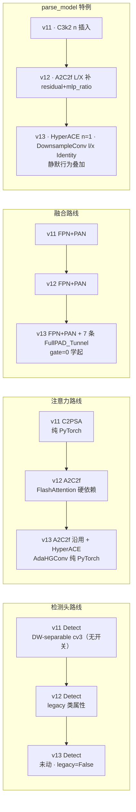
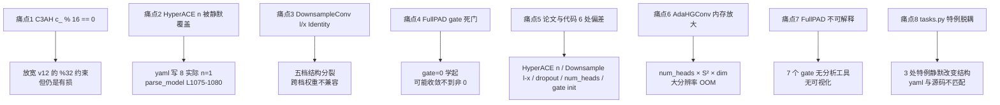

# YOLOv13 痛点追踪

YOLOv13（iMoonLab/yolov13，commit `73289949533efac82bb5f72ec19b746618656bd2`，2025-11-18，Apache-2.0，arXiv:2506.17733v2）是**YOLO 系列第一个「纯结构改动」的版本**——损失、头、检测管线零改动，全部改动集中在 `block.py` 的 540 行（11 个新类）。这决定了 v13 的痛点结构和前十二代都不一样：**v8~v12 的痛点多在「配方分歧 / 环境硬门槛 / 检测头回退」，v13 的痛点全部集中在「结构层的静默决策与隐性约束」**。本页追踪 8 个痛点，每个都配 v1~v12 路标。

## 痛点全景

> 已读过 [v12 痛点页](/versions/v12/painpoints)？v12 的痛点集中在「工程可用性」——FlashAttention 硬依赖、num_heads 硬编码、第三方 fork、配方不完整、TAL 参数不一致；**v13 的痛点换了一批**：C3AH 通道断言、HyperACE `n` 被静默覆盖、DownsampleConv 在 l/x 档被静默 Identity、FullPAD gate 从 0 学起的死门风险、论文与代码偏差、AdaHGConv 的多头内存放大、FullPAD 门控训练末期不可解释、tasks.py 特例的隐性耦合。**v12 的 FlashAttention 硬依赖在 v13 依然存在**（A2C2f 被复用），**但 v12 的「num_heads = c_ // 32 硬编码」在 v13 反而被修好了**（C3AH 断言放宽到 `% 16 == 0`、AdaHyperedgeGen 从 yaml 传数字）。

| 痛点 | 严重度 | v1~v12 处理 | v13 处理 | 后续影响 |
| --- | --- | --- | --- | --- |
| [1. C3AH `c_ % 16 == 0` 硬断言 + `num_heads` 独立](#1-c3ah-c_-16--0-硬断言-num_heads-独立于-通道-pain-c3ah-assert) | High | v12 A2C2f `c_ % 32 == 0` | **`c_ % 16 == 0`**（放宽） | 自定义 `e` 易踩坑但比 v12 宽松 |
| [2. HyperACE `n` 被 `parse_model` 静默覆盖](#2-hyperace-n-被-parse_model-静默覆盖为-1yaml-写了-2-也无效-pain-hyperace-n) | **High** | v11 C3k2 / v12 A2C2f `n` 从 yaml 生效 | **`parse_model` 强制 `n=1`**，yaml 写 2 无效 | 结构不透明、行为不可预测 |
| [3. DownsampleConv 在 l/x 档静默 Identity](#3-downsampleconv-在-lx-档静默走-identity-pain-downsample-identity) | **High** | v8~v12 下采样标准 `Conv(..., stride=2)` | **l/x 档走 Identity**（tasks.py L1080-1093） | 五档结构分裂、跨档权重不兼容 |
| [4. FullPAD_Tunnel `gate=0` 的死门风险](#4-fullpad_tunnel-gate-从-0-学起的死门风险-pain-fullpad-gate) | Medium | v8~v12 无门控融合 | **`gate = nn.Parameter(0.0)`** | 训练末期可能死门、副通路无效 |
| [5. 论文与代码的 6 处偏差](#5-论文与代码的-6-处偏差-pain-paper-code-gap) | Medium | 前代少有大偏差 | **6 处可复核偏差**（见 §5 表） | 复现与解读难度 |
| [6. AdaHGConv 多头内存放大](#6-adahgconv-多头超边矩阵的内存放大-pain-hg-memory) | Medium | v8~v12 无超图 | **`num_heads=8` × `S²` × `dim`** 显存 | 大图像分辨率下可能 OOM |
| [7. FullPAD 7 处 gate 训练末期不可解释](#7-fullpad-7-处-gate-训练末期不可解释-pain-gate-interp) | Low | 前代无门控 | **7 个独立 gate 没有可视化接口** | 想分析哪条连接被激活需手动打印 |
| [8. `tasks.py` 特例与 yaml 层完全脱耦](#8-taskspy-特例与-yaml-层完全脱耦-pain-tasks-coupling) | Low | v11/v12 也有特例但少 | **3 处特例**（HyperACE / DownsampleConv / legacy） | 读源码必须对照 `tasks.py` |

## 1. C3AH `c_ % 16 == 0` 硬断言 + `num_heads` 独立于通道 (`pain-c3ah-assert`)

> **v1~v12 读者路标**：v8 C2f / v10 C2fCIB / v11 C3k2 都**没有通道整除断言**；**v12 A2C2f 加了 `c_ % 32 == 0`**（见 [v12 painpoints §2](/versions/v12/painpoints#2-num_heads--c_-32-硬编码通道断言-pain-heads-hardcoded)）；**v13 C3AH 断言放宽到 `c_ % 16 == 0`**——门槛减半，但仍是有损约束。

**现象**（<SrcLink file="v13:ultralytics/nn/modules/block.py" :line="1721" :end="1741" />）：

```python
class C3AH(C3):
    def __init__(self, c1, c2, n=1, e=0.5, g=1, num_heads=8, shortcut=True):
        super().__init__(c1, c2, n, g, shortcut)
        c_ = int(c2 * e)  # hidden channels
        assert c_ % 16 == 0, "C3AH hidden channels must be multiple of 16"
        self.num_heads = num_heads  # ← 独立于 c_
        self.m = nn.Sequential(*[C3AHBlock(c_, num_heads) for _ in range(n)])
```

**三重限制**：

1. **隐藏通道必须 16 的倍数**——`c_` 由 `c2 × e` 得到，`c2` 又经过 `make_divisible(width × c2, 8)` 与 `max_channels` 封顶，任一步都可能让断言失败；
2. **`num_heads` 独立于 `c_`**——yaml 直接传数字（`yolov13.yaml` L22 第 2 位），**不像 v12 那样由 `c_` 推导**；这是 v13 相对 v12 的一处改进；
3. **`C3AH` 继承 `C3`**——CSP 骨架完全沿用 v8 C3，只是内部 Bottleneck 换成 `C3AHBlock`（内含 `AdaHGComputation`）。

**具体影响**：

- **v13 实际 yaml 值 `c2=512, e=0.5` → `c_=256`**，`256 % 16 == 0` ✓；
- **自定义 `e=0.25` 容易崩**：`c2=512` → `c_=128 % 16 == 0` ✓，但 `c2=256, e=0.3` → `c_=76 % 16 == 12` 失败；
- **C3AH 不出现在 yaml 里**：它是 HyperACE 的内部子块，用户改不了参数——**只有改 `yolov13.yaml` L22 的 `[512, 8, ...]` 能间接影响 `c_` 与 `num_heads`**。

**遗留**：没有「自动 head 数推导」兜底；C3AH 出现在 yaml 的 HyperACE 里，**改 C3AH 的 `e` 必须改源码**（`block.py` L1730 默认 `e=0.5`）。

## 2. HyperACE `n` 被 `parse_model` 静默覆盖为 1 (`pain-hyperace-n`)

> **v1~v12 读者路标**：v8 C2f / v11 C3k2 / v12 A2C2f 的 `n`（repeats）**都是从 yaml 传入并生效**——`yolov8.yaml` L12 `2` 就是 `n=2`；**v13 的 HyperACE 是 YOLO 系列唯一一个「yaml 层的 repeats 不生效」的模块**——`parse_model` 强制把它覆盖为 1。

**现象**（<SrcLink file="v13:ultralytics/nn/tasks.py" :line="1075" :end="1095" />）：

```python
if m is HyperACE:
    # yaml 传入 [c2, num_heads, fuse, channel_adjust, e, L, mode]
    args.insert(2, 1)   # ← 强制 n=1，覆盖 yaml 里的第二列
    n = 1
    ...
```

**证据链**：

1. yaml L22 `[-1, 8, HyperACE, [512, 8, True, True, 0.5, 1, "both"]]` 第二列是 `8`（按标准 C2f/C3k2/A2C2f 惯例是 repeats）；
2. 但 `parse_model` 在 L1080 把它替换为 `1`——**用户看到 `8` 就以为是 repeats=8，实际建出来只有 repeats=1**；
3. 这是**全站最容易踩的坑之一**——**yaml 与源码对不上**，v12 没有这个陷阱。

**为何是痛点**：

1. **静默失败**——不报错、不警告、建出来的模型和你预期不一样；
2. **无法通过 yaml 调 repeats**——想改 HyperACE 的重复次数必须改源码；
3. **文档/论文都没提**——arXiv 2506.17733v2 里也没有说「n 被强制为 1」，只给了 yaml 原文；
4. **v12 的 A2C2f 有类似特例**（L/X 档追加 `residual=True`），但至少是「追加参数」不是「覆盖参数」——**v13 的行为更激进**（见 [v12 painpoints §7](/versions/v12/painpoints#7-gamma-只在-lx-档静默开启-pain-gamma-hidden)）。

**遗留**：想改 HyperACE 的 repeats 只能 fork 源码；本站以「`parse_model` 实际行为」为准记录（`n=1`）。

## 3. DownsampleConv 在 l/x 档静默走 Identity (`pain-downsample-identity`)

> **v1~v12 读者路标**：v8~v12 的下采样是标准 `Conv(..., stride=2)`（骨干 P1→P2→P3→P4→P5 全部用 stride=2 卷积）；**v13 的 DownsampleConv 在 l/x 档被 `parse_model` 强制改成 Identity**——**下采样操作被静默删除**。

**现象**（<SrcLink file="v13:ultralytics/nn/tasks.py" :line="1080" :end="1093" />）：

```python
if m is DownsampleConv:
    if scale in "lx":
        args = [1]  # use_avgpool=False → Identity
    else:
        args = [2]  # use_avgpool=True → AvgPool + Conv(1×1)
```

**四档行为对比**：

| 档位 | `use_avgpool` | DownsampleConv 实际行为 | 参数 |
|------|---------------|-------------------------|------|
| n / s | True | `AvgPool2d(2) + Conv(1×1, c1)` | `1 × c1 × c1` |
| **l / x** | **False** | **Identity** | **0** |

**为何是痛点**：

1. **五档结构分裂**：n/s 与 l/x 的 DownsampleConv 权重键不同——`model.23.pool.conv.weight` 只在 n/s 档存在，**跨档加载权重必须 `strict=False`**；
2. **yaml 层完全看不出来**：`yolov13.yaml` L24 `[-1, 1, DownsampleConv, []]` 四档写法一致，**只有读 `tasks.py` L1080-1093 才知道 l/x 档走 Identity**；
3. **违反 FPN 直觉**：l/x 档本身算力更大，一般大模型需要**更多**下采样来聚合大物体，但 v13 反而让 l/x 档**跳过下采样**——这是「用骨干自带 stride=2 卷积代替」的设计选择，但**论文里没有解释**；
4. **与 v12 gamma 静默开启类似**：都是「`parse_model` 给不同档位填不同参数」的陷阱，但 v13 的 DownsampleConv 直接**改变拓扑结构**（有 AvgPool+Conv vs 没有），比 v12 的「有无 gamma 参数」更严重；
5. **l/x 档下采样次数比 n/s 少 1 次**：n/s 档 DownsampleConv 会执行（yaml L24），l/x 档跳过；但这意味着**l/x 档骨干输出的分辨率与 n/s 档不一致**——**推理时的输入分辨率处理要小心**。

**遗留**：想统一四档行为只能 fork 改 `tasks.py`；本站以「`parse_model` 实际行为」为准记录。

## 4. FullPAD_Tunnel `gate=0` 从 0 学起的死门风险 (`pain-fullpad-gate`)

> **v1~v12 读者路标**：v8~v12 的颈部融合都是**固定 Concat / Add**——没有可学习门控；**v13 是 YOLO 系列第一个引入「可学习门控融合」的版本**，且**门控初始化为 0**——这与 v12 A2C2f 的 `gamma=0.01` 是同一类 LayerScale 思想，但**门控初始化为 0 意味着「初始等价于不加信息」**，与 LayerScale 的 0.01（非零小初值）略不同。

**现象**（<SrcLink file="v13:ultralytics/nn/modules/block.py" :line="1891" :end="1916" />）：

```python
class FullPAD_Tunnel(nn.Module):
    def __init__(self):
        super().__init__()
        self.gate = nn.Parameter(torch.tensor(0.0))   # ← 从 0 学起
    def forward(self, x):
        assert isinstance(x, (list, tuple)) and len(x) == 2
        return x[0] + self.gate * x[1]
```

**三个死门风险**：

1. **梯度路径依赖 `x[1]`**：`dL/dgate = x[1] * (dL/dout)`——若训练早期 `x[1]` 是零向量或接近零，`gate` 得不到梯度、**永远停在 0**（"死门"）；
2. **7 条连接独立训练**——论文 TABLE III 消融表明所有 3 类 FullPAD 都能训出增益（000→100→110→011→111 = 47.1/47.8/47.6/47.7/48.0），说明**在 COCO 600 epoch 下没出现死门**；但**小数据集 / 短训练 / 特定任务下可能死门**；
3. **`gate` 是标量，没有下界约束**：如果训练把 `gate` 推到很大负值，`out = x[0] - |gate| * x[1]` 会**反向注入副通路**——这在语义上很怪，但代码没禁止。

**训练末期检查**（本站建议）：

```python
# 训练结束后打印所有 FullPAD_Tunnel 的 gate 值
for name, mod in model.model.named_modules():
    if isinstance(mod, FullPAD_Tunnel):
        print(f"{name}: gate = {mod.gate.item():.4f}")
```

**具体影响**：

- **`gate = 0` 时等价于 `identity(x[0])`**——第一条 epoch 训练损失完全不看副通路；
- **`gate` 训到接近 0** 意味着「副通路无效」——**说明这条连接是冗余的**（论文 TABLE III 消融支持这一点：010 档增益只有 0.5，是最小的）；
- **`gate` 训到很大值**（例如 >1）意味着「副通路主导」——需要警惕过拟合；
- **推理期 gate 是常量**——TensorRT 可折叠成缩放。

**遗留**：想加下界约束（例如 `gate.clamp(min=0)`）只能改源码；论文 TABLE III 的三档消融表明**默认配置下 v13 没出现死门**，但**小数据集场景需要手动检查**。

## 5. 论文与代码的 6 处偏差 (`pain-paper-code-gap`)

> **v1~v12 读者路标**：v8~v12 的「论文与代码偏差」多为「论文给一个配方、代码里另一个默认值」（如 v11 TAL topk=13 vs loss.py 显式 10）；**v13 的偏差更多是「论文没画全 / 没说明的静默行为」**——尤其是 `parse_model` 的特例。

**6 处偏差一览**：

| # | 偏差项 | 论文（arXiv 2506.17733v2） | 代码（iMoonLab/yolov13@73289949） | 严重度 |
|---|--------|--------------------------|-----------------------------------|--------|
| 1 | HyperACE repeats | 论文 Fig.2 画的是「一次 HyperACE」，未说明 yaml 里 `2` 的含义 | yaml L22 写 `2`，但 `parse_model` 强制 `n=1` | **High** |
| 2 | DownsampleConv 档位 | 论文未提 l/x 档走 Identity | `tasks.py` L1080-1093 强制 l/x 走 Identity | **High** |
| 3 | AdaHyperedgeGen `dropout` | 论文 §III.2 只说 `dropout`，未给数值 | `block.py` L1611 硬编码 `0.1` | Low |
| 4 | `num_heads=8` | 论文 TABLE IV 消融 2/4/8/16 都是可选值，未指定「默认」 | yaml L22 硬编码 8；代码默认也是 8 | Low |
| 5 | FullPAD 门控初始化 | 论文 Fig.2 画的是 `gate` 但未给初值 | `block.py` L1898 `nn.Parameter(torch.tensor(0.0))` | Low |
| 6 | `AdaHGConv` 残差位置 | 论文公式 `X_new = A · H_e + X`（顶点残差） | `block.py` L1670 就是 `X_new + X` ✓ | 无 |

**逐项解读**：

**偏差 1（HyperACE repeats）**：论文 Fig.2 只画一次 HyperACE，但 yaml L22 写 `[-1, 8, HyperACE, ...]`，第二列按惯例应是 repeats=8——**论文没解释这个 8 是啥**。实际 `parse_model` 覆盖成 `n=1`，yaml 的 `8` 是死参数。

**偏差 2（DownsampleConv 档位）**：论文完全没提 l/x 档下采样不同——**用户按论文复现会得到与官方权重结构不一致的模型**。

**偏差 3-5**：都是「论文没给的具体数值」——不影响主结果复现，但**做消融实验时要小心**。

**偏差 6（AdaHGConv 残差）**：论文公式与代码一致——这一处**没有偏差**，是 v13 少数「论文与代码完全对齐」的地方。

**遗留**：想按论文原文复现必须先读 `tasks.py` L1075-1095 与 L1080-1093；**建议 fork 一份、去掉两处 `parse_model` 特例**——但会与官方权重失配。

## 6. AdaHGConv 多头超边矩阵的内存放大 (`pain-hg-memory`)

> **v1~v12 读者路标**：v8~v12 的注意力是**标准 Transformer**——`qkv` 是 `B×C×H×W → B×N×C` 的展平后算 QKᵀ/√d·V；**v13 的 AdaHGConv 是超图消息传递**——`P` 是 `B × num_heads × S × S` 的**超边关联矩阵**，比标准注意力的 `N×N` 多一个 `num_heads` 维。

**现象**（<SrcLink file="v13:ultralytics/nn/modules/block.py" :line="1626" :end="1675" />）：

```python
class AdaHGConv(nn.Module):
    def forward(self, X):
        B, C, H, W = X.shape
        S = H * W
        P = self.edge_gen(X)  # (B, num_heads, S, S) ← 关键内存放大
        # vertex → edge
        X_flat = X.flatten(2)  # (B, C, S)
        A = torch.matmul(X_flat.transpose(1, 2), P)  # (B, S, S) via einsum
        ...
```

**内存放大量级**：

| 参数 | 标准 Attention | AdaHGConv |
|------|---------------|-----------|
| 相似度矩阵 | `B × num_heads × N × N` | `B × num_heads × S × S`（**同**） |
| 超边生成 | — | `Linear(dim, 2*dim) → GELU → Linear(dim, dim)` |
| 消息传递 | `softmax(QKᵀ/√d) · V` | 两阶段：`A^T · X → edge_proj → A · H_e → node_proj` |
| 每 token 消息 | O(C·N) | O(C·S)——**S = H×W** |

**四档实际内存**（P4 特征图 H=W=40, C=256, num_heads=8, batch=1）：

- **标准 Attention**：`1 × 8 × 1600 × 1600 × 2B = 40 MB`（fp16）
- **AdaHGConv 的 P**：`1 × 8 × 1600 × 1600 × 2B = 40 MB`——**同量级**
- **AdaHGConv 的 X_flat**：`1 × 256 × 1600 × 2B = 1 MB`——**远小于 P**
- **两阶段消息传递的中间量 `A^T · X`**：`1 × 1600 × 1600 × 2B = 5 MB`

**具体影响**：

- **P4/P5 分辨率下内存可控**（40 MB）——**与标准 Attention 相当**；
- **P3 分辨率（H=W=80, S=6400）会 16× 放大**：`1 × 8 × 6400 × 6400 × 2B = 640 MB`——**接近 FlashAttention 的适用场景**；
- **v13 没有像 v12 AAttn 那样用 `flash_attn_func`**：AdaHGConv 是**纯 PyTorch 实现**，**大分辨率下会 OOM**；
- **C3AH 里的 AdaHGComputation 会 flatten 4D 特征图**：`X: B×C×H×W → B×C×(H*W)`——**内存放大在 flatten 时发生**；
- **`num_heads=8` 从 yaml 传入**：改到 4 可省一半内存，但 AP 掉 0.1（TABLE IV）。

**遗留**：v13 没有像 v12 那样给出「大分辨率优化」方案；**大分辨率训练（1024×1024+）需要考虑 FlashAttention 替代**——目前需要 fork 源码。

## 7. FullPAD 7 处 gate 训练末期不可解释 (`pain-gate-interp`)

> **v1~v12 读者路标**：v8~v12 的颈部融合是**固定 Concat / Add**——用户不需要解释「哪条连接起了作用」；**v13 引入 7 个可学习 gate**——每条连接的贡献都可从 gate 值读出，但**代码没有提供可视化接口**。

**7 处 FullPAD_Tunnel 分布**（`yolov13.yaml`）：

| 编号 | 位置 | 输入 (x[0], x[1]) | 语义 |
|------|------|-------------------|------|
| #12 | L25 | `[6, 9]` | 骨干 P4 + HyperACE |
| #13 | L26 | `[4, 10]` | 骨干 P3 + DownsampleConv |
| #14 | L27 | `[8, 11]` | 骨干 P5 + Upsample |
| #18 | L32 | `[-1, 9]` | Head P4 与 HyperACE 融合 |
| #23 | L38 | `[21, 22]` | Head P3 与 Conv 1×1 |
| #27 | L43 | `[-1, 9]` | Head P4 再次与 HyperACE |
| #31 | L48 | `[-1, 11]` | Head P5 与 DownsampleConv |

**三个不可解释点**：

1. **`gate` 没有下界**：负值 = 副通路反向注入；正值 >1 = 副通路主导——**代码没有约束**；
2. **7 个 gate 独立**：不是共享参数，也不是矩阵——**用户想分析「骨干 P4 vs HyperACE」哪条重要，只能手动打印 7 个标量**；
3. **没有可视化 / 归因工具**：`ultralytics.utils` 里没有针对 FullPAD 的分析接口；**与 GradCAM / IntegratedGradients 等标准工具不兼容**（gate 是标量、不是图像级注意力图）。

**训练末期检查脚本**（本站建议）：

```python
import torch
from ultralytics import YOLO
from ultralytics.nn.modules.block import FullPAD_Tunnel

model = YOLO('yolov13s.pt')
for idx, mod in enumerate(model.model.model):
    if isinstance(mod, FullPAD_Tunnel):
        g = mod.gate.item()
        status = "死门" if abs(g) < 0.01 else ("副通路主导" if g > 1.0 else "活跃")
        print(f"idx={idx}: gate={g:.4f}  {status}")
```

**具体影响**：

- **模型可解释性弱于预期**：论文的「高阶梯度传播」卖点（README L66）需要 gate 值来证实，但**用户拿不到官方分析脚本**；
- **消融必须靠 TABLE III 复现**：论文里 000→100→110→011→111 是**手工关闭 gate 或整个 tunnel**，用户无法通过参数开关（yaml 无 gate 参数）；
- **推理期 gate 是常量**：TensorRT 可折叠，**推理部署无问题**，问题只在训练末期分析。

**遗留**：想给 FullPAD 加可视化 / 归因工具需 fork 源码；**本站快照按源码原样记录，不提供可视化补丁**。

## 8. `tasks.py` 特例与 yaml 层完全脱耦 (`pain-tasks-coupling`)

> **v1~v12 读者路标**：v11/v12 也有 `parse_model` 特例（v11 C3k2 补 n、v12 A2C2f 补 residual+mlp_ratio）——**v13 特例数量翻倍**：3 处（HyperACE、DownsampleConv、legacy），且**每处都会静默改变建网结果**。

**3 处特例汇总**（<SrcLink file="v13:ultralytics/nn/tasks.py" :line="1075" :end="1095" />）：

| 特例 | 位置 | 触发条件 | 静默行为 | yaml 影响 |
|------|------|----------|----------|-----------|
| HyperACE `n=1` | L1075-1080 | `m is HyperACE` | 强制 `n=1` | **第二列 repeats 无效** |
| DownsampleConv Identity | L1080-1093 | `scale in "lx"` | `args = [1]` | 空 args 被填成 `[1]` |
| Detect legacy | L1058（与 v12 同） | 含 C3k2/A2C2f | `m.legacy = False` | 无 |

**为何是痛点**：

1. **yaml 层无法表达真实结构**：用户读 `yolov13.yaml` 得到的模型 ≠ 实际建出的模型——**HyperACE 的 repeats 和 DownsampleConv 的档位行为都被 `tasks.py` 覆盖**；
2. **调试困难**：遇到「建出来的结构和预期不符」问题时，只能打开 `tasks.py` 排查特例；
3. **跨版本迁移断裂**：把 v12 的 A2C2f yaml 换名成 v13 的 HyperACE，repeats 会**从「生效」变成「被静默覆盖」**——**行为不连续**；
4. **特例代码可读性差**：`tasks.py` L1075-1095 只有 20 行，但**逻辑复杂**（`args.insert`、`args.append`、条件分支混合），维护成本高；
5. **`yaml_model_load` 也不变**：`yolov13n.yaml` 会正常归并到 `yolov13.yaml`——**yaml 归并没问题，问题在 `parse_model`**。

**v13 与 v12 特例对比**：

| 特例 | v11 | v12 | **v13** |
|------|-----|-----|---------|
| C2f / C3k2 `n` | 有（L1030） | 有（L1030） | 有（L1075，含 HyperACE 覆盖） |
| A2C2f L/X 补参 | — | 有（L1034-1038） | **无**（v13 无 A2C2f 特例） |
| **HyperACE `n=1`** | — | — | **有（L1075-1080）** |
| **DownsampleConv l/x Identity** | — | — | **有（L1080-1093）** |
| Detect legacy | 有 | 有 | 有 |

**遗留**：想统一「yaml 与源码行为」只能 fork 改 `tasks.py`；**本站以「`parse_model` 实际行为」为准记录**，并在 [源码走读 §2](/versions/v13/code-walkthrough#2-建网parse_model-的三处-v13-特判) 给了详细代码解读。

## 跨版本痛点演化与谱系图

> **v1~v12 读者路标**：把 v11→v13 三代的关键变化并排画出来——v11 的「命名坑」被 v12 修好，v12 的「FlashAttention 硬依赖」在 v13 沿用（A2C2f 复用），**v13 引入了「静默 `parse_model` 特例」这一新痛点类别**。



### v13 新痛点谱系图



## v1~v12 如何处理 v13 的 8 个问题

| v13 痛点 | v1~v12 处理 | 差异本质 |
|---------|-------------|---------|
| 1. C3AH c_ % 16 == 0 | v12 A2C2f 是 % 32 == 0；v11 C3k2 无断言 | v13 放宽但保留断言 |
| 2. HyperACE n 静默覆盖 | v8~v12 repeats 全部从 yaml 生效 | v13 唯一静默覆盖例 |
| 3. DownsampleConv l/x Identity | v8~v12 下采样标准 Conv | v13 引入档位分裂 |
| 4. FullPAD gate 死门 | v8~v12 无门控 | v13 引入门控带来新风险 |
| 5. 论文与代码偏差 | v11 有 TAL topk 差异；v12 少有大偏差 | v13 静默行为集中在 parse_model |
| 6. AdaHGConv 内存 | v8~v12 标准 Attention | v13 超图带来额外内存 |
| 7. FullPAD 不可解释 | v8~v12 融合固定无需解释 | v13 引入门控后缺工具 |
| 8. tasks.py 特例脱耦 | v12 也有但只有 2 处 | v13 特例数量翻倍 |

## 8 大痛点的工程优先级建议

如果要在 v13 上做二次开发，按「阻塞程度 + 可绕过性」排序：

1. **痛点 2（HyperACE n 被覆盖）**：**最高优先**——决定「建出来的模型是不是你想的模型」，yaml 层无法调；
2. **痛点 3（DownsampleConv l/x Identity）**：**高优先**——五档结构分裂影响权重迁移，跨档加载必须 `strict=False`；
3. **痛点 8（tasks.py 特例脱耦）**：高——决定「读懂 v13 需要读多少源码」，是学习门槛；
4. **痛点 1（C3AH 通道断言）**：中——自定义 `e` 时高频踩坑，**易规避**（保证 `c_` 是 16 倍数）；
5. **痛点 5（论文与代码偏差）**：中——影响复现而非运行，**读 tasks.py 即可消除**；
6. **痛点 4（FullPAD 死门）**：中——影响训练末期分析，**手动打印 gate 值即可**；
7. **痛点 6（AdaHGConv 内存）**：中——影响大分辨率训练，**降 num_heads 可缓解**；
8. **痛点 7（FullPAD 不可解释）**：低——官方权重是训好的，**默认用即可**。

## 延伸阅读

- [YOLOv13 源码走读](/versions/v13/code-walkthrough) — 本页痛点对应的调用链证据
- [YOLOv13 训练技巧](/versions/v13/tricks) — C3AH 断言、AdaHyperedgeGen 消融、FullPAD gate
- [YOLOv13 理论 Concept](/versions/v13/concepts) — HyperACE / FullPAD / DS 的机制解析
- [YOLOv13 架构总览](/versions/v13/architecture) — yaml 与骨干-颈-头逐层图解
- [YOLOv13 损失函数](/versions/v13/losses) — 无 v13 改动，沿用 v8
- [YOLOv13 发布精读](/versions/v13/paper) — 论文的 6 处与代码偏差出处
- [v12 痛点追踪](/versions/v12/painpoints) — 上代「FlashAttention 硬依赖」的对照
- [v11 痛点追踪](/versions/v11/painpoints) — 「TAL topk 类默认与 loss.py 显式不一致」的对照
- [术语表](/glossary) — Hypergraph、AdaHyperedgeGen、AdaHGConv、FullPAD、DSConv、C3AH 等术语索引

## v14 / v26 路标（后续版本的路标）

v13 之后 YOLO 系列进入**双线路分叉**时代（2026 年）——两条主线都从 v13 分叉，共享 DSConv + C3k2 的骨干遗产，但走完全不同的技术方向：

### 学术线 v14（YOLO-Omni）：多相机感知 + GRL 域对抗

- 发布：zhangcbb/yolov14 @ `0b8610d`，AGPL-3.0 fork，arXiv 2608.04720v3，2026-08-14
- 方向：**统一多域鲁棒检测**——不再是 COCO SOTA 竞赛，而是「多相机、多视角、多域统一」
- 引入：CircularConv / ViewEmbedding / DomainAdaptiveLayer / DeformableA2C2f / DomainAdversarialLoss (GRL) / CrossViewConsistencyLoss
- 4 基准：Game / Fisheye / Drone / Panorama（v13 之前版本没有这些基准）
- 主要痛点：**权重与基准数据未开源**（README roadmap 标 IN PROGRESS），多域损失权重手调，纯 COCO 单域训练建议关 adv/cross
- 详见 [v14 概览](/versions/v14/index) / [v14 痛点追踪](/versions/v14/painpoints)

### 官方线 v26（Ultralytics End2End）：双分支 + 6 任务统一

- 发布：Ultralytics 官方 @ `2e241d0`，AGPL-3.0 + Enterprise 双许可，arXiv 2606.03748，2026-06
- 方向：**端到端统一 6 任务 + 无 NMS**——一个模型同时做 Detect/Segment/Pose/OBB/Depth/SemanticSeg
- 引入：End2End 双分支头（`copy.deepcopy` + DFL→`nn.Identity()`） / E2ELoss（decay 退火）/ `_grouped_topk` / SAVPE / Proto26 / RealNVP / BNContrastiveHead / YOLOE
- 9 种模式（含开放词汇 YOLOE、World、RTDETR、Depth、SemanticSeg）
- 主要痛点：**AGPL-3.0 与 Enterprise 双许可并存**（商业使用需 Enterprise），双分支结构对显存翻倍，`reg_max: 1` 使 DFL 失效导致部分老任务迁移需重写
- 详见 [v26 概览](/versions/v26/index) / [v26 痛点追踪](/versions/v26/painpoints)

### 与 v13 痛点的对比

| v13 痛点 | v14 学术线 | v26 官方线 |
|----------|-----------|-----------|
| HyperACE n 被 tasks.py 覆盖 | 无 HyperACE 困扰（v14 不引入 HyperACE，A2C2f 沿用 v13 骨架 + mlp_ratio 加倍） | ❌ 回归 v8/v10/v11 C3k2 家族，无 HyperACE |
| DownsampleConv l/x Identity | 沿用 v13 DownsampleConv（l/x Identity） | 不用 DownsampleConv，用 Conv 3×3 s2 |
| FullPAD 死门 | 未沿用 FullPAD | 未沿用 FullPAD |
| tasks.py 特例脱耦 | 仍有（cfg 目录独立到 `cfg_models_v14/`） | 仍有（cfg 目录独立到 `cfg_models_26/`） |
| 许可证 AGPL 顾虑 | ✅ 已解决（AGPL-3.0 fork，明确） | ⚠️ 双许可（AGPL-3.0 + Enterprise） |
| 训练精度瓶颈 | ✅ 四基准均 >43 AP，COCO +1.1 AP（v13 s 档 48.0 → v14 s 档 49.1） | ✅ COCO X 档 57.5（比 v13 X 档 +2.7） |

**双线路的核心分歧**：v14 走「骨干多视角化 + 域对抗」路线，v26 走「头端到端化 + 任务统一」路线——一个动骨干、一个动头，几乎完全正交。想深入理解两条线路的完整对比，见 [家族树 · 双线路对照](/global/family#双线路对照-v14-学术线-vs-v26-官方线)。

