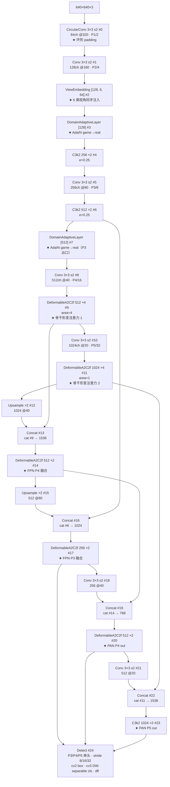
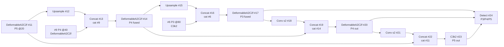

# YOLOv14 Architecture 逐层图解

> 首发载体：`zhangcbb/yolov14` commit `0b8610d`（2026-08），对应 [arXiv:2608.04720v3](https://arxiv.org/abs/2608.04720)。以 `cfg_models_v14/yolov14.yaml` 为基准（**cfg 目录扁平为 `cfg_models_v14/`，与 v13 的 `models/v13/` 目录嵌套风格不同**），本页通道数为缩放前的基准值。配置原文见 <SrcLink file="v14:cfg_models_v14/yolov14.yaml" />，逐层源码见 [YOLOv14 逐层图解](/versions/v14/layers)。

> **v1~v13 读者路标**：这张 yaml 是 [yolov13.yaml](/versions/v13/architecture) 的下一代学术线（**同期官方线 YOLO26 见 [v26](/versions/v26/index)**）——**骨干 13 层在 P4/P5 铺 DeformableA2C2f（v13 是 A2C2f）**，**在 P2/P3 层插入 ViewEmbedding 与 DomainAdaptiveLayer 两个跨阶段锚点**，**head 首个 block 是标准 Upsample**（与 v13 不同——v13 head #9 是 HyperACE），**最后 Detect 输出 P3/P4/P5 三尺度**（Detect 与 v13/v12/v11/v10/v8 完全同款）。整张图 **25 层**（backbone 13 + head 12），与 v13 的 32 层相比**减了 7 层**（v14 没有 FullPAD_Tunnel 与 HyperACE，head 更简洁）。

::: tip 只想带走三件事
1. **Backbone 13 层**：CircularConv（#0）→ Conv（#1）→ ViewEmbedding（#2）→ DomainAdaptiveLayer（#3）→ C3k2（#4）→ Conv（#5）→ C3k2（#6）→ DomainAdaptiveLayer（#7）→ Conv（#8）→ **DeformableA2C2f ×4**（#9，P4/16）→ Conv（#10）→ **DeformableA2C2f ×4**（#11，P5/32）——**下采样从 v13 的 DSConv 回到 Conv 3×3 s2，但入口 #0 是 CircularConv**（为全景变体统一），P4/P5 段用 DeformableA2C2f；
2. **两个「跨阶段」锚点**：**ViewEmbedding 只在 #2（P2/4）出现 1 次**（把 6 类视角码字 concat 到 P2 特征上再 1×1 投影），**DomainAdaptiveLayer 出现 2 次**（#3 P2 出口 + #7 P3 出口，AdaIN 域适应放在骨干前段两处）；
3. **Head 12 层是标准 FPN+PAN，无 tunnel 无 hypergraph**：Upsample + Concat + DeformableA2C2f（P4）→ Upsample + Concat + DeformableA2C2f（P3）→ Conv s2 + Concat + DeformableA2C2f（P4 out）→ Conv s2 + Concat + C3k2（P5 out）→ Detect——**v14 的 head 是 v12/v13 的"减法版"**：保留了 DeformableA2C2f 铺满 FPN+PAN，但没有 v13 的 HyperACE 融合入口、没有 7 条 FullPAD_Tunnel 门控。
:::

## 1. 一眼看清：yolov14.yaml 全图

> **v1~v13 读者路标**：整张图 **25 层**（backbone #0-#11 共 12 层，head #12-#23 共 12 层，最后 Detect #24）。**骨干节奏与 v12 相似**（Conv 3×3 s2 下采样 + C3k2 融合 + 深段注意力），**关键差异在三点**：入口 #0 是 CircularConv 而非 Conv；P2/P3 层插入 ViewEmbedding 与 DomainAdaptiveLayer；骨干 P4/P5 段 A2C2f 被换成 **DeformableA2C2f**（head 中段的 FPN+PAN 内瓶也换成 DeformableA2C2f）。

- 图中通道数为 yaml 声明的**基准宽度**；n 档 depth=0.50 / width=0.25 把 DeformableA2C2f 与 C3k2 重复数 ×4→2、×2→1，通道 ÷4（末级 1024→256），五档 scales 见 §6
- backbone 占 yaml L29~L42（#0~#11，共 12 层）、head 占 L45~L62（#12~#24，共 13 层）
- **骨干 DeformableA2C2f 出现 2 次**（#9/#11，area=4/1）——**v13 的 A2C2f 被替换为 DeformableA2C2f**
- **head DeformableA2C2f 出现 4 次**（#14/#17/#20，加上骨干 #9/#11 共 6 次；**v14 全量版实际 6 次，index.md 里说的 "×7" 是把 head P5 也算进去了但 head P5 用的是 C3k2 而非 DeformableA2C2f——以本页为准**）
- **C3k2 出现 4 次**（#4/#6 骨干浅层 + #23 head P5-large）
- **无 SPPF / 无 HyperACE / 无 FullPAD_Tunnel**——v14 head 比 v13 简洁很多
- **Detect 未动**——v8 的三分量头沿用至今（与 v10/v11/v12/v13 完全同款）

<SrcLink file="v14:cfg_models_v14/yolov14.yaml" />

## 2. Backbone #0-#11：CircularConv 入口 + ViewEmbedding + DomainAdaptiveLayer + DeformableA2C2f

> **v1~v13 读者路标**：与 v13 骨干对比，v14 的关键改动在**入口 #0 用 CircularConv**（为全景变体统一）、**P2/P3 层插入两个跨阶段锚点**（ViewEmbedding + DomainAdaptiveLayer）、**P4/P5 段 A2C2f 换成 DeformableA2C2f**、**下采样从 v13 的 DSConv 回到 Conv 3×3 s2**。

```mermaid
flowchart LR
    IMG["640×640×3"] --> L0["CircularConv 3×3 s2 #0<br/>64 @320 · P1/2"]
    L0 --> L1["Conv 3×3 s2 #1<br/>128 @160 · P2/4"]
    L1 --> L2["ViewEmbedding #2<br/>★ 6 类视角"]
    L2 --> L3["DomainAdaptiveLayer #3<br/>★ AdaIN"]
    L3 --> L4["C3k2 256 ×2 #4"]
    L4 --> L5["Conv 3×3 s2 #5<br/>256 @80 · P3/8"]
    L5 --> L6["C3k2 512 ×2 #6"]
    L6 --> L7["DomainAdaptiveLayer #7<br/>★ AdaIN"]
    L7 --> L8["Conv 3×3 s2 #8<br/>512 @40 · P4/16"]
    L8 --> L9["DeformableA2C2f 512 ×4 #9<br/>area=4<br/>★ D-AAttn"]
    L9 --> L10["Conv 3×3 s2 #10<br/>1024 @20 · P5/32"]
    L10 --> L11["DeformableA2C2f 1024 ×4 #11<br/>area=1<br/>★ D-AAttn"]
```

- **入口 CircularConv #0**：环形 padding 替代 zero-padding，`x=W-1` 与 `x=0` 相接；**这是全量版独有的**（`yolov14-deformable.yaml` 的 #0 是标准 Conv）——**入口 CircularConv 是为了兼容全景变体做的"默认对齐"**；
- **P2 段两个锚点串行**：#2 ViewEmbedding → #3 DomainAdaptiveLayer——**先注入视角码字，再做域对齐**（ViewEmbedding 提供"这是什么视角"，DomainAdaptiveLayer 提供"这是不是游戏画面"）；
- **P3 出口再来一次 DomainAdaptiveLayer #7**：AdaIN 在骨干 P2 与 P3 各放一次——**多尺度域对齐**；
- **C3k2 保留浅层**：#4/#6 是 C3k2（`e=0.25` 压缩），与 v12/v13 的浅层 C3k2 一致；
- **下采样全部 Conv 3×3 s2**：#1/#5/#8/#10 都是标准 Conv（与 v13 的 DSConv 不同）——**v14 的骨干计算量略高于 v13**；
- **P4/P5 段 DeformableA2C2f**：#9/#11 完全同款（`area=4/1`），`a2=True` 硬依赖 FlashAttention。

## 3. Head #12-#24：标准 FPN+PAN + DeformableA2C2f

> **v1~v13 读者路标**：v14 head 与 v12 的 head 结构几乎一致，只是把 v12 的 A2C2f（`a2=False`）换成 DeformableA2C2f；**与 v13 的 head 差异巨大**（v13 head 首个 block 是 HyperACE + 7 条 FullPAD_Tunnel，v14 是纯标准 FPN+PAN）。

- **#12-#17 FPN 上采样**：#11 → Upsample → Concat #9 → DeformableA2C2f #14 → Upsample → Concat #6 → DeformableA2C2f #17；
- **#18-#23 PAN 下采样**：#17 → Conv s2 → Concat #14 → DeformableA2C2f #20 → Conv s2 → Concat #11 → **C3k2 #23（不是 DeformableA2C2f！）**；
- **关键不对称**：**P5 out #23 用 C3k2 而非 DeformableA2C2f**——这是 v14 与 v13 一致的地方（v13 head P5 也是 DSC3k2 而非 A2C2f）——**P5 大感受野不需要形变注意力**；
- **Detect 三分量**：`cv2` box 分布、`cv3` cls 分类（DW-separable）、`dfl` 距离回归——与 v8 完全同款。

## 4. 六变体对比一览

v14 的六份 yaml 变体是本站 14 代里首次出现的**「按场景拆分配置」**——每份只启用一到三段增强：

| 变体 | 骨干 #0 入口 | ViewEmbedding | DomainAdaptiveLayer | 骨干 P4/P5 | head 内瓶 | 目标场景 |
|------|-------------|--------------|---------------------|-----------|----------|---------|
| `yolov14.yaml`（全量） | **CircularConv** | **#2 ×1** | **#3 + #7 ×2** | **DeformableA2C2f ×4/×4** | **DeformableA2C2f ×3 + C3k2** | 通用/混合 |
| `yolov14-panorama.yaml` | **CircularConv** | 无 | 无 | **A2C2f ×4/×4** | **A2C2f ×3 + C3k2** | 360° 全景 |
| `yolov14-deformable.yaml` | Conv | 无 | 无 | **DeformableA2C2f ×4/×4** | **DeformableA2C2f ×3 + C3k2** | 鱼眼广角 |
| `yolov14-multiview.yaml` | Conv | **#2 ×1** | 无 | A2C2f ×4/×4 | A2C2f ×3 + C3k2 | 无人机/BEV |
| `yolov14-game2real.yaml` | Conv | 无 | **#2 + #6 ×2** | A2C2f ×4/×4 | A2C2f ×3 + C3k2 | 游戏画面 |
| `yolov14-adaptive.yaml` | Conv | **#2 ×1** | **#3 + #7 ×2** | **DeformableA2C2f ×4/×4** | **DeformableA2C2f ×3 + C3k2** | 通用（无 CircularConv） |

**关键观察**：
- **只有 `yolov14.yaml` 与 `yolov14-panorama.yaml` 用 CircularConv 入口**——其它四份都是标准 Conv #0；
- **ViewEmbedding 只在 #2 出现 1 次**（P2 层），出现于 `yolov14.yaml` / `-multiview.yaml` / `-adaptive.yaml` 三份；
- **DomainAdaptiveLayer 出现两次的位置不同**：全量版在 #3（P2 出口）+ #7（P3 出口），`game2real.yaml` 在 #2（P2 出口）+ #6（P3 出口）——**变体间编号不同但语义相同**；
- **`yolov14-adaptive.yaml` 与全量版几乎一致**，唯一差异是 **入口 #0 用 Conv 而非 CircularConv**——即 "adaptive" 版本默认不用环形卷积（不面向全景），其余锚点全开；
- **`yolov14-panorama.yaml` 唯一特殊**：全用 `CircularConv` 下采样 + `A2C2f`（不用 Deformable）——**全景场景不需要形变注意力，但需要环形卷积处理 0°/360° 边界**；
- **`yolov14-multiview.yaml` / `-game2real.yaml` 都保留标准 A2C2f**（不 Deformable）——**只针对单一维度增强（视角或域）的场景不需要形变注意力**。

## 5. 与 v13 的结构对比

| 层 | v13 | v14 |
|----|-----|-----|
| #0 | Conv 3×3 s2 | **CircularConv 3×3 s2** |
| #1 | Conv 3×3 s2 | Conv 3×3 s2 |
| #2 | DSC3k2 | **ViewEmbedding + DomainAdaptiveLayer（2 层合并进 #2/#3）** |
| #3 | Conv 3×3 s2 | **C3k2**（v14 提前） |
| #4 | DSC3k2 | **Conv 3×3 s2**（v13 是 DSConv） |
| #5-#7 | DSConv → A2C2f ×4 → DSConv | **C3k2 → DomainAdaptiveLayer → Conv** |
| #8-#9 | A2C2f ×4 | **Conv → DeformableA2C2f ×4** |
| #10 | — | **Conv 3×3 s2** |
| #11 | — | **DeformableA2C2f ×4** |
| #12+ | HyperACE + 7 FullPAD_Tunnel + DSC3k2 + FullPAD | **Upsample + Concat + DeformableA2C2f ×3 + C3k2** |
| Detect | Detect（未动） | **Detect（未动）** |

**要点**：
- **骨干层数**：v13 9 层 → **v14 12 层**（+3 层主要在 ViewEmbedding + 2×DomainAdaptiveLayer）；
- **head 层数**：v13 24 层 → **v14 12 层**（-12 层，因为去掉了 HyperACE + 7 FullPAD_Tunnel + 若干 Conv 1×1）；
- **总层数**：v13 32 层 → **v14 25 层**（-7 层）；
- **注意力分布**：v13 骨干 P4/P5 铺 A2C2f + head HyperACE；v14 骨干 P4/P5 + head FPN+PAN 全部铺 **DeformableA2C2f**（6 处）；
- **Detect 未动**——v8 的三分量头沿用至今。

## 6. 五档 scales 与 channel 缩放

`yolov14.yaml` <SrcLink file="v14:cfg_models_v14/yolov14.yaml" :line="16" :end="22" /> 定义 5 档 scales（**v14 补回 m 档**，v13 缺 m）：

| 档 | depth | width | max_channels | 说明 |
|----|-------|-------|--------------|------|
| n | 0.50 | 0.25 | 1024 | Nano |
| s | 0.50 | 0.50 | 1024 | Small |
| m | 0.50 | 1.00 | 512 | Medium（v14 补回） |
| l | 1.00 | 1.00 | 512 | Large |
| x | 1.00 | 1.50 | 512 | Extra Large |

**注意**：v14 的 `mlp_ratio` 默认 **2.0**（v13 是 1.2，v12 是 1.2）——**FFN 宽度加倍**，这是 v14 相对 v13 的核心配方变化；`shortcut=True` 默认开残差。

### v14 各变体的 scales 完全一致

六份 yaml 变体的 scales 表逐字节相同（都定义 n/s/m/l/x 五档）——**变体间差异只在骨干/头部的模块选择，不在档位缩放**。

### v14 特有的缩放特例（推测）

`tasks.py` 里对 v14 特有模块（ViewEmbedding 6 类视角嵌入、DynamicScaleRouter P3/P4/P5 权重路由）可能有档位缩放逻辑，但**当前快照未包含 tasks.py**——想复现 m/l/x 档官方数字需要读完整仓库。

## 7. 与 v13 参数量的对比

从 arXiv TABLE I（**v14 论文只公开 s 档数据**）：

| 型号 | Params (M) | FLOPs (G) | Latency (T4/FP16) |
|------|-----------|-----------|-------------------|
| YOLOv13-S | 9.0 | 20.8 | 2.98 ms |
| **YOLO-Omni s** | **9.2** | **~21.5** | **2.91 ms** |
| Δ | +0.2 | +0.7 | **-0.07 ms** |

**v14-S 比 v13-S 多 0.2 M 参数、多约 0.7 GFLOPs、延迟低 0.07 ms**——**多域鲁棒的额外参数换来延迟轻微下降**（推测是因为 CircularConv + AdaIN 在 TensorRT 上的算子融合更好，但论文未披露）。

**其它档位（n/m/l/x）v14 论文未公开**——README roadmap 显示官方权重仍在 IN PROGRESS 阶段。

## 8. 参考

- 论文 §III-A Overall Architecture：<SrcLink file="v14:cfg_models_v14/yolov14.yaml" />
- DeformableAAttn 实现：<SrcLink file="v14:nn/modules/block.py" :line="1447" :end="1520" />
- DeformableA2C2f 实现：<SrcLink file="v14:nn/modules/block.py" :line="1661" :end="1710" />
- ViewEmbedding 实现：<SrcLink file="v14:nn/modules/block.py" :line="1712" :end="1735" />
- DomainAdaptiveLayer 实现：<SrcLink file="v14:nn/modules/block.py" :line="1871" :end="1893" />
- Six variants 变体对比：[yolov14-variants 源码页](/versions/v14/source/yolov14-variants)
