# YOLOv14 源码走读

本页沿 YOLOv14（`zhangcbb/yolov14` commit `0b8610d`，2026-08，AGPL-3.0，[arXiv:2608.04720v3](https://arxiv.org/abs/2608.04720)，命名 **YOLO-Omni**）的一条端到端链路走读源码：**入口 `from ultralytics import YOLO` → 选 6 份 yaml 之一建网（`yolov14.yaml` / `-adaptive` / `-deformable` / `-game2real` / `-multiview` / `-panorama`）→ CircularConv → ViewEmbedding → DomainAdaptiveLayer ×2 → DeformableA2C2f ×6 → C3k2 ×4 → Detect(P3/P4/P5) → v14DetectionLoss（4 条退火 schedule）→ NMS**。所有行号均以站内快照 `source/yolov14/snapshot/` 为准。

> **这个项目的身份必须先说清**：v14 与 v12/v13 一样**不是 ultralytics 官方发布**，而是第三方研究者（zhangcbb）**fork ultralytics 后改造**的仓库。因此 `ultralytics/__init__.py` 里的 `__version__` 是 **fork 基线版本**；v14 的增量集中在三处：`cfg_models_v14/` 的 **6 份 yaml 变体**（**目录名不带 `v` 前缀**——与 v13 的 `models/v13/` 相反，与 v11 的 `models/11/` 一致）、`nn/modules/block.py` 的 **v14 新类**（`CircularConv` / `ViewEmbedding` / `DynamicScaleRouter` / `GradReverse` / `grl_lambda_schedule` / `is_fast_mode` / `_FAST_MODE_CACHE`）、`utils/loss.py` 的 **`v14DetectionLoss` + `DomainAdversarialLoss`**（这是 v14 首次给损失侧加东西）。

> **这条链路与 v13 推理链的差异**：v13 是「DSC3k2 骨干 + HyperACE 融合 + 7×FullPAD_Tunnel + v8DetectionLoss」；v14 把骨干首层换成 **`CircularConv`**（全景/鱼眼专用环形 padding）、**在中段插入 `ViewEmbedding`（6 类视角码字）+ 2 处 `DomainAdaptiveLayer`（AdaIN 域对齐）**、**把 A2C2f 全数换成 `DeformableA2C2f`**、**首次给损失侧加 `v14DetectionLoss`**（三分量 loss + 4 条退火 schedule + GRL 对抗）。所以本页的重点在**6 份 yaml 的场景路由**、**`is_fast_mode()` 推理加速的三处挂钩**、**`v14DetectionLoss.set_epoch` 的静默吞异常**、**GRL λ 与 λ_reg 的双路退火**。

## 文件清单

| 文件 | 行数 | 功能 |
| --- | --- | --- |
| `cfg_models_v14/yolov14.yaml` | 62 | 全量版：CircularConv + ViewEmbedding + DomainAdaptiveLayer×2 + DeformableA2C2f×6 + C3k2×4 |
| `cfg_models_v14/yolov14-adaptive.yaml` | — | 自适应版：宣称全组件叠加，但 `AdaptiveAugmentPolicy` 未实现 |
| `cfg_models_v14/yolov14-game2real.yaml` | 55 | 游戏域版：仅 `DomainAdaptiveLayer×2`（A2C2f 用非形变版） |
| `cfg_models_v14/yolov14-deformable.yaml` | 50 | 形变注意力版：仅 `DeformableA2C2f×6`；唯一在注释里写参数量（n=2.6M / s=9.2M / m=19.8M / l=26.7M / x=59.6M） |
| `cfg_models_v14/yolov14-multiview.yaml` | — | 多视角版：`ViewEmbedding + CrossViewLoss` |
| `cfg_models_v14/yolov14-panorama.yaml` | — | 全景版：`SphereAAttn + CircularConv` |
| `nn/modules/block.py` | 1900+ | **v14 新类**：`is_fast_mode` (L13-L37) / `GradReverse` (L39-L60) / `grl_lambda_schedule` (L63-L69) / `CircularConv` / `ViewEmbedding` (L1710-L1731) / `DynamicScaleRouter` (L1736-L1773) / `DomainAdaptiveLayer` |
| `nn/modules/head.py` | — | `Detect`（沿用 v8~v13 的 DW-separable cv3，无 v14 增量） |
| `utils/loss.py` | 983 | **`v14DetectionLoss`（L871-L983）**：三分量 + 4 条退火 schedule；`DomainAdversarialLoss`（L838）：GRL + 域分类器 |
| `utils/tal.py` | — | TaskAlignedAssigner（沿用 v8~v13，无 v14 增量） |
| `README.md` | 202 | 项目主页：AGPL-3.0、四基准 mAP、Roadmap |

**v14 缺失的文件**（v8~v13 有）：
- ❌ `ultralytics/__init__.py` — 快照未收录
- ❌ `nn/tasks.py` — 快照未收录（`parse_model` 无法核验）
- ❌ `nn/modules/conv.py` — 快照未收录
- ❌ `cfg/models/v14/` 目录 — v14 用的是 **`cfg_models_v14/`**（顶层独立目录，不走 `cfg/models/` 子目录）

## 调用链总览

```mermaid
flowchart LR
    subgraph NET["建网"]
        A["from ultralytics import YOLO"] --> B["DetectionModel"]
        B --> C["yaml_model_load<br/>6 份 yaml 变体"]
        C --> C1["yolov14.yaml<br/>62 层 · CircularConv<br/>+ VE + DAL×2 + D-A2C2f×6"]
        C --> C2["yolov14-game2real.yaml<br/>DAL×2 精简版"]
        C --> C3["yolov14-deformable.yaml<br/>D-A2C2f×6 无 VE/DAL"]
        C1 --> D["DetectionModel"]
    end
    subgraph FWD["前向：骨干"]
        D --> E["#0 CircularConv<br/>wrap-aware P1"]
        E --> F["#1 Conv 128·s2"]
        F --> G["#2 ViewEmbedding<br/>if not is_fast_mode<br/>view_ids → 6-类码字"]
        G --> H["#3 DomainAdaptiveLayer<br/>if not is_fast_mode<br/>AdaIN 对齐"]
        H --> I["#4 C3k2 → #5 Conv → #6 C3k2"]
        I --> J["#7 DomainAdaptiveLayer<br/>第二次域对齐"]
        J --> K["#8 Conv → #9 D-A2C2f → #10 Conv → #11 D-A2C2f"]
    end
    subgraph HEAD["前向：颈部 + 头"]
        K --> L["Upsample → Concat → D-A2C2f ×4<br/>#13 #17 #20 #23"]
        L --> M["Detect P3/P4/P5<br/>legacy=False<br/>DW-separable cv3"]
    end
    subgraph TRAIN["训练：v14DetectionLoss"]
        M -.-> T1["DetectionModel.init_criterion<br/>→ v14DetectionLoss L871"]
        T1 --> T2["set_epoch(epoch, num_epochs)<br/>⚠ try: except: pass<br/>4 条 schedule"]
        T2 --> T3["λ_reg 50ep 线性<br/>GRL λ 100ep sigmoid<br/>τ per-iter 指数<br/>tal_topk=10"]
    end
    subgraph INFER["推理：Fast Mode"]
        M --> I1["YOLOV14_FAST=1<br/>跳过 VE / DAL / SceneAnalysis"]
        I1 --> I2["NMS conf=0.25 iou=0.7 max_det=300"]
    end
```



## 1. 入口：`YOLO` 通用类，无 YOLOv14 类

v14 与 v11/v12/v13 一样**没有专属入口类**——`from ultralytics import YOLO` 就是全部。README L167-L175 的 Quick Start：

```python
from ultralytics import YOLO
model = YOLO("ultralytics/cfg/models/yolo-game2real.yaml")
model.train(data="coco.yaml", epochs=300, imgsz=640)
```

**v14 的三处入口陷阱**：

1. **yaml 路径不一致**：README L168 写 `ultralytics/cfg/models/yolo-game2real.yaml`，但**快照里的实际路径是 `cfg_models_v14/yolov14-game2real.yaml`**——两处不一致，用户照抄会 `FileNotFoundError`；
2. **没有 m 档以外的档位**：v14 yaml 提供 `n/s/m/l/x` 五档（**v14 补回了 v13 缺失的 m 档**），README 表格未明确说明；
3. **AGPL-3.0 提示**：README L194 底部注明许可，但 `__init__.py` 的 `__version__` 无法从快照核验。

## 2. 建网：6 份 yaml 变体与 5 档 scales

v14 是**首次把「场景路由」从代码层提到 yaml 层**的一代——6 份 yaml 就是 6 种场景预设：

| yaml | 关键模块 | 目标场景 | 参数量（注释） |
|------|---------|---------|--------------|
| `yolov14.yaml` | CircularConv + VE + DAL×2 + D-A2C2f×6 + C3k2×4 | 全场景（默认） | — |
| `yolov14-adaptive.yaml` | 全组件叠加（但 `AdaptiveAugmentPolicy` 未实现） | 通用自适应 | — |
| `yolov14-game2real.yaml` | DAL×2（A2C2f 用非形变版） | Game 域 | — |
| `yolov14-deformable.yaml` | D-A2C2f×6（无 VE / DAL / CircularConv） | Fisheye / 广角 | n=2.6M / s=9.2M / m=19.8M / l=26.7M / x=59.6M |
| `yolov14-multiview.yaml` | VE + CrossViewLoss | Drone / BEV | — |
| `yolov14-panorama.yaml` | SphereAAttn + CircularConv | 360° 全景 | — |

**5 档 scales**（yaml L16-22）：

```yaml
scales:
  n: [0.50, 0.25, 1024]   # 深度 0.5，宽度 0.25
  s: [0.50, 0.50, 1024]
  m: [0.50, 1.00, 512]    # ← v14 补回 m 档（v13 缺失）
  l: [1.00, 1.00, 512]
  x: [1.00, 1.50, 512]
```

**与 v13 的四档对比**：v13 的 `scales` 只有 `n/s/l/x` 四档；v14 补回 `m` 档，`max_channels` 从 v13 的 1024（n/s）+ 512（l/x）变成 v14 的 1024（n/s）+ 512（m/l/x）。

### 2.1 `yolov14.yaml` 全量结构

```yaml
backbone:
  - [-1, 1, CircularConv, [64, 3, 2]]               # 0  P1/2  wrap-aware conv
  - [-1, 1, Conv, [128, 3, 2, 1, 2]]                # 1  P2/4
  - [-1, 1, ViewEmbedding, [128, 6, 64]]            # 2  Multi-View Conditioning
  - [-1, 1, DomainAdaptiveLayer, [128]]             # 3  Game2Real AdaIN
  - [-1, 2, C3k2, [256, False, 0.25]]               # 4
  - [-1, 1, Conv, [256, 3, 2, 1, 4]]                # 5  P3/8
  - [-1, 2, C3k2, [512, False, 0.25]]               # 6
  - [-1, 1, DomainAdaptiveLayer, [512]]             # 7  Game2Real AdaIN
  - [-1, 1, Conv, [512, 3, 2]]                       # 8  P4/16
  - [-1, 4, DeformableA2C2f, [512, True, 4]]         # 9  D-AAttn
  - [-1, 1, Conv, [1024, 3, 2]]                      # 10 P5/32
  - [-1, 4, DeformableA2C2f, [1024, True, 1]]        # 11 D-AAttn

head:
  - [-1, 1, nn.Upsample, [None, 2, "nearest"]]      # 12
  - [[-1, 9], 1, Concat, [1]]                        # 13 cat backbone P4
  - [-1, 2, DeformableA2C2f, [512, False, -1]]       # 14 D-AAttn
  - [-1, 1, nn.Upsample, [None, 2, "nearest"]]      # 15
  - [[-1, 6], 1, Concat, [1]]                        # 16 cat backbone P3
  - [-1, 2, DeformableA2C2f, [256, False, -1]]       # 17 D-AAttn
  - [-1, 1, Conv, [256, 3, 2]]                       # 18
  - [[-1, 14], 1, Concat, [1]]                       # 19 cat head P4
  - [-1, 2, DeformableA2C2f, [512, False, -1]]       # 20 D-AAttn
  - [-1, 1, Conv, [512, 3, 2]]                       # 21
  - [[-1, 11], 1, Concat, [1]]                       # 22 cat head P5
  - [-1, 2, C3k2, [1024, True]]                       # 23
  - [[17, 20, 23], 1, Detect, [nc]]                  # 24
```

**v14 yaml 与 v13 yaml 的三处关键差异**：

1. **首层用 CircularConv**：v13 首层是标准 `Conv`，v14 换成 `CircularConv`（wrap-aware padding）——**为全景/鱼眼的 x=W-1 ↔ x=0 相接设计**；
2. **中段插入 ViewEmbedding + DAL**：v13 无这两类模块；v14 在骨干 #2 / #3 / #7 三次插入——**多视角 + 域对齐的静态配置**；
3. **A2C2f → DeformableA2C2f**：v13 骨干用 A2C2f，v14 换成 `DeformableA2C2f`（形变区域注意力）；**这是 v14 参数量的主要来源**（README L111 声称「+4.7% 参数 / +4.1% FLOPs」）。

### 2.2 6 份 yaml 的模块矩阵

| 模块 | 全量 | adaptive | game2real | deformable | multiview | panorama |
|------|:---:|:---:|:---:|:---:|:---:|:---:|
| `CircularConv` | ✅ | ✅ | ❌ | ❌ | ❌ | ✅ |
| `ViewEmbedbing` | ✅ | ✅ | ❌ | ❌ | ✅ | ❌ |
| `DomainAdaptiveLayer×2` | ✅ | ✅ | ✅ | ❌ | ❌ | ❌ |
| `DeformableA2C2f×6` | ✅ | ✅ | ❌ | ✅ | ❌ | ❌ |
| `SphereAAttn` | ❌ | ✅ | ❌ | ❌ | ❌ | ✅ |
| `DynamicScaleRouter` | **❌** | **❌** | **❌** | **❌** | **❌** | **❌** |
| `SceneAnalysis` | ❌ | ❌ | ❌ | ❌ | ❌ | ❌ |
| `AdaptiveAugmentPolicy` | ❌ | **❌**（应启用） | ❌ | ❌ | ❌ | ❌ |

**关键观察**：
- **`DynamicScaleRouter` 6 份 yaml 全部零实例化**——见 [painpoints §2](/versions/v14/painpoints#2-dynamicscalerouter-6-份-yaml-零实例化-pain-dsr-unused)；
- **`SceneAnalysis` 全部未实例化**——见 [painpoints §1](/versions/v14/painpoints#1-三个类只在-readme-声称代码未落地-pain-claim-only)；
- **`AdaptiveAugmentPolicy` 只在 adaptive yaml 里"应该"存在但类未实现**——同上。

## 3. 前向：骨干三处的 `is_fast_mode()` 挂钩

v14 引入的 `is_fast_mode()` 是**推理加速的核心机制**——推理时通过 `YOLOV14_FAST=1` 环境变量跳过 3 处昂贵模块。

### 3.1 Fast Mode 的缓存机制（block.py L13-L37）

```python
import os
_FAST_MODE_CACHE: bool | None = None

def is_fast_mode() -> bool:
    global _FAST_MODE_CACHE
    if _FAST_MODE_CACHE is None:
        _FAST_MODE_CACHE = os.environ.get("YOLOV14_FAST", "0") == "1"
    return _FAST_MODE_CACHE

def reset_fast_mode_cache() -> None:
    global _FAST_MODE_CACHE
    _FAST_MODE_CACHE = None
```

**三重特性**：

1. **进程级缓存**：环境变量只读一次，之后 `is_fast_mode()` 直接返回缓存值——**训练脚本中途改环境变量无效**；
2. **默认关闭**：`YOLOV14_FAST` 未设置时返回 `False`——**训练默认走完整路径**；
3. **`reset_fast_mode_cache()` 只测试用**：文档明确写 "Useful for testing"——**生产代码不应调用**。

### 3.2 `ViewEmbedding` 的前向（block.py L1710-L1731）

```python
class ViewEmbedding(nn.Module):
    VIEW_TYPES = {"pinhole": 0, "fisheye": 1, "panoramic": 2,
                  "drone": 3, "bev": 4, "ground": 5}

    def __init__(self, c1, num_views=6, embed_dim=64):
        super().__init__()
        self.view_embed = nn.Embedding(num_views, embed_dim)
        self.proj = Conv(c1 + embed_dim, c1, 1)

    def forward(self, x, view_ids=None):
        if is_fast_mode():                       # ← 推理时跳过
            return x
        B, C, H, W = x.shape
        if view_ids is None:                     # ← 默认 pinhole=0
            view_ids = x.new_zeros(B, dtype=torch.long)
        emb = self.view_embed(view_ids).view(B, -1, 1, 1).expand(-1, -1, H, W)
        return self.proj(torch.cat([x, emb], dim=1))
```

**两个静默点**：
- **`is_fast_mode()` 为 True**：整个 ViewEmbedding 变 Identity，**视角信息完全丢失**；
- **`view_ids is None`**：静默走 pinhole=0——**多视角训练必须显式传 view_ids**。

### 3.3 `DomainAdaptiveLayer` 的前向（DAL 段）

DAL 走同样的 `if is_fast_mode(): return x` 模式，推理时跳过 AdaIN 域对齐——**在 game2real 推理时尤其危险**：如果训练时对齐了域，推理时跳过会让模型在 Game 域上表现退化。

### 3.4 `DynamicScaleRouter` 的前向（block.py L1736-L1773）

```python
class DynamicScaleRouter(nn.Module):
    def __init__(self, num_scales=3, hidden_dim=16):
        super().__init__()
        self.num_scales = num_scales
        self.gate = nn.Sequential(
            nn.AdaptiveAvgPool2d(1),
            nn.Flatten(),
            nn.Linear(num_scales * 32, hidden_dim),
            nn.GELU(),
            nn.Linear(hidden_dim, num_scales),
            nn.Softmax(dim=1),
        )

    def forward(self, p3, p4, p5):
        if is_fast_mode():                       # ← 推理时跳过
            return p3, p4, p5
        x = torch.cat([p3, p4, p5], dim=0)
        weights = self.gate(x)                   # (1, num_scales)
        return p3 * weights[0], p4 * weights[1], p5 * weights[2]
```

**三重问题**：
- **6 份 yaml 全部零实例化**（见 §2.2）——即使启用也白搭；
- **推理时 `is_fast_mode()` 会跳过**；
- **README 声称 1.8K 参数 / 0.06 ms**——但快照里 `num_scales × 32 + hidden_dim × num_scales` = 3×32 + 16×3 = 144 参数（不含 bias），远低于 1.8K——**README 数字与代码不一致**。

## 4. 前向：`Detect` 无 v14 增量

`Detect` 沿用 v8~v13 的 DW-separable cv3，**v14 无改动**。yaml 尾部：

```yaml
- [[17, 20, 23], 1, Detect, [nc]]
```

三尺度 P3/P4/P5 → Detect → NMS，与 v13 完全一致。**v14 增量全部在骨干 + 颈部 + 损失侧**。

## 5. 训练：`v14DetectionLoss` + 4 条退火 schedule

`v14DetectionLoss`（<SrcLink file="v14:utils/loss.py" :line="871" :end="983" />）是**v14 首次在损失侧加新东西**的一代。

### 5.1 三分量损失（L871-L920）

```python
class v14DetectionLoss(nn.Module):
    def __init__(self, model, lambda_reg=0.01, lambda_adv=0.05, ...):
        # 三分量损失
        self.bbox_loss = BboxLoss(m.reg_max)
        self.cls_loss = ...
        self.dfl_loss = ...
        # v14 新增
        self.domain_adv_loss = DomainAdversarialLoss(lambda_domain=lambda_adv)
        self.lambda_reg = lambda_reg  # GRL 相关

    def forward(self, batch, preds):
        # L_box + L_cls + L_dfl（三分量，与 v8 同构）
        # + L_adv（DomainAdversarialLoss）
        # + L_reg（可选，正则项）
        ...
```

**与 v8 DetectionLoss 的对比**：

| 项 | v8 DetectionLoss | **v14DetectionLoss** |
|---|:---:|:---:|
| 三分量 L_box + L_cls + L_dfl | ✅ | ✅ |
| L_reg（正则项） | ❌ | ✅（默认 λ=0.01） |
| L_adv（GRL 对抗） | ❌ | ✅（默认 λ=0.05） |
| L_cross（跨视角对比） | ❌ | README 声称有，代码未落地 |
| set_epoch 退火 | ❌ | ✅（4 条 schedule） |
| try-except 吞异常 | ❌ | **✅**（见 [painpoints §4](/versions/v14/painpoints#4-v14detectionlossset_epoch-的-try-except-pass-静默吞异常-pain-setepoch-swallow)） |

### 5.2 `set_epoch` 的 4 条 schedule（loss.py L932-L950）

```python
def set_epoch(self, epoch, num_epochs):
    """Update schedule parameters each epoch."""
    try:
        # 1. λ_reg: 50 epochs linear decay 0.01 → 0.001
        frac = min(epoch / 50.0, 1.0)
        self.lambda_reg = 0.01 - 0.009 * frac
        # 2. GRL λ: sigmoid ramp over 100 epochs
        if hasattr(self, "grl_module"):
            self.grl_module.lambd = grl_lambda_schedule(epoch, num_epochs)
        # 3. Temperature τ: per-iteration exponential decay
        # (handled in forward, not here)
        # 4. TAL topk: no schedule (constant 10)
    except Exception:
        pass
```

**四条 schedule 一览**：

| schedule | 初值 → 终值 | 时域 | 函数形式 | 位置 |
|---------|-----------|------|---------|------|
| λ_reg | 0.01 → 0.001 | 50ep 线性 | `frac = min(epoch/50, 1)` | `set_epoch` |
| GRL λ | 0 → 1 | 100ep sigmoid | `2/(1+exp(-10·p))-1` | `grl_lambda_schedule` (block.py L63-L69) |
| τ | 0.05 → 0.5 | per-iter 指数 | `0.05 + 0.45·exp(-0.01·t)` | `forward` 内 |
| tal_topk | 10（无退火） | — | 常量 | 类属性 |

**双重静默点**：
- **`try: except: pass`**：任何异常被吞——见 [painpoints §4](/versions/v14/painpoints#4-v14detectionlossset_epoch-的-try-except-pass-静默吞异常-pain-setepoch-swallow)；
- **`hasattr(self, "grl_module")`**：GRL 未初始化时静默跳过——见 [painpoints §4](/versions/v14/painpoints#4-v14detectionlossset_epoch-的-try-except-pass-静默吞异常-pain-setepoch-swallow)。

### 5.3 `DomainAdversarialLoss` 的双层默认值（loss.py L838-L870）

```python
class DomainAdversarialLoss(nn.Module):
    def __init__(self, lambda_domain: float = 0.1):   # ← 内层默认 0.1
        super().__init__()
        self.lambda_domain = lambda_domain
        self.grl = GradReverse()
        self.classifier = nn.Sequential(
            nn.AdaptiveAvgPool2d(1),
            nn.Flatten(),
            nn.Linear(c, 64),
            nn.ReLU(),
            nn.Linear(64, 2),
        )
```

**矛盾**：外层 `v14DetectionLoss.__init__(lambda_adv=0.05)`（L924 附近）会把 `0.05` 传给内层——**内层默认 0.1 被覆盖为 0.05**。见 [painpoints §6](/versions/v14/painpoints#6-lambda_domain01-内层默认被外层-005-覆盖-pain-lambda-override)。

### 5.4 `GradReverse`（block.py L39-L60）

```python
class GradReverse(torch.autograd.Function):
    @staticmethod
    def forward(ctx, x, lambd=1.0):
        ctx.lambd = lambd
        return x.view_as(x)

    @staticmethod
    def backward(ctx, grad_output):
        return -ctx.lambd * grad_output, None
```

**要点**：反向返回 `-lambd * grad_output`——**当 `lambd=0`（GRL λ 初始值）时，特征提取器收不到 L_adv 的梯度**——**训练前 100 epoch 的对抗分支实际不生效**（GRL λ 从 0 sigmoid 升到 1，需要 100 epoch）。

### 5.5 `grl_lambda_schedule`（block.py L63-L69）

```python
def grl_lambda_schedule(epoch, num_epochs=100):
    """Sigmoid ramp for GRL lambda: 0 → 1 over num_epochs."""
    p = min(epoch / num_epochs, 1.0)
    return 2.0 / (1.0 + math.exp(-10.0 * p)) - 1.0
```

**DANN 经典公式**：`2/(1+exp(-10·p)) - 1`——从 0 平滑升到 1，100 epoch 完成。**τ 是 per-iteration 而 GRL λ 是 per-epoch**，两条 schedule 的单位不一致。

## 6. 推理：`YOLOV14_FAST=1` 与 NMS

推理路径与 v8~v13 一致：Detect 输出 → make_anchors → dist2bbox → sigmoid → NMS。

**Fast Mode 的影响**：

| 环节 | 正常路径 | Fast Mode (`YOLOV14_FAST=1`) |
|------|---------|------------------------------|
| ViewEmbedding | 视角嵌入 + 1×1 投影 | 直通 |
| DomainAdaptiveLayer | AdaIN 域对齐 | 直通 |
| DynamicScaleRouter | MLP gate 学 P3/P4/P5 权重 | 直通（但见 §2.2：yaml 未实例化） |
| NMS | conf=0.25 iou=0.7 max_det=300 | 同正常 |

**训练时误开 Fast Mode 的三处风险**：见 [painpoints §5](/versions/v14/painpoints#5-yolov14_fast1-在训练时误开-pain-fast-mode-train)。

## 7. 六个关键源码文件走读顺序

1. **`cfg_models_v14/yolov14.yaml`**（62 行）——5 档 scales + 12 层 backbone（CircularConv / VE / DAL×2 / D-A2C2f×2）+ 12 层 head（D-A2C2f×4 / C3k2 / Detect）；
2. **`cfg_models_v14/yolov14-{game2real,deformable,multiview,panorama,adaptive}.yaml`**——对比 6 份 yaml 的模块差异；
3. **`nn/modules/block.py` L13-L69**——`is_fast_mode` / `GradReverse` / `grl_lambda_schedule` 三个工具函数；
4. **`nn/modules/block.py` L1710-L1773**——`ViewEmbedding` / `DynamicScaleRouter` 两个 v14 新类；
5. **`utils/loss.py` L838-L983**——`DomainAdversarialLoss`（内层）+ `v14DetectionLoss`（外层）+ `set_epoch`（4 条 schedule）；
6. **`nn/modules/head.py`**——`Detect` 沿用 v8~v13，无 v14 增量。

## 与 v8 / v10 / v11 / v12 / v13 走读对比

| 维度 | v8 | v10 | v11 | v12 | v13 | **v14** |
|------|----|-----|-----|-----|-----|---------|
| 项目归属 | ultralytics 官方 | THU-MIG 独立 | ultralytics 官方 | sunsmarterjie fork | iMoonLab fork | **zhangcbb fork** |
| 许可 | Apache-2.0 | Apache-2.0 | Apache-2.0 | Apache-2.0 | Apache-2.0 | **AGPL-3.0**（回切） |
| yaml 目录 | `models/v8/` | `models/v10/` | `models/11/` | `models/v12/` | `models/v13/` | **`cfg_models_v14/`**（顶层独立） |
| yaml 变体数 | 5 | 6 | 5 | 5 | 1 | **6** |
| yaml 档位 | 5 | 6 | 5 | 5 | 4（无 m） | **5（补回 m）** |
| 骨干首层 | Conv 64·s2 | Conv 64·s2 | Conv 64·s2 | Conv 64·s2 | Conv 64·s2 | **CircularConv 64·s2** |
| 骨干注意力 | 无 | PSA | C2PSA | A2C2f | DSC3k2 + A2C2f | **DeformableA2C2f** |
| 骨干多视角 | 无 | 无 | 无 | 无 | 无 | **ViewEmbedding（6 类码字）** |
| 骨干域对齐 | 无 | 无 | 无 | 无 | 无 | **DomainAdaptiveLayer×2** |
| 全景支持 | 无 | 无 | 无 | 无 | 无 | **SphereAAttn + CircularConv** |
| Head 首层 | Concat | SCDown | Concat | Concat | HyperACE | **Concat（无首层创新）** |
| 检测头 | Detect | v10Detect | Detect | Detect | Detect | **Detect** |
| 损失 | v8DetectionLoss | v10DetectLoss | v8DetectionLoss | v8DetectionLoss | v8DetectionLoss | **v14DetectionLoss** |
| 三分量损失 | L_box+cls+dfl | 同 v8 | 同 v8 | 同 v8 | 同 v8 | **L_box+cls+dfl+L_adv+L_reg** |
| 对抗损失 | 无 | 无 | 无 | 无 | 无 | **DomainAdversarialLoss（GRL）** |
| 退火 schedule | 无 | 无 | 无 | 无 | 无 | **4 条（λ_reg / GRL λ / τ / topk）** |
| 推理加速开关 | 无 | 无 | 无 | 无 | 无 | **`YOLOV14_FAST=1`** |
| try-except 吞异常 | 无 | 无 | 无 | 无 | 无 | **✅**（`set_epoch`） |
| README 与代码不一致 | 低 | 中 | 中 | 中 | 中（6 处偏差） | **高（3 个类未落地）** |

## 阅读路线建议

1. **先读 `yolov14.yaml` 62 行**——确认 5 档 scales（补回 m）、6 份 yaml 变体、CircularConv 首层、VE/DAL 中段插入、DeformableA2C2f 骨干；
2. **读 `yolov14-{game2real,deformable,multiview,panorama,adaptive}.yaml`**——对比 6 份 yaml 的模块矩阵；
3. **读 `block.py` L13-L69**——`is_fast_mode` / `GradReverse` / `grl_lambda_schedule` 三个工具；
4. **读 `block.py` L1710-L1773**——`ViewEmbedding`（6 类码字 + 默认 pinhole=0）+ `DynamicScaleRouter`（yaml 未实例化）；
5. **读 `loss.py` L838-L870**——`DomainAdversarialLoss` 内层默认 0.1；
6. **读 `loss.py` L871-L950**——`v14DetectionLoss` 外层默认 0.05 + `set_epoch` 的 4 条 schedule + `try: except: pass`；
7. **读 `head.py`**——`Detect` 沿用 v8~v13，无 v14 增量；
8. **读 README L61-L95**——对比声称的 6 阶段流水线与实际实现的模块矩阵。

## 延伸阅读

- [YOLOv14 痛点追踪](/versions/v14/painpoints) — 10 大 v14 独有痛点与源码位置的对应
- [YOLOv14 训练技巧](/versions/v14/tricks) — 4 条退火 schedule 单点下发 + 8 大训练坑
- [YOLOv14 概念详解](/versions/v14/concepts) — ViewEmbedding / DSR / GRL / Fast Mode 的机制解析
- [YOLOv14 损失函数](/versions/v14/losses) — `v14DetectionLoss` 与 `DomainAdversarialLoss` 详解
- [YOLOv14 损失-梯度链路](/versions/v14/loss-gradient) — GRL λ / τ / λ_reg 的退火曲线
- [YOLOv14 架构总览](/versions/v14/architecture) — 6 份 yaml 与四基准定位
- [YOLOv14 发布精读](/versions/v14/paper) — README 与 arXiv 的三处不一致
- [v13 源码走读](/versions/v13/code-walkthrough) — 上一代「HyperACE + 7×FullPAD_Tunnel + v8DetectionLoss」的对照
- [v12 源码走读](/versions/v12/code-walkthrough) — 「A2C2f 骨干 + Detect」的对照
- [v11 源码走读](/versions/v11/code-walkthrough) — 「C3k2 + C2PSA」的对照
- [术语表](/glossary) — GRL / AGPL / AdaIN / DANN / NT-Xent / TAL / DomainAdversarialLoss / ViewEmbedding 等术语索引
