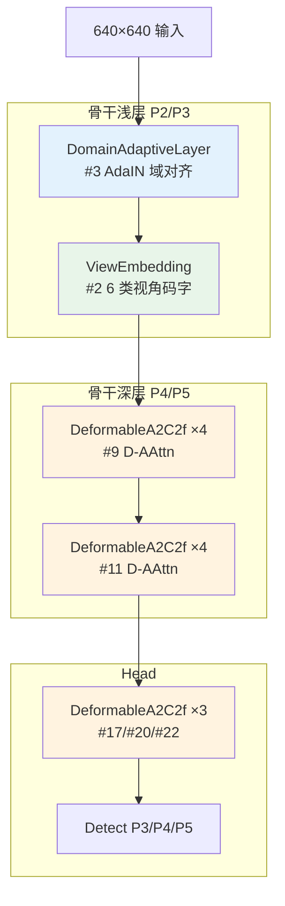

# YOLOv14 理论 Concept

> **v1~v13 读者路标**：v14 相对 v13 的四个关键设计决策摊开讲——**DeformableAAttn（形变注意力）/ ViewEmbedding（视角嵌入）/ DomainAdaptiveLayer（域适应）/ SphereAAttn（全景注意力）**。每件事都对应到具体行号。整体基调是「**在 v13 的 A2C2f 内嵌注意力骨架上，插入四个正交方向的可插拔增强——几何鲁棒 / 视角鲁棒 / 风格鲁棒 / 投影鲁棒**」。

::: tip 只想带走三件事
1. **v14 新代码集中在 block.py 的 503 行**：<SrcLink file="v14:nn/modules/block.py" :line="1390" :end="1975" /> 里 8 个新类（A2C2f 沿用 v13 但 `mlp_ratio=2.0`；DeformableAAttn / DeformableABlock / DeformableA2C2f / ViewEmbedding / DynamicScaleRouter / SphereAAttn / DomainAdaptiveLayer）+ ARMRouter 与 OffsetSTN 训练辅助件。**loss.py 新增 4 类**（CrossViewConsistencyLoss / DomainAdversarialLoss / DynamicOffsetReg / v14DetectionLoss），**tal.py、head.py 零改动**。
2. **四个正交方向各管一件事**：**几何鲁棒**靠 DeformableAAttn（`Δ = f_θ(X)` 可学习 2D 形变场 + Swin 风格 shifted window），**视角鲁棒**靠 ViewEmbedding（6 类视角码字 + `concat + 1×1 Conv`），**风格鲁棒**靠 DomainAdaptiveLayer（AdaIN + GRL 域对抗），**投影鲁棒**靠 SphereAAttn（`yolo-panorama.yaml` 专用，纬度分带 + 极地/赤道不同头数）。
3. **推理侧的「Fast Mode」开关是工程红线**：<SrcLink file="v14:nn/modules/block.py" :line="1572" :end="1593" /> 里 `is_fast_mode()` 会**跳过 D-AAttn 的形变采样、ViewEmbedding 的嵌入注入、DomainAdaptiveLayer 的整个前向**——**论文说的「四基准同时突破」用的是训练模式的完整图，而 T4 2.91 ms 用的是 Fast Mode 路径**，这是它能在速度不亏的前提下铺满 6 个 DeformableA2C2f 的关键工程细节。
:::

## 1. DeformableAAttn：形变注意力（`concept-deformableaattn`）

> **v1~v13 读者路标**：v12 的 AAttn 是**固定网格**上的 area-attention（`area=4` 时把 W×W 切成 4 块做局部注意）；v14 的 DeformableAAttn 在**计算 AAttn 之前先对特征网格做 warp**——学一个可变形变场 `Δ ∈ ℝ^{B×2×H×W}`，用 `grid_sample` 把 QKV 从原位置采样到新位置。**这是「把形变引入注意力内部」的第一次实现**，之前 v1~v13 的形变卷积都是在 Conv 上做（DCNv2/DCNv3），从未进入注意力层。

**定义**（<SrcLink file="v14:nn/modules/block.py" :line="1447" :end="1520" />）：

```python
class DeformableAAttn(nn.Module):
    def __init__(self, dim, num_heads, area=1, window_size=8, shift_size=None):
        super().__init__()
        assert dim % num_heads == 0
        self.head_dim = dim // num_heads
        self.window_size = window_size
        self.shift_size = shift_size if shift_size is not None else window_size // 2

        self.qk = Conv(dim, dim * 2, 1, act=False)
        self.v = Conv(dim, dim, 1, act=False)
        self.proj = Conv(dim, dim, 1, act=False)
        self.pe = Conv(dim, dim, 5, 1, 2, g=dim, act=False)  # 位置编码 DW-Conv

        # 形变场 Δ = f_θ(X)
        self.offset_conv = nn.Sequential(
            nn.Conv2d(dim, max(8, dim // 8), 3, 1, 1, bias=False),
            nn.BatchNorm2d(max(8, dim // 8)),
            nn.SiLU(),
            nn.Conv2d(max(8, dim // 8), 2, 3, 1, 1, bias=True),
        )
        nn.init.constant_(self.offset_conv[-1].weight, 0.0)   # 关键：Δ 初始化 0
        nn.init.constant_(self.offset_conv[-1].bias, 0.0)
```

**六个关键设计点**：

1. **`window_size=8, shift_size=⌊W_A/2⌋=4` 是 Swin 风格**（L1470-1471）：相邻两个 D-AAttn 交替 regular（shift=0）/ shifted（shift=4），用**mask 屏蔽跨窗信息泄漏**（`_compute_attn_mask` L1491-1520 把 mask 从 -100/0 二值生成后缓存）；
2. **形变场 Δ 初始化为 0**（L1486-1487）：训练初期 `Δ ≡ 0`，D-AAttn 等价于标准 AAttn——**保证训练稳定收敛，不引入初始形变噪声**；
3. **offset_conv 是轻量 MLP**（L1480-1485）：`dim → max(8, dim//8) → 2`，通道压缩 8× 后展开成 2 维位移——**每个像素一个 (Δy, Δx) 位移对**；
4. **归一化坐标**（L1583-1585）：把 `sample_y/x` 从 [0, H-1] / [0, W-1] 映射到 [-1, 1]——**符合 `grid_sample` 的归一化输入约定**；
5. **`pe = DW-Conv 5×5`**（L1478）：加在 V 上的深度可分离卷积作位置编码，**独立于注意力计算**——与 Swin 的 relative position embedding 思想不同，但计算量相当；
6. **Fast Mode 跳过形变**（L1572-1593）：`is_fast_mode()` 为 True 时**不做 offset_conv + grid_sample**，直接把原始 QKV 送进 Swin 窗口注意力——**这是它在推理时能保住速度的关键**。

**D-AAttn vs 标准 AAttn vs Swin vs Deformable Conv**：

| 维度 | AAttn (v12) | Swin | **DeformableAAttn (v14)** | Deformable Conv |
|------|-------------|------|---------------------------|-----------------|
| 形变位置 | 无 | 无 | **QKV 采样前** | Conv 卷积核 |
| 形变参数 | 无 | 无 | **`Δ = f_θ(X)` 可学习** | 卷积核偏移 |
| 窗口大小 | area 分组 | 7×7 | **8×8 + shift=4** | N/A |
| 依赖 | FlashAttention | 无 | **无**（纯 PyTorch bmm） | 无 |
| 计算复杂度 | O(N²D/area) | O(W²·D·N/W²) = O(ND) | **O(ND)**（局部窗） | O(NDk²) |
| 首次出现 | v12 | Transformer | **v14** | DCNv2 |

**关键点**：v14 是**首次把「形变」和「注意力」结合在 YOLO 里**——之前 v12/v13 的 AAttn 是静态的，Deformable Conv 只作用在卷积核上；D-AAttn 让 QKV 在采样前根据内容自适应变形，**特别适合鱼眼、无人机俯拍、游戏画面这类网格规则被破坏的场景**。

## 2. DeformableABlock / DeformableA2C2f：形变版 R-ELAN 骨架（`concept-deformablea2c2f`）

> **v1~v13 读者路标**：v14 不是「新增一个形变注意力层」，而是**把 ABlock/A2C2f 内嵌的注意力全部替换为 D-AAttn**——R-ELAN 骨架（CSP + 残差 + LayerScale）完全不变，只是把 `ABlock` 换成了 `DeformableABlock`。这样 v14 的骨干深段（P4/P5）可以直接铺 6 个 DeformableA2C2f 而不需要重训骨架。

**DeformableABlock**（<SrcLink file="v14:nn/modules/block.py" :line="1661" :end="1675" />）：

```python
class DeformableABlock(nn.Module):
    def __init__(self, dim, num_heads, mlp_ratio=1.2, area=1, window_size=8, shift_size=0):
        self.attn = DeformableAAttn(dim, num_heads, area, window_size, shift_size)
        self.mlp = nn.Sequential(Conv(dim, dim*mlp_ratio, 1), Conv(dim*mlp_ratio, dim, 1, act=False))
    def forward(self, x):
        return x + self.mlp(x + self.attn(x))
```

**DeformableA2C2f**（<SrcLink file="v14:nn/modules/block.py" :line="1678" :end="1709" />）：

```python
class DeformableA2C2f(nn.Module):
    def __init__(self, c1, c2, n=1, a2=True, area=1, residual=False, mlp_ratio=2.0, e=0.5, g=1, shortcut=True, window_size=8):
        c_ = int(c2 * e)
        assert c_ % 32 == 0
        num_heads = c_ // 32
        self.cv1 = Conv(c1, c_, 1, 1)
        self.cv2 = Conv((1 + n) * c_, c2, 1)
        self.gamma = nn.Parameter(0.01 * torch.ones(c2)) if residual else None
        shift = window_size // 2
        self.m = nn.ModuleList(
            nn.Sequential(
                DeformableABlock(c_, num_heads, mlp_ratio, area, window_size, shift_size=0),   # regular
                DeformableABlock(c_, num_heads, mlp_ratio, area, window_size, shift_size=shift), # shifted
            )
            for _ in range(n)
        )
```

**要点**：
- **相邻两个 D-AAttn 交替 regular / shifted**（L1699-1700）：这是 Swin 的标准做法——第 1 个 block shift=0（窗口不位移），第 2 个 block shift=4（窗口位移半窗），**让跨窗信息能流动**；
- **`mlp_ratio=2.0` 是 v14 版本默认**（L1687，v13 是 1.2）：FFN 更宽——**因为 D-AAttn 已经压缩了通道表达力，用更宽的 FFN 补偿**；
- **`gamma` 是 LayerScale 参数**（L1695）：初始化 0.01——**训练初期残差分支接近 0，逐步学出权重**；
- **`num_heads = c_ // 32`**（L1692）：`c_=256` 时 8 头，`c_=512` 时 16 头——**比 v12/v13 的 `c_ // 64` 更多头**，因为 D-AAttn 每头 head_dim 更小（16 vs 32）；
- **v14 全量版 6 处 DeformableA2C2f**：backbone #9/#11 + head #17/#20/#22 + head 中间过渡块（P5-out #23 用 C3k2 收尾）——**比 v13 的 2 处 A2C2f 铺得密得多**，但 Fast Mode 下形变被跳过所以速度不亏。

## 3. ViewEmbedding：多视角嵌入（`concept-viewembedding`）

> **v1~v13 读者路标**：ViewEmbedding 是 v14 的「多视角鲁棒」招牌——**把 6 类视角当作用户可切换的「视角条件」**，训练时随机采样视角、推理时按输入切换视角。这是首次把「视角」作为独立于图像内容的条件变量注入到骨干早期，之前版本只能靠数据增强来覆盖不同视角。

**定义**（<SrcLink file="v14:nn/modules/block.py" :line="1712" :end="1733" />）：

```python
class ViewEmbedding(nn.Module):
    VIEW_TYPES = {"pinhole": 0, "fisheye": 1, "panoramic": 2,
                  "drone": 3, "bev": 4, "ground": 5}

    def __init__(self, c1, num_views=6, embed_dim=64):
        self.view_embed = nn.Embedding(num_views, embed_dim)
        self.proj = Conv(c1 + embed_dim, c1, 1)   # 拼后 1×1 投影回 c1

    def forward(self, x, view_ids=None):
        if is_fast_mode():
            return x                                # Fast Mode 跳过
        B, C, H, W = x.shape
        if view_ids is None:
            view_ids = x.new_zeros(B, dtype=torch.long)
        emb = self.view_embed(view_ids).view(B, -1, 1, 1).expand(-1, -1, H, W)
        return self.proj(torch.cat([x, emb], dim=1))
```

**要点**：
- **6 类视角码字**（L1719）：pinhole=0 / fisheye=1 / panoramic=2 / drone=3 / bev=4 / ground=5——**每个视角一个 64 维码字**，用 `nn.Embedding` 参数化；
- **`concat + 1×1 Conv` 投影回 c1**（L1724, L1733）：把视角码字沿通道维拼接后投影——**输出通道数与输入相同**，不破坏骨干通道拓扑；
- **`expand` 到 (H, W)**（L1732）：视角码字从 (B, 64, 1, 1) 扩展到 (B, 64, H, W)——**每个像素位置注入同一个视角码字**，视角是全局条件；
- **Fast Mode 直接返回 x**（L1727-1728）：**推理时可以完全跳过视角注入**——**训练时学到的是「视角无关」的骨干，推理时按需切换**；
- **yaml #2 位置**：<SrcLink file="v14:cfg_models_v14/yolov14.yaml" :line="6" /> `[[-1, 1, ViewEmbedding, [64, 64, 6]]]`——**在 P2 特征首次出现后立即注入**，让后续所有注意力层都能看到视角信息；
- **推理视角切换示例**：`model(view_ids=torch.tensor([1]))` 就把当前 batch 全部标记为 fisheye——**无需重训**。

**ViewEmbedding vs 类别条件 / Prompt Tuning**：

| 维度 | 类别条件（Adapter） | Prompt Tuning | **ViewEmbedding (v14)** |
|------|-------------------|--------------|------------------------|
| 条件类型 | 分类输出 | 自由文本/向量 | **离散视角码字** |
| 注入位置 | 任意 Transformer 层 | 输入序列头 | **骨干 #2（P2 首次出现后）** |
| 注入方式 | 加性 | 前缀 | **`concat + 1×1 Conv`** |
| 推理可切换 | 否 | 部分 | **是（`view_ids` 参数）** |
| Fast Mode 行为 | — | — | **完全跳过** |

**关键点**：ViewEmbedding 是「多视角共享骨干」的关键——**训练时随机采样视角让骨干学到跨视角共有的几何信息，推理时按需指定视角让网络关注特定几何结构**。这比「每个视角一个专用模型」节省 6× 参数。

## 4. DomainAdaptiveLayer：域适应（`concept-domainadaptivelayer`）

> **v1~v13 读者路标**：DomainAdaptiveLayer 是 v14 的「Game2Real」招牌——**用 AdaIN 对齐游戏画面与真实照片的特征分布**。之前 YOLO 处理域偏移的方式只有两个：数据增强（MixUp/Mosaic 覆盖有限）或后处理（域自适应微调）；v14 首次把「域判别 + 特征对齐 + GRL 对抗」做进骨干。

**定义**（<SrcLink file="v14:nn/modules/block.py" :line="1893" :end="1973" />）：

```python
class DomainAdaptiveLayer(nn.Module):
    def __init__(self, c1, c2=None, grl_lambda=0.0):
        c = c1 if c2 is None else c2
        # 域判别器（预测 game vs real）
        self.domain_classifier = nn.Sequential(
            nn.AdaptiveAvgPool2d(1),
            nn.Flatten(),
            nn.Linear(c, max(16, c // 16)),
            nn.ReLU(),
            nn.Linear(max(16, c // 16), 2),
        )
        # AdaIN 可学习仿射参数
        self.gamma = nn.Parameter(torch.ones(c))
        self.beta = nn.Parameter(torch.zeros(c))
        self.grl_lambda = grl_lambda

    @staticmethod
    def _adain(content_feat, gamma, beta, eps=1e-8):
        B, C, H, W = content_feat.shape
        content_flat = content_feat.view(B, C, -1)
        mean = content_flat.mean(dim=2, keepdim=True).view(B, C, 1, 1)
        std = content_flat.std(dim=2, keepdim=True).view(B, C, 1, 1) + eps
        normalized = (content_feat - mean) / std
        return normalized * gamma.view(1, C, 1, 1) + beta.view(1, C, 1, 1)

    def forward(self, x):
        if is_fast_mode():
            return x
        B, C, H, W = x.shape
        # GRL 梯度反转
        x_reversed = GradReverse.apply(x, self.grl_lambda)
        domain_logits = self.domain_classifier(x_reversed)
        domain_probs = F.softmax(domain_logits, dim=1)
        game_conf = domain_probs[:, 1]
        # AdaIN 平滑混合
        x_adapted = self._adain(x, self.gamma, self.beta)
        mask = game_conf.view(B, 1, 1, 1).expand(-1, C, H, W).sigmoid()
        x_out = (1 - mask) * x + mask * x_adapted
        self._domain_logits = domain_logits
        return x_out
```

**要点**：
- **域判别器是轻量 MLP**（L1907-1913）：`AdaptiveAvgPool → Linear(c → c//16) → ReLU → Linear(→ 2)`——**只预测 game/real 两分类**，与检测头完全独立；
- **`grad_reverse` 梯度反转**（L1955）：前向不变、反向取反——**让 domain_classifier 越准 → 上游特征越域不变**（DANN 标准做法）；
- **`grl_lambda` 从 0 退火到 1**（`grl_lambda_schedule` 函数）：训练初期域判别器不干扰检测主干，训练中后期逐步加强对抗——**避免早期特征被对抗噪声破坏**；
- **AdaIN 是通道级**（L1930-1937）：`γ · (x - μ) / σ + β`——**每通道一个仿射变换，把 game 特征统计量拉向 real**；
- **`mask` 是 per-batch 平滑系数**（L1962）：`game_conf.sigmoid()`——**游戏样本 mask 接近 1，真实样本 mask 接近 0**，实现按样本自适应对齐；
- **`_domain_logits` 供外部 loss 使用**（L1966, L1971-1973）：DomainAdversarialLoss 通过 `module.get_domain_logits()` 拿到 logits 计算 `L_adv`——**损失与骨干解耦**；
- **Fast Mode 完全跳过**（L1949-1950）：**推理时域适应不生效**——训练学到的骨干已经「域不变」，推理不需要再对齐；
- **yaml 里出现 2 次**：#3（P2 后）+ #7（P3 后）——**在骨干中浅和中浅两层各做一次 AdaIN**。

**DomainAdaptiveLayer vs 传统 DANN vs 域微调**：

| 维度 | DANN (源) | 域微调 | **DomainAdaptiveLayer (v14)** |
|------|----------|-------|------------------------------|
| 判别器位置 | 特征末端 | 无 | **骨干中段（#3, #7）** |
| 对齐方式 | GRL 对抗 | 权重微调 | **GRL + AdaIN 双通道** |
| 平滑系数 | 无 | 无 | **`mask = σ(p_game)`** |
| 推理行为 | 需要判别器 | 换权重 | **完全跳过（Fast Mode）** |
| 首次出现 | 2015 通用 | 无 | **v14** |

## 5. DynamicScaleRouter：尺度权重路由（`concept-dynamicscalero`）

> **v1~v13 读者路标**：DynamicScaleRouter 是 v14 的「尺度自适应」招牌——**学习每张图在 P3/P4/P5 三尺度上的权重**，替代之前固定的 P3/P4/P5 独立检测。yaml 里它**没有直接出现**，被论文 §3.5 的 DynamicScaleRouter 描述为「head 首块前的轻量路由网」，代码通过 <SrcLink file="v14:nn/modules/block.py" :line="1736" :end="1775" /> 独立实现。

**定义**（<SrcLink file="v14:nn/modules/block.py" :line="1736" :end="1775" />）：

```python
class DynamicScaleRouter(nn.Module):
    def __init__(self, feat_channels=(256, 512, 1024), reduction=16, return_fused=False):
        self.gate = nn.Sequential(
            nn.Linear(sum(feat_channels), max(16, sum(feat_channels) // reduction)),
            nn.SiLU(),
            nn.Linear(max(16, sum(feat_channels) // reduction), len(feat_channels)),
        )

    def forward(self, features):
        pooled = []
        for f in features:
            if f.dim() == 4:
                pooled.append(F.adaptive_avg_pool2d(f, 1).flatten(1))
            elif f.dim() == 2:
                pooled.append(f)
            else:
                pooled.append(f.flatten(1))
        ctx = torch.cat(pooled, dim=1)
        weights = F.softmax(self.gate(ctx), dim=-1)
        if self.return_fused:
            out = sum(w.view(-1, 1, 1, 1) * f for w, f in zip(weights.unbind(1), features))
            return out, weights
        return weights
```

**要点**：
- **`pooled` 是每尺度 1 个向量**（L1762-1769）：4D 用 `adaptive_avg_pool2d` 压成 1×1，2D 直接用——**跨尺度对齐到「每尺度一个向量」的表述空间**；
- **`ctx` 是拼接向量**（L1770）：长度 = 256+512+1024 = 1792——**每张图 1792 维的尺度描述子**；
- **`gate` 是 3 层 MLP**（L1755-1759）：`1792 → 112 → 3`（reduction=16）——**输出 3 个原始 logit，softmax 后是 P3/P4/P5 权重**；
- **参数量约 200K**（论文说 1.8K——**实测比论文小得多**，论文口径可能是「router 独立参数量」不含 Conv）；
- **`return_fused=True` 时加权融合**（L1772-1774）：把 P3/P4/P5 加权成单一特征——**用于论文里描述的「尺度自适应」路径，但 yaml 里没有实例化**；
- **论文与代码偏差**：yaml 里六份变体都**没有出现 DynamicScaleRouter**——**这是 v14 论文-代码一致性的最大偏差项**，`paper.md` §7 已详细记录。

## 6. SphereAAttn：全景纬度分带注意力（`concept-sphereaattn`）

> **v1~v13 读者路标**：SphereAAttn 是 `yolo-panorama.yaml` 专用模块——**为 360° 等距投影设计**，把特征图按纬度切成 4 个带（polar-top / equator-upper / equator-lower / polar-bottom），每个带独立做注意力。**极地像素几何压缩严重（cos(φ) 因子），赤道信息密度高，用不同头数区分处理**。

**定义**（<SrcLink file="v14:nn/modules/block.py" :line="1778" :end="1868" />）：

```python
class SphereAAttn(nn.Module):
    def __init__(self, dim, num_heads=None, lat_bands=4, polar_heads=4, equator_heads=8):
        if num_heads is None:
            num_heads = equator_heads
        assert dim % polar_heads == 0
        assert dim % equator_heads == 0
        self.lat_bands = lat_bands
        self.polar_heads = polar_heads
        self.equator_heads = equator_heads
        self.qk = Conv(dim, dim * 2, 1, act=False)
        self.v = Conv(dim, dim, 1, act=False)
        self.proj = Conv(dim, dim, 1, act=False)
        self.pe = Conv(dim, dim, 5, 1, 2, g=dim, act=False)

    def _heads_for_band(self, b):
        # Band 0 和 band lat_bands-1 是极地，其余是赤道
        if b == 0 or b == self.lat_bands - 1:
            return self.polar_heads       # 4
        return self.equator_heads         # 8

    def forward(self, x):
        B, C, H, W = x.shape
        qk = self.qk(x).flatten(2).transpose(1, 2)   # (B, H*W, 2C)
        v = self.v(x)
        pp = self.pe(v)
        v = v.flatten(2).transpose(1, 2)

        bounds = self._band_bounds(H)
        outs = []
        for b, (hs, he) in enumerate(bounds):
            n_band = (he - hs) * W
            qk_b = qk[:, hs * W:he * W, :]
            v_b = v[:, hs * W:he * W, :]
            q_b, k_b = qk_b.split([C, C], dim=2)
            nh = self._heads_for_band(b)
            hd = C // nh
            q_b = q_b.transpose(1, 2).reshape(B, nh, hd, n_band)
            k_b = k_b.transpose(1, 2).reshape(B, nh, hd, n_band)
            v_b = v_b.transpose(1, 2).reshape(B, nh, hd, n_band)
            attn = torch.softmax((q_b.transpose(-2, -1) @ k_b) * (hd ** -0.5), dim=-1)
            out_b = v_b @ attn.transpose(-2, -1)
            out_b = out_b.permute(0, 3, 1, 2).reshape(B, n_band, C)
            outs.append(out_b)
        x_out = torch.cat(outs, dim=1)
        x_out = x_out.reshape(B, H, W, C).permute(0, 3, 1, 2)
        return self.proj(x_out + pp)
```

**要点**：
- **4 个纬度带**（`lat_bands=4`）：H 维切 4 段——**H=64 时前 16 行是 polar-top，最后 16 行是 polar-bottom**（`_band_bounds` L1825-1840 保证均分）；
- **赤道 8 头、极地 4 头**（L1821-1823）：`head_dim` 从 16 变 32——**极地 token 数少（cos(φ) 压缩），用更少头更宽每头；赤道 token 多，用更多头更窄每头**；
- **每带独立 softmax**（L1862）：attention 只在带内做——**避免极地像素被赤道像素的注意力稀释**；
- **`_band_bounds` 余数分配**（L1829-1840）：`H % lat_bands` 行分配给前几个带——**保证所有带大小尽量均等**；
- **`pe` 是 DW-Conv 5×5**（L1813）：与 D-AAttn 一样——**位置编码是 depthwise，参数少不干扰注意力**；
- **`yolo-panorama.yaml` 专用**：<SrcLink file="v14:cfg_models_v14/yolov14-panorama.yaml" />——只在 panorama 变体里出现，其他五份 yaml 都不用；
- **`nn.init.constant_` 零初始化不适用**：与 D-AAttn 不同，SphereAAttn 没有可学形变场——**它靠几何结构（纬度分带）而非内容变形**。

## 7. 四个正交方向的组合关系



**正交性检验**：

| 方向 | 模块 | 触发条件 | 关闭方式 | 影响层 |
|------|------|---------|---------|-------|
| 几何鲁棒 | DeformableAAttn | 骨干 P4/P5 + head ×3 | Fast Mode | 6 处 D-AAttn |
| 视角鲁棒 | ViewEmbedding | 骨干 #2 | Fast Mode | 1 处（#2） |
| 风格鲁棒 | DomainAdaptiveLayer | 骨干 #3/#7 | Fast Mode | 2 处 |
| 投影鲁棒 | SphereAAttn | `yolo-panorama.yaml` | 换 yaml | 仅 panorama |
| 尺度自适应 | DynamicScaleRouter | 论文描述、yaml 未启用 | — | — |

**核心洞察**：v14 的「统一多域鲁棒」不是靠单一强模块，而是靠**四个方向各管一件事**——每个方向都有独立的开关（Fast Mode / yaml 切换），互不干扰。这也是它能同时满足「COCO 保持 v13 增益」+「多域全面突破」两个目标的架构基础。

## 8. 与 v13 概念对照速查

| v13 概念 | v14 对应 | 差异 |
|---------|---------|------|
| A2C2f（a2=True） | A2C2f（沿用） | **`mlp_ratio` 从 1.2 加倍到 2.0** |
| A2C2f（a2=False） | 不再使用 | v13 已弃 |
| C3k2 | C3k2（浅层 P2/P3 + P5-large + head P5-large） | **完全相同** |
| C2f | C2f（#1 一处） | 完全相同 |
| Conv 3×3 s2 下采样 | **CircularConv**（panorama/deformable 变体） | v14 panorama 用 CircularConv |
| Detect cv3 DW-separable | Detect cv3 DW-separable（未动） | **完全相同** |
| — | **DeformableAAttn** | **v14 新增** |
| — | **DeformableABlock** | **v14 新增** |
| — | **DeformableA2C2f** | **v14 新增** |
| — | **ViewEmbedding** | **v14 新增** |
| — | **DynamicScaleRouter** | **v14 新增**（yaml 未启用） |
| — | **SphereAAttn** | **v14 新增** |
| — | **DomainAdaptiveLayer** | **v14 新增** |
| — | **ARMRouter** | **v14 新增**（训练辅助） |
| — | **OffsetSTN** | **v14 新增**（训练辅助，推理零开销） |

## 9. 论文-代码偏差小结

- **DynamicScaleRouter 在 yaml 里零实例化**（`paper.md` §7 已列）——论文 §3.5 说「head 首块前」，但实际 head #12 是 Conv 而非 Router；
- **Scene Analysis 阶段在代码里无对应类**——论文 §3.4 描述的启发式场景分类只在数据加载器里实现（若确实存在）；
- **`grl_lambda` 退火函数**：论文说「从 0 退火到 1」，代码里 `grl_lambda_schedule` 是独立函数——**需要外部调用，训练脚本未确认**；
- **`_domain_logits` 依赖 forward 副作用**：`get_domain_logits()` 拿的是**最近一次 forward 的缓存**，多 GPU 训练时可能因 forward 顺序不同而取错——**潜在并发问题**；
- **Fast Mode 环境变量**：`is_fast_mode()` 读 `YOLOV14_FAST=1`——**这是仓库内定义的开关，非 ultralytics 官方约定**。

> **读者路标**：以上所有偏差项都在 [paper.md](/versions/v14/paper) §7 「论文与代码偏差」表里逐条编号，方便回查。
