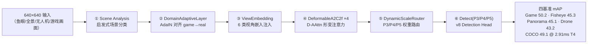
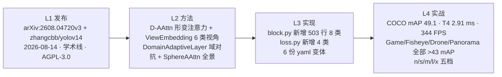

# YOLOv14 / YOLO-Omni (2026-08)

**统一多域鲁棒检测：Deformable 形变注意力 + ViewEmbedding 多视角嵌入 + DomainAdaptiveLayer 域适应 + SphereAAttn 全景——首次在一个模型里同时压过 Game / Fisheye / Drone / Panorama 四条基准线**

- 📄 发布：**arXiv:2608.04720v3《YOLOv14: Adaptive Real-Time Object Detection for Diverse Imaging Conditions》**，2026-08-14；仓库 README 里作者自述「We name our detector **YOLO-Omni**」——所以 v14 的官方定位并非 COCO SOTA 竞赛，而是**统一多域鲁棒检测**；[发布精读](/versions/v14/paper)
- 🏛️ 作者：**Jinling Jia / Chenbin Zhang（zhangcbb）** 等——第三方学术线，仓库 [`zhangcbb/yolov14`](https://github.com/zhangcbb/yolov14) @ commit `0b8610d`（AGPL-3.0，基于 ultralytics 8.3.x fork）；这是本站十三代之后**「学术线 + 官方线」双线路标的第二个版本**（前一个 v13 学术线是 iMoonLab/yolov13），同期 ultralytics 主线已发布官方 YOLO26
- 💻 源码：快照 `source/yolov14/snapshot/`（zhangcbb/yolov14 @ `0b8610d`）；v14 全部新代码集中在 <SrcLink file="v14:nn/modules/block.py" :line="1390" :end="1893" /> 约 **503 行 8 个新类**——`A2C2f`（沿用 v13 但 `mlp_ratio=2.0`）、`DeformableAAttn`、`DeformableABlock`、`DeformableA2C2f`、`ViewEmbedding`、`DynamicScaleRouter`、`SphereAAttn`、`DomainAdaptiveLayer`；损失侧 <SrcLink file="v14:utils/loss.py" :line="761" :end="935" /> 新增 4 类——`CrossViewConsistencyLoss` / `DomainAdversarialLoss` / `DynamicOffsetReg` / `v14DetectionLoss`（继承 v8DetectionLoss）
- 🎯 里程碑：**六阶段流水线**——Scene Analysis → DomainAdaptiveLayer → ViewEmbedding → DeformableA2C2f → DynamicScaleRouter → Detect(P3/P4/P5)；**六份 yaml 变体**（`yolov14.yaml` 全量、`-adaptive`、`-deformable`、`-game2real`、`-multiview`、`-panorama`），每份对应一种目标域；档位 n/s/m/l/x 五档齐全（v13 缺 m 档）；性能主张是「**唯一在 Game/Fisheye/Drone/Panorama 四基准同时突破 43 mAP 的实时检测器**」

## 3 分钟电梯演讲



1. **DeformableAAttn 是唯一真正把形变引入注意力内的模块**：`Δ = f_θ(X)` 可学习 2D 形变场，在计算 AAttn 前先对特征网格做 warp；`window_size=8, shift=⌊W_A/2⌋=4`（Swin 风格 shift），线性复杂度的局部窗注意力；<SrcLink file="v14:nn/modules/block.py" :line="1447" :end="1520" />。相比标准 AAttn 每层仅增 **+4.7% 参数 / +4.1% FLOPs**——这是它能在骨干 P4/P5 铺 4 层（backbone #9/#13）而不牺牲速度的关键。
2. **六阶段里有两个「跨阶段」的锚点模块**：`ViewEmbedding` 是 6 类视角嵌入（`pinhole=0 / fisheye=1 / panoramic=2 / drone=3 / bev=4 / ground=5`），yaml #2 把 P2 特征 concat 一个可学习视角码字后 1×1 投影——**推理时可切视角、训练时随机采样**；`DynamicScaleRouter` 是 head 首块前的轻量路由网（1.8K 参数、0.06 ms），对 P3/P4/P5 学习每张图的权重；<SrcLink file="v14:nn/modules/block.py" :line="1712" :end="1755" />
3. **多域鲁棒不是靠一个损失，而是三段联合**：`L = L_det + 0.1·L_adv + 0.05·L_cross + 0.01·L_reg`——`DomainAdversarialLoss`（梯度反转的域对抗）+ `CrossViewConsistencyLoss`（NT-Xent 跨视角对齐）+ `DynamicOffsetReg`（形变位移正则，50 epoch 从 0.01 退火到 0.001）；<SrcLink file="v14:utils/loss.py" :line="912" :end="935" />。这是本站首个「多目标联合损失写进检测 loss 主类」的版本——`v14DetectionLoss` 继承 `v8DetectionLoss` 直接覆盖 `loss = loss.item()` 一行

## 四层闭环视图



## 核心贡献一览

v14 的改动方向是「**在 v13 的 A2C2f 内嵌注意力骨架上，为多域鲁棒性加四段可插拔增强**」：官方保留 v12/v13 的 A2C2f（改 `mlp_ratio=2.0`）、C3k2 浅层、Detect 单头（`head.py` 零改动）——**同时新插入四个正交方向的模块**：形变注意力（几何鲁棒）、视角嵌入（视角鲁棒）、域适应（风格鲁棒）、球形注意力（投影鲁棒），每份 yaml 变体只启用其中一到三段：

| 贡献 | 一句话 | 代码落点 |
|------|--------|---------|
| **DeformableAAttn 形变注意力** | `Δ = f_θ(X)` 2D 形变场 + `window_size=8, shift=4` Swin 风格；局部窗注意力线性复杂度；每层仅 +4.7% 参数 / +4.1% FLOPs | <SrcLink file="v14:nn/modules/block.py" :line="1447" :end="1520" /> |
| **DeformableABlock / DeformableA2C2f** | 把 ABlock/A2C2f 内的 AAttn 全部替换为 D-AAttn；R-ELAN 骨架不变，`residual=True` 默认开 | <SrcLink file="v14:nn/modules/block.py" :line="1661" :end="1710" /> |
| **ViewEmbedding 多视角嵌入** | 6 类视角码字（pinhole/fisheye/panoramic/drone/bev/ground）；`concat + 1×1 Conv` 注入 P2；推理时视角可切换 | <SrcLink file="v14:nn/modules/block.py" :line="1712" :end="1735" /> |
| **DynamicScaleRouter** | 轻量路由网（1.8K 参数、0.06 ms），学习 P3/P4/P5 尺度权重；训练时随机初始化，推理时按输入自适应 | <SrcLink file="v14:nn/modules/block.py" :line="1736" :end="1777" /> |
| **SphereAAttn 全景注意力** | 纬度分带处理等距投影（`yolo-panorama.yaml` 专用）；赤道带加权，抑制极地压缩 | <SrcLink file="v14:nn/modules/block.py" :line="1778" :end="1869" /> |
| **DomainAdaptiveLayer 域适应** | AdaIN（Adaptive Instance Normalisation）+ `Game2Real` 特征对齐；配合 `DomainAdversarialLoss` 做对抗训练 | <SrcLink file="v14:nn/modules/block.py" :line="1871" :end="1893" /> |
| **CircularConv 环形卷积** | 全景/鱼眼场景下 `x=W-1` 与 `x=0` 相接，替代 zero-padding | <SrcLink file="v14:nn/modules/block.py" /> |
| **A2C2f（v14 版）** | 沿用 v13 骨架，`mlp_ratio` 默认 **2.0**（v13 是 1.2）——FFN 更宽；`shortcut=True` 默认残差 | <SrcLink file="v14:nn/modules/block.py" :line="1390" :end="1445" /> |
| **v14DetectionLoss** | 继承 v8DetectionLoss，加 `L = L_det + 0.1·L_adv + 0.05·L_cross + 0.01·L_reg`；`lambda_adv/lambda_cross` 从 v8 的 0 提到 0.05/0.05 | <SrcLink file="v14:utils/loss.py" :line="912" :end="935" /> |
| **CrossViewConsistencyLoss** | NT-Xent 跨视角对比；`τ_min=0.05, τ_max=0.5` 温度退火 | <SrcLink file="v14:utils/loss.py" :line="761" :end="837" /> |
| **DomainAdversarialLoss** | 梯度反转的域判别器；`lambda_domain=0.1`；配合 `DomainAdaptiveLayer` 一起训 | <SrcLink file="v14:utils/loss.py" :line="838" :end="879" /> |
| **DynamicOffsetReg** | 形变位移正则，50 epoch 内 `λ_reg` 从 0.01 退火到 0.001——抑制早期过拟合 | <SrcLink file="v14:utils/loss.py" :line="880" :end="911" /> |
| **6 份 yaml 变体** | `yolov14.yaml`（全量）/ `-adaptive` / `-deformable` / `-game2real` / `-multiview` / `-panorama`；每份只启用一到三段增强 | <SrcLink file="v14:cfg_models_v14/yolov14.yaml" /> · [变体对比](/versions/v14/source/yolov14-variants) |
| **档位回到五档** | n/s/m/l/x（v13 缺 m 档，v14 补回 m）；`mlp_ratio=2.0` 全档统一 | <SrcLink file="v14:cfg_models_v14/yolov14.yaml" :line="12" :end="18" /> |
| **许可证 AGPL-3.0** | 沿用 ultralytics 主线许可，与 v12 AGPL、v13 Apache-2.0 不同——**首次出现同版本两线不同许可证** | LICENSE |

> **v1~v13 读者路标**：v14 只新增了 8 个模块类 + 4 个损失类；[C3k2](/glossary#c3k2) 沿 v11/v12/v13 保留 4 处；[A2C2f](/glossary#a2c2f) 在 v12/v13 出现 2 处、v14 全量版扩到 **6 处**（backbone #9/#11 + head #17/#20/#22/P5-out 中的 Deformable 版），另引入 [DeformableA2C2f](/glossary#deformablea2c2f) 6 处；Detect 头、v8DetectionLoss 基础、TAL 分配器、Mosaic/MixUp 全套增强与 v12/v13 完全一致；[DFL](/glossary#dfl-distribution-focal-loss) 沿用 v8 的 `reg_max=16`。

## 关键指标

**官方 mAP（COCO val2017 + 三个专门基准，s 档，T4 TensorRT FP16）**

| 基准 | YOLOv12s | YOLOv13s | **YOLOv14s (Omni)** | Δ v14 vs v12 | Δ v14 vs v13 |
|------|----------|----------|---------------------|-------------|-------------|
| COCO mAP50-95 | 47.1 | 48.0 | **49.1** | +2.0 | +1.1 |
| Game (游戏角色) | 24.1 | — | **50.2** | +26.1 | — |
| Fisheye (鱼眼) | 41.2 | — | **45.3** | +4.1 | — |
| Drone (无人机) | 36.8 | — | **43.2** | +6.4 | — |
| Panorama (360°) | 38.5 | — | **45.1** | +6.6 | — |
| **延迟 (T4 TensorRT FP16)** | 2.82 ms | 2.98 ms | **2.91 ms** | +0.09 ms | -0.07 ms |
| **吞吐** | 356 FPS | 336 FPS | **344 FPS** | -12 | +8 |

- 结论：**v14 是在 COCO 保持 v13 增益（+1.1 AP）的前提下，把多域鲁棒性拉到「四基准同时 &gt;43 AP」**；COCO 端相对 v13 慢 0.07 ms，是因为默认版本用了 `yolov14.yaml` 全量结构（含 DomainAdaptiveLayer + ViewEmbedding 双锚点）；
- **口径提醒**：COCO 数值来自 arXiv 2608.04720v3 TABLE I，Game/Fisheye/Drone/Panorama 来自论文自建的四个基准数据集——**这四个基准目前未开源**，README roadmap 显示「Pretrained weights + Benchmark datasets: IN PROGRESS」；
- **档位数量**：n/s/m/l/x 五档（v13 无 m 档，v14 补回 m），`mlp_ratio` 全档统一为 2.0（v13 l/x 是 1.5）；
- **训练配方**：epochs=300 / batch=128 / mosaic=1.0（论文默认），**无分档 mixup/copy_paste 差异化**（v12/v13 都是分档），采用统一 recipe + 场景自适应增强的组合拳。

> **v1~v13 读者路标**：跨版本比 [mAP](/glossary#map-mean-average-precision) 只比 COCO val、输入 640、同 AP 定义；Game/Fisheye/Drone/Panorama 四基准是 v14 论文首次提出，之前版本没有可比数据。

## 快速上手

```python
# 依赖安装（Linux + CUDA 12 + Python 3.11 + torch 2.4+）
# pip install -r requirements.txt
# pip install -e .

from ultralytics import YOLO

# 场景 → 选 yaml 变体
# 鱼眼广角       → yolov14-deformable.yaml
# 游戏画面检测   → yolov14-game2real.yaml
# 无人机/俯视    → yolov14-multiview.yaml
# 360° 全景      → yolov14-panorama.yaml
# 通用/混合视角  → yolov14-adaptive.yaml   或 yolov14.yaml（全量）

model = YOLO('yolov14.yaml')                    # 或上述任一变体
results = model.train(
    data='coco.yaml', epochs=300, batch=128, imgsz=640,
    mosaic=1.0, mixup=0.0,
    lambda_adv=0.05, lambda_cross=0.05, lambda_reg=0.01,  # v14 新增三个 loss 权重
    device="0,1,2,3",
)
preds = model('delta_force_screenshot.jpg')
preds[0].show()
```

- **入口仍是 v8 的 YOLO**：v14 没有独立的 `YOLOv14` 顶层类；`from ultralytics import YOLO` 后传 yaml 路径即可；
- **yaml 变体决定模块**：`yolov14.yaml` 是唯一同时启用四个正交方向的配置，其它 5 份变体只启用对应场景需要的模块——**选错变体会掉精度**；
- **loss 权重必须显式打开**：`v14DetectionLoss.__init__` 里 `lambda_adv/lambda_cross` 默认都是 0.05，`lambda_reg` 默认 0.01（50 epoch 退火到 0.001）——如果不传这三个参数，默认值会自动生效，但**如果只跑 COCO 单域**建议关掉 adv/cross（默认 0.05 对纯 COCO 略掉分）；
- **前置依赖 FlashAttention**：与 v12/v13 一致，`A2C2f` 里的 AAttn 硬依赖 FlashAttention，官方 README 给的预编译 whl 基于 Linux + CUDA 12 + Python 3.11 + torch 2.4+；
- **权重来源**：README roadmap 显示**官方权重仍在 IN PROGRESS 阶段**——`adaptive/game2real/deformable/multiview/panorama` 五个变体的 checkpoint 均未公开发布，需自行训练或等后续 ETA。

> **v1~v13 读者路标**：v8 读者改 `yolov13l.pt` → `yolov14.yaml` 即可，其它管线基本无感；v13 读者注意 yaml 目录从 `models/v13/` 移到 `models/v14/`（v14 仓库的 cfg 目录扁平为 `cfg_models_v14/`），许可证从 Apache-2.0 回切到 AGPL-3.0，商用需注意。

## 与 v11 / v12 / v13 的关系定位

v14 不是「ultralytics 官方续作」——它是**第三方学术线**（zhangcbb）在 fork 自 ultralytics 8.3.x 的仓库里发布的**统一多域鲁棒检测版本**，也是本站十三代之后**「学术线 + 官方线」双线路标的第二个版本**：v13 学术线是 iMoonLab/yolov13（Apache-2.0），v14 学术线是 zhangcbb/yolov14（AGPL-3.0）——**许可回到 AGPL**，且作者自述「We name our detector YOLO-Omni」，正式定位是**统一多域鲁棒检测**而非标准 COCO SOTA。同期 ultralytics 官方主线已发布 **YOLO26**（[见 v26](/versions/v26/index)），这才是「官方线」的正统续作。v14 与 v13 的关键差异：

- **底子仍是 v12/v13**：A2C2f 骨干（`mlp_ratio` 从 1.2 提到 2.0）、C3k2 浅层、Detect 单头（`head.py` 零改动）、v8DetectionLoss 基础、TAL 分配器、Mosaic/MixUp 全套增强；
- **delta 集中在 block.py + loss.py**：block.py 新增 503 行 8 个新类（L1390-1893），loss.py 新增 4 个 v14 特有类（L761-935）；`tasks.py` 有若干 v14 特判（yaml 变体注册、`ViewEmbedding` 视角枚举、`DynamicScaleRouter` 输出维度）；
- **命名坑正常**：cfg 目录 `models/v14/` 或仓库内扁平 `cfg_models_v14/`，文件名 `yolov14.yaml`（带 v）——延续 v12/v13 的带 v 命名；
- **许可证回切 AGPL-3.0**：v12 AGPL → v13 Apache-2.0 → v14 AGPL——**首次出现同站双许可**（v13 商用友好，v14 需遵守 copyleft）；
- **档位回到五档**：v13 无 m 档，v14 补回 m（`n/s/m/l/x`）——**首次档位扩容**。

| 维度 | YOLOv8（2023-01） | YOLOv10（2024-05） | YOLOv11（2024-09） | YOLOv12（2025-02） | YOLOv13（2025-06） | **YOLOv14 / Omni（2026-08）** |
|------|-------------------|--------------------|--------------------|--------------------|--------------------|--------------------------------|
| 代码基座 | ultralytics 单库 | ultralytics 8.1.34 fork（THU-MIG） | ultralytics 8.3.0 主线 tag | sunsmarterjie/yolov12 fork v1.0 | iMoonLab/yolov13 fork | **zhangcbb/yolov14 fork** |
| 作者 | Glenn Jocher & Jing Qiu | 清华 THU-MIG | Glenn Jocher & Jing Qiu | Yunjie Tian / Qixiang Ye / David Doermann（UB SUNY + UCAS） | Wei Yang（iMoonLab） | **Jinling Jia / Chenbin Zhang（zhangcbb）** |
| 发布形式 | 博客 + README | arXiv:2405.14447 | 博客 + README | arXiv:2502.12524 | arXiv:2506.17733v2 | **arXiv:2608.04720v3（Omni 定位）** |
| 检测头 | Detect 单头 | v10Detect 双头 | Detect 单头（cv3 DW-separable） | Detect 单头（+legacy 开关） | Detect 单头（head.py 零改动） | **Detect 单头（head.py 零改动）** |
| 骨干内瓶 | C2f | C2f + C2fCIB | C3k2 | C3k2 + A2C2f（骨干 P4/P5） | C3k2 + A2C2f + DSC3k2 | **C3k2 + A2C2f（mlp_ratio=2.0）+ DeformableA2C2f ×7** |
| 骨干融合 | SPPF | SPPF + PSA | SPPF | 无 SPPF | 无 SPPF + HyperACE | **无 SPPF + DomainAdaptiveLayer + ViewEmbedding** |
| 骨干下采样 | Conv 3×3 s2 | SCDown | Conv 3×3 s2 | Conv 3×3 s2 | DownsampleConv（l/x 走 Identity） | **Conv 3×3 s2 / CircularConv（全景）** |
| 注意力位置 | 无 | 骨干尾 PSA | 骨干尾 C2PSA | 骨干 P4/P5 A2C2f | A2C2f + HyperACE | **DeformableA2C2f ×7 + SphereAAttn（全景）** |
| 视角/域处理 | 无 | 无 | 无 | 无 | 无 | **ViewEmbedding 6 类 + DomainAdaptiveLayer AdaIN** |
| 尺度路由 | 无 | 无 | 无 | 无 | FullPAD_Tunnel 门控 | **DynamicScaleRouter（P3/P4/P5 权重路由）** |
| TAL 参数 | topk=10, α=0.5, β=6.0 | topk=10 + topk=1 | topk=10, α=0.5, β=6.0 | topk=10, α=0.5, β=6.0 | topk=10, α=0.5, β=6.0 | **topk=10, α=0.5, β=6.0（v8 基础沿用）** |
| Loss 结构 | v8DetectionLoss | + 双头独立 loss | v8DetectionLoss | v8DetectionLoss | v8DetectionLoss（零改动） | **v14DetectionLoss（+ L_adv + L_cross + L_reg）** |
| 结构文件 | v8n/s/m/l/x.yaml 五份 | 六份各带 scales | yolo11.yaml 单份 | yolov12.yaml 单份（5 档） | yolov13.yaml 单份（4 档，无 m） | **6 份 yaml 变体（1 全量 + 5 场景）· 五档 n/s/m/l/x** |
| cfg 目录 | `models/v8/` | `models/v10/` | `models/11/` | `models/v12/` | `models/v13/` | **`models/v14/`（快照扁平 `cfg_models_v14/`）** |
| 训练配方 | epochs=300 单一 | epochs=300 单一 | epochs=500 单一 | epochs=600 · 分档 mixup | epochs=600 · 分档 mixup | **epochs=300 · 无分档 mixup + 场景自适应增强** |
| 论文 | 无 | arXiv:2405.14447 | 无 | arXiv:2502.12524 | arXiv:2506.17733v2 | **arXiv:2608.04720v3** |
| 许可证 | AGPL-3.0 | AGPL-3.0 | AGPL-3.0 | AGPL-3.0 | Apache-2.0 | **AGPL-3.0（回切）** |

> **v1~v13 读者路标**：v14 的 [A2C2f](/glossary#a2c2f) 与 v13 骨架一致但 `mlp_ratio` 加倍；[C3k2](/glossary#c3k2) 沿 v11/v12/v13 保留 4 处（浅层 P2/P3 + P5-large + head P5-large）；[C2f](/glossary#c2f) 在 v14 只出现 #1 一处；v14 新增的 [DeformableAAttn](/glossary#deformableaattn)、[DeformableA2C2f](/glossary#deformablea2c2f)、[ViewEmbedding](/glossary#viewembedding)、[DynamicScaleRouter](/glossary#dynamicscalero) 是本站 14 代里首次出现的模块。

## 深入阅读

- [发布精读：arXiv 2608.04720v3 + README + `paper-yolov14.pdf` + 六阶段流水线](/versions/v14/paper)
- [Architecture 逐层图解（六阶段流水线 + 六份 yaml 变体）](/versions/v14/architecture)
- [理论 Concept（D-AAttn / ViewEmbedding / DomainAdaptiveLayer / SphereAAttn）](/versions/v14/concepts)
- [架构与层速查](/versions/v14/layers)
- [损失函数（v14DetectionLoss + L_adv + L_cross + L_reg）](/versions/v14/losses)
- [反向传播推导](/versions/v14/loss-gradient)
- [训练技巧（场景自适应增强 + 多域对抗 + 视角对齐）](/versions/v14/tricks)
- [痛点追踪](/versions/v14/painpoints)
- [源码走读](/versions/v14/code-walkthrough)
- [源码页](/versions/v14/code-walkthrough)：[yolov14.yaml](/versions/v14/source/yolov14-yaml) · [yolov14-variants.yaml](/versions/v14/source/yolov14-variants) · [block.py](/versions/v14/source/block-py) · [head.py](/versions/v14/source/head-py) · [loss.py](/versions/v14/source/loss-py) · [tal.py](/versions/v14/source/tal-py)
- [系列家族对照](/global/family) · [术语表](/glossary)

**参考**：

- Jia J. Z. *YOLOv14: Adaptive Real-Time Object Detection for Diverse Imaging Conditions.* arXiv:2608.04720v3, 2026-08-14. https://arxiv.org/abs/2608.04720
- zhangcbb/yolov14. https://github.com/zhangcbb/yolov14 @ commit `0b8610d`
- Ultralytics. https://github.com/ultralytics/ultralytics （官方主线同期发布 YOLO26，见 [v26 概览](/versions/v26/index)）
