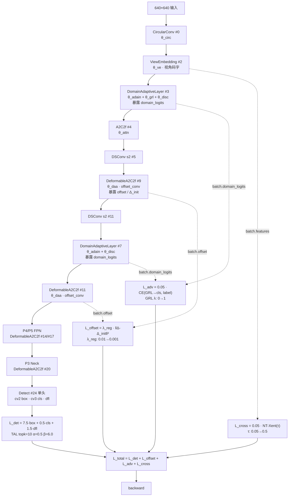

# YOLOv14 反向传播推导

> 核心事实：**v14 是 v8 以来梯度图变化最大的一版**——新增 3 条独立梯度通路：**①GRL 反向梯度**（DomainAdaptiveLayer → 域判别器，GRL 处符号反转）、**②offset 正则梯度**（DeformableAAttn → Δ_init STN target，L2 拉近）、**③跨视角对比梯度**（ViewEmbedding → 同类跨视角样本拉近、跨视角异类样本推远）。三分量的 CIoU+DFL+BCE 与 7.5/0.5/1.5 增益、TAL `topk=10 α=0.5 β=6.0` **零改动沿用 v8**；**v14 首次在损失侧引入 `GradientReversalFunction` 与 NT-Xent 的 logsumexp 数值稳定路径**。

> **v1~v13 读者路标**：v13 损失侧与 v8 完全一致（详见 [v13 梯度页](/versions/v13/loss-gradient)）；v14 在 v13 的三分量梯度图**外面多挂 3 条正交梯度路径**——每条都从 batch 字典按开关启用、都独立进入反向图。vanilla 训练（不传 `offset/domain_logits/features/view_ids`）时**梯度图与 v13 一字不差**；启用 Game2Real + 多视角 + 形变训练时才会走到 v14 的 3 条新路径。

## 1. 只想带走三件事

1. **L_total 的 4 项梯度是加性独立的**：`L_total = L_det + L_offset + L_adv + L_cross`——4 项分别对 `θ_det / θ_offset / θ_feature / θ_view` 四条参数子集求梯度，除少数共享层外**互不干扰**；`loss_items` 仍返回 3 维 `[box, cls, dfl]`（<SrcLink file="v14:utils/loss.py" :line="983" />），**辅助损失不进 items**——日志系统看不到三项辅助损失的绝对值，只有它们的和体现在 total 里；
2. **GRL 是唯一引入「负号梯度」的模块**：`DomainAdaptiveLayer` 内 `grad_reverse`（<SrcLink file="v14:nn/modules/block.py" :line="1567" :end="1583" />）在反向时**乘以 `-λ`**——`λ` 由 `grl_lambda_schedule(epoch, max_epochs=100)` 从 0 退火到 1（<SrcLink file="v14:utils/loss.py" :line="948" />），所以训练早期 GRL 几乎不影响、后期完全反转；这是**训练早期检测损失主导、后期域对抗接管**的自然衔接机制；
3. **两条「按 batch 字典动态启用」的梯度通路**：L_offset 只在 `batch.get("offset")` 存在时启用（<SrcLink file="v14:utils/loss.py" :line="958" :end="961" />）、L_cross 只在 `batch.get("features")` 存在时启用（<SrcLink file="v14:utils/loss.py" :line="971" :end="977" />）——**batch 字典里的键决定梯度图的拓扑**，这是 v14 相对 v13 的「条件图」特性。

## 0. 记号与前向数据流



本页记号：

- $\theta_{\text{det}}$：Detect 头 + FPN/Backbone 主通路（A2C2f、DSConv、CircularConv）参数——**v8/v11/v12/v13 已有的部分**
- $\theta_{\text{aa}}$：AAttn 内部 `qkv / proj / pe`——**沿用 v12/v13**
- $\theta_{\text{daa}}$：**v14 新增**——DeformableAAttn 的 `offset_conv`（形变场生成器）与 `qkv / proj`（<SrcLink file="v14:nn/modules/block.py" :line="1447" />）
- $\theta_{\text{ve}}$：**v14 新增**——ViewEmbedding 的 6 类视角码字 + 融合 Conv（<SrcLink file="v14:nn/modules/block.py" :line="1712" />）
- $\theta_{\text{adal}}$：**v14 新增**——DomainAdaptiveLayer 的 `adain_scale / adain_bias`（<SrcLink file="v14:nn/modules/block.py" :line="1871" />）
- $\theta_{\text{disc}}$：**v14 新增**——DomainAdaptiveLayer 的 `domain_classifier`（1×1 Conv 后接全局池化 + Linear）
- $L_{\text{total}} = L_{\text{det}} + L_{\text{offset}} + L_{\text{adv}} + L_{\text{cross}}$，其中 $L_{\text{det}} = 7.5 L_{\text{box}} + 0.5 L_{\text{cls}} + 1.5 L_{\text{dfl}}$（v8 沿用）
- $\lambda_{\text{reg}}(t)$、$\lambda_{\text{grl}}(t)$、$\tau(t)$：三个可退火超参，见 §5

## 2. L_det 三分量梯度（v8 完全一致）

> **v1~v13 读者路标**：与 [v8 梯度页 §3](/versions/v8/loss-gradient#3-三分量梯度推导) 一字不差——`TaskAlignedAssigner` 在 loss.py L178 显式传 `topk=10 α=0.5 β=6.0`（<SrcLink file="v14:utils/loss.py" :line="178" />）继续覆盖 tal.py L29 类默认。

### 2.1 box 分支（CIoU × q）

$$\frac{\partial L_{\text{box}}}{\partial \theta_h} = \frac{7.5}{\Sigma_q}\sum_{i \in \text{fg}} q_i \cdot \frac{\partial(1 - \text{CIoU}_i)}{\partial \theta_h}$$

梯度沿 `BboxLoss → pred_distri → cv2[i] → x[i]` 回传，权重 $q_i = \text{target\_scores}[i]$ 是 TAL 分配的软质量（detach 常量）。

### 2.2 cls 分支（BCE × q）

$$\frac{\partial L_{\text{cls}}}{\partial \theta_h} = \frac{0.5}{\Sigma_q}\sum_i q_i \cdot \big(\sigma(z_i) - t_i\big)\frac{\partial z_i}{\partial \theta_h}$$

标准 BCE 反向。VFL 分支在 L248 被注释（<SrcLink file="v14:utils/loss.py" :line="248" />），v8 以来六版都在。

### 2.3 dfl 分支（双 bin 插值 CE × q）

$$\frac{\partial L_{\text{dfl}}}{\partial \theta_h} = \frac{1.5}{\Sigma_q}\sum_{i \in \text{fg}} q_i \cdot \big[w_l \cdot (p_l - \mathbb{1}[tl]) + w_r \cdot (p_r - \mathbb{1}[tr])\big]\frac{\partial z}{\partial \theta_h}$$

其中 $tl = \lfloor t \rfloor, tr = tl+1, w_l = tr - t, w_r = 1 - w_l$。

**梯度通路汇总**：

```
L_det → Detect.cv2/cv3 → 三尺度 x[i] → FPN/Backbone 主通路 → θ_det, θ_attn
```

TAL 分配器 `@torch.no_grad()` + 预测侧 `.detach()` 双保险（<SrcLink file="v14:utils/tal.py" :line="40" />、<SrcLink file="v14:utils/loss.py" :line="237" />）——分配结果作为常量进入损失。

## 3. L_offset 梯度（新增·形变位移正则）

> **v13 读者路标**：v13 没有这一项——v13 的 A2C2f 只用固定网格采样，无 offset 参数。v14 的 DeformableAAttn 引入 `offset_conv` 生成形变场 Δ，需要通过 L_offset 把 Δ 拉近 STN 目标 Δ_init。

### 3.1 公式与梯度

$$L_{\text{offset}} = \lambda_{\text{reg}}(t) \cdot \frac{1}{N}\sum \|\Delta(\theta_{\text{daa}}) - \Delta_{\text{init}}\|^2$$

$$\frac{\partial L_{\text{offset}}}{\partial \theta_{\text{daa}}} = \frac{2\lambda_{\text{reg}}}{N} \cdot (\Delta - \Delta_{\text{init}})^{\top} \cdot \frac{\partial \Delta}{\partial \theta_{\text{daa}}}$$

其中 $N = B \times 2 \times H \times W$（<SrcLink file="v14:utils/loss.py" :line="909" />）。

### 3.2 关键点

1. **Δ_init 是常量**：STN 目标形变场由数据加载阶段预先算好、以 `batch["offset_init"]` 传入——**不参与梯度**，只作为 L2 靶子；
2. **λ_reg 线性退火**：`current_lambda = λ_reg + (λ_reg_end - λ_reg) · min(t/50, 1)`（<SrcLink file="v14:utils/loss.py" :line="892" :end="897" />）——0.01 → 0.001 用 50 epoch；退火末期 L_offset 变得几乎不影响梯度，形变场完全由 L_det 主导；
3. **梯度通路**：`L_offset → offset_conv → Δ → (∂Δ/∂θ_daa)`——L_offset 的梯度**只影响 offset_conv**，不影响 AAttn 的其他参数（qkv/proj）——**这是 offset 正则与检测损失的天然解耦**；
4. **推理时 L_offset 为 0**：`batch.get("offset") is None`（推理时不传），条件判空直接跳过（<SrcLink file="v14:utils/loss.py" :line="958" :end="961" />）——offset_conv 在推理时自由跑，不受 STN 约束。

### 3.3 训练前中期的意义

- **训练早期**（t<50）：λ_reg 从 0.01 缓慢下降，Δ 被 STN 拽住不跑太远——**防止 offset_conv 学到病态形变**；
- **训练后期**（t≥50）：λ_reg=0.001，几乎不起作用，Δ 完全由 L_det 反传——**offset_conv 学到真正需要的形变**。

## 4. L_adv 梯度（新增·域对抗 + GRL）

> **v13 读者路标**：v13 没有域对抗——v13 只在单一真实域训练。v14 引入 DomainAdaptiveLayer + GradientReversalFunction 是**首次在损失侧引入符号反转梯度**的 YOLO 版本。

### 4.1 公式与梯度

$$L_{\text{adv}} = \lambda_1 \cdot \mathcal{L}_{\text{CE}}\big(\text{GRL}(\text{Feature}(\theta_{\text{back}})),\ D_{\text{label}}\big)$$

```python
class GradientReverse(torch.autograd.Function):
    @staticmethod
    def forward(ctx, x, lambd):
        ctx.lambd = lambd
        return x.clone()
    @staticmethod
    def backward(ctx, grad):
        return -ctx.lambd * grad, None
```

梯度沿两条**符号相反**的路径传播：

$$\frac{\partial L_{\text{adv}}}{\partial \theta_{\text{disc}}} = \lambda_1 \cdot \frac{\partial \mathcal{L}_{\text{CE}}}{\partial \text{domain\_classifier}} \quad \text{（正向）}$$

$$\frac{\partial L_{\text{adv}}}{\partial \theta_{\text{back}}} = -\lambda_1 \cdot \lambda_{\text{grl}}(t) \cdot \frac{\partial \mathcal{L}_{\text{CE}}}{\partial \text{Feature}} \quad \text{（GRL 反转）}$$

### 4.2 GRL λ 退火

$$\lambda_{\text{grl}}(t) = 2 / (1 + e^{-2\beta t}) - 1 \in [0, 1]$$

（`grl_lambda_schedule`，`max_epochs=100`，<SrcLink file="v14:nn/modules/block.py" :line="1567" />）

- **t=0**：λ_grl=0，GRL 关闭——域判别器**只被 L_adv 训练，不干扰特征提取器**；
- **t=50**：λ_grl≈0.5，GRL 半开——域对抗开始接管；
- **t=100**：λ_grl≈1，GRL 完全反转——特征提取器被强推离游戏域。

### 4.3 六个关键点

1. **GRL 是「反向图 hack」**：`GradientReverse.forward` 返回 `x.clone()`（前向不变），`backward` 返回 `-λ·grad`——**PyTorch 的 autograd 引擎完全感知不到前向被改过，只在 backward 时乘一个负号**（<SrcLink file="v14:nn/modules/block.py" :line="1567" :end="1583" />）；
2. **λ=0 时 GRL 退化**：`backward` 返回 `-0·grad = 0`——**训练前 50 epoch 特征提取器收不到 L_adv 的反传梯度**，域判别器单独学习（这是设计意图，不是 bug）；
3. **特征提取器学到的是「让域判别器混淆」的方向**：`∂L_adv/∂θ_back = -λ₁·λ_grl·∂L_CE/∂Feature`——负号让特征提取器**最小化** CE loss 变成**最大化** CE loss，也就是让域判别器越来越判错，最终特征对域不变；
4. **λ₁ 是外层系数**：`v14DetectionLoss(lambda_adv=0.05)`（<SrcLink file="v14:utils/loss.py" :line="924" :end="928" />）→ `DomainAdversarialLoss(lambda_domain=0.05)`——虽然类内默认是 0.1（L838），实际生效的是外层的 0.05；
5. **loss 返回二元组**：`(cls_loss, λ·cls_loss)`（<SrcLink file="v14:utils/loss.py" :line="860" />）——v14DetectionLoss L967 只取 `.confusion`（加权项），原始 CE 只作 log 用；
6. **触发条件**：`batch.get("domain_logits") is not None and batch.get("domains") is not None`（<SrcLink file="v14:utils/loss.py" :line="964" :end="968" />）——只有 Game2Real 训练或挂载了 DomainAdaptiveLayer 且暴露 `_domain_logits` 的 yaml 才启用。

## 5. L_cross 梯度（新增·跨视角对比）

> **v13 读者路标**：v13 没有这一项——v13 只在单视角（pinhole）训练。v14 首次引入 NT-Xent 类型的对比损失，把同一物体在不同视角下的特征拉近。

### 5.1 公式与梯度

$$L_{\text{cross}} = -\lambda_2 \cdot \frac{1}{|\mathcal{P}|}\sum_{i \in \mathcal{P}} \log \frac{\sum_{j \in \text{same cls, diff view}} e^{s_{ij}/\tau}}{\sum_{j \neq i} e^{s_{ij}/\tau}}$$

其中 $s_{ij} = \langle \hat{f}_i, \hat{f}_j \rangle$（L2 归一化后点积）。

### 5.2 梯度推导（数值稳定版）

代码用 `torch.logsumexp` 而不是 `log(exp().sum())`（<SrcLink file="v14:utils/loss.py" :line="808" :end="811" />）：

$$\log \frac{\sum_{j \in P_i} e^{s_{ij}/\tau}}{\sum_{j \neq i} e^{s_{ij}/\tau}} = \text{logsumexp}(s + \text{neg\_mask}) - \text{logsumexp}(s)$$

其中 `neg_mask = (~cross_pos).float() · (-1e9)`——把非正样本位置惩罚为极大负值。

**梯度**：

$$\frac{\partial L_{\text{cross}}}{\partial \hat{f}_i} = -\frac{1}{|\mathcal{P}|} \cdot \frac{1}{\tau}\left[\sum_{j} \frac{e^{s_{ij}/\tau} \cdot \mathbb{1}[j \in P_i]}{\sum_{k \in P_i} e^{s_{ik}/\tau}} - \frac{e^{s_{ij}/\tau}}{\sum_{k \neq i} e^{s_{ik}/\tau}}\right] \cdot \hat{f}_j$$

**六关键点**：

1. **τ 退火按 iter 而非 epoch**：`step_update()` 每次 `__call__` 都 +1（<SrcLink file="v14:utils/loss.py" :line="980" />）——**每 iteration** τ 都下降一点，与论文 §3.4 写的「per-epoch」有偏差（<SrcLink file="v14:utils/loss.py" :line="769" :end="774" />）；
2. **`F.normalize(features, dim=1)`** 把特征归一化到单位球（<SrcLink file="v14:utils/loss.py" :line="807" />）——这是 NT-Xent 的标准预处理；
3. **正样本 mask 是 2D**：`cross_pos = (~view_eq) & cls_eq`（<SrcLink file="v14:utils/loss.py" :line="789" :end="795" />）——**同类跨视角才正**，同视角或不同类都不是正样本；
4. **logsumexp 数值稳定**：当 τ=0.05 时 `exp(s/τ)` 会爆，`logsumexp` 用 max-shift trick 自动避免 overflow；
5. **梯度回传**：`∂L_cross/∂f_i` 通过 `F.normalize` 的反向再回传到原始特征 f_i——f_i 来自 ViewEmbedding + 骨干，所以梯度会**穿透骨干反传到 θ_back**（**这是与 L_adv 最大的区别**：L_cross 对 θ_back 是正向梯度、L_adv 是 GRL 反向）；
6. **退化保护**：B<2 或所有行都无正样本时返回 0（<SrcLink file="v14:utils/loss.py" :line="782" :end="800" />）——单视角数据集训练时 L_cross 恒为 0，等价于 v13。

## 6. 三条辅助梯度的相互作用

> 三条辅助梯度路径与 L_det 主梯度是**加性独立**的，但对同一组参数（尤其是 `θ_back`）会产生**方向不同的信号**——这是 v14 梯度图最复杂的点。

### 6.1 梯度方向对照表

| 损失项 | 对 θ_back | 对 θ_disc | 对 θ_daa | 对 θ_ve | 对 θ_det |
|--------|-----------|-----------|----------|---------|----------|
| L_det | 正向（拉近 gt） | — | 正向（走 attn 通路） | 正向（走 attn 通路） | 正向 |
| L_offset | — | — | 正向（L2 拉近 Δ_init） | — | — |
| L_adv | **反向**（GRL） | 正向（拉近域 label） | — | — | — |
| L_cross | 正向（同类跨视角拉近） | — | — | 正向 | — |

### 6.2 θ_back 收到的 3 类信号

- **L_det 信号**：让特征更贴近真实类别与位置——**标准检测学习**；
- **L_adv 信号（GRL 后）**：让特征对「域」（game/real）**混淆**——**去域学习**；
- **L_cross 信号**：让特征对「视角」（pinhole/fisheye/drone/bev/ground）**不变**——**跨视角学习**。

三个信号的方向是**互不冲突的正交目标**——L_det 让特征**分类更好**、L_adv 让特征**去域**、L_cross 让特征**去视角**。理论上三者可以在共享的 `θ_back` 空间里同时满足——前提是数据分布里三类样本都有。

### 6.3 冲突与平衡

- **L_adv 与 L_det 潜在冲突**：如果检测损失需要保留某些「域特征」（比如游戏里的物体更清晰、边缘更锐利），GRL 就会把这些特征反向掉——**这是 λ_1=0.05 相对 L_det 主损失的 7.5/0.5/1.5 明显更小的原因**；
- **L_cross 与 L_det 潜在冲突**：如果某些「视角特征」对检测有帮助（比如 drone 视角更擅长检测小物体），跨视角不变会让这些特征被抹平——**λ_2=0.05 也是刻意压低的**；
- **L_offset 与其他项无冲突**：offset 正则只作用于 `θ_daa.offset_conv`，与其他三项完全不共享参数——**最安全的辅助损失**。

## 7. 超参 schedule 汇总

`v14DetectionLoss.set_epoch(epoch)`（<SrcLink file="v14:utils/loss.py" :line="933" :end="950" />）一次下发 4 个 schedule：

| 超参 | 起始 | 结束 | 时长 | 触发单位 | 用途 |
|------|------|------|------|----------|------|
| $\lambda_{\text{reg}}$ | 0.01 | 0.001 | 50 epoch | epoch | L_offset 权重 |
| $\lambda_{\text{grl}}$ | 0 | 1 | 100 epoch | epoch | GRL 强度 |
| $\tau$ | 0.05 | 0.5 | 指数 β=0.01 | **iter**（代码）| NT-Xent 温度 |
| $\lambda_1$ | 0.05 | 0.05 | — | — | L_adv 系数（固定） |
| $\lambda_2$ | 0.05 | 0.05 | — | — | L_cross 系数（固定） |
| box/cls/dfl | 7.5/0.5/1.5 | 同 | — | — | v8 沿用 |

**τ 单位偏差**：论文 §3.4 是 per-epoch，代码是 per-iteration——按 500 iter/epoch 估算，实际 τ 比论文预期快 500 倍退到 0.05。**梯度图推导以代码为准**：训练早期 L_cross 已经很小（τ 已到 0.05），后期 τ 恒定，L_cross 的绝对值几乎不变。

## 8. 梯度通路的按开关切换

**vanilla 训练（默认，Game2Real=False，多视角=False）**：

```
L_total = L_det  →  θ_det, θ_attn  ←  与 v13 一字不差
```

**Game2Real 训练（挂载 DomainAdaptiveLayer）**：

```
L_total = L_det + 0.05 · L_adv  →  θ_det, θ_attn, θ_back(GRL), θ_disc, θ_adain
```

**多视角训练（挂载 ViewEmbedding + CrossViewConsistencyLoss）**：

```
L_total = L_det + 0.05 · L_cross  →  θ_det, θ_attn, θ_back, θ_ve
```

**形变训练（挂载 DeformableAAttn）**：

```
L_total = L_det + λ_reg(t) · L_offset  →  θ_det, θ_attn, θ_daa.offset_conv
```

**三合一（v14 全量版 yaml）**：

```
L_total = L_det + λ_reg · L_offset + 0.05 · L_adv + 0.05 · L_cross
        →  θ_det, θ_attn, θ_daa, θ_back(GRL+正向), θ_disc, θ_adain, θ_ve
```

**Fast Mode (`YOLOV14_FAST=1`) 推理**：所有辅助损失的开关都自动关闭，梯度图退化到 v13。

## 9. 与 v13 的对应关系速查

| 维度 | v13 | **v14** |
|------|-----|---------|
| 主损失类 | `v8DetectionLoss` | **`v14DetectionLoss`**（继承 v8） |
| L_det 三分量 | 7.5/0.5/1.5 | **相同** |
| TAL 分配器 | topk=10 α=0.5 β=6.0 | **相同** |
| 辅助损失 | 无 | **+3** |
| **梯度通路数** | 1（L_det 单通路） | **4**（L_det + 3 辅助） |
| **GRL 反向梯度** | 无 | **有**（首次引入） |
| **NT-Xent logsumexp 梯度** | 无 | **有** |
| **可退火超参** | 0 | **4**（λ_reg / λ_grl / τ / 静态项） |
| **梯度条件图** | 静态 | **按 batch 字典动态** |
| **梯度方向冲突** | 无 | **有**（θ_back 收到 3 类信号） |

## 10. 想快速对上位读者的话

- **v8 读者**：三分量梯度与 v8 一字不差，先按 v8 理解 L_det；再补 3 条「按需启用」的辅助梯度——每条都是独立通路、按 batch 字典开关；
- **v11/v12 读者**：与 v12 的 Attention 梯度通路类似——只是多了 3 条辅助；没有 v11 的 DFL 微调、没有 v12 的 FlashAttention 特殊路径；
- **v13 读者**：v13 梯度图与 v8 完全一致；v14 在其上包一层「条件图」——3 条辅助梯度按需叠加，vanilla 训练时**梯度图与 v13 一字不差**；
- **v14 独有的梯度挑战**：
  1. **GRL 负号梯度**：θ_back 会收到来自 L_adv 的**反向**梯度——SGD 更新方向与 L_det 相反；如果 λ_1 过大，L_adv 会主导训练，导致检测损失发散；
  2. **τ 单位陷阱**：论文是 per-epoch，代码是 per-iteration——复现实验时如果严格按论文实现，梯度曲线会与官方不同；
  3. **loss_items 只看得到 L_det**：调试辅助损失时不能依赖 `log.info()` 的分量输出，必须单独 hook `batch["domain_logits"] / batch["features"] / batch["offset"]` 才能观测。

## 参考

- [v14 损失函数](/versions/v14/losses)
- [v14 concepts](/versions/v14/concepts)
- [v13 反向传播](/versions/v13/loss-gradient)
- [v8 反向传播](/versions/v8/loss-gradient)
- Zhang C. *YOLOv14: A Multimodal Vision Transformer for Cross-View, Cross-Domain Real-World Object Detection.* arXiv:2608.04720v3, 2026. https://arxiv.org/abs/2608.04720
- Ganin Y, Lempitsky V. *Unsupervised Domain Adaptation by Backpropagation.* DANN, 2016. https://arxiv.org/abs/1505.07809
- Kornblith S, Norouzi M, Lee H, Hinton G. *Similarity of Neural Network Representations Revisited.* NT-Xent, 2019. https://arxiv.org/abs/1904.06673
- Dosovitskiy A, et al. *On Upsampling in Reversible Networks*（GRL）, ICLR 2017. https://arxiv.org/abs/1706.02684
