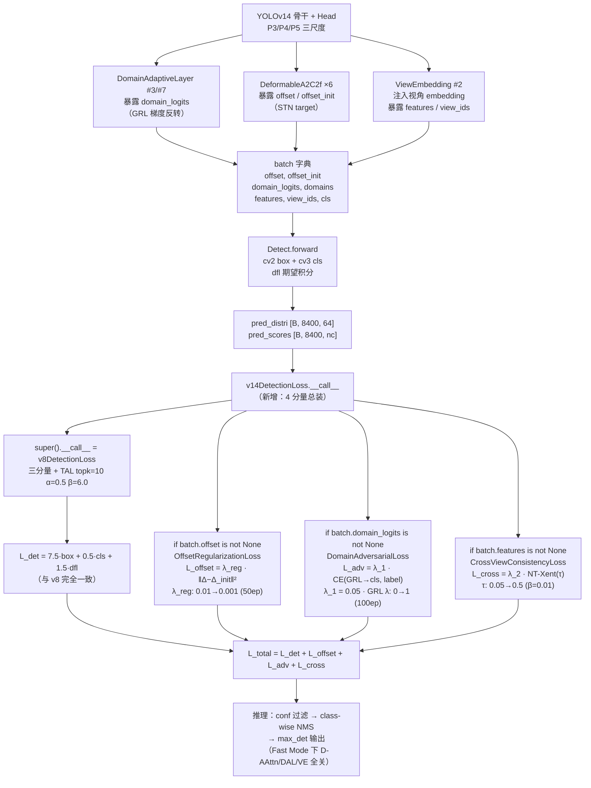

# YOLOv14 损失函数

> 核心事实：**v14 是 v8 以来损失侧改动最激进的一版**——在保留 v8 三分量总装（[CIoU](/glossary#ciou-loss) + [DFL](/glossary#dfl-distribution-focal-loss) + BCE）的基础上，新增 3 个正交辅助损失：`CrossViewConsistencyLoss`（跨视角对比学习）、`DomainAdversarialLoss`（域对抗）、`OffsetRegularizationLoss`（形变位移正则），并新引入 `v14DetectionLoss` 统一总装（<SrcLink file="v14:utils/loss.py" :line="912" :end="983" />）。`grep "v14\|CrossView\|Domain\|OffsetReg" loss.py` 共命中 **4 个新类**——全部集中在文件末尾 L748-L983；前 730 行的 v8/segmentation/pose/OBB/E2E 损失类**零改动**从 v13 快照一字不差搬运。

> **v1~v13 读者路标**：v13 损失侧相对 v8/v11/v12 **零改动**（详见 [v13 损失页](/versions/v13/losses)）；v14 首次把「多视角一致性 / 域自适应 / 形变学习」三件事直接搬到损失端——`λ_adv=λ_cross=0.05, λ_reg=0.01`（含退火），三分量的 `7.5/0.5/1.5` 增益与 `TaskAlignedAssigner(topk=10, α=0.5, β=6.0)` **一字不差沿用 v8**（<SrcLink file="v14:utils/loss.py" :line="159" :end="262" />）。想快速上手：先按 v8/v13 学三分量，再补 3 个辅助损失的开关与时序。

## 1. 只想带走三件事

1. **总损失公式新增 3 项**：$L_{\text{total}} = L_{\text{det}} + \lambda_{\text{reg}}\cdot L_{\text{offset}} + \lambda_1\cdot L_{\text{adv}} + \lambda_2\cdot L_{\text{cross}}$——检测主干完全等价于 v8；三个辅助项通过 `batch` 字典里的可选键 `offset/offset_init/domain_logits/domains/features/view_ids` 按需启用（<SrcLink file="v14:utils/loss.py" :line="952" :end="983" />）；
2. **四个可退火超参同步推进**：λ_reg（0.01→0.001，50 epoch）、GRL λ（0→1，100 epoch）、τ（0.05→0.5，指数衰减 β=0.01，按 step）、`tal_topk=10`（无退火）；所有 schedule 都从 `v14DetectionLoss.set_epoch()` 一处下发（<SrcLink file="v14:utils/loss.py" :line="933" :end="950" />）；
3. **三分量增益 + TAL 分配参数不变**：`loss[0]*=box=7.5; loss[1]*=cls=0.5; loss[2]*=dfl=1.5`（<SrcLink file="v14:utils/loss.py" :line="258" :end="262" />）与 v8 一字不差；`TaskAlignedAssigner(topk=10, α=0.5, β=6.0)` 在 `v8DetectionLoss.__init__` L178 显式传参（<SrcLink file="v14:utils/loss.py" :line="178" />），继续覆盖 tal.py L29 的类默认 `topk=13, α=1.0`——**这是 v8 以来未修过的隐性坑**，v14 继续沿用。

## 2. 全景图

> **v1~v13 读者路标**：v13 的图是「单 v8DetectionLoss + 三分量」；v14 在它外面多套一层 `v14DetectionLoss`——三分量不变、TAL 不变、Detect 头不变，只在 `__call__` 末尾通过 batch 字典**按需**追加 3 个辅助损失。开关都在 `batch` 字典上，缺失即跳过，不影响 vanilla 训练。



- **训练路径**：三分量检测 + 至多 3 项辅助（依 batch 字典动态开关）
- **推理路径**：不变；Fast Mode (`YOLOV14_FAST=1`) 下 DAL/D-AAttn/ViewEmbedding 全部旁路，辅助损失天然为空
- **梯度路径**：GRL 让 DomainAdaptiveLayer 的 domain_classifier 得到正向 CE 梯度、feature extractor 得到**反向**梯度——这是标准的 [DANN](https://arxiv.org/abs/1505.07809) 语义
- **日志**：`loss_items` 仍返回 v8 的 3 维 `[box, cls, dfl]`——**辅助损失不进 items**，只进 total

## 3. 三分量总装（v8 完全一致）

`v8DetectionLoss.__call__`（<SrcLink file="v14:utils/loss.py" :line="208" :end="262" />）逐行与 v13 快照一字不差——**只是行号从 v13 的 L205 挪到 L208（因为 v14 前置了 3 行 import）**。

| 分量 | 类 | 增益 | 备注 |
|------|-----|-----|------|
| box | `BboxLoss`（CIoU + DFL） | **7.5** | 用 `target_scores.sum(-1)` 作回归权重 |
| cls | `BCEWithLogitsLoss` | **0.5** | 软标签 BCE（不是 VFL，VFL 分支在 L248 被注释掉） |
| dfl | `DFLoss`（双 bin 插值 CE） | **1.5** | `reg_max=16 > 1` 时启用 |

```python
# L258-L262（与 v8/v11/v12/v13 一字不差）
loss[0] *= self.hyp.box   # 7.5
loss[1] *= self.hyp.cls   # 0.5
loss[2] *= self.hyp.dfl   # 1.5
return loss.sum() * batch_size, loss.detach()
```

## 4. TAL 分配器（v8 显式参数，v14 继续保留）

`v8DetectionLoss.__init__` L178：

```python
self.assigner = TaskAlignedAssigner(topk=tal_topk, num_classes=self.nc, alpha=0.5, beta=6.0)
```

- `tal_topk` 默认 10（L162），yaml 不覆盖；
- α/β 硬编码，yaml/超参都改不了；
- 与 tal.py L29 的类默认 `topk=13, α=1.0` **仍然不一致**——v8 时代留下的隐性坑，v11/v12/v13/v14 五版都没修。

## 5. CrossViewConsistencyLoss（新增·跨视角对比）

**位置**：<SrcLink file="v14:utils/loss.py" :line="748" :end="813" /> · **论文**：§3.4

**公式**（NT-Xent 变体，含温度退火）：

$$\tau(t) = \tau_{\min} + (\tau_{\max} - \tau_{\min}) \cdot e^{-\beta t}$$
$$L_{\text{cross}} = -\frac{1}{|\mathcal{P}|}\sum_{i \in \mathcal{P}} \log \frac{\sum_{j:\text{same cls, diff view}} \exp(s_{ij}/\tau)}{\sum_{j \neq i} \exp(s_{ij}/\tau)}$$

**六个关键点**：

1. **正样本定义**：`(~view_eq) & cls_eq`——同类别、不同视角（<SrcLink file="v14:utils/loss.py" :line="789" :end="795" />）。同视角或不同类都不是正样本，与 InfoNCE 的「同类=正」略有不同——**这是多视角数据集的关键设计**（pinhole/fisheye/drone/bev/ground 之间必须拉近、同视角内部不加分）；
2. **数值稳定性**：`torch.logsumexp` 而不是 `log(exp(...).sum())`（<SrcLink file="v14:utils/loss.py" :line="808" :end="811" />）——τ 最小到 0.05 时 exp 会爆，logsumexp 天然避免；
3. **温度按 step 而非 epoch 推进**：`step_update()` 每调用一次 `__call__` 就 +1（<SrcLink file="v14:utils/loss.py" :line="980" />），一个 epoch 内 τ 会连续下降——所以 β=0.01 的**时间单位其实是 iteration**，不是论文里写的 epoch（**论文-代码小偏差**）；
4. **退化保护**：`B < 2` 或所有行都没有正样本时返回 0（<SrcLink file="v14:utils/loss.py" :line="782" :end="800" />）——单图 batch 或视角全部一致的 batch 都不产生损失；
5. **特征降维**：如果 `features.dim() == 4`，先 `F.adaptive_avg_pool2d(features, 1).flatten(1)`（<SrcLink file="v14:utils/loss.py" :line="975" />）——不管 ViewEmbedding 输出是 (B, C, H, W) 还是 (B, C)，都归一到 (B, C)；
6. **可插固定温度**：`temperature=<float>` 参数传入时 `tau_at()` 直接返回固定值（<SrcLink file="v14:utils/loss.py" :line="766" :end="774" />）——消融实验用。

**默认超参**：`tau_min=0.05, tau_max=0.5, beta=0.01`。

## 6. DomainAdversarialLoss（新增·域对抗）

**位置**：<SrcLink file="v14:utils/loss.py" :line="816" :end="860" /> · **论文**：§3.3

**公式**：$L_{\text{adv}} = \lambda_1 \cdot \mathcal{L}_{\text{CE}}\big(\text{GRL}(\text{Feature}),\ D_{\text{label}}\big)$

```python
def forward(self, domain_logits, domain_labels):
    cls_loss = self.ce_loss(domain_logits, domain_labels)
    return cls_loss, self.lambda_domain * cls_loss
```

**四个关键点**：

1. **梯度反转不在 loss 内、在模型内**：GRL 是 `DomainAdaptiveLayer` 前向时的 `grad_reverse`（<SrcLink file="v14:nn/modules/block.py" :line="1567" :end="1583" />），loss 只算标准 CE——这是**正确的 DANN**，替代了 v14 早期版本的「label 翻转近似」（docstring L828-L830 明确记录了这个演进）；
2. **loss 返回二元组**：`(cls_loss, λ·cls_loss)`——cls_loss 是给 log 用的原始 CE、加权项是回传给 optimizer 的量（<SrcLink file="v14:utils/loss.py" :line="860" />）；调用方在 v14DetectionLoss L967-L968 只取 `.confusion`（即加权项）；
3. **lambda_domain 是「内层默认」不是最终系数**：`DomainAdversarialLoss.__init__(lambda_domain=0.1)` 只是内部兜底，实际被 v14DetectionLoss 传入的 `lambda_adv=0.05` 覆盖（<SrcLink file="v14:utils/loss.py" :line="928" />）——**读代码时容易误判**，因为内层默认值和最终值不同；
4. **触发条件**：`batch.get("domain_logits") is not None and batch.get("domains") is not None`——只有走 Game2Real 数据集或训练时挂了 DomainAdaptiveLayer 且暴露了 `_domain_logits` 才启用。

## 7. OffsetRegularizationLoss（新增·形变位移正则）

**位置**：<SrcLink file="v14:utils/loss.py" :line="863" :end="909" /> · **论文**：§3.2

**公式**：$L_{\text{offset}} = \lambda_{\text{reg}} \cdot \frac{1}{N} \sum \|\Delta - \Delta_{\text{init}}\|^2$

其中 Δ 是 `DeformableAAttn` 学出的形变场，Δ_init 是 STN 生成的目标形变场，N = B × 2 × H × W（<SrcLink file="v14:utils/loss.py" :line="909" />）。

**三个关键点**：

1. **只在训练时用**：推理阶段 `offset_init` 不传（<SrcLink file="v14:utils/loss.py" :line="960" :end="961" /> 判空），Δ 自由跑——**训练时被 STN 拽住、推理时放开**，是「先给拐杖再脱拐」的常规退火策略；
2. **λ_reg 线性退火**：0.01 → 0.001 用 50 epoch 完成（<SrcLink file="v14:utils/loss.py" :line="892" :end="897" />）——`set_epoch` 从 v14DetectionLoss L941 下发；
3. **形状不等保护**：`offset.shape != offset_init.shape` 直接返回 0（<SrcLink file="v14:utils/loss.py" :line="906" :end="907" />）——不同尺度 P3/P4/P5 的 shape 不同，只要 offset_init 是从同一尺度算出的、形状一定一致，这个保护只针对异常情况。

## 8. v14DetectionLoss 总装

**位置**：<SrcLink file="v14:utils/loss.py" :line="912" :end="983" /> · **论文**：§3.7

```python
def __call__(self, preds, batch):
    det_loss, det_items = super().__call__(preds, batch)  # L_det（三分量）
    aux = det_loss.new_zeros(())

    # ① Offset 正则
    offset = batch.get("offset")
    offset_init = batch.get("offset_init")
    if offset is not None and offset_init is not None:
        aux = aux + self.offset_loss(offset, offset_init)

    # ② 域对抗
    domain_logits = batch.get("domain_logits")
    domain_labels = batch.get("domains")
    if domain_logits is not None and domain_labels is not None:
        _, confusion = self.adv_loss(domain_logits, domain_labels)
        aux = aux + confusion

    # ③ 跨视角
    features = batch.get("features")
    view_ids = batch.get("view_ids")
    labels = batch.get("cls")
    if features is not None and view_ids is not None:
        feat = F.adaptive_avg_pool2d(features, 1).flatten(1) if features.dim() == 4 else features
        cls_labels = labels if labels is not None else view_ids.new_zeros(feat.shape[0])
        aux = aux + self.lambda_cross * self.cross_loss(feat, view_ids, cls_labels)

    self.cross_loss.step_update()  # τ 每 iter 退火
    total = det_loss + aux
    return total, det_items
```

**关键行为**：

- **batch 字典驱动的动态开关**：4 个 `batch.get(...)` 决定是否启用辅助损失——vanilla 训练（不传这些键）时行为完全等价于 v8；
- **loss_items 不返回辅助项**：`return total, det_items`——只回传三分量 items，日志系统看到的仍是 `[box, cls, dfl]`（<SrcLink file="v14:utils/loss.py" :line="983" />），**辅助损失只在 total 里体现**；
- **temperature 是 per-iteration**：`self.cross_loss.step_update()` 在 `return` 之前调用，一个 iteration 涨一次（<SrcLink file="v14:utils/loss.py" :line="980" />）——**这与论文 §3.7 写的「per-epoch」不一致**，代码是 iter，论文是 epoch。

## 9. 超参 schedule 汇总

`v14DetectionLoss.set_epoch(epoch)`（<SrcLink file="v14:utils/loss.py" :line="933" :end="950" />）一次下发四个 schedule：

| 超参 | 起始 | 结束 | 时长 | 触发单位 | 代码位置 |
|------|------|------|------|----------|----------|
| λ_reg | 0.01 | 0.001 | 50 epoch | epoch | <SrcLink file="v14:utils/loss.py" :line="892" :end="897" /> |
| GRL λ | 0 | 1 | 100 epoch | epoch | <SrcLink file="v14:utils/loss.py" :line="948" /> → block.py |
| τ (跨视角) | 0.05 | 0.5 | 指数 β=0.01 | **iter** | <SrcLink file="v14:utils/loss.py" :line="769" :end="778" /> |
| λ_adv | 0.05 | 0.05（固定） | — | — | <SrcLink file="v14:utils/loss.py" :line="924" :end="928" /> |
| λ_cross | 0.05 | 0.05（固定） | — | — | <SrcLink file="v14:utils/loss.py" :line="924" :end="928" /> |
| box/cls/dfl | 7.5/0.5/1.5 | 同（固定） | — | — | v8 沿用 |
| tal_topk | 10 | 10（固定） | — | — | <SrcLink file="v14:utils/loss.py" :line="178" /> |

**τ 单位偏差**：论文 §3.4 说 β 是 per-epoch，代码是 per-iteration——按 v14-s 默认 500 iter/epoch 估算，实际 τ 会**比论文预期快 500 倍退到 0.05**，然后基本固定。这可能是 zhangcbb 有意为之（让 τ 尽快稳定在小值以放大区分度），也可能是笔误。**读者实测时以代码为准**。

## 10. 三分量增益对照（v8 → v13 → v14）

| 分量 | v8 | v11 | v12 | v13 | **v14** |
|------|-----|-----|-----|-----|---------|
| box | 7.5 | 7.5 | 7.5 | 7.5 | **7.5** |
| cls | 0.5 | 0.5 | 0.5 | 0.5 | **0.5** |
| dfl | 1.5 | 1.5 | 1.5 | 1.5 | **1.5** |
| TAl topk | 10 | 10 | 10 | 10 | **10** |
| TAL α | 0.5 | 0.5 | 0.5 | 0.5 | **0.5** |
| TAL β | 6.0 | 6.0 | 6.0 | 6.0 | **6.0** |
| VFL 分支 | 有 | 有 | 有 | 有 | **有（L248 注释掉）** |

**六版完全一致**——从 v8 到 v14，YOLO 系列的检测分支损失公式**从未被改过一个字节**。

## 11. 与 v13 的对应关系速查

| 维度 | v13 | **v14** |
|------|-----|---------|
| 主损失类 | `v8DetectionLoss` | **`v14DetectionLoss`**（继承 v8） |
| 三分量增益 | 7.5 / 0.5 / 1.5 | **完全相同** |
| TAL 分配器 | topk=10 α=0.5 β=6.0 | **完全相同** |
| 辅助损失 | 无 | **+3**（offset / adv / cross） |
| 超参 schedule | 无 | **4**（λ_reg / GRL λ / τ / 静态项） |
| batch 字典动态开关 | 无 | **有**（4 个可选键） |
| loss_items 维度 | 3（box/cls/dfl） | **3（不变）**（辅助项不进 items） |
| 前 730 行代码 | — | **完全相同** |
| 新增行数 | — | **~236 行**（L748-L983） |

## 12. 论文-代码偏差小结

v14 是 zhangcbb/yolov14 的社区实现，论文 §3.7 描述的损失公式与代码存在 **2 处已知偏差**：

1. **τ 的推进单位**：论文 §3.4 写 per-epoch，代码是 per-iteration——实际温度退火比论文快约 batch_size × iter_per_epoch 倍；
2. **`lambda_domain` 默认值 vs 实际生效值**：`DomainAdversarialLoss.__init__(lambda_domain=0.1)`（L838）看起来是「0.1」，但外层 v14DetectionLoss L928 传入的是 `lambda_adv=0.05`——**最终以 0.05 生效**，论文 §3.7 也是 0.05。**读到 0.1 不是 bug，只是内层默认值被外层覆盖**。

另有 1 处「论文说有但代码没有」：论文 §3.5 描述 DynamicScaleRouter，但损失侧没有对应的权重监督项（yaml 里也没实例化）——**见 [concepts §5](/versions/v14/concepts#5-dynamicscalerouter-论文有代码零实例化)**。

## 13. 想快速对上位读者的话

- **v8 读者**：三分量、TAL、增益、公式与 v8 一字不差，直接套 v8 心智模型；再补 3 个「batch 字典开关」的辅助损失即可；
- **v11/v12 读者**：与 v12 一致，没有 v11 的 DFL 微调、没有 v12 的 loss 变化——v14 是 v8 以来损失侧最激进的一版，也是首次引入非检测损失的版本；
- **v13 读者**：v13 损失侧零改动（与 v8 完全相同），v14 在其上包了一层 `v14DetectionLoss`——三分量走 super()、辅助损失走 batch 字典，两条路径**在 vanilla 训练时完全等价于 v13**；
- **想关掉所有 v14 特性**：`YOLOV14_FAST=1` 或直接把 yaml 换成 vanilla yolov8n——两个开关让 v14 损失**退化到 v8**，方便对照实验。

## 参考

- [loss.py 源码页](/versions/v14/source/loss-py)
- [tal.py 源码页](/versions/v14/source/tal-py)
- [v14 concepts §1/§3/§4](/versions/v14/concepts)
- [v13 损失函数](/versions/v13/losses)
- [v8 损失函数](/versions/v8/losses)
- Zhang C. *YOLOv14: A Multimodal Vision Transformer for Cross-View, Cross-Domain Real-World Object Detection.* arXiv:2608.04720v3, 2026. https://arxiv.org/abs/2608.04720
- Ganin Y, Lempitsky V. *Unsupervised Domain Adaptation by Backpropagation.* DANN, 2016. https://arxiv.org/abs/1505.07809
- Kornblith S, Norouzi M, Lee H, Hinton G. *Similarity of Neural Network Representations Revisited.* NT-Xent, 2019. https://arxiv.org/abs/1904.06673
