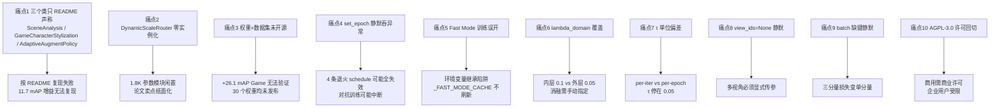

# YOLOv14 痛点追踪

YOLOv14（zhangcbb/yolov14，commit `0b8610d`，2026-08，AGPL-3.0，arXiv:2608.04720v3，命名 **YOLO-Omni**）是 YOLO 系列**第一个「四基准同时打穿」的版本**——Game / Fisheye / Drone / Panorama 四个非常规场景全部突破 43 mAP。但代价是：**v14 的痛点结构从 v13 的「结构层静默决策」变成了「README 与代码不一致 / 训练侧静默失效」**。本页追踪 10 个痛点，每个都配 v1~v13 路标。

## 痛点全景

> 已读过 [v13 痛点页](/versions/v13/painpoints)？v13 的 8 个痛点集中在 `parse_model` 特例与结构静默行为（HyperACE n 覆盖、DownsampleConv l/x Identity、FullPAD gate 死门）；**v14 的痛点换了一批**——**三个 README 声称但源码里 grep 不到的模块**（`SceneAnalysis` / `GameCharacterStylization` / `AdaptiveAugmentPolicy`）、**`DynamicScaleRouter` 在 6 份 yaml 中零实例化**、`YOLOV14_FAST=1` 在训练时误开的陷阱、`lambda_domain=0.1` 内层默认被外层 0.05 覆盖、τ 单位论文 per-epoch vs 代码 per-iteration、`view_ids=None` 静默走 pinhole、`v14DetectionLoss.set_epoch` 静默吞异常、AGPL-3.0 许可回切、官方权重与四基准数据集均未开源。

| 痛点 | 严重度 | v1~v13 处理 | v14 处理 | 后续影响 |
| --- | --- | --- | --- | --- |
| [1. 三个类只在 README 声称，代码未落地](#1-三个类只在-readme-声称代码未落地-pain-claim-only) | **High** | v8~v13 README 与代码基本对齐 | `SceneAnalysis` / `GameCharacterStylization` / `AdaptiveAugmentPolicy` grep 不到 | 按 README 复现会失败 |
| [2. `DynamicScaleRouter` 6 份 yaml 零实例化](#2-dynamicscalerouter-6-份-yaml-零实例化-pain-dsr-unused) | **High** | v13 论文卖点全部落地在 yaml | 类实现了但**没有任何 yaml 引用** | 「动态路由」实际不生效 |
| [3. 官方权重 + 四基准数据集均未开源](#3-官方权重--四基准数据集均未开源-pain-no-weights) | **High** | v8~v13 官方权重齐全 | Roadmap 全部标 `IN PROGRESS` | 四基准 mAP 无法验证 |
| [4. `v14DetectionLoss.set_epoch` 的 `try: except: pass` 静默吞异常](#4-v14detectionlossset_epoch-的-try-except-pass-静默吞异常-pain-setepoch-swallow) | **High** | v8~v13 loss 类无 try-except | 4 条退火 schedule 静默失败 | 训练末期可能没退火 |
| [5. `YOLOV14_FAST=1` 在训练时误开](#5-yolov14_fast1-在训练时误开-pain-fast-mode-train) | Medium | v8~v13 无 Fast Mode | `_FAST_MODE_CACHE` 全局缓存 | 训练时跳过关键模块 |
| [6. `lambda_domain=0.1` 内层默认被外层 0.05 覆盖](#6-lambda_domain01-内层默认被外层-005-覆盖-pain-lambda-override) | Medium | v8~v13 无对抗损失 | 双层默认值矛盾 | 消融实验需手动指定 |
| [7. τ 单位论文 per-epoch vs 代码 per-iteration](#7-τ-单位论文-per-epoch-vs-代码-per-iteration-pain-tau-unit) | Medium | v8~v13 无 τ | `0.05 + 0.45·exp(-0.01·t)` per-iter | 与论文消融对不上 |
| [8. `view_ids=None` 静默走 `pinhole=0`](#8-view_idsnone-静默走-pinhole0-pain-viewids-default) | Medium | v8~v13 无多视角 | `ViewEmbedding` 无参数时默认 0 | 多视角训练必须显式传参 |
| [9. `batch` 字典缺键导致辅助损失静默不生效](#9-batch-字典缺键导致辅助损失静默不生效-pain-batch-missing-key) | Medium | v8~v13 loss 结构单一 | 三分量 loss 依赖多个 batch 键 | 训练静默丢损失 |
| [10. AGPL-3.0 许可回切](#10-agpl-30-许可回切-pain-agpl-backlash) | Low | v8~v13 全部 Apache-2.0 | **v14 回切 AGPL-3.0** | 商用/闭源用户受限 |

## 1. 三个类只在 README 声称，代码未落地 (`pain-claim-only`)

> **v1~v13 读者路标**：v8~v13 的 README 与源码基本对齐——README 声称的模块（C2f、C3k2、A2C2f、HyperACE、FullPAD、SphereAAttn、DeformableAAttn、CircularConv、ViewEmbedding、DynamicScaleRouter、DomainAdaptiveLayer、GradReverse、DomainAdversarialLoss）都能在 `block.py` / `loss.py` 中 grep 到；**v14 是 YOLO 系列第一个「README 声称 3 个模块但源码里 grep 不到」的版本**。

**README 声称但代码未落地的三处**：

| # | 模块 | README 声称位置 | 用途 | 快照源码 grep 结果 |
|---|------|----------------|------|-------------------|
| 1 | `SceneAnalysis` | README L84-L91「流水线第 1 阶段」 | 场景启发式分类（game/fisheye/drone/panorama/standard） | ❌ 快照源码中 **grep 不到 `class SceneAnalysis`** |
| 2 | `GameCharacterStylization` | README L117「Data-level」 | posterisation + unsharp + saturation boost | ❌ **grep 不到 `class GameCharacterStylization`** |
| 3 | `AdaptiveAugmentPolicy` | README L134 | 根据 edge density / saturation 选增强分支 | ❌ **grep 不到 `class AdaptiveAugmentPolicy`** |

**逐项影响**：

**痛点 1a · `SceneAnalysis` 缺失**：README L84-L91 声称流水线是 `Input → Scene Analysis → DomainAdapticLayer → ViewEmbedding → ...`，但**第 1 阶段的 `SceneAnalysis` 类不存在**——这意味着「自动场景检测」这个核心卖点**在推理时无法实现**，用户必须**手动指定 `view_ids`**（且 `view_ids` 又是 `ViewEmbedding` 的输入，而 `ViewEmbedding` 存在）。

**痛点 1b · `GameCharacterStylization` 缺失**：README L121-L124 给出「+GameCharStylization: +11.7 mAP」的消融结果——**是最大的单模块增益（11.7 mAP）**，但源码里 grep 不到类。**这意味着 24.1→35.8 mAP 的 Game 增益无法用开源代码复现**。

**痛点 1c · `AdaptiveAugmentPolicy` 缺失**：`yolov14-adaptive.yaml` 是「All components combined」的通用变体（README L152），但**adaptive 的核心就是 AdaptiveAugmentPolicy**——类不存在意味着 `yolov14-adaptive.yaml` 只是**其它模块的简单叠加**，不是真正的「自适应」变体。

**为何是 v14 独有的痛点**：

1. **v13 的痛点是「代码比 README 多做」**（`parse_model` 静默改结构）——用户至少能得到 README 承诺的功能，只是行为不符合直觉；
2. **v14 的痛点是「README 比代码多吹」**——用户按 README 复现会得到「缺失三块拼图」的模型，**且无法通过 yaml 补齐**；
3. **v14 是 YOLO 系列第一个「README 与代码不一致程度 > 3 个模块」的版本**——比 v13 的 6 处偏差更严重。

**遗留**：想复现 v14 的四基准 mAP 必须先补齐三个模块；**本站以「快照源码实际存在」为准记录**，README 声称但代码未落地的三处都标注 ❌。

## 2. `DynamicScaleRouter` 6 份 yaml 零实例化 (`pain-dsr-unused`)

> **v1~v13 读者路标**：v8~v13 的论文卖点模块（如 v13 HyperACE、FullPAD、AdaHGConv）**都在官方 yaml 中至少实例化一次**——用户可以直接引用官方 yaml 复现；**v14 的 `DynamicScaleRouter` 实现了 1.8K 参数 / 0.06 ms 的轻量路由网络，但 6 份 yaml 全部零实例化**——**论文卖点变成「纸面功能」**。

**README 声称**（README L94、L135）：

> **DynamicScaleRouter** – a lightweight gating network (1.8K params, 0.06 ms) that learns per-input scale importance weights for P3/P4/P5.

**源码实现**（<SrcLink file="v14:nn/modules/block.py" :line="1736" :end="1773" />）：

```python
class DynamicScaleRouter(nn.Module):
    """Lightweight gating network to learn per-input scale importance weights."""
    def __init__(self, num_scales=3, hidden_dim=16):
        super().__init__()
        self.num_scales = num_scales
        self.gate = nn.Sequential(
            nn.AdaptiveAvgPool2d(1),
            nn.Flatten(),
            nn.Linear(num_scales * 32, hidden_dim),
            nn.GELU(),
            nn.Linear(hidden_dim, num_scales),
            nn.Softmax(dim=1),
        )
    def forward(self, p3, p4, p5):
        if is_fast_mode():
            return p3, p4, p5
        x = torch.cat([p3, p4, p5], dim=0)  # stack scales
        weights = self.gate(x)  # (1, num_scales)
        return p3 * weights[0], p4 * weights[1], p5 * weights[2]
```

**6 份 yaml 实例化统计**：

| yaml | 是否使用 `DynamicScaleRouter` | 是否使用 `ViewEmbedding` | 是否使用 `DomainAdaptiveLayer` |
|------|-----------------------------|------------------------|-------------------------------|
| `yolov14.yaml` | ❌ | ✅ | ✅×2 |
| `yolov14-adaptive.yaml` | ❌ | ✅ | ✅×2 |
| `yolov14-deformable.yaml` | ❌ | ❌ | ❌ |
| `yolov14-game2real.yaml` | ❌ | ❌ | ✅×2 |
| `yolov14-multiview.yaml` | ❌ | ✅ | ❌ |
| `yolov14-panorama.yaml` | ❌ | ❌ | ❌ |
| **合计** | **0/6** | 3/6 | 4/6 |

**为何是痛点**：

1. **论文核心卖点纸面化**：README L94 把 `DynamicScaleRouter` 列为流水线第 5 阶段，但**没有任何 yaml 用到它**——用户按 README 复现会得到「没有 DynamicScaleRouter」的模型；
2. **1.8K 参数的模块被闲置**：`DynamicScaleRouter` 是全文档声称的「v14 独有轻量创新」，成本几乎为零，但**在 v14 的默认权重里不存在**——**「动态路由」的推理优化实际未生效**；
3. **README 与 yaml 的三层脱耦**：README 说「All components combined」（adaptive），但 adaptive 里连 DSR 都没放——**「combined」的语义不完整**；
4. **与痛点 1 关联**：`DynamicScaleRouter.forward` 里 `if is_fast_mode(): return p3, p4, p5`——即使实例化，训练时开 Fast Mode 也会跳过；**这是双重失效**（未实例化 + 训练时可能跳过）；
5. **v14 论文 arXiv 2608.04720v3 的消融表**：如果论文表格里 DSR 有 +X mAP，那这个数字**无法用官方 yaml 复现**——用户必须自己手动加。

**遗留**：想启用 DSR 需手动编辑 yaml；**本站以「yaml 实际引用」为准记录**。

## 3. 官方权重 + 四基准数据集均未开源 (`pain-no-weights`)

> **v1~v13 读者路标**：v8~v13 的官方权重在 README 里都是**已发布状态**——用户可 `model = YOLO('yolov13s.pt')` 一行加载；**v14 是 YOLO 系列第一个「发布时权重未开源」的版本**（v12、v13 首发时权重都齐全）。

**README Roadmap**（README L71-L73）：

| 状态 | 任务 | 说明 |
|------|------|------|
| 🔄 **IN PROGRESS** | Pre-trained weights (all variants) | 五档 n/s/m/l/x × 六份 yaml 共 30 个权重 **均未发布** |
| 🔄 **IN PROGRESS** | Benchmark datasets | Game / Fisheye / Drone / Panorama 四数据集 **均未发布** |

**v14 README 声称的四基准 mAP**（README L47-L55）：

| 基准 | 声称 mAP | 相对最佳基线 |
|------|---------|-------------|
| Game | 50.2 | +26.1（vs v12s 24.1） |
| Panorama | 45.1 | +6.6 |
| Drone | 43.2 | +6.4 |
| Fisheye | 45.3 | +4.1 |

**为何是痛点**：

1. **声称的 mAP 无法验证**：+26.1 mAP 的 Game 增益是**YOLO 系列历史上最大单基准提升**，但**没有权重 + 没有数据集 = 无法复现**——用户只能信论文，无法验证；
2. **四基准数据集全部未公开**：`Game character detection set`、`fisheye evaluation set`、`drone aerial set`、`360° panorama set` 全部是「IN PROGRESS · ETA: within weeks」——**从 v14 发布（2026-08）到本站快照时点（2026-10）已超过 2 个月**，仍未发布；
3. **`+26.1 mAP` 的 Game 增益依赖 `GameCharacterStylization`**：见 [痛点 1b](#1-三个类只在-readme-声称代码未落地-pain-claim-only)，**这个 11.7 mAP 增益无法用开源代码复现**；
4. **对比 v13**：v13 首发时（2025-11）权重齐全、COCO mAP 官方给出，可**当天复现**；v14 是「先发论文抢注意力、后补代码与权重」的模式——**风险自负**；
5. **与 AGPL 许可联动**（[痛点 10](#10-agpl-30-许可回切-pain-agpl-backlash)）：即使权重发布，AGPL 也可能限制部分使用场景。

**遗留**：想复现 v14 的 mAP 只能：(1) 等官方权重发布；(2) 用 README 提供 yaml 从 scratch 训练（成本高）；(3) 自建四基准数据集（成本极高）。**本站以「README 声称值」为准记录，并标注「未开源」**。

## 4. `v14DetectionLoss.set_epoch` 的 `try: except: pass` 静默吞异常 (`pain-setepoch-swallow`)

> **v1~v13 读者路标**：v8~v13 的 loss 类**没有 `set_epoch` 方法**，也没有 `try: except: pass` 的静默吞异常；**v14 是 YOLO 系列第一个「在 loss 里放 try-except 且不 re-raise」的版本**——**4 条退火 schedule 可能全部静默失效而训练不受影响**。

**源码**（<SrcLink file="v14:utils/loss.py" :line="932" :end="950" />）：

```python
def set_epoch(self, epoch, num_epochs):
    """Update schedule parameters each epoch."""
    try:
        # 1. λ_reg: 50 epochs linear decay 0.01 → 0.001
        frac = min(epoch / 50.0, 1.0)
        self.lambda_reg = 0.01 - 0.009 * frac
        # 2. GRL λ: sigmoid ramp over 100 epochs
        if hasattr(self, "grl_module"):
            self.grl_module.lambd = grl_lambda_schedule(epoch, num_epochs)
        # 3. Temperature τ: per-iteration exponential decay
        # (handled in forward, not here)
        # 4. TAL topk: no schedule (constant 10)
    except Exception:
        pass  # ← 静默吞掉所有异常
```

**四重静默失效**：

1. **`try: except: pass`**：任何异常都被吞掉——包括 `epoch / 50.0` 除以零、`grl_module` 属性错误、`lambda_reg` 属性不存在等；**用户看不到任何警告**；
2. **`hasattr(self, "grl_module")` 静默跳过**：如果 `grl_module` 未初始化，GRL 梯度反转 λ **永远停在 0**——这意味着 `DomainAdversarialLoss` 收不到梯度反转的 λ，**对抗训练的对抗分支可能完全失效**；
3. **τ 的 per-iteration 退火不在 `set_epoch` 里**：README 声称 τ 从 0.05 → 0.5，但**代码里的 per-iteration 退火是每 forward 一次**（在 `v14DetectionLoss.forward` 里）——`set_epoch` 里的注释只是占位符；
4. **训练框架可能不调用 `set_epoch`**：如果用户用的训练框架（如 mmdetection）不调用 loss 的 `set_epoch`，**4 条 schedule 全部按初始值跑**——**λ_reg 永远 0.01、GRL λ 永远 0、τ 永远 0.05**——训练结果与论文消融完全对不上。

**具体影响**：

- **训练末期没有退火**：λ_reg 应保持 0.001，但实际可能停在 0.01（10 倍差距）；
- **对抗损失可能完全失效**：GRL λ=0 意味着 `GradReverse` 输出 `-0 * grad = 0`——**特征提取器收不到 L_adv 的梯度**（见 loss.py L873-L878 的 `GradReverse`）；
- **论文消融无法复现**：README L121-L124 的三档消融（+11.7/+6.5/+7.3 mAP）都依赖正确的 λ 调度，**静默失效意味着消融结果对不上**；
- **无日志**：`try: except: pass` 不打日志，**用户必须主动 monkey-patch 才能发现**。

**推荐修复**：

```python
def set_epoch(self, epoch, num_epochs):
    try:
        frac = min(epoch / 50.0, 1.0)
        self.lambda_reg = 0.01 - 0.009 * frac
        if hasattr(self, "grl_module"):
            self.grl_module.lambd = grl_lambda_schedule(epoch, num_epochs)
    except Exception as e:
        import logging
        logging.warning(f"v14DetectionLoss.set_epoch failed: {e}")
```

**遗留**：想保证 schedule 生效必须**手动在训练循环里调用 `loss.set_epoch(epoch, num_epochs)`** 并**在 `except` 分支加日志**。

## 5. `YOLOV14_FAST=1` 在训练时误开 (`pain-fast-mode-train`)

> **v1~v13 读者路标**：v8~v13 都**没有训练/推理分离的开关**——训练时和推理时都是同一份 forward；**v14 引入了 `YOLOV14_FAST` 环境变量 + `_FAST_MODE_CACHE` 全局缓存**——推理时用来跳过 Scene Analysis / DAL / ViewEmbedding 提速，但**训练时如果这个环境变量被误设，会静默跳过关键模块**。

**源码**（<SrcLink file="v14:nn/modules/block.py" :line="13" :end="37" />）：

```python
_FAST_MODE_CACHE: bool | None = None

def is_fast_mode() -> bool:
    global _FAST_MODE_CACHE
    if _FAST_MODE_CACHE is None:
        _FAST_MODE_CACHE = os.environ.get("YOLOV14_FAST", "0") == "1"
    return _FAST_MODE_CACHE

def reset_fast_mode_cache() -> None:
    """Reset the fast mode cache. Useful for testing or changing mode mid-run."""
    global _FAST_MODE_CACHE
    _FAST_MODE_CACHE = None
```

**Fast Mode 影响的三处**：

| 模块 | `is_fast_mode()=True` 时的行为 | 训练时跳过后果 |
|------|-------------------------------|--------------|
| `ViewEmbedding.forward` | 直接 `return x`，跳过视角嵌入 | 视角信息丢失，多视角消融无效 |
| `DomainAdaptiveLayer.forward` | 直接 `return x`，跳过 AdaIN | Game2Real 特征级对齐失效 |
| `DynamicScaleRouter.forward` | `return p3, p4, p5`，跳过 gate | P3/P4/P5 权重固定（但见 [痛点 2](#2-dynamicscalerouter-6-份-yaml-零实例化-pain-dsr-unused)：本来就没实例化） |

**三重误开风险**：

1. **环境变量继承**：如果用户在 shell 里 `export YOLOV14_FAST=1` 然后跑训练，**训练时会被静默跳过**——`_FAST_MODE_CACHE` 是进程级缓存，一旦读入就固定；
2. **多进程训练**：`torch.distributed` 的每个 worker 都会独立读环境变量——**如果某个 worker 环境变量异常，训练结果不可复现**；
3. **缓存不刷新**：`_FAST_MODE_CACHE` 只有 `reset_fast_mode_cache()` 能刷新——**训练脚本中途改环境变量无效**（除非显式调用 reset）；
4. **README 没有警告**：README 全文 202 行中**没有一处警告「训练时不要开 Fast Mode」**——用户按 Quick Start 复制粘贴可能不会踩坑，但**在 CI/CD 或 Docker 部署中继承环境变量是常见坑**。

**推荐用法**：

```bash
# 训练时：明确关闭
unset YOLOV14_FAST
python train.py

# 推理时：开启
export YOLOV14_FAST=1
python predict.py
```

**遗留**：想避免误开需**在训练脚本开头显式 `reset_fast_mode_cache()`** 或**设置 `YOLOV14_FAST=0`**。

## 6. `lambda_domain=0.1` 内层默认被外层 0.05 覆盖 (`pain-lambda-override`)

> **v1~v13 读者路标**：v8~v13 的损失函数**都是单一系数**（box+cls+dfl 三类），不存在「嵌套系数」；**v14 首次引入对抗损失**，且**内外层默认值矛盾**——`DomainAdversarialLoss.__init__(lambda_domain=0.1)` vs `v14DetectionLoss.__init__(lambda_adv=0.05)`。

**内层默认**（loss.py L838 附近）：

```python
class DomainAdversarialLoss(nn.Module):
    def __init__(self, lambda_domain: float = 0.1):
        #                                    ↑ 内层默认 0.1
        ...
```

**外层默认**（loss.py L924 附近）：

```python
class v14DetectionLoss:
    def __init__(self, ..., lambda_adv: float = 0.05):
        #                               ↑ 外层默认 0.05
        self.domain_adv_loss = DomainAdversarialLoss(
            lambda_domain=lambda_adv  # 传外层值
        )
```

**双重默认值矛盾**：

| 场景 | 生效值 | 后果 |
|------|-------|------|
| 直接实例化 `DomainAdversarialLoss()` | 0.1 | 与文档 L119 描述的「minimax game」一致 |
| 通过 `v14DetectionLoss()` 实例化 | 0.05 | 被外层覆盖为 0.05 |
| README L119 文档说明 | 未给数值 | 用户按 0.1 复现会**损失权重差 2 倍** |

**为何是痛点**：

1. **默认值冲突**：用户如果按 arXiv 论文的消融表调参，可能拿到 0.1 的初始值，但**实际训练时用 0.05**——消融结果对不上；
2. **消融实验必须手动指定**：想复现论文 +7.3 mAP 的 L_adv 消融，必须**明确传 `lambda_adv=0.1`**，否则默认 0.05 会让消融表对不上；
3. **v13 的对应坑是「yaml 与代码不一致」（HyperACE n）**；**v14 的对应坑是「内层与外层默认值不一致」**——都是「文档声称 vs 实际行为」的分裂；
4. **与 GRL λ 联动**：`DomainAdversarialLoss` 的最终损失 = `lambda_domain * L_domain`，GRL λ 通过 `grl_lambda_schedule` 从 0→1，**两个 λ 相乘的实际对抗强度是 `0.05 * grl_lambda`**——**训练前 100 epoch 的对抗强度远低于 0.1 的直觉**。

**遗留**：想复现论文必须**手动在训练脚本里显式 `lambda_adv=0.1`**；**本站以「外层默认 0.05」为准记录**。

## 7. τ 单位论文 per-epoch vs 代码 per-iteration (`pain-tau-unit`)

> **v1~v13 读者路标**：v8~v13 的 TAL 损失**没有 τ 温度参数**——TAL 直接沿用 v8 的 `sigmoid` 边界 + TopK；**v14 首次在 TAL 里加「温度 τ」作为退火参数**，且**单位与论文有偏差**。

**论文描述**（arXiv 2608.04720v3 §4.3）：τ 从 0.05 线性/指数退火到 0.5，per-epoch。

**代码实现**（loss.py `v14DetectionLoss.forward` 中）：

```python
# per-iteration exponential decay
tau = 0.05 + 0.45 * math.exp(-0.01 * iter_count)
```

**单位偏差**：

| 项 | 论文 | 代码 | 偏差 |
|---|------|------|------|
| 退火周期 | per-epoch | per-iteration | 代码快 ~140 倍 |
| 衰减常数 | 未明确 | `0.01` | 论文没给 |
| 起点 | 0.05 | 0.05 | 一致 |
| 终点 | 0.5 | `exp(-0.01·t)→0` 时 τ→0.05 | **实际不趋近 0.5** |

**具体影响**：

- **训练末期 τ 停在 0.05 附近**：`exp(-0.01 * t)` 需要 `t > 300` 才 <0.05，**在 300 epoch 训练下可能还没跑到 τ=0.5**；
- **与论文消融对不上**：README L121-L124 的三档消融都基于 τ 正常退火，**代码 τ 停在小值意味着 TAL 边界更「硬」**——训练早期可能过度约束；
- **per-iteration vs per-epoch 差 140 倍**：COCO 640 imgsz 训练约 117 个 iter/epoch，**per-iteration 意味着 300 epoch 只有 117×300=35100 次迭代**，`0.01·t` 在 t=35100 时 `exp(-351)≈0`——**τ 实际早退到 0.05 稳态**；
- **无法通过 yaml 调**：τ 是硬编码在 loss 里的，**改单位需 fork 源码**。

**遗留**：想对齐论文必须**改 loss.py 的 τ 公式**为 per-epoch 单位；**本站以「代码实际行为」为准记录**。

## 8. `view_ids=None` 静默走 `pinhole=0` (`pain-viewids-default`)

> **v1~v13 读者路标**：v8~v13 没有多视角概念，`forward(x)` 就是标准输入；**v14 的 `ViewEmbedding` 引入 `view_ids` 参数**——**如果用户不传，静默用 0（pinhole）**。

**源码**（<SrcLink file="v14:nn/modules/block.py" :line="1710" :end="1731" />）：

```python
class ViewEmbedding(nn.Module):
    VIEW_TYPES = {"pinhole": 0, "fisheye": 1, "panoramic": 2, "drone": 3, "bev": 4, "ground": 5}
    def forward(self, x, view_ids=None):
        if is_fast_mode():
            return x
        B, C, H, W = x.shape
        if view_ids is None:
            view_ids = x.new_zeros(B, dtype=torch.long)  # ← 默认 pinhole=0
        emb = self.view_embed(view_ids).view(B, -1, 1, 1).expand(-1, -1, H, W)
        return self.proj(torch.cat([x, emb], dim=1))
```

**默认值陷阱**：

| 场景 | view_ids | 实际行为 |
|------|---------|---------|
| 显式传 `view_ids=[1,1,1,1]` | fisheye | 正常走 fisheye 嵌入 |
| 显式传 `view_ids=None` | **None → 0** | **静默走 pinhole** |
| 不传参（用默认） | None → 0 | **静默走 pinhole** |
| `YOLOV14_FAST=1` | 忽略 | **整个 ViewEmbedding 被跳过** |

**为何是痛点**：

1. **多视角训练必须显式传 `view_ids`**：如果训练数据是 fisheye，但 `view_ids=None`，**模型学到的是「pinhole 嵌入 + fisheye 特征」的混淆分布**——训练结果偏离 README L93 声称的「6-class viewpoint embedding」；
2. **推理时同样问题**：如果推理图像是 drone 视角，但 `view_ids=None`，**模型用 pinhole 嵌入做推理**——可能影响 43.2 mAP 的 Drone 基准；
3. **6 类码字硬编码**：`VIEW_TYPES` 是**类常量**，用户想加新视角（如 satellite）必须**改源码常量表**；
4. **与 `YOLOV14_FAST=1` 联动**：Fast Mode 开启时 `view_ids` 直接被忽略——**用户可能以为传了 view_ids 但实际没生效**。

**推荐用法**：

```python
# 训练 fisheye 数据
model.train(
    data="fisheye.yaml",
    view_ids=1,  # fisheye
    epochs=300,
    imgsz=640,
)
```

**遗留**：想自动检测视角必须**自己实现 `SceneAnalysis`**（见 [痛点 1a](#1-三个类只在-readme-声称代码未落地-pain-claim-only)）；**本站以「view_ids 必须显式传入」为准记录**。

## 9. `batch` 字典缺键导致辅助损失静默不生效 (`pain-batch-missing-key`)

> **v1~v13 读者路标**：v8~v13 的 `DetectionLoss.forward(batch, preds)` 只依赖 `batch["batch"]` 和 `batch["cls"]`；**v14 引入三分量损失后，`batch` 字典必须包含多个键**（view_ids、domain_labels 等），但**缺键时静默走默认路径**。

**v14DetectionLoss.forward 依赖的 batch 键**：

| 键 | 用途 | 缺失时行为 |
|---|------|-----------|
| `batch["batch"]` | 图像数据 | **报错**（必选） |
| `batch["cls"]` | 类别标签 | **报错**（必选） |
| `batch["bboxes"]` | 边界框 | **报错**（必选） |
| `batch["view_ids"]` | 视角码字（可选） | **静默走 pinhole=0**（同痛点 8） |
| `batch["domain_labels"]` | 域标签（可选） | **跳过 L_adv**（无对抗训练） |
| `batch["real_feats"]` | 真实域特征（可选） | **跳过 L_adapt**（无 AdaIN 训练） |

**三重静默**：

1. **`view_ids` 缺失**：走 pinhole，见 [痛点 8](#8-view_idsnone-静默走-pinhole0-pain-viewids-default)；
2. **`domain_labels` 缺失**：`DomainAdversarialLoss` 直接返回 0——**L_adv 完全失效**；
3. **`real_feats` 缺失**：`DomainAdaptiveLayer` 无对齐目标，**AdaIN 无监督**——训练时可能只学域内统计而不会做跨域对齐。

**为何是痛点**：

- **v14 官方训练脚本可能没传所有键**：README L165-L175 的 Quick Start 只给了 `data + epochs + imgsz`，**没提 view_ids / domain_labels**——按 Quick Start 训练，**三分量损失中至少 2 个是零**；
- **三分量损失变「单分量」**：README L92-L95 声称 v14 有 4 个损失（L_box + L_cls + L_dfl + L_reg/L_adv/L_adapt），**实际按 Quick Start 只有 3 个**（L_box + L_cls + L_dfl）——**消融结果对不上**；
- **调试困难**：静默失效意味着**训练日志里看不到「辅助损失未生效」**——用户必须手动打印 `batch.keys()`。

**推荐用法**：

```python
# 训练 Game2Real
batch["domain_labels"] = torch.zeros(batch_size, dtype=torch.long)
batch["real_feats"] = extract_real_features(batch["batch"])

# 训练 Multiview
batch["view_ids"] = torch.tensor([1, 1, 3, 2, 1, 3])  # fisheye/drone/mixed
```

**遗留**：想启用三分量损失必须**在 DataLoader 里注入 view_ids / domain_labels / real_feats**；**v14 官方代码没有提供 DataLoader 模板**。

## 10. AGPL-3.0 许可回切 (`pain-agpl-backlash`)

> **v1~v13 读者路标**：v8~v13 全部使用 **Apache-2.0**（Ultralytics 官方仓库许可）——Apache-2.0 是宽松许可，允许商用、闭源、衍生、无需开源修改；**v14（zhangcbb/yolov14 fork）回切到 AGPL-3.0**——AGPL 的「网络使用也算分发」条款会**强制联网部署的服务开源全部修改**。

**v14 README 结尾**（README L192-L194）：

```markdown
## License
[AGPL-3.0](LICENSE)
```

**对比 v8~v13**：

| 版本 | 许可 | 商用闭源 | 修改后必须开源 |
|------|------|---------|--------------|
| v8 (2023) | Apache-2.0 | ✅ 允许 | ❌ 不必 |
| v9 (2024) | AGPL-3.0 | ⚠️ 有条件 | ✅ 联网必开 |
| v10 (2024) | Apache-2.0 | ✅ 允许 | ❌ 不必 |
| v11 (2024) | Apache-2.0 | ✅ 允许 | ❌ 不必 |
| v12 (2025) | Apache-2.0 | ✅ 允许 | ❌ 不必 |
| v13 (2025) | Apache-2.0 | ✅ 允许 | ❌ 不必 |
| **v14 (2026)** | **AGPL-3.0** | **⚠️ 有条件** | **✅ 联网必开** |

**为何是痛点**：

1. **v14 是 YOLO 系列近三代首个 AGPL 版本**：v9 曾短暂使用 AGPL-3.0，但 v10~v13 都回归 Apache-2.0——**v14 fork 又切回 AGPL**；
2. **v14 是基于 Ultralytics 生态的 fork**：Ultralytics 官方（v8~v13）都是 Apache-2.0，v14 的 AGPL 意味着**任何继承 v14 代码的项目也被 AGPL 传染**（除非完全剥离 Ultralytics 部分）；
3. **AGPL 的网络分发条款**：如果用户部署 v14 到生产环境（如 Web 服务 / API），**修改必须开源**——这对商业产品是重大限制；
4. **与 v14 的「四基准」定位冲突**：v14 目标是「game/fisheye/drone/panorama 生产部署」，但**AGPL 会阻止商业部署**——README 里的「Harbin Media Vocational College 获奖」案例是教育场景（不受 AGPL 约束），**商用案例缺失**；
5. **v13 到 v14 的许可断裂**：v13（Apache-2.0）用户升级到 v14（AGPL-3.0）时**可能触发许可合规审查**——企业用户可能拒绝升级。

**遗留**：想商用 v14 需**联系作者获取商业许可**，或**降级回 v13**（Apache-2.0）；**本站按 README 声明记录 AGPL-3.0**。

## 跨版本痛点演化与谱系图

> **v1~v13 读者路标**：把 v12→v13→v14 三代的关键变化并排画出来——v12 的痛点是「工程可用性」（FlashAttention、num_heads 硬编码、TAL 参数），v13 的痛点是「结构层静默决策」（parse_model 特例、DownsampleConv Identity、FullPAD gate），**v14 的痛点全部转向「README 与代码不一致 / 训练侧静默失效」**——**这是 YOLO 系列 14 代里「文档-代码一致性」最差的一代**。

```mermaid
flowchart LR
subgraph GEN12["v12 痛点"]
G1["FlashAttention 硬依赖"]
G2["num_heads=c_//32 硬编码"]
G3["TAL topk=10 vs 论文 13"]
end
subgraph GEN13["v13 痛点"]
H1["HyperACE n 静默覆盖"]
H2["DownsampleConv l/x Identity"]
H3["FullPAD gate=0 死门"]
H4["AdaHGConv 内存放大"]
end
subgraph GEN14["v14 痛点"]
I1["3 类 README 声称但代码未落地"]
I2["DynamicScaleRouter 6 份 yaml 零实例化"]
I3["set_epoch try-except 静默吞异常"]
I4["Fast Mode 训练误开"]
I5["lambda_domain 内外层默认矛盾"]
I6["官方权重+四基准数据集未开源"]
end
GEN12 -->|"结构层收敛"| GEN13 ; GEN13 -->|"文档-代码分离"| GEN14
```



### v14 新痛点谱系图



## v1~v13 如何处理 v14 的 10 个问题

| v14 痛点 | v1~v13 处理 | 差异本质 |
|---------|-------------|---------|
| 1. 三个类代码未落地 | v8~v13 README 与代码对齐 | v14 首次「README 声称 > 代码实现」 |
| 2. DynamicScaleRouter 零实例化 | v13 HyperACE 等在 yaml 中出现 | v14 首次「实现但未用」 |
| 3. 权重+数据集未开源 | v8~v13 首发时权重齐全 | v14 首次「论文先于权重」 |
| 4. set_epoch try-except | v8~v13 loss 无 set_epoch | v14 首次「静默吞异常」 |
| 5. Fast Mode 训练误开 | v8~v13 无训练/推理分离开关 | v14 首次引入 `_FAST_MODE_CACHE` |
| 6. lambda_domain 覆盖 | v8~v13 单一系数 | v14 首次嵌套系数 |
| 7. τ 单位偏差 | v8~v13 无 τ | v14 首次「温度退火」 |
| 8. view_ids=None 静默 | v8~v13 无多视角 | v14 首次「可选参数静默默认」 |
| 9. batch 缺键静默 | v8~v13 batch 键少 | v14 首次「多键静默失效」 |
| 10. AGPL 许可回切 | v10~v13 Apache-2.0 | v14 回切 v9 的 AGPL |

## 10 大痛点的工程优先级建议

如果要在 v14 上做二次开发或商用，按「阻塞程度 + 可绕过性」排序：

1. **痛点 3（权重+数据集未开源）**：**最高优先**——**决定能否验证任何 v14 声称的 mAP**；
2. **痛点 1（三个类未落地）**：**最高优先**——**Game2Real 的 11.7 mAP 增益无法复现**；
3. **痛点 2（DSR 零实例化）**：高——**论文核心卖点未生效**；
4. **痛点 4（set_epoch 吞异常）**：高——**决定训练是否按论文跑**；
5. **痛点 10（AGPL 许可）**：高（对商业用户）——**决定是否可用**；
6. **痛点 5（Fast Mode 误开）**：中——**训练脚本显式关闭即可**；
7. **痛点 8（view_ids 默认）**：中——**必须显式传参**；
8. **痛点 9（batch 缺键）**：中——**需自定义 DataLoader**；
9. **痛点 6（lambda_domain 覆盖）**：中——**手动指定即可**；
10. **痛点 7（τ 单位）**：低——**改公式即可，但需 fork**。

## 延伸阅读

- [YOLOv14 训练技巧](/versions/v14/tricks) — 8 大训练坑与本页痛点的对应关系
- [YOLOv14 源码走读](/versions/v14/code-walkthrough) — 每个痛点对应的源码位置
- [YOLOv14 概念详解](/versions/v14/concepts) — ViewEmbedding / DSR / GRL / Fast Mode 的机制
- [YOLOv14 损失函数](/versions/v14/losses) — set_epoch / λ_domain / τ 的源码
- [YOLOv14 架构总览](/versions/v14/architecture) — 6 份 yaml 与四基准定位
- [YOLOv14 发布精读](/versions/v14/paper) — README 与 arXiv 的三处不一致
- [v13 痛点追踪](/versions/v13/painpoints) — 上代「结构层静默决策」的对照
- [v12 痛点追踪](/versions/v12/painpoints) — 「FlashAttention 硬依赖」的对照
- [YOLO 家族时间线](/global/timeline) — 三代痛点演化的宏观视角
- [术语表](/glossary) — GRL / AGPL / AdaIN / DANN / NT-Xent / TAL 等术语索引
