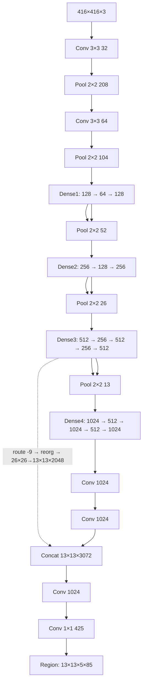
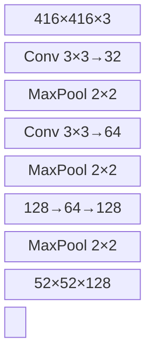
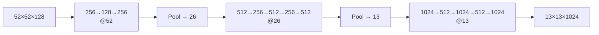
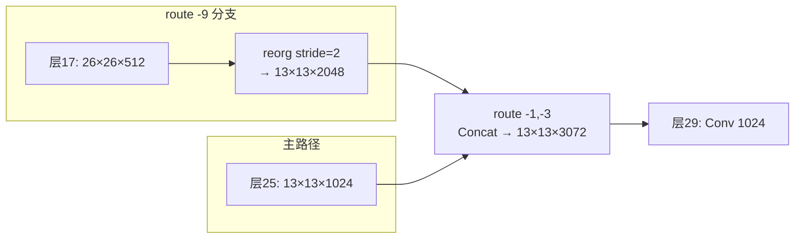
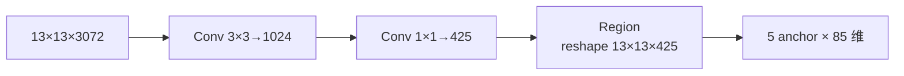
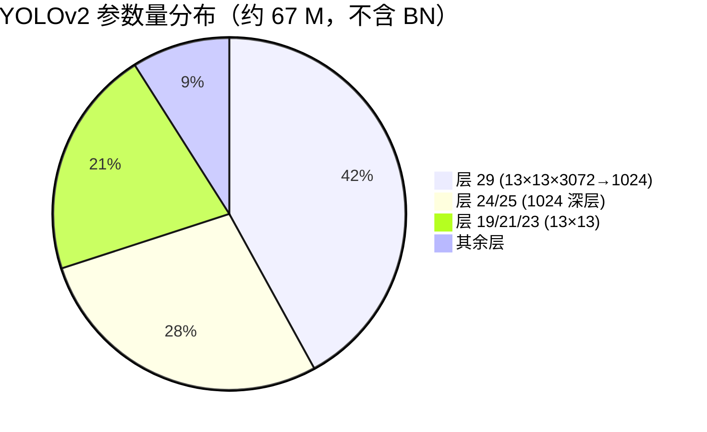

# YOLOv2 架构逐层图解

这一页把 YOLOv2（commit `c6afc7f`）的 cfg 逐层展开：输入/输出 tensor shape、参数量、源码对应位置、一句白话解释。

> 所有代码来自 `source/yolov2/snapshot/`，cfg 见 `cfg/yolo.cfg`（`f:\src\agent-yolo\source\yolov2\snapshot\cfg\yolo.cfg`）。
> **口径说明**：本文以快照 cfg 事实为准。快照共 22 conv + 5 maxpool + 2 route + 1 reorg + 1 region = **31 层**，与论文/流传的"24 conv"版本不一致，此为 pjreddie 实际提交。

::: tip TL;DR：只想带走三件事
1. **31 层全卷积**：没有 FC，BN + leaky 激活全配，参数量从 v1 的 2.7 亿降到约 1 亿。
2. **passthrough 是无损搬运**：route 取回 26×26×512，reorg 重排成 13×13×2048 拼进检测头——细粒度特征不被下采样吞掉。
3. **输出 13×13×425 = 5 anchors × (4+1+80)**：类别从 v1 的 cell 级挪到 anchor 级，每个 anchor 自带一套类别。
:::

---

## 1. 一眼看清：输入 → 输出的完整流程



**一句话总结**：5 次空间减半把 416×416 压到 13×13（backbone），再经一个 `reorg` 把 26×26 的细粒度特征重排后**拼接**进检测头（passthrough），最后 region 层把 425 维切分预测。

---

## 2. 逐层明细表（按快照 cfg 顺序，共 31 层）

> **v1 读者路标**：v1 的 24 conv + 2 FC 在这里整体换成全卷积——**FC 层没有了**，不用在表里找；BN + leaky 出现在每个卷积之后。

所有卷积 `batch_normalize=1` + leaky，这是 v2 与 v1 最大的层级差异。cfg 起始行可点击直达。

| # | 类型 | kernel / stride | 输出通道 | 特征图尺寸 | cfg 行 | 参数量 |
|---|------|-----------------|---------|-----------|--------|--------|
| 1 | conv | 3×3 / 1 | 32 | 416×416 | <SrcLink file="v2:cfg/yolo.cfg" :line="20" /> | 896 |
| 2 | maxpool | 2×2 / 2 | 32 | 208×208 | <SrcLink file="v2:cfg/yolo.cfg" :line="28" /> | 0 |
| 3 | conv | 3×3 / 1 | 64 | 208×208 | <SrcLink file="v2:cfg/yolo.cfg" :line="32" /> | 18,496 |
| 4 | maxpool | 2×2 / 2 | 64 | 104×104 | <SrcLink file="v2:cfg/yolo.cfg" :line="40" /> | 0 |
| 5 | conv | 3×3 / 1 | 128 | 104×104 | <SrcLink file="v2:cfg/yolo.cfg" :line="44" /> | 73,856 |
| 6 | conv | 1×1 / 1 | 64 | 104×104 | <SrcLink file="v2:cfg/yolo.cfg" :line="52" /> | 8,256 |
| 7 | conv | 3×3 / 1 | 128 | 104×104 | <SrcLink file="v2:cfg/yolo.cfg" :line="60" /> | 73,856 |
| 8 | maxpool | 2×2 / 2 | 128 | 52×52 | <SrcLink file="v2:cfg/yolo.cfg" :line="68" /> | 0 |
| 9 | conv | 3×3 / 1 | 256 | 52×52 | <SrcLink file="v2:cfg/yolo.cfg" :line="72" /> | 295,168 |
| 10 | conv | 1×1 / 1 | 128 | 52×52 | <SrcLink file="v2:cfg/yolo.cfg" :line="80" /> | 32,896 |
| 11 | conv | 3×3 / 1 | 256 | 52×52 | <SrcLink file="v2:cfg/yolo.cfg" :line="88" /> | 295,168 |
| 12 | maxpool | 2×2 / 2 | 256 | 26×26 | <SrcLink file="v2:cfg/yolo.cfg" :line="96" /> | 0 |
| 13 | conv | 3×3 / 1 | 512 | 26×26 | <SrcLink file="v2:cfg/yolo.cfg" :line="100" /> | 1,180,032 |
| 14 | conv | 1×1 / 1 | 256 | 26×26 | <SrcLink file="v2:cfg/yolo.cfg" :line="108" /> | 131,328 |
| 15 | conv | 3×3 / 1 | 512 | 26×26 | <SrcLink file="v2:cfg/yolo.cfg" :line="116" /> | 1,180,032 |
| 16 | conv | 1×1 / 1 | 256 | 26×26 | <SrcLink file="v2:cfg/yolo.cfg" :line="124" /> | 131,328 |
| 17 | conv | 3×3 / 1 | 512 | 26×26 | <SrcLink file="v2:cfg/yolo.cfg" :line="132" /> | 1,180,032 |
| 18 | maxpool | 2×2 / 2 | 512 | 13×13 | <SrcLink file="v2:cfg/yolo.cfg" :line="140" /> | 0 |
| 19 | conv | 3×3 / 1 | 1024 | 13×13 | <SrcLink file="v2:cfg/yolo.cfg" :line="144" /> | 4,719,616 |
| 20 | conv | 1×1 / 1 | 512 | 13×13 | <SrcLink file="v2:cfg/yolo.cfg" :line="152" /> | 524,288 |
| 21 | conv | 3×3 / 1 | 1024 | 13×13 | <SrcLink file="v2:cfg/yolo.cfg" :line="160" /> | 4,719,616 |
| 22 | conv | 1×1 / 1 | 512 | 13×13 | <SrcLink file="v2:cfg/yolo.cfg" :line="168" /> | 524,288 |
| 23 | conv | 3×3 / 1 | 1024 | 13×13 | <SrcLink file="v2:cfg/yolo.cfg" :line="176" /> | 4,719,616 |
| 24 | conv | 3×3 / 1 | 1024 | 13×13 | <SrcLink file="v2:cfg/yolo.cfg" :line="187" /> | 9,438,208 |
| 25 | conv | 3×3 / 1 | 1024 | 13×13 | <SrcLink file="v2:cfg/yolo.cfg" :line="195" /> | 9,438,208 |
| 26 | **route** | -9（回连层 17） | 512 | 26×26 | <SrcLink file="v2:cfg/yolo.cfg" :line="203" /> | 0 |
| 27 | **reorg** | stride=2 | 2048 | 13×13 | <SrcLink file="v2:cfg/yolo.cfg" :line="206" /> | 0 |
| 28 | **route** | -1,-3（拼层 25） | 3072 | 13×13 | <SrcLink file="v2:cfg/yolo.cfg" :line="209" /> | 0 |
| 29 | conv | 3×3 / 1 | 1024 | 13×13 | <SrcLink file="v2:cfg/yolo.cfg" :line="212" /> | 28,312,576 |
| 30 | conv | 1×1 / 1 | 425 | 13×13 | <SrcLink file="v2:cfg/yolo.cfg" :line="220" /> | 435,625 |
| 31 | **region** | — | — | reshape 13×13×425 | <SrcLink file="v2:cfg/yolo.cfg" :line="227" /> | 0 |

**空间下采样共 5 次**：层 2/4/8/12/18（5 次 maxpool），416 / 2⁵ = **13**。

**总参数量 ≈ 6,700 万（卷积约 67 M）**：相比 v1 的 2.72 亿（其中 FC 占 2 亿+）锐减。注意：**BN 的参数不计入** `convolutional_layer.c` 的 `nweights`，所以这里只数卷积核权重；若把 BN 的 γ/β 也算上会是另一套数字。计算开销因去 FC + 全卷积明显下降，但 29/30 层的 1024 大卷积仍占相当比例。

---

## 3. 四个阶段的「原理图 + 白话 + 代码」

### 3.1 Stem：把图像从大变小（层 1-8）

**原理图**：



**白话**：
- 第一层用 **3×3**（v1 是 7×7）小卷积，416 起步；前两层 maxpool 把 416→208→104，通道变 32→64。
- v1 用一个大 7×7 暴力降维，v2 改小卷积 + 更快堆叠，信息保留更好，配合 BN 也更稳。
- Stem 末端是 52×52×128，比 v1 同阶段的 56×56 更细。

**对应代码**（<SrcLink file="v2:cfg/yolo.cfg" :line="20" :end="45" />，原文）：

<SrcSnippet file="v2:cfg/yolo.cfg" :start="20" :end="45" hl="21-26,33-38" />

---

### 3.2 Body：反复提炼（层 9-23）

**原理图**：



**白话**：
- 沿用 GoogLeNet 的"1×1 压缩、3×3 提取"瓶颈块，但 v2 的 block 更规整、通道更高。
- 三档分辨率（52/26/13）各嵌套一组，越到深层语义越强。
- 层 19-23 就是论文里的 **Dense4/Dense5**，全在 13×13 上提炼，为检测头准备。

**对应代码**（<SrcLink file="v2:cfg/yolo.cfg" :line="100" :end="183" />，512/256 成对 + 1024/512 成对）:

<SrcSnippet file="v2:cfg/yolo.cfg" :start="100" :end="110" hl="101-102,109-110" />

---

### 3.3 Passthrough：细粒度特征拼接（层 24-28）

**原理图**：



**白话**：
- `reorg` 把 26×26×512 **无损重排**成 13×13×2048（信息不丢，只是把 2×2 邻域搬进通道）。
- 再和主路径的 13×13×1024 拼接成 3072，让检测头既能看全局也能看细节。
- 这是论文里 **passthrough**/Re-org 层，是 v3 多尺度（FPN）的原型。

**对应代码**（<SrcLink file="v2:cfg/yolo.cfg" :line="203" :end="219" />）：

<SrcSnippet file="v2:cfg/yolo.cfg" :start="203" :end="219" hl="203-216" />

> ⚠️ 层 26 `/ -9` 是**从当前层往回数 9 层**，即回连到层 17（26×26×512），而不是从网络开头数。层 28 `/ -1,-3` 表示拼接倒数第 1（层 27 reorg）和倒数第 3（层 25）。

---

### 3.4 Detection Head：从特征到预测（层 29-31）

**原理图**：



**白话**：
- 层 29 一个大卷积把 3072 压回 1024，提炼拼接后的特征。
- 层 30 是 **1×1** 卷积，直接映射到 **425** 维输出——这是 v2 的 1×1 卷积头（v1 用 FC）。
- 425 = 5 anchors ×（4 坐标 + 1 objectness + 80 类）。region 层把它 reshape 成 13×13×425。

**对应代码**（<SrcLink file="v2:cfg/yolo.cfg" :line="220" :end="244" />）：

<SrcSnippet file="v2:cfg/yolo.cfg" :start="220" :end="244" hl="221-225,228,231,233" />

---

## 4. 425 维输出的可视化切分

Region Layer 把 1×1 conv 的 425 维输出 reshape 成 13×13×425（每个 cell 5 组 × 85）：

```text
13×13 × 5 × 85
        ↑        └ 80 类概率（softmax）
        └─┴────── 每 anchor：tx,ty,tw,th + objectness
```

| 逻辑段 | 含义 | 激活 | 训练目标 |
|-------|------|------|---------|
| tx, ty | 相对 cell 的网格内偏移 | sigmoid | `(truth.x*13 − i)` |
| tw, th | 相对 anchor 的对数缩放 | 线性 | `log(truth.w*13/anchor_w)` |
| objectness | P(Object)（每 anchor 独立） | sigmoid | 无目标 0；有目标 IoU（`rescore=1`） |
| 80 类 | 类别概率 | **softmax**（`softmax=1`） | one-hot |

**推理解码**在 `get_region_boxes()`（<SrcLink file="v2:src/region_layer.c" :line="327" />），box 用 <SrcLink file="v2:src/region_layer.c" :line="73" /> 的解码公式，类概率乘 objectness 得到最终分数。

---

## 5. 参数量分布

相比 v1 的"FC 撑胖子"，v2 全卷积、参数量分布更均衡：



**关键结论**：v1 的 FC4096 贡献约 196 M 参数，换来的是慢；v2 去掉 FC 后参数降到约 67 M，且因为全卷积，**推理时还能随时换输入分辨率**（多尺度），这是 v2 又快又省的关键设计。

---

## 6. 与 v1 的架构对比

| 特性 | v1 | v2 |
|------|-----|-----|
| 输入 | 448×448 | **416×416** |
| 下采样次数 | 6（conv s2 ×2 + pool ×4）→ 7×7 | 5（pool ×5）→ 13×13 |
| 第一个 conv kernel | 7×7 s2 | 3×3 s1 |
| BN | 无 | 每 conv 后启用 |
| Head | 2 FC | 全卷积 + anchor（1×1→425） |
| 类别预测 | 每 grid 共享、sigmoid | 每 anchor 独立、softmax |
| Box 回归 | √w√h | **log w/log h（相对 anchor）** |
| 参数量 | ~272 M | ~67 M |
| 层数 | 24 conv + 2 FC | 31 层（22 conv + 5 pool + 2 route + 1 reorg + 1 region） |

---

## 7. 常见误区

1. **"v2 是 24 个卷积层"**：论文正文/部分教程这样写，但 `c6afc7f` 快照的 cfg 实际是 **22 conv**（加上 pool/route/reorg/region = 31 层）。一切以快照 cfg 为准。
2. **"reorg 是采样丢失信息"**：`route`+`reorg` 是**无损重排**，只是把空间维搬进通道维，不是降采样卷积。所以它能保留小目标的细粒度。
3. **"425 是 425 类"**：不是，是 5×(4+1+80)=425 维输出，对应的 COCO 是 80 类。
4. **"region layer 是单独的卷积"**：它是**损失/解码层**，不带参数（`nweights=0`），参数全在层 30 的 1×1 卷积里。

---

## 8. 延伸阅读

- [论文精读](/versions/v2/paper)
- [理论 Concept](/versions/v2/concepts)
- [损失函数](/versions/v2/losses)
- [训练技巧](/versions/v2/tricks)
- [源码走读](/versions/v2/code-walkthrough)
- [层速查](/versions/v2/layers)
- [痛点追踪](/versions/v2/painpoints)
