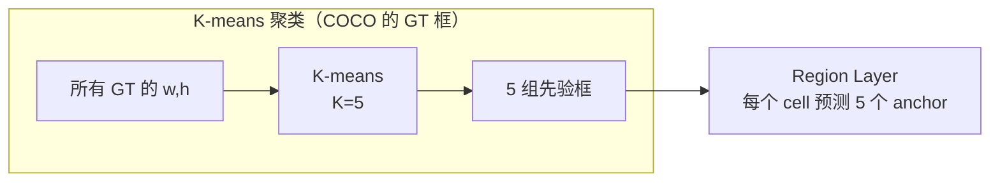
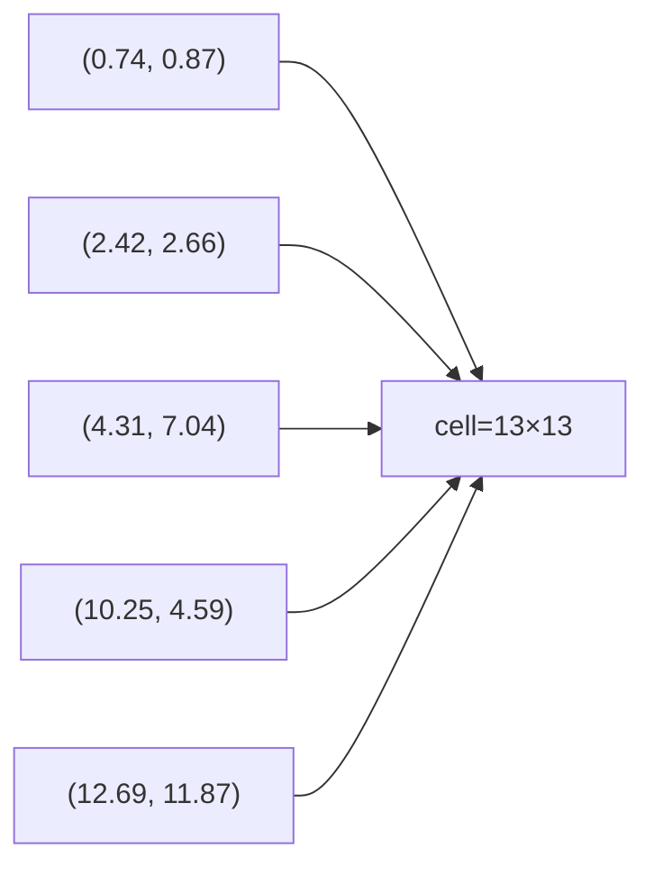
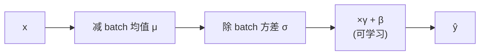
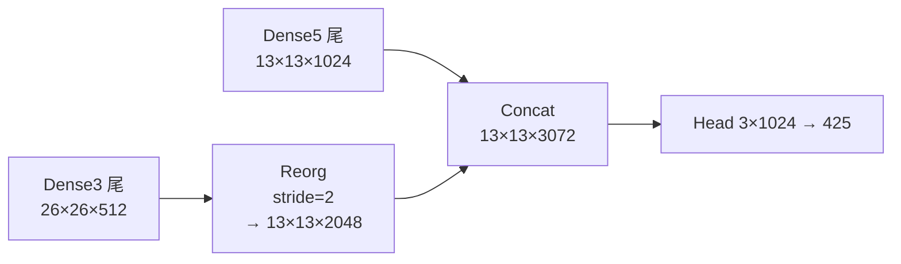
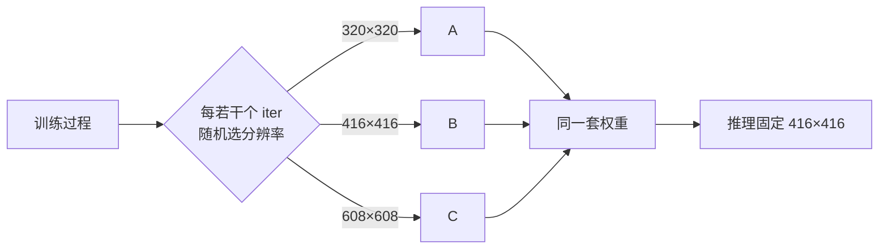
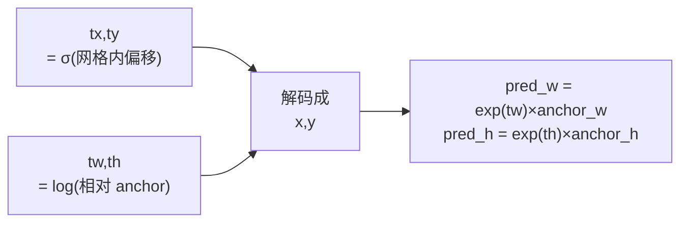
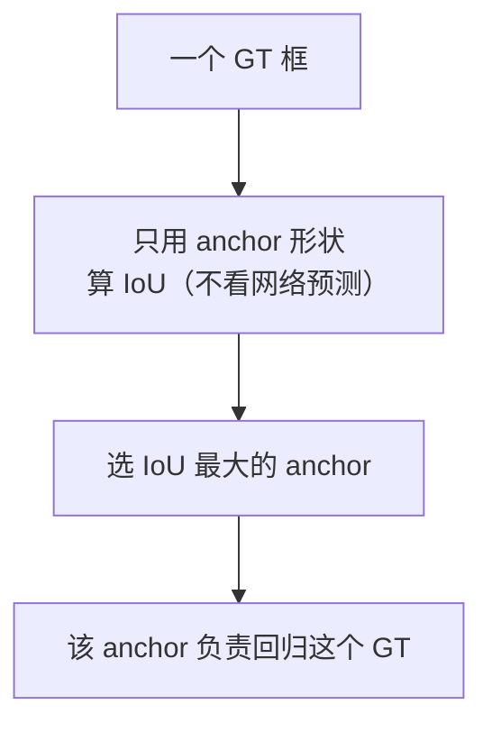
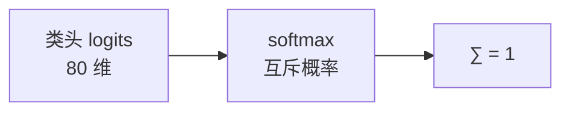
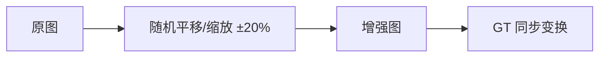
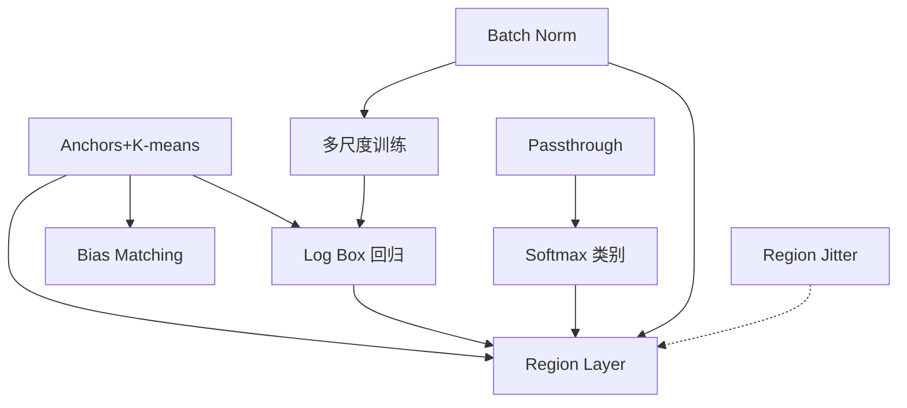

# YOLOv2 理论 Concept

YOLOv2 相比 v1 引入/演进了 8 个核心概念。每个都配**原理图 + 白话 + 源码对应**。源码统一指向 v2 快照（commit `c6afc7f`）。

---

## 1. Anchors + K-means 先验 (`concept-anchors-kmeans`)

### 原理图



### 白话

> 与其让网络从零猜框的形状，不如先统计训练集里 GT 框到底都长什么样，用 K-means 聚出 **5 个“典型宽高比”**，网络只需要预测“相对这个典型框的偏移”。

### 5 组先验值（快照原文）



### 与 v1 的对比

| | v1 | v2 |
|---|---|---|
| Box 来源 | 自由回归 | 固定 anchor + 偏移 |
| 每 cell Box 数 | B=2 | N=5 |
| 类别归属 | 2 box **共享** 20 类 | 5 anchor **各自独立** 80 类 |

### 源码对应

先验值定义在 <SrcLink file="v2:cfg/yolo.cfg" :line="228" />：`anchors = 0.738768,0.874946, 2.42204,2.65704, ...`。

---

## 2. Batch Normalization (BN) (`concept-batch-normalization`)

### 原理图



### 白话

> 每经过一次卷积，把该 batch 内同一通道的数据先“拉回均值 0、方差 1”，再加回一对可学习参数 γ、β。这样中间层的分布不炸，梯度更稳，能开更大的学习率。

### 收益

- 加速收敛约 **30%**
- 允许更高学习率 / 去 dropout
- 轻微正则化

### 源码对应

`cfg/yolo.cfg` **每一层** `[convolutional]` 都有 `batch_normalize=1`（如 <SrcLink file="v2:cfg/yolo.cfg" :line="21" />）。实现融合在卷积层内（`src/convolutional_layer.c` 的 `forward_convolutional_layer`），不是独立层。

---

## 3. Passthrough：`route + reorg`（`concept-passthrough-reorg`）

### 原理图



### 白话

> v2 检测头是 13×13 的网格，分辨率比 v1 的 7×7 高，但仍吃不到 26×26 层里的**细粒度小目标特征**。`reorg` 把 26×26 做空间重排变 13×13（信息不丢），再和 13×13 拼在一起——这就是最原始的 **FPN skip**。

### reorg 是什么

```text
输入:  H × W ×  C
输出: H/2 × W/2 × 4C
（像素无损，只重排通道）
```

### 源码对应

<SrcLink file="v2:cfg/yolo.cfg" :line="203" :end="210" />：`route -9`（回连 Dense3 尾）→ `reorg stride=2` → `route -1,-3`（拼接 Dense5 尾）。

<SrcSnippet file="v2:cfg/yolo.cfg" :start="203" :end="210" hl="203-210" />

---

## 4. 多尺度训练 (Multi-scale Training) (`concept-multi-scale`)

### 原理图



### 白话

> 因为整网是全卷积（无 FC），输入尺寸可以任意变。训练时随机切换分辨率，让网络学到“不管物体多大都能框中”的尺度无关特征。

### 源码对应

- <SrcLink file="v2:cfg/yolo.cfg" :line="4" :end="5" /> 定义 `height=416, width=416`（快照默认）。
- 注意：**本快照 cfg 里 `random=0`**（<SrcLink file="v2:cfg/yolo.cfg" :line="244" />），多尺度训练靠训练脚本手动切换 cfg 分辨率，而非 cfg 单条触发。

---

## 5. Log 空间 Box 回归 (`concept-log-box-regression`)

### 原理图



### 白话

> v1 回归 \( \sqrt{w},\sqrt{h} \)，v2 改为**相对 anchor 的对数**。这样网络输出的不再是绝对宽高，而是“这个框比它的 anchor 大(小)多少倍”。

### 解码公式

$$pred_x = (\sigma(t_x) + i) / 13 \qquad pred_y = (\sigma(t_y) + j) / 13$$

$$pred_w = \exp(t_w) \times anchor_w / 13 \qquad pred_h = \exp(t_h) \times anchor_h / 13$$

### 源码对应

解码 <SrcLink file="v2:src/region_layer.c" :line="73" :end="85" />，目标值与梯度 <SrcLink file="v2:src/region_layer.c" :line="92" :end="104" />（`tw = log(truth.w/anchor_w)`）。

> ⚠️ `DOABS=1`（<SrcLink file="v2:src/region_layer.c" :line="12" />）会再除一次 grid 尺寸，是 v2 早期的坐标系 hack。

---

## 6. Bias Matching（锚框匹配）(`concept-bias-matching`)

### 原理图



### 白话

> 一个 GT 该交给哪个 anchor？v2 不啰嗦：**直接用 anchor 的形状**和 GT 形状算 IoU，谁像（IoU 大）谁负责。避免了“预测框形状干扰匹配”的问题。

### 源码对应

<SrcLink file="v2:src/region_layer.c" :line="272" :end="292" />，其中 `bias_match=1` 时直接把 `pred.w/h` 替换成 anchor 的 w/h：

<SrcSnippet file="v2:src/region_layer.c" :start="272" :end="292" hl="275-282" />

::: details 逐行注释（L272–L292）
- **L275-279**：`bias_match=1` 时把 `pred.w/h` **替换成 anchor 尺寸**——匹配只看 anchor 先验，不看网络当前预测的框。
- **L281**：`pred.x = pred.y = 0`、GT 也平移到原点——**只比形状，不比位置**。
- **L283-291**：逐个 anchor 算 IoU，记录最大的 `best_n`；这个 anchor 独占该 GT 的 coord/obj/class 监督。
:::

---

## 7. Softmax 类别头 (`concept-softmax-classes`)

### 原理图



### 白话

> v1 每个类用独立的 sigmoid（可同时给很多类打高分）。v2 改成 **softmax**，强制“一辆车”不能同时是“一辆卡车”——类别间互斥，减少近义类混淆。

### 源码对应

<SrcLink file="v2:src/region_layer.c" :line="168" :end="174" />（训练前向时对 class 部分做 softmax）：

<SrcSnippet file="v2:src/region_layer.c" :start="168" :end="175" hl="168-174" />

::: details 逐行注释（L168–L175）
- **L168-169**：`if(l.softmax)` 对每个 cell×anchor 的 80 维类头做 `softmax_array`——输出变互斥概率。
- **L171-172**：`if(l.softmax_tree)` 是 YOLO9000 的层级 softmax 分支（VOC/COCO 不走这里）。
- **L173-174**：objectness 槽位统一过 `logistic_activate`（sigmoid）压到 (0,1)。
- **L177**（卡片外一行）：`if(!state.train) return`——推理到这里就返回，后面全是训练逻辑。
:::

---

## 8. Region Jitter 数据增强（沿用）(`concept-region-jitter`)

### 原理图



### 白话

> v1 就有 jitter（±20% 平移缩放），v2 保持这个增强，并补上了 **hue 色相抖动**。让模型对“物体位置偏移”“颜色变化”都更鲁棒。

### 源码对应

- `jitter=.2`：<SrcLink file="v2:cfg/yolo.cfg" :line="234" />
- `hue=.1`：<SrcLink file="v2:cfg/yolo.cfg" :line="12" />（v1 没有）

---

## 9. Region Layer vs Detection Layer (`concept-region-vs-detection`)

### 为什么把 detection_layer 换成 region_layer？

| | Detection Layer (v1) | Region Layer (v2) |
|---|---|---|
| Anchors | ❌ 自由 box | ✅ 固定 anchor |
| 类别共享 | 所有 box 共享 | 每 anchor 独立 |
| Class 输出 | coords+conf 之后 | coords+1 之后 |
| Rescore | `rescore=1` | 保留 |
| 网格 | 7×7 | **13×13** |
| 层位置 | 网络末尾 | 网络末尾 |

### 白话

> 同样是“损失计算层”，region_layer 为 anchor + log 回归 + 独立类别重新设计了正反向。这也解释了为什么 v2 检测头**输出维度从 30 涨到 425**：\( 13×13×5×(4+1+80) \)。

### 源码对应

Region Layer 的构造在 <SrcLink file="v2:src/region_layer.c" :line="14" />，输出维度 <SrcLink file="v2:src/region_layer.c" :line="28" />；cfg 配置 <SrcLink file="v2:cfg/yolo.cfg" :line="227" :end="244" />。

---

## Concept 依赖图



---

## 延伸阅读

- [论文精读](/versions/v2/paper)
- [Architecture 逐层图解](/versions/v2/architecture)
- [损失函数](/versions/v2/losses)
- [训练技巧](/versions/v2/tricks)
- [源码走读](/versions/v2/code-walkthrough)
- [痛点追踪](/versions/v2/painpoints)
