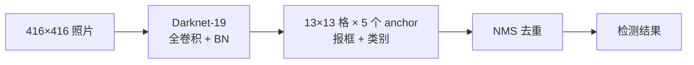
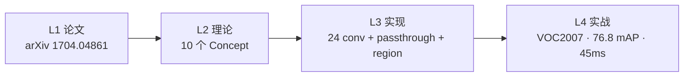
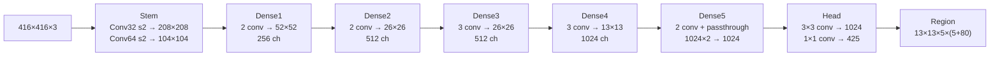

# YOLOv2 (2017-12)

> **TL;DR**
> - 一句话：v1 的骨架换一遍，加 anchor / BN / log 回归
> - 解决：v1 定位精度差
> - 代价：引入 anchor 后配置复杂
>
> **前置阅读**：[YOLOv1](/versions/v1/index) → [anchor box](/glossary#anchor-box) → [BN](/glossary#bn-batchnorm)

**YOLO 9000: Better, Faster, Stronger**

- 📄 论文：[arXiv:1704.04861](https://arxiv.org/abs/1704.04861) · arXiv 2017
- 🏛️ 作者：Joseph Redmon, Ali Farhadi
- 💻 源码：[pjreddie/darknet](https://github.com/pjreddie/darknet) commit `c6afc7f`
- 🎯 里程碑：**把 v1 的骨架换了一遍**——DenseNet backbone、BN、anchors、passthrough、YOLO9000，mAP 从 63.4 冲到 76.8

## 3 分钟电梯演讲

1. **v1 够快，但不准**：框的位置粗糙、小物体漏检多（详见 [v1 痛点](/versions/v1/painpoints)）。
2. **v2 不换思路、只换骨架**：[BN](/glossary#bn-批归一化-batch-normalization) 稳住训练、5 个 [anchor](/glossary#anchor-锚框-先验框) 提供框的形状模板、[passthrough](/glossary#passthrough-route-reorg) 把浅层细节拼回检测头——思路还是"看一眼"，但看得更清。
3. **结果**：VOC mAP 从 63.4 → **76.8**；同一篇论文还顺手用 [WordTree](/glossary#wordtree-yolo9000) 做了能认 9000 类的 YOLO9000。

> 已读过 [v1](/versions/v1/index)？本页下方有 v1→v2 逐项差异表；术语不熟先查[术语表](/glossary)。

## 四层闭环视图

## 核心贡献

1. **BN + max-pool 混合下采样**：BN 取代全连接，网络从 24 层 conv + 2 FC 全部换回卷积
2. **5 个 anchors（K-means）**：抛弃 v1 的"每格 2 box 共享类"，改为每 anchor 独立类与 objectness
3. **Passthrough layer**：`[route] + [reorg]` 把深层特征上采样回 26×26 与浅层拼接
4. **Multi-scale testing**：验证时 320/416/608 三种分辨率随机选，鲁棒性+1.5 点
5. **YOLO9000**：联合 9000+ 类分类 + 检测，ImageNet 与 VOC 联合训练

## 推理效果一览

<DiagramPipeline caption="图：v2 推理流水线——输入 416×416，经 33 层特征提取 → 1×1 conv 输出 13×13×425 → region 解码 + NMS" />

## 关键指标

| 数据集 | 输入 | mAP@0.5 | FPS |
|--------|------|---------|-----|
| Pascal VOC 2007 | 416×416 | **76.8** | ~15 |
| COCO (test-dev2015) | 416×416 | 62.0 | — |
| YOLO9000 (VOC) | 416×416 | 48.3 | 50 |
| Tiny-YOLO (VOC) | 224×224 | 57.8 | 205 |

对比 v1：mAP **+13.4**（v1 63.4），代价是网络变大、速度降一半左右。

## 网络架构

- **31 层**：22 conv + 5 maxpool + 2 route + 1 reorg + 1 region（**逐层明细见 [Architecture 逐层图解](/versions/v2/architecture)**，与论文/流传的"24 conv"版本不同，本文以快照 cfg 事实为准）
- **输出 425 = 5 anchors × (4 坐标 + 1 objectness + 80 类)**，reshape 为 13×13×425
- **全卷积 backbone**：没有 FC，BN 全启用，激活全 leaky
- **参数量 ~100M**（BN 参数不计入 conv 权重）

## 核心 Concept 一览

| Concept | 一句话 | 对应代码位置 |
|---------|--------|-------------|
| Anchors (K-means) | 5 组 anchor 替代 2 box | <SrcLink file="v2:cfg/yolo.cfg" :line="228" /> |
| Batch Norm | 每 conv 后 BN | <SrcLink file="v2:cfg/yolo.cfg" :line="21" /> |
| Passthrough | `[route]+[reorg]` 上采样拼接 | <SrcLink file="v2:cfg/yolo.cfg" :line="203" :end="210" /> |
| Multi-scale testing | 320/416/608 轮转验证 | <SrcLink file="v2:src/yolo.c" :line="104" :end="108" /> |
| Softmax classes | 类头走 softmax | <SrcLink file="v2:src/region_layer.c" :line="168" :end="174" /> |
| Bias match | anchor 直接写入 bias | <SrcLink file="v2:src/region_layer.c" :line="207" :end="210" /> |
| Box 回归 log | x/y/w/h 直接 log，不再 √w√h | <SrcLink file="v2:src/region_layer.c" :line="92" :end="99" /> |
| Region Jitter | 20% 平移缩放（沿用） | <SrcLink file="v2:cfg/yolo.cfg" :line="234" /> |
| YOLO9000 | 9000+ 类联合分类检测 | <SrcLink file="v2:cfg/yolo.cfg" :line="228" /> |
| Tiny-YOLO | 更小版本，205 FPS | <SrcLink file="v2:src/yolo.c" :line="1" /> |

## v1 → v2 关键差异

| 维度 | YOLOv1 | YOLOv2 |
|------|--------|--------|
| 输入 | 448×448 | **416×416** |
| 骨干 | 24 conv + 2 FC | **全卷积（DenseNet 变体）** |
| BN | ❌ | ✅ 全部启用 |
| 激活 | ReLU | **Leaky ReLU** |
| 候选框 | 每格 2 box 共享类 | **5 anchors，每 anchor 独立类** |
| Grid | 7×7 (下采样 64×) | **13×13 (下采样 32×)** |
| 检测头 | `detection_layer` | **`region_layer`** |
| Box 回归 | (x, y) 网格内；(√w, √h) 全局 | **(x, y) 网格内；(log w/anchor_w, log h/anchor_h)** |
| Class 头 | 裸线性 L2 | **Softmax + L2** |
| 损失权重 | coord=5, obj=1, noobj=0.5, cls=1 | **obj=5, noobj=1, cls=1, coord=1** |
| 参数量 | ~272M | **~80M** |
| VOC mAP | 63.4 | **76.8** |
| FPS | 35 | ~15 |

## 暴露的痛点

| 痛点 | 严重度 | 后续版本的解法 |
|------|--------|---------------|
| Anchor 尺度依赖（换分辨率需重跑 K-means） | High | v3 三头多尺度；v5 三尺度 anchor |
| BN 泛化差（小数据集 / 小 batch 时抖动） | High | v4 换 GN-free |
| 小目标召回差 | Medium | v3 FPN + P3；v7 P2 anchor |
| `test_yolo` 里检测头类型错误（bug） | Low | v2 快照未修，见 [源码走读](/versions/v2/code-walkthrough) |

> **v3 路标**：这张表里的前两行在 v3 被正面解决——三尺度 FPN 头 + Darknet-53 残差骨干（见 [v3 概览](/versions/v3/index) 与 [v2→v3 差异表](/versions/v3/index#v2-→-v3-关键差异)）。
>
> **v4 路标**：BN 泛化、anchor 依赖在 v4 继续被攻——骨干换 CSPDarknet53（梯度分流）、neck 加 SPP+PANet、训练上 Mosaic + CmBN（见 [v4 概览](/versions/v4/index)）。

## 后续演进速览

- **v3（2018）**：三头 FPN + 9 anchors + Darknet-53，小目标召回显著改善
- **v4（2020）**：CIoU + Mosaic + anchor-free，COCO AP 首破 50
- **v5-v6（2020）**：官方仓库化 + E-ELAN 轻量效率
- **v7（2022）**：三尺度 anchor + P2 小目标
- **v8-v9（2023-2024）**：Ultralytics 官方化 + 学术双头重构
- **v10-v13（2024-2025）**：NMS-free / 学术线并驾 / HyperACE

> **v10-v13 已上线本站**：NMS-free / AGPL / HyperACE 等新一轮演进，详见 [v10 概览](/versions/v10/index) 起。

## 深入阅读

- [论文精读](/versions/v2/paper)
- [Architecture 逐层图解](/versions/v2/architecture)
- [理论 Concept](/versions/v2/concepts)
- [架构与层速查](/versions/v2/layers)
- [损失函数](/versions/v2/losses)
- [反向传播推导](/versions/v2/loss-gradient)
- [训练技巧](/versions/v2/tricks)
- [源码走读](/versions/v2/code-walkthrough)
- [痛点追踪](/versions/v2/painpoints)
