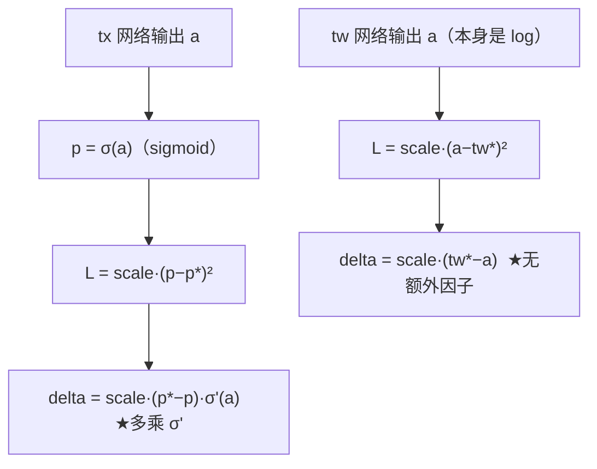
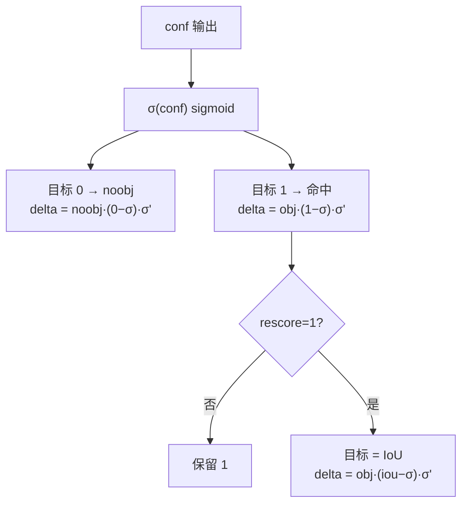
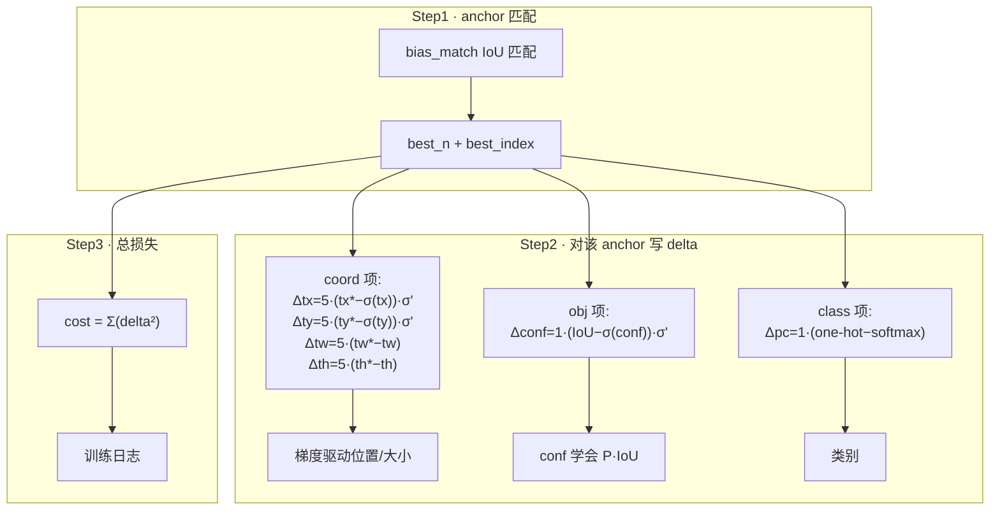

# YOLOv2 反向传播精解：从公式到 delta 的完整推导

> 这是 v2 最"硬核"的一页。前面的[损失函数](/versions/v2/losses)讲了"损失长什么样"，这一页讲"**梯度怎么一步步算出来**"——也就是 `forward_region_layer()` 里那些 delta 赋值，在数学上到底对应什么。
>
> 全程对照真实源码：<SrcLink file="v2:src/region_layer.c" :line="144" /> 起的 `forward_region_layer()`，行号以快照 `c6afc7f` 为准；也可直接打开 [region_layer.c 整文件浏览](/versions/v2/source/region-layer)。

::: tip TL;DR：只想带走三件事
1. **和 v1 同一套 delta 约定**，但中心/objectness 过了 sigmoid → 梯度多乘 σ′；宽高在 log 空间无激活 → 纯线性差。
2. **GT 分配看 anchor 形状**（bias_match）：预测框不参与匹配，一个 GT 独占一个 best anchor。
3. **类别 softmax 化**后 delta 化简成 one-hot − p（交叉熵形）；前 12800 张 warmup 强制 anchor 先学占位。
:::

---

## 0. 先搞懂 darknet 的"梯度约定"

和 [v1 的推导](/versions/v1/loss-gradient)是同一套约定：`l.delta[]` 直接存放每个输出神经元的误差信号，且取**损失对输出梯度的相反数**。

$$\delta_i = -\frac{\partial L}{\partial output_i}$$

region_layer 是网络的最后一层，它算出的 `l.delta` 就是整个反向传播的起跑信号。`backward_region_layer`（<SrcLink file="v2:src/region_layer.c" :line="322" />）只是把 delta 累加进 `state.delta`：

```c
void backward_region_layer(const region_layer l, network_state state){
    axpy_cpu(l.batch*l.inputs, 1, l.delta, 1, state.delta, 1);
}
```

> **与 v1 的第一个结构差异**：v1 的 coord 项直接 `(target − output)`，没有激活梯度（见 v2 下方 §3.4 对比）；v2 因为 `tx,ty` 过了 sigmoid、类别过了 softmax，**多了链式法则里对激活求导的项**，这是本页重点。

---

## 1. 总损失回顾

每个 batch、每个 grid cell 累加：

```
每一格的处理：
  ┌─ 对 5 个 anchor 先无条件写 noobject 项            （本页 §5.1）
  ├─ 前 12800 张训练图：用 anchor 形状当伪 GT 学 shape  （§5.2）
  ├─ 对每个 GT box：
  │     ├─ 选 best_n anchor（IoU 匹配）               （§2）
  │     ├─ coord 项 → delta[0..3]（含 sigmoid 链式）    （§3）
  │     ├─ obj 项   → delta[conf]（含 logistic 链式）   （§4）
  │     └─ class 项 → delta[class]（softmax 交叉熵）    （§5.3）
```

---

## 2. 目标分配：选"哪个 anchor 该背锅"

一个 cell 有 5 个 anchor，一个 GT 只归**最像的那个**（`best_n`）。选法用 IoU：

真实循环 <SrcLink file="v2:src/region_layer.c" :line="272" :end="292" />：

```c
for(n = 0; n < l.n; ++n){
    int index = size*(j*l.w*l.n + i*l.n + n) + b*l.outputs;
    box pred = get_region_box(l.output, l.biases, n, index, i, j, l.w, l.h);
    if(l.bias_match){                       // bias_match=1: 只用 anchor 形状比
        pred.w = l.biases[2*n];   pred.h = l.biases[2*n+1];
        if(DOABS){ pred.w = l.biases[2*n]/l.w; pred.h = l.biases[2*n+1]/l.h; }
    }
    pred.x = 0;  pred.y = 0;               // 中心对齐，只看形状
    float iou = box_iou(pred, truth_shift);
    if (iou > best_iou){ best_index = index; best_iou = iou; best_n = n; }
}
```

**白话**：把预测框的中心挪到原点（`pred.x=pred.y=0`），GT 也挪到原点（`truth_shift`），然后只用**宽高形状**算 IoU。`bias_match=1` 时干脆连预测尺寸都不用，直接拿 `biases[2n]`（anchor 的宽高）来比——让匹配只看 anchor 先验，不被网络当前乱猜的预测干扰。

> **v1 vs v2 的差异**：v1 是 `best_iou>0 ? IoU : RMSE` 兜底（且坐标裸值）；v2 统一用 IoU，且用 bias_match 去掉了"预测框形状"对匹配的干扰。这是 v2 定位更稳的原因之一。

选好 `best_n` 后，`delta_region_box` 算这个 anchor 的坐标梯度（<SrcLink file="v2:src/region_layer.c" :line="87" />）：

```c
float tx = (truth.x*w - i);                        // 相对 cell 的网格内偏移
float ty = (truth.y*h - j);
float tw = log(truth.w / biases[2*n]);             // 相对 anchor 的对数
float th = log(truth.h / biases[2*n + 1]);
if(DOABS){ tw = log(truth.w*w / biases[2*n]); th = log(truth.h*h / biases[2*n+1]); }
```

---

## 3. coord 项：位置回归的梯度（含 sigmoid/log 链式法则）

### 3.1 目标是什么？

v2 的网络头 4 个输出是：

$$output_0 = t_x \;\text{（裸值，待 sigmoid）} \qquad output_1 = t_y \;\text{（裸值，待 sigmoid）}$$

$$output_2 = t_w \;\text{（裸值，直接当 log）} \qquad output_3 = t_h \;\text{（裸值，直接当 log）}$$

训练要让解码后的 `(σ(tx)+i)/w` 逼近 `truth.x`，等价于让 `σ(tx)` 逼近目标 `tx* = truth.x*w − i`。

### 3.2 delta 的直接写法

真实赋值 <SrcLink file="v2:src/region_layer.c" :line="101" :end="104" />：

```c
delta[index + 0] = scale * (tx - logistic_activate(x[index + 0])) * logistic_gradient(logistic_activate(x[index + 0]));
delta[index + 1] = scale * (ty - logistic_activate(x[index + 1])) * logistic_gradient(logistic_activate(x[index + 1]));
delta[index + 2] = scale * (tw - x[index + 2]);
delta[index + 3] = scale * (th - x[index + 3]);
```

### 3.3 为什么 tx,ty 要乘 logistic_gradient，tw,th 不用？

**核心推导**。设单分量预测为 `p = σ(a)`（a 是网络输出 tx），目标为 `p*`，损失：

$$L = \frac{1}{2} \cdot scale \cdot (p - p^{*})^2 \quad \text{（忽略 } \tfrac{1}{2} \text{）}$$

$$\frac{\partial L}{\partial a} = scale \cdot (p - p^{*}) \cdot \frac{\partial p}{\partial a} = scale \cdot (p - p^{*}) \cdot \sigma'(a) \quad \leftarrow \; \text{链式法则：多乘 sigmoid 导数}$$

darknet 里 delta 取负：`delta = scale·(p* − p)·σ'(a)`，正是代码里 `(tx − σ(x))·logistic_gradient(...)` 那项（logistic 就是 sigmoid，logistic_gradient 就是 σ'）。

**而 tw, th**：网络输出 `a` 本身就是 log 值，解码是 `exp(a)·anchor`。它的目标是 `tw* = log(truth.w·w/anchor)`，损失写在 log 空间：

$$\frac{\partial L}{\partial a} = scale \cdot (a - t_w^{*}) \cdot \frac{\partial a}{\partial a} = scale \cdot (a - t_w^{*}) \quad \leftarrow \; \text{没有额外激活，导数=1}$$

所以 tw,th 的 delta 就是**简单的线性差** `scale·(tw* − a)`，不用乘任何梯度因子。这就是为什么 §3.2 里 tw/th 两行比 tx/ty 少一项。



> **v1 vs v2 对比**：v1 在 √ 空间算 L2，delta = `scale·(√t − ŵ)`，也只换目标不乘因子（但 √ 是没有链式因子，因为损失直接写 √w 空间）。v2 引入 sigmoid 后，**第一次在坐标梯度里出现了激活梯度项**。

### 3.4 无 IOU 梯度直入坐标（与 v1 相同）

v2 的 `delta_region_box` 返回了 `iou`（<SrcLink file="v2:src/region_layer.c" :line="105" />），但**这个 iou 只用于 rescore 的 conf 目标**，不直接进坐标梯度。也就是说：**坐标的学习只靠 §3 上面的 L2 项**，IoU 并没有直接微分流入坐标——这一点 v1/v2 相同，一直是定位粗糙的根源（v4 的 CIoU 才补上）。

---

## 4. conf 项：objectness 的梯度（含 logistic 链式）

**先对所有 anchor 写 noobject**（真实 <SrcLink file="v2:src/region_layer.c" :line="230" :end="241" />）：

```c
float best_iou = 0;  int best_class = -1;
for(t...) { ... iou = box_iou(pred, truth); ... }    // 找该 anchor 与所有 GT 的最大 IoU
avg_anyobj += l.output[index + 4];

l.delta[index + 4] = l.noobject_scale * ((0 - l.output[index + 4]) * logistic_gradient(l.output[index + 4]));

if(l.classfix == -1) 
    l.delta[index + 4] = l.noobject_scale * ((best_iou - l.output[index + 4]) * logistic_gradient(l.output[index + 4]));
else{
    if (best_iou > l.thresh) l.delta[index + 4] = 0;   // IoU 高于阈值则不惩罚这个 anchor
    ...
}
```

**白话**：objectness 输出先过 sigmoid（`l.output[index+4]` 是激活后的值）。noobject 项目标 = 0，delta 带 `logistic_gradient`，因为损失是对激活后的 conf 求导、再经 sigmoid 链式回传。

注意这里 conf 的 `logistic_gradient` 因子很关键——v1 没有（v1 的 conf 是裸线性，见 [v1 §4](/versions/v1/loss-gradient)）。v2 因为 conf 用了 sigmoid，梯度里多乘 `σ'(conf)`。

**对命中 anchor 的 objectness**（真实 <SrcLink file="v2:src/region_layer.c" :line="299" :end="304" />）：

```c
avg_obj += l.output[best_index + 4];
l.delta[best_index + 4] = l.object_scale * (1 - l.output[best_index + 4]) * logistic_gradient(l.output[best_index + 4]);
if (l.rescore) {
    l.delta[best_index + 4] = l.object_scale * (iou - l.output[best_index + 4]) * logistic_gradient(l.output[best_index + 4]);
}
```

**白话（rescore=1 时）**：目标从 1 覆盖成 `iou`，让 confidence 学会 `P(Object)·IoU`——和 v1 的语义完全一致，只是多了 `logistic_gradient`。



---

## 5. 其余各项梯度

### 5.1 class 项：softmax 交叉熵梯度

真实 <SrcLink file="v2:src/region_layer.c" :line="125" :end="130" />（非 hier 分支）：

```c
for(n = 0; n < classes; ++n){
    delta[index + n] = scale * (((n == class)?1 : 0) - output[index + n]);
    if(n == class) *avg_cat += output[index + n];
}
```

**白话**：`output[index+n]` 是 **softmax 之后的概率**（前向 <SrcLink file="v2:src/region_layer.c" :line="168" /> 已对类头做 softmax）。delta = `scale·(one-hot − softmax)`，正是交叉熵对 softmax 输入的梯度（含链式，softmax 的雅可比恰好化简为 `[n==class] − p_n`）。

> **v1 vs v2 的关键差异**：v1 是**裸线性 L2**（`softmax=0`，delta = `scale·(t_c − p_c)` 无激活链式）；v2 用 **softmax**，delta 是交叉熵式的 `(one-hot − softmax)`。互斥性更强，近义类混淆减少。

**层次化分支（YOLO9000）**：`hier` 非空时沿父节点回溯（<SrcLink file="v2:src/region_layer.c" :line="111" />），见[论文精读 §12](/versions/v2/paper)。

### 5.2 前 12800 张的 anchor 形状预训练

真实 <SrcLink file="v2:src/region_layer.c" :line="243" :end="254" />：

```c
if(*(state.net.seen) < 12800){
    box truth = {0};
    truth.x = (i + .5)/l.w;  truth.y = (j + .5)/l.h;   // cell 中心
    truth.w = l.biases[2*n];  truth.h = l.biases[2*n+1]; // anchor 尺寸
    if(DOABS){ truth.w = l.biases[2*n]/l.w; truth.h = l.biases[2*n+1]/l.h; }
    delta_region_box(truth, l.output, l.biases, n, index, i, j, l.w, l.h, l.delta, .01);
}
```

**白话**：训练一开始，先让每个 anchor 学会"待在 cell 中心、尺寸等于自己的先验"。用 scale=**.01**（极小权重）把这种"占位"引导加进坐标梯度，让 anchor 不至于一开始乱飞。这是 v1"前 100k 随机 best_index"的 v2 版替代。

### 5.3 无目标格 / 无目标 anchor

和 v1 逻辑一致：无目标的 anchor 只有 §4 的 noobject 项，其余不执行。因为 v2 的每个 cell 有 5 个 anchor，**绝对多数 anchor** 走 noobject 路径，所以 v2 把 noobject_scale 从 v1 的 0.5 提到 **1**（见[损失函数](/versions/v2/losses)）。

---

## 6. 全流程串起来：一个带物体 cell 的完整反向路径



**总损失**：`*(l.cost) = pow(mag_array(l.delta, l.outputs * l.batch), 2)`（<SrcLink file="v2:src/region_layer.c" :line="318" />）——即 **sum of squared deltas**，和 v1 的 `Σ(target−output)²` 是"平方差求和"同一哲学。

> 注意 v2 **没有** v1 那个"只进 cost 不进 delta"的 `(1−IoU)²` 统计项。v2 的直接 `Σdelta²` 就是真实训练损失，不再有装饰性项。这也让 v2 的训练日志更贴近真实 loss。

---

## 7. 一张表速记：每个 delta 背后的"目标"与"链式因子"

| 损失项 | 目标值 target | delta = scale·(target − out)·G | scale | 链式 G | 反传? |
|--------|--------------|------------------------------|-------|-------|-------|
| coord.tx | `tx*=truth.x·w−i` | `5·(tx*−σ(tx))·σ'` | 5 | σ'(σ(tx)) | ✅ |
| coord.ty | `ty*=truth.y·h−j` | `5·(ty*−σ(ty))·σ'` | 5 | σ'(σ(ty)) | ✅ |
| coord.tw | `tw*=log(truth.w·w/anchor)` | `5·(tw*−tw)` | 5 | 1（log 无激活） | ✅ |
| coord.th | `th*=log(truth.h·h/anchor)` | `5·(th*−th)` | 5 | 1（log 无激活） | ✅ |
| object(命中) | `IoU`（rescore=1） | `1·(IoU−σ(conf))·σ'` | 1 | σ'(σ(conf)) | ✅ |
| object(无目标) | `0` | `1·(0−σ(conf))·σ'` | 1 | σ'(σ(conf)) | ✅ |
| class | `one-hot` | `1·(one−hot−softmax)` | 1 | softmax 雅可比 | ✅ |
| 早期 anchor shape | cell 中心+先验 | `.01·(...)` | 0.01 | 同 coord | ✅ |

> 记忆口诀：**"差多少、反着传、多乘激活导"** —— v2 相比 v1，坐标的 tx/ty 和 conf 都因为引入 sigmoid 而**多乘了一个激活梯度项**，这是本页最需要记住的差异。

---

## 8. 与推理端如何衔接

这些 delta 只在**训练时**算（<SrcLink file="v2:src/region_layer.c" :line="177" /> 的 `if(!state.train) return`）。**推理时**该函数算完 softmax/sigmoid 就提前返回，解码在 `get_region_boxes()`（<SrcLink file="v2:src/region_layer.c" :line="327" />）：

- 用 <SrcLink file="v2:src/region_layer.c" :line="73" /> 的解码公式把 tx,ty 加 cell 偏移、tw,th 乘 anchor 还原成像素框；
- 类概率乘 objectness 得到最终分数，低于 `thresh` 清零；
- 再由推理入口 <SrcLink file="v2:src/yolo.c" :line="189" /> 调 `do_nms_sort`（<SrcLink file="v2:src/box.c" :line="249" />）去重。

完整推理管线见[源码走读](/versions/v2/code-walkthrough)。

---

## 与其他页的链接

- [损失函数公式版](/versions/v2/losses) — 本页是它的"梯度推导版"，两者对照看
- [v1 反向传播推导](/versions/v1/loss-gradient) — 与本页逐项对照，差异集中在 sigmoid/softmax 链式 + log 回归
- [训练技巧](/versions/v2/tricks) — bias_match、多尺度、12800 warmup 的实现出处
- [源码走读](/versions/v2/code-walkthrough) — region_layer.c 逐段
- [痛点追踪](/versions/v2/painpoints)
- [论文精读](/versions/v2/paper) — §5 loss 公式的论文角
