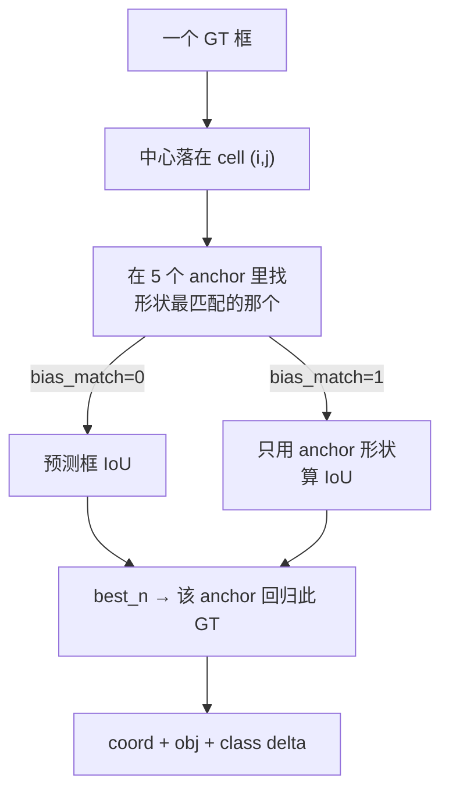

# YOLOv2 损失函数

YOLOv2 的损失仍然是 **sum-squared error**（与 v1 一致，论文沿用 "We optimize for sum-squared error in the output of our model"），全部在 <SrcLink file="v2:src/region_layer.c" :line="144" /> 的 `forward_region_layer()` 中计算。

$$L_{total} = 5 \cdot L_{coord} + 1 \cdot L_{obj} + 1 \cdot L_{noobj} + 1 \cdot L_{class}$$

**与 v1 的 4 点关键差异**：

| 项 | v1 | v2 |
|----|----|----|
| 坐标回归 | √w√h | **log w/log h（相对 anchor）** |
| 类别头 | 裸线性 L2（softmax=0） | **softmax + 交叉熵式 delta** |
| No-Object 权重 | 0.5 | **1** |
| 目标分配 | 每 cell 一个 box（best_index） | 每 GT 匹配一个 anchor + objectness |

> ⚠️ v2 的 objectness 权重是 **1**（不再是 v1 的 0.5）。配置见 <SrcLink file="v2:cfg/yolo.cfg" :line="238" :end="240" />。

## 全景图

```mermaid
flowchart TB
  INPUT[每个 cell × 5 anchor 的预测]
  HAS[有目标 anchor<br/>best_n 命中]
  NOL[无目标 anchor]

  INPUT --> HAS
  INPUT --> NOL

  HAS --> COORD["L_coord: Σ(pred-t)²<br/>tx,ty sigmoid / tw,th log<br/>weight=5"]
  HAS --> OBJ["L_obj: (target-conf)²<br/>target=IoU(rescore)<br/>weight=1"]
  HAS --> CLASS["L_class: softmax<br/>交叉熵式 delta<br/>weight=1"]
  NOL --> NOOBJ[L_noobj: conf²<br/>weight=1（比 v1 重） ]
  COORD --> SUM[delta 加权求和<br/>cost = Σ(delta²)]
  OBJ --> SUM
  CLASS --> SUM
  NOOBJ --> SUM
```

## 1. 坐标回归 L2 (`loss-coord-l2`)

**公式**：

$$L_{coord} = 5 \sum_{best} \Big[ (\sigma(t_x)-\tau_x)^2 \sigma' + (\sigma(t_y)-\tau_y)^2 \sigma' + (t_w-\tau_w)^2 + (t_h-\tau_h)^2 \Big]$$

**weight = 5**

**白话**：预测框相对其 **anchor** 的偏移。中心点经过 sigmoid（限制在网格内），宽高是**相对 anchor 的对数缩放**。相比 v1，不再比较 √ 空间，而是比较 log 空间。

**要点**：
- 中心点目标 `tx = truth.x*13 − i`，真实值先过 sigmoid；delta 乘以 logistic 梯度（<SrcLink file="v2:src/region_layer.c" :line="101" :end="102" />）
- 宽高目标 `tw = log(truth.w*13/anchor_w)`（`DOABS` 时乘 grid 尺寸，<SrcLink file="v2:src/region_layer.c" :line="97" :end="98" />），delta 是**线性差**，无激活梯度（<SrcLink file="v2:src/region_layer.c" :line="103" :end="104" />）
- 权重 5 是手工调的（<SrcLink file="v2:cfg/yolo.cfg" :line="241" /> coord_scale）

**源码对应**：

<SrcSnippet file="v2:src/region_layer.c" :start="87" :end="106" hl="92-104" />

## 2. Objectness L2 (`loss-object-l2`)

**公式**：

$$L_{obj} = 1 \cdot (IoU_{conf} - \sigma(conf))^2 \quad \text{（有目标 anchor）}$$

**weight = 1**

**白话**：每个 **anchor** 独立判断"这里有没有物体"。v2 里目标仍是 `IoU(pred, gt)`（不是 1），让 confidence 同时承载定位信息。

**源码对应**（先设 1，`rescore=1` 时用 IoU 覆盖）：

<SrcSnippet file="v2:src/region_layer.c" :start="299" :end="304" hl="301-304" />

## 3. No-Object L2 (`loss-noobject-l2`)

**公式**：

$$L_{noobj} = 1 \cdot \sigma(conf)^2 \cdot \sigma' \quad \text{（无目标 anchor）}$$

**weight = 1**（v1 是 0.5）

**白话**：v2 把 no-object 权重从 0.5 提到 **1**。因为**每个 cell 有 5 个 anchor**（13×13×5=845 候选），无目标 anchor 的比例更极端，作者选择加重压制。

**源码对应**（先对所有 anchor 置 noobj，best_n 命中者之后被 object delta 覆盖）：

<SrcSnippet file="v2:src/region_layer.c" :start="230" :end="241" hl="231-232" />

## 4. Class 损失（softmax）(`loss-class-softmax`)

**公式**：

$$\delta_n = scale \cdot \big( [n = class] - output_n \big) \quad \text{（交叉熵式）}$$

**weight = 1**

**白话**：v2 的类别头改用 **softmax**，delta 是 `one-hot − softmax`（就是交叉熵梯度）。类别间互斥，解决了 v1 里 sigmoid 近义类双高的问题。

**源码对应**：

<SrcSnippet file="v2:src/region_layer.c" :start="125" :end="130" hl="127-128" />

> 层次化分类（YOLO9000）是另一分支：`hier` 非空时沿树回溯父节点，见 <SrcLink file="v2:src/region_layer.c" :line="111" />。

## 5. 目标分配（anchor matching）

v2 每个 GT 不再只归一个 cell，而是：



- 只有 **best_n** 那个 anchor 得到 coord/obj/class 监督。
- 其余 4 个 anchor 只算 noobject。
- 源码：<SrcLink file="v2:src/region_layer.c" :line="258" :end="312" />。

> 早期 warmup：`seen < 12800`（<SrcLink file="v2:src/region_layer.c" :line="243" />）时用 anchor 本身当 pseudo-GT 预训练（`w=biases`），类似 v1 的 random best_index warmup。

## 6. Rescore 项 (`loss-rescore-objectness`)

**公式**：

$$\delta_{conf} = object\_scale \cdot (IoU - \sigma(conf)) \quad \text{（rescore=1）}$$

**白话**：和 v1 一样，`rescore=1`（<SrcLink file="v2:cfg/yolo.cfg" :line="235" />）让 confidence 的目标取实时 IoU，把"框得准不准"写进 objectness。

**源码**：见第 2 节 snippet（<SrcLink file="v2:src/region_layer.c" :line="302" :end="304" />）。

## 7. 损失计算流程图

```mermaid
flowchart TB
    FORWARD["网络输出 425 维"] --> SPLIT["reshape 13×13×425 → 5 anchor/85"]
    SPLIT --> CLASSHEAD["类头 softmax<br/>objectness sigmoid"]
    CLASSHEAD --> ANCHOR["遍历 cell × anchor"]
    ANCHOR --> NOOBJ["所有 anchor：<br/>delta += noobj·(-conf)·σ'"]
    ANCHOR --> WARM{"seen<12800?"}
    WARM -->|是| PSEUDO["用 anchor 当伪 GT<br/>学 shape"]
    WARM -->|否| GT["对每个 GT：<br/>best_n = argmax IoU"]
    GT --> COMPUTE["对该 anchor："]
    COMPUTE --> COORD[coord_scale=5: tx,ty,tw,th]
    COMPUTE --> OBJ[obj_scale=1: conf→IoU(rescore)]
    COMPUTE --> CLS[class_scale=1: softmax 交叉熵]
    COORD --> SUM[cost = Σ delta²]
    OBJ --> SUM
    CLS --> SUM
    NOOBJ --> SUM
    SUM --> BP["backward: delta 累加到 state.delta"]
```

## 权重平衡总表

| 项 | 权重 | 作用域 | 与 v1 对比 |
|----|------|--------|-----------|
| Coord L2 | **5** | best_n anchor | √→log（保持 5） |
| Object L2 | 1 | 命中 anchor | 保持 1；rescore 目标为 IoU |
| No-Object L2 | **1** | 无目标 anchor | 0.5 → **1** |
| Class | 1 | 命中 anchor | 线性 L2 → **softmax 交叉熵** |

## 与其他页的链接

- [概览](/versions/v2/index)
- [论文精读](/versions/v2/paper)
- [理论 Concept](/versions/v2/concepts)
- [架构与层](/versions/v2/layers)
- [训练技巧](/versions/v2/tricks)
- [反向传播推导](/versions/v2/loss-gradient)
- [源码走读](/versions/v2/code-walkthrough) — region_layer.c 逐段解析
- [痛点追踪](/versions/v2/painpoints)
