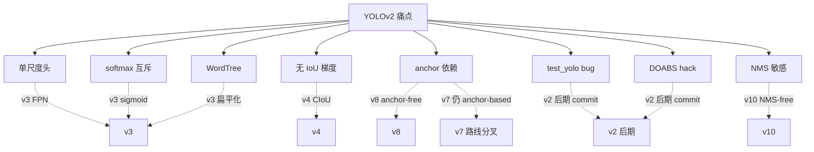

# YOLOv2 痛点追踪

YOLOv2 用 anchor + BN + 全卷积大幅提升了 mAP，但也引入/暴露了 8 个痛点。这一页追踪每个痛点的：表现、根因、跨版本修复路径。**带"快照"标记的是代码级事实**，均可在本仓快照中复核。

## 8 个痛点全景

| 痛点 | 严重度 | 后续解法 | 修复版本 |
|------|--------|---------|---------|
| 单尺度检测头（小目标仍弱） | High | FPN 多尺度头 | v3 |
| 定位无 IoU 直接梯度 | High | CIoU/GIoU 损失 | v4 |
| Softmax 类别头限制多标签 | Medium | 改回独立 sigmoid | v3 |
| Anchor 先验依赖数据集 | Medium | anchor-free | v8 / v10 |
| test_yolo 残留 detection_layer 强转（快照 bug） | Medium（代码） | 推理改用 region_layer 解码 | v2 后期 commit |
| DOABS 坐标系 hack（快照） | Low（代码） | 坐标系统一 | v2 后期 commit |
| WordTree 层级分类复杂 | Medium | 扁平多标签 | v3 |
| NMS 阈值敏感（遗留自 v1） | Medium | NMS-free | v10 |

> **v3 路标**：表里前几行在 v3 就有答案——FPN 三尺度头、多标签 logistic、9 anchors；"定位无 IoU 梯度"要到 v4 CIoU 才真正闭环（见 [v3 痛点追踪](/versions/v3/painpoints)）。
>
> **v4 路标**："定位无 IoU 直接梯度"在 v4 闭环——CIoU loss 上线，框回归首次对 IoU 直接求导（见 [v4 痛点追踪](/versions/v4/painpoints)）。
>
> **v5 路标**："Anchor 先验依赖数据集"在 v5 由 autoanchor 自动化——k-means + 遗传算法按训练集自动重算 anchors，不再需要手工调参（见 [v5 痛点追踪](/versions/v5/painpoints)）。

> **v6 路标**：anchor 先验在 v6 被釜底抽薪——EffiDeHead 转 anchor-free，解码与分配都不再有 anchor，"调锚"这门手艺连同 autoanchor 一起退出历史舞台（见 [v6 痛点追踪](/versions/v6/painpoints)）。

> **v8 路标**："Anchor 先验依赖数据集"在 v8 以 anchor-free 归一收官——anchor、autoanchor、anchor_t 一并退场，只剩网格中心与 ltrb 距离分布；"Softmax 类别头限制多标签"也由逐类 BCE 一路延续到 v8（见 [v8 痛点追踪](/versions/v8/painpoints)）。

> **v9 路标**：v2 时代"IoU 不直接微分、梯度语义靠手写 delta"是早期"梯度不可信"的具体样本；v9 把这类问题升维成机制命题——PGI 的辅助可逆分支逐尺度把深层特征注回浅层，让监督信号绕开信息瓶颈（见 [v9 痛点追踪](/versions/v9/painpoints#_1-信息瓶颈与梯度不可靠-pain-info-bottleneck)）。

> **v10 路标**：表里两行标着 v10 的账一次结清——"Anchor 先验依赖数据集"早由 anchor-free 收官，"NMS 阈值敏感（遗留自 v1）"在 v10 由一致性双分配正面解决：one2one 头每目标只出一个框，推理链路不再需要 NMS（见 [v10 痛点追踪](/versions/v10/painpoints)）。

---

## 1. 单尺度检测头：小目标仍然弱 (`pain-single-scale-head`)

**表现**：v2 把 grid 从 7×7 提到 13×13，小目标召回改善但仍明显弱于中大目标。

**根因**：
- 整网只在末端 **13×13** 单尺度出检测（<SrcLink file="v2:cfg/yolo.cfg" :line="227" />），感受野约 32×32 像素
- passthrough（<SrcLink file="v2:cfg/yolo.cfg" :line="203" :end="210" />）只是把 26×26 特征拼进来，**不是**多尺度预测头
- 5 次 maxpool 把 <32px 的小目标基本吞掉

**跨版本修复**：

| 版本 | 尝试 | 是否解决 |
|------|------|---------|
| v2 | 13×13 + passthrough | ⚠️ 缓解 |
| v3 | FPN 三尺度头（13/26/52） | ✅ 大幅解决 |
| v7 | P2 高分辨率支路 | ✅ 彻底解决 |

**教训**：passthrough 是"单尺度头 + 特征拼接"的折中，真正解法是 v3 的**每个尺度独立出检测头**。

---

## 2. 定位仍无 IoU 直接梯度 (`pain-no-iou-gradient`)

**表现**：mAP@0.75 提升有限；框"大致对"但边缘不准。

**根因**：
- 坐标损失仍是 L2 家族：`delta_region_box`（<SrcLink file="v2:src/region_layer.c" :line="87" />）算的是 `(target − output)`，IoU 只用于**选 anchor**（<SrcLink file="v2:src/region_layer.c" :line="272" :end="292" />）和 **rescore 的 conf 目标**（<SrcLink file="v2:src/region_layer.c" :line="302" :end="304" />）
- IoU 本身**从不直接微分**流入坐标——这个 v1 就有的结构性问题 v2 原样继承

**跨版本修复**：

| 版本 | 尝试 | 是否解决 |
|------|------|---------|
| v4 | CIoU loss（中心距 + 宽高比直接进损失） | ✅ 解决 |
| v5+ | GIoU/DIoU/CIoU 家族 | ✅ 标配 |

**快照佐证**：<SrcLink file="v2:src/box.c" :line="140" /> 附近有一批 `dxa/dya/dwa/dha` 的 DIoU 风格实验函数，但在 v2 检测路径中**未被调用**——pjreddie 已经在草稿这个方向，真正实现留给了后人（v4）。

---

## 3. Softmax 类别头限制多标签 (`pain-softmax-single-label`)

**表现**：一个 anchor 只能属于一个类；近义类（car/truck）互斥，多标签场景（"人" 同时是 "运动员"）无法表达。

**根因**：
- `softmax=1`（<SrcLink file="v2:cfg/yolo.cfg" :line="233" />）让类头概率和为 1
- delta 是 `one-hot − softmax`（<SrcLink file="v2:src/region_layer.c" :line="125" :end="130" />），鼓励独占

**跨版本修复**：

| 版本 | 尝试 | 是否解决 |
|------|------|---------|
| v3 | 类头改回**独立 sigmoid**（多标签） | ✅ 解决，沿用至 v8 |

**教训**：v2 为互斥性引入 softmax，反而限制了表达力；v3 退回 sigmoid 是"纠错"。

---

## 4. Anchor 先验依赖数据集 (`pain-anchor-dataset-bias`)

**表现**：换数据集（VOC→COCO→自有数据）就要重跑 K-means 重填 `anchors`，否则 mAP 掉几个点。

**根因**：
- 5 组 anchor 硬编码在 cfg（<SrcLink file="v2:cfg/yolo.cfg" :line="228" />）
- bias_match（<SrcLink file="v2:src/region_layer.c" :line="275" />）让匹配完全由 anchor 形状决定，先验不准则分配全错

**跨版本修复**：

| 版本 | 尝试 | 是否解决 |
|------|------|---------|
| v3 | 9 anchor 三尺度分担 | ⚠️ 缓解 |
| v8 / v10 | anchor-free | ✅ 解决 |

---

## 5. 快照 bug：test_yolo 残留 detection_layer 强转 (`pain-test-yolo-cast-bug`)

**表现（代码级）**：<SrcLink file="v2:src/yolo.c" :line="292" /> 写的是：

```c
detection_layer l = net.layers[net.n-1];
```

但 v2 最后一层是 **region_layer**。`l.side`、`get_detection_boxes()`（<SrcLink file="v2:src/yolo.c" :line="319" />）都是 v1 detection 时代的调用。

**根因**：pjreddie 在 `c6afc7f` 提交时只改了训练侧（region_layer），推理入口忘记同步。能"碰巧跑起来"是因为两个结构体前部字段（batch/inputs/outputs 等）内存布局重合，`l.side` 读到的其实是 region_layer 里的某个同位置字段。

**影响**：
- 用该 commit 直接跑 `./darknet yolo test` 结果不可靠
- 论文 72.8% VOC mAP 是用**后续修正 commit** 测的；研究本快照以**训练逻辑**为准

**修复**：v2 后期 commit 把推理入口改为 `get_region_boxes()`（<SrcLink file="v2:src/region_layer.c" :line="327" />）+ region 专用 NMS 流程。

---

## 6. 快照 hack：DOABS 坐标系 (`pain-doabs-hack`)

**表现（代码级）**：<SrcLink file="v2:src/region_layer.c" :line="12" /> 定义 `DOABS 1`，导致：

- 解码时 `b.w = exp(x[2])·biases[2n]/w`（<SrcLink file="v2:src/region_layer.c" :line="78" :end="79" />）——anchor 先除一次 grid 尺寸
- 训练目标同步改成 `tw = log(truth.w·w/anchor)`（<SrcLink file="v2:src/region_layer.c" :line="97" :end="98" />）

**白话**：anchor 的绝对尺寸（如 12.69）先除 13 变成归一化，再进 exp。数学上自洽，但让"anchor 尺寸到底在什么坐标系"变得极易误读。

**修复**：v2 后期版本把坐标系统一，去掉 DOABS 分支。

---

## 7. WordTree 层级分类复杂 (`pain-wordtree-complexity`)

**表现**：YOLO9000 的 WordTree 需要手工维护 9418 类的层级树，`hier` 分支（<SrcLink file="v2:src/region_layer.c" :line="111" :end="124" />）沿父节点回溯写梯度，训练/调试成本高。

**根因**：强行把"检测框分类"和"WordNet 语义树"耦合，树的构建/剪枝本身是独立工程。

**跨版本修复**：

| 版本 | 尝试 | 是否解决 |
|------|------|---------|
| v3 | 放弃 WordTree，扁平多标签 sigmoid | ✅ 解决 |

**教训**：层级分类学术上漂亮，工程上 ROI 太低；v3 之后无人再捡。

---

## 8. NMS 阈值敏感（遗留自 v1） (`pain-nms-threshold`)

**表现**：`do_nms_sort` 阈值（test 0.4 / valid 0.5，见 <SrcLink file="v2:src/yolo.c" :line="299" /> 与 <SrcLink file="v2:src/yolo.c" :line="146" />）对拥挤场景敏感：人挤人时容易误删。

**根因**：与 v1 相同——按类 qsort、重叠即把该类概率**置零**（<SrcLink file="v2:src/box.c" :line="249" />），是硬阈值贪心。

**跨版本修复**：

| 版本 | 尝试 | 是否解决 |
|------|------|---------|
| v4-v7 | soft-NMS / DIoU-NMS | ⚠️ 缓解 |
| v10 | NMS-free 端到端 | ✅ 解决 |

---

## 痛点谱系图



---

## 延伸阅读

- [概览](/versions/v2/index) / [论文精读](/versions/v2/paper)
- [损失函数](/versions/v2/losses) / [反向传播推导](/versions/v2/loss-gradient)
- [训练技巧](/versions/v2/tricks)
- [源码走读](/versions/v2/code-walkthrough)
- [v1 痛点追踪](/versions/v1/painpoints) — 对照看哪些是 v1 遗留、哪些是 v2 新引入
- [v7 痛点追踪](/versions/v7/painpoints) — v7 对 anchor 依赖等遗留议题的回应（含指向 v8+ 的路标）
