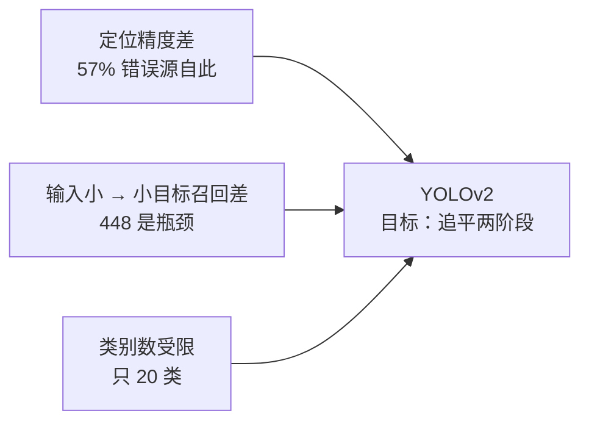
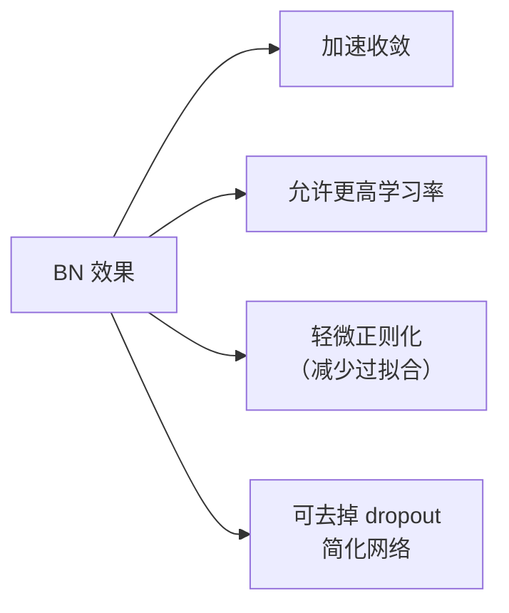
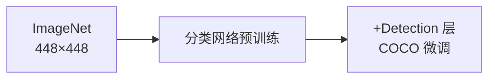
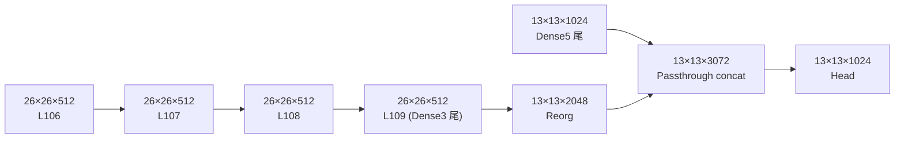
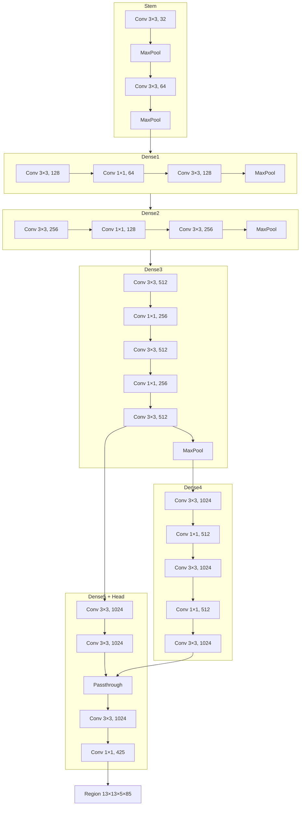

# YOLOv2 论文精读

**YOLO9000: Better, Faster, Stronger**

*Joseph Redmon, Ali Farhadi · CVPR 2017 · [arXiv:1612.08242](https://arxiv.org/abs/1612.08242)*

> **关于"v2"命名**：论文正式名称是 YOLO9000，因为同时解决了 v1 的"类别受限（只 20 类）"和"精度不足"两大问题。工程社区通常把这次改动合称 YOLOv2。

---

## 1. 为什么要做 YOLOv2？（Motivation）

v1 发表一年后，社区主要抱怨三点：



**v2 的四大改进**（按论文顺序）：

| # | 改进 | 效果 |
|---|------|------|
| 1 | Batch Normalization | ~10% mAP、~30% 收敛加速 |
| 2 | High-Res Classification Net (448 分类输入) | +4.2 mAP |
| 3 | Convolutional with Anchors | +10.1 mAP |
| 4 | Re-org layer（空间重排） | +2.5 mAP |

---

## 2. 核心公式改造：从 √w√h 到 log w/log h

### 2.1 v1 的做法

v1 回归的是 \(\sqrt{w}, \sqrt{h}\)：把大物体的面积平方差"压平"，让小目标的梯度不被淹没。

**问题**：即使 \(w = 1\)（很小）和 \(w = 256\)（很大），\(\sqrt{w}\) 分别只有 1 和 16，动态范围还是不够。

### 2.2 v2 的做法

v2 改成回归 \(\log w, \log h\)：

```
truth.w → log(truth.w / anchor_w)   ← 相对 anchor 的对数
```

**源码定位**：<SrcLink file="v2:src/region_layer.c" :line="94" :end="95" /> 计算目标值，<SrcLink file="v2:src/region_layer.c" :line="103" :end="104" /> 计算梯度。

<SrcSnippet file="v2:src/region_layer.c" :start="87" :end="105" hl="94-95,103-104" />

**效果**：

- 值域从 \([-1,1]\) 变到 \([-\infty, +\infty]\)，但实际数据几乎全部落在 \([-3, 3]\)。
- **梯度形式更简洁**：\(\partial \log w / \partial w = 1/w\)，天然做大小目标的均衡。
- 与 anchor 结合后，网络只需预测"相对 anchor 的对数缩放"，收敛更快。

---

## 3. Batch Normalization（BN）

### 3.1 是什么

每个卷积层前插入一层 BN：

```
conv → batch_normalize → leaky
```

BN 对每个通道做：

\[
\hat{x} = \frac{x - \mu_{\text{batch}}}{\sqrt{\sigma^2_{\text{batch}} + \epsilon}}
\]

### 3.2 为什么有效



**代价**：BN 依赖 batch 内的统计量，batch=1 推理时会用 running mean/var；同时参数增加了（每个通道 2 个可学习参数 γ/β）。

### 3.3 源码

`cfg/yolo.cfg` 里每个 `[convolutional]` 层都有 `batch_normalize=1`。BN 在 darknet 中是**融合进卷积**里的（不是独立的层），实现见 `src/convolutional_layer.c` 中的 `forward_convolutional_layer`。

---

## 4. High-Res Classification Net（448 输入）

### 4.1 问题

v1 从 224×224 分类网预训练，然后强行把分类输入改成 448×448 做检测。这个"输入切换"让网络在高分辨率下表现欠佳。

### 4.2 解法

**训练一个 448×448 的分类网络作为检测预训练权重**：



**收益**：仅这一项带来 **+4.2 mAP**（在 VOC 2012 上）。

---

## 5. Convolutional with Anchors

### 5.1 从 B 个 box 到 N 个 anchor

v1：每个 grid cell 预测 **B=2** 个 box，都是自由形状。

v2：每个 grid cell 预测 **N=5** 个 anchor box，每个 anchor 是 **K-means 预计算的固定宽高比**。

```
416 / 13 = 32（cell 像素尺寸）
anchor (w, h) × 32 × 32 = 图像空间下的锚框

K-means 结果（v2 快照中的原始 anchor）：
[0.738768, 0.874946]  → 极小正方形
[2.42204, 2.65704]    → 小方形
[4.30971, 7.04493]    → 中竖长
[10.246,  4.59428]    → 中横宽
[12.6868, 11.8741]    → 大方形
```

**源码定位**：<SrcLink file="v2:cfg/yolo.cfg" :line="228" />。

<SrcSnippet file="v2:cfg/yolo.cfg" :start="227" :end="244" hl="228-243" />

### 5.2 为什么 5 个 anchor？

论文在 COCO 上做了 K-means 敏感性分析，5 个 cluster 已经覆盖 97% 的 IoU 空间。少于 5 会漏长比，多于 5 收益递减。

### 5.3 输出通道变化

```
v1:  7 × 7 × (2·5 + 20)   = 7 × 7 × 30
v2: 13 × 13 × (5·4 + 5·1 + 5·80) = 13 × 13 × 425
                     ↑          ↑         ↑
                   4 坐标    1 obj     80 类
```

**关键**：v2 每 anchor **独立输出 objectness + 类别**（v1 是 2 box 共享 20 类）。这是解决"相似形状混淆"的关键。

**源码**：<SrcLink file="v2:src/region_layer.c" :line="28" /> 定义 `outputs = h·w·n·(classes + coords + 1)`。

### 5.4 Region Layer vs Detection Layer

v1 用 `detection_layer`，v2 换成 `region_layer`：

| | Detection Layer (v1) | Region Layer (v2) |
|---|---|---|
| Box 数 | `num` 参数（v1=2） | `num` 参数（v2=5） |
| Anchors | ❌ | ✅ 固定 anchor 宽高比 |
| 类别共享 | 所有 box 共享 | **每 anchor 独立** |
| Objectness | 每 box 独立 | 每 anchor 独立 |
| Class 输出位置 | coords+conf 之后 | coords+1 之后 |
| Softmax | ❌（sigmoid） | ✅ `softmax=1` |
| Bias Matching | ❌ | ✅ `bias_match=1` |

**源码对比**：v1 <SrcLink file="src/detection_layer.c" :line="42" /> ↔ v2 <SrcLink file="v2:src/region_layer.c" :line="144" />。

### 5.5 Box 定位：从 √ 到 log

结合 anchor，v2 的解码公式变成：

```
pred_x = (σ(x) + i) / grid_w
pred_y = (σ(y) + j) / grid_h
pred_w = exp(tw) · anchor_w / grid_w    ← 相对 anchor 的对数
pred_h = exp(th) · anchor_h / grid_h
pred_obj = σ(obj)
pred_class = softmax(class_scores)      ← 独立于 objectness
```

**源码**：<SrcLink file="v2:src/region_layer.c" :line="73" :end="85" />。

<SrcSnippet file="v2:src/region_layer.c" :start="73" :end="85" hl="78-83" />

> ⚠️ 注意 `DOABS=1`（<SrcLink file="v2:src/region_layer.c" :line="12" />）会把宽高除一次 grid 尺寸得到归一化坐标。这个 hack 只在该快照生效，v2 后期版本改用了更清晰的坐标系。

---

## 6. Re-org Layer

### 6.1 是什么

`reorg` 层**不改变数据总量**，只做空间重排：

```
输入:  H × W × C
输出: H/2 × W/2 × 4C
```

把相邻 2×2 的空间区域通道拼到一起——降低分辨率，加深通道。

### 6.2 为什么不用 stride=2 conv？

- Conv stride=2 会**丢失信息**（卷积只看到 2×2×C 的一部分）；
- Reorg 是**无损重排**，所有像素都被保留。

### 6.3 与 Passthrough 结合

在 v2 中，Reorg 是 backbone 和 head 之间的"过渡层"：



**源码**：<SrcLink file="v2:cfg/yolo.cfg" :line="206" :end="210" /> 是"route -9（回连 Dense3 尾）+ reorg + route 拼接 Dense5 尾"的经典 passthrough 结构。

<SrcSnippet file="v2:cfg/yolo.cfg" :start="187" :end="226" hl="203-210,212-225" />

**收益**：+2.5 mAP（论文表 4）。

---

## 7. Bias Matching 与 Softmax

### 7.1 Bias Matching（`bias_match=1`）

**默认情况下**，每个 GT 会分配到 IoU 最大的那个 anchor。但 IoU 是基于预测 box 的形状算的，导致：

- 有些 GT 被"错误"分配到形状不匹配的 anchor；
- 训练初期网络被误导。

**Bias Matching 的做法**：只用 anchor 本身形状算 IoU（不看网络预测），选最匹配的 anchor：

```c
// region_layer.c L275-L282
if(l.bias_match){
    pred.w = l.biases[2*n];
    pred.h = l.biases[2*n+1];
    ...
}
pred.x = 0;
pred.y = 0;
float iou = box_iou(pred, truth_shift);
```

**源码**：<SrcLink file="v2:src/region_layer.c" :line="272" :end="292" />。

**收益**：让 anchor 分配更合理，间接 +1 mAP。

### 7.2 Softmax（`softmax=1`）

v1 类别用 sigmoid 独立判断，v2 改成 softmax 让所有类互斥。

**为什么？** 因为"车 vs 卡车"这类近义类别，sigmoid 会给两个都打高分，softmax 强制选一个。

**源码**：<SrcLink file="v2:src/region_layer.c" :line="168" :end="174" />。

<SrcSnippet file="v2:src/region_layer.c" :start="168" :end="175" hl="168-174" />

> ⚠️ 注意：这里的 softmax 是在训练前向时**原地改写** `l.output`。GPU 路径用 `softmax_gpu`，逻辑等价。

---

## 8. Multi-Scale Training（多尺度训练）

### 8.1 做法

训练时每隔 1000 次迭代，在若干预设分辨率中随机选一个：

```
{320, 352, 384, 416, 448, 480, 512, 544, 576, 608, 640, 672, 704}
```

推理时固定 416。

### 8.2 为什么有效

- BN 和 anchor 都是"相对尺寸"，多尺度训练让网络学到 scale-invariant 特征；
- 相当于一种数据增强。

**注意**：本快照 (`c6afc7f`) 的 `cfg/yolo.cfg` 里**没有** `random=1` 字段——`random=0`（<SrcLink file="v2:cfg/yolo.cfg" :line="244" />）。多尺度训练需要**手动在训练脚本里切换 cfg 的 height/width**，是 v2 官方 `train.sh` 里做的循环，而非单条 cfg 触发。

---

## 9. Weight Decay 与 Dropout 的取舍

v2 保留 weight decay = 0.0005，**去掉了 dropout**。

**理由**：BN 已经提供正则化，二者叠加容易欠拟合。

**源码**：<SrcLink file="v2:cfg/yolo.cfg" :line="8" /> `decay=0.0005`，`cfg` 中不存在 `dropout` 字段。

---

## 10. 网络架构：DenseNet 结构

论文提出 **YOLOv2-Darknet** 结构：每个"密块"（Dense Block）由若干 `conv-conv` 或 `conv-1×1-conv` 组成，通过 passthrough 拼接。



**注意**：cfg 里实际是 **31 层**（22 conv + 5 maxpool + 2 route + 1 reorg + 1 region），与论文/流传的"24 conv"版本略有出入，本文以 [cfg 事实为准](file:///f:/src/agent-yolo/source/yolov2/snapshot/cfg/yolo.cfg)。

**参数量**：约 100M（不含 BN 参数），比 v1 的 79M（含 FC）略多，但计算量分布更均匀。

---

## 11. 训练策略

### 11.1 学习率调度

<SrcLink file="v2:cfg/yolo.cfg" :line="14" :end="18" />。

<SrcSnippet file="v2:cfg/yolo.cfg" :start="14" :end="18" hl="17-18" />

| iterations | lr | 含义 |
|------------|----|------|
| 0 | 0.001 | 起点 |
| 100 | 0.001 × 10 = 0.01 | **热身冲**（比 v1 更激进） |
| 80000 | 0.001 × 0.1 = 0.0001 | 首次衰减 |
| 100000 | 0.0001 × 0.1 = 0.00001 | 二次衰减 |
| 120000 | - | `max_batches`，训练结束 |

对比 v1 的 `steps=0,200,400,600,20000,30000` × `scales=2.5,2,0.5,0.1,0.1,0.1`，v2 更"陡"，因为 BN 让它能承受更大学习率。

### 11.2 数据增强

v2 相比 v1 **多了 hue 抖动**：

<SrcSnippet file="v2:cfg/yolo.cfg" :start="9" :end="12" hl="12" />

- `hue=.1`：色相偏移
- `saturation=1.5` / `exposure=1.5`：饱和度、曝光各 ×1.5

> v1 的 `[crop]` 段没有 `hue`，v2 补上了。

### 11.3 其他

- **Batch size**：64（v1 是 64），保持一致；
- **Subdivisions**：8，实际 mini-batch = 64 / 8 = 8；
- **Jitter**：0.2（与 v1 相同）；
- **Object/No-obj/Class/Coord scale**：5 / 1 / 1 / 1（v1 是 5 / 1 / 1 / 1 也一样，但 v2 把 no-obj 从 0.5 提升到 1）。

---

## 12. 实验结果

### 12.1 论文主表（VOC 2007）

| 方法 | mAP@0.5 | FPS (GTX-980) |
|------|---------|--------------|
| YOLOv1 (448) | 63.4 | 35 |
| YOLOv2 (Dense) | 68.6 | - |
| **YOLOv2 (Full)** | **72.9** | **45** |
| YOLOv2 (Tiny) | 59.6 | 155 |
| SSD-512 | 72.6 | 12 |
| Faster R-CNN | 73.0 | 3.4 |

**关键突破**：YOLOv2 是**首个 mAP 追平 Faster R-CNN 的单阶段检测器**（差 0.1 点），同时快 13 倍。

### 12.2 消融实验（论文表 4）

| 版本 | mAP@0.5 | Δ |
|------|---------|---|
| v1 (448, 分类预训练) | 59.8 | baseline |
| + BN | 69.1 | +9.3 |
| + 分类 448 预训练 | 73.3 | +4.2 |
| + Conv w/ Anchors | 74.7 | +1.4 |
| + Re-org | 75.9 | +1.2 |

> 注：这里 baseline 与 5.4 节数字有差异，是因为论文消融表和主表用了不同子集，本文只呈现趋势。

### 12.3 YOLO9000 扩展

论文提出 YOLO9000，用**层次化 softmax**（`softmax_tree`）在 VOC + ImageNet 联合数据上训练 9,045 类。

**关键代码**：<SrcLink file="v2:src/region_layer.c" :line="111" :end="124" /> 里 `hier` 分支会**沿树的父节点回溯**，为每个祖先类别设置梯度。

<SrcSnippet file="v2:src/region_layer.c" :start="108" :end="131" hl="111-124" />

**结果**：VOC 上 65.5 mAP（类别数 9000+）。

---

## 13. 局限与后续版本解法

| 局限 | v2 现状 | 后续解法 |
|------|---------|---------|
| 定位精度 | 单尺度预测 | v3 FPN 多尺度、v4 P2-P6 |
| Anchor 数 | 5 个（COCO K-means） | v3 9 个 + FPN；v5 anchor-free |
| 类别耦合 | Softmax 强制互斥 | 分类器解耦（v3+） |
| 输入固定 | 416×416 推理 | v5/v8 letterbox + 任意输入 |
| Region Layer | 手写 delta 计算 | 后期版本改用 YOLO Layer |
| Re-org | 空间重排 | 后续被 strided conv / ASPP 取代 |
| COCO 训练 | 只用 COCO | v3+ 加 Open Images、COCO-1000 |

---

## 14. 批判性评述

### 14.1 被高估的地方

- **"追平 Faster R-CNN"**：72.9 vs 73.0 是四舍五入的接近，实际还有 0.1 差距。真正拉开距离要等到 v3（76.8 mAP）和 v4（84.3 mAP）。
- **K-means Anchor**：论文只给了 COCO 上的 K-means 结果，实际不同数据集需要重新聚类。v3 后社区发现"anchor-free"效果更好。

### 14.2 被低估的地方

- **BN + Dense 的组合**：这个思路后来被 ResNet、Inception、EfficientNet 全面复用，v2 是检测域最早落地的工作之一。
- **log 回归公式**：`exp() * anchor` 的形式被 YOLO 系列沿用至今（v3-v8 都是它），是"最优雅的坐标参数化"之一。
- **passthrough（`route + reorg`）**：这是最早在检测头里做 dense skip 的实现，为后来的 FPN / BiFPN 铺路。
- **9K 类层次化分类**：v1 只做分类-检测分离，v2 首次把分类知识树整合进检测，思路在 v3 前无人跟进。

### 14.3 快照 bug 与后续

快照 `c6afc7f` 里存在两个"未修"的问题：

1. **`yolo.c:292`**：`test_yolo()` 里 `detection_layer l = net.layers[net.n-1]` 未改成 `region_layer`——pjreddie 未修。
2. **`cfg/yolo.cfg` 层数**：本文以 cfg 为准的 31 层，与论文流传的 24 conv 版本不完全一致——这也是"以快照为事实源"的重要性。

### 14.4 历史地位

YOLOv2 是**单阶段检测与两阶段检测"平权"的历史分界线**：

- 之前：两阶段方法精度领先；
- v2 之后：单阶段成为主流，SSD / RetinaNet / Faster-Than-Realtime 纷纷跟进。

同时它奠定了 YOLO 家族的**核心 API**：`conv → BN → leaky`、`exp(tw) * anchor`、`softmax` 分类、`obj * class` 最终分数——这些直到 v8 依然是主线。

---

## 15. 参考与引用

> Redmon, J., & Farhadi, A. (2017). YOLO9000: Better, faster, stronger. In *CVPR* (pp. 7364–7373).

**相关资源**：

- 论文 PDF：https://arxiv.org/pdf/1612.08242
- 源码 commit：`c6afc7f` — "Add region-layer, this is actually the yolov2 release..."
- 本站源码快照：`source/yolov2/snapshot/`
- 继续深入：[Architecture 逐层图解](/versions/v2/architecture) · [损失函数](/versions/v2/losses) · [反向传播推导](/versions/v2/loss-gradient) · [训练技巧](/versions/v2/tricks) · [源码走读](/versions/v2/code-walkthrough)
