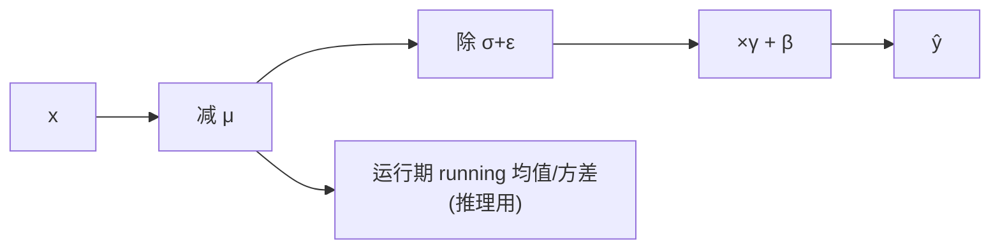
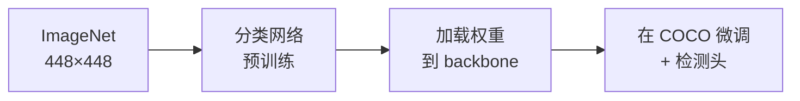
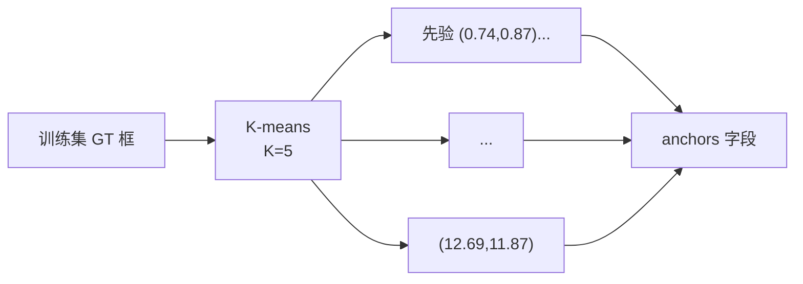
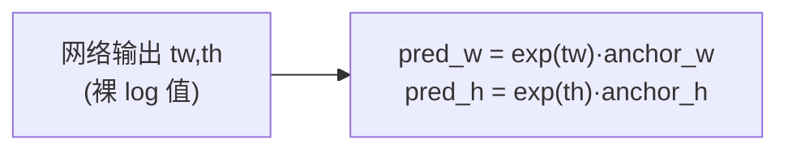
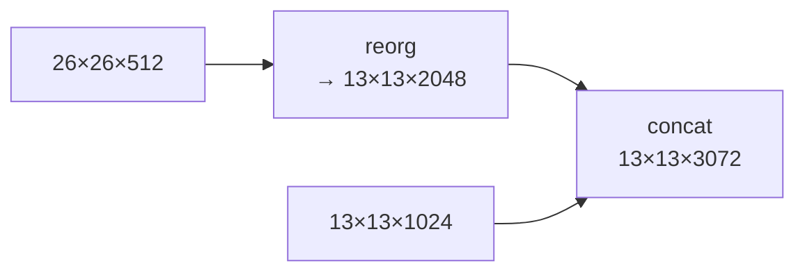
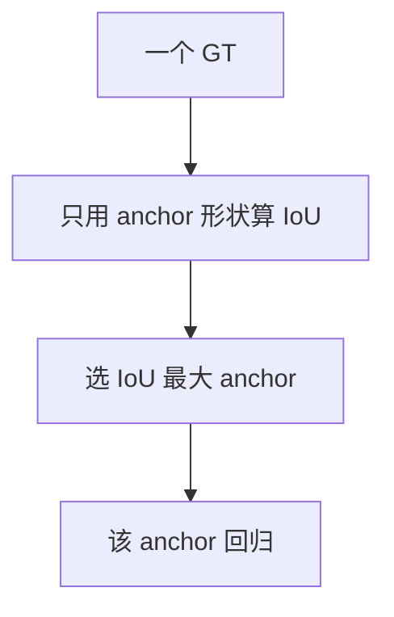
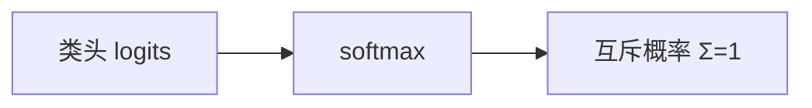
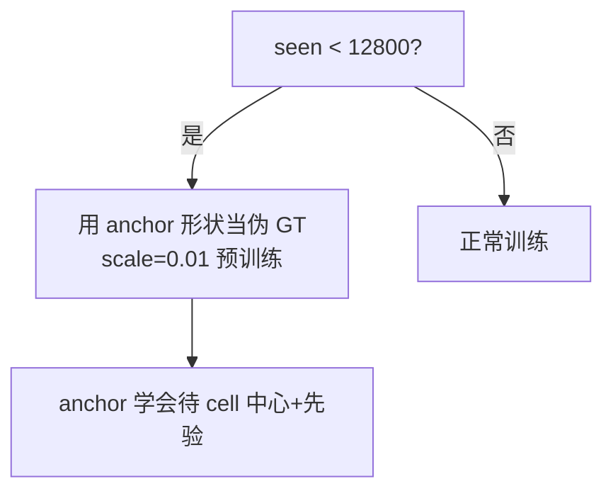
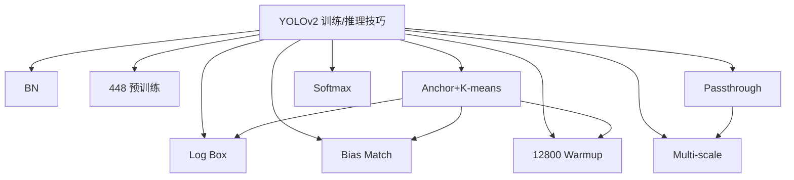

# YOLOv2 训练与推理技巧

YOLOv2 有 9 个关键 knob，全部通过 `cfg/yolo.cfg` 或源码落地。每个 trick 下面都有：**原理图、白话、源码、演进**。

---

## 全部 9 个 Trick 速查

| # | Trick | 类别 | 位置 | 影响 |
|---|-------|------|------|------|
| 1 | Batch Normalization | 训练稳定 | `yolo.cfg` 每 conv | +~9 mAP、加速收敛 30% |
| 2 | 448 高分辨率分类预训练 | 初始化 | 权重加载 | +4 mAP |
| 3 | Anchor + K-means | 先验设计 | `anchors` | +10 mAP |
| 4 | Log 空间 box 回归 | 损失设计 | `region_layer.c` | 取代 √w√h |
| 5 | Passthrough（route+reorg） | 结构 | `yolo.cfg` | +2.5 mAP |
| 6 | Bias Matching | 目标分配 | `bias_match=1` | anchor 分配更合理 |
| 7 | Softmax 类别头 | 分类 | `softmax=1` | 减少近义类混淆 |
| 8 | Multi-scale 训练 | 数据增强 | 训练脚本 | 尺度鲁棒、加速 |
| 9 | 12800 anchor warmup | 训练稳定 | `region_layer.c` | anchor 占位 |

---

## 1. Batch Normalization（BN）(`trick-bn`)

### 原理图



### 白话

> 每层卷积后把同 batch 同通道的数据标准化。梯度不再随网络加深而爆炸或消失，学习率可以开更大。**所有卷积统一 `batch_normalize=1`**，是 v2 结构上最大的一刀。

### 源码

<SrcLink file="v2:cfg/yolo.cfg" :line="20" :end="26" /> 每一层都带 `batch_normalize=1`：

<SrcSnippet file="v2:cfg/yolo.cfg" :start="20" :end="26" hl="24-25" />

### 演进

BN 从 v2 起成为 YOLO 系列标配，v3-v8 全沿用。v2 是 early adopter。

---

## 2. 448 高分辨率分类预训练 (`trick-high-res-pretrain`)

### 原理图



### 白话

> v1 用 224 的分类网预训练，然后**跳**到 448 做检测，分辨率突变让网络不适。v2 干脆**直接用 448 训练分类网**，再用这份权重初始化检测，省去突变代价。

### 源码

权重文件是 run 命令可选第三参（`train_yolo` 的 `weightfile`，见 <SrcLink file="v2:src/yolo.c" :line="15" />）：

```text
./darknet detector train cfg/coco.data cfg/yolo.cfg darknet19_448.conv.23
```

### 演进

标准做法沿用至今；v3+ 用更高分辨率 + 多尺度迭代。

---

## 3. Anchor + K-means（`trick-anchor-kmeans`）

### 原理图



### 白话

> v1 让网络从零猜框形状。v2 先统计 GT 的长宽分布，用 K-means 找出 5 个“典型框”，网络只需预测相对它们的小偏移。

### 源码

<SrcLink file="v2:cfg/yolo.cfg" :line="228" />：

<SrcSnippet file="v2:cfg/yolo.cfg" :start="228" :end="233" hl="228" />

### 演进

v3 扩到 9 个 anchor + FPN 多尺度；v5+ 走向 anchor-free。

---

## 4. Log 空间 Box 回归（`trick-log-box`）

### 原理图



### 白话

> 取代 v1 的 √w√h。网络输出的是“相对 anchor 的对数缩放”，解码时 `exp` 还原。梯度在 log 空间天然均衡大小目标。

### 源码

解码 <SrcLink file="v2:src/region_layer.c" :line="73" :end="85" />，目标与梯度 <SrcLink file="v2:src/region_layer.c" :line="92" :end="104" />：

<SrcSnippet file="v2:src/region_layer.c" :start="92" :end="104" hl="94-104" />

> ⚠️ `DOABS=1`（<SrcLink file="v2:src/region_layer.c" :line="12" />）会把宽高再除一次 grid 尺寸，是 v2 早期的坐标系 hack。

### 演进

这一套 `exp(tw)·anchor` 公式被 YOLO 主线沿用至 v8。

---

## 5. Passthrough：`route + reorg`（`trick-passthrough`）

### 原理图



### 白话

> 13×13 检测头吃不到 26×26 里的细粒度小目标特征。reorg 把 26×26 **无损重排**成 13×13×2048，再拼接，让检测头兼顾全局与细节。

### 源码

<SrcLink file="v2:cfg/yolo.cfg" :line="203" :end="210" />：

<SrcSnippet file="v2:cfg/yolo.cfg" :start="203" :end="210" />

### 演进

这是 FPN 的原型。v3 用真正的上采样 + 多尺度头替代。

---

## 6. Bias Matching（`trick-bias-match`）

### 原理图



### 白话

> 一个 GT 归哪个 anchor？用**anchor 先验形状**（不看网络预测）算 IoU，谁像谁负责，避免预测框干扰匹配。

### 源码

<SrcLink file="v2:cfg/yolo.cfg" :line="229" /> `bias_match=1`；实现 <SrcLink file="v2:src/region_layer.c" :line="275" :end="282" />。

### 演进

v3+ 改为在训练时动态算 GT 与所有 anchor 的 IoU 分配（不再依赖 bias_match hack）。

---

## 7. Softmax 类别头（`trick-softmax`）

### 原理图



### 白话

> v1 每类 sigmoid 独立，可以同时打高分多个近义类。v2 改成 softmax，强制互斥（车 vs 卡车二选一）。

### 源码

<SrcLink file="v2:cfg/yolo.cfg" :line="233" /> `softmax=1`；实现 <SrcLink file="v2:src/region_layer.c" :line="168" :end="174" />。

### 演进

v3+ 改回多标签 sigmoid，因为多标签/多对象场景 softmax 反而受限。

---

## 8. Multi-scale 训练（`trick-multi-scale`）

### 原理图

```mermaid
flowchart LR
    T["训练"] --> RAND{"随机选分辨率"} -->|320| A & |416| B & |608| C --> NET["同一权重"] --> TEST["固定 416 推理"]
```

### 白话

> 全卷积网络可接受任意输入。训练时轮换 320~608，让模型学到尺度无关特征，顺便加速。

### 源码

快照 cfg 默认 `height=416, width=416`（<SrcLink file="v2:cfg/yolo.cfg" :line="4" :end="5" />），但 `random=0`（<SrcLink file="v2:cfg/yolo.cfg" :line="244" />）——**多尺度靠训练脚本循环切换 cfg 分辨率**，非单 cfg 触发。

### 演进

v3-v8 全部保留多尺度训练，成为标配。

---

## 9. 12800 Anchor Warmup（`trick-anchor-warmup`）

### 原理图



### 白话

> 最开始的几千张图，先让每个 anchor“占位”：待在自己 cell 中心、尺寸等于先验。用极小的 scale=0.01 引导，避免 anchor 训练初期乱飞。

### 源码

<SrcLink file="v2:src/region_layer.c" :line="243" :end="254" />：

<SrcSnippet file="v2:src/region_layer.c" :start="243" :end="254" hl="243-253" />

### 演进

v3+ 改为更复杂的匹配策略；anchor warmup 思想仍保留在多数 YOLO 版本中。

---

## 9 个 Trick 的谱系图



---

## 延伸阅读

- [论文精读](/versions/v2/paper)
- [Architecture 逐层图解](/versions/v2/architecture)
- [理论 Concept](/versions/v2/concepts)
- [损失函数](/versions/v2/losses)
- [源码走读](/versions/v2/code-walkthrough)
- [痛点追踪](/versions/v2/painpoints)
