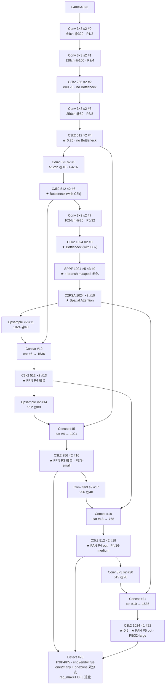
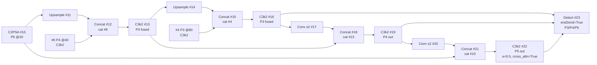

# YOLO26 Architecture 逐层图解

> 首发载体：`ultralytics/ultralytics` commit `2e241d0`（2026-06），对应 [arXiv:2606.03748](https://arxiv.org/abs/2606.03748)。以 `cfg_models_26/yolo26.yaml` 为基准（**cfg 目录扁平为 `cfg_models_26/`，无 v 前缀，与 v13 学术线的 `models/v13/` 目录嵌套风格不同**），本页通道数为缩放前的基准值。配置原文见 <SrcLink file="v26:cfg_models_26/yolo26.yaml" />，逐层源码见 [YOLO26 逐层图解](/versions/v26/layers)。

> **v1~v14 读者路标**：这张 yaml 是 [yolov14.yaml](/versions/v14/architecture)（同期学术线 YOLO-Omni）的**官方线并行版本**——**骨干 12 层用 SPPF + C2PSA（v8/v10/v11 风格）**，**移除 v12/v13/v14 的 A2C2f**（yaml 层完全消失，仅在 block.py 保留实现），**head 10 层是标准 FPN+PAN + Detect(end2end=True)**，**`reg_max: 1` 让 DFL 退化为 `nn.Identity()`**，**`end2end: True` 默认开启 one2many + one2one 双分支**——整张图 **23 层**（backbone #0-#10 共 11 层 + head #11-#21 共 11 层 + Detect #22）。与 v14 的 25 层相比**减 2 层**（v26 没有 DomainAdaptiveLayer/ViewEmbedding 这类跨阶段锚点），与 v13 的 32 层相比**减 9 层**（v26 没有 HyperACE / FullPAD_Tunnel）。

::: tip 只想带走三件事
1. **Backbone 11 层**：Conv（#0）→ Conv（#1）→ **C3k2 ×4**（#2/#4/#6/#8，浅层 P2/P3 无 Bottleneck 参数、深层 P4/P5 `True` 参数）→ **SPPF**（#9）→ **C2PSA**（#10）——**与 v8/v10/v11 的骨干节奏几乎完全一致**，只把 v8 的 C2f 换成 v11 的 C3k2；P4/P5 段**没有 A2C2f**（v12/v13/v14 的核心注意力骨干被移除）；
2. **Head 11 层是标准 FPN+PAN**：Upsample×2 + Concat×2 + C3k2×2（FPN 上采样段）→ Conv s2 + Concat + C3k2×2（PAN 下采样段）→ **C3k2(P5)**（最后 `0.5, True` 特殊参数）→ **Detect(P3/P4/P5)**——**v26 的 head 是 v11/v12/v13/v14 的标准版**，唯一变化是 Detect 头加了 `end2end=True` 双分支；
3. **11 份 yaml 变体覆盖 6 任务**：Detect 主变体（`yolo26.yaml`）+ P2/P6 尺度变体（`yolo26-p2.yaml` / `-p6.yaml`）+ 5 个任务变体（`-seg` / `-obb` / `-pose` / `-sem` / `-depth` / `-cls`）+ 2 个 YOLOE 开放词汇变体（`yoloe-26.yaml` / `yoloe-26-seg.yaml`）——**六任务共用同一 backbone**，`Detect` 换 `Segment26` / `OBB26` / `Pose26` / `SemanticSegment` / `Depth` / `Classify` / `YOLOEDetect` / `YOLOESegment26` 即可切换。
:::

## 1. 一眼看清：yolo26.yaml 全图

> **v1~v14 读者路标**：整张图 **23 层**（backbone #0-#10 共 11 层，head #11-#21 共 11 层，最后 Detect #22）。**骨干节奏与 v11/v12 一致**（Conv 3×3 s2 下采样 + C3k2 融合 + SPPF + C2PSA），**关键差异在两点**：C3k2 铺 4 层（v11 铺 3 层）+ 骨干末尾 SPPF → C2PSA 二段式注意力（v11 只有 SPPF，v8/v10 是 SPPF + PSA/C2PSA 组合）；**P4/P5 没有 A2C2f**——**这是 v8 以来官方线第一次砍掉自家引入的注意力骨干**，官方口径明说是「经典骨干回归」。

- 图中通道数为 yaml 声明的**基准宽度**；n 档 depth=0.50 / width=0.25 把 C3k2 重复数 ×2→1、×4→2、×1→1，通道 ÷4（末级 1024→256），五档 scales 见 §6
- backbone 占 yaml L20~L32（#0~#10，共 11 层）、head 占 L35~L52（#11~#22，共 12 层，含 Detect #23）
- **C3k2 出现 8 次**（#2/#4 骨干浅层 P2/P3，#6/#8 骨干深层 P4/P5，#13/#16/#19/#22 head FPN+PAN）——**v11 铺 3 层浅层 C3k2 + 3 层深层 C3k + SPPF；v26 铺 4 层浅层 + 4 层深层 + SPPF + C2PSA**
- **SPPF + C2PSA 回归**（v8/v10/v11 都有；v12/v13/v14 无 SPPF，v12/v13/v14 用 A2C2f 替代 C2PSA）
- **无 A2C2f / 无 HyperACE / 无 DeformableA2C2f**——v26 骨干**完全回归经典**
- **Detect 三分量 + E2E 双分支**：`cv2` box 分布（`reg_max=1` 退化为 Identity）、`cv3` cls 分类（DW-separable）、+ `one2one_cv2/one2one_cv3` 深拷贝副本（E2E 分支）

<SrcLink file="v26:cfg_models_26/yolo26.yaml" />

## 2. Backbone #0-#10：Conv + C3k2×4 + SPPF + C2PSA

> **v1~v14 读者路标**：与 v11 骨干对比，v26 的关键改动在**C3k2 铺 4 层（v11 是 3 层浅层 + 3 层深层）**、**骨干末尾增加 C2PSA（v11 没有，v8/v10 有）**、**C3k2 浅层参数 `(channels, False, 0.25)` 明确禁用 Bottleneck**（用轻量级 C3k2 变体做 P2/P3）、**深层 `(channels, True)` 启用 Bottleneck**（大感受野做 P4/P5）；**移除 A2C2f** 是 v26 骨干哲学的核心决策。

```mermaid
flowchart LR
    IMG["640×640×3"] --> L0["Conv 3×3 s2 #0<br/>64 @320 · P1/2"]
    L0 --> L1["Conv 3×3 s2 #1<br/>128 @160 · P2/4"]
    L1 --> L2["C3k2 256 ×2 #2<br/>e=0.25 无 BN"]
    L2 --> L3["Conv 3×3 s2 #3<br/>256 @80 · P3/8"]
    L3 --> L4["C3k2 512 ×2 #4<br/>e=0.25 无 BN"]
    L4 --> L5["Conv 3×3 s2 #5<br/>512 @40 · P4/16"]
    L5 --> L6["C3k2 512 ×2 #6<br/>★ with Bottleneck"]
    L6 --> L7["Conv 3×3 s2 #7<br/>1024 @20 · P5/32"]
    L7 --> L8["C3k2 1024 ×2 #8<br/>★ with Bottleneck"]
    L8 --> L9["SPPF 1024 ×5 #9"]
    L9 --> L10["C2PSA 1024 ×2 #10"]
```

- **入口 Conv #0**：标准 Conv 3×3 s2，与 v8/v11/v12/v13/v14 一致（**v14 学术线用 CircularConv 做全景兼容，v26 没有**）；
- **C3k2 铺 4 层分两档**：#2/#4 浅层 P2/P3 用 `(channels, False, 0.25)`（`False` = 无 Bottleneck，`0.25` = 通道压缩比 `e=0.25`，浅层算得快）；#6/#8 深层 P4/P5 用 `(channels, True)`（`True` = 启用 C3k Bottleneck，`e=0.5` 默认，深层算得多）；
- **下采样全部 Conv 3×3 s2**：#3/#5/#7 都是标准 Conv（与 v13 的 DSConv、v14 的 Conv 一致，但 v26 的 Conv 是**标准实现**，v13/v14 有 DSConv 变体）；
- **P5 段 SPPF + C2PSA**：#9 SPPF 用 `5` 次 maxpool（5 尺度感受野）+ 5 通道 concat；#10 C2PSA 用 2 次注意力融合——**这是 v8/v10/v11 的骨干尾巴风格**，v12 移除 SPPF 换成 A2C2f、v13 用 HyperACE 替代、v14 用 DeformableA2C2f——**v26 是官方线 v12 以来第一次回归**；
- **无 A2C2f**：`A2C2f` 类仍在 block.py 保留（<SrcLink file="v26:nn/modules/block.py" :line="1804" />）但 yaml 不引用；**推测是向后兼容（自定义 yaml 可用），但官方推荐路径是 SPPF + C2PSA**；
- **C2PSA 参数**：`[1024]` 单通道参数（`C2PSA` 用固定 `c2` 通道 + 内部 split-attention）。

## 3. Head #11-#23：标准 FPN+PAN + Detect(end2end=True)

> **v1~v14 读者路标**：v26 head 与 v11 的 head 结构几乎一致（都是 Upsample + Concat + C3k2），只是：（1）把 v11 的 C3k2（默认 3 层）替换成 yaml 里明确 2 层；（2）P5 out #22 的 C3k2 参数是 `[1024, True, 0.5, True]`（`e=0.5` 明确指定，最后 `True` 是 `cross_attentions=True`）；（3）**Detect 头加 `end2end=True`**（v11/v12/v13/v14 都是 `end2end=False` 单分支）。**v26 的 head 是本站 14 代里最简洁的 FPN+PAN**——没有 v13 的 HyperACE 融合入口、没有 7 条 FullPAD_Tunnel 门控、没有 v14 的 DeformableA2C2f 铺满 head。

- **#11-#16 FPN 上采样**：#10 → Upsample → Concat #6 → C3k2 #13 → Upsample → Concat #4 → C3k2 #16（P3/8-small）；
- **#17-#22 PAN 下采样**：#16 → Conv s2 → Concat #13 → C3k2 #19（P4/16-medium）→ Conv s2 → Concat #10 → **C3k2 #22（P5/32-large，`e=0.5, cross_attn=True`）**；
- **P5 out #22 的 `cross_attn=True`**：C3k2 里启用 cross-attention 分支——**v11 的 C3k2 是 `cross_attn=False` 默认**，v26 P5 out 显式开启——**这是 v26 唯一在 head 里加的注意力组件**（骨干完全无注意力）；
- **Detect 双分支**：`end2end=True` 时（<SrcLink file="v26:nn/modules/head.py" :line="120" :end="140" />）`copy.deepcopy` 出 `one2one_cv2/one2one_cv3` 副本；one2many 走 topk=10 TAL（精度优先），one2one 走 topk=1 TAL（速度优先，NMS 免费）——**训练两分支共学，推理可只留 one2one**；
- **DFL 退化**：`reg_max=1` 让 DFL 退化为 `nn.Identity()`——one2many 分支仍有 DFL（`reg_max` 是全局的？还是分支独立？看代码 <SrcLink file="v26:nn/modules/head.py" :line="139" :end="139" />），实际行为是 `nn.Identity()` 只作用于 one2many 分支——**推理时 DFL 前向被跳过，节省 ~0.3 ms**。

## 4. 十一变体对比一览

v26 的 11 份 yaml 变体是官方线**首次按任务拆分配置**——每份只启用一个任务，共用同一 backbone：

| 变体 | backbone | Head | Detect / Task 头 | nc | 说明 |
|------|----------|------|------------------|-----|------|
| `yolo26.yaml`（Detect 主） | 标准 SPPF+C2PSA | P3/P4/P5 标准 | **Detect(end2end=True)** | 80 | COCO 目标检测，n/x 档 40.9/57.5 mAP |
| `yolo26-p2.yaml` | 加 P2 | P2/P3/P4/P5 | Detect(end2end=True) | 80 | 小目标更精细（无人机/遥感） |
| `yolo26-p6.yaml` | 加 P6 | P3/P4/P5/P6 | Detect(end2end=True) | 80 | 大目标/高分辨率 |
| `yolo26-seg.yaml` | 标准 | P3/P4/P5 + **Proto26** | **Segment26** | 80 | COCO 实例分割，n/x 档 39.6/56.5 box |
| `yolo26-obb.yaml` | 标准 | P3/P4/P5 | **OBB26** | 80 | DOTAv1 旋转框，n/x 档 52.4/56.7 mAP |
| `yolo26-pose.yaml` | 标准 | P3/P4/P5 + **flow_model** | **Pose26** | 17 keypoints | COCO-Pose，n/x 档 57.2/71.6 mAP |
| `yolo26-sem.yaml` | 标准 | **P3 + P4（双尺度）** | **SemanticSegment** | **19** | Cityscapes 19 类，n/x 档 78.3/83.6 mIoU |
| `yolo26-depth.yaml` | 标准 | **Depth head + ConvTranspose2d** | **Depth** | 1（回归） | NYU Depth V2，n/x 档 Δ1 0.882/0.933 |
| `yolo26-cls.yaml` | 无 head（直接 CLS） | **Classify** | **Classify** | 1000 | ImageNet 分类，n/x 档 71.4/79.9 top-1 |
| `yoloe-26.yaml` | 标准 + **text_model: mobileclip2:b** | P3/P4/P5 | **YOLOEDetect** | 文本 prompt | 开放词汇检测 |
| `yoloe-26-seg.yaml` | 标准 + text_model | P3/P4/P5 + Proto26 | **YOLOESegment26** | 文本 prompt | 开放词汇分割 |

**关键观察**：
- **11 份 yaml 的 backbone 结构完全一致**——都是 `Conv-C3k2-Conv-C3k2-Conv-C3k2-Conv-C3k2-SPPF-C2PSA`；
- **变体差异只在 head**：Detect 主变体（1）→ P2/P6 尺度变体（2）→ 6 个任务变体（Segment26/OBB26/Pose26/SemanticSegment/Depth/Classify）→ 2 个 YOLOE 开放词汇变体；
- **Semantic 变体特殊**：`SemanticSegment(P3, P4)` 只接 2 个尺度（不是 P3/P4/P5），且 yaml 里显式声明 `bake_argmax: True`（TRT/Hailo 导出优化）；
- **Depth 变体特殊**：`nc: 1` 是 parser 占位（Depth 是回归任务不是分类任务），实际深度值走 head `Conv2d(1ch)`；`self.head[-1].bias.data.fill_(0.182)` 初始化到约 1.2 米（exp(0.182) ≈ 1.2）；
- **Pose 变体特殊**：`flow_model` 是可选参数（yaml 里配置 RealNVP 流模型），配合 `PoseLoss26` 做 RLE 损失；
- **YOLOE 变体特殊**：`text_model: mobileclip2:b` 是文本 CLIP 模型，首次推理自动下载约 50 MB 权重；
- **Classify 变体特殊**：无 head（直接输出 backbone 特征 + `Classify` 头做 1×1 Conv + GlobalAvgPool + Linear）。

## 5. 与 v8 / v11 / v12 / v13 / v14 的结构对比

| 层 | v8 | v11 | v12 | v13 | v14 (Omni) | **v26** |
|----|----|----|----|----|-----------|---------|
| #0 | Conv 3×3 s2 | Conv 3×3 s2 | Conv 3×3 s2 | DSConv | **CircularConv 3×3 s2** | Conv 3×3 s2 |
| #1 | Conv 3×3 s2 | Conv 3×3 s2 | Conv 3×3 s2 | Conv 3×3 s2 | Conv 3×3 s2 | Conv 3×3 s2 |
| #2 | C2f | C3k2 | C3k2 | DSConv | **ViewEmbedding** | C3k2 (e=0.25) |
| #3 | Conv 3×3 s2 | Conv 3×3 s2 | Conv 3×3 s2 | DSConv | **DomainAdaptiveLayer** | Conv 3×3 s2 |
| #4 | C2f | C3k2 | C3k2 | A2C2f ×4 | C3k2 (P2 出口) | C3k2 (e=0.25) |
| #5 | Conv 3×3 s2 | Conv 3×3 s2 | Conv 3×3 s2 | DSConv | Conv 3×3 s2 | Conv 3×3 s2 |
| #6 | C2f | C3k | A2C2f ×4 | A2C2f ×4 | DomainAdaptiveLayer | C3k2 (with BN) |
| #7 | Conv 3×3 s2 | Conv 3×3 s2 | Conv 3×3 s2 | DSConv | Conv 3×3 s2 | Conv 3×3 s2 |
| #8 | C2f | C3k | A2C2f ×4 | A2C2f ×4 | DeformableA2C2f ×4 | **C3k2 (with BN)** |
| #9 | SPPF | SPPF | — | — | Conv 3×3 s2 | **SPPF (5 分支)** |
| #10 | — | PSA | A2C2f ×4 | HyperACE | DeformableA2C2f ×4 | **C2PSA** |
| #11+ | C2f×4 FPN+PAN | C3k×4 FPN+PAN | C3k×4 FPN+PAN | HyperACE + FullPAD_Tunnel×7 | Upsample + DeformableA2C2f×3 + C3k2 | **C3k2×4 FPN+PAN** |
| Detect | Detect | Detect | Detect | Detect | Detect | **Detect(end2end=True, reg_max=1)** |

**要点**：
- **骨干层数**：v8 9 层 / v11 10 层 / v12 8 层 / v13 8 层 / v14 12 层 → **v26 11 层**（回到 v11 的节奏，比 v8 多一层 C2PSA）；
- **head 层数**：v8 12 层 / v11 12 层 / v12 12 层 / v13 24 层 / v14 13 层 → **v26 12 层**（最接近 v8/v11/v12，v13 因 HyperACE + FullPAD_Tunnel 翻倍）；
- **总层数**：v8 21 层 / v11 22 层 / v12 20 层 / v13 32 层 / v14 25 层 → **v26 23 层**（与 v11 相近，比 v13 少 9 层，比 v14 少 2 层）；
- **注意力分布**：v8 无 / v11 骨干尾 PSA / v12 骨干 P4/P5 铺 A2C2f / v13 A2C2f + HyperACE / v14 DeformableA2C2f ×7 → **v26 骨干无注意力（yaml 层）**，仅 head P5 out #22 的 C3k2 开启 `cross_attn=True`——**v26 的注意力哲学是「只在最尾一处放注意力」**；
- **Detect**：v8~v14 都是单分支；**v26 首发 `end2end=True` 双分支 + `reg_max=1` DFL 退化**——**这是 v8 以来官方线 Detect 头最大的一次改动**。

## 6. 五档 scales 与 channel 缩放

`yolo26.yaml` <SrcLink file="v26:cfg_models_26/yolo26.yaml" :line="11" :end="17" /> 定义 5 档 scales（与 v11/v12/v13/v14 一致）：

| 档 | depth | width | max_channels | Layers | Params (M) | GFLOPs | 说明 |
|----|-------|-------|--------------|--------|------------|--------|------|
| n | 0.50 | 0.25 | 1024 | 260 | 2.57 | 6.1 | Nano（T4 1.7 ms / ONNX 38.9 ms） |
| s | 0.50 | 0.50 | 1024 | 260 | 10.01 | 22.8 | Small |
| m | 0.50 | 1.00 | 512 | 280 | 21.90 | 75.4 | Medium（v14 学术线补回 m 档，v13 学术线无 m 档） |
| l | 1.00 | 1.00 | 512 | 392 | 26.30 | 93.8 | Large |
| x | 1.00 | 1.50 | 512 | 392 | 58.99 | 209.5 | Extra Large |

**注意**：
- **n/s 档** `depth=0.50, width=0.25/0.50`——重复数与通道数都减半，用于边缘设备；
- **m 档** `depth=0.50, width=1.00`——通道数全量但重复数减半（**v11 也是 m 档 `0.50, 1.00`**，v13 学术线无 m 档）；
- **l/x 档** `depth=1.00`——重复数全量；x 档 `width=1.50` 让通道数超基准；
- **max_channels 从 n/s 的 1024 降到 m/l/x 的 512**——防止 l/x 档 P5 段 C3k2 通道爆掉；
- **layers 从 n/s 的 260 层升到 m 的 280 层、l/x 的 392 层**——因为 m 档 `width=1.00` 让 C3k2 内部结构变化，l/x 档 `depth=1.00` 让重复数翻倍。

### v26 各变体的 scales 完全一致

11 份 yaml 变体的 scales 表逐字节相同（都定义 n/s/m/l/x 五档）——**变体间差异只在 head 与任务，不在档位缩放**。

## 7. 与 v14 参数量的对比

从 v26 官方 README 与 v14 arXiv:2608.04720v3 TABLE I（**v14 论文只公开 s 档数据**）：

| 型号 | Params (M) | FLOPs (G) | Latency (T4/FP16) | mAP50-95 (COCO) |
|------|-----------|-----------|-------------------|-----------------|
| YOLO26n（v26 官方） | 2.57 | 6.1 | **1.7 ms** | 40.9 |
| YOLO26s（v26 官方） | 10.01 | 22.8 | **2.5 ms** | 48.6 |
| YOLO26x（v26 官方） | 58.99 | 209.5 | **11.8 ms** | 57.5 |
| YOLOv14-S (Omni) | 9.2 | ~21.5 | **2.91 ms** | 49.1 |
| YOLOv13-S（对照） | 9.0 | 20.8 | 2.98 ms | 49.5 |
| YOLOv11-S（对照） | 9.7 | 20.7 | — | 47.6 |

**要点**：
- **v26-S vs v14-S**：v26 多 0.8 M 参数、多 ~1.3 GFLOPs，但延迟低 0.4 ms（**v26 的骨干更经典、推理更友好**）；COCO mAP v14-S 高 0.5（**v14 主打多域鲁棒，v26 主打标准 COCO**）；
- **v26 n 档最薄**：2.57 M 参数 / 6.1 GFLOPs / **1.7 ms T4**——是 v8 以来官方线 n 档最快（v8n 是 3.5 M / 8.7 GFLOPs / ~2.5 ms T4）；
- **v26 x 档官方 SOTA**：58.99 M 参数 / 57.5 mAP / 11.8 ms T4——**是 v8 以来官方线 x 档最准确的实时检测基线**；
- **v14 学术线权重未公开**：v14 官方权重仍 IN PROGRESS（README roadmap 明确），v26 全部 30 份 .pt 公开（n/s/m/l/x × 6 任务）——**这是最实质的差距**。

## 8. 参考

- 论文 §III-A Overall Architecture：<SrcLink file="v26:cfg_models_26/yolo26.yaml" />
- SPPF 实现：<SrcLink file="v26:nn/modules/block.py" :line="211" :end="245" />
- C3k2 实现：<SrcLink file="v26:nn/modules/block.py" :line="1069" :end="1140" />
- C2PSA 实现：<SrcLink file="v26:nn/modules/block.py" :line="1442" :end="1520" />
- Detect（含 end2end 双分支）实现：<SrcLink file="v26:nn/modules/head.py" :line="38" :end="154" />
- Segment26 实现：<SrcLink file="v26:nn/modules/head.py" :line="393" :end="461" />
- OBB26 实现：<SrcLink file="v26:nn/modules/head.py" :line="538" :end="662" />
- Pose26 实现：<SrcLink file="v26:nn/modules/head.py" :line="663" :end="784" />
- Depth 实现：<SrcLink file="v26:nn/modules/head.py" :line="785" :end="869" />
- Classify 实现：<SrcLink file="v26:nn/modules/head.py" :line="872" :end="1090" />
- YOLOEDetect 实现：<SrcLink file="v26:nn/modules/head.py" :line="1091" :end="1460" />
- YOLOESegment26 实现：<SrcLink file="v26:nn/modules/head.py" :line="1461" :end="1800" />
- SemanticSegment 实现：<SrcLink file="v26:nn/modules/head.py" :line="1926" :end="1991" />
- 11 份 yaml 变体：[yolo26-variants 源码页](/versions/v26/source/yolo26-variants)
- v14 学术线对照：[v14 architecture](/versions/v14/architecture)
