# YOLO26 源码走读

本页沿 YOLO26（`ultralytics/ultralytics` commit `2e241d0`，2026-06，AGPL-3.0 + Enterprise 双许可，[arXiv:2606.03748](https://arxiv.org/abs/2606.03748)）的一条端到端链路走读源码：**入口 `from ultralytics import YOLO` → 选 11 份 yaml 之一建网（`yolo26.yaml` / `-p2` / `-p6` / `-seg` / `-obb` / `-pose` / `-sem` / `-depth` / `-cls` / `yoloe-26` / `yoloe-26-seg`）→ Conv 3×3 s2 → C3k2 ×4 → SPPF → C2PSA → FPN+PAN（C3k2 ×4）→ Detect(end2end=True, reg_max=1) 双分支 → E2ELoss 权重退火 → one2one 无 NMS 输出**。所有行号均以站内快照 `source/yolo26/snapshot/` 为准。

> **这个项目的身份必须先说清**：v26 是本站 14 代后**第一个「官方线 + 学术线」双线路标的官方线版本**——同期学术线是 v14 `zhangcbb/yolov14`（AGPL-3.0 fork），v26 才是 Ultralytics 官方主线。所以本页的 v26 与 v11/v12 一样属 Ultralytics 官方，与 v13/v14 这类 fork 有本质差异；`__version__` 直接跟 `yolo26` 对齐，`nn/modules/head.py` 里的 17 个类里 v26 新增 9 个（`Segment26` / `OBB26` / `Pose26` / `YOLOESegment26` / `SemanticSegment` / `Depth` / `Classify` / `LRPCHead` / `YOLOEDetect`），`utils/loss.py` 里 21 个类中 v26 新增 4 项创新（`DepthLoss26` / `E2EDetectLoss` / `E2ELoss` / `SemanticSegmentationLoss`），`nn/modules/block.py` 只新增 3 类（`SAVPE` / `Proto26` / `RealNVP`）。

> **这条链路与 v14 学术线的差异**：v14 是「CircularConv + ViewEmbedding + DomainAdaptiveLayer ×2 + DeformableA2C2f ×6 + v14DetectionLoss」；v26 把骨干换成 **`Conv-C3k2 ×4-SPPF-C2PSA`（回归 v8/v10/v11）**、**移除 A2C2f**（yaml 层完全消失，block.py 只留实现）、**引入 Detect end2end=True + 双分支 one2many/one2one**、**首次给损失侧加 `DepthLoss26` + `SemanticSegmentationLoss`**、**首次把 RLE (RealNVP) 引入 pose 关键点**。所以本页的重点在**11 份 yaml 的任务路由**、**E2E 双分支的 `copy.deepcopy` + detach 机制**、**`E2ELoss.decay` 权重退火**、**`reg_max: 1` DFL 退化为 `nn.Identity`**。

## 文件清单

| 文件 | 行数 | 功能 |
| --- | --- | --- |
| `cfg_models_26/yolo26.yaml` | 52 | 主变体：Detect 骨干 11 层 + Head 14 层（含 Detect） |
| `cfg_models_26/yolo26-p2.yaml` | — | P2 尺度变体（小目标） |
| `cfg_models_26/yolo26-p6.yaml` | — | P6 尺度变体（大场景） |
| `cfg_models_26/yolo26-seg.yaml` | — | 实例分割：Head 换 `Segment26` + Proto26 |
| `cfg_models_26/yolo26-obb.yaml` | — | 旋转框：Head 换 `OBB26`（`reg_max` 从 1 变回 16） |
| `cfg_models_26/yolo26-pose.yaml` | — | 关键点：Head 换 `Pose26` + `flow_model`（RealNVP） |
| `cfg_models_26/yolo26-sem.yaml` | — | 语义分割：Head 换 `SemanticSegment` + 1024 类 Cityscapes |
| `cfg_models_26/yolo26-depth.yaml` | — | 单目深度：Head 换 `Depth`（+log-deep 回归） |
| `cfg_models_26/yolo26-cls.yaml` | — | 分类：走 `ClassificationModel` + head-only Conv |
| `cfg_models_26/yoloe-26.yaml` | — | 开放词汇检测：Head 换 `YOLOEDetect` + `mobileclip2:b` |
| `cfg_models_26/yoloe-26-seg.yaml` | — | 开放词汇分割：Head 换 `YOLOESegment26` |
| `nn/modules/block.py` | 2080+ | 54 个类；v26 新增 3：`SAVPE` (L1930) / `Proto26` (L1998) / `RealNVP` (L2045)；其余复用 v11~v14 遗产 |
| `nn/modules/head.py` | 2080+ | 17 个类；v26 新增 9：`Segment26` (L393) / `OBB26` (L538) / `Pose26` (L663) / `Depth` (L785) / `Classify` (L872) / `YOLOEDetect` (L1091) / `YOLOESegment26` (L1461) / `SemanticSegment` (L1926) / `LRPCHead` (L1010) |
| `nn/tasks.py` | 2300+ | 9 个 Model 类 + `parse_model` (L2071) + `torch_safe_load` (L1875)；v26 新增 `DepthModel` (L838) + `SemanticSegmentationModel` (L723) |
| `utils/loss.py` | 1442 | 21 个类；v26 新增 4：`RLELoss` (L166) / `PoseLoss26` (L810) / `DepthLoss26` (L1169) / `E2EDetectLoss` + `E2ELoss` (L1263, L1283) / `SemanticSegmentationLoss` (L1389) |
| `utils/tal.py` | — | TaskAlignedAssigner / PoseTaskAlignedAssigner / RotatedTaskAlignedAssigner（沿用 v8~v14，无 v26 增量） |
| `README.md` | 400+ | 项目主页：AGPL-3.0 + Enterprise 双许可、11 份 yaml 官方权重、Roadmap 指向 YOLO27 |

**v26 缺失的文件**（v8~v13 有）：
- ❌ `ultralytics/__init__.py` — 快照未收录
- ❌ `nn/modules/layers.py` — 快照未收录（`forward` 装饰器等工具函数）
- ❌ `cfg/models/v26/` 目录 — v26 用的是 **`cfg_models_26/`**（顶层独立目录，与 v11 的 `models/11/`、v14 的 `cfg_models_v14/` 一致；与 v8/v10/v12/v13 的 `cfg/models/v8|v10|v12|v13/` 相反）

## 调用链总览

```mermaid
flowchart LR
subgraph NET["建网"]
A["from ultralytics import YOLO"] --> B["DetectionModel / SegmentationModel<br/>/ OBBModel / PoseModel<br/>/ SemanticSegmentationModel<br/>/ DepthModel / ClassificationModel"]
B --> C["yaml_model_load<br/>11 份 yaml 变体"] ; C --> C1["yolo26.yaml<br/>Detect 骨干 11 层<br/>+ Head 14 层"] ; C --> C2["yolo26-{seg/obb/pose/sem/depth}.yaml<br/>换 head"] ; C --> C3["yoloe-26.yaml<br/>+ text_model: mobileclip2:b"] ; C1 --> D["parse_model(d, ch)<br/>L2071"]
end
subgraph FWD["前向：骨干"]
D --> E["#0 Conv 3×3 s2 → 64ch P1/2"] ; E --> F["#1 Conv 3×3 s2 → 128ch P2/4"] ; F --> G["#2 C3k2 256×2 e=0.25 no BN<br/>#4 C3k2 512×2 e=0.25 no BN<br/>#6 C3k2 512×2 with Bottleneck<br/>#8 C3k2 1024×2 with Bottleneck"] ; G --> H["#9 SPPF 1024×5×3"] ; H --> I["#10 C2PSA 1024×2<br/>★ v26 唯一注意力"]
end
subgraph HEAD["前向：颈部 + 头"]
I --> J["FPN 上行 #11-16<br/>Upsample+Concat+C3k2 ×2"] ; J --> K["PAN 下行 #17-22<br/>Conv s2+Concat+C3k2 ×2<br/>#22 C3k2 cross_attn=True e=0.5"] ; K --> L["#23 Detect(P3,P4,P5)<br/>end2end=True<br/>reg_max=1 DFL→Identity"]
end
subgraph E2E["E2E 双分支"]
L -.-> L1["one2many_cv2/cv3<br/>原始 cv2/cv3"] ; L -.-> L2["one2one_cv2/cv3<br/>copy.deepcopy<br/>L142-L143"] ; L1 --> M["Detect.forward<br/>L194-L204<br/>训练时 dict 返回"] ; L2 --> M
end
subgraph TRAIN["训练：E2ELoss"]
M -.-> T1["DetectionModel.init_criterion<br/>→ E2ELoss L1283"] ; T1 --> T2["one2many: v8DetectionLoss topk=10<br/>one2one: v8DetectionLoss topk=7, topk2=1"] ; T2 --> T3["w_o2m: 0.8→0.1<br/>w_o2o: 0.2→0.9<br/>decay 退火 L1313-L1315"]
end
subgraph INFER["推理：无 NMS"]
M --> I1["detect._inference<br/>仅用 one2one 分支"] ; I1 --> I2["postprocess L249<br/>topk=300<br/>agnostic_nms=False"]
end
```



## 1. 入口：`YOLO` 通用类 + 6 个 Model 子类

v26 与 v8/v10/v11 一样**没有专属 YOLO26 类**——`from ultralytics import YOLO` 就是全部。`YOLO` 按 `data.yaml` 的 `task` 字段路由到 6 个子类（<SrcLink file="v26:nn/tasks.py" :line="494" :end="957" />）：

| Model 类 | task | 对应 yaml | Head |
|---------|------|-----------|------|
| `DetectionModel` | detect | `yolo26.yaml` / `-p2` / `-p6` | `Detect` |
| `SegmentationModel` | segment | `yolo26-seg.yaml` | `Segment26` |
| `OBBModel` | obb | `yolo26-obb.yaml` | `OBB26` |
| `PoseModel` | pose | `yolo26-pose.yaml` | `Pose26` |
| `SemanticSegmentationModel` | semantic | `yolo26-sem.yaml` | `SemanticSegment` |
| `DepthModel` | depth | `yolo26-depth.yaml` | `Depth` |
| `ClassificationModel` | classify | `yolo26-cls.yaml` | `Classify`（无 backbone） |
| `YOLOEModel` / `YOLOESegModel` | detect/segment | `yoloe-26.yaml` / `yoloe-26-seg.yaml` | `YOLOEDetect` / `YOLOESegment26` |

**v26 的三处入口陷阱**：
1. **yaml 目录扁平化**：`cfg_models_26/` 而非 `cfg/models/v26/`——与 v11/v14 风格一致，但用户照抄 v8/v10/v12/v13 的 `cfg/models/v26/` 路径会 `FileNotFoundError`；
2. **`end2end: True` 默认开启**：yaml L9 `end2end: True` 是**主 yaml 默认值**，用户不显式覆盖就会走双分支——**训练/推理路径与 v8~v14 完全不同**；
3. **`reg_max: 1` 默认退化 DFL**：yaml L10 `reg_max: 1` 让 `Detect.dfl` 变成 `nn.Identity()`（<SrcLink file="v26:nn/modules/head.py" :line="139" :end="139" />）——**推理时无需 `dist2bbox`**，直接返回 xyxy；只有 OBB 变体显式覆盖为 `reg_max: 16`。

## 2. 建网：11 份 yaml 变体与 5 档 scales

v26 是**首次把「任务广度」拉到官方线极致的一代**——11 份 yaml 覆盖 6 个任务 + 2 个开放词汇：

| yaml | Head | 目标任务 | v26 特有 Head 类 |
|------|------|---------|-----------------|
| `yolo26.yaml` | Detect | Detect 检测 | `Detect`（end2end=True, reg_max=1） |
| `yolo26-p2.yaml` | Detect | 小目标（+ P2 尺度） | `Detect`（`[16, 19, 22, +P2]`） |
| `yolo26-p6.yaml` | Detect | 大场景（+ P6 尺度） | `Detect`（`[16, 19, 22, +P6]`） |
| `yolo26-seg.yaml` | Segment26 | 实例分割 | `Segment26` + `Proto26` |
| `yolo26-obb.yaml` | OBB26 | 旋转框（DOTAv1） | `OBB26`（reg_max=16） |
| `yolo26-pose.yaml` | Pose26 | 关键点（COCO-Pose） | `Pose26` + `flow_model: realnvp` |
| `yolo26-sem.yaml` | SemanticSegment | 语义分割（Cityscapes） | `SemanticSegment` + 1024 类 |
| `yolo26-depth.yaml` | Depth | 单目深度（NYU） | `Depth` + `DepthLoss26` |
| `yolo26-cls.yaml` | Classify | 分类（ImageNet） | `Classify`（head-only） |
| `yoloe-26.yaml` | YOLOEDetect | 开放词汇检测 | `YOLOEDetect` + `mobileclip2:b` |
| `yoloe-26-seg.yaml` | YOLOESegment26 | 开放词汇分割 | `YOLOESegment26` |

**5 档 scales**（yaml L11-L17）：

```yaml
scales:
  n: [0.50, 0.25, 1024]   # 260 层 · 2.57M · 6.1 GFLOPs
  s: [0.50, 0.50, 1024]   # 260 层 · 10.01M · 22.8 GFLOPs
  m: [0.50, 1.00, 512]    # 280 层 · 21.90M · 75.4 GFLOPs
  l: [1.00, 1.00, 512]    # 392 层 · 26.30M · 93.8 GFLOPs
  x: [1.00, 1.50, 512]    # 392 层 · 58.99M · 209.5 GFLOPs
```

**与 v14 的 5 档对比**：v14 的 n/s 用 max_channels=1024，m/l/x 用 512——**v26 完全沿用 v14 的缩放节奏**（v14 补回了 v13 缺失的 m 档），只是参数量与 v14 相比**明显更小**（v26 n=2.57M vs v14 n=2.6M，v26 x=58.99M vs v14 x=59.6M——几乎一致）。

### 2.1 `yolo26.yaml` 全量结构

```yaml
backbone:
  - [-1, 1, Conv, [64, 3, 2]]                # 0  P1/2
  - [-1, 1, Conv, [128, 3, 2]]               # 1  P2/4
  - [-1, 2, C3k2, [256, False, 0.25]]         # 2  浅层无 Bottleneck
  - [-1, 1, Conv, [256, 3, 2]]               # 3  P3/8
  - [-1, 2, C3k2, [512, False, 0.25]]         # 4  浅层无 Bottleneck
  - [-1, 1, Conv, [512, 3, 2]]               # 5  P4/16
  - [-1, 2, C3k2, [512, True]]               # 6  ★ 深层 with Bottleneck
  - [-1, 1, Conv, [1024, 3, 2]]              # 7  P5/32
  - [-1, 2, C3k2, [1024, True]]              # 8  ★ 深层 with Bottleneck
  - [-1, 1, SPPF, [1024, 5, 3, True]]        # 9  ★ 4-branch maxpool
  - [-1, 2, C2PSA, [1024]]                   # 10 ★ v26 唯一注意力

head:
  - [-1, 1, nn.Upsample, [None, 2, "nearest"]]  # 11
  - [[-1, 6], 1, Concat, [1]]                    # 12 cat backbone P4
  - [-1, 2, C3k2, [512, True]]                   # 13 FPN P4
  - [-1, 1, nn.Upsample, [None, 2, "nearest"]]  # 14
  - [[-1, 4], 1, Concat, [1]]                    # 15 cat backbone P3
  - [-1, 2, C3k2, [256, True]]                   # 16 P3/8-small
  - [-1, 1, Conv, [256, 3, 2]]                    # 17
  - [[-1, 13], 1, Concat, [1]]                   # 18 cat head P4
  - [-1, 2, C3k2, [512, True]]                   # 19 P4/16-medium
  - [-1, 1, Conv, [512, 3, 2]]                    # 20
  - [[-1, 10], 1, Concat, [1]]                   # 21 cat head P5
  - [-1, 1, C3k2, [1024, True, 0.5, True]]       # 22 ★ 唯一 cross_attn=True e=0.5
  - [[16, 19, 22], 1, Detect, [nc]]              # 23 Detect(P3, P4, P5)
```

**v26 yaml 与 v14 yaml 的三处关键差异**：
1. **首层用 Conv 而非 CircularConv**：v14 首层是 `CircularConv`（wrap-aware padding），v26 用标准 `Conv 3×3 s2`——**回归 v8 传统**；
2. **中段无 ViewEmbedding / DomainAdaptiveLayer**：v14 在骨干 #2 / #3 / #7 三次插入的域适配模块，v26 **完全消失**——**v26 骨干是「经典稳定」而非「跨域迁移」**；
3. **A2C2f → 完全移除**：v14 骨干用 `DeformableA2C2f×6`，v26 换成 `C3k2 ×4`——**v8 以来官方线第一次砍掉自家引入的注意力骨干**；唯一保留的注意力是骨干末尾的 `C2PSA`（v10/v11 就有的 PSPNet-style Spatial Attention）。

### 2.2 11 份 yaml 的模块矩阵

| 模块 | 主 Detect | seg | obb | pose | sem | depth | cls | yoloe-26 | yoloe-26-seg | p2 | p6 |
|------|:---:|:---:|:---:|:---:|:---:|:---:|:---:|:---:|:---:|:---:|:---:|
| `Conv-C3k2×4-SPPF-C2PSA` 骨干 | ✅ | ✅ | ✅ | ✅ | ✅ | ✅ | ✅ | ✅ | ✅ | ✅ | ✅ |
| `Detect(end2end=True, reg_max=1)` | ✅ | — | — | — | — | — | — | — | — | ✅ | ✅ |
| `Segment26 + Proto26` | — | ✅ | — | — | — | — | — | — | — | — | — |
| `OBB26 (reg_max=16)` | — | — | ✅ | — | — | — | — | — | — | — | — |
| `Pose26 + RealNVP` | — | — | — | ✅ | — | — | — | — | — | — | — |
| `SemanticSegment` | — | — | — | — | ✅ | — | — | — | — | — | — |
| `Depth + DepthLoss26` | — | — | — | — | — | ✅ | — | — | — | — | — |
| `Classify`（无 backbone） | — | — | — | — | — | — | ✅ | — | — | — | — |
| `YOLOEDetect + mobileclip2:b` | — | — | — | — | — | — | — | ✅ | ✅ | — | — |
| `LRPCHead`（YOLOE prompt-free） | — | — | — | — | — | — | — | ✅ | ✅ | — | — |

**关键观察**：
- **11 份 yaml 100% 复用同一 backbone**——**六任务共用同一 Conv-C3k2×4-SPPF-C2PSA 骨干**，与 v8~v14 各任务各写 yaml 完全不同；
- **`A2C2f` 类保留但 yaml 零实例化**——见 [painpoints §7](/versions/v26/painpoints#7-aattn--a2c2f-类保留但-yaml-零实例化-pain-attn-unused)；
- **`end2end: True` 主 yaml 默认开启**——用户不显式关闭就走双分支；
- **`reg_max: 1` 主 yaml 默认退化 DFL**——OBB 显式覆盖为 16（唯一保留 DFL 的任务）。

## 3. 前向：骨干 11 层的经典稳定路线

v26 骨干没有任何新类——完全复用 v11/v12/v13 的 `Conv` / `C3k2` / `SPPF` / `C2PSA`。所有 v26 增量集中在**骨干末尾的 `C2PSA`**（<SrcLink file="v26:nn/modules/block.py" :line="1442" :end="1496" />）。

### 3.1 `C3k2` 的 4 层铺陈与 Bottleneck 分档

C3k2（<SrcLink file="v26:nn/modules/block.py" :line="1069" :end="1108" />）是 v11 引入的改进版 C2f，参数含义：

```python
C3k2(c1, c2, n, shortcut, e, g, attn)
#       ^    ^    ^    ^        ^     ^     ^
#       ^    ^    ^    ^        ^     ^     └── cross-attention 开关
#       ^    ^    ^    ^        ^     └── groups
#       ^    ^    ^    ^        └── expansion ratio (0.25 或 0.5)
#       ^    ^    ^    └── 是否 shortcut
#       ^    ^    └── 重复次数
#       ^    └── 输出通道
#       └── 输入通道
```

v26 4 层 C3k2 的**三档分层策略**：
- **P2/P3（#2/#4）**：`e=0.25, shortcut=False`——**低膨胀率、无 shortcut、无 Bottleneck**，浅层轻量；
- **P4/P5（#6/#8）**：`e 默认 0.5, shortcut=True` + `Bottleneck`——**高膨胀率、有 shortcut、有 Bottleneck**，深层重表达；
- **Head #22**：`e=0.5, shortcut=True, attn=True`——**唯一 `cross_attn=True`**，是**v26 全网络唯一跨尺度注意力**。

### 3.2 `SPPF` + `C2PSA` 的双段注意力

骨干末尾（<SrcLink file="v26:nn/modules/block.py" :line="211" :end="242" /> 与 <SrcLink file="v26:nn/modules/block.py" :line="1442" :end="1496" />）：

```python
# SPPF 1024×5×3: 4-branch maxpool（k=5, stride=3）
# 输入 1024ch → 4 分支池化 → cat → 输出 4096ch → 1×1 Conv 回到 1024ch

# C2PSA 1024×2: 2-layer C2f + Spatial Attention
# 输入 1024ch → C2PSABlock×2 → 输出 1024ch
# 每个 C2PSABlock = C2f + SpatialAttentionPool
```

**与 v8/v11 骨干对比**：
- v8：`SPPF + SPPF`（两个 SPPF）——**空间池化增强**；
- v10/v11：`SPPF + C2PSA`（或 `PSA`）——**空间池化 + 空间注意力**；
- v12/v13/v14：`A2C2f ×N`——**注意力骨干化**；
- **v26：`SPPF + C2PSA`**——**完全回归 v10/v11**，官方口径明说是「经典骨干回归」。

## 4. 前向：`Detect(end2end=True)` 双分支的 `copy.deepcopy` 机制

`Detect`（<SrcLink file="v26:nn/modules/head.py" :line="38" :end="296" />）是 v26 的头号 trick——`end2end=True` 时**训练走双分支、推理走单分支**。

### 4.1 双分支的构造（head.py L108-L143）

```python
def __init__(self, nc=80, reg_max=16, end2end=False, ch=()):
    super().__init__()
    self.nc = nc
    self.nl = len(ch)
    self.reg_max = reg_max
    self.no = nc + self.reg_max * 4
    self.stride = torch.zeros(self.nl)
    c2, c3 = max((16, ch[0] // 4, self.reg_max * 4)), max(ch[0], min(self.nc, 100))
    self.cv2 = nn.ModuleList(...)  # box head
    self.cv3 = nn.ModuleList(...)  # cls head (DW-separable 版)
    self.dfl = DFL(self.reg_max) if self.reg_max > 1 else nn.Identity()  # ← reg_max=1 退化
    
    if end2end:                                                              # ← L141
        self.one2one_cv2 = copy.deepcopy(self.cv2)                          # ← L142
        self.one2one_cv3 = copy.deepcopy(self.cv3)                          # ← L143
```

**三个关键机制**：

1. **`copy.deepcopy` 参数复制**：one2one 分支与 one2many 分支**共享初值、独立优化**——**训练前两个分支等价**，随训练逐步分化；
2. **`reg_max=1` DFL 退化**：yaml L10 `reg_max: 1` 让 `DFL(1)` 变 `nn.Identity()`——**box 直接输出 4 维坐标，无需 softmax 加权**；
3. **`no = nc + reg_max * 4`**：`reg_max=1` 时 `no = 80 + 4 = 84`——**每个 anchor 输出 84 维（80 cls + 4 box）**。

### 4.2 前向的双分支分叉（head.py L194-L204）

```python
def forward(self, x):
    preds = self.forward_head(x, **self.one2many)                          # ← 主分支
    if getattr(self, "one2one_cv2", None) is not None:                     # ← end2end=True
        x_detach = [xi.detach() for xi in x] if self.training else x      # ← 训练时 detach
        one2one = self.forward_head(x_detach, **self.one2one)              # ← 副分支
        preds = {"one2many": preds, "one2one": one2one}
    if self.training:
        return preds                                                        # ← 训练返回 dict
    y = self._inference(preds["one2one" if self.end2end else "one2many"])
    if self.end2end:
        y = self.postprocess(y.permute(0, 2, 1))                            # ← NMS-free
    return y if self.export else (y, preds)
```

**三处静默点**：
- **`x_detach = [xi.detach() for xi in x]`**：训练时 one2one 分支从 backbone **detach 梯度**——**backbone 只受 one2many 分支监督**（one2many 是主监督，one2one 是精调）；
- **推理路径只看 `self.end2end` 属性**：`Detect._end2end` setter（L160-L167）控制推理分支选择——**默认 True 走 one2one**；
- **`fuse()` 方法（L290-L295）**：推理前调用，删除未用的分支——**one2end=True 时删 one2many，False 时删 one2one**。

### 4.3 `Detect` 无 NMS 的 postprocess（head.py L249-L288）

```python
def postprocess(self, preds):
    boxes, scores, *extra = preds.split([s for s in (4, self.nc, ...) if s], dim=-1)
    scores, conf, idx = self.get_topk_index(scores, self.max_det)          # ← topk=300
    return torch.cat([self._gather(boxes, idx), scores, conf, ...], dim=-1)

def get_topk_index(self, scores, max_det=300):
    anchors, nc = scores.shape[1:]
    k = min(max_det, anchors)
    if self.agnostic_nms:                                                    # ← 默认 False
        scores, labels = scores.max(dim=-1)
        scores, index = self._grouped_topk(scores, k, 1)
        return scores[..., None], self._gather(labels[..., None].float(), index), index
    groups = 8 if self.export and self.format == "engine" and not self.dynamic else 1
    ori_index = self._grouped_topk(scores.max(dim=-1)[0], k, groups)[1]
    scores = self._gather(scores, ori_index)
    scores, index = self._grouped_topk(scores.flatten(1), k, groups)
    return scores[..., None], (index % nc)[..., None].float(), self._gather(ori_index, index // nc)
```

**关键观察**：
- **无 NMS，只 topk**：E2E 模式不做 NMS，只用 `_grouped_topk` 从 `scores.max(dim=-1)` 里选前 300；
- **`agnostic_nms=False` 默认**：按类 topk（同类多个检测会保留）——**依赖 one2one 分支的 `tal_topk=1` 训练让每个 anchor 只对齐 1 个 GT**；
- **`groups=8` 加速**：export 时分组 topk 减少全局排序成本。

## 5. 训练：`E2ELoss` + `decay` 权重退火

v26 训练走 `E2ELoss`（<SrcLink file="v26:utils/loss.py" :line="1283" :end="1315" />）——不是 `E2EDetectLoss`（<SrcLink file="v26:utils/loss.py" :line="1263" :end="1280" />）。

### 5.1 两套 E2E Loss 的并存

| Loss 类 | 加权方式 | 使用场景 |
|---------|---------|---------|
| `E2EDetectLoss` (L1263) | 等权相加 | 兼容旧 yaml 或显式覆盖 `loss_fn` |
| `E2ELoss` (L1283) | 退火加权 `o2m·L_o2m + o2o·L_o2o` | **默认使用**（yaml `end2end: True`） |

**`E2ELoss` 的构造（L1286-L1297）**：
```python
def __init__(self, model, loss_fn=v8DetectionLoss):
    self.one2many = loss_fn(model, tal_topk=10)                 # ← 主监督
    self.one2one = loss_fn(model, tal_topk=7, tal_topk2=1)      # ← 精调：topk=7 候选，取 1
    self.updates = 0
    self.total = 1.0
    self.o2m = 0.8                                              # ← 初值 0.8
    self.o2o = self.total - self.o2m                            # ← 初值 0.2
    self.o2m_copy = self.o2m
    self.final_o2m = 0.1                                        # ← 终值 0.1
```

**`tal_topk` 与 `tal_topk2` 的差异**：
- `tal_topk=10`：一个 GT 分配 10 个 anchor 作为正样本（标准 v8）；
- `tal_topk=7, tal_topk2=1`：**先算 topk=7，再从这 7 个里选 top-1**——**one2one 分支每个 anchor 只对齐 1 个 GT**，为推理时无 NMS 铺路。

### 5.2 `decay` 函数的退火公式（L1313-L1315）

```python
def decay(self, x) -> float:
    return max(1 - x / max(self.one2one.hyp.epochs - 1, 1), 0) * (self.o2m_copy - self.final_o2m) + self.final_o2m
```

展开计算（假设 `epochs=300`）：

| epoch (x) | `1 - x/(epochs-1)` | `× (0.8-0.1)` | `+ 0.1` | `o2m` | `o2o` |
|-----------|-------------------|---------------|---------|-------|-------|
| 0 | 1.000 | 0.700 | 0.1 | 0.800 | 0.200 |
| 50 | 0.833 | 0.583 | 0.1 | 0.683 | 0.317 |
| 100 | 0.667 | 0.467 | 0.1 | 0.567 | 0.433 |
| 150 | 0.500 | 0.350 | 0.1 | 0.450 | 0.550 |
| 200 | 0.333 | 0.233 | 0.1 | 0.333 | 0.667 |
| 250 | 0.167 | 0.117 | 0.1 | 0.217 | 0.783 |
| 300 | 0.000 | 0.000 | 0.1 | 0.100 | 0.900 |

**关键观察**：
- **线性退火，非 sigmoid**：`o2m` 从 0.8 线性下降到 0.1，`o2o` 从 0.2 线性上升到 0.9；
- **`o2m` 有下限 0.1**：`max(..., 0)` + `+ 0.1` 双保险，防止主监督权重归零；
- **`self.one2one.hyp.epochs - 1`**：**分母用 `hyp.epochs`**——用户不改 `hyp` 就用 yaml 里的 `epochs`；
- **`self.updates += 1` 是 per-iteration**：不是 per-epoch——**每个 batch 都更新一次**；
- **README 未描述此退火**：见 [painpoints §1](/versions/v26/painpoints#1-e2e-权重退火-readme-未描述-pain-e2e-annealing)。

### 5.3 `__call__` 的三分量输出

```python
def __call__(self, preds, batch):
    preds = self.one2many.parse_output(preds)                    # ← dict 解析
    one2many, one2one = preds["one2many"], preds["one2one"]
    loss_one2many = self.one2many.loss(one2many, batch)          # ← 走 v8DetectionLoss.loss
    loss_one2one = self.one2one.loss(one2one, batch)             # ← 走 v8DetectionLoss.loss
    return loss_one2many[0] * self.o2m + loss_one2one[0] * self.o2o, loss_one2one[1]
    #                                                          ↑ 只返回 one2one 的分量
```

**关键点**：
- **加权后的总 loss**：`o2m·L_o2m + o2o·L_o2o`；
- **只返回 one2one 的分量 dict**（box/cls/dfl）——**训练日志看到的 box_loss/cls_loss/dfl_loss 都是 one2one 分支的**；
- **`update()` 由训练循环显式调用**：训练循环里 `criterion.update()` 才会推进 `self.updates`。

## 6. 训练：六任务损失全景

v26 是**官方线首次把 6 个任务损失都放进 `utils/loss.py` 的一代**——21 个 Loss 类分 3 组：

| 组 | Loss 类 | 对应任务 | v26 特有？ |
|---|---------|---------|-----------|
| 三分量（沿用 v8） | `VarifocalLoss` / `FocalLoss` / `DFLoss` / `BboxLoss` / `v8DetectionLoss` | Detect/Seg/Pose/OBB | ❌ |
| **v26 新增** | `RLELoss` (L166) | Pose 关键点 | ✅ |
| **v26 新增** | `PoseLoss26` (L810) | Pose | ✅ |
| **v26 新增** | `DepthLoss26` (L1169) | Depth | ✅ |
| **v26 新增** | `E2EDetectLoss` (L1263) | Detect 双分支等权 | ✅ |
| **v26 新增** | `E2ELoss` (L1283) | Detect 双分支退火 | ✅ |
| **v26 新增** | `SemanticSegmentationLoss` (L1389) | Semantic | ✅ |
| 沿用 v11~v14 | `v8SegmentationLoss` / `v8PoseLoss` / `v8OBBLoss` / `v8ClassificationLoss` / `TVPDetectLoss` / `TVPSegmentLoss` | Seg/Pose/OBB/CLS/TVP | ❌ |

**详细机制见**：
- **`DepthLoss26`**（<SrcLink file="v26:utils/loss.py" :line="1169" :end="1260" />）：SILog 主损失 + 4 尺度梯度 L1 + LiDAR 过滤；
- **`PoseLoss26`**（<SrcLink file="v26:utils/loss.py" :line="810" :end="932" />）：RLE (RealNVP) 归一化流 + `flow_model` 兜底；
- **`SemanticSegmentationLoss`**（<SrcLink file="v26:utils/loss.py" :line="1389" :end="1442" />）：`nc=1` BCE / `nc>1` CE + `CITYSCAPES_WEIGHT`；
- **完整对照表**：[YOLO26 损失函数](/versions/v26/losses) 与 [YOLO26 损失-梯度链路](/versions/v26/loss-gradient)。

## 7. YOLOE 开放词汇：`YOLOEDetect` + `mobileclip2:b`

`yoloe-26.yaml`（<SrcLink file="v26:cfg_models_26/yoloe-26.yaml" />）是 v26 官方线首次把「文本条件检测」拉进 yaml 层的实现：

```yaml
text_model: mobileclip2:b    # 文本编码器
# ...head 段
- [[16, 19, 22], 1, YOLOEDetect, [nc, embed]]
```

`YOLOEDetect`（<SrcLink file="v26:nn/modules/head.py" :line="1091" :end="1287" />）的三处增量：

1. **`cv3` 输出维度从 `nc` 改为 `embed`**：`nn.Conv2d(c3, embed, 1)`——**每个 anchor 输出一个 512 维视觉特征，而非 80 维类分数**；
2. **`cv4 = BNContrastiveHead(embed)`**：对比学习头（<SrcLink file="v26:nn/modules/block.py" :line="780" :end="828" />）——**特征 L2 归一化后乘 `logit_scale.exp()`**；
3. **`fuse(txt_feats)` 权重融合**：推理前调用 `fuse(txt_feats)`，把文本特征乘进 `cv3` 权重：

```python
def fuse(self, txt_feats=None):
    if txt_feats is None:                                          # ← 只删分支
        super().fuse()
        return
    ...
    self._fuse_tp(txt_feats, self.cv3, self.cv4)                  # ← 主分支融合
    if getattr(self, "one2one_cv2", None) is not None:
        self._fuse_tp(txt_feats, self.one2one_cv3, self.one2one_cv4)  # ← 副分支融合
    del self.reprta
    self.reprta = nn.Identity()                                    # ← 删 Residual+SwiGLUFFN
    self.is_fused = True
```

**`_fuse_tp` 的权重融合公式**：
```python
t = txt_feats * logit_scale.exp()
conv: nn.Conv2d = fuse_conv_and_bn(conv, norm)
w = conv.weight.data.squeeze(-1).squeeze(-1)
b = conv.bias.data
w = t @ w                                                          # ← 视觉权重 × 文本
b1 = (t @ b.reshape(-1).unsqueeze(-1)).squeeze(-1)
b2 = torch.ones_like(b1) * bias
```

**关键观察**：
- **`reprta`（Residual+SwiGLUFFN）只用于训练**：推理时删掉换成 `nn.Identity`——**推理零开销**；
- **`savpe = SAVPE(ch, c3, embed)`**：SAVPE 是 v26 新增的 `nn/modules/block.py` L1930 类，做**空间感知视觉提示嵌入**；
- **`LRPCHead`**（<SrcLink file="v26:nn/modules/head.py" :line="1010" :end="1090" />）是 YOLOE 的**prompt-free** head，用于无需文本提示的推理场景。

## 8. 推理：NMS-free 与 fast 路径

v26 推理路径与 v8~v14 有本质差异——**默认无 NMS**：

### 8.1 正常推理路径

```
输入 → backbone → neck → Detect(end2end=True)
                ↓
                one2many_cv2/cv3 → forward_head → preds["one2many"]
                one2one_cv2/cv3  → forward_head → preds["one2one"]   ← detach backbone
                ↓
                _inference(preds["one2one"])                          ← 只走 one2one
                ↓
                decode_bboxes (dist2bbox, xywh=False)                 ← reg_max=1 直接返回 xyxy
                ↓
                postprocess (topk=300)                                ← 无 NMS
                ↓
                (B, 300, 6) [x1,y1,x2,y2,score,cls]
```

### 8.2 与 v8~v14 的推理对比

| 环节 | v8~v14 | **v26** |
|------|--------|---------|
| 训练分支数 | 1（one2many） | 2（one2many + one2one） |
| 推理分支数 | 1 | 1（one2one） |
| box 回归 | `DFL(16)` → dist2bbox | **`nn.Identity()`** → xyxy 直接 |
| postprocess | `non_max_suppression(conf=0.25, iou=0.7)` | **`postprocess(topk=300)`**（无 NMS） |
| 输出形状 | (B, max_det, 6) | (B, 300, 6) |
| export 加速 | 手动 fuse | **`fuse()` 自动删未用分支 + 权重融合** |

### 8.3 无 NMS 的代价

- **依赖 one2one 训练的 `tal_topk=1`**：训练时每个 anchor 只对齐 1 个 GT，保证推理时同类 anchor 不会互相重叠；
- **`agnostic_nms=False` 默认**：按类 topk，同类多个检测会保留——**依赖 one2one 训练的 `tal_topk2=1` 抑制**；
- **export 时 `_grouped_topk(groups=8)`**：加速 topk 排序，但可能引入少量近似误差。

## 9. 六个关键源码文件走读顺序

1. **`cfg_models_26/yolo26.yaml`**（52 行）——5 档 scales + 11 层 backbone（Conv/C3k2×4/SPPF/C2PSA）+ 14 层 head（FPN+PAN + Detect）；
2. **`cfg_models_26/yolo26-{seg,obb,pose,sem,depth,cls}.yaml`**——对比 6 个任务变体的 Head 差异；
3. **`cfg_models_26/yoloe-26.yaml`**——开放词汇：`text_model: mobileclip2:b` + `YOLOEDetect`；
4. **`nn/modules/head.py` L38-L296**——`Detect` 类的完整实现：双分支 `copy.deepcopy` + `_inference` + `postprocess` + `fuse`；
5. **`nn/modules/head.py` L393-L1520**——`Segment26` / `OBB26` / `Pose26` / `YOLOEDetect` / `YOLOESegment26` 五个 v26 特有 head；
6. **`nn/modules/head.py` L785-L1010**——`Depth` / `Classify` / `LRPCHead` 三个 v26 特有 head；
7. **`utils/loss.py` L1169-L1442**——`DepthLoss26` + `E2EDetectLoss` + `E2ELoss` + `SemanticSegmentationLoss` 四个 v26 新损失；
8. **`utils/loss.py` L810-L932**——`PoseLoss26` + `RLELoss`（RealNVP 归一化流）；
9. **`nn/modules/block.py` L1930-L2080**——`SAVPE` / `Proto26` / `RealNVP` 三个 v26 新 block；
10. **`nn/tasks.py` L2071-L2310**——`parse_model` + `yaml_model_load` + `guess_model_scale`；
11. **`nn/tasks.py` L494-L957**——9 个 Model 类（含 `DepthModel` / `SemanticSegmentationModel`）；

## 与 v8 / v10 / v11 / v12 / v13 / v14 走读对比

| 维度 | v8 | v10 | v11 | v12 | v13 | v14 | **v26** |
|------|----|-----|-----|-----|-----|-----|---------|
| 项目归属 | ultralytics 官方 | THU-MIG 独立 | ultralytics 官方 | sunsmarterjie fork | iMoonLab fork | zhangcbb fork | **ultralytics 官方** |
| 许可 | Apache-2.0 | Apache-2.0 | Apache-2.0 | Apache-2.0 | Apache-2.0 | **AGPL-3.0** | **AGPL-3.0 + Enterprise** |
| yaml 目录 | `models/v8/` | `models/v10/` | `models/11/` | `models/v12/` | `models/v13/` | `cfg_models_v14/` | **`cfg_models_26/`** |
| yaml 变体数 | 5 | 6 | 5 | 5 | 1 | 6 | **11** |
| yaml 档位 | 5 | 6 | 5 | 5 | 4 | 5 | **5** |
| 骨干首层 | Conv 64·s2 | Conv 64·s2 | Conv 64·s2 | Conv 64·s2 | Conv 64·s2 | CircularConv 64·s2 | **Conv 64·s2** |
| 骨干注意力 | 无 | PSA | C2PSA | A2C2f | DSC3k2 + A2C2f | DeformableA2C2f | **C2PSA（回归 v11）** |
| 骨干多视角 | 无 | 无 | 无 | 无 | 无 | ViewEmbedding | **无** |
| 骨干域对齐 | 无 | 无 | 无 | 无 | 无 | DomainAdaptiveLayer | **无** |
| 检测头 | Detect | v10Detect | Detect | Detect | Detect | Detect | **Detect(end2end=True, reg_max=1)** |
| 双分支 one2many/one2one | 无 | 无 | 无 | 无 | 无 | 无 | **✅（`copy.deepcopy`）** |
| DFL | `DFL(16)` | `DFL(16)` | `DFL(16)` | `DFL(16)` | `DFL(16)` | `DFL(16)` | **`nn.Identity()`**（reg_max=1） |
| 训练 NMS | v8DetectionLoss | v10DetectLoss | v8DetectionLoss | v8DetectionLoss | v8DetectionLoss | v14DetectionLoss | **E2ELoss**（退火加权） |
| 推理 NMS | ✅ | ✅ | ✅ | ✅ | ✅ | ✅ | **❌**（topk-only） |
| 分割头 | Segment | Segment | Segment | Segment | Segment | Segment | **Segment26 + Proto26** |
| Pose 头 | Pose | — | Pose | — | Pose | — | **Pose26 + RealNVP** |
| OBB 头 | — | — | — | — | OBB | — | **OBB26**（reg_max=16） |
| Semantic 头 | — | — | — | — | — | — | **SemanticSegment**（新增） |
| Depth 头 | — | — | — | — | — | — | **Depth**（新增） |
| 开放词汇 | — | — | — | — | — | — | **YOLOEDetect + mobileclip2:b** |
| 任务数（官方） | 3 | 5 | 3 | 2 | 2 | 4 | **7**（Detect/Seg/OBB/Pose/Semantic/Depth/CLS + 2 YOLOE） |
| 训练技巧 | TAL | TAL + LSC | TAL | TAL + AAttn | TAL + HyperACE | TAL + GRL | **TAL + E2E 退火 + DFL 退化** |
| 官方权重数 | 5 | 3 | 5 | 3 | 4 | 3 | **11**（每 yaml 都有 n/s/m/l/x） |

## 阅读路线建议

1. **先读 `yolo26.yaml` 52 行**——确认 5 档 scales、11 份 yaml 变体、Conv 首层、C3k2 ×4 + SPPF + C2PSA 骨干、`end2end: True`、`reg_max: 1`；
2. **读 `yolo26-{seg,obb,pose,sem,depth,cls}.yaml`**——对比 6 个任务变体的 Head 差异；
3. **读 `yoloe-26.yaml` + `yoloe-26-seg.yaml`**——开放词汇：`text_model: mobileclip2:b` + `YOLOEDetect`；
4. **读 `head.py` L38-L296**——`Detect` 完整实现：双分支 `copy.deepcopy` + `_inference` + `postprocess` + `fuse`；
5. **读 `loss.py` L1283-L1315**——`E2ELoss` 的 `decay` 退火公式；
6. **读 `loss.py` L1169-L1260**——`DepthLoss26` 的 SILog + 4 尺度梯度；
7. **读 `loss.py` L810-L932**——`PoseLoss26` 的 RLE (RealNVP) + `flow_model` 兜底；
8. **读 `loss.py` L1389-L1442**——`SemanticSegmentationLoss` 的 BCE/CE + `CITYSCAPES_WEIGHT`；
9. **读 `block.py` L1930-L2080**——`SAVPE` / `Proto26` / `RealNVP` 三个 v26 新 block；
10. **读 `tasks.py` L2071-L2310**——`parse_model` + `yaml_model_load` 的建网流程；
11. **读 README L100-L250**——11 份 yaml 官方权重清单 + Roadmap（YOLO27 预告）。

## 延伸阅读

- [YOLO26 痛点追踪](/versions/v26/painpoints) — 10 大 v26 独有痛点与源码位置的对应
- [YOLO26 训练技巧](/versions/v26/tricks) — 27 项训练技巧速查 + 6 任务训练命令
- [YOLO26 概念详解](/versions/v26/concepts) — E2E 双分支 / DFL 退化 / RLE / SILog / mobileclip2:b 的机制解析
- [YOLO26 损失函数](/versions/v26/losses) — 6 任务损失全景
- [YOLO26 损失-梯度链路](/versions/v26/loss-gradient) — E2E 退火 / SILog / RLE 的完整梯度推导
- [YOLO26 架构总览](/versions/v26/architecture) — 11 份 yaml 与六任务定位
- [YOLO26 逐层图解](/versions/v26/layers) — 24 层 yaml 逐层对照
- [YOLO26 发布精读](/versions/v26/paper) — arXiv 与 README 的对照
- [YOLOv14 源码走读](/versions/v14/code-walkthrough) — 同期学术线的对照
- [v13 源码走读](/versions/v13/code-walkthrough) — 「HyperACE + 7×FullPAD_Tunnel」的对照
- [v12 源码走读](/versions/v12/code-walkthrough) — 「A2C2f 骨干 + Detect」的对照
- [v11 源码走读](/versions/v11/code-walkthrough) — 「C3k2 + C2PSA」的对照
- [v8 源码走读](/versions/v8/code-walkthrough) — 「官方线第一代」的对照
- [术语表](/glossary) — E2E / DFL / TAL / RLE / SILog / NVP / mobileclip2:b / OBB / NYU / Cityscapes / DOTAv1 等术语索引
