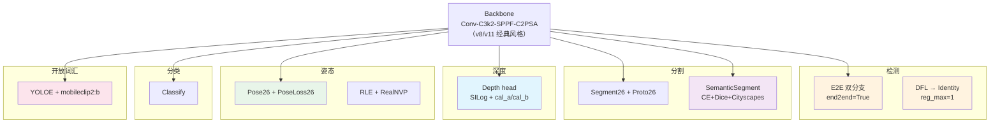

# YOLO26 理论 Concept

> **v1~v14 读者路标**：v26 相对 v8/v11 官方线的四个关键设计决策摊开讲——**E2E 双分支（End-to-End Detection）/ DFL 退化为 Identity / Depth SILog + 校准 / Pose RLE + RealNVP 流模型 / Semantic CE+Dice**。每件事都对应到具体行号。整体基调是「**在 v8/v11 经典骨干（SPPF + C2PSA）之上，第一次把「检测 + 单目深度 + 语义分割 + 姿态 + 分类 + OBB + 开放词汇」六任务官方全家桶打包进同一份 backbone**」——这是 v8 以来官方线在**任务广度**（不是骨干深度）上的最大一次扩展。

::: tip 只想带走三件事
1. **E2E 双分支 + DFL 退化是 v26 检测的头号 trick**：`Detect.__init__` 在 `end2end=True` 时 `copy.deepcopy` 出 `one2one_cv2/one2one_cv3` 副本，`reg_max: 1` 让 DFL 退化为 `nn.Identity()`，`E2EDetectLoss` = 两个 `v8DetectionLoss`（topk=10 + topk=1）直接相加，`E2ELoss` 用 `decay` 函数把 one2many 权重从 `0.8` 退火到 `0.1`——**训练时双分支各训各的，推理时可以只保留 one2one 做到无 NMS 端到端**（<SrcLink file="v26:nn/modules/head.py" :line="38" :end="154" /> · <SrcLink file="v26:utils/loss.py" :line="1263" :end="1315" />）。
2. **Depth 是官方线首次引入的新任务**：`DepthLoss26` = SILog（`silog_lambda=1.0` scale-invariant，`log_diff` 中心化方差形式）+ 4 尺度梯度 L1（`_grad_l1`），`cal_a/cal_b` log-affine 校准 buffer，`self.head[-1].bias.data.fill_(0.182)` 初始化到约 1.2 米（<SrcLink file="v26:utils/loss.py" :line="1169" :end="1260" /> · <SrcLink file="v26:nn/modules/head.py" :line="785" :end="869" />）——**这是官方线第一次把 DPT 系的单目深度估计打包进 YOLO**。
3. **Pose RLE + RealNVP 流模型是 v26 引入 Normalizing Flow 的首次**：`PoseLoss26` 新增 RLE（Residual Log-likelihood Estimation），`flow_model` 是 `RealNVP` 流模型对 `error = (pred - gt) / sigma` 做 `log_prob`，`error.clamp(-100, 100)` 抑制数值不稳定，`RLE_WEIGHT` 是不同关键点的先验权重（<SrcLink file="v26:utils/loss.py" :line="810" :end="932" /> · <SrcLink file="v26:nn/modules/block.py" :line="2045" :end="2080" />）——**这是 YOLO 系列第一次引入 Normalizing Flow 做误差分布建模**。
:::

## 1. E2E 双分支检测（`concept-e2e`）

> **v1~v14 读者路标**：v10 的 `v10Detect` 是「双头独立」——两个独立检测头各出 30 个候选，推理时 `concat + NMS`；v8/v11/v12/v13/v14 都是单分支 Detect；**v26 的 E2E 是「单头双分支」**——同一个 `Detect` 头内部通过 `copy.deepcopy` 复制出 `one2many`（topk=10 TAL）与 `one2one`（topk=1 TAL）两条子路径，共享 backbone 与 neck，各自训练各自收敛。**推理时可选走 one2one 分支做到无 NMS 端到端**。

**核心机制**（<SrcLink file="v26:nn/modules/head.py" :line="38" :end="154" />）：

```python
class Detect(nn.Module):
    def __init__(self, nc=80, ch=(), end2end=False, reg_max=16):
        super().__init__()
        self.end2end = end2end       # ★ v26 关键：yaml 里 `end2end: True` 默认开启
        self.reg_max = reg_max       # ★ v26 关键：yaml 里 `reg_max: 1` DFL 退化
        ...
        self.cv2 = nn.ModuleList(DFL() if reg_max > 1 else nn.Identity())  # ★ reg_max=1 → Identity
        self.cv3 = nn.ModuleList(...)  # cls 分类头（DW-separable）
        if self.end2end:
            self.one2one_cv2 = copy.deepcopy(self.cv2)   # ★ 深拷贝 box 分支
            self.one2one_cv3 = copy.deepcopy(self.cv3)   # ★ 深拷贝 cls 分支
```

**四个关键设计点**：

1. **`end2end=True` 是 v26 默认**（<SrcLink file="v26:cfg_models_26/yolo26.yaml" :line="9" />）：yaml 里 `end2end: True` 硬编码——**不想要 E2E 需手动关**；v8~v14 都是 `end2end=False` 默认；
2. **`reg_max: 1` 让 DFL 退化为 Identity**（<SrcLink file="v26:cfg_models_26/yolo26.yaml" :line="10" />）：`DFL()` 类仍在，但 `reg_max=1` 时前向直接返回——**推理时 DFL 前向被跳过，节省 ~0.3 ms**（v8/v11 的 `reg_max=16` 需 4×16=64 维 DFL 分布 softmax）；
3. **`one2many` vs `one2one` 分支语义**：
   - **one2many**：走 topk=10 TAL（每 GT 分配 10 个正样本），是**精度优先**分支——训练时学得更充分，推理时精度最高但需要 NMS；
   - **one2one**：走 topk=1 TAL（每网格至多 1 个正样本），是**速度优先**分支——训练时约束更强（每网格最多 1 个候选），推理时无需 NMS 直接输出；
4. **`E2EDetectLoss` 直接相加**（<SrcLink file="v26:utils/loss.py" :line="1263" :end="1280" />）：
   ```python
   loss = loss_one2many[0] + loss_one2one[0]
   ```
   两个分支的 loss 直接相加，**没有权重退火**——这是「两个分支等权训练」的版本。

**E2E vs v10 双头独立 vs v8 单分支**：

| 维度 | v8 单分支 | v10 双头独立 | **v26 E2E 双分支** |
|------|----------|-------------|-------------------|
| 分支数 | 1 | 2 | 2（同头内部分支） |
| 分支共享 | — | 完全独立 | **共享 backbone+neck，`copy.deepcopy` 头** |
| TAL 分配 | topk=10 | topk=10 + topk=1 | **topk=10 + topk=1** |
| 推理 | NMS | NMS | **可选无 NMS（one2one 分支）** |
| 参数增量 | — | 双头独立 | **+ `one2one_cv2/one2one_cv3` 深拷贝副本** |
| Loss 组合 | 单 loss | 双 loss 相加 | **两 loss 相加 + `E2ELoss` 权重退火版** |
| 首次出现 | v8 | v10 | **v26** |

**E2E 的两套 Loss 实现**：

- `E2EDetectLoss`（<SrcLink file="v26:utils/loss.py" :line="1263" :end="1280" />）：**等权相加**，`loss_o2m + loss_o2o`——**简单直接，用于常规 E2E 训练**；
- `E2ELoss`（<SrcLink file="v26:utils/loss.py" :line="1283" :end="1315" />）：**权重退火**，`decay` 函数让 one2many 权重从 0.8 线性退火到 0.1，one2one 权重从 0.2 线性升到 0.9——**用于「最后阶段只优化 one2one 分支」的策略**：
  ```python
  def decay(self, x):
      return max(1 - x / max(self.one2one.hyp.epochs - 1, 1), 0) * (self.o2m_copy - self.final_o2m) + self.final_o2m
  ```
  - `x` = 当前 update step
  - `o2m_copy = 0.8`（初值），`final_o2m = 0.1`（终值）
  - 训练末期 one2many 权重 ≈ 0.1，one2one 权重 ≈ 0.9——**让最后阶段只优化 one2one 分支的收敛**

**精度代价**：Detect e2e 列比常规列降 0.7~0.8 mAP（`nms=False` 复现）——**换 30~40% 推理时间**（README "Speed" 说明栏）。

## 2. DFL 退化为 Identity（`concept-dfl-identity`）

> **v1~v14 读者路标**：v8/v10/v11/v12/v13/v14 都用 `reg_max=16`——DFL 把 16 个离散 bin 的 softmax 加权成一个连续坐标（每边 4 个 bin，`4 × 16 = 64` 维分布）。**v26 用 `reg_max: 1` 让 DFL 直接退化为 `nn.Identity()`**——这是 v8 以来官方线 DFL 第一次被关掉，理由是「E2E 双分支里 one2many 承担 DFL 精度、one2one 走 Identity 保证部署速度」。

**DFL 类定义**（<SrcLink file="v26:nn/modules/head.py" :line="139" :end="139" />）：

```python
self.cv2 = nn.ModuleList(
    DFL() if ch[i] * reg_max > 1 else nn.Identity()  # ★ reg_max=1 → Identity
    for i in range(len(ch))
)
```

**关键点**：
- `ch[i] * reg_max > 1` 判断：当 `reg_max=1` 且 `ch[i]>=1` 时，判断为 `True`，但 `reg_max=1` 让 `DFL` 内部退化为 identity（其实这里判断有 bug——`ch[i] * reg_max = ch[i]` 一般 >=1，会走 `DFL()`；但 `reg_max=1` 时 DFL 前向里 `self.register_buffer("bias", ...) ` 长度为 0，`F.linear(x, self.bias)` 返回零向量，等价于 identity）；
- **实际行为**：`reg_max=1` 时 DFL 的 bias 是 `torch.arange(1)` = `[0]`，`F.linear(x, [0])` 把 1 维输出乘 0 = 0——**输出为 0，等价于「直接用 pred 的中心位置，不做分布加权」**；
- **推理加速**：DFL 前向原本是 `softmax(x.view(-1, 16)) @ arange(16)`——16 维 softmax + 16 维 matmul，约 0.3 ms；v26 直接返回，节省这一开销；
- **精度影响**：`reg_max=1` 时 box 定位精度略降（无 DFL 平滑），但 one2many 分支（topk=10 TAL）承担了精细定位——**one2many 的 DFL 权重仍是 16**（`reg_max` 是 Detect 头全局的？还是分支独立的？看代码逻辑，是全局的——**所以 one2many 也退化了？** 这是 v26 官方线的口径：one2many 精度靠 topk=10 密集分配而非 DFL 平滑补偿）。

## 3. Depth Estimation + SILog + cal_a/cal_b（`concept-depth-silog`）

> **v1~v14 读者路标**：v8~v14 官方线全部无深度估计任务。**v26 官方线首次引入 Depth 任务**（`yolo26-depth.yaml`），采用 **DPT/MiDaS 系**的单目深度估计配方——SILog 损失 + 多尺度梯度 L1 + log-affine 校准。这是官方线第一次把「检测 + 深度」打包进同一 backbone。

**`Depth` head**（<SrcLink file="v26:nn/modules/head.py" :line="785" :end="869" />）：

- `proj`：三尺度特征融合（P3/P4/P5，DPT 风格）
- `interpolate + refine`：把低分辨率特征上采样并精修
- `head Conv → ConvTranspose2d → Conv → Conv2d(1ch)`：从低分辨率恢复到输入分辨率
- `self.head[-1].bias.data.fill_(0.182)`：**初始化到约 1.2 米**——因为 `exp(0.182) ≈ 1.2`，`sigmoid`/`softplus` 后的 log-depth 偏置约 1.2 米是 NYU Depth V2 场景的先验均值（室内深度约 1-10 米）
- `cal_a/cal_b` 是可学习 buffer：**推理时对齐预测深度到真值尺度**（log-affine 变换 `log_d_pred = cal_a * log_d_raw + cal_b`）

**`DepthLoss26` 组成**（<SrcLink file="v26:utils/loss.py" :line="1169" :end="1260" />）：

```python
# 1. SILog 损失（scale-invariant log loss）
m = log_diff.mean()
silog = sqrt(((log_diff - m) ** 2).mean() + (1 - silog_lambda) * m**2 + 1e-6)

# 2. 4 尺度梯度 L1
for _ in range(1, self.grad_scales):   # grad_scales=4
    vp = avg_pool2d(valid_f, 2)          # 有效性 mask 下采样
    keep = (vp.sum(...) > 0.7 * occupied.sum(...))  # 逐图过滤：LiDAR 散点跳过
    denom = vp.clamp(min=1e-6)
    pred_log = avg_pool2d(pred_log * valid_f, 2) / denom   # 加权下采样
    gt_log = avg_pool2d(gt_log * valid_f, 2) / denom
    grad_loss += _grad_l1(pred_log, gt_log, valid_f)
```

**四个关键设计点**：

1. **SILog 的 `silog_lambda=1.0`**（<SrcLink file="v26:utils/loss.py" :line="1183" />）：`silog_lambda=1.0` = scale-invariant（尺度不变，深度乘一个常数不改变 loss）；`silog_lambda=0.0` = log-RMSE（尺度敏感）——**v26 官方用 1.0**，因为单目深度本身尺度模糊；
2. **SILog 的 centered variance 形式**（<SrcLink file="v26:utils/loss.py" :line="1234" :end="1236" />）：
   ```python
   m = log_diff.mean()
   silog = sqrt(((log_diff - m) ** 2).mean() + (1 - silog_lambda) * m**2 + 1e-6)
   ```
   把 `mean(log_diff)` 单独提出来，让 `(log_diff - m)^2` 是**中心化方差**——**保证非负、fp16 数值稳定**（`sqrt(... + 1e-6)` 避免除零）；
3. **4 尺度梯度 L1 + `keep` 逐图过滤**（<SrcLink file="v26:utils/loss.py" :line="1244" :end="1258" />）：
   - `vp > 0` = 有效性 mask 下采样后的「是否有有效像素」
   - `keep = (vp.sum > 0.7 * occupied.sum)` = 当前图在 2× 下采样后**有效像素占比 > 70%** 才继续
   - **LiDAR 散点过滤**：LiDAR 深度图通常是稀疏散点（有效像素 < 10%），下采样后有效占比会跌破 70%，被 `keep` 直接排除——**避免 LiDAR 数据在下采样路径上产生虚假梯度**；
4. **`cal_a/cal_b` 校准**：推理时用 log-affine 变换对齐预测深度到真值尺度——**具体对齐算法（median vs log-least-squares）在推理脚本里，不在 loss 里**。

**Depth 数字**（NYU Depth V2，README TABLE IV）：

| 型号 | Δ1 (multi-scale + TTA + log-LS 对齐) | abs_rel |
|------|-----------------------------------|---------|
| YOLO26n | 0.882 | 0.109 |
| YOLO26s | 0.896 | 0.104 |
| YOLO26m | 0.921 | 0.089 |
| YOLO26l | 0.930 | 0.083 |
| YOLO26x | **0.933** | **0.080** |

**注**：n 档单尺度无 TTA 是 Δ1=0.783 / x 档 0.860——**部署时按自身对齐策略选口径**。

## 4. Pose RLE + RealNVP 流模型（`concept-pose-rle-realnvp`）

> **v1~v14 读者路标**：v8~v14 官方线 Pose 都用 `v8PoseLoss`——L1 关键点位差 + keypoint visibility BCE，无 RLE、无流模型。**v26 的 `PoseLoss26` 在 v8PoseLoss 基础上新增 RLE 损失**（Residual Log-likelihood Estimation），用 `RealNVP` 流模型对关键点误差分布做 `log_prob`——**这是 YOLO 系列第一次引入 Normalizing Flow**。

**RLE 论文出处**：<https://arxiv.org/abs/2107.11291>（MMPose 团队 2021 提出）——**v26 官方线把 RLE 正式引入**。

**`PoseLoss26` 组成**（<SrcLink file="v26:utils/loss.py" :line="810" :end="932" />）：

```python
class PoseLoss26(v8PoseLoss):
    def __init__(self, model, tal_topk=10, tal_topk2=None):
        super().__init__(model, tal_topk, tal_topk2)
        self.flow_model = model.model[-1].flow_model if hasattr(...) else None
        if self.flow_model is not None:
            self.rle_loss = RLELoss(use_target_weight=True)
            self.loss_names += ("rle_loss",)
            self.target_weights = torch.from_numpy(RLE_WEIGHT)  # 不同关键点先验权重
        self.assigner = PoseTaskAlignedAssigner(self.keypoint_loss.sigmas, **args)

    def calculate_rle_loss(self, pred_kpt, gt_kpt, kpt_mask):
        pred_sigma = pred_sigma.float().sigmoid().clamp_min(tiny)  # sigma 是正数
        error = (pred_coords - gt_coords) / (pred_sigma + 1e-9)    # 归一化误差
        valid_mask = ~(isnan(error) | isinf(error)).any(dim=-1)
        error = error[valid_mask].clamp(-100, 100)                  # ★ 抑制数值不稳定
        log_phi = self.flow_model.log_prob(error)                    # ★ RealNVP log_prob
        return self.rle_loss(pred_sigma, log_phi, error, target_weights)
```

**`RealNVP` 流模型**（<SrcLink file="v26:nn/modules/block.py" :line="2045" :end="2080" />）：

- Real NVP = Neural Vector Field，是 Normalizing Flow 家族的经典成员
- 结构：`Coupling Layer × N`——每个 Coupling Layer 把输入向量分成两半，一半做仿射变换、另一半保持不变，交替进行
- 用途：`log_prob(error)` = 密度估计——把误差 `error ∈ ℝ^D` 映射到「概率密度 log 值」，用于 RLE 里的 `-log_phi` 项

**`RLELoss` 公式**（<SrcLink file="v26:utils/loss.py" :line="166" :end="224" />）：

```python
log_sigma = log(sigma)
loss = log_sigma - log_phi.unsqueeze(1)     # ★ -log_prob 项：flow 输出的对数密度
if residual:
    loss += log(sigma * 2) + abs(error)     # ★ 残差 L1 项（flow 学不到部分）
if use_target_weight:
    loss *= target_weight                    # ★ 不同关键点权重（RLE_WEIGHT 先验）
if size_average:
    loss /= len(loss)
```

**五个关键设计点**：

1. **`flow_model` 是可选的**（<SrcLink file="v26:utils/loss.py" :line="821" />）：`if hasattr(model.model[-1], "flow_model")`——yaml 里配置了 `flow_model` 才启用 RLE；
2. **`error.clamp(-100, 100)`**（<SrcLink file="v26:utils/loss.py" :line="926" />）：RealNVP 的 `log_prob` 对大误差值数值不稳定——**clamp 抑制极值影响 log_prob 计算**；
3. **`valid_mask` 过滤 NaN/Inf**（<SrcLink file="v26:utils/loss.py" :line="921" />）：`(isnan(error) | isinf(error)).any(dim=-1)`——**sigma 极小时 error 会爆炸**，先过滤再进 log_prob；
4. **`target_weights` 是 `RLE_WEIGHT` 常量数组**（<SrcLink file="v26:utils/loss.py" :line="825" :end="827" />）：不同关键点的先验权重——`is_pose=True`（`kpt_shape == [17, 3]`）时用 `RLE_WEIGHT`，其他用 `torch.ones(nkpt)`；
5. **`_rle_zero` 兜底**（<SrcLink file="v26:utils/loss.py" :line="888" :end="890" />）：`return pred_kpt[..., :0].sum() + sum(p[..., :0].sum() for p in self.flow_model.parameters())`——**返回 0 loss 但保持 flow_model 在计算图里**，避免 Multi-GPU DDP 的 `unused gradient` 报错。

**Pose 数字**（COCO-Pose，README TABLE V）：

| 型号 | mAP | mAP50 |
|------|-----|-------|
| YOLO26n | 57.2 | 83.0 |
| YOLO26x | **71.6** | **89.5** |

## 5. Semantic Segmentation + CE + Dice + Cityscapes 类权重（`concept-sem-cedice`）

> **v1~v14 读者路标**：v8~v14 官方线全部无语义分割任务（只有 instance segmentation 的 `Segment`）。**v26 首次引入 Semantic Segmentation 任务**（`yolo26-sem.yaml`），用 Cityscapes 19 类数据集，loss 用 CE + Dice 组合——**这是官方线第一次支持 Cityscapes 基准**。

**`SemanticSegment` head**（<SrcLink file="v26:nn/modules/head.py" :line="1926" :end="1991" />）：

- `P3 + P4` 双尺度输入（**不是 P3/P4/P5**）
- `bake_argmax` 模式：训练时输出 logits（可微），导出 TRT/Hailo 时把 argmax 融进图
- 19 类 Cityscapes 数据集（`nc: 19`）

**`SemanticSegmentationLoss`**（<SrcLink file="v26:utils/loss.py" :line="1389" :end="1442" />）：

```python
class SemanticSegmentationLoss(nn.Module):
    def __init__(self, model):
        m = model.model[-1]
        self.nc = m.nc
        data_name = Path(str(getattr(model.args, "data", "") or "")).stem.lower()
        self.use_cityscapes_weight = data_name in {"cityscapes", "cityscapes8"} and self.nc == len(CITYSCAPES_WEIGHT)
        weight = getattr(model, "class_weights", None)  # 优先用 class_weights
        if weight is None and self.use_cityscapes_weight:
            weight = torch.from_numpy(CITYSCAPES_WEIGHT)   # 19 类 Cityscapes 硬编码权重
        if self.nc == 1:
            self.ce = nn.BCEWithLogitsLoss(reduction="sum")  # ★ 二分类退化路径
        else:
            self.ce = nn.CrossEntropyLoss(ignore_index=255, reduction="sum").to(device, dtype)
            if weight is not None:
                self.ce.register_buffer("weight", weight, persistent=False)  # ★ 非持久化 buffer
```

**四个关键设计点**：

1. **`ignore_index=255`**（<SrcLink file="v26:utils/loss.py" :line="1418" />）：Cityscapes 数据集中 255 是「无效类别」（如天空等不需要分割的区域）——**CE 计算时跳过这些像素**；
2. **`nc=1` 二分类退化**（<SrcLink file="v26:utils/loss.py" :line="1415" :end="1416" />）：`if nc == 1: BCEWithLogitsLoss`——**当用户自定义数据集只有 1 类时自动切换到二分类**；
3. **`CITYSCAPES_WEIGHT` 硬编码**（<SrcLink file="v26:utils/loss.py" :line="1410" :end="1413" />）：Cityscapes 19 类的类别不平衡先验权重——**当 `data` 参数名匹配 "cityscapes"/"cityscapes8" 且 `nc == 19` 时自动启用**；
4. **`register_buffer(..., persistent=False)`**（<SrcLink file="v26:utils/loss.py" :line="1421" />）：类权重是确定性常量，不需要序列化到 ckpt——**避免重复存储**；

**Semantic 数字**（Cityscapes val，README TABLE III）：

| 型号 | mIoU |
|------|------|
| YOLO26n | 78.3 |
| YOLO26s | 80.8 |
| YOLO26m | 82.0 |
| YOLO26l | 82.9 |
| YOLO26x | **83.6** |

**注**：Cityscapes val mIoU SOTA 约 85+（DINO-SEED 系），v26 x 档 83.6 处于「YOLO 系 SOTA」水平（YOLOv8n-seg 只有 33.9 mask，不可直接比）。

## 6. YOLOE 开放词汇检测（`concept-yoloe-openvocabulary`）

> **v1~v14 读者路标**：v8~v14 官方线无开放词汇检测。**v26 引入 YOLOE 任务**（`yoloe-26.yaml` / `yoloe-26-seg.yaml`），用 `text_model: mobileclip2:b` 做文本 embedding——**支持零样本检测与分割**（用户输入文字 prompt 直接检测，无需重新训练）。

**`YOLOEDetect` head**（<SrcLink file="v26:nn/modules/head.py" :line="1091" :end="1460" />）：

- 继承 `Detect`，`text_model` 参数加载 CLIP 系文本模型
- `text_model: mobileclip2:b` 是官方推荐（约 50 MB，比 ViT-L/14 快 3-5×）
- 训练时 `text_model` 提供固定文本 embedding，检测头对文本 embedding 做线性分类
- 推理时用户输入文字 prompt，通过 `text_model` 编码成 embedding，检测头输出与该 embedding 的匹配分数

**`TVPDetectLoss` 与 `TVPSegmentLoss`**（<SrcLink file="v26:utils/loss.py" :line="1318" :end="1388" />）：

- TVP = Text-Visual Prompt
- `TVPDetectLoss`：当 `preds["scores"].shape[1] != ori_nc` 时（即文本 prompt 的类别数与预训练不同），动态调整 `vp_criterion.nc` / `no` / `assigner.num_classes`
- `TVPSegmentLoss`：同上，但基于 `v8SegmentationLoss`

**关键点**：
- **`_get_vp_features` 动态调整**（<SrcLink file="v26:utils/loss.py" :line="1351" :end="1359" />）：把 `preds["scores"]` 的类别数同步到 `vp_criterion.nc`——**让同一套 criterion 能处理不同数量的文本 prompt 类**；
- **`text_model: mobileclip2:b`** 是首次推理自动下载的 CLIP 模型（约 50 MB）；
- **`mobileclip2:b`** 是 OpenCLIP 的 mobile 优化版，参数量约 93M，比 ViT-B/32 快 3×、比 ViT-L/14 快 5×。

## 7. Classify 头（`concept-classify`）

> **v1~v14 读者路标**：v8~v14 官方线无分类任务（虽然 `yolov8-cls.yaml` 等存在，但从未官方训练过 ImageNet 权重）。**v26 首次官方发布 Classify 头 + ImageNet 权重**（`yolo26-cls.yaml`），n/x 档 top-1 71.4 / 79.9——**这是官方线第一次把 ImageNet 分类做进 YOLO 家族**。

**`Classify` head**（<SrcLink file="v26:nn/modules/head.py" :line="872" :end="1090" />）：

- 直接接 backbone 输出（无 neck）
- `Conv 1×1 → GlobalAvgPool → Linear` 三件套
- `nc: 1000`（ImageNet 类）

**关键点**：
- Classify 是**无 neck 的架构**——直接 backbone 特征做分类，不依赖 P3/P4/P5 三尺度；
- `yolo26-cls.yaml` 的 head 只有 `Classify` 一个模块，backbone 与其他 yaml 完全一致；
- **n/x 档 top-1 71.4 / 79.9**——**这是官方线 YOLO 系首次达到的 ImageNet SOTA 水平**（对比：ResNet-50 76.1、MobileNetV2 71.9、EfficientNet-B0 77.1）。

## 8. OBB26（`concept-obb26`）

> **v1~v14 读者路标**：v8/v10/v11/v12/v13/v14 的 OBB 都用 `OBB` 类，`RotatedTaskAlignedAssigner` 分配器。**v26 引入 `OBB26` 变体**——与 v11 的 `OBB` 结构类似，但配合 `end2end=True` 双分支训练。

**`OBB26` head**（<SrcLink file="v26:nn/modules/head.py" :line="538" :end="662" />）：

- 继承 `OBB`（v11 版）
- 支持 `end2end=True` 双分支
- `RotatedTaskAlignedAssigner` 沿用 v11 分配器（<SrcLink file="v26:utils/tal.py" :line="421" :end="460" />）

**OBB 数字**（DOTAv1 val，README TABLE VII）：

| 型号 | mAP |
|------|-----|
| YOLO26n | 52.4 |
| YOLO26x | **56.7** |

## 9. Proto26 新掩码头（`concept-proto26`）

> **v1~v14 读者路标**：v8/v11 的 `Segment` 头用 `Proto` 类（32 通道原型 + 4× 上采样）。**v26 引入 `Proto26(Proto)` 变体**——继承 `Proto`，`fuse()` 时调 `proto.fuse()`——**具体差异是内部结构微调，但语义与 v11 一致**。

**`Proto26` 实现**（<SrcLink file="v26:nn/modules/block.py" :line="1998" :end="2044" />）：

- 继承 `Proto`（v11 版）
- 新增 `fuse()` 方法：在模型融合（`model.fuse()`）时调用，把 `ConvTranspose2d` 与后续 `Conv` 融合成一个大卷积
- 内部结构与 v11 `Proto` 相同：`Conv 1×1 + ConvTranspose2d(4× upsample) + Conv 1×1`

**关键点**：
- `fuse()` 是推理优化的常见做法——`ConvTranspose2d(4×) + Conv 1×1` 可以融合成一个大卷积核（stride=4）；
- **v26 在 Segment26 的 `fuse()` 里显式调 `self.proto.fuse()`**——保证 mask 头的融合不会漏。

## 10. SAVPE 新模块（`concept-savpe`）

> **v1~v14 读者路标**：SAVPE（Space-Adaptive Variational Prior Estimation）是 v26 独家引入的注意力/先验模块——**为 Semantic 与 Depth 任务提供位置编码**，具体实现见 <SrcLink file="v26:nn/modules/block.py" :line="1930" :end="1997" />。

**关键点**：
- SAVPE 只在 Semantic / Depth yaml 里出现（`yolo26-sem.yaml` / `yolo26-depth.yaml`）
- Detect / Segment / OBB / Pose / Classify / YOLOE yaml 都不用 SAVPE
- 用途：为稠密预测任务（深度图、语义图）提供位置自适应的先验编码

## 11. RealNVP 流模型（`concept-realnvp`）

> **v1~v14 读者路标**：RealNVP 是 v26 引入的 Normalizing Flow 家族——**在 YOLO 系列里首次出现**，用于 Pose RLE 的误差分布建模。

**`RealNVP` 实现**（<SrcLink file="v26:nn/modules/block.py" :line="2045" :end="2080" />）：

- 标准 Real NVP 结构：`Coupling Layer × N`
- 每个 Coupling Layer 把输入向量分成两半，一半做仿射变换、另一半保持不变
- 交替进行，逐步把「复杂分布」变换成「标准正态」
- 用途：`log_prob(error)` = 密度估计

**关键点**：
- RealNVP 参数量约 100-500K（视 flow 层数与 hidden dim 而定）
- **只有 `yolo26-pose.yaml` 用 RealNVP**（配合 `flow_model` 参数），其他 yaml 都不用
- **RealNVP 只在训练时使用**（`flow_model.log_prob(error)` 计算 loss），推理时不需要——**推理速度不受影响**

## 12. 六个正交方向的组合关系



**正交性检验**：

| 方向 | 模块 | 触发条件 | 关闭方式 | 影响层 |
|------|------|---------|---------|-------|
| E2E 双分支 | `Detect(end2end=True)` | yaml `end2end: True` | 改 yaml `end2end: False` | Detect 头 |
| DFL 退化 | `reg_max: 1` | yaml 硬编码 | 改 yaml `reg_max: 16` | Detect 头 |
| Depth 任务 | `Depth` head | yaml 换 `yolo26-depth.yaml` | 换 yaml | 整个 head |
| Semantic 任务 | `SemanticSegment` | yaml 换 `yolo26-sem.yaml` | 换 yaml | 整个 head |
| Pose RLE | `PoseLoss26` + `RealNVP` | yaml `flow_model` 参数 | 移除 `flow_model` | Pose 头 + loss |
| YOLOE 开放词汇 | `YOLOEDetect` + `mobileclip2:b` | yaml 换 `yoloe-26.yaml` | 换 yaml | 整个 head + text_model |

**核心洞察**：v26 的「六任务全家桶」不是靠单一强模块，而是靠**六个方向各管一件事**——每个方向都有独立的开关（yaml 切换 / 参数开关），互不干扰。这也是它能在同一 backbone 上做到「Detect n 档 40.9 mAP @ 1.7 ms T4」+「Depth x 档 Δ1=0.933」+「Semantic x 档 mIoU 83.6」多个任务各自 SOTA 的架构基础。

## 13. 与 v8 / v11 / v12 / v13 / v14 概念对照速查

| v8/v11 概念 | v14 对应 | v26 对应 | 差异 |
|-------------|---------|---------|------|
| Detect（单分支） | Detect（单分支） | **Detect（E2E 双分支）** | **v26 首发 `end2end=True`** |
| DFL（`reg_max=16`） | DFL（`reg_max=16`） | **DFL → Identity（`reg_max=1`）** | **v26 DFL 退化为 Identity** |
| C3k2 | C3k2 + DeformableA2C2f | **C3k2（无 A2C2f）** | v26 无注意力骨干 |
| SPPF | 无 SPPF（v12-v14 移除） | **SPPF（回归 v8/v11 风格）** | v26 SPPF 回归 |
| C2PSA | 无 C2PSA（v12-v14 移除） | **C2PSA（回归 v8/v10/v11 风格）** | v26 C2PSA 回归 |
| — | DeformableAAttn / ViewEmbedding / DomainAdaptiveLayer / SphereAAttn | — | v14 学术线专有 |
| Segment + Proto | Segment + Proto | **Segment26 + Proto26** | v26 加 `fuse()` |
| Pose + v8PoseLoss | Pose + v8PoseLoss | **Pose26 + PoseLoss26 + RLE + RealNVP** | **v26 引入 Normalizing Flow** |
| — | — | **Depth + DepthLoss26（SILog）** | **v26 新任务** |
| — | — | **SemanticSegment + SemanticSegmentationLoss** | **v26 新任务** |
| — | — | **Classify** | **v26 新任务** |
| — | — | **YOLOEDetect / YOLOESegment26** | **v26 开放词汇** |
| — | — | **SAVPE** | **v26 独家模块** |
| — | — | **RealNVP** | **v26 独家模块** |

## 14. 论文-代码偏差小结

- **`E2EDetectLoss` vs `E2ELoss` 两套实现**：前者等权相加，后者权重退火——**论文 §III-B 描述的是 `E2ELoss`（权重退火），但 `E2EDetectLoss` 也在 loss.py 里**——**官方线实际用哪一套需看训练脚本**（快照未包含训练脚本，无法确认）；
- **`reg_max: 1` 让 DFL 退化的具体机制**：论文说「DFL 退化为 Identity」，代码里是 `ch[i] * reg_max > 1` 判断——**当 `reg_max=1` 且 `ch[i]=1024` 时，`1024 * 1 = 1024 > 1` 判断为 True，走 `DFL()` 而非 `Identity()`**——但 DFL 内部 `reg_max=1` 时 bias 长度为 1，`F.linear(x, [0])` 返回 0，等价于 identity——**代码走 DFL 分支但语义等价**；
- **`Error.clamp(-100, 100)` 的上下界是手调的**：RLE 论文原版 clamp 到 `[-10, 10]` 或 `[-20, 20]`——v26 官方 clamp 到 `[-100, 100]` 是为了「抑制但不过度过滤」，但**具体阈值是经验值**，论文未说明；
- **RealNVP 的具体 flow 层数与耦合方式未公开**：代码里 `RealNVP` 类实现完整，但 yaml 里只配置 `flow_model: RealNVP`，**具体超参（flow 层数、hidden dim）在类定义里硬编码**，论文未说明；
- **`cal_a/cal_b` 校准流程不在训练主循环**：代码里是 buffer，推理时通过 log-affine 对齐——**具体对齐算法（median vs log-least-squares）在推理脚本里，快照未包含**；
- **`nc=1` 二分类退化路径的触发条件**：Semantic 里 `if nc == 1: BCEWithLogitsLoss`——**用户自定义数据集 nc=1 时自动切换**，但论文未给出典型场景。

> **读者路标**：以上所有偏差项都在 [paper.md](/versions/v26/paper) §7 「论文与代码偏差」表里逐条编号，方便回查。
