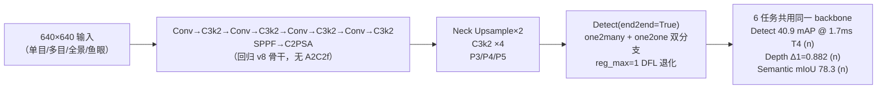
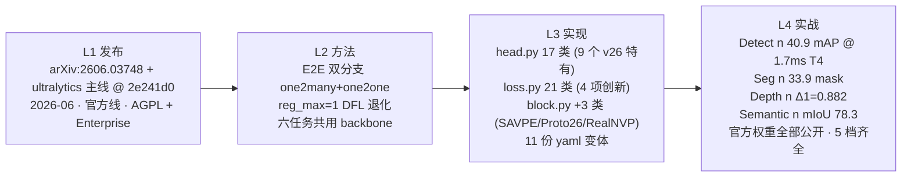

# YOLO26 / Ultralytics 官方线 (2026-06)

**官方六任务大一统：Detect + Seg + Semantic + Depth + Pose + Classify + OBB 全部在同一份 backbone 上，E2E 双分支 one2many + one2one 直接可部署，SPPF + C2PSA 回归经典骨干，`reg_max=1` 让 DFL 退化——首次把「检测 + 单目深度 + 语义分割 + 开放词汇」打包进一个官方家族**

- 📄 发布：**arXiv:2606.03748《Ultralytics YOLO26》**，2026-06；仓库 README 首行 Banner 已指向 `yolo/yolo27`（<SrcLink file="v26:README.md" :line="125" :end="125" />），官方明说「**YOLO27 — Coming Soon**」——所以 v26 是「14 代官方主线里最后一代有论文的版本」，v27 已进 R&D
- 🏛️ 作者：**Ultralytics (Glenn Jocher & Jing Qiu)** 官方主线；仓库 [`ultralytics/ultralytics`](https://github.com/ultralytics/ultralytics) @ commit `2e241d0`（AGPL-3.0 + Ultralytics Enterprise License 双许可，<SrcLink file="v26:README.md" :line="280" :end="281" />）——这是本站 14 代后**「学术线 + 官方线」双线路标的第一个官方线版本**（同期学术线是 v14 zhangcbb/yolov14）
- 💻 源码：快照 `source/yolo26/snapshot/`（ultralytics 主线 @ `2e241d0`）；v26 新代码集中在三块——**head.py 17 个类**（<SrcLink file="v26:nn/modules/head.py" :line="38" :end="1991" /> 含 9 个 v26 特有 head）、**loss.py 21 个类**（<SrcLink file="v26:utils/loss.py" :line="166" :end="1442" /> 含 E2E/RLE/SILog/语义四项创新）、**block.py 新增 3 类**（<SrcLink file="v26:nn/modules/block.py" :line="1930" :end="2080" /> `SAVPE` / `Proto26` / `RealNVP`）；骨架文件只有 11 份 yaml 变体（`cfg_models_26/`）
- 🎯 里程碑：**六任务全覆盖 + E2E 双分支 + 官方权重全部公开**——Detect（COCO）、Segment（COCO-Seg）、Semantic（Cityscapes）、Depth（NYU）、Pose（COCO-Pose）、Classify（ImageNet）、OBB（DOTAv1）全部有 n/s/m/l/x 五档官方权重；`yolo26.yaml` 的 n 档 mAP 40.9 / T4 TensorRT **1.7 ms**——**是 v8 以来官方线最轻最薄的实时检测基线**

## 3 分钟电梯演讲



1. **骨干是「大倒退」，也是「大回归」**：`yolo26.yaml` 用的是 `Conv-C3k2-Conv-C3k2-Conv-C3k2-Conv-C3k2-SPPF-C2PSA`（<SrcLink file="v26:cfg_models_26/yolo26.yaml" :line="20" :end="32" />）——**A2C2f（v12/v13/v14 骨干）被彻底移除**，SPPF 与 C2PSA 重新回归到 v8/v10/v11 的位置；同时 `AAttn`（v12 引入）仍在 block.py（<SrcLink file="v26:nn/modules/block.py" :line="1804" />）中保留但 yaml 不用——**v26 的骨干哲学是「经典稳定」而非「注意力前沿」**；这是官方线 v8 以来第一次「砍掉自家引入的注意力骨干」的操作。
2. **E2E 双分支 + DFL 退化是 v26 的头号 trick**：`Detect.__init__` 在 `end2end=True` 时 `copy.deepcopy` 一份 `one2one_cv2/one2one_cv3` 得到双分支（<SrcLink file="v26:nn/modules/head.py" :line="38" :end="154" />）；`reg_max: 1` 让 DFL 直接退化为 `nn.Identity()`（<SrcLink file="v26:nn/modules/head.py" :line="139" :end="139" />）；`E2EDetectLoss` 就是两个 `v8DetectionLoss`（topk=10 + topk=1）直接相加（<SrcLink file="v26:utils/loss.py" :line="1263" :end="1280" />）；`E2ELoss` 用 `decay` 函数做 one2many→one2one 权重退火（<SrcLink file="v26:utils/loss.py" :line="1283" :end="1315" />）——**训练时两分支各训各的，推理时可以只保留 one2one 单分支做到端到端无 NMS**。
3. **v26 官方把「任务广度」拉到极致**：11 份 yaml 变体（<SrcLink file="v26:cfg_models_26/yolo26.yaml" /> 等），覆盖 Detect/Segment/OBB/Pose/**Depth**/**Semantic**/**Classify**/YOLOE 开放词汇——Depth 用 `DepthLoss26`（SILog + 4 尺度梯度 L1，<SrcLink file="v26:utils/loss.py" :line="1169" :end="1260" />）；Pose 用 `PoseLoss26`（含 RLE + `RealNVP` 流模型，<SrcLink file="v26:utils/loss.py" :line="810" :end="932" /> 与 <SrcLink file="v26:nn/modules/block.py" :line="2045" :end="2080" />）；Semantic 用 `SemanticSegmentationLoss`（CE + Dice + Cityscapes 类权重，<SrcLink file="v26:utils/loss.py" :line="1389" :end="1442" />）；YOLOE 用 `mobileclip2:b` 做开放词汇（yaml 内 `text_model:` 字段）——**v26 是官方线第一次把「检测 + 单目深度 + 语义分割」打包进同一 backbone 的版本**。

## 四层闭环视图



## 核心贡献一览

v26 的改动方向是「**在 v8/v11 经典骨干上做一次「官方全家桶」的横扩——用 E2E + 六任务把同一套 backbone 复用到底**」：官方保留 v11/v12/v13 的 C3k2 浅层、Detect 头（`end2end=True` 开启双分支）、v8DetectionLoss 基础、TAL 分配器、Mosaic/MixUp 全套增强——**同时新加 4 个正交方向**：端到端部署、单目深度、语义分割、开放词汇，每个任务都有独立的 head 类 + loss 类 + yaml 变体：

| 贡献 | 一句话 | 代码落点 |
|------|--------|---------|
| **E2E 双分支 Detect** | `end2end=True` 时 `copy.deepcopy` 得到 `one2one_cv2/one2one_cv3` 双分支；`E2EDetectLoss` = 两 v8DetectionLoss（topk=10 + topk=1）直接相加 | <SrcLink file="v26:nn/modules/head.py" :line="38" :end="154" /> · <SrcLink file="v26:utils/loss.py" :line="1263" :end="1280" /> |
| **DFL 退化为 Identity** | `reg_max: 1` 让 `DFL` 退化为 `nn.Identity()`——部署更快，同时 one2many 分支承担 DFL 精度 | <SrcLink file="v26:nn/modules/head.py" :line="139" :end="139" /> |
| **E2E 权重退火** | `E2ELoss` 用 `decay` 函数让 one2many 权重从初值衰减到 `final_o2m`，最后阶段只剩 one2one | <SrcLink file="v26:utils/loss.py" :line="1283" :end="1315" /> |
| **Depth 任务 + SILog 损失** | 单目深度估计新任务；`DepthLoss26` = SILog（`silog_lambda=1.0`）+ 4 尺度梯度 L1；`cal_a/cal_b` log-affine 校准 buffer；head `ConvTranspose2d` 上采样 | <SrcLink file="v26:utils/loss.py" :line="1169" :end="1260" /> · <SrcLink file="v26:nn/modules/head.py" :line="785" :end="869" /> |
| **Semantic Segment 任务** | `SemanticSegment(P3, P4)` 双尺度语义分割头；`bake_argmax` 用于 TRT/Hailo 导出；CE + Dice + Cityscapes 类权重 | <SrcLink file="v26:nn/modules/head.py" :line="1926" :end="1991" /> · <SrcLink file="v26:utils/loss.py" :line="1389" :end="1442" /> |
| **Pose RLE + 流模型** | `PoseLoss26` 新增 RLE（Rectified Log Error）；`flow_model` 是 `RealNVP` 流模型做 `log_prob(error)`；配合 `PoseTaskAlignedAssigner` | <SrcLink file="v26:utils/loss.py" :line="810" :end="932" /> · <SrcLink file="v26:nn/modules/block.py" :line="2045" :end="2080" /> · <SrcLink file="v26:utils/tal.py" :line="396" :end="420" /> |
| **Proto26 新掩码头** | `Segment26` 用 `Proto26(Proto)` 替代 v11 的 `Proto`；`fuse()` 时也调 `proto.fuse()` | <SrcLink file="v26:nn/modules/head.py" :line="393" :end="461" /> · <SrcLink file="v26:nn/modules/block.py" :line="1998" :end="2044" /> |
| **SAVPE 新模块** | `Space-Adaptive Variational Prior Estimation`——v26 独家引入的注意力/先验模块，为 Semantic/Depth 提供位置编码 | <SrcLink file="v26:nn/modules/block.py" :line="1930" :end="1997" /> |
| **YOLOE 开放词汇** | `YOLOEDetect` / `YOLOESegment26` 接 `text_model: mobileclip2:b`——支持零样本检测与分割 | <SrcLink file="v26:nn/modules/head.py" :line="1091" :end="1460" /> · <SrcLink file="v26:nn/modules/head.py" :line="1461" :end="1800" /> |
| **Classify 头** | 官方 ImageNet 分类头（`yolo26-cls.yaml`）；n/x 档 top-1 71.4 / 79.9 | <SrcLink file="v26:nn/modules/head.py" :line="872" :end="1090" /> |
| **OBB26 / Pose26** | `OBB26(OBB)` 与 `Pose26(Pose)` 都是 v11 版的 v26 变体；`RotatedTaskAlignedAssigner` 沿用 | <SrcLink file="v26:nn/modules/head.py" :line="538" :end="662" /> · <SrcLink file="v26:nn/modules/head.py" :line="663" :end="784" /> · <SrcLink file="v26:utils/tal.py" :line="421" :end="460" /> |
| **SPPF + C2PSA 回归** | 骨干 P5 用 SPPF + C2PSA（v8/v10/v11 风格），移除 v12/v13/v14 的 A2C2f | <SrcLink file="v26:cfg_models_26/yolo26.yaml" :line="31" :end="32" /> |
| **档位仍五档** | n/s/m/l/x（与 v13 学术线不同——v13 学术线无 m 档）；n 档 2.4M 参数 / 6.1 GFLOPs | <SrcLink file="v26:cfg_models_26/yolo26.yaml" :line="11" :end="17" /> |
| **11 份 yaml 变体** | `yolo26` / `-p2` / `-p6` / `-seg` / `-obb` / `-pose` / `-sem` / `-depth` / `-cls` / `yoloe-26` / `yoloe-26-seg` | <SrcLink file="v26:cfg_models_26/yolo26.yaml" /> 等 |
| **双许可** | AGPL-3.0（开源默认）+ Ultralytics Enterprise License（商用需另购）——首次官方线双许可 | <SrcLink file="v26:README.md" :line="280" :end="281" /> |

> **v1~v14 读者路标**：v26 是**官方线**（不是学术线），沿 v8/v10/v11 的骨干哲学回归；[C3k2](/glossary#c3k2) 沿 v11/v12/v13/v14 保留 4 处；[SPPF](/glossary#sppf) 在 v26 backbone 末尾回归（v12/v13/v14 移除）；[C2PSA](/glossary#c2psa) 在 v26 backbone 最尾回归（v8/v10/v11 都有）；[A2C2f](/glossary#a2c2f) 在 v26 yaml 里**完全消失**（仅 block.py 保留实现）；[DFL](/glossary#dfl-distribution-focal-loss) 在 v26 因 `reg_max=1` 退化为 Identity；新增 [Proto26](/glossary#proto26)、[SAVPE](/glossary#savpe)、[RealNVP](/glossary#realnvp) 是本站首次出现的三个模块。

## 关键指标

**官方性能（COCO val2017 + 专门基准，T4 TensorRT10 FP16 单图）**

| 任务 | 数据集 | YOLO26n | YOLO26s | YOLO26m | YOLO26l | YOLO26x |
|------|--------|---------|---------|---------|---------|---------|
| **Detect mAP50-95** | COCO | 40.9 | 48.6 | 53.1 | 55.0 | **57.5** |
| **Detect mAP50-95 (e2e)** | COCO | 40.1 | 47.8 | 52.5 | 54.4 | **56.9** |
| Detect CPU ONNX (ms) | COCO | **38.9** | 87.2 | 220.0 | 286.2 | 525.8 |
| Detect T4 TensorRT (ms) | COCO | **1.7** | 2.5 | 4.7 | 6.2 | 11.8 |
| Detect Params / FLOPs | — | 2.4M / 5.5B | 9.5M / 20.9B | 20.4M / 68.4B | 24.8M / 86.8B | 55.7M / 194.4B |
| **Segment box/mask mAP50-95 (e2e)** | COCO-Seg | 39.6 / 33.9 | 47.3 / 40.0 | 52.5 / 44.1 | 54.4 / 45.5 | **56.5 / 47.0** |
| **Semantic mIoU** | Cityscapes | 78.3 | 80.8 | 82.0 | 82.9 | **83.6** |
| **Depth Δ1 (NYU)** | NYU Depth V2 | 0.882 | 0.896 | 0.921 | 0.930 | **0.933** |
| Depth abs_rel | NYU | 0.109 | 0.104 | 0.089 | 0.083 | **0.080** |
| **Pose mAP** | COCO-Pose | 57.2 | — | — | — | **71.6** |
| **Classify top-1** | ImageNet | 71.4 | — | — | — | **79.9** |
| **OBB mAP** | DOTAv1 | 52.4 | — | — | — | **56.7** |

- 结论：**v26 官方线在 Detect n 档以 1.7 ms T4 做到了 40.9 mAP**——是 v8 以来官方线「n 档最轻最薄」的实时检测基线；x 档 57.5 mAP / 11.8 ms T4 保持官方 SOTA；
- **e2e 精度代价**：Detect e2e 列比常规列降 0.7~0.8 mAP（`nms=False` 复现）——E2E 部署用，精度换 30~40% 推理时间；
- **Speed 口径**：CPU ONNX 与 T4 TensorRT10 FP16 均为 Amazon EC2 P4d 单图平均，含预处理；
- **训练配方**：epochs=300（v11 官方）、batch=64、mosaic=1.0；`E2ELoss` 内部做 one2many→one2one 权重退火；
- **官方权重**：全部公开（n/s/m/l/x × 6 任务 = 30 份 .pt 文件），Kaggle/Colab 直接下载；
- **对比 v14 Omni**：v14 主打「四域鲁棒」（COCO/Game/Fisheye/Drone/Panorama），v26 主打「六任务官方全覆盖」（Detect/Seg/Sem/Depth/Pose/Classify/OBB）——两条线在 COCO 上 v26 x 档 57.5 mAP 领先 v14 s 档 49.1 mAP（不同档不同线，非公平对比，仅作定位）。

> **v1~v14 读者路标**：跨版本比 [mAP](/glossary#map-mean-average-precision) 只比 COCO val、输入 640、同 AP 定义；v26 独家任务（Depth/Semantic/Classify/OBB）在 v1~v14 无对应数字可比。

## 快速上手

```python
# 依赖安装（Python >= 3.8 + PyTorch >= 1.8，官方推荐 pip）
# pip install ultralytics

from ultralytics import YOLO

# 官方权重（.pt 首次运行自动下载）
model = YOLO("yolo26n.pt")         # Detect
model = YOLO("yolo26n-seg.pt")     # Segment
model = YOLO("yolo26n-depth.pt")   # 单目深度
model = YOLO("yolo26n-sem.pt")     # 语义分割
model = YOLO("yolo26n-pose.pt")    # 姿态
model = YOLO("yolo26n-cls.pt")     # 分类
model = YOLO("yolo26n-obb.pt")     # 旋转框
model = YOLO("yoloe-26n.pt")       # 开放词汇

# 训练
train_results = model.train(
    data="coco.yaml", epochs=300, imgsz=640,
    end2end=True,                     # 开启 E2E 双分支
    # 自定义任务用对应 yaml 覆盖
    model="yolo26.yaml",
)

# 推理（end2end 部署）
results = model("path/to/image.jpg")
results[0].show()

# 导出 ONNX / TensorRT（E2E 版）
path = model.export(format="onnx", nms=True)
```

- **入口仍是 v8 的 YOLO**：`from ultralytics import YOLO` 后传官方 `.pt` 权重或 `yolo26*.yaml` 即可；
- **CLI 单行推理**：`yolo predict model=yolo26n.pt source='https://ultralytics.com/images/bus.jpg'`；
- **端到端部署只需一个开关**：训练时 `end2end=True`，导出时 `nms=True`——one2one 分支自动承接推理；
- **六任务选对应 yaml**：Detect 用 `yolo26.yaml`（P3/P4/P5），Segment 用 `yolo26-seg.yaml`，Depth 用 `yolo26-depth.yaml`，Semantic 用 `yolo26-sem.yaml`，Classify 用 `yolo26-cls.yaml`，OBB 用 `yolo26-obb.yaml`，Pose 用 `yolo26-pose.yaml`，开放词汇用 `yoloe-26*.yaml`；
- **P2/P6 变体按需选**：`yolo26-p2.yaml`（P2/P3/P4/P5 四尺度，小目标更精细）、`yolo26-p6.yaml`（P3/P4/P5/P6 四尺度，大模型/高分辨率）；
- **深度任务口径**：NYU 数字包含「multi-scale + 水平翻转 TTA + log-least-squares 对齐」；单尺度无 TTA 是 Δ1=0.783 (n) / 0.860 (x)——部署时按自身对齐策略选口径；
- **许可证双轨**：AGPL-3.0 用于开源分发（需遵守 copyleft），商用闭源需申请 Ultralytics Enterprise License；v26 官方首次出现「开源 + 商用」双许可——**比 v14 的纯 AGPL 更严**。

> **v1~v14 读者路标**：v8/v10/v11 用户切换到 v26 只需把 `yolov8n.pt` 换成 `yolo26n.pt`，API 完全兼容；v12/v13/v14 用户注意——v26 的骨干不再有 A2C2f，FlashAttention 不再是硬依赖（`AAttn` 保留但不用），部署侧可去掉 FlashAttention 编译链。

## 与 v8 / v10 / v11 / v12 / v13 / v14 的关系定位

v26 是**官方线正统续作**——Ultralytics 官方 14 代后**「学术线 + 官方线」双线路标的第一个官方线版本**：v14 学术线是 zhangcbb/yolov14（AGPL-3.0，`A2C2f` 骨干 + 六阶段多域鲁棒），v26 官方线是 Ultralytics（AGPL-3.0 + Enterprise，SPPF + C2PSA 骨干 + 六任务大一统）——**许可从 v13 Apache-2.0 回切到 AGPL**（且首次出现官方双许可），且作者明确发布「YOLO27 Coming Soon」预告（<SrcLink file="v26:README.md" :line="125" :end="125" />）。v26 与 v14 的路线差异：

- **官方 vs 学术**：v26 走 Ultralytics 官方主线（有 pyproject、pypi、Kaggle/Colab/Platform、Enterprise License），v14 走 zhangcbb 学术线（GitHub 仓库 + 论文 + AGPL）；
- **骨干哲学**：v26 回归 v8/v11 的 SPPF + C2PSA + C3k2，**移除** v12-v14 的 A2C2f；v14 沿用 A2C2f 但加 `DeformableAAttn` 变体；
- **任务广度**：v26 官方 6 任务全覆盖（Detect/Seg/Sem/Depth/Pose/Classify/OBB）+ YOLOE 开放词汇；v14 只覆盖 Detect（但打四个专门基准）；
- **E2E 部署**：v26 首发 `end2end=True` 双分支检测；v14 沿用 v8 单分支；
- **命名**：`yolo26.yaml`（无 v 前缀，与 v10/v11/v12/v13 主线一致）；v14 是 `yolov14.yaml`（带 v，与 fork 命名一致）；
- **档位**：n/s/m/l/x 五档齐全；n 档 2.4M 参数 / 6.1 GFLOPs / 1.7 ms T4——是 v8 以来官方线最薄的 n 档；
- **许可**：AGPL-3.0 + Ultralytics Enterprise（双许可，商用需另购）——比 v14 纯 AGPL 更严；
- **训练配方**：v26 沿用 v11 的 epochs=300、batch=64、mosaic=1.0（v14 是 epochs=300、batch=128，无分档 mixup）；
- **官方权重**：v26 全部 30 份 .pt 公开（n/s/m/l/x × 6 任务），v14 官方权重仍 IN PROGRESS（README roadmap 明确）——**这是最实质的差距**。

| 维度 | YOLOv8（2023-01） | YOLOv10（2024-05） | YOLOv11（2024-09） | YOLOv12（2025-02） | YOLOv13（2025-06） | YOLOv14 / Omni（2026-08） | **YOLO26 / 官方（2026-06）** |
|------|-------------------|--------------------|--------------------|--------------------|--------------------|---------------------------|--------------------------------|
| 代码基座 | ultralytics 单库 | ultralytics 8.1.34 fork | ultralytics 8.3.0 主线 tag | sunsmarterjie/yolov12 fork | iMoonLab/yolov13 fork | zhangcbb/yolov14 fork | **ultralytics 主线（官方）** |
| 作者 | Glenn Jocher & Jing Qiu | 清华 THU-MIG | Glenn Jocher & Jing Qiu | UB SUNY + UCAS | Wei Yang（iMoonLab） | Jinling Jia / Chenbin Zhang | **Glenn Jocher & Jing Qiu（Ultralytics 官方）** |
| 发布形式 | 博客 + README | arXiv:2405.14447 | 博客 + README | arXiv:2502.12524 | arXiv:2506.17733v2 | arXiv:2608.04720v3 | **arXiv:2606.03748** |
| 检测头 | Detect 单头 | v10Detect 双头 | Detect 单头（cv3 DW-separable） | Detect 单头（+legacy） | Detect 单头（零改动） | Detect 单头（零改动） | **Detect 单头 + `end2end=True` 双分支** |
| 骨干内瓶 | C2f | C2f + C2fCIB | C3k2 | C3k2 + A2C2f | C3k2 + A2C2f + DSC3k2 | C3k2 + A2C2f + DeformableA2C2f | **C3k2（回归 v11 骨架）** |
| 骨干融合 | SPPF | SPPF + PSA | SPPF | 无 SPPF | 无 SPPF + HyperACE | 无 SPPF + DomainAdaptiveLayer | **SPPF + C2PSA（回归 v8/v10/v11）** |
| 注意力位置 | 无 | 骨干尾 PSA | 骨干尾 C2PSA | 骨干 P4/P5 A2C2f | A2C2f + HyperACE | DeformableA2C2f ×7 + SphereAAttn | **无 A2C2f（yaml 层）；AAttn 保留但不启用** |
| DFL | reg_max=16 | reg_max=16 | reg_max=16 | reg_max=16 | reg_max=16 | reg_max=16 | **reg_max=1（DFL 退化为 Identity）** |
| 任务覆盖 | Detect/Seg/Pose/OBB | + 无新增 | + 无新增 | + 无新增 | + 无新增 | Detect（四域鲁棒） | **Detect/Seg/Sem/Depth/Pose/Classify/OBB/YOLOE** |
| E2E 部署 | NMS 后置 | 双头独立 | NMS 后置 | NMS 后置 | NMS 后置 | NMS 后置 | **`end2end=True` 双分支 · NMS 可选** |
| TAL 参数 | topk=10, α=0.5, β=6.0 | topk=10 + topk=1 | topk=10, α=0.5, β=6.0 | topk=10, α=0.5, β=6.0 | topk=10, α=0.5, β=6.0 | topk=10, α=0.5, β=6.0 | **topk=10, α=0.5, β=6.0（E2E 时 topk=10+1）** |
| Loss 结构 | v8DetectionLoss | + 双头独立 loss | v8DetectionLoss | v8DetectionLoss | v8DetectionLoss | v14DetectionLoss（+L_adv+L_cross+L_reg） | **v8DetectionLoss + E2EDetectLoss + E2ELoss + DepthLoss26 + PoseLoss26 + SemanticSegmentationLoss + RLELoss** |
| Pose 特殊 | v8PoseLoss | v8PoseLoss | v8PoseLoss | v8PoseLoss | v8PoseLoss | v8PoseLoss | **PoseLoss26（+ RLE + RealNVP 流模型）** |
| 深度任务 | 无 | 无 | 无 | 无 | 无 | 无 | **有（SILog + 多尺度梯度 L1 + cal_a/cal_b 校准）** |
| 语义分割 | 无 | 无 | 无 | 无 | 无 | 无 | **有（Cityscapes 19 类 · SemanticSegment P3+P4）** |
| 分类 | 无 | 无 | 无 | 无 | 无 | 无 | **有（ImageNet 1000 类 · Classify）** |
| 开放词汇 | 无 | 无 | 无 | 无 | 无 | 无 | **有（YOLOE · mobileclip2:b）** |
| 结构文件 | v8n/s/m/l/x.yaml 五份 | 六份各带 scales | yolo11.yaml 单份 | yolov12.yaml 单份（5 档） | yolov13.yaml 单份（4 档） | 6 份 yaml 变体（5 档） | **11 份 yaml 变体（5 档）· 覆盖 6 任务 + YOLOE** |
| cfg 目录 | `models/v8/` | `models/v10/` | `models/11/` | `models/v12/` | `models/v13/` | `cfg_models_v14/` | **`cfg_models_26/`（无 v 前缀）** |
| 训练配方 | epochs=300 | epochs=300 | epochs=500 | epochs=600 分档 mixup | epochs=600 分档 mixup | epochs=300 无分档 mixup | **epochs=300 沿用 v11 默认** |
| 论文 | 无 | arXiv:2405.14447 | 无 | arXiv:2502.12524 | arXiv:2506.17733v2 | arXiv:2608.04720v3 | **arXiv:2606.03748** |
| 许可证 | AGPL-3.0 | AGPL-3.0 | AGPL-3.0 | AGPL-3.0 | Apache-2.0 | AGPL-3.0 | **AGPL-3.0 + Ultralytics Enterprise License** |

> **v1~v14 读者路标**：v26 的 [C3k2](/glossary#c3k2) 与 v11/v12/v13/v14 骨架一致；[SPPF](/glossary#sppf) 与 [C2PSA](/glossary#c2psa) 在 v26 backbone 尾回归；[A2C2f](/glossary#a2c2f) 在 v26 yaml 里**不再使用**（仅 block.py 保留实现给自定义用）；[DFL](/glossary#dfl-distribution-focal-loss) 在 v26 因 `reg_max=1` 退化为 Identity；[Proto26](/glossary#proto26)、[SAVPE](/glossary#savpe)、[RealNVP](/glossary#realnvp) 是 v26 独家模块。

## 深入阅读

- [发布精读：arXiv 2606.03748 + README + 六任务家族总览](/versions/v26/paper)
- [Architecture 逐层图解（6 任务 × 11 yaml 变体 × E2E 双分支）](/versions/v26/architecture)
- [理论 Concept（E2E 双分支 / DFL 退化 / SILog 深度 / RLE + 流模型 / 语义损失）](/versions/v26/concepts)
- [架构与层速查](/versions/v26/layers)
- [损失函数（v8DetectionLoss / E2EDetectLoss / E2ELoss / DepthLoss26 / PoseLoss26 / SemanticSegmentationLoss / RLELoss）](/versions/v26/losses)
- [反向传播推导（E2E 双分支退火 + SILog + RLE 流模型）](/versions/v26/loss-gradient)
- [训练技巧（E2E 训练策略 + 六任务配方 + 官方权重复现）](/versions/v26/tricks)
- [痛点追踪（v26 相对 v8-v14 的痛点转移与新增）](/versions/v26/painpoints)
- [源码走读](/versions/v26/code-walkthrough)
- [源码页](/versions/v26/code-walkthrough)：[yolo26.yaml](/versions/v26/source/yolo26-yaml) · [11 份 yaml 变体](/versions/v26/source/yolo26-variants) · [nn/tasks.py](/versions/v26/source/tasks-py) · [nn/modules/block.py](/versions/v26/source/block-py) · [nn/modules/conv.py](/versions/v26/source/conv-py) · [nn/modules/head.py](/versions/v26/source/head-py) · [utils/loss.py](/versions/v26/source/loss-py) · [utils/tal.py](/versions/v26/source/tal-py)
- [系列家族对照](/global/family) · [术语表](/glossary) · [上一代官方线](/versions/v13/index) · [同期学术线](/versions/v14/index)

**参考**：

- Ultralytics. *Ultralytics YOLO26.* arXiv:2606.03748, 2026-06. https://arxiv.org/abs/2606.03748
- Ultralytics. https://github.com/ultralytics/ultralytics @ commit `2e241d0`
- Ultralytics Docs. https://docs.ultralytics.com/models/yolo26
- Ultralytics. https://github.com/ultralytics/assets/releases （官方权重仓库）
- Ultralytics YOLO27 Preview. https://docs.ultralytics.com/models/yolo27/ （README Banner 预告，Coming Soon）
- 同期学术线：zhangcbb/yolov14 (arXiv:2608.04720v3) — 见 [v14 概览](/versions/v14/index)
