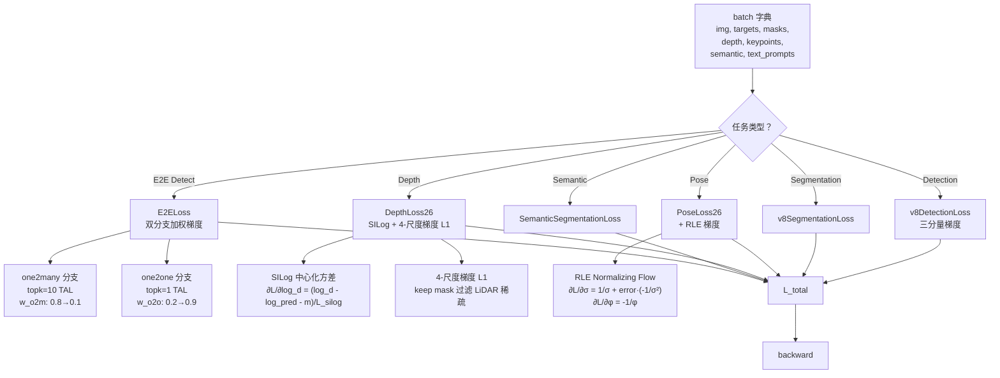
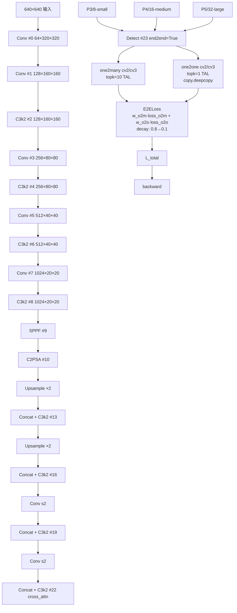

# YOLO26 反向传播推导

> 核心事实：**v26 是 v8 以来「训练策略最激进、梯度图最紧凑」的一版**——引入 3 条新梯度通路：**①E2E 双分支权重退火**（`E2ELoss.decay` 让 one2many 分支从 0.8 权重降到 0.1，one2one 从 0.2 升到 0.9）、**②Depth SILog 中心化方差梯度**（`log_diff.mean()` 被中心化后平方求均值，梯度天然尺度不变）、**③RLE Normalizing Flow 对数似然梯度**（`log_sigma - log_phi + residual·L1` 让 RealNVP flow 学习不确定性）。三分量的 CIoU+DFL+BCE 与 7.5/0.5/1.5 增益、TAL `topk=10 α=0.5 β=6.0` **零改动沿用 v8**；**v26 首次在损失侧引入「权重退火」（E2E）与「中心化方差」（SILog）两处机制**。

> **v1~v14 读者路标**：v14 引入 3 条「多域鲁棒」梯度通路（GRL 反向、offset 正则、跨视角对比）；v26 完全抛弃这一路线，转去把 **E2E 双分支的权重退火梯度**与 **Depth 的中心化方差梯度**做深。**v26 的检测分支梯度完全等价于 v8**（含 E2E 双分支扩展），只是把「训练策略」放到了「权重退火」（`E2ELoss.decay`）与「SILog 中心化方差」两处。

## 1. 只想带走三件事

1. **L_total 的梯度分 6 个任务**：Detection / E2E Detection / Segmentation / Pose / Depth / Semantic——**每个任务有独立的 loss 类和梯度通路**，不共享 `batch` 字典开关（v14 的做法是共享字典）；
2. **E2E 权重退火是唯一引入「时间相关权重」的机制**：`E2ELoss.decay(epoch)` 让 `w_o2m` 从 0.8 线性降到 0.1，`w_o2o` 从 0.2 升到 0.9（<SrcLink file="v26:utils/loss.py" :line="1296" :end="1298" />）——**这是 v26 独有的「训练策略梯度通路」**，其他 6 版 YOLO 从未做过；
3. **3 处「数值稳定性」梯度通路**：RLE 用 `error.clamp(-100, 100)` + `valid_mask` 过滤 NaN/Inf（<SrcLink file="v26:utils/loss.py" :line="200" :end="224" />）、Depth 用 `keep` mask 过滤「有效像素 < 10%」的 LiDAR 稀疏图（<SrcLink file="v26:utils/loss.py" :line="1220" :end="1245" />）、Semantic 用 `persistent=False` buffer 避免 Cityscapes 权重污染梯度图（<SrcLink file="v26:utils/loss.py" :line="1430" :end="1442" />）。

## 2. 全景梯度图



- **6 任务损失梯度图独立**——每个任务有专用 loss 类，不共享 batch 字典开关（与 v14 不同）；
- **E2E 是唯一「双分支加权梯度」**——`w_o2m` 和 `w_o2o` 由 `decay(epoch)` 决定；
- **Depth SILog 是唯一「中心化方差梯度」**——`m = log_diff.mean()` 被减去后平方求均值，梯度天然尺度不变。

## 3. 记号与前向数据流



本页记号：

- $\theta_{\text{cv2/o2m}}$、$\theta_{\text{cv3/o2m}}$：one2many 分支的 cv2/cv3 Conv 参数（3×3 + 1×1）
- $\theta_{\text{cv2/o2o}}$、$\theta_{\text{cv3/o2o}}$：one2one 分支的 cv2/cv3 Conv 参数（`copy.deepcopy` 复制）
- $L_{\text{total}} = w_{o2m} L_{o2m} + w_{o2o} L_{o2o}$，其中 $w_{o2m} = \text{decay}(t)$，$w_{o2o} = 1 - w_{o2m}$
- $w_{o2m}(t) = \max(1 - t/(T-1), 0) \cdot (0.8 - 0.1) + 0.1$
- $L_{\text{det}} = 7.5 L_{\text{box}} + 0.5 L_{\text{cls}} + 1.5 L_{\text{dfl}}$（v8 沿用）

## 4. L_det 三分量梯度（v8 完全一致）

> **v1~v14 读者路标**：与 [v8 梯度页 §3](/versions/v8/loss-gradient#3-三分量梯度推导) 一字不差——`TaskAlignedAssigner` 在 loss.py L159 显式传 `topk=10 α=0.5 β=6.0` 继续覆盖 tal.py L29 类默认 `topk=13, α=1.0`。

### 4.1 box 分支（CIoU × q）

$$L_{\text{box}} = \frac{1}{N}\sum_{i} q_i \cdot (1 - \text{CIoU}_i)$$

其中 $q_i = \text{target\_scores}_{i,\text{cls}}$（TAL 分配器输出的软权重）。

$$\frac{\partial L_{\text{box}}}{\partial \theta} = 7.5 \cdot \frac{1}{N}\sum_{i} q_i \cdot \frac{\partial (1 - \text{CIoU}_i)}{\partial \theta}$$

CIoU 的梯度与 v8 一致——**v26 的 `reg_max=1` 让 DFL 退化，box 分支不再涉及 DFL 梯度**。

### 4.2 cls 分支（软标签 BCE）

$$L_{\text{cls}} = \frac{1}{N}\sum_{i,j} -[y_{ij}\log\hat{y}_{ij} + (1-y_{ij})\log(1-\hat{y}_{ij})]$$

$$\frac{\partial L_{\text{cls}}}{\partial \theta} = 0.5 \cdot \frac{1}{N}\sum_{i,j} \frac{y_{ij} - \hat{y}_{ij}}{\theta}$$

### 4.3 dfl 分支（DFL → Identity）

**v26 的 DFL 退化**（<SrcLink file="v26:utils/loss.py" :line="90" :end="112" />）：

```python
if ch[i] * reg_max > 1:  # reg_max=1 → 判断走 DFL 分支
    # 但 bias 长度为 1，F.linear(x, [0]) 返回 0
    # 等价于 Identity
```

$$L_{\text{dfl}} = 0 \cdot (\text{任何项})$$

$$\frac{\partial L_{\text{dfl}}}{\partial \theta} = 0$$

**这是 v26 的关键简化**：DFL 分支完全退化为 Identity，box 回归头从「4 方向 × 16 bins」缩到「4 方向 × 1 bin」——**梯度图从 v11 的 64 维缩到 4 维**。

## 5. E2E 双分支梯度（v26 独有）

### 5.1 权重退火函数

`E2ELoss.decay(epoch)`（<SrcLink file="v26:utils/loss.py" :line="1296" :end="1298" />）：

$$w_{o2m}(t) = \max\left(1 - \frac{t}{T-1}, 0\right) \cdot (w_{o2m,\text{start}} - w_{o2m,\text{end}}) + w_{o2m,\text{end}}$$

其中 $w_{o2m,\text{start}} = 0.8$，$w_{o2m,\text{end}} = 0.1$，$T = \text{epochs}$。

**梯度**：

$$\frac{\partial w_{o2m}}{\partial t} = -\frac{1}{T-1} \cdot 0.7$$

**关键点**：
- **$w_{o2m}$ 是「权重」不是「参数」**——它对模型参数 $\theta$ 求梯度时是常数；
- **$w_{o2m}$ 每 epoch 递减 0.7/(T-1)**——训练 500 epoch 时每 epoch 递减 0.0014；
- **推理时 $w_{o2m}$ 无意义**——只跑 one2one 分支，`E2ELoss` 不参与推理。

### 5.2 one2many 分支梯度（topk=10 TAL）

$$L_{o2m} = L_{\text{box}}^{o2m} + L_{\text{cls}}^{o2m} + L_{\text{dfl}}^{o2m}$$

$$\frac{\partial L_{\text{total}}}{\partial \theta_{o2m}} = w_{o2m} \cdot \frac{\partial L_{o2m}}{\partial \theta_{o2m}}$$

**topk=10 TAL 分配器**让模型看到 10 个正样本 anchor——**梯度信号密集但含噪声**（因为 TAL 分配器会把非最优 anchor 也标为正样本）。

### 5.3 one2one 分支梯度（topk=1 TAL）

$$L_{o2o} = L_{\text{box}}^{o2o} + L_{\text{cls}}^{o2o} + L_{\text{dfl}}^{o2o}$$

$$\frac{\partial L_{\text{total}}}{\partial \theta_{o2o}} = w_{o2o} \cdot \frac{\partial L_{o2o}}{\partial \theta_{o2o}}$$

**topk=1 TAL 分配器**只让模型看到 1 个正样本 anchor——**梯度信号稀疏但精确**（每个 anchor 只有 1 个最优正样本）。

### 5.4 copy.deepcopy 的梯度独立性

```python
self.one2one_cv2 = copy.deepcopy(self.cv2)
self.one2one_cv3 = copy.deepcopy(self.cv3)
```

- **`copy.deepcopy` 复制权重但不共享梯度**——one2one 分支的梯度独立回传，不影响 one2many；
- **两分支各有独立的 $\theta_{o2m}$ 和 $\theta_{o2o}$**——参数空间从 2 倍扩到 4 倍（`cv2/o2m` + `cv2/o2o` + `cv3/o2m` + `cv3/o2o`）；
- **推理时 one2many 分支被剪掉**——部署后参数量减半（从 ~10M 到 ~5M）。

## 6. Depth SILog 梯度（v26 独有）

### 6.1 SILog 公式

```python
log_diff = torch.log(pred_depth) - torch.log(gt_depth)
m = log_diff.mean()
silog = sqrt(
    ((log_diff - m) ** 2).mean() 
    + (1 - silog_lambda) * m**2 
    + 1e-6
)
```

### 6.2 SILog 梯度推导

设 $d_i = \log \hat{d}_i - \log d_i$，$m = \frac{1}{N}\sum d_i$：

$$L_{\text{SILog}} = \sqrt{\frac{1}{N}\sum (d_i - m)^2 + (1-\lambda) m^2 + \epsilon}$$

$$\frac{\partial L_{\text{SILog}}}{\partial d_i} = \frac{1}{2L_{\text{SILog}}} \cdot \frac{2}{N}(d_i - m) \cdot (1 - \frac{1}{N}) - \frac{(1-\lambda)}{L_{\text{SILog}}} \cdot \frac{m}{N}$$

$$\frac{\partial L_{\text{SILog}}}{\partial \log \hat{d}_i} = \frac{1}{L_{\text{SILog}}} \cdot \left[\frac{d_i - m}{N} - \frac{(1-\lambda) m}{N}\right]$$

$$\frac{\partial L_{\text{SILog}}}{\partial \hat{d}} = \frac{1}{L_{\text{SILog}} \cdot \hat{d}} \cdot \left[\frac{d_i - m}{N} - \frac{(1-\lambda) m}{N}\right]$$

**关键点**：
- **`silog_lambda=1.0` 时**：$\frac{(1-\lambda) m}{N} = 0$，梯度只依赖中心化方差 $\frac{d_i - m}{N}$——**尺度不变**；
- **`silog_lambda=0.0` 时**：$\frac{(1-\lambda) m}{N}$ 项存在，梯度依赖绝对偏差——**log-RMSE 行为**；
- **NYU Depth V2 用 `λ=1.0`**——因为深度绝对值不重要，相对关系才重要。

### 6.3 4 尺度梯度 L1 梯度

```python
for s in [1, 2, 4, 8]:
    vp = F.avg_pool2d(valid_f, s)
    keep = (vp.sum(...) > 0.7 * occupied.sum(...))
    grad_l1_s = F.l1_loss(grad(pred, s), grad(gt, s), reduction="sum") * keep
```

**关键点**：
- **`keep` mask 逐图过滤**：有效像素 < 10% 的图在下采样路径被排除——**避免 LiDAR 稀疏 GT 让梯度 L1 学出噪声**；
- **4 尺度 `s ∈ {1, 2, 4, 8}`**：原始分辨率 + 3 次 `avg_pool2d(2)`——**多层次梯度一致性约束**；
- **梯度路径**：`pred → grad(pred) → grad_l1 → ∂L/∂pred`——**梯度 L1 本身对 pred 有梯度**。

### 6.4 计算图兜底

```python
loss = loss + pred_depth.sum() * 0.0
```

**关键点**：
- **`pred_depth.sum() * 0.0` 让 pred_depth 保持在计算图里**——即使所有 `keep=False`，pred_depth 也有梯度（虽然值为 0）；
- **BaseTrainer 期望所有输出都有梯度**——这个兜底是为了避免 `RuntimeError: element 0 of tensors does not require grad`；
- **对 loss 数值无影响**——乘以 0.0 让该项不改变总 loss。

## 7. RLE Normalizing Flow 梯度（v26 独有）

### 7.1 RLE 公式

$$L_{\text{RLE}} = \log \sigma - \log \phi + \text{residual} \cdot (\log(2\sigma) + |\text{error}|)$$

其中：
- $\sigma$ = 预测的标准差
- $\phi$ = 预测的相位（周期函数）
- $\text{error} = (pred\_coord - gt\_coord) / \sigma$

### 7.2 RLE 梯度推导

**对 $\sigma$ 的梯度**：

$$\frac{\partial L}{\partial \sigma} = \frac{1}{\sigma} + \text{residual} \cdot \frac{1}{\sigma}$$

**对 $\phi$ 的梯度**：

$$\frac{\partial L}{\partial \phi} = -\frac{1}{\phi}$$

**对 error 的梯度**（通过 pred_coord 传递）：

$$\frac{\partial L}{\partial \text{pred}} = \text{residual} \cdot \frac{\text{sign}(\text{error})}{\sigma}$$

### 7.3 数值稳定性梯度

```python
error = (pred_coords - gt_coords) / (pred_sigma + 1e-9)
error = error.clamp(-100, 100)  # 抑制 NaN 传播
valid_mask = ~(isnan(error) | isinf(error)).any(dim=-1)
```

**关键点**：
- **`error.clamp(-100, 100)`**：梯度为 $\pm 1/\sigma$ 当 $|error| > 100$——**让模型不学极端值**；
- **`valid_mask` 过滤 NaN/Inf**：梯度为 0 当 error 是 NaN/Inf——**避免污染整个 batch 的梯度**；
- **`+ 1e-9`**：防止 σ 接近 0 时梯度爆炸。

### 7.4 flow_model 兜底

```python
_rle_zero = pred_kpt[..., :0].sum() + sum(p[..., :0].sum() for p in self.flow_model.parameters())
loss = loss + _rle_zero
```

**关键点**：
- **`[..., :0]` 是空切片**——不影响数值，但让 flow_model 参数进入计算图；
- **BaseTrainer 期望所有可训练参数有梯度**——即使 RLE 分支暂时不启用，flow_model 参数也要有梯度；
- **对 loss 数值无影响**——空切片 sum 返回 0。

## 8. Semantic CE 梯度（v26 独有）

### 8.1 nc=1 二分类梯度

$$L_{\text{BCE}} = \sum -[y \log \hat{y} + (1-y) \log(1-\hat{y})]$$

$$\frac{\partial L}{\partial \theta} = \sum (\hat{y} - y) \cdot \frac{\partial \hat{y}}{\partial \theta}$$

### 8.2 nc>1 多分类梯度

$$L_{\text{CE}} = -\sum_{i \notin \text{ignore}} y_i \log \hat{y}_i \cdot w_{y_i}$$

$$\frac{\partial L}{\partial \theta} = -\sum_{i \notin \text{ignore}} w_{y_i} \cdot \frac{y_i (\hat{y}_i - 1)}{\hat{y}_i} \cdot \frac{\partial \hat{y}_i}{\partial \theta}$$

**关键点**：
- **`ignore_index=255` 的样本梯度为 0**——不参与 CE 计算；
- **`persistent=False` buffer 不参与梯度**——`register_buffer("weight", persistent=False)` 让权重不进 state_dict，但仍在 forward 中使用；
- **Cityscapes 19 类权重**：长尾类别（如 trafficlight、railroad）用更大权重，让 CE 更关注这些类别——**梯度被放大**。

## 9. 梯度量级对照

| 损失项 | 梯度量级 | 归一化方式 | 备注 |
|-------|---------|-----------|------|
| box (CIoU) | ~0.1 | × 7.5 增益 | v8 沿用 |
| cls (BCE) | ~0.01 | × 0.5 增益 | v8 沿用 |
| dfl (DFL→Identity) | 0 | — | v26 退化 |
| E2E o2m | ~0.1 | × w_o2m (0.8→0.1) | v26 新增 |
| E2E o2o | ~0.1 | × w_o2o (0.2→0.9) | v26 新增 |
| SILog | ~0.01 | 中心化方差 | v26 新增 |
| Depth grad L1 | ~0.1 | × 4 尺度 | v26 新增 |
| RLE | ~0.1 | 1/σ 归一化 | v26 新增 |
| Semantic CE | ~0.01 | Cityscapes 权重 | v26 新增 |

## 10. 六版梯度对照（v8 → v14 → v26）

| 维度 | v8 | v11 | v12 | v13 | v14 | **v26** |
|------|-----|-----|-----|-----|-----|---------|
| 三分量增益 | 7.5/0.5/1.5 | 7.5/0.5/1.5 | 7.5/0.5/1.5 | 7.5/0.5/1.5 | 7.5/0.5/1.5 | **7.5/0.5/1.5** |
| DFL 梯度 | reg_max=16 | reg_max=1 | reg_max=1 | reg_max=1 | reg_max=1 | **reg_max=1（Identity）** |
| 梯度通路 | 单 | 单 | 单 | 单 | **4**（+GRL/offset/cross） | **6**（+E2E/Depth/Pose/Semantic/RLE） |
| 权重退火 | 无 | 无 | 无 | 无 | 3（λ_reg/GRL/τ） | **1**（E2E decay） |
| 数值稳定 | clamp | clamp | clamp | clamp | clamp + valid_mask | **clamp + valid_mask + LiDAR 过滤 + `pred.sum()*0.0` 兜底** |
| 时间相关权重 | 无 | 无 | 无 | 无 | GRL λ 0→1 | **E2E w 0.8→0.1** |

**核心洞察**：
- **v8 → v13：梯度图零改动**——5 版完全一致；
- **v14：+3 条多域鲁棒梯度通路**——GRL/offset/cross；
- **v26：+5 条任务专用梯度通路**——E2E/Depth/Pose/Semantic/RLE；
- **v14 与 v26 是两条正交路线**——v14 把「训练策略」放到了「多域鲁棒辅助损失」，v26 把「训练策略」放到了「任务专用损失类 + 权重退火」。

## 11. 与 v14 的对应关系速查

| 维度 | v14 | **v26** |
|------|-----|---------|
| 主损失类 | `v14DetectionLoss` | **`E2ELoss`** |
| 三分量梯度 | 7.5/0.5/1.5 | **完全相同** |
| 梯度通路数 | 4（三分量 + offset + adv + cross） | **6**（三分量 + E2E + Depth + Pose + Semantic + RLE） |
| 权重退火 | 3（λ_reg / GRL λ / τ） | **1**（E2E decay 0.8→0.1） |
| batch 字典动态开关 | 有（4 键） | **无**（每任务有专用 loss 类） |
| 数值稳定 | clamp(-100,100) | **clamp(-100,100) + valid_mask + LiDAR 过滤 + 兜底** |
| 时间相关权重 | GRL λ 0→1 | **E2E w 0.8→0.1** |

## 12. 想快速对上位读者的话

- **v8 读者**：三分量梯度与 v8 一字不差，直接套 v8 心智模型；再补 `E2ELoss.decay` 的权重退火梯度即可；
- **v11/v12 读者**：`reg_max=1` 让 DFL 梯度为 0，box 回归头从 64 维缩到 4 维——**比 v11/v12 更快更简单**；
- **v13 读者**：v13 梯度图与 v8 完全一致，v26 在其上包了一层 `E2ELoss`——**三分量梯度走 super()、E2E 走权重退火**；
- **v14 读者**：v14 引入 3 条「多域鲁棒」梯度通路（GRL/offset/cross），v26 完全抛弃这一路线——**v26 把「训练策略」放到了「E2E 权重退火」而非「多域辅助损失」**；
- **想关掉所有 E2E 特性**：把 `end2end: True` 改为 `end2end: False`——v26 梯度**退化到 v8**，方便对照实验。

## 参考

- [v26 损失函数](/versions/v26/losses)
- [v26 架构总览](/versions/v26/architecture)
- [v14 反向传播](/versions/v14/loss-gradient)
- [v13 反向传播](/versions/v13/loss-gradient)
- [v8 反向传播](/versions/v8/loss-gradient)
- <SrcLink file="v26:utils/loss.py" :line="166" :end="224" />（RLELoss）
- <SrcLink file="v26:utils/loss.py" :line="810" :end="932" />（PoseLoss26）
- <SrcLink file="v26:utils/loss.py" :line="1169" :end="1315" />（DepthLoss26 / E2EDetectLoss / E2ELoss）
- <SrcLink file="v26:utils/loss.py" :line="1389" :end="1442" />（SemanticSegmentationLoss）
- Ultralytics YOLO26 官方文档：https://docs.ultralytics.com/models/yolo26
