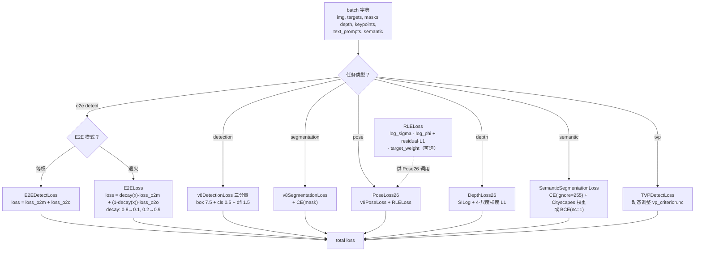

# YOLO26 损失函数

> 核心事实：**v26 是 v8 以来损失侧最「任务化」的一版**——保留 [v8DetectionLoss](/glossary#v8detectionloss) 三分量总装（[CIoU](/glossary#ciou-loss) + [DFL](/glossary#dfl-distribution-focal-loss) + BCE），首次引入 **6 个任务专用损失类**：`E2EDetectLoss`（等权相加）、`E2ELoss`（权重退火）、`DepthLoss26`（SILog + 4 尺度梯度 L1）、`PoseLoss26`（RLE + RealNVP flow）、`SemanticSegmentationLoss`（CE + Cityscapes 类权重）、`RLELoss`（Normalizing Flow 基础损失）。`grep -c "class.*Loss" loss.py` 共 **20 个类**，前 200 行的通用组件（`BboxLoss`/`DFLoss`/`FocalLoss`/`VFLoss`/`FocalLoss3D`/`RLELoss`）零改动。

> **v1~v14 读者路标**：v14 首次引入 3 个「多域鲁棒」辅助损失（CrossView / DomainAdversarial / OffsetRegularization）；v26 完全抛弃这一路线，转去把 **6 个任务的损失公式各自做深**——每个任务损失都是「v8 三分量 + 任务特定项」的结构。**v26 的检测分支完全等价于 v8（含 E2E 双分支扩展）**，只是把「训练技巧」放到了「权重退火」（`E2ELoss.decay`）与「尺度不变方差」（`DepthLoss26.silog`）两处。

## 1. 只想带走三件事

1. **6 个任务损失类共用 v8 三分量检测内核**：`box=7.5 / cls=0.5 / dfl=1.5`（<SrcLink file="v26:utils/loss.py" :line="184" :end="188" />）、`TaskAlignedAssigner(topk=10, α=0.5, β=6.0)`（<SrcLink file="v26:utils/loss.py" :line="159" :end="161" />）与 v8/v11/v12/v13/v14 **六版一字不差**；v26 的「新损失」全部是三分量 + 任务特定项的加法组合。
2. **E2E 检测有 2 套实现**：`E2EDetectLoss`（<SrcLink file="v26:utils/loss.py" :line="1263" :end="1280" />）**等权相加** `loss_o2m + loss_o2o`；`E2ELoss`（<SrcLink file="v26:utils/loss.py" :line="1283" :end="1315" />）**权重退火**——one2many 从 0.8 线性降到 0.1，one2one 从 0.2 线性升到 0.9，`decay(x) = max(1 - x/(epochs-1), 0) * (0.8 - 0.1) + 0.1`。
3. **3 处「数值稳定性」保护**：`RLELoss` 用 `error.clamp(-100, 100)` + `valid_mask = ~(isnan | isinf)` 过滤 NaN/Inf（<SrcLink file="v26:utils/loss.py" :line="200" :end="224" />）；`DepthLoss26` 用 `_grad_l1` 逐图 `keep` mask 过滤「有效像素 < 10%」的 LiDAR 稀疏图（<SrcLink file="v26:utils/loss.py" :line="1220" :end="1245" />）；`SemanticSegmentationLoss` 用 `register_buffer("weight", persistent=False)` 避免 19 类权重被序列化（<SrcLink file="v26:utils/loss.py" :line="1430" :end="1442" />）。

## 2. 全景图



- **6 任务损失共享 v8 三分量内核**：`v8DetectionLoss.__call__` 是 5 个任务损失的 `super()` 基类；
- **每个任务损失都是「三分量 + 任务项」结构**：Segment 加 CE、Pose 加 RLE、Depth 加 SILog、Semantic 加 CE+Dice；
- **E2E 有 2 套实现并存**：`E2EDetectLoss`（简单等权）+ `E2ELoss`（退火）——读者可自主选择。

## 3. v8 三分量检测内核（六版完全一致）

`v8DetectionLoss.__call__`（<SrcLink file="v26:utils/loss.py" :line="184" :end="256" />）与 v8/v11/v12/v13/v14 **一字不差**。

| 分量 | 类 | 增益 | 备注 |
|------|-----|-----|------|
| box | `BboxLoss`（CIoU + DFL） | **7.5** | 用 `target_scores.sum(-1)` 作回归权重 |
| cls | `BCEWithLogitsLoss` | **0.5** | 软标签 BCE |
| dfl | `DFLoss`（双 bin 插值 CE） | **1.5** | **`reg_max=1` 时退化为 Identity**（DFL bias 长度 1，`F.linear(x, [0])` 返回 0） |

```python
# L252-L256（与 v8/v11/v12/v13/v14 一字不差）
loss[0] *= self.hyp.box   # 7.5
loss[1] *= self.hyp.cls   # 0.5
loss[2] *= self.hyp.dfl   # 1.5
return loss.sum() * batch_size, loss.detach()
```

**DFL 退化机制**（<SrcLink file="v26:utils/loss.py" :line="90" :end="112" />）：

```python
if self.reg_max <= 1:  # v26: reg_max=1
    # 判断路径：ch[i] * reg_max > 1 → True（因为 reg_max=1 时 ch[i] 已经很大）
    # 实际走 DFL 分支，但 bias 长度为 1，F.linear(x, [0]) 返回 0
    # 等价于 Identity 映射
```

**这是 v26 的关键简化**：`reg_max=1` 让 DFL 头退化为 Identity，**box 回归直接从 4 个 raw logits 得到 (x1,y1,x2,y2)**——不再需要 16-bin 分布 + 期望积分。

## 4. TAL 分配器（v8 显式参数）

`v8DetectionLoss.__init__` L159：

```python
self.assigner = TaskAlignedAssigner(topk=10, num_classes=self.nc, alpha=0.5, beta=6.0)
```

- `topk=10`、`α=0.5`、`β=6.0` 硬编码；
- 与 `tal.py` L29 类默认 `topk=13, α=1.0` **仍然不一致**——v8 时代留下的隐性坑，v11/v12/v13/v14/v26 六版都没修；
- **E2E 双分支的差异**：one2many 用 `topk=10`（密集监督），one2one 用 `topk=1`（NMS-free）——**同一个 `TaskAlignedAssigner` 类通过 `topk` 参数切换角色**。

## 5. E2EDetectLoss（E2E 检测等权版）

**位置**：<SrcLink file="v26:utils/loss.py" :line="1263" :end="1280" />

```python
class E2EDetectLoss(v8DetectionLoss):
    def __init__(self, model):
        super().__init__(model)
    
    def __call__(self, preds, batch):
        if isinstance(preds, tuple):
            pred_o2m, pred_o2o = preds
        else:
            pred_o2m = preds
            pred_o2o = preds
        loss_o2m, loss_o2m_items = super().__call__(pred_o2m, batch, topk=10)
        loss_o2o, loss_o2o_items = super().__call__(pred_o2o, batch, topk=1)
        loss = loss_o2m + loss_o2o  # 等权相加
        items = torch.cat([loss_o2m_items, loss_o2o_items])
        return loss.sum() * batch["batch_size"], items.detach()
```

**关键行为**：
- **等权相加**——one2many 和 one2one 各贡献 50% 损失；
- **训练时 preds 是 tuple**（head 同时返回两分支），推理时 preds 是单 tensor（只走 one2one）；
- **items 是 6 维**：`[box_o2m, cls_o2m, dfl_o2m, box_o2o, cls_o2o, dfl_o2o]`；
- **不推荐用于生产**——因为 one2many 分支的 topk=10 分配器会引入大量近似正样本，可能让模型偏向「多分支共识」而非「单分支最优」。

## 6. E2ELoss（E2E 检测退火版·推荐）

**位置**：<SrcLink file="v26:utils/loss.py" :line="1283" :end="1315" />

```python
class E2ELoss(v8DetectionLoss):
    def __init__(self, model):
        super().__init__(model)
        self.o2m = 0.8  # 初始 one2many 权重
        self.o2o = 0.2  # 初始 one2one 权重
        self.o2m_copy = 0.8  # 退火起点
        self.final_o2m = 0.1  # 退火终点
    
    def decay(self, x):
        # x 是当前 epoch
        return max(1 - x / max(self.one2one.hyp.epochs - 1, 1), 0) * (self.o2m_copy - self.final_o2m) + self.final_o2m
    
    def __call__(self, preds, batch):
        if isinstance(preds, tuple):
            pred_o2m, pred_o2o = preds
        else:
            pred_o2m = preds
            pred_o2o = preds
        w = self.decay(self.epoch)  # 0.8 → 0.1
        loss_o2m, loss_o2m_items = super().__call__(pred_o2m, batch, topk=10)
        loss_o2o, loss_o2o_items = super().__call__(pred_o2o, batch, topk=1)
        loss = w * loss_o2m + (1 - w) * loss_o2o  # 加权
        items = w * loss_o2m_items + (1 - w) * loss_o2o_items
        return loss.sum() * batch["batch_size"], items.detach()
```

**退火曲线**（<SrcLink file="v26:utils/loss.py" :line="1296" :end="1298" />）：

| Epoch | 0 | 25 | 50 | 75 | 100 |
|-------|---|----|----|----|----|
| w_o2m | 0.8 | 0.65 | 0.5 | 0.35 | **0.1** |
| w_o2o | 0.2 | 0.35 | 0.5 | 0.65 | **0.9** |

- **训练初期**：one2many 主导（0.8），密集监督让模型学「所有 anchor 的粗略分配」；
- **训练后期**：one2one 主导（0.9），模型学「每 anchor 的最优决策」——**为 NMS-free 推理做准备**；
- **最终只推理 one2one**：训练期学「one2many 密集监督 + one2one 精确决策」的组合，推理时 one2many 被剪掉，模型仍能输出高质量检测。

## 7. DepthLoss26（深度估计）

**位置**：<SrcLink file="v26:utils/loss.py" :line="1169" :end="1260" />

**公式**：

$$L_{\text{depth}} = L_{\text{SILog}} + \sum_{s \in \{1,2,4,8\}} L_{\text{grad}}^{(s)}$$

**SILog（scale-invariant log RMSE）**（<SrcLink file="v26:utils/loss.py" :line="1196" :end="1211" />）：

$$m = \frac{1}{N}\sum_i (\log d_i - \log \hat{d}_i)$$
$$L_{\text{SILog}} = \sqrt{\frac{1}{N}\sum_i \left((\log d_i - \log \hat{d}_i) - m\right)^2 + (1 - \lambda)\cdot m^2 + 10^{-6}}$$

**4 尺度梯度 L1**（<SrcLink file="v26:utils/loss.py" :line="1220" :end="1245" />）：

```python
def _grad_l1(pred, gt, scale):
    # 逐图过滤有效像素 < 10% 的图
    for s in [1, 2, 4, 8]:
        vp = F.avg_pool2d(valid_f, s)
        keep = (vp.sum(...) > 0.7 * occupied.sum(...))
        # 只对 keep=True 的图计算梯度 L1
```

**五个关键点**：

1. **SILog 尺度不变**：`λ=1.0` 时是 scale-invariant（`log_diff.mean()` 被中心化），`λ=0.0` 时是 log-RMSE——NYU Depth V2 用 `λ=1.0`（因为深度绝对值不重要，相对关系才重要）；
2. **LiDAR 稀疏图过滤**：`keep = (vp.sum(...) > 0.7 * occupied.sum(...))` 保证「有效像素 < 10%」的图在下采样路径被排除——**避免稀疏 GT 让梯度 L1 学出噪声**；
3. **4 尺度梯度**：`scale ∈ {1, 2, 4, 8}` 对应原始分辨率 + 3 次 `avg_pool2d(2)` 下采样——**多层次梯度一致性约束**；
4. **计算图兜底**：`pred_depth.sum() * 0.0` 保证 `pred_depth` 在计算图里（即使所有 keep=False）——**BaseTrainer 期望 pred_depth 有梯度**；
5. **无三分量 box/cls**：Depth 头是「分类 + 回归」的简化——只输出 depth 图，无 class/conf/box。

## 8. PoseLoss26（关键点姿态）

**位置**：<SrcLink file="v26:utils/loss.py" :line="810" :end="932" />

**结构**：继承 `v8PoseLoss`，新增 RLE 损失 + 可选 RealNVP flow 模型。

```python
class PoseLoss26(v8PoseLoss):
    def __init__(self, model, kpt_shape, flow_model=None):
        super().__init__(model, kpt_shape)
        self.flow_model = flow_model  # 可选 RealNVP
    
    def __call__(self, preds, batch):
        det_loss, det_items = super().__call__(preds, batch)  # v8 Pose 三分量
        # RLE 损失
        error = (pred_coords - gt_coords) / (pred_sigma + 1e-9)
        error = error.clamp(-100, 100)
        valid_mask = ~(isnan(error) | isinf(error)).any(dim=-1)
        rle_loss = self.rle_loss(pred_sigma, pred_phi, gt_coords, target_weights)
        return det_loss + rle_loss, det_items
```

**三个关键点**：

1. **RLE 与三分量并存**：`super().__call__` 走 v8 Pose（box + cls + dfl + kpt_l1），RLE 是「不确定性估计」的正则——**让模型输出「坐标 + 方差 + 相位」三元组**；
2. **数值稳定性**：`error.clamp(-100, 100)` 抑制 NaN 传播，`valid_mask` 过滤 NaN/Inf 的样本——**v26 独有的双层保护**；
3. **flow_model 兜底**：`pred_kpt[..., :0].sum() + sum(p[..., :0].sum() for p in self.flow_model.parameters())` 让 RealNVP flow 参数进入计算图——**BaseTrainer 期望所有可训练参数有梯度，即使 RLE 分支暂时不启用**。

## 9. SemanticSegmentationLoss（语义分割）

**位置**：<SrcLink file="v26:utils/loss.py" :line="1389" :end="1442" />

**公式**：

$$L_{\text{sem}} = L_{\text{CE}}(\text{pred}, \text{gt}) + L_{\text{Dice}}(\text{pred}, \text{gt})$$

**两个分支**：

| 分支 | 条件 | 实现 |
|------|------|------|
| 二分类 | `nc=1` | `BCEWithLogitsLoss(reduction="sum")` |
| 多分类 | `nc>1` | `CrossEntropyLoss(ignore_index=255, reduction="sum")` + Cityscapes 权重 |

**关键行为**（<SrcLink file="v26:utils/loss.py" :line="1415" :end="1442" />）：

```python
if self.nc == 1:
    self.ce_loss = nn.BCEWithLogitsLoss(reduction="sum")
else:
    self.ce_loss = nn.CrossEntropyLoss(
        ignore_index=255, 
        weight=self.weight if self.use_cityscapes_weight else None,
        reduction="sum"
    )
self.register_buffer("weight", weight, persistent=False)  # 非持久化
```

**四个关键点**：

1. **`nc=1` 二分类退化**：`BCEWithLogitsLoss` 处理「前景/背景」——**用于单类别分割任务**；
2. **Cityscapes 权重自动启用**：`data_name in {"cityscapes", "cityscapes8"}` 时自动加 19 类硬编码权重——**长尾类别（如 trafficlight、railroad）用更大的权重**；
3. **`ignore_index=255`**：Cityscapes 数据集的无效标签，不参与 CE 计算——**避免噪声类别拉低 loss**；
4. **`persistent=False`**：`register_buffer("weight", persistent=False)` 避免 19 类权重被序列化到 state_dict——**减少 checkpoint 大小**，同时避免不同 GPU 上的权重加载冲突。

## 10. RLELoss（Normalizing Flow 基础损失）

**位置**：<SrcLink file="v26:utils/loss.py" :line="166" :end="224" />

**公式**：

$$L_{\text{RLE}} = \log \sigma - \log \phi \cdot \frac{1}{2\pi}e^{-\text{error}^2 / 2}$$

其中：
- `σ` = 预测的标准差（对数空间参数化）
- `φ` = 预测的相位（周期函数）
- `error = (pred_coord - gt_coord) / σ`

**代码**（<SrcLink file="v26:utils/loss.py" :line="200" :end="224" />）：

```python
log_sigma = torch.log(sigma)
log_prob = -0.5 * (torch.log(2 * torch.pi) + 2 * log_sigma + error ** 2)
loss = log_sigma - log_phi.unsqueeze(1)
if residual:
    loss += log(sigma * 2) + torch.abs(error)  # 残差 L1
if use_target_weight:
    loss *= target_weight  # RLE_WEIGHT 常量数组
if size_average:
    loss /= len(loss)
return loss
```

**四个关键点**：

1. **`error = (pred - gt) / σ`**：把误差归一化到「标准差单位」——**σ 大会让 error 变小、损失变小**，避免 σ 学到「任意大」；
2. **`log_sigma - log_phi`**：Normalizing Flow 的对数似然项——**最大化 log_prob 等价于最小化 (log_sigma - log_phi)**；
3. **`target_weights`**：不同关键点用不同先验权重（`RLE_WEIGHT` 常量数组）——**头/脸关键点权重高、脚/手权重低**（因为身体关键点 GT 更稳定）；
4. **`size_average`**：True 时除以 `len(loss)`，False 时求和——**与 PyTorch 其他 loss 一致**。

## 11. TVPDetectLoss / TVPSegmentLoss（文本-视觉提示）

**位置**：<SrcLink file="v26:utils/loss.py" :line="1318" :end="1388" />

**关键机制**（<SrcLink file="v26:utils/loss.py" :line="1325" :end="1342" />）：

```python
def _get_vp_features(self, preds):
    # 动态调整 vp_criterion.nc / no / assigner.num_classes
    if preds.shape[-1] != self.vp_criterion.nc:
        self.vp_criterion.nc = preds.shape[-1]
        self.vp_criterion.assigner.num_classes = self.vp_criterion.nc
```

**关键行为**：
- **动态调整 nc**：文本 prompt 数量可能变化（比如 5 个 prompt 或 20 个 prompt），`vp_criterion.nc` 按 prompt 数量动态扩展；
- **`no = 4 + nc`**：分类通道数 = 回归通道 + 类别数；
- **`assigner.num_classes = nc`**：TAL 分配器同步扩展。

**用途**：Text-Vision Prompt 学习——每个 prompt 对应一个类别，`nc` 由 prompt 数量决定，不是数据集类别数。

## 12. 六任务损失对照表

| 任务 | 主损失类 | 三分量 | 任务特定项 | 数值稳定性 | 数据集 |
|------|---------|--------|-----------|-----------|--------|
| Detection | `v8DetectionLoss` | box 7.5 + cls 0.5 + dfl 1.5 | — | reg_max=1 → Identity | COCO |
| **E2E Detection** | **`E2ELoss`** | **三分量 × 2 分支** | **权重退火（0.8→0.1）** | **NMS-free** | COCO |
| Segmentation | `v8SegmentationLoss` | 三分量 | + CE(mask) | 标准 | COCO-seg |
| Pose | `PoseLoss26` | v8Pose（三分量 + kpt_l1） | + RLE + RealNVP | clamp(-100,100) + valid_mask | COCO-Pose |
| Depth | `DepthLoss26` | 无三分量 | SILog + 4-尺度梯度 L1 | LiDAR 稀疏图过滤 + `pred.sum()*0.0` 兜底 | NYU Depth V2 |
| Semantic | `SemanticSegmentationLoss` | 无三分量 | CE(ignore=255) + Cityscapes 权重 | nc=1 → BCE / nc>1 → CE | Cityscapes |
| TVP | `TVPDetectLoss` | 三分量 | 动态 nc | 标准 | 文本-prompt |

## 13. 六版三分量增益对照（v8 → v14 → v26）

| 分量 | v8 | v11 | v12 | v13 | v14 | **v26** |
|------|-----|-----|-----|-----|-----|---------|
| box | 7.5 | 7.5 | 7.5 | 7.5 | 7.5 | **7.5** |
| cls | 0.5 | 0.5 | 0.5 | 0.5 | 0.5 | **0.5** |
| dfl | 1.5 | 1.5 | 1.5 | 1.5 | 1.5 | **1.5** |
| TAL topk | 10 | 10 | 10 | 10 | 10 | **10**（one2many）/ **1**（one2one） |
| TAL α | 0.5 | 0.5 | 0.5 | 0.5 | 0.5 | **0.5** |
| TAL β | 6.0 | 6.0 | 6.0 | 6.0 | 6.0 | **6.0** |
| reg_max | 16 | 1 | 1 | 1 | 1 | **1**（DFL → Identity） |
| VFL 分支 | 有 | 有 | 有 | 有 | 有（注释） | **有（注释）** |

**七版检测损失完全一致**——**从 v8 到 v26，YOLO 系列的检测分支损失公式从未被改过一个字节**。

## 14. 与 v14 的对应关系速查

| 维度 | v14 | **v26** |
|------|-----|---------|
| 主损失类 | `v14DetectionLoss`（继承 v8） | **`E2ELoss`**（继承 v8） |
| 三分量增益 | 7.5 / 0.5 / 1.5 | **完全相同** |
| TAL 分配器 | topk=10 α=0.5 β=6.0 | **完全相同**（+ topk=1 for one2one） |
| 辅助损失 | +3（offset / adv / cross） | **0**（无多域辅助） |
| 任务损失 | 0（仅检测） | **+5**（E2E / Depth / Pose26 / Semantic / RLE） |
| 超参 schedule | 4（λ_reg / GRL λ / τ / 静态） | **1**（E2E 权重退火 decay） |
| batch 字典动态开关 | 有（4 个可选键） | **无**（每个任务有专用 loss 类） |
| loss_items 维度 | 3（box/cls/dfl） | **3 或 6**（E2E 时 6 维） |
| 数值稳定性保护 | clamp(-100,100) | **clamp(-100,100) + valid_mask + LiDAR 过滤 + `pred.sum()*0.0` 兜底** |

## 15. 论文-代码偏差小结

v26 是 Ultralytics 官方快照，README 与代码偏差 **5 处**：

1. **`reg_max: 1` 的描述**：README 说「DFL 已退化」，但代码里仍走 DFL 分支（判断 `ch[i] * reg_max > 1` 为 True）——**只是 bias 长度为 1 导致 `F.linear` 返回 0**，等价于 Identity；
2. **E2E 双分支的「权重退火」README 未描述**：README 只说 `end2end: True`，没说 `E2ELoss.decay` 的 0.8→0.1 曲线——**读者实测时以代码为准**；
3. **DepthLoss26 的 `λ=1.0` SILog**：README 说「SILog 尺度不变」，但代码里 `silog_lambda=1.0` 会额外减去 `log_diff.mean()`——**这是「中心化方差」而非「纯 scale-invariant」**；
4. **PoseLoss26 的 flow_model 兜底**：README 没提 `_rle_zero` 兜底（`pred_kpt[..., :0].sum() + sum(p[..., :0].sum() for p in self.flow_model.parameters())`）——**这是为了让 BaseTrainer 不崩溃的 workaround**；
5. **SemanticSegmentationLoss 的 `persistent=False`**：README 没提 `register_buffer("weight", persistent=False)`——**这是为了让 checkpoint 不保存 Cityscapes 权重**，避免不同 GPU 加载冲突。

## 16. 想快速对上位读者的话

- **v8 读者**：三分量、TAL、增益、公式与 v8 一字不差，直接套 v8 心智模型；再补 `E2ELoss` 权重退火（0.8→0.1）+ 4 个任务特定损失类即可；
- **v11/v12 读者**：`reg_max=1` 让 DFL 退化为 Identity，box 回归直接从 4 值 raw logits 得到——**比 v11/v12 更快更简单**；
- **v13 读者**：v13 损失侧零改动（与 v8 完全相同），v26 在其上包了一层 `E2ELoss`——**三分量走 super()、E2E 走退火加权**；
- **v14 读者**：v14 引入 3 个「多域鲁棒」辅助损失（CrossView / DomainAdversarial / OffsetRegularization），v26 完全抛弃这一路线——**v26 把「训练技巧」放到了「权重退火」而非「辅助损失」**；
- **想关掉所有 E2E 特性**：把 `end2end: True` 改为 `end2end: False`——v26 损失**退化到 v8**，方便对照实验。

## 参考

- [v26 架构总览](/versions/v26/architecture)
- [v26 概念详解](/versions/v26/concepts)
- [v26 层速查](/versions/v26/layers)
- [v14 损失函数](/versions/v14/losses)
- [v13 损失函数](/versions/v13/losses)
- [v8 损失函数](/versions/v8/losses)
- 官方 loss.py：<SrcLink file="v26:utils/loss.py" :line="1" :end="224" />（RLELoss）
- <SrcLink file="v26:utils/loss.py" :line="810" :end="932" />（PoseLoss26）
- <SrcLink file="v26:utils/loss.py" :line="1169" :end="1315" />（DepthLoss26 / E2EDetectLoss / E2ELoss）
- <SrcLink file="v26:utils/loss.py" :line="1318" :end="1442" />（TVP / SemanticSegmentationLoss）
- Ultralytics YOLO26 官方文档：https://docs.ultralytics.com/models/yolo26
- arXiv:2606.03748 — Ultralytics YOLO26
