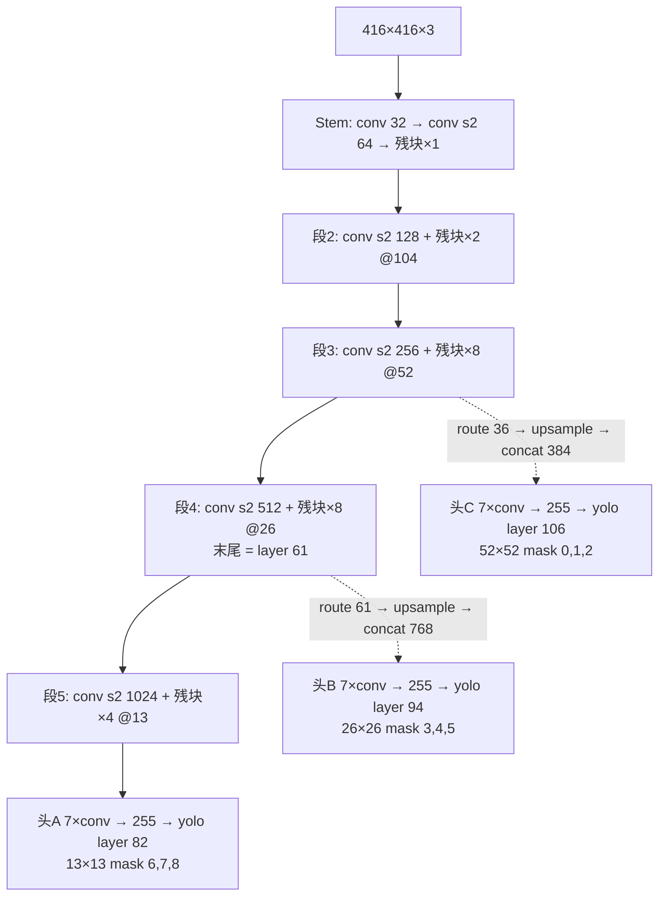
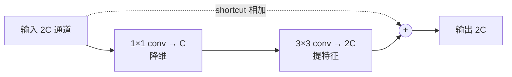
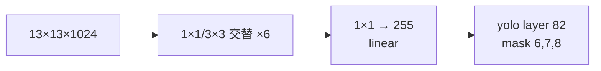
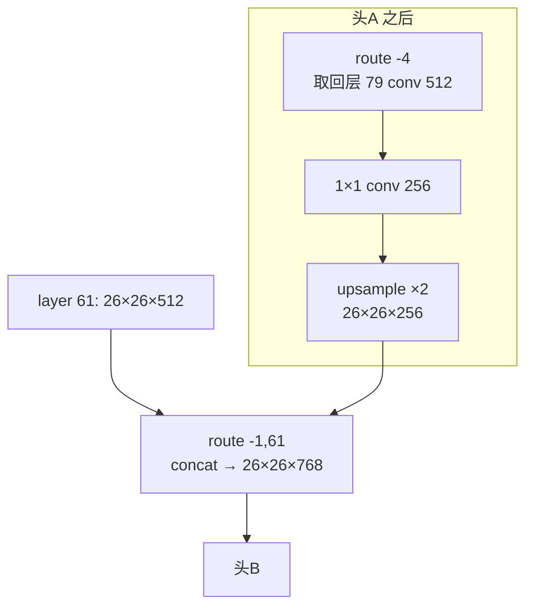
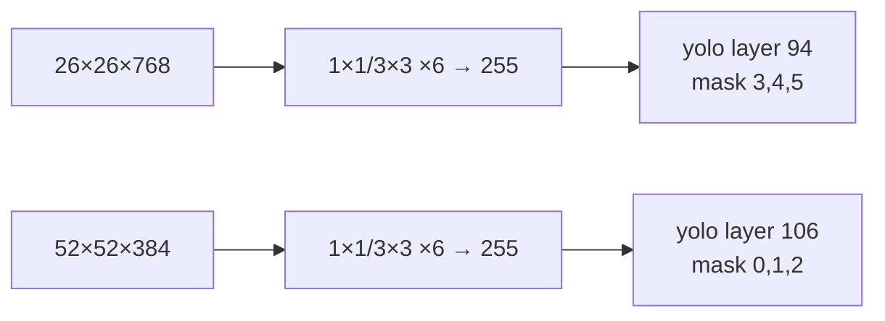
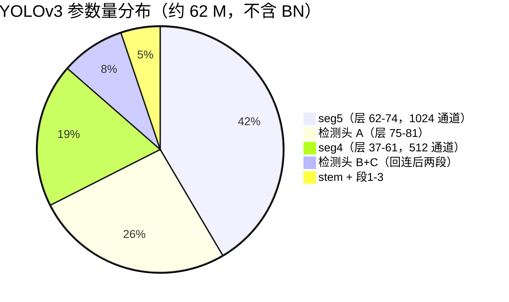

# YOLOv3 架构逐层图解

这一页把 YOLOv3（commit `e84933b`）的 cfg 逐层展开：输入/输出 tensor shape、层号、源码对应位置、一句白话解释。

> 所有代码来自 `source/yolov3/snapshot/`，cfg 见 `cfg/yolov3.cfg`（`f:\src\agent-yolo\source\yolov3\snapshot\cfg\yolov3.cfg`）。
> **口径说明**：共 **107 层**（0-indexed 编号 0–106，社区说的"106 层"即最大层号）。构成 = 75 conv + 23 shortcut + 4 route + 2 upsample + 3 yolo。本文以快照 cfg 事实为准。

::: tip TL;DR：只想带走三件事
1. **107 层 = Darknet-53 骨干（0–74）+ 两个检测头段（75–106）**：骨干 5 段残差，步进 5 次下采样到 13×13。
2. **三个 yolo 头在 layer 82 / 94 / 106**，输出都是 255 = 3×(4+1+80)，anchors 由 mask 6,7,8 / 3,4,5 / 0,1,2 切分。
3. **回连锚点是 layer 61 和 36**：route -1,61 / route -1,36 把浅层特征拼进上采样后的语义特征——这是 FPN 的 darknet 实现。
:::

---

## 1. 一眼看清：输入 → 输出的完整流程



**一句话总结**：5 次空间减半把 416×416 压到 13×13（骨干 0–74），检测头段先在 13×13 出大目标框，再两次 upsample + concat 回 26×26 / 52×52 出中/小目标框——三个头各管一档尺度。

---

## 2. 逐层明细表（按快照 cfg 顺序，共 107 层）

> **v1/v2 读者路标**：v1 有 FC、v2 有 reorg，这里都**没有了**；取而代之的是 23 个 `[shortcut]`（残差相加）和 2 个 `[upsample]`（最近邻放大）。表格按段分组，`#` 列是 darknet 的 0-indexed 层号（route/shortcut 的 `from` 用它回数）。

所有卷积 `batch_normalize=1` + leaky（除每头末层 1×1 255 是 linear）。

### 2.1 骨干：stem + 段1-2（层 0–11）

| # | 类型 | kernel / stride | 输出通道 | 特征图 | cfg 行 |
|---|------|-----------------|---------|--------|--------|
| 0 | conv | 3×3 / 1 | 32 | 416×416 | <SrcLink file="v3:cfg/yolov3.cfg" :line="25" /> |
| 1 | conv | 3×3 / **2** | 64 | 208×208 | <SrcLink file="v3:cfg/yolov3.cfg" :line="35" /> |
| 2 | conv | 1×1 / 1 | 32 | 208×208 | <SrcLink file="v3:cfg/yolov3.cfg" :line="43" /> |
| 3 | conv | 3×3 / 1 | 64 | 208×208 | <SrcLink file="v3:cfg/yolov3.cfg" :line="51" /> |
| 4 | **shortcut** | from=-3 | 64 | 208×208 | <SrcLink file="v3:cfg/yolov3.cfg" :line="59" /> |
| 5 | conv | 3×3 / **2** | 128 | 104×104 | <SrcLink file="v3:cfg/yolov3.cfg" :line="65" /> |
| 6-8 | conv,conv,shortcut | 1×1+3×3 | 128 | 104×104 | <SrcLink file="v3:cfg/yolov3.cfg" :line="73" /> |
| 9-11 | conv,conv,shortcut | 1×1+3×3 | 128 | 104×104 | <SrcLink file="v3:cfg/yolov3.cfg" :line="93" /> |

### 2.2 骨干：段3（层 12–36，8 残块）→ 回连锚点 36

| # | 类型 | 说明 | 特征图 | cfg 行 |
|---|------|------|--------|--------|
| 12 | conv | 3×3 / **2** → 256ch | 52×52 | <SrcLink file="v3:cfg/yolov3.cfg" :line="115" /> |
| 13-36 | 残块×8 | 1×1 128 + 3×3 256 + shortcut | 52×52×**256** | <SrcLink file="v3:cfg/yolov3.cfg" :line="123" /> 起 |

**layer 36** = 段3 末（52×52×256），后续被 `route -1,36` 回连给 52×52 小目标头。

### 2.3 骨干：段4（层 37–61，8 残块）→ 回连锚点 61

| # | 类型 | 说明 | 特征图 | cfg 行 |
|---|------|------|--------|--------|
| 37 | conv | 3×3 / **2** → 512ch | 26×26 | <SrcLink file="v3:cfg/yolov3.cfg" :line="286" /> |
| 38-61 | 残块×8 | 1×1 256 + 3×3 512 + shortcut | 26×26×**512** | <SrcLink file="v3:cfg/yolov3.cfg" :line="294" /> 起 |

**layer 61** = 段4 末（26×26×512），后续被 `route -1,61` 回连给 26×26 中目标头。

### 2.4 骨干：段5（层 62–74，4 残块）

| # | 类型 | 说明 | 特征图 | cfg 行 |
|---|------|------|--------|--------|
| 62 | conv | 3×3 / **2** → 1024ch | 13×13 | <SrcLink file="v3:cfg/yolov3.cfg" :line="461" /> |
| 63-74 | 残块×4 | 1×1 512 + 3×3 1024 + shortcut | 13×13×1024 | <SrcLink file="v3:cfg/yolov3.cfg" :line="469" /> 起 |

### 2.5 检测头 A + 第一次回连（层 75–94）

| # | 类型 | 说明 | 特征图 | cfg 行 |
|---|------|------|--------|--------|
| 75-80 | conv×6 | 1×1 512 / 3×3 1024 交替 | 13×13×1024 | <SrcLink file="v3:cfg/yolov3.cfg" :line="551" /> 起 |
| 81 | conv | **1×1 → 255**（linear） | 13×13×255 | <SrcLink file="v3:cfg/yolov3.cfg" :line="599" /> |
| 82 | **yolo** | mask 6,7,8（大 anchor） | 13×13×255 | <SrcLink file="v3:cfg/yolov3.cfg" :line="607" /> |
| 83 | route | -4 → 取回层 79（512ch） | 13×13×512 | <SrcLink file="v3:cfg/yolov3.cfg" :line="618" /> |
| 84 | conv | 1×1 → 256 | 13×13×256 | <SrcLink file="v3:cfg/yolov3.cfg" :line="621" /> |
| 85 | **upsample** | 最近邻 ×2 | 26×26×256 | <SrcLink file="v3:cfg/yolov3.cfg" :line="629" /> |
| 86 | route | -1, 61 → 拼层 61 | 26×26×**768** | <SrcLink file="v3:cfg/yolov3.cfg" :line="632" /> |
| 87-92 | conv×6 | 1×1 256 / 3×3 512 交替 | 26×26×512 | <SrcLink file="v3:cfg/yolov3.cfg" :line="637" /> 起 |
| 93 | conv | **1×1 → 255**（linear） | 26×26×255 | <SrcLink file="v3:cfg/yolov3.cfg" :line="685" /> |
| 94 | **yolo** | mask 3,4,5（中 anchor） | 26×26×255 | <SrcLink file="v3:cfg/yolov3.cfg" :line="693" /> |

### 2.6 检测头 C + 第二次回连（层 95–106）

| # | 类型 | 说明 | 特征图 | cfg 行 |
|---|------|------|--------|--------|
| 95 | route | -4 → 取回层 91（256ch） | 26×26×256 | <SrcLink file="v3:cfg/yolov3.cfg" :line="705" /> |
| 96 | conv | 1×1 → 128 | 26×26×128 | <SrcLink file="v3:cfg/yolov3.cfg" :line="708" /> |
| 97 | **upsample** | 最近邻 ×2 | 52×52×128 | <SrcLink file="v3:cfg/yolov3.cfg" :line="716" /> |
| 98 | route | -1, 36 → 拼层 36 | 52×52×**384** | <SrcLink file="v3:cfg/yolov3.cfg" :line="719" /> |
| 99-104 | conv×6 | 1×1 128 / 3×3 256 交替 | 52×52×256 | <SrcLink file="v3:cfg/yolov3.cfg" :line="724" /> 起 |
| 105 | conv | **1×1 → 255**（linear） | 52×52×255 | <SrcLink file="v3:cfg/yolov3.cfg" :line="772" /> |
| 106 | **yolo** | mask 0,1,2（小 anchor） | 52×52×255 | <SrcLink file="v3:cfg/yolov3.cfg" :line="780" /> |

**空间下采样共 5 次**：层 1/5/12/37/62（5 个 stride-2 conv，**没有 maxpool**——v1/v2 的 pool 层全部消失，v3 只用卷积下采样），416 / 2⁵ = **13**。

---

## 3. 四个阶段的「原理图 + 白话 + 代码」

### 3.1 骨干：残差下采样（层 0–74）

**原理图**（残块结构）：



**白话**：
- 5 段的通道 64→128→256→512→1024，每段入口一个 stride-2 卷积减半分辨率，段内残块在固定分辨率上提炼。
- 残块 = **1×1 降维 + 3×3 升回 + shortcut 相加**，v3 最大的结构升级；梯度有直通路径，107 层也能训得动。
- 层 36 / 61 两个"半路特征"被后面回连——它们是 FPN 的浅层供体。

**对应代码**（段3 的 s2 入口 + 第一个残块，<SrcLink file="v3:cfg/yolov3.cfg" :line="115" :end="140" />）：

<SrcSnippet file="v3:cfg/yolov3.cfg" :start="115" :end="140" hl="115-119,139-140" />

---

### 3.2 检测头 A：13×13 大目标（层 75–82）

**原理图**：



**白话**：
- 头部 6 个 1×1/3×3 交替卷积做最终提炼，最后一个 1×1 把 1024 压到 255，**不再过激活**（linear）——偏移量和概率交给 yolo 层的 logistic 去处理。
- 255 = 3 anchors × (4 坐标 + 1 objectness + 80 类)，13×13 格子配最大的 3 个 anchor（116,90 / 156,198 / 373,326）。

**对应代码**（<SrcLink file="v3:cfg/yolov3.cfg" :line="599" :end="615" />）：

<SrcSnippet file="v3:cfg/yolov3.cfg" :start="599" :end="615" hl="600-604,608-609,613-614" />

---

### 3.3 回连：upsample + route（层 83–86 / 95–98）

**原理图**：



**白话**：
- `route -4` 从 yolo 层往回数 4 层，取回 13×13×512 的中间特征；1×1 卷积压到 256 通道，upsample 最近邻放大到 26×26。
- `route -1,61` 把上采样结果与 layer 61 的 26×26×512 **拼接**（不是相加）成 768 通道——深层语义 + 浅层细节一起进入头 B。
- 第二次回连（route -1,36）同理，给 52×52 头拼 384 通道。

**对应代码**（<SrcLink file="v3:cfg/yolov3.cfg" :line="618" :end="633" />）：

<SrcSnippet file="v3:cfg/yolov3.cfg" :start="618" :end="633" hl="618-619,629-630,632-633" />

> ⚠️ route 的 `-1, 61` 里：`-1` 是相对当前层的前一层（上采样结果），`61` 是**绝对层号**（0-indexed），即段4 末尾。

---

### 3.4 头 B / 头 C：中目标与小目标（层 87–94 / 99–106）

**原理图**：



**白话**：
- 两个头的内部结构和头 A 完全同构（1×1/3×3 交替 ×6 + 1×1→255），只是通道更窄（512 / 256），因为浅层特征图更大、算力预算要省着用。
- 头 B 的 26×26 格子配中等 anchor（30,61 / 62,45 / 59,119），头 C 的 52×52 格子配最小 anchor（10,13 / 16,30 / 33,23）——anchor 尺度与格子尺度天然匹配。

**对应代码**（头 B 尾部 + 头 C 入口，<SrcLink file="v3:cfg/yolov3.cfg" :line="685" :end="701" />）：

<SrcSnippet file="v3:cfg/yolov3.cfg" :start="685" :end="701" hl="686-690,694-695" />

---

## 4. 255 维输出的可视化切分（每个头相同）

```text
13×13 × 3 anchors × 85
                    └ 80 类概率（独立 logistic）
              └────── 每 anchor：tx, ty, tw, th + objectness
```

| 逻辑段 | 含义 | 激活 | 训练目标 |
|-------|------|------|---------|
| tx, ty | 相对格子的偏移 | sigmoid | `truth.x×13 − i` |
| tw, th | 相对 anchor 的对数缩放 | 线性 | `log(truth.w×net.w / anchor_w)` |
| objectness | P(Object)，每 anchor 独立 | sigmoid | 背景推 0（IoU>0.5 豁免）；正样本推 1 |
| 80 类 | 类别概率 | **独立 logistic**（多标签） | 正样本只推正确类 |

**推理解码**在 `get_yolo_detections()`（<SrcLink file="v3:src/yolo_layer.c" :line="316" />），坐标解码用 <SrcLink file="v3:src/yolo_layer.c" :line="83" /> 的 `get_yolo_box`，letterbox 还原在 <SrcLink file="v3:src/yolo_layer.c" :line="247" />。

---

## 5. 参数量分布

按每层 `in×out×k×k` 累加（不含 BN 的 γ/β），全网约 **61.8M**——层数比 v2 翻 3 倍多，参数却和 v2 的 67M 基本持平：



**关键结论**：参数高度集中在 1024 通道区（seg5 + 头 A 占 2/3）。浅层虽大（52×52 特征图）但通道窄，计算量占比小——这也是为什么检测头 C "免费"提供了 52×52 的分辨率。

---

## 6. 与 v2 的架构对比

| 特性 | v2 | v3 |
|------|-----|-----|
| 层数 | 31（22 conv + 5 pool + 2 route + 1 reorg + 1 region） | **107（75 conv + 23 shortcut + 4 route + 2 upsample + 3 yolo）** |
| 下采样 | 5× maxpool | **5× stride-2 conv**（pool 消失） |
| 残差 | 无 | 23 个 shortcut |
| 检测头 | 1 个（13×13） | **3 个（13/26/52）** |
| 跨层连接 | route + reorg 下采样 1 次 | **route + upsample 上采样 2 次** |
| 输出维度 | 425 = 5×(4+1+80) 单头 | **255 = 3×(4+1+80) × 3 头** |
| anchors | 5 个 | 9 个（三组 mask 切分） |
| 参数量 | ~67M | **~62M** |
| 类头激活 | softmax | 独立 logistic |

---

## 延伸阅读

- [理论 Concept](/versions/v3/concepts)
- [架构与层速查](/versions/v3/layers)
- [损失函数](/versions/v3/losses)
- [源码走读](/versions/v3/code-walkthrough)
