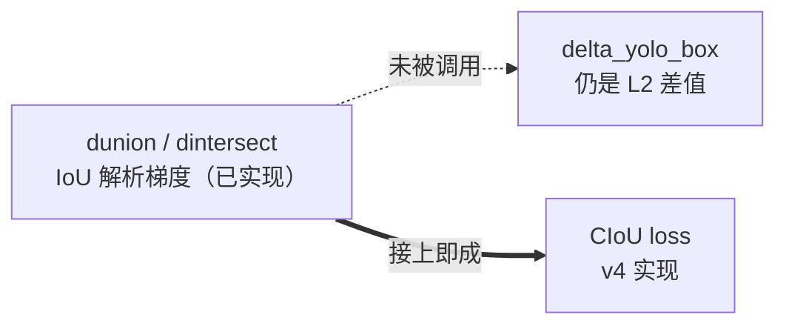

# YOLOv3 源码走读

基于仓库内 darknet 快照 `source/yolov3/snapshot/`（commit `e84933b`，2018-03-25 *"YOLOv3 WOOOO!!!"*，论文发布版），走读四个关键文件。**本页所有代码均为快照原文截取**，头部可跳转完整源码页或 GitHub 对应行。

> 快照与论文口径的差异：论文说 BCE、代码是 SSE 形 delta 混合体；`truth_thresh=1` 监督分支实际不触发；`test_yolo()` 有未初始化 `l.side` 的祖传 bug（见 §3）。一切以快照为准。

## 文件清单

| 文件 | 行数 | 作用 | 完整源码 |
|------|------|------|----------|
| `cfg/yolov3.cfg` | 789 | 107 层结构 + 训练超参 + 3 个 yolo 头 | [浏览](/versions/v3/source/yolo-cfg) |
| `src/yolo_layer.c` | 374 | 检测头：前向里算 loss/delta，推理解码 | [浏览](/versions/v3/source/yolo-layer) |
| `examples/yolo.c` | 331 | 训练/验证/测试入口（**v3 移入 examples/**） | [浏览](/versions/v3/source/yolo) |
| `src/box.c` | 357 | IoU、NMS、IoU 梯度实验函数 | [浏览](/versions/v3/source/box) |

> ⚠️ v3 的目录结构与 v2 不同：`yolo.c` 从 `src/` 移到了 `examples/`——本站所有 `v3:` 引用使用 `v3:examples/yolo.c` 路径。

---

## 1. `yolov3.cfg` — 107 层结构与训练配置

`[net]` 段：输入 416、batch=64、burn_in 升温 + steps 两级衰减、色彩增强三件套：

<SrcSnippet file="v3:cfg/yolov3.cfg" :start="8" :end="23" hl="8-9,14-16,18-19,22-23" />

- `burn_in=1000`：前 1000 iter 线性升温（v2 已有但论文少提，v3 成为标配）
- `hue/saturation/exposure`：v1 的死参数、v2 只有 hue，v3 全部真实生效（见 [tricks §8](/versions/v3/tricks#_8-色彩增强三件套-trick-color-aug)）

骨干残块示例（1×1 降维 + 3×3 升回 + shortcut）：

<SrcSnippet file="v3:cfg/yolov3.cfg" :start="115" :end="140" hl="115-119,139-140" />

三个 yolo 头之一（13×13 大目标，mask 6,7,8）：

<SrcSnippet file="v3:cfg/yolov3.cfg" :start="607" :end="615" hl="608-609,613-615" />

- `num=9` + `mask=6,7,8`：9 个 anchor 全网络共享，本头只认领第 7/8/9 组
- `jitter=.3`（v2 是 .2）、`random=1`（多尺度训练内置，v2 是 0）
- **没有** `*_scale`、`rescore`、`softmax`——v2 的 5 个 loss knob 全删
- `truth_thresh=1`：名义上的高 IoU 奖励阈值，实际是死代码（见 [痛点 §7](/versions/v3/painpoints#_7-快照事实-truth-thresh-1-监督分支是死代码-pain-truth-thresh-dead)）

---

## 2. `yolo_layer.c` — 前向即损失

与 v1/v2 同一哲学：训练时 **`forward_yolo_layer()` 一边前向一边写 `l.delta`**，`backward_yolo_layer()` 只做一次 axpy（<SrcLink file="v3:src/yolo_layer.c" :line="242" :end="245" />）。v3 的新东西：objectness-gated 类别、动态坐标权重、两遍循环分配、前置激活。

### 2.1 构造：三头同构，255 = 3×(4+1+80)

<SrcLink file="v3:src/yolo_layer.c" :line="13" /> `make_yolo_layer(batch, w, h, n, total, mask, classes)`——`n=3`（本头 anchors）、`total=9`（全网）、`mask` 从 cfg 读入。输出 `outputs = h·w·n·(classes + coords + 1)`（<SrcLink file="v3:src/yolo_layer.c" :line="50" />）。

### 2.2 前置激活：tx/ty 与 obj/class

<SrcSnippet file="v3:src/yolo_layer.c" :start="137" :end="146" hl="141-143" />

::: details 逐行注释（L137–L146）
- **L138**：把 conv 1×1 的原始输出（logits）拷进 `l.output`。
- **L141**：对 tx/ty 通道（每 cell 前 2 格）原地做 logistic——**从此 `l.output` 里存的是激活后的值**，v2 是在 delta 里现算现乘。
- **L143**：对 objectness + 80 类通道原地做 logistic（多标签独立 sigmoid）。
- **tw/th 不过激活**：网络直接输出对数缩放，与 v2 一致。
:::

### 2.3 解码 get_yolo_box：σ + exp + anchor

<SrcSnippet file="v3:src/yolo_layer.c" :start="83" :end="91" hl="85-90" />

::: details 逐行注释（L83–L91）
- **L85-86**：`b.x = (i + x[...])/lw`——激活后的偏移加格子索引，除以格子数归一到全图。
- **L87-88**：`b.w = exp(x[...])·biases[2n]/w`——e 的预测次幂 × anchor 宽，再归一。**没有 v2 的 DOABS hack**。
- **L90**：anchor 序号 n 先经 `entry_index` 的 stride 展开，每 cell 3 个 anchor 各占 85 维。
:::

### 2.4 类别 delta：objectness-gated

<SrcSnippet file="v3:src/yolo_layer.c" :start="111" :end="123" hl="114-118" />

- `if (delta[index])` 守卫：objectness 未激活的 anchor 对 80 类**全部沉默**
- 只推正确类 `1 − output`（BCE 对 logits 的严格梯度），其余类不写 delta
- 详析见[反向传播 §5](/versions/v3/loss-gradient#_5-class-项-objectness-gated-的-bce-梯度)

### 2.5 两遍循环：全场 noobj + 逐 GT 定主力

第一遍（<SrcLink file="v3:src/yolo_layer.c" :line="159" :end="192" />）：

<SrcSnippet file="v3:src/yolo_layer.c" :start="176" :end="183" hl="178-181" />

::: details 逐行注释（L176–L183）
- **L178**：默认全部当背景：`delta = 0 − output`（BCE 语义，无 v1 的 0.5 系数）。
- **L179-181**：`best_iou > ignore_thresh(.5)` 时 delta 置 0——预测得好但没被选为主力的框不受罚。
- **L182-183**：`truth_thresh` 分支（IoU>1 才触发）实际死代码。
:::

第二遍（<SrcLink file="v3:src/yolo_layer.c" :line="195" :end="236" />）：对每个 GT 用 9 个 anchor 全局找形状最像的 `best_n`，mask 命中才监督：

<SrcSnippet file="v3:src/yolo_layer.c" :start="216" :end="236" hl="219,223,228" />

::: details 逐行注释（L216–L236）
- **L216-217**：`mask_n < 0` 直接 `continue`——这个 GT 的主力 anchor 属于别的头，本头沉默。
- **L219**：`delta_yolo_box(..., (2-truth.w*truth.h), ...)`——坐标监督 + **动态权重**（小框 ≈2、大框 ≥1.19）。
- **L223**：objectness 正样本目标 = 1（无 rescore），`delta = 1 − output` 覆盖第一遍的背景值。
- **L228**：类别 delta（走 2.4 的 gated 分支）。
- **L234**：avg_iou / recall 统计——IoU 在这里是日志量，不进梯度。
:::

### 2.6 cost 与 backward

`*(l.cost) = pow(mag_array(l.delta, ...), 2)`（<SrcLink file="v3:src/yolo_layer.c" :line="238" />）——Σdelta² 是日志量；`backward_yolo_layer` 一次 axpy 把 delta 加回 `net.delta`。

---

## 3. `examples/yolo.c` — 入口与祖传 bug

v3 把训练/验证/测试入口从 `src/` 挪到 `examples/`：`train_yolo`（<SrcLink file="v3:examples/yolo.c" :line="5" />）、`validate_yolo`（<SrcLink file="v3:examples/yolo.c" :line="98" />）、`test_yolo`（<SrcLink file="v3:examples/yolo.c" :line="265" />）、`run_yolo`（<SrcLink file="v3:examples/yolo.c" :line="311" />）。

**test_yolo 的 side bug**（与 v2 的强转 bug 同源的祖传死代码）：

<SrcSnippet file="v3:examples/yolo.c" :start="293" :end="298" hl="295-297" />

::: details 逐行注释（L293–L298）
- **L294**：`get_network_boxes` 返回真实框数 `nboxes`（内部走 `get_yolo_detections`，正确）。
- **L295/297**：却把 `l.side*l.side*l.n` 传给 NMS 和画框——`side` 是 v1 detection 层的字段，`make_yolo_layer` 从不赋值（=0），所以 `0×0×3=0`：**NMS 空转、画框为空**。
- 正确用法是传 `nboxes`；社区后续 commit 已修。实际推理走 `darknet detector test`（`examples/detector.c`），不经过这里。
:::

---

## 4. `box.c` — IoU 家族与未被调用的梯度实验

核心函数：`box_iou`（<SrcLink file="v3:src/box.c" :line="179" />）、`do_nms_sort`（<SrcLink file="v3:src/box.c" :line="58" />，按类贪心抑制，v1 逻辑原样）、`float_to_box`（<SrcLink file="v3:src/box.c" :line="91" />）。

**IoU 梯度实验函数仍在**：`dintersect`（<SrcLink file="v3:src/box.c" :line="192" />）/ `dunion`（<SrcLink file="v3:src/box.c" :line="207" />）算 IoU 对框坐标的解析导数，`test_dunion/test_dintersect/test_box`（L221/243/266）是配套单元测试——**检测路径依然没调用它们**。pjreddie 已经把 CIoU 的数学备好了，只差把它接进 delta_yolo_box——这一步要等 v4。

---

## 阅读路线建议

1. 先看 [Architecture 逐层图解](/versions/v3/architecture)建立 107 层地图
2. `cfg` 的 [yolo] 段（<SrcLink file="v3:cfg/yolov3.cfg" :line="607" :end="615" />）→ `yolo_layer.c` 的 forward（<SrcLink file="v3:src/yolo_layer.c" :line="132" />）→ 两遍循环（<SrcLink file="v3:src/yolo_layer.c" :line="159" :end="236" />）
3. 对照 [losses](/versions/v3/losses) / [loss-gradient](/versions/v3/loss-gradient) 逐行验证公式
4. 最后读 [painpoints](/versions/v3/painpoints) 复核三个快照级发现

## 延伸阅读

- [源码页：yolo_layer.c](/versions/v3/source/yolo-layer) / [yolo.c](/versions/v3/source/yolo) / [box.c](/versions/v3/source/box) / [yolov3.cfg](/versions/v3/source/yolo-cfg)
- [痛点追踪](/versions/v3/painpoints)
- [v2 源码走读](/versions/v2/code-walkthrough)
