# YOLOv3 理论 Concept

YOLOv3 相比 v2 引入/演进了 9 个核心概念。每个都配**原理图 + 白话 + 源码对应**。源码统一指向 v3 快照（commit `e84933b`）。

---

## 1. Darknet-53 残差骨干 (`concept-darknet53-residual`)

> **v2 读者路标**：v2 的 Dense 变体是"1×1 压缩 + 3×3 提取"的串联堆叠，没有跨层相加；v3 每段塞入 N 个残块，shortcut 把输入**直接加回**输出。

### 原理图

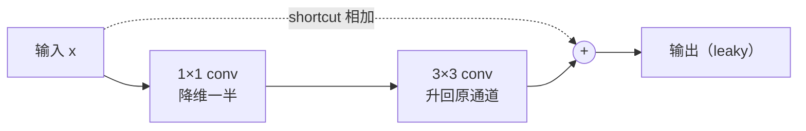

### 白话

> 残差连接让梯度有一条"高速公路"：就算中间卷积学砸了，梯度也能原样流回浅层。这让 v3 敢把骨干从 31 层加深到 107 层——精度涨了，训练却比 v2 更稳。

### 结构分解

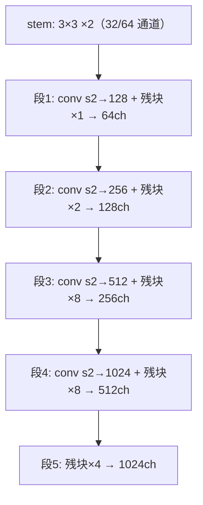

52 conv + 23 shortcut，每段步进 2 下采样共 5 次（416/2⁵ = 13）。逐层明细见 [Architecture 页](/versions/v3/architecture)。

### 源码对应

第一个 shortcut 在 <SrcLink file="v3:cfg/yolov3.cfg" :line="59" />（`layers=-3`，把 3 层前的输出加回来）。相加逻辑在 `src/shortcut_layer.c`（v2 快照没有这个文件）。

---

## 2. 三尺度 FPN 检测头 (`concept-fpn-three-scales`)

> **v2 读者路标**：v2 只有一个 13×13 检测头，靠 reorg 把 26×26 特征"重排"下来拼一次；v3 反过来——**从深层往浅层 upsample 两次**，把语义特征送回 26×26 和 52×52，各自立头出框。

### 原理图

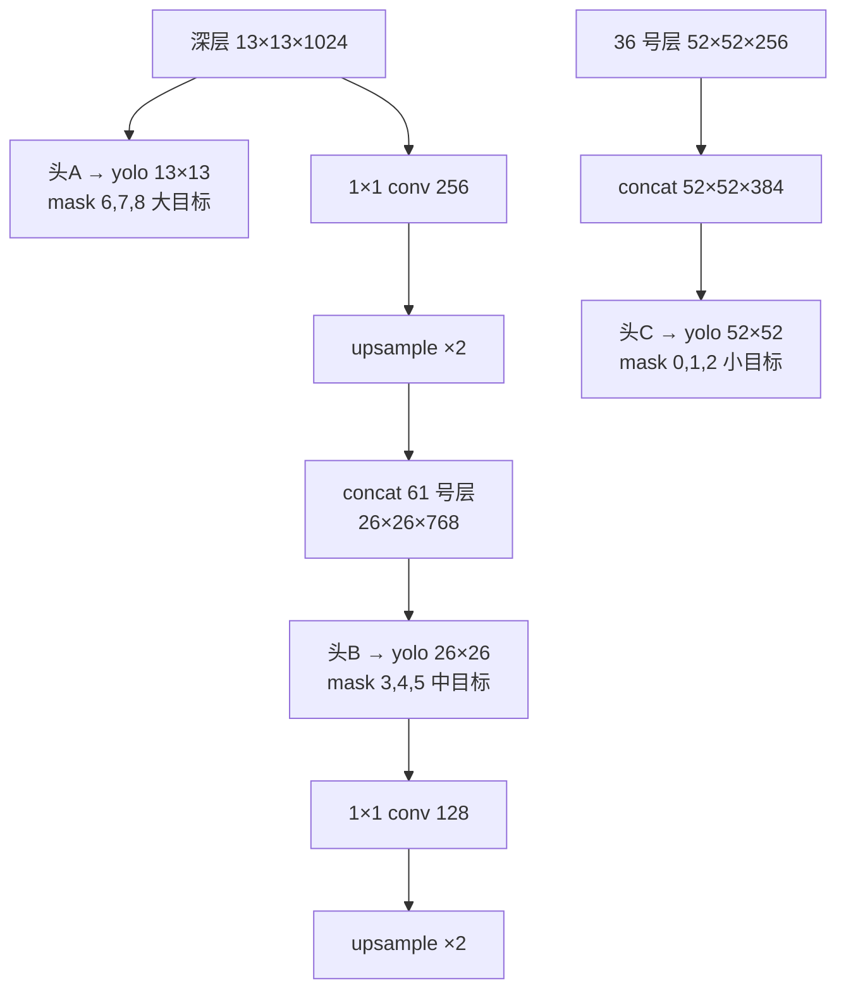

### 白话

> v2 的小目标必须"活过"5 次下采样才能被 13×13 看到，信息早被压没了。v3 把深层语义特征**搬运回**浅层：52×52 头只离输入 3 次下采样，像素细节保留完整，小目标终于有专门的"眼睛"。

### 与 v2 passthrough 的对比

| | v2 passthrough | v3 FPN 回连 |
|---|---|---|
| 方向 | 浅层 → 深层（重排下采样） | 深层 → 浅层（上采样） |
| 次数 | 1 次 | 2 次 |
| 检测头 | 1 个（13×13） | 3 个（13/26/52） |
| 拼接后通道 | 3072 | 768 / 384 |

### 源码对应

第一处回连 <SrcLink file="v3:cfg/yolov3.cfg" :line="618" :end="633" />（route -4 → conv 256 → upsample → route -1,61）；第二处 <SrcLink file="v3:cfg/yolov3.cfg" :line="705" :end="720" />（route -4 → conv 128 → upsample → route -1,36）。`[upsample]` 层实现在 `src/upsample_layer.c`（最近邻 ×2，v2 没有）。

---

## 3. 9 Anchors 三组 mask (`concept-anchors-9-mask`)

> **v2 读者路标**：v2 单头 5 个 anchor、K-means 距离用 \(1-\text{IoU}\)；v3 聚 9 类，按大小均分三组，每个头只认领自己的 3 个。

### 原理图

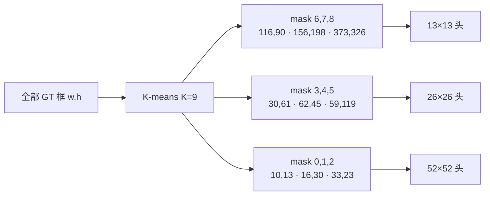

### 白话

> 9 个 anchor 是全网络共享的"形状字典"，但每个头只取 3 个：大格子（13×13）配大框，小格子（52×52）配小框。这样 GT 分配时天然按尺度分流，不会出现"小目标被大格子的 anchor 抢走"。

### 源码对应

<SrcLink file="v3:cfg/yolov3.cfg" :line="607" :end="615" />：`num=9` 声明全集，`mask=6,7,8` 只取第 7/8/9 个（0-indexed）。三头的 mask 分别是 6,7,8 / 3,4,5 / 0,1,2。

---

## 4. 多标签 logistic 类头 (`concept-multi-label-logistic`)

> **v2 读者路标**：v2 的 80 维类头过 softmax（互斥，∑=1，见 [v2 concepts §7](/versions/v2/concepts#_7-softmax-类别头-concept-softmax-classes)）；v3 删掉 softmax，每维独立 logistic。

### 原理图

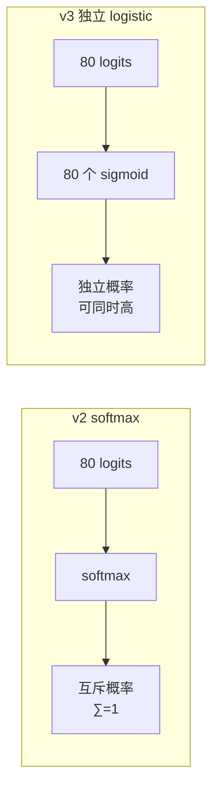

### 白话

> 数据集开始出现重叠标签："Woman" 和 "Person" 同时是真。softmax 强制一类独大，会互相压制。v3 给每个类一个独立的 sigmoid，"这框里 90% 是人、85% 是女人"可以共存。

### 快照细节

激活发生在训练前向最开始：<SrcLink file="v3:src/yolo_layer.c" :line="141" :end="143" />，tx/ty 一段 + objectness/80 类一段都过 `LOGISTIC`，**tw/th 保持线性**。

> ⚠️ 论文写训练用 binary cross-entropy，快照代码实际仍是 SSE delta（`delta = 1 − output`）——这是 darknet "论文与实现不一致"的名场面，[losses 页](/versions/v3/losses)有逐行分析。

---

## 5. Objectness-gated 类别 delta (`concept-objectness-gated-delta`)

> **v2 读者路标**：v2 的类梯度对"匹配上 anchor 的格子"推全部 80 维；v3 的 `delta_yolo_class` 开头多了 `if (delta[index])` 守卫——**objectness 没被激活的 anchor，对类别完全沉默**。

### 原理图

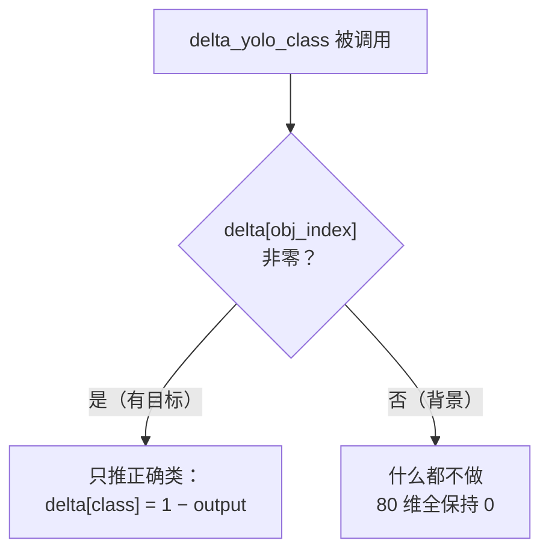

### 白话

> 背景格子的 anchor 本来就不该学类别。v2 代码路径里这一层是靠"只有匹配上的格子才调用类别 delta"间接保证；v3 把守卫**显式写进函数**：先看 objectness 的 delta 是不是非零，非零才推"正确类 1 − output"，其余 79 类不动。

### 源码对应

<SrcSnippet file="v3:src/yolo_layer.c" :start="111" :end="123" hl="114-118" />

::: details 逐行注释（L111–L123）
- **L114**：`if (delta[index])` —— `index` 指向该 anchor 的 objectness 槽位；delta 非零说明这个 anchor 已被判为"有目标"（第二遍循环的 `L223` 已写入 `1 − output`）。
- **L115**：只对**正确类**写 `1 − output`，把它推向 1；其余类不写 delta（保持 memset 的 0）。
- **L116**：`avg_cat` 统计正确类的平均输出（训练日志用）。
- **L119-122**：守卫不成立时的兜底分支——推全部 80 维 one-hot delta。本快照中两个调用点（L188 传 0、L228 传 `&avg_cat`）都在 objectness 已写 delta 之后，所以**实际只走 L115 分支**。
:::

---

## 6. 坐标权重 scale = 2 − w·h (`concept-box-scale-weight`)

> **v1/v2 读者路标**：v1 用 √w√h 压动态范围（coord=5 统一权重）；v2 log 空间 + 统一权重；v3 在 log 空间上**按 GT 面积反比加权**——小框自动获得接近 2 的权重。

### 原理图

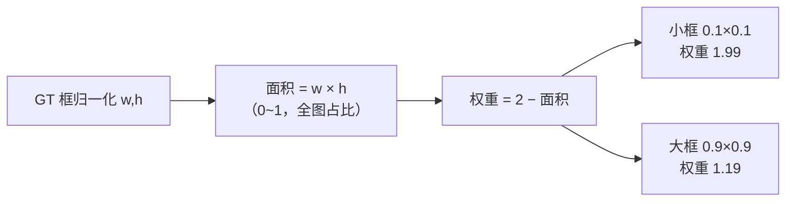

### 白话

> 一张图里大框没几个、小框一大堆，但 v2 给所有框的坐标损失同等权重。v3 的 `scale = 2 − truth.w × truth.h`：框越小（面积占比低）权重越接近 2，大框最低也有 1.19——**小目标的坐标回归被隐性加倍重视**。

### 源码对应

两处传入：第一遍循环 truth_thresh 分支 <SrcLink file="v3:src/yolo_layer.c" :line="190" />、第二遍循环主路径 <SrcLink file="v3:src/yolo_layer.c" :line="219" />；权重消费在 `delta_yolo_box` 的 <SrcLink file="v3:src/yolo_layer.c" :line="103" :end="106" />（`delta = scale × (target − x)`）。

<SrcSnippet file="v3:src/yolo_layer.c" :start="93" :end="108" hl="96,103-106" />

::: details 逐行注释（L93–L108）
- **L95**：先用当前网络输出解码预测框（内部调 `get_yolo_box`）。
- **L96**：算预测框与 GT 的 IoU——**只用于日志统计**（L234 `avg_iou`），不进损失。
- **L98-99**：x/y 目标 = GT 在格子坐标系的位置差 `truth.x*lw − i`（与 v2 同构，直接 L2 到线性目标）。
- **L100-101**：w/h 目标 = `log(truth.w×net.w / anchor_w)`——相对 anchor 的对数缩放。
- **L103-106**：delta = `scale × (目标 − 预测)`，`scale` 就是调用方传入的 `2 − truth.w × truth.h`；注意预测值是 logistic **激活后**的输出。
:::

---

## 7. GT 分配两遍循环 + ignore_thresh (`concept-gt-assignment`)

> **v2 读者路标**：v2 的 `forward_region_layer` 一遍循环里同时做 noobj 标记和 bias-match 监督；v3 把它**拆成两遍**——第一遍全场打 noobj、第二遍逐 GT 找归属，中间用 `ignore_thresh` 挡住"预测得好但没被选中"的框。

### 原理图

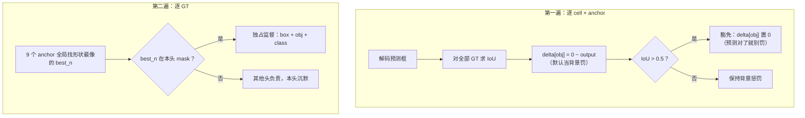

### 白话

> 第一遍先"有罪推定"：所有 anchor 都按背景罚，但 IoU>0.5 的豁免——避免惩罚"其实框得挺好、只是没被选为主力"的预测。第二遍再按形状把每个 GT 交给最像它的 anchor 独占训练。两遍配合，既压背景误报，又不打压高质量预测。

### 快照彩蛋：truth_thresh 分支实际不触发

第一遍循环里还有个 `truth_thresh` 分支（<SrcLink file="v3:src/yolo_layer.c" :line="182" :end="191" />，IoU 超阈值时推 obj+class+box 监督）。但 cfg 里 `truth_thresh = 1`（<SrcLink file="v3:cfg/yolov3.cfg" :line="614" />），而 IoU 恒 ≤ 1，`best_iou > 1` **永远为假**——这段监督代码在默认配置下是死代码，真正的监督全靠第二遍循环。

### 源码对应

第一遍 <SrcLink file="v3:src/yolo_layer.c" :line="159" :end="192" />；第二遍 <SrcLink file="v3:src/yolo_layer.c" :line="195" :end="236" />。

<SrcSnippet file="v3:src/yolo_layer.c" :start="176" :end="183" hl="178-181" />

::: details 逐行注释（L176–L183）
- **L176**：定位该 anchor 的 objectness 槽位。
- **L178**：`delta = 0 − output`——默认把所有 anchor 当背景，推向 0（v3 没有系数 0.5，v2 的 noobj_scale=1 同样无 0.5）。
- **L179-181**：`best_iou > ignore_thresh(0.5)` 时把 delta 清零——这个预测框已经很像某个 GT 了，罚它反而打压好预测。
- **L182-183**：`truth_thresh` 分支（IoU>1 才触发，实际死代码，见上）。
:::

---

## 8. 多尺度训练内置 (`concept-multiscale-training`)

> **v2 读者路标**：v2 cfg 里 `random=0`，多尺度靠训练脚本改分辨率重启；v3 `random=1` 直接内置——每 10 个 batch 重摇输入尺寸。

### 原理图

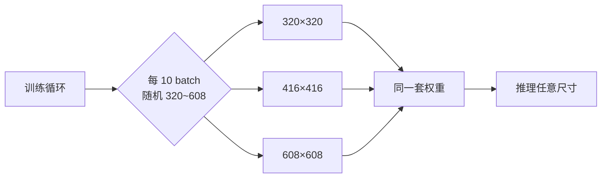

### 白话

> 全卷积网络输入尺寸随便换。训练时反复"换焦距"，网络学到尺度无关的特征；三尺度头本来就是为不同大小目标设计的，多尺度训练让每个头在各种输入下都被锻炼到。

### 源码对应

`random=1`：<SrcLink file="v3:cfg/yolov3.cfg" :line="615" />（三个 yolo 段各写一次）。解析进 `l.random`，由 `src/detector.c` 的 `train_detector` 每 10 batch 重设网络宽高。对比 v2 快照同位置是 `random=0`（<SrcLink file="v2:cfg/yolo.cfg" :line="244" />）。

---

## 9. 色彩增强三件套生效 (`concept-color-augmentation`)

> **v1/v2 读者路标**：v1 的 cfg 里 saturation/exposure 是死参数（数据路径没调用）；v2 加了 hue 但只此一项；v3 的 hue + saturation + exposure **全部在数据路径真实生效**。

### 原理图

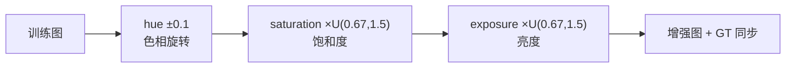

### 白话

> 现实里的照片有各种光照和色温。训练时随机微调色相、饱和度、亮度，模型就不会把"暗照片里的狗"认成新东西。三件套配合 jitter 裁剪 + 翻转，构成 v3 的完整增强链。

### 源码对应

cfg <SrcLink file="v3:cfg/yolov3.cfg" :line="14" :end="16" />；消费在 `src/data.c` 的 `load_data_detection`（`random_distort_image`，v1 快照的该函数**未被检测数据路径调用**）。

---

## Concept 依赖图

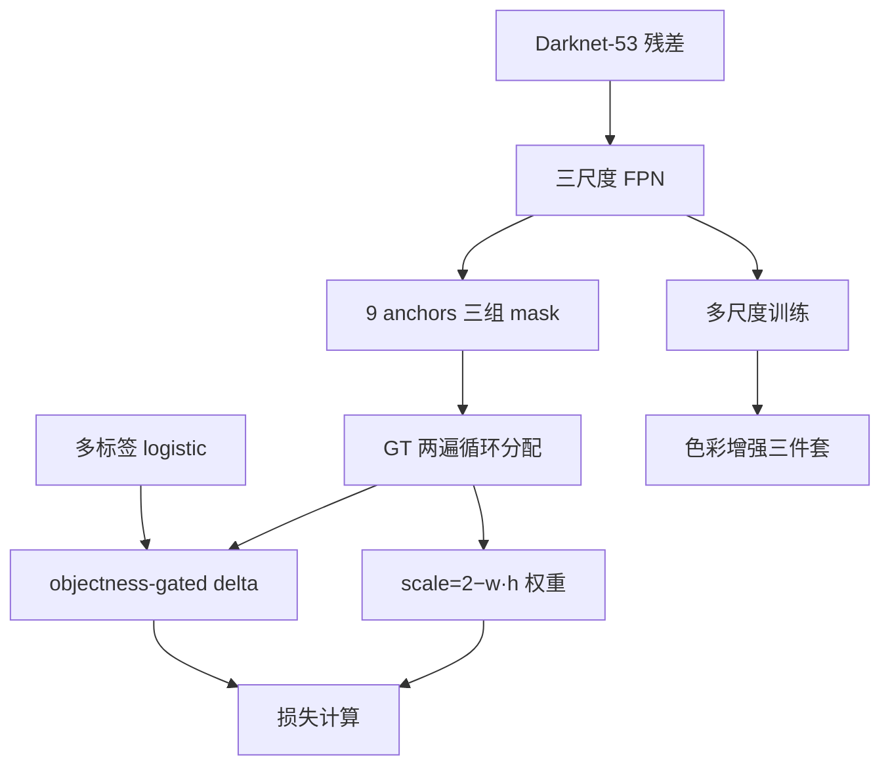

---

## 延伸阅读

- [论文精读](/versions/v3/paper)
- [Architecture 逐层图解](/versions/v3/architecture)
- [损失函数](/versions/v3/losses)
- [反向传播推导](/versions/v3/loss-gradient)
- [训练技巧](/versions/v3/tricks)
- [源码走读](/versions/v3/code-walkthrough)
