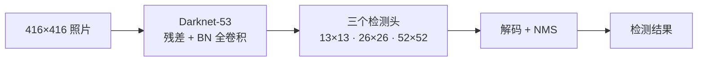
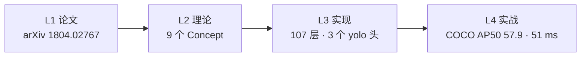
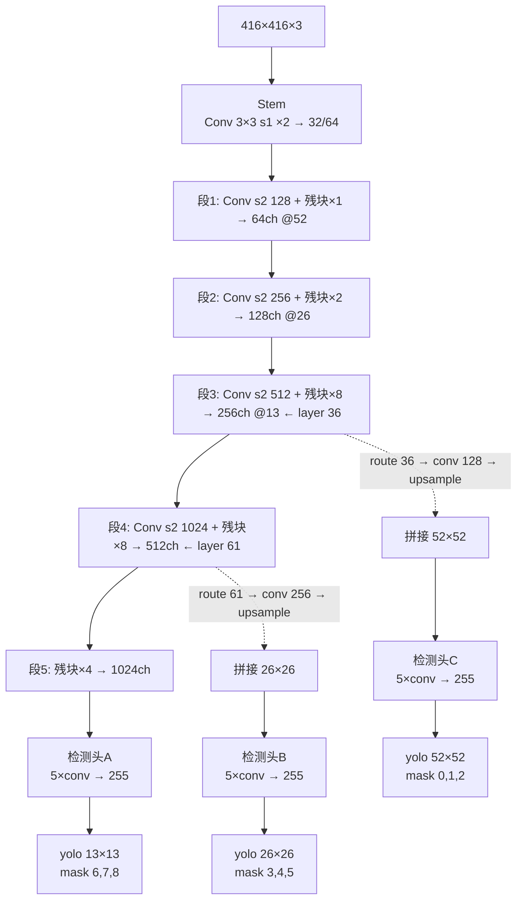

# YOLOv3 (2018-04)

**YOLOv3: An Incremental Improvement**

- 📄 论文：[arXiv:1804.02767](https://arxiv.org/abs/1804.02767) · arXiv 2018
- 🏛️ 作者：Joseph Redmon, Ali Farhadi
- 💻 源码：[pjreddie/darknet](https://github.com/pjreddie/darknet) commit `e84933b`
- 🎯 里程碑：**"增量改进"（论文原话）**——残差骨干 [Darknet-53](/glossary#darknet-53)、三尺度 FPN 检测头、多标签 logistic 类头，COCO AP50 从 48.1 冲到 57.9

## 3 分钟电梯演讲

1. **v2 只有一个 13×13 头，小目标吃大亏**：v3 加了 26×26 和 52×52 两个头，浅层细节经 upsample 拼回来——[FPN 思路](/glossary#fpn-特征金字塔) 在检测器里成型。
2. **骨干换成带残差的 Darknet-53**：分类精度追平 ResNet-101，速度快 1.5 倍；softmax 类头换成独立 logistic，一次能认多个标签（"女人"同时是"人"）。
3. **结果**：COCO AP50 从 v2 的 48.1 → **57.9**（608 输入），和 SSD 打平但快约 3 倍；论文标题就叫 *An Incremental Improvement*——一次不吹牛的升级。

> 已读过 [v2](/versions/v2/index)？本页下方有 v2→v3 逐项差异表；术语不熟先查[术语表](/glossary)。

## 四层闭环视图

## 核心贡献

1. **Darknet-53 残差骨干**：Darknet-19 + ResNet 式 [shortcut](/glossary#shortcut-残差连接)，1×1/3×3 交替堆叠，ImageNet top-1 77.2%（ResNet-101 77.1% 但速度只有其一半）
2. **三尺度预测头（FPN）**：13×13 / 26×26 / 52×52 三头并联，9 个 [anchor](/glossary#anchor-锚框-先验框) 按尺度分 3 组；upsample 上采样 + route 回连浅层特征
3. **多标签分类头**：删掉 softmax，每类独立 [logistic](/glossary#logistic-激活)——适配 Open Images 式重叠标签（Person + Woman 可同时成立）
4. **小目标友好的坐标权重**：`scale = 2 − truth.w × truth.h`，框越小权重越大（v2 是统一权重）
5. **训练配置补齐**：hue/saturation/exposure 色彩增强真实生效 + `random=1` 多尺度训练内置（v2 靠脚本切分辨率）

## 推理效果一览

<DiagramPipeline caption="图：v3 推理流水线——输入 416×416，Darknet-53 主干 → 两次 upsample + route 回连浅层 → 三个 yolo 头（13/26/52 格）各输出 255 通道 → 解码 + NMS" />

## 关键指标

**检测（COCO test-dev，Titan X）**

| 模型 | 输入 | AP50 | AP | 延迟 |
|------|------|----------------|-----|------|
| YOLOv3-320 | 320×320 | 51.5 | 28.2 | 22 ms |
| YOLOv3-416 | 416×416 | 55.3 | 31.0 | 29 ms |
| YOLOv3-608 | 608×608 | **57.9** | **33.0** | 51 ms |

- 对比 SSD：AP50 相当，**快约 3 倍**
- 对比 RetinaNet：高 IoU 段（AP75）与 AP 整体落后——论文自己承认 *"YOLOv3 is a good detector, it is not the strongest"*
- 对比 v2（同口径 YOLOv2-608）：AP50 48.1 → 57.9

**骨干分类（ImageNet，Titan X）**

| 骨干 | top-1 | top-5 | FPS |
|------|-------|-------|-----|
| Darknet-53 | **77.2** | 93.8 | **78** |
| ResNet-101 | 77.1 | 93.6 | 53 |
| ResNet-152 | 77.6 | 94.1 | 32 |

## 网络架构

- **107 层**（cfg 逐层盘点）：75 conv + 23 shortcut + 4 route + 2 upsample + 3 yolo（**逐层明细见 [Architecture 逐层图解](/versions/v3/architecture)**）
- **Darknet-53** = stem 1 conv + 5 段（s2 卷积 64/128/256/512/1024 + 残块 1/2/8/8/4）= 52 conv + 23 shortcut
- **输出 255 = 3 anchors × (4 坐标 + 1 objectness + 80 类)**，每个头各自 255 通道
- **全卷积 + BN**：无 FC，激活全 leaky（检测头末层 linear）
- 参数量约 62M（BN 参数不计入）——层数翻倍但参数比 v2 的 67M 略降

## 核心 Concept 一览

| Concept | 一句话 | 对应代码位置 |
|---------|--------|-------------|
| Darknet-53 残差 | shortcut 层两输入相加 | <SrcLink file="v3:cfg/yolov3.cfg" :line="59" /> |
| 9 anchors 三组 mask | K-means 先验按尺度切分 | <SrcLink file="v3:cfg/yolov3.cfg" :line="608" :end="609" /> |
| FPN 三头回连 | upsample + route 拼浅层 | <SrcLink file="v3:cfg/yolov3.cfg" :line="629" :end="633" /> |
| 多标签 logistic 类头 | softmax 删除，每类独立 | <SrcLink file="v3:src/yolo_layer.c" :line="111" :end="118" /> |
| objectness-gated delta | 有目标时只推正确类 | <SrcLink file="v3:src/yolo_layer.c" :line="111" :end="118" /> |
| 坐标权重 2−w·h | 小框自动加大权重 | <SrcLink file="v3:src/yolo_layer.c" :line="190" /> |
| ignore_thresh 豁免 | noobj 不罚高 IoU 预测 | <SrcLink file="v3:src/yolo_layer.c" :line="179" /> |
| GT 分配两遍循环 | 先全场 noobj 豁免、再 best_n 监督 | <SrcLink file="v3:src/yolo_layer.c" :line="132" /> |
| 多尺度训练内置 | random=1 每批换分辨率 | <SrcLink file="v3:cfg/yolov3.cfg" :line="615" /> |
| 色彩增强生效 | hue/sat/exposure 全在数据路径调用 | <SrcLink file="v3:cfg/yolov3.cfg" :line="14" :end="16" /> |

## v2 → v3 关键差异

| 维度 | YOLOv2 | YOLOv3 |
|------|--------|--------|
| 骨干 | Darknet-19（31 层，无残差） | **Darknet-53（107 层，23 个 shortcut）** |
| 检测头 | 单头 13×13 | **三头 13/26/52（FPN 回连）** |
| 候选框 | 5 anchors（单头独占） | **9 anchors，每头 3 个（mask 切分）** |
| 类别头 | softmax（互斥单标签） | **独立 logistic（多标签）** |
| loss 权重 | coord=1/obj=5/noobj=1/cls=1 | **四项 scale 全删，硬编码进 yolo_layer.c** |
| 坐标权重 | 统一权重 | **scale = 2 − truth.w × truth.h（小框加权）** |
| 跨层连接 | route + reorg（一次） | **route + upsample（两次回连）** |
| 多尺度训练 | cfg random=0，靠脚本切换 | **cfg random=1 内置** |
| 参数量 | ~67M | **~62M** |
| COCO AP50（608） | 48.1 | **57.9** |
| FPS（Titan X，608） | — | 20 |

## 暴露的痛点

| 痛点 | 严重度 | 后续版本的解法 |
|------|--------|---------------|
| 高 IoU 段（AP75）落后 RetinaNet | High | IoU-series loss（v4 CIoU / v5 CIoU 变体） |
| 大目标召回一般（论文自嘲） | Medium | 更强骨干 + 更准分配策略（v4: OTA/SimOTA） |
| loss 仍是 sum-squared error | Medium | v4 换 CIoU + BCE 组合 |
| anchor 仍是手工超参（K-means 换数据集要重跑） | Medium | v5 保留 anchor 但自动化；anchor-free 路线兴起 |
| 单 GT 单头独占（两遍循环分配） | Medium | v4 跨头多正样本分配 |

## 深入阅读

- [论文精读](/versions/v3/paper)
- [Architecture 逐层图解](/versions/v3/architecture)
- [理论 Concept](/versions/v3/concepts)
- [架构与层速查](/versions/v3/layers)
- [损失函数](/versions/v3/losses)
- [反向传播推导](/versions/v3/loss-gradient)
- [训练技巧](/versions/v3/tricks)
- [源码走读](/versions/v3/code-walkthrough)
- [痛点追踪](/versions/v3/painpoints)
