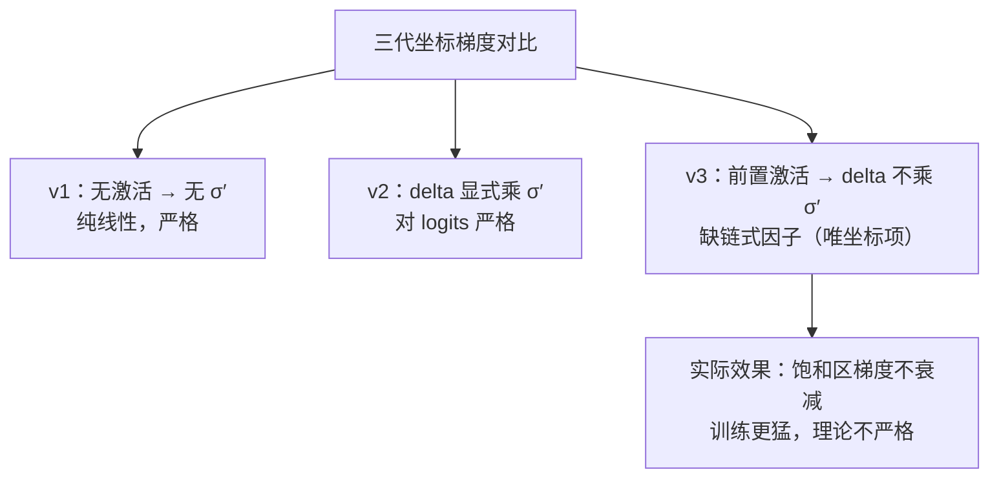
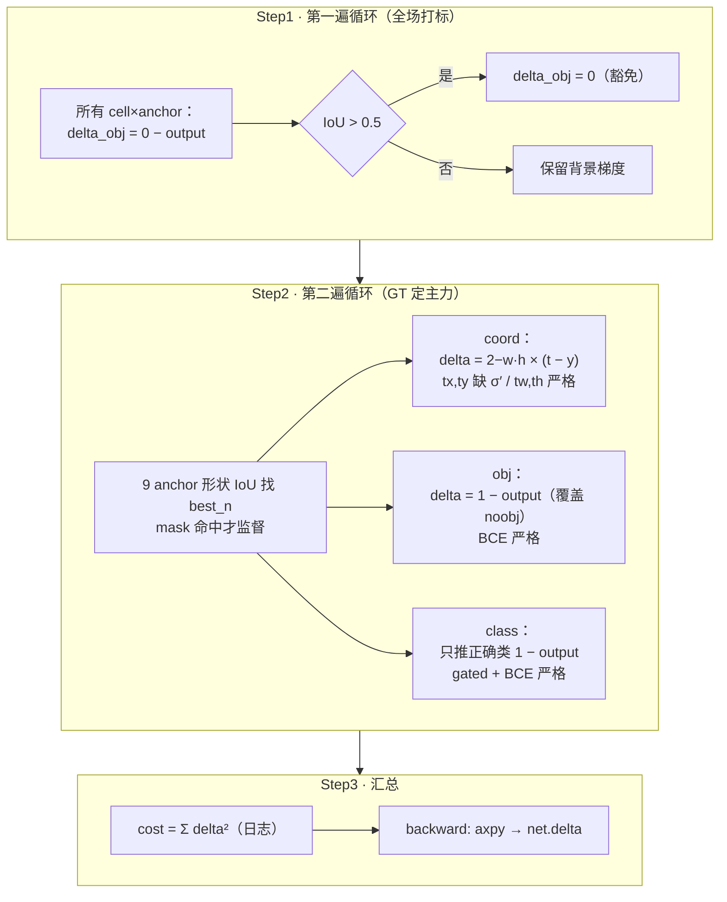

# YOLOv3 反向传播精解：从公式到 delta 的完整推导

> 这是 v3 最"硬核"的一页。[损失函数](/versions/v3/losses)讲了"损失长什么样"，这一页讲"**梯度怎么一步步算出来**"——`forward_yolo_layer()` 里那些 delta 赋值，在数学上到底对应什么。
>
> 全程对照真实源码：<SrcLink file="v3:src/yolo_layer.c" :line="132" /> 起的 `forward_yolo_layer()`，行号以快照 `e84933b` 为准；也可直接打开 [yolo_layer.c 整文件浏览](/versions/v3/source/yolo-layer)。

::: tip TL;DR：只想带走三件事
1. **v3 的激活被前置**：forward 一开始就把 tx/ty/objectness/类别原地过 sigmoid（<SrcLink file="v3:src/yolo_layer.c" :line="141" :end="143" />），delta 直接在激活后的值上算差——**v2 的 σ′ 链式因子消失了**。
2. **梯度是"BCE + 残缺 MSE"的混合体**：objectness/class 的 `t − output` 恰好是 BCE 对 logits 的严格梯度（σ′ 被消掉）；坐标 tx/ty 的 `t − output` 却缺 σ′（v2 有）——只有坐标项不严格。
3. **动态权重 `2 − w·h` 乘进坐标 delta**，ignore 豁免实现为 delta 置 0，一个 GT 仍独占一个 anchor。
:::

---

## 0. 先搞懂 darknet 的"梯度约定"，以及 v3 改了哪一步

约定与 [v1](/versions/v1/loss-gradient)/[v2](/versions/v2/loss-gradient) 相同：`l.delta[]` 存放每个输出神经元的误差信号，取**损失对输出梯度的相反数**。

$$\delta_i = -\frac{\partial L}{\partial output_i}$$

`backward_yolo_layer`（<SrcLink file="v3:src/yolo_layer.c" :line="242" :end="245" />）只是累加：

```c
void backward_yolo_layer(const layer l, network net)
{
   axpy_cpu(l.batch*l.inputs, 1, l.delta, 1, net.delta, 1);
}
```

**真正的结构变化在 forward 开头**（<SrcLink file="v3:src/yolo_layer.c" :line="137" :end="146" />）：

```c
memcpy(l.output, net.input, l.outputs*l.batch*sizeof(float));
for (b...) for (n...) {
    index = entry_index(l, b, n*l.w*l.h, 0);
    activate_array(l.output + index, 2*l.w*l.h, LOGISTIC);          // tx,ty 原地 sigmoid
    index = entry_index(l, b, n*l.w*l.h, 4);
    activate_array(l.output + index, (1+l.classes)*l.w*l.h, LOGISTIC); // obj+80类 原地 sigmoid
}
```

对比三代的梯度处理：

| | 激活时机 | delta 里有没有 σ′ | 数学身份 |
|---|---|---|---|
| v1 | 无激活（坐标/置信度全线性） | 无需 | 纯线性 MSE，严格 |
| v2 | delta 计算时显式乘 `logistic_gradient` | **有** | 对 logits 的严格 MSE 梯度 |
| v3 | forward 开头原地激活 `l.output` | **无** | 混合体（下文拆解） |

v3 的 `l.delta` 算的是"激活后输出 y 的梯度"，但 backward 直接把它累加到 `net.delta`（对应激活前的 logits a）——中间的 sigmoid 雅可比**没有被应用**。这不是疏忽的偶然，看下面各分项的"对错账本"。

---

## 1. 总损失回顾

```
每个头（×3）、每张图的处理：
  ┌─ 第一遍循环：所有 cell×anchor 先写 noobj，IoU>0.5 豁免      （§6）
  ├─ 第二遍循环：对每个 GT：
  │     ├─ 9 anchor 全局找形状最像的 best_n（mask 命中才监督）    （§2）
  │     ├─ coord 项 → delta[0..3]（动态 scale，缺 σ′）           （§3）
  │     ├─ obj 项   → delta[obj] = 1 − output（BCE 严格）        （§4）
  │     └─ class 项 → delta[正确类] = 1 − output（gated，BCE 严格）（§5）
  └─ cost = Σ delta²（日志监控量）
```

---

## 2. 目标分配：两遍循环的梯度含义

真实循环：第一遍 <SrcLink file="v3:src/yolo_layer.c" :line="159" :end="192" />，第二遍 <SrcLink file="v3:src/yolo_layer.c" :line="195" :end="236" />。

第二遍的形状匹配（v2 bias_match 的延续）：

```c
for(n = 0; n < l.total; ++n){          // 9 个 anchor 全局找
    box pred = {0};
    pred.w = l.biases[2*n]/net.w;      // 只用 anchor 形状，位置归零
    pred.h = l.biases[2*n+1]/net.h;
    float iou = box_iou(pred, truth_shift);
    if (iou > best_iou){ best_iou = iou; best_n = n; }
}
int mask_n = int_index(l.mask, best_n, l.n);   // best_n 属于本头吗
if(mask_n >= 0){ /* coord + obj + class 监督 */ }
```

**梯度视角的效果**：

- 一个 GT **独占** 9 个 anchor 里形状最像的 1 个（且必须落在本头的 mask 里，否则由别的头负责）——正样本极度稀疏，每头 13×13×3=507 个候选里通常只有个位数正样本
- 第一遍循环里已经把全场写成 noobj（或豁免），第二遍的 obj delta = `1 − output` 会**覆盖**主力的 noobj 值——顺序保证了正确性
- `truth_thresh=1` 的第一遍监督分支是死代码（IoU 恒 ≤ 1），对梯度无贡献

---

## 3. coord 项：位置回归的梯度（动态权重 + 缺失的 σ′）

### 3.1 目标与 delta 写法

真实赋值 <SrcLink file="v3:src/yolo_layer.c" :line="93" :end="108" />：

```c
float tx = (truth.x*lw - i);                       // 目标：格子内偏移 0~1
float ty = (truth.y*lh - j);
float tw = log(truth.w*w / biases[2*n]);           // 目标：相对 anchor 的对数
float th = log(truth.h*h / biases[2*n + 1]);

delta[index + 0*stride] = scale * (tx - x[index + 0*stride]);
delta[index + 1*stride] = scale * (ty - x[index + 1*stride]);
delta[index + 2*stride] = scale * (tw - x[index + 2*stride]);
delta[index + 3*stride] = scale * (th - x[index + 3*stride]);
```

调用时 `scale = (2 − truth.w×truth.h)`（<SrcLink file="v3:src/yolo_layer.c" :line="219" />）。

### 3.2 tw/th：严格正确（线性输出无链式）

网络输出 `a` 本身就是 log 值（解码 `exp(a)·anchor`），损失写在 log 空间：

$$\frac{\partial L}{\partial a} = scale \cdot (a - t_w^{*}) \quad \leftarrow \; \text{无激活，导数}=1$$

所以 tw/th 的 delta = `scale·(tw* − a)` 是**严格的 MSE 梯度**，与 v2 相同（v2 的 wh 也不乘梯度）。

### 3.3 tx/ty：缺 σ′ 的 MSE（与 v2 的关键差异）

设 logits 为 `a`，激活后 `p = σ(a)`（forward 开头已原地写入 `x[...]`），目标 `p*`。严格推导：

$$L = scale \cdot (p - p^{*})^2 \;\Rightarrow\; \frac{\partial L}{\partial a} = scale \cdot (p - p^{*}) \cdot \underbrace{\sigma'(a)}_{\text{链式因子}}$$

v2 的代码老老实实乘了：`delta = scale·(tx* − σ(a))·σ'(a)`（[v2 §3.2](/versions/v2/loss-gradient#_32-delta-的直接写法)）。v3 的代码是：

$$\delta = scale \cdot (p^{*} - p) \qquad \leftarrow \; \textbf{缺 } \sigma'(a)$$

**后果分析**：

- `σ'(a) ∈ (0, 0.25]`，在输出远离目标（饱和区）时趋近 0。v2 会自动"减弱饱和样本的拉扯"，v3 不减——**饱和区梯度反而更大**，等于给难样本变相加权
- 换来的好处：没有 σ′ 时梯度不会消失，训练对学习率更鲁棒；这也是为什么 v3 砍掉 σ′ 后训练依然稳定
- 严格来说这不是 MSE 的无偏梯度，社区通常把 v3 的坐标损失理解为"实用主义近似"



### 3.4 动态 scale = 2 − w·h 乘在哪


v2 里所有 GT 的坐标权重一律 1，"大目标误差天然大"主导梯度；v3 用面积反比权重把天平拨向小框——这是三尺度头之外的第二个小目标补救。

---

## 4. obj 项：BCE 梯度的"巧合严格"

**正样本**（第二遍循环 <SrcLink file="v3:src/yolo_layer.c" :line="223" />）：

```c
l.delta[obj_index] = 1 - l.output[obj_index];
```

设 logits `a`、激活 `p = σ(a)`、目标 `t=1`。BCE 损失：

$$L_{BCE} = -\big[t\log p + (1-t)\log(1-p)\big] \;\Rightarrow\; \frac{\partial L}{\partial a} = p - t$$

darknet delta 取负梯度，所以 `delta = t − p = 1 − output`——**恰好严格等于 BCE 对 logits 的梯度**。sigmoid 的 σ′ 被 BCE 的 `1/p` 因子精确消掉，不需要显式写。

**与 v2 的对比**：v2 写 `obj_scale·(1 − σ)·σ′`——那是 **MSE + logistic** 的严格梯度；v2 的语义下 confidence 回归的是 IoU 值（rescore），MSE 合理。v3 目标固定 1、语义变成"分类有没有"，BCE 梯度才对口。**同一个公式形状，损失语义变了**。

> v2 快照有 `rescore`，v3 cfg/代码里 rescore 彻底消失——目标恒为 1，objectness 不再兼职表达定位质量。

---

## 5. class 项：objectness-gated 的 BCE 梯度

真实 <SrcLink file="v3:src/yolo_layer.c" :line="111" :end="123" />：

```c
void delta_yolo_class(float *output, float *delta, int index, int class, int classes, int stride, float *avg_cat)
{
    int n;
    if (delta[index]){                                    // ① gate：objectness 已激活
        delta[index + stride*class] = 1 - output[index + stride*class];  // ② 只推正确类
        if(avg_cat) *avg_cat += output[index + stride*class];
        return;
    }
    for(n = 0; n < classes; ++n){                         // ③ 兜底（实际不触发）
        delta[index + stride*n] = ((n == class)?1 : 0) - output[index + stride*n];
        ...
    }
}
```

**逐层拆解**：

1. **① gate**：`index` 指向 objectness 槽位。只有 obj delta 非零（= 正样本）才继续——**背景 anchor 对 80 个类全部保持 0**，这是 v3 对 v2 "匹配上才调 class delta"的显式化
2. **② 只推正确类**：多标签语义下其他类"未知"，不该推向 0。`1 − output` 是 BCE（t=1）对 logits 的严格梯度，与 §4 同理
3. **③ 兜底**：全类 one-hot 推。本快照两个调用点（<SrcLink file="v3:src/yolo_layer.c" :line="188" /> 传 `0`、<SrcLink file="v3:src/yolo_layer.c" :line="228" /> 传 `&avg_cat`）都在 obj delta 写入**之后**，gate 恒真，③ 永远不执行

**与 v2 的对比**：v2 是 `one-hot − softmax` 全类推（softmax 交叉熵的严格梯度，互斥语义）；v3 只推正确类（多标签语义）。**类间互斥 → 类间独立**，是 v3 适配 Open Images 的根本改动。

---

## 6. noobj 项 + ignore 豁免：写成"置零"的梯度

真实 <SrcLink file="v3:src/yolo_layer.c" :line="178" :end="181" />：

```c
l.delta[obj_index] = 0 - l.output[obj_index];       // ① 默认：推向 0
if (best_iou > l.ignore_thresh) {
    l.delta[obj_index] = 0;                          // ② 豁免：梯度归零
}
```

- ① 的 `0 − output` 是 BCE（t=0）对 logits 的严格梯度（`delta = t − p`，取负梯度方向）——与 §4 完全同构，v3 的 objectness 全项统一在 BCE 语义下
- ② 的"豁免"不是改目标，而是**直接把梯度置零**：这个 anchor 预测框与某 GT 的 IoU>0.5，说明它"框得不错"，若再罚它会跟第二遍循环的正样本奖励打架
- 没有 v2 的 `classfix` 分支和 v1 的软标签——v3 的 noobj 逻辑是三代里最简的

---

## 7. 全流程串起来：一个带物体 GT 的完整反向路径



**总损失**：`*(l.cost) = pow(mag_array(l.delta, l.outputs * l.batch), 2)`（<SrcLink file="v3:src/yolo_layer.c" :line="238" />）——与 v1/v2 同一套 Σdelta² 哲学。但注意：v3 的 delta 已经混入动态权重与豁免置零，且坐标项缺 σ′，所以 cost 只是**训练监控量**，不是严格标量 loss。

---

## 8. 一张表速记：每个 delta 背后的"目标"与"链式因子"

| 损失项 | 目标值 target | delta 写法 | scale | 链式因子 | 严格性 |
|--------|--------------|-----------|-------|---------|--------|
| coord.tx | `truth.x·lw − i` | `(tx* − σ(a))` | **2 − w·h** | ✗ 缺 σ′ | 近似 |
| coord.ty | `truth.y·lh − j` | `(ty* − σ(a))` | **2 − w·h** | ✗ 缺 σ′ | 近似 |
| coord.tw | `log(truth.w·W/anchor_w)` | `(tw* − a)` | **2 − w·h** | 1（线性） | ✅ 严格 |
| coord.th | `log(truth.h·H/anchor_h)` | `(th* − a)` | **2 − w·h** | 1（线性） | ✅ 严格 |
| object(正样本) | 1 | `(1 − σ(a))` | 1 | BCE 化简 ✅ | ✅ 严格 |
| object(背景) | 0 | `(0 − σ(a))` | 1 | BCE 化简 ✅ | ✅ 严格 |
| object(IoU>0.5) | — | `0`（置零） | — | — | 豁免 |
| class(正确类) | 1 | `(1 − σ(a))` | 1 | BCE 化简 ✅ | ✅ 严格 |
| class(其余类) | — | 不写（gate 拦截） | — | — | 多标签语义 |

> 记忆口诀：**"差多少、反着传；BCE 自带链式消，MSE 坐标少个 σ′；小框权重 2−w·h"**。

---

## 9. 与推理端如何衔接

这些 delta 只在**训练时**算（<SrcLink file="v3:src/yolo_layer.c" :line="149" /> 的 `if(!net.train) return`，且激活函数在 L141-143 已经做完）。**推理时**解码在 `get_yolo_detections()`（<SrcLink file="v3:src/yolo_layer.c" :line="316" />）：

- 用 <SrcLink file="v3:src/yolo_layer.c" :line="83" /> 的解码公式还原像素框（tx/ty 加格子偏移、tw/th 乘 anchor）；
- 类概率 **乘 objectness** 得到最终分数（与 v2 相同的合分方式）；
- letterbox 坐标还原在 `correct_yolo_boxes`（<SrcLink file="v3:src/yolo_layer.c" :line="247" />）；
- 再由推理入口 <SrcLink file="v3:examples/yolo.c" /> 调 NMS（<SrcLink file="v3:src/box.c" />）去重。

完整推理管线见[源码走读](/versions/v3/code-walkthrough)。

---

## 与其他页的链接

- [损失函数公式版](/versions/v3/losses) — 本页是它的"梯度推导版"，两者对照看
- [v2 反向传播推导](/versions/v2/loss-gradient) — 与本页逐项对照：σ′ 的消失、rescore 的移除、softmax→logistic
- [v1 反向传播推导](/versions/v1/loss-gradient) — 三代梯度处理对比的起点
- [理论 Concept](/versions/v3/concepts) — objectness-gated、2−w·h 的概念视角
- [源码走读](/versions/v3/code-walkthrough) — yolo_layer.c 逐段
- [痛点追踪](/versions/v3/painpoints)
